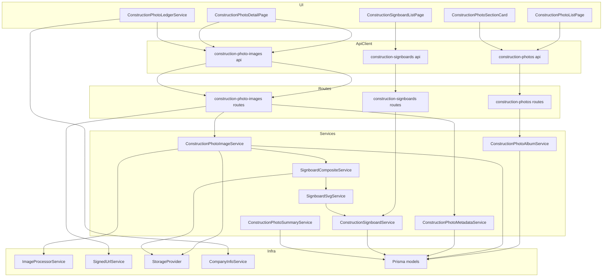
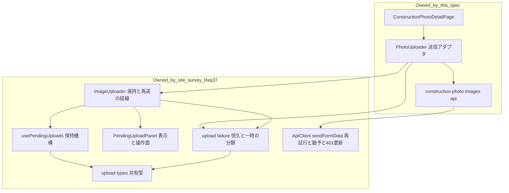
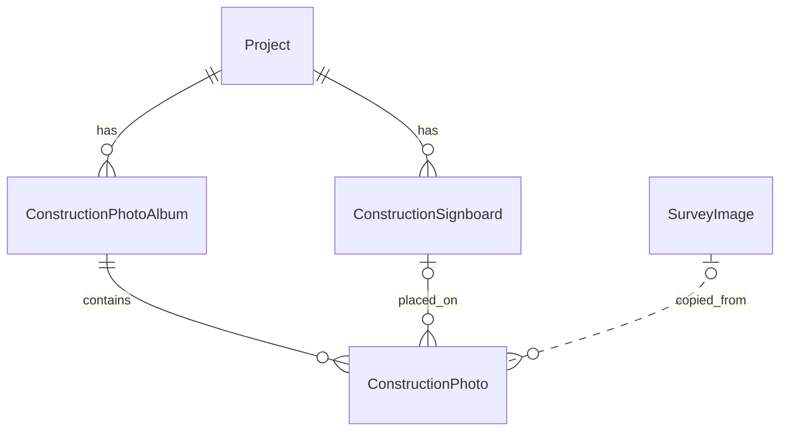
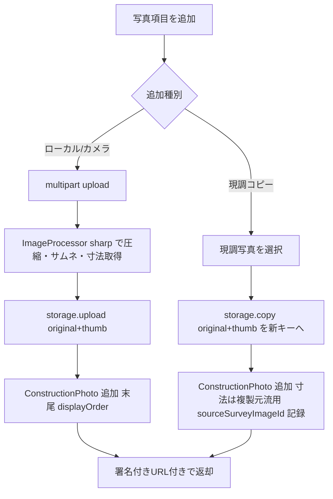
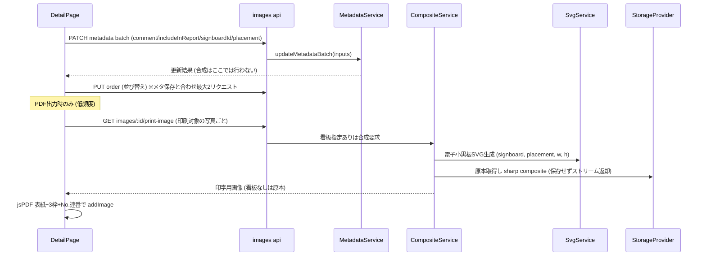
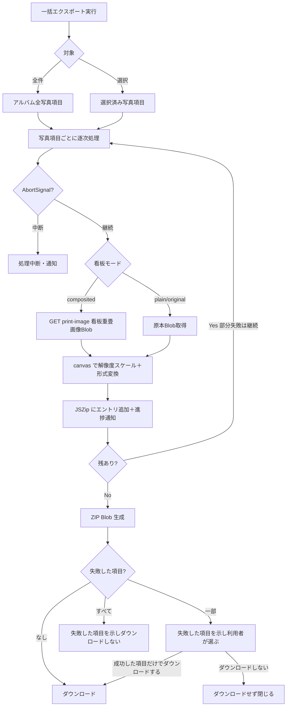
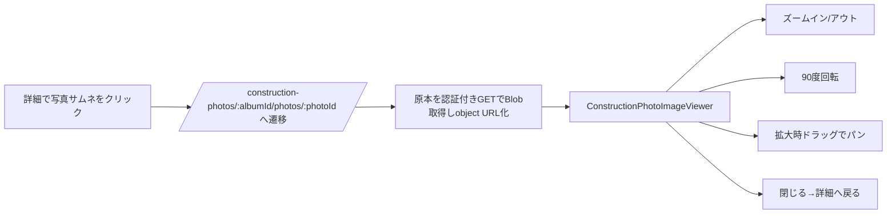
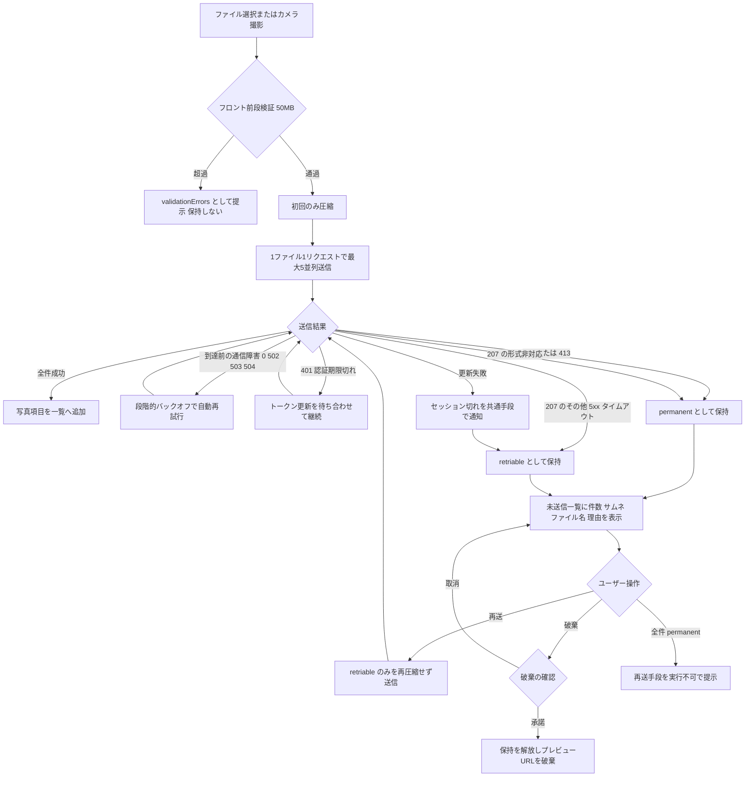

# Technical Design: construction-photo（工事写真）

## Overview

本機能は、工事案件のプロジェクトに紐付く工事写真（写真＋コメント＝「写真項目」）をアルバム単位で管理し、印刷対象を選別して工事看板を重畳した工事写真台帳PDFを出力する機能を提供する。写真項目は3系統（ローカルアップロード／カメラ撮影／同一プロジェクトの現場調査写真のコピー）で追加でき、並び替え・印刷対象チェック・工事看板の配置ができる。

**Users**: 施工管理担当者が、現場写真の整理と提出用台帳作成のワークフローで利用する。

**Impact**: 既存の現場調査（site-survey）機能を改変せず、その実装パターン（画像パイプライン・署名付きURL・fabric・jsPDF台帳）を再利用した独立ドメインを新設する。プロジェクト詳細画面に工事写真パネルを工程表パネルの直下へ追加する。

### Goals
- 工事写真アルバムのCRUD・一覧・詳細と、写真項目の3系統追加・管理を提供する。
- プロジェクト単位の工事看板（電子小黒板調・構造化テキスト）を写真項目へ任意で配置し、PDFに重畳する。
- 参考書式（表紙＋1ページ3枠・No.通し番号）に準拠した台帳PDFを出力する。
- 多数写真でもサーバーリクエストが過大にならない（一覧50件ページング・一括取得・保存最大2リクエスト・アップロード並列5）。
- 詳細画面の運用機能を site-survey と同等に拡充する: 画像フルスクリーンビューア（ズーム・回転・パン）、ZIP一括エクスポート、アルバム編集・削除導線、権限に応じたUI出し分け、未保存離脱警告、モバイル対応（R14〜R19）。
- 写真項目のアップロードが失敗しても撮影・選択した画像を画面に保持し、再圧縮せずその場で再送できるようにする。認証期限切れからは無操作で復帰し、到達前の通信障害は自動再試行する（R20）。

### Non-Goals
- site-survey 機能自体の仕様変更（読取・コピー元参照のみ）。
- 工事看板の画像アップロード形式（構造化テキスト描画のみ）、会社横断の看板共有。
- 現調写真のリンク（共有参照）方式（コピー＝独立複製のみ）。
- サーバサイドPDF生成への移行（クライアント jsPDF を踏襲）。
- 未送信画像の端末ローカル保存（画面リロード・タブ再起動をまたぐ復旧）、およびオフライン中の自動キュー送信（R20 の Out of scope）。
- 未送信保持・再送機構そのものの実装および共通レイヤへの移設。当該機構は site-survey spec の Requirement 37 が所有し、本 spec は利用のみを行う。
- 画像アップロードのサイズ上限値（フロント50MB／サーバー10MB）の乖離の是正。本 spec は乖離を前提に失敗を区分・提示するにとどめる。

## Boundary Commitments

### This Spec Owns
- データ: `ConstructionPhotoAlbum` / `ConstructionPhoto` / `ConstructionSignboard` の3モデルと関連ストレージオブジェクト（`construction-photos/` プレフィックス）。
- API: `/api/(projects/:projectId/)construction-photos*`、`/api/construction-photos/:id/images*`、`/api/(projects/:projectId/)construction-signboards*`。
- 電子小黒板SVGの版組と、看板を原本へ焼き込む合成（印字用画像生成）。
- 台帳PDF（表紙レンダラ＋3枠版組＋No.通し番号）のクライアント生成ロジック。
- プロジェクト詳細サマリへの `constructionPhotos` セクション寄与（自セクションのデータのみ）。
- 工事写真詳細の画像ビューア（ズーム/回転/パン, 閲覧専用）と、写真項目画像のZIP一括エクスポート（クライアント生成, 形式/解像度/看板重畳モード/選択/進捗/中断）。
- 工事写真詳細・一覧のアルバム編集/削除導線、権限（`construction_photo:*`）に応じたUI出し分け、未保存離脱警告、詳細画面のモバイルレイアウト。
- 看板配置有無に関わらず**非合成の原本画像をオンデマンド配信するエンドポイント**（ビューア表示・ZIPの `plain`/`original` モード用）。一覧DTOには `originalUrl` を含めない（既存の効率・非公開方針を維持し、原本は専用エンドポイントで必要時のみ取得）。
- 工事写真の**アップロード送信アダプタ**（`PhotoUploader`）— 並列ウェーブ送信の集約結果に失敗画像の実体（`File`）と再送可否区分を含めて返す責務、および 207（部分失敗）応答を再送可否判定へ渡せる形へ組み立てる責務（R20.1, R20.16, R20.21）。
- 工事写真画面における R20 の受入検証（写真項目追加経路の単体テストと E2E シナリオ）。

### Out of Boundary
- site-survey の `SiteSurvey`/`SurveyImage`/`ImageAnnotation`（読取のみ。書込・スキーマ変更は行わない）。
- `CompanyInfo`（会社名は読取のみ）、`Project`（`name` 読取・パネル結線のみ）。
- 共通画像基盤（`ImageProcessorService`/`SignedUrlService`/`StorageProvider`/`PdfFontService`）の内部実装（利用のみ、拡張しない）。
- **未送信画像の保持・再送・破棄の機構本体**: `components/site-surveys/ImageUploader`（保持と再送・破棄の結線）、`hooks/usePendingUploads`（保持・重複排除・プレビューURL生存管理）、`components/site-surveys/PendingUploadPanel`（一覧表示と操作面）、`utils/upload-failure`（恒久／一時の分類）、`types/upload.types`（共有型）。所有は site-survey spec の Requirement 37。本 spec は利用のみで改変しない。
- **multipart 送信の再試行方針・送信猶予・401 リフレッシュ・セッション切れ通知**: `api/client.ts` の `ApiClient.request`／`sendFormData`／`UPLOAD_TIMEOUT_MS`／`UPLOAD_RETRYABLE_STATUS_CODES`。所有は site-survey spec Requirement 37。本 spec は `apiClient.sendFormData` を呼ぶのみ。
- 未送信保持部品を `components/common/` 等の共通レイヤへ移設する構造リファクタ（受入基準を変えず、完了済み実装への回帰リスクのみを生むため本 spec では扱わない）。

### Allowed Dependencies
- 基盤（利用可）: `StorageProvider.copy/upload/getSignedUrl`、`ImageProcessorService.processImage`、`SignedUrlService.generateBatchSignedUrls`、`CompanyInfoService.getCompanyInfo`、`PdfFontService.initializePdfFonts`、fabric primitives、multer 設定、`authenticate`/`requirePermission`/`validate`。
- フロント基盤（利用可・流用）: `hooks/useCanvasViewport`・`components/site-surveys/ZoomControls`・`components/site-surveys/gestures/*`・`utils/imageFitScale`・`ImageViewer` の回転定数/`normalizeRotation`（ビューアR14）、`hooks/useUnsavedChanges`＋`components/common/UnsavedChangesDialog`（離脱警告R18）、`hooks/useMediaQuery`＋`utils/responsive`（モバイルR19）、`hooks/usePermission`（権限R17）、JSZip（ZIP生成R15）。site-survey の `services/export/bulkExportService` は**流用せず独立クローン**（安定性優先）。
- フロント基盤（利用可・R20）: `types/upload.types`（`FailedUpload`/`UploadOutcome`/`PendingUpload`/`UploadFailureKind`）、`utils/upload-failure`（`toFailedUpload`/`classifyUploadFailure`/`isUnsupportedFormatMessage`）、`components/site-surveys/ImageUploader`（保持・再送・破棄の結線を内包）、`api/client.ts` の `apiClient.sendFormData`。いずれも**利用のみ**で、これらのファイルを本 spec の実装で変更しない。
- フロント基盤（利用可・共有の画面部品と横断ルールの値。タスク 23.10 で宣言を補った）: `frontend/src/utils/tap-target.ts` の `TAP_TARGET_MIN_PX`（タップ領域の下限 44 の実装の側の単一の出所。site-survey と共有し、`PhotoItemPanel`・`BulkExportProgressDialog`・`ConstructionPhotoImageViewer`・`SignboardAssignDialog` が引く）、`frontend/src/components/common/Breadcrumb.tsx`（共通のパンくず。一覧・作成・編集・詳細・看板マスタの各画面が使う。モバイル幅で折り返す挙動は trading-partner-management のタスク 30.1 が直した）、`frontend/src/components/Navigation/AppHeader.tsx`（共通ヘッダ。本 spec は import しないが全画面の上端に載る。320 幅以上で文書全体を水平にはみ出させない挙動は user-authentication のタスク 39.1 が直した）、`hooks/useMediaQuery`（上の R19 の用途に加え、`SignboardAssignDialog` がモバイル幅のリンクのタップ領域の切替に使う）。いずれも**利用のみ**で、本 spec の実装で変更しない。本 spec のモバイル幅の E2E（文書全体が水平にはみ出さないこと・パンくずの折り返し）は、パンくずと共通ヘッダの上記の是正に依存する。
- 依存方向: Types → Prisma → Storage/Infra → Service → Route → API(client) → UI。左方向のみ import 可、上方向禁止。R20 の追加経路も `types/upload.types → utils/upload-failure → api/construction-photo-images → components/construction-photos/PhotoUploader` の順で左方向のみに従う（`utils` は `api` を import しない）。
- 制約: site-survey のサービス／モデルへ書込依存しない。現調写真は Prisma 読取＋`storage.copy` のみ。
- 制約（R20）: 工事写真から共有部品への依存は `components/construction-photos/* → components/site-surveys/*` の一方向のみ。`components/site-surveys/*` が工事写真の型・API・画面を参照することは禁止（既存の `ConstructionPhotoImageViewer → site-surveys/ZoomControls` と同じ向き）。

### Revalidation Triggers
- `constructionPhotos` サマリDTO形状の変更 → `project-management`（詳細画面）に再検証。
- 画像リスト／メタ更新／並び替えのAPIコントラクト変更 → フロントUI再検証。
- `signboardPlacement` JSON形状・座標系の変更 → プレビュー・合成・PDFの再検証。
- 署名付きURLの取得方式／TTL変更 → 一覧・詳細・PDFの表示再検証。
- `SurveyImage` 読取形状に依存する現調コピーは、site-survey スキーマ変更時に再検証。
- 画像ビューアのルート（`/construction-photos/:albumId/photos/:photoId`）／表示状態契約の変更 → 詳細画面の写真クリック導線を再検証。
- ZIP エクスポートの看板モード（composited/plain/original）と画像取得元（print-image/原本）の対応変更 → エクスポート結果を再検証。
- `construction_photo:*` 権限とUI出し分けのマッピング変更 → 詳細/一覧の操作導線・`readOnly` 挙動を再検証。
- `UploadOutcome`／`FailedUpload` の契約形状の変更（site-survey 側） → `PhotoUploader.handleUpload` の返却と工事写真 E2E を再検証。
- `UPLOAD_RETRYABLE_STATUS_CODES`／`UPLOAD_TIMEOUT_MS`／再試行回数・バックオフ係数の変更 → R20.13〜R20.15・R20.19・R20.20 を再検証。
- **バックエンドの画像形式エラー文言の変更**（`surveyImageService.validateFile` が投げる 3 種のメッセージ） → 207 応答の恒久／一時分類（R20.16, R20.21）が静かに壊れるため、`utils/upload-failure` の判定文言と工事写真の再送不可 E2E を再検証。
- `construction-photo-images` のアップロード応答形状（201/207 と `{successful, failed}`）の変更 → `PhotoUploader.uploadFilesInWaves` の集約と再送可否判定を再検証。
- 共有の画面部品と横断ルールの値の変更（`TAP_TARGET_MIN_PX` の値、`Breadcrumb` のモバイル幅の折り返し、`AppHeader` のモバイル幅の配置、`useMediaQuery` の判定） → 本 spec の画面のモバイル幅のタップ領域と水平のはみ出しの E2E（`construction-photo-additional.spec.ts`・`construction-photo-workflow.spec.ts`）を再検証（タスク 23.10）。
- 利用できるかの共通の判定（`construction-photo-availability` の、対象と所属プロジェクトが取り除かれていないかの判定）またはロールの権限の表（`construction_photo:*`・`construction_signboard:*`）の変更 → アルバム・写真・メタ・看板の 4 サービスの 404 / 403 と統合テスト `construction-photo-access.api.integration.test.ts` を再検証（タスク 23.1）。

## Architecture

### Existing Architecture Analysis
- バックエンドは Express 5 + Prisma 7.8、ルートは二重マウント（nested `/api/projects/:projectId/...` ＋ flat `/api/.../:id`）、DIはルートファイル内モジュールシングルトン。
- 画像は multer→Sharp→StorageProvider（local/R2）保存、配信は署名付きURL（公開パス禁止, TTL 900s）。合成は SVG→`sharp.composite` の実績パターン（`annotated-thumbnail.service`）。
- フロントは React 19 + react-router 7、状態はローカル＋context、PDFは jsPDF（`PdfReportService` に3枚/ページ版組が既存）、注釈は fabric。
- 認可は RBAC 権限（`requirePermission('<resource>:<action>')`）。プロジェクトメンバーシップ専用ガードは存在しない。
- 工事写真・工事看板のアクセスもロールの権限の表（`requirePermission`）だけで判定し、プロジェクトの担当者（作成者・営業担当・工事担当）や admin ロールでの絞り込みは行わない（タスク 23.1、利用者の判断（2026-10-03）。初回実装は写真の一覧・メタの一括更新・並び替え・写真項目の削除・印字画像・原本にだけ担当者の限定 `canAccessProject` を掛けており、アルバム・アップロード・看板の側と食い違っていたため外した）。担当でない一般ユーザーも、権限の表が許す操作（user は閲覧・作成・編集）を全プロジェクトの工事写真・工事看板に対して行える。受入基準 13.2・13.3 の「アクセス可能なプロジェクト」は、実在し取り除かれていない（論理削除されていない）プロジェクトと読む。プロジェクトの論理削除は配下のアルバム・看板へ波及しないため、アルバム・写真項目・看板の各操作は、対象と所属プロジェクトの論理削除の状態を同じ問い合わせで読み、共通の判定（`construction-photo-availability` の `isAvailableInLiveProject`・`isProjectLive`）に掛ける。判定の順は、認証（401）→ ロールの権限の表（403）→ 対象と所属プロジェクトが実在し論理削除されていないこと、およびプロジェクト（アルバム）の配下として指したときの所属（404 / 400）である。

### Architecture Pattern & Boundary Map



**Architecture Integration**:
- 選択パターン: レイヤードモノリス内の独立ドメインモジュール（Option C ハイブリッド）。ドメイン層は新規、基盤層（Infra）は直接再利用。
- 境界分離: 工事写真ドメインは site-survey と別テーブル・別ルート・別サービス。共有は Infra 層のみ（読取・利用）。
- 依存方向: `Types → Prisma → Infra → Service → Route → API → UI`（左方向のみ）。
- Steering準拠: 二重マウント／モジュールDI／署名付きURL配信／RBAC権限 を踏襲。

### アップロード失敗の保持と再送の分担（R20）

R20 は site-survey の Requirement 37 と同一の問題（画像送信の失敗を、送信元機能に依らず画像の実体ごと保持して再送する）である。requirements.md の Adjacent expectations が「site-survey と共通のアップロードUIで提供され、挙動が一致する」ことを前提としているため、**機構は共有部品を採用し、工事写真は送信アダプタのみを所有する**。



**Key Decisions**:
- **境界の切り方**: `ImageUploader` が「保持・再送・破棄」を所有し、送信そのものは注入された `onUpload` に委ねる。工事写真は `PhotoUploader.handleUpload` としてこのアダプタを実装するのみで、保持ロジックを持たない（No Hidden Shared Ownership）。
- **再送可否の確定位置**: 分類は「送信例外が手元にある」アダプタ層（`uploadFilesInWaves`）で確定させ、上位へは区分済みの `FailedUpload` を渡す。文字列の失敗理由だけを上げると 413（サイズ上限超過）が文言判定にかからず再送可へ倒れるためである。
- **207 の扱い**: `uploadConstructionPhotos` は部分失敗を例外化せず `{successful, failed}` を返すため、アダプタが `ApiError(207, item.error)` として組み立て直して分類器へ渡す。207 は「ストレージ障害・画像処理失敗・DBエラー」も含むため一律 permanent とはせず、画像形式の非対応のみ permanent とする（R20.21）。
- **バックエンド変更なし**: `constructionPhotoImageService` は `surveyImageService.validateFile()` を再利用しており、形式エラーの文言が分類器の判定集合と一致する。R20 に伴うバックエンド／スキーマ／API コントラクトの変更は発生しない。
- **現調コピーは対象外**: `handleSurveySelect` は画像バイトを送信せずサーバー側の複製を要求するだけであるため、保持・再送の対象としない（requirements.md 備考1）。失敗時は従来どおり通知のみを行う。

### Technology Stack

| Layer | Choice / Version | Role in Feature | Notes |
|-------|------------------|-----------------|-------|
| Frontend | React 19 / react-router-dom 7 / fabric 7 / jspdf | 一覧・詳細・看板配置プレビュー・台帳PDF生成 | 既存踏襲。fabricは配置プレビューのみ |
| Backend | Express 5 / Prisma 7.8 / multer / sharp | ルート・サービス・アップロード・看板合成 | `construction_photo:*` 権限を追加 |
| Data / Storage | Postgres / StorageProvider(local, R2) | 3モデル・`construction-photos/` オブジェクト | サムネイルは署名付きURL配信（TTL 900s）。原本・印字画像は認証付きのルートが中継（タスク 23.10 で注記） |
| Infrastructure | 既存 Docker/entrypoint | 変更なし | 新規ランタイム前提なし |

## Data Models

### Domain Model
- **集約1: ConstructionPhotoAlbum**（集約ルート）— 配下に `ConstructionPhoto`（写真項目）を持ち、写真の追加・並び替え・削除・印刷対象・コメントを一貫性境界とする。論理削除でアルバムと写真を一括無効化。
- **集約2: ConstructionSignboard**（集約ルート・プロジェクト単位マスタ）— 写真項目から `signboardId` で参照される。看板削除時は参照側を `SetNull`（R9.7）。ただし看板の削除は論理削除（`deletedAt`）であり、スキーマの `onDelete: SetNull` は発火しない。そのため `ConstructionSignboardService.delete` が、看板を論理削除するのと同じトランザクションの中で、参照する写真項目の `signboardId` と `signboardPlacement` を null にする（タスク 23.3。初回実装は件数を数えるだけで参照側を解除しておらず、写真一覧が削除済みの看板の指定を返し続けた）。論理削除済みの看板を指す指定が行に残る場合（この解除より前の行、看板の削除とメタの一括更新の競合）に備え、写真項目の DTO を作る読み出し（写真一覧・メタの一括更新の応答）は参照先の看板の生死を同じ問い合わせで読み（`SIGNBOARD_LIVENESS_SELECT`）、生きているときだけ指定と配置を有効として返す（`resolveSignboardAssignment`。件数に比例する問い合わせは足さない）。印字画像の生成は従来から自前で同じ判定をしており、PDF の台帳と ZIP はその経路を通る。データの移行はしておらず、宙吊りの行は DB に残る。
- 写真↔看板の**配置情報**（位置・大きさ）は参照側 `ConstructionPhoto.signboardPlacement`（写真の所有物）に保持。看板本体は配置情報を持たない（No Hidden Shared Ownership）。



### Logical Data Model（Prisma, snake_case マップ）

**ConstructionPhotoAlbum**（`@@map("construction_photo_albums")`）
- `id String @id @default(uuid())`、`projectId String`、`name String`、`memo String?`
- `createdAt`、`updatedAt @updatedAt`、`deletedAt DateTime?`（論理削除）
- rel: `project @relation(onDelete: Cascade)`、`photos ConstructionPhoto[]`
- index: `@@index([projectId])`、`@@index([deletedAt])`、`@@index([name])`

**ConstructionPhoto**（`@@map("construction_photos")`）
- `id`、`albumId String`、`originalPath String`、`thumbnailPath String`
- `fileName String`、`fileSize Int`、`width Int`、`height Int`、`displayOrder Int`
- `comment String?`（最大2000）、`includeInReport Boolean @default(false)`
- `signboardId String?`、`signboardPlacement Json?`（`{left,top,width,height}` 画像ピクセル座標）
- `sourceSurveyImageId String?`（現調コピー由来の来歴。FKにはせず値保持のみ＝site-survey非依存）
- `createdAt`
- rel: `album @relation(onDelete: Cascade)`、`signboard ConstructionSignboard? @relation(onDelete: SetNull)`（`onDelete: SetNull` が発火するのは看板の行が物理的に消えるときだけである。看板マスタの削除は論理削除のため、参照側の解除はサービスが行う。タスク 23.3）
- 更新日時の列（`updatedAt`）は持たない。写真項目のメタの一括更新は版の照合（楽観的排他）をせず、送られた項目だけを書く（タスク 23.3 で確かめた）
- index: `@@index([albumId])`、`@@index([displayOrder])`、`@@index([includeInReport])`、`@@index([signboardId])`

**ConstructionSignboard**（`@@map("construction_signboards")`）
- `id`、`projectId String`、`workName String`（工事件名の値）、`workLocation String`（工事場所の値）
- `freeItems Json`（自由項目 `Array<{label:string,value:string}>`、既定 `[]`）
- `footerText String?`（下部記入欄の固定テキスト、複数行可）
- `createdAt`、`updatedAt @updatedAt`、`deletedAt DateTime?`
- rel: `project @relation(onDelete: Cascade)`、`photos ConstructionPhoto[]`
- index: `@@index([projectId])`、`@@index([deletedAt])`

### Data Contracts（主要DTO・型）

```typescript
// 配置ジオメトリ（画像ピクセル座標系）
interface SignboardPlacement {
  left: number; top: number; width: number; height: number;
}

// 看板の自由項目
interface SignboardFreeItem { label: string; value: string; }

// 画像リストDTO（署名付きURL同梱、写真項目ごと個別リクエスト不要）
interface ConstructionPhotoWithUrls {
  id: string; albumId: string; fileName: string; fileSize: number;
  width: number; height: number; displayOrder: number;
  comment: string | null; includeInReport: boolean;
  signboardId: string | null; signboardPlacement: SignboardPlacement | null;
  thumbnailUrl: string | null;   // 一覧・詳細のサムネ優先表示
  printImageUrl: string;         // PDF用: 印字画像取得エンドポイント。看板ありはサーバでオンデマンド合成、なしは原本を返す
  createdAt: string;
}

// --- 追加機能 (Req 14-19) の型 ---

// ZIP一括エクスポート設定 (R15)
type ConstructionPhotoExportFormat = 'jpeg' | 'png';
type ConstructionPhotoExportResolution = 'low' | 'medium' | 'high';
// 看板重畳モード: composited=看板重畳(サーバ print-image), plain=看板なし加工(原本を解像度変換), original=原本そのまま
type SignboardExportMode = 'composited' | 'plain' | 'original';
interface ConstructionPhotoExportSettings {
  format: ConstructionPhotoExportFormat;
  resolution: ConstructionPhotoExportResolution;
  signboardMode: SignboardExportMode;
}
interface ConstructionPhotoExportProgress { completed: number; total: number; failed: number; }

// 権限UI (R17) — usePermission('construction_photo:*') を包む
type ConstructionPhotoPermissionAction = 'view' | 'create' | 'edit' | 'delete';
interface ConstructionPhotoPermission {
  canView: boolean; canCreate: boolean; canEdit: boolean; canDelete: boolean;
  canViewSignboards: boolean;  // construction_signboard:read。看板マスタへの導線の出し分け（タスク 23.2）。ロード中は false
  canCreateSignboards: boolean; canEditSignboards: boolean; canDeleteSignboards: boolean;
  // construction_signboard:create / update / delete。看板マスタの「新規登録」・各行の「編集」「削除」の出し分け（タスク 23.8）。ロード中は false
  isLoading: boolean;
  getPermissionError: (action: ConstructionPhotoPermissionAction) => string | null;
}

// ビューア表示状態 (R14) — ImageViewer の RotationAngle を流用
interface ConstructionPhotoViewerState { zoom: number; rotation: 0 | 90 | 180 | 270; panX: number; panY: number; }

// --- アップロード失敗の保持と再送 (R20) の型 ---
// 定義の所有は site-survey spec Req37（frontend/src/types/upload.types.ts）。
// 本 spec は利用のみで、形状を変更しない。参照の便宜のため再掲する。

// 再送で解消しうるか否か。permanent はサーバーの受入条件違反による確定的な拒否 (R20.16)
type UploadFailureKind = 'retriable' | 'permanent';

// アップロードに失敗した1件。再圧縮せず再送するため実体を File のまま保持する (R20.4)
interface FailedUpload {
  readonly file: File;
  readonly error: string;      // ユーザーへ提示する失敗理由 (R20.2)
  readonly kind: UploadFailureKind;
}

// onUpload の戻り値。void を返した場合は全件成功とみなす（既存呼び出しとの後方互換）
interface UploadOutcome {
  readonly failed: readonly FailedUpload[];
}

// 保持中の未送信画像。id は name:size:lastModified 由来の安定キー（同一画像の重複保持を防ぐ）
interface PendingUpload extends FailedUpload {
  readonly id: string;
  readonly previewUrl: string;  // ObjectURL。生成・解放は usePendingUploads が唯一の責任者
}
```

## File Structure Plan

### Directory Structure（新規, backend）
```
backend/src/
├── routes/
│   ├── construction-photos.routes.ts          # アルバムCRUD/一覧 (dual mount)
│   ├── construction-photo-images.routes.ts     # 画像 upload/list/reorder/metadata/delete/copy
│   └── construction-signboards.routes.ts        # 看板CRUD/一覧 (dual mount)
├── services/
│   ├── construction-photo-album.service.ts      # アルバムCRUD・ページング (R1,R3)
│   ├── construction-photo-image.service.ts      # addFromUpload/addFromSurveyImage/list/delete (R4,R5,R6,R12)
│   ├── construction-photo-metadata.service.ts   # コメント/印刷対象/看板配置 batch + 並び替え (R7,R9)
│   ├── construction-signboard.service.ts        # 看板CRUD (R8)。論理削除と同じトランザクションで参照側の指定を解除 (R9.7, タスク 23.3)
│   ├── construction-photo-availability.ts       # 対象と所属プロジェクトが取り除かれていないかの共通の判定。アルバム・写真・メタ・看板の4サービスが使い、どのサービスにも依存しない (R13.2, R13.3, タスク 23.1)
│   ├── signboard-svg.service.ts                 # 電子小黒板SVG生成 (R8,R9,R10)
│   ├── signboard-composite.service.ts           # SVG→sharp composite で印字用画像生成 (R9,R10)
│   └── construction-photo-summary.service.ts    # findLatestByProjectId (R2)
├── schemas/
│   ├── construction-photo.schema.ts             # zod/validate スキーマ
│   └── construction-signboard.schema.ts
└── types/construction-photo.types.ts            # 共有型（DTO/Placement/FreeItem）
```

### Directory Structure（新規, frontend）
```
frontend/src/
├── pages/
│   ├── ConstructionPhotoListPage.tsx            # 一覧 (R2,R3)
│   ├── ConstructionPhotoDetailPage.tsx          # 詳細: 写真項目管理+保存+PDF (R1,R7,R9,R10)
│   ├── ConstructionPhotoCreatePage.tsx          # アルバム作成 (R1)
│   ├── ConstructionPhotoEditPage.tsx            # アルバム編集: アルバム名・メモの更新（楽観的排他・競合表示）(R1)
│   └── ConstructionSignboardListPage.tsx        # 看板マスタ一覧+編集 (R8)
├── components/construction-photos/
│   ├── ConstructionPhotoResponsiveView.tsx      # Table/Card切替（clone）(R3)
│   ├── ConstructionPhotoListTable.tsx / ListCard.tsx / SearchFilter.tsx  # clone (R3)
│   ├── PhotoItemPanel.tsx                        # コメント/印刷対象/並び替え（PhotoManagementPanel clone）(R7)
│   ├── PhotoUploader.tsx                         # 3系統追加UI（ImageUploader踏襲, 現調選択追加）(R4,R5,R6)
│   ├── SurveyImagePicker.tsx                     # 現調写真選択モーダル (R6)
│   ├── SignboardPlacementEditor.tsx             # fabric 1枚Rect配置プレビュー (R9)
│   ├── signboard-placement-geometry.ts          # 表示座標と画像ピクセル座標の相互換算（純関数, SignboardPlacementEditor が使用）(R9)
│   ├── SignboardAssignDialog.tsx                # 詳細画面の「看板を配置」ダイアログ: 看板選択＋SignboardPlacementEditor の結線 (R9)。看板マスタへのリンク「工事看板マスタを開く」と、看板の一覧の取得の状態（signboardsStatus）に応じた表示 (R8, タスク 23.2)
│   └── SignboardForm.tsx                         # 看板 標準項目+自由項目+固定テキスト (R8)
├── components/projects/
│   └── ConstructionPhotoSectionCard.tsx         # 工程表パネル直下パネル (R2)
├── services/export/
│   ├── ConstructionPhotoLedgerService.ts        # 台帳PDF: 表紙+3枠+No.連番 (R10)
│   ├── ConstructionPhotoLedgerExportService.ts  # PDF出力の結線: 印刷対象の抽出（保存順）・印字画像のオンデマンド取得・0件は非実行（通知は詳細画面）(R10)
│   └── loadConstructionPhotoLedgerExportService.ts  # 上記の動的 import 境界（日本語フォント資産を初期チャンクへ載せない。導入は estimate-creation のタスク 56.13）(R10)
├── api/
│   ├── construction-photos.ts / construction-photo-images.ts / construction-signboards.ts
└── types/construction-photo.types.ts
```

### 追加機能ファイル（Req 14〜19）

**新規（frontend）**
- `pages/ConstructionPhotoImageViewerPage.tsx` — 画像ビューアページ（ズーム/回転/パン, 閲覧専用）(R14)
- `components/construction-photos/ConstructionPhotoImageViewer.tsx` — ビューア本体。`useCanvasViewport`/`ZoomControls`/`gestures/*`/`imageFitScale` と回転状態（`ImageViewer` の `normalizeRotation`/`ROTATION_CONSTANTS` 流用）を合成。注釈ツールは持たない (R14)
- `components/construction-photos/BulkExportDialog.tsx` / `BulkExportProgressDialog.tsx` / `ExportSettingsForm.tsx` — ZIP設定（形式/解像度/看板モード）・進捗・中断UI（site-survey同名部品のクローン, CP型対応）(R15)
- `services/export/ConstructionPhotoBulkExportService.ts` — JSZip束ね・解像度/形式変換（canvas再エンコード）・看板モード分岐（composited=print-image取得, plain/original=原本取得）・進捗callback/AbortSignal (R15)
- `services/export/constructionPhotoZipNaming.ts` — ZIPエントリ命名（`zip-naming` 相当のクローン）(R15)
- `components/construction-photos/AlbumDeleteDialog.tsx` — アルバム削除確認（FocusManagerパターン踏襲）(R16)
- `hooks/useConstructionPhotoPermission.ts` — `usePermission('construction_photo:*')` を包む canView/canCreate/canEdit/canDelete/getPermissionError (R17)。看板の権限は写真の権限から導かず、`construction_signboard:*` から canViewSignboards（タスク 23.2）と canCreateSignboards/canEditSignboards/canDeleteSignboards（タスク 23.8）を返す
- `hooks/useCameraAvailability.ts` — 端末のカメラの有無を `enumerateDevices` の `videoinput` で判定する。判定できないときは `unknown`（導線を出す側）。`PhotoUploader` が使う (R5.3, タスク 23.5)

**変更（frontend）**
- `pages/ConstructionPhotoDetailPage.tsx` — `onPhotoClick`→ビューア遷移結線(R14)、ZIP起動＋対象選択(R15)、アルバム編集/削除導線(R16)、`useConstructionPhotoPermission` で `readOnly`/ボタン出し分け(R17)、画面の `isDirty` state を `useUnsavedChanges({ isDirty })` へ渡して離脱警告を結線(R18)、`isDirty` は保留（`pendingChangesRef`・`pendingOrderRef`）から `syncDirtyWithPending` で決め直す（R18.3, タスク 23.6。Frontend Interfaces の R18 を参照）、保存は開始時に送る保留を取り出し、成功の後は送ったものだけを保留から消す（R18.1, R18.3, タスク 24.5）、看板の一覧を写真項目の取得とは別の effect で取得し、取得の状態（`signboardsStatus`）と看板マスタの経路を「看板を配置」のダイアログへ渡す（R8, R9, タスク 23.2）、`useMediaQuery` でモバイル分岐(R19)、通知の枠の通知と失敗を一つの状態（`pageMessage`）に持ち、後から出たものが前のものを置き換える（タスク 22.1。Error Handling を参照）、保存の失敗は `pageMessage` に保存の失敗の印を付けて載せ、同じ文言を `PhotoItemPanel` の `saveFailure` へ渡し、その間は上部の枠を role を持たずに描き、role が変わるときは枠を `key` で作り直す（タスク 22.2。Error Handling を参照）、写真項目を取り除く操作の失敗は捕捉せずに `PhotoItemPanel` へ伝播させ、上部の通知の枠（`pageMessage`）には載せず、画面も送らない（R7.7 の失敗時, タスク 21.3・23.9。Error Handling を参照）
- `components/construction-photos/PhotoItemPanel.tsx` — エクスポート対象の選択チェック(R15)、モバイルスタイル分岐(R19)、`readOnly` 結線の実効化(R17)、看板の操作ボタン（「看板を配置」／「看板を変更」）のモバイル幅のタップ領域を `TAP_TARGET_MIN_PX` 以上にする上書き（`assignSignboardButtonMobile`, R19.3, タスク 21.2）、写真項目を取り除く操作の成功・失敗のどちらでも、その完了の後に確認ダイアログを閉じる（タスク 21.3）。取り除く操作の実行中は確認ダイアログを閉じず、オーバーレイのクリックとキャンセルを受け付けず、別の写真項目の確認も開かない（タスク 22.3）。失敗はその写真項目の操作の行の直後に role=alert で表示し、失敗の間だけ取り除くボタンの `aria-describedby` で結び付け、フォーカスを画面を送らずにそのボタンへ戻す。表示が画面の外へ出るときだけ表示の分だけ画面を動かす。失敗の文言は写真項目ごとの状態に持ち、文言の規則もこの部品が持つ（R7.7 の失敗時, タスク 21.3・23.9。Error Handling を参照）。保存の失敗（`saveFailure`）は保存ボタンの直後に role=alert で表示し、表示がある間だけ保存ボタンの `aria-describedby` で結び付け、フォーカスを失っているとき（または保存ボタンにあるとき）だけ、表示が画面の外へ出るなら表示の分だけ画面を動かし、保存ボタンへ画面を送らずに戻す（タスク 22.2。Error Handling を参照）
- `pages/ConstructionPhotoListPage.tsx` / `components/construction-photos/ConstructionPhotoListTable.tsx` / `ConstructionPhotoListCard.tsx` — アルバム編集/削除の行導線（権限連動）(R16,R17)。一覧の見出しの行に看板マスタへの常設のリンク「工事看板マスタ」（`canViewSignboards` のときだけ。R8, タスク 23.2）
- `routes.tsx` — CPビューアルート `/construction-photos/:albumId/photos/:photoId` を追加 (R14)
- `pages/ConstructionSignboardListPage.tsx` — 権限の無い操作の手段を表示しない（「新規登録」は canCreateSignboards、各行の編集の操作は canEditSignboards、各行の取り除く操作は canDeleteSignboards のときだけ。行の操作が一つも無い利用者には操作の列を出さない）。看板の API が 403 を返したときは応答の符号でなく、操作ごとに権限が無い旨の日本語の文言を示す（R17.4, R17.5, タスク 23.8。Error Handling を参照）

### アップロード失敗の保持と再送のファイル（Req 20）

**利用のみ・本 spec では変更しない（所有は site-survey spec Req37）**
- `frontend/src/types/upload.types.ts` — `FailedUpload`/`UploadOutcome`/`PendingUpload`/`UploadFailureKind`
- `frontend/src/utils/upload-failure.ts` — `toFailedUpload`/`classifyUploadFailure`/`isUnsupportedFormatMessage`
- `frontend/src/hooks/usePendingUploads.ts` — 保持・重複排除・ObjectURL 生存管理
- `frontend/src/components/site-surveys/PendingUploadPanel.tsx` — 未送信一覧の表示と再送・破棄の操作面
- `frontend/src/components/site-surveys/ImageUploader.tsx` — 保持と再送・破棄の結線、圧縮の有無の切替（例外として、タスク 23.5 がカメラの導線を描くかの任意の口 `showCameraCapture` を既定 `true` で足した。既定の挙動は変えていない。R5.3）
- `frontend/src/api/client.ts` — `sendFormData`／`UPLOAD_TIMEOUT_MS`／`UPLOAD_RETRYABLE_STATUS_CODES`／401 リフレッシュ待ち合わせ

**本 spec が所有する送信アダプタ（結線済み・回帰時の修正対象）**
- `frontend/src/components/construction-photos/PhotoUploader.tsx` — `uploadFilesInWaves` が失敗画像の実体と再送可否を集約し、`handleUpload` が `UploadOutcome` として返す (R20.1, R20.16, R20.21)
- `frontend/src/api/construction-photo-images.ts` — `uploadConstructionPhotos` が `apiClient.sendFormData` へ委譲（R20.11〜R20.15, R20.19, R20.20 の適用経路）
- `frontend/src/pages/ConstructionPhotoDetailPage.tsx` — `PhotoUploader` を `canEdit` 配下に描画。未送信一覧は `ImageUploader` 内部に描画されるため詳細画面側の追加結線は不要

**新規（検証）**
- `e2e/specs/construction-photos/construction-photo-upload-retry.spec.ts` — 失敗→保持→再送→解消／再送不可の区別／破棄確認の E2E (R20.1〜R20.3, R20.5〜R20.8, R20.16〜R20.18)。R20.13 は「リクエスト回数2回以上」を観測した場合にのみラベルへ含める（Testing Strategy の検証責務の切り分けを参照）
- `frontend/src/components/construction-photos/PhotoUploader.test.tsx` — 既存ファイルへ再送・破棄・実行中抑止・全件再送不可のケースを追加（工事写真経路での要件トレースを成立させる）

### Modified Files
- `backend/prisma/schema.prisma` — 3モデル追加＋`Project`に逆リレーション追加（migration生成）。
- `backend/src/app.ts` — import＋二重マウント4行（photos/images）＋signboardルート登録。
- `backend/src/routes/projects.routes.ts` — `getProjectSections` の `allSettled` に工事写真を追加、返却に `constructionPhotos:{totalCount,latest...}`。アルバムの代表サムネイルの署名付きURLへ写真一覧と同じ有効期限 `SIGNED_URL_EXPIRES_IN`（900 秒）を渡す（R11.6, タスク 23.7。それまでは有効期限を渡さず既定の 3600 秒になっていた）。
- `backend/src/services/construction-photo-availability.ts`（タスク 23.1 で新設）— 対象と所属プロジェクトが実在し取り除かれていないかの共通の判定（`AVAILABILITY_IN_PROJECT_SELECT`・`PROJECT_LIVENESS_SELECT`・`isAvailableInLiveProject`・`isProjectLive`）。アルバム・写真・メタ・看板の 4 サービスが使う。担当者を読まない。
- `backend/src/services/construction-signboard.service.ts` — `delete` が、看板を取り除くのと同じトランザクションで参照する写真項目の看板の指定と配置を解除し、解除した件数を `inUseCount` として返す（R9.7, タスク 23.3）。
- `backend/src/services/construction-photo-image.service.ts` — 写真一覧の DTO の看板の指定を、参照先の看板が生きているときだけ有効とする `resolveSignboardAssignment` / `SIGNBOARD_LIVENESS_SELECT`（R9.7, タスク 23.3。メタの一括更新の応答も同じ判定を使う）。有効期限の定数 `SIGNED_URL_EXPIRES_IN` を export する（タスク 23.7）。
- `backend/src/middleware/authorize.middleware.ts`（または権限定義箇所）— `construction_photo:*` / `construction_signboard:*` 権限を追加。
- `frontend/src/routes.tsx` — `/construction-photos` ルート群を site-survey 順序規約に倣い追加。
- `frontend/src/pages/ProjectDetailPage.tsx` — `ConstructionPhotoSectionCard` を `ScheduleSectionCard` の直後に挿入。
- `frontend/src/api/projects.ts` — `ProjectDetailSummary.sections` に `constructionPhotos` 型追加。
- `backend/src/routes/construction-photo-images.routes.ts` — 非合成原本配信ルート `GET /images/:imageId/original` を追加（`construction_photo:read`＋プロジェクト境界検証＋原本ストリーム, 看板合成なし）。
- `backend/src/services/construction-photo-image.service.ts` — `getOriginalImage(photoId): Promise<Buffer>`（看板を合成せず原本を返す）を追加。
- `frontend/src/api/construction-photo-images.ts` — `getConstructionPhotoOriginalImage(imageId): Promise<Blob>` を追加（一覧DTOは不変, 原本は必要時のみ取得）。

## System Flows

### 写真項目の追加（3系統）



現調コピーはバイト複製のため `width/height/fileSize` を複製元 `SurveyImage` 行からそのまま流用し、Sharp再処理を行わない。site-survey へは書込まない。

### 看板配置の保存とPDF出力（オンデマンド合成）



看板合成は**サーバ権威かつオンデマンド**（保存しない）。看板マスタ編集・配置変更でも常に最新内容で焼き込まれ、キャッシュ無効化が不要（Critical Issue 1 の解消）。プレビューはクライアント fabric でライブ編集。看板未指定の写真は原本をそのまま返す。

### ZIP一括エクスポート（クライアント生成・中断可能）



ZIP自体はクライアント（JSZip）で生成する。看板重畳モード（composited）は既存 `GET print-image`（サーバ合成）を、`plain`/`original` は**新設の非合成原本エンドポイント `GET .../original`** を取得元とする（看板配置済み写真でも生原本を取得できる）。解像度（低/中/高）と形式（JPEG/PNG）変換は canvas 再エンコードで一元化し、`original` は設定を適用せず原本バイトをそのまま格納、`plain` は看板なしのまま解像度/形式を適用する。1件の取得・加工失敗は当該項目のみ失敗として継続し、成功分での続行をユーザーが選べる（R15.10）。対象0件は非実行で通知（R15.11）。

部分失敗時の選択（タスク 23.4、利用者の判断（2026-10-03））: 生成が終わった ZIP に失敗した写真項目が一件でもあれば、詳細画面は自動でダウンロードしない。サービスが返す `failed`（写真項目の ID）をエクスポート対象と突き合わせ、失敗した写真項目をファイル名とエクスポート対象の中での順番（1 始まり）にして、`BulkExportProgressDialog` の結果の段に示す。失敗の理由は区別せず「画像を取得または加工できませんでした」と述べる（サービスは理由を返さない）。
- 成功と失敗が混在するとき: 失敗の件数と一覧、成功の件数を示し、「成功した項目だけでダウンロードする」と「ダウンロードしない」を出す。前者は保留した ZIP を従来と同じファイル名でダウンロードし、従来の部分失敗の通知（「一部の写真項目（N件）のエクスポートに失敗しました。成功した項目のみでZIPをダウンロードしました。」）を出す。後者と Escape は何もダウンロードせずにダイアログを閉じる。
- すべて失敗したとき: ダウンロードせず、失敗の一覧と「閉じる」だけを示し、ダウンロードしていない旨を通知の枠にも出す。
- 全件成功・中断は従来どおり（全件成功は即座にダウンロードし、結果の段は出さない。中断は結果の段を出さず中断を通知する）。
- 保留する ZIP は Blob とファイル名だけで、オブジェクトURLはダウンロードの瞬間に作ってその場で解放する。保留はダイアログを閉じるすべての経路・次のエクスポートの開始・詳細画面の破棄で手放し、詳細画面の破棄時は実行中のエクスポートも中断する。
- 結果の段が出たらフォーカスを段の見出しへ移し、Tab はダイアログの中で循環させる。失敗の一覧は一覧の中でスクロールさせ（操作を画面外へ押し出さない）、ファイル名は `overflowWrap: 'anywhere'` で折り返す。モバイル幅では二つの操作のタップ領域を `TAP_TARGET_MIN_PX` 以上にし、操作の列を折り返す（R19）。

### 画像ビューア（閲覧専用）



ビューアは注釈編集を持たない閲覧専用で、`useCanvasViewport`/`ZoomControls`/`gestures/*`/`imageFitScale` と回転状態を合成する。表示する原本は**新設の `GET .../original`**（看板を焼き込まない生原本）を必要時にのみ取得する（R11.3, R14.6）。原本は署名付きURLではなく、認証付きの GET の応答本文（サーバーがストレージから読んだバイト列を中継する）として受け取り、Blob を object URL にして表示する（`getConstructionPhotoOriginalImage`。タスク 23.10 で、署名付きURLの取得とした流れ図の記述を実装に合わせた）。

### アップロード失敗時の保持と再送（R20）



**Key Decisions**:
- **自動再試行の対象**: サーバー処理に到達する前の失敗（`0`/`502`/`503`/`504`）に限る。`500` は永続化が完了した後の失敗を含み、再送が同一画像の重複登録を生むため対象外とする（R20.13, R20.14）。
- **時間切れは自動再試行しない**: 1件あたり120秒の猶予を与えたうえで、時間切れは保持へ回してユーザー操作に委ねる。自動再試行を重ねると再送を開始できるまでの待ち時間が積み上がるためである（R20.15, R20.19, R20.20）。
- **前段検証との線引き**: フロントの上限（50MB）で弾かれた画像は**送信を試行していない**ため未送信画像として保持せず、従来どおり `validationErrors` として提示する。サーバー上限（10MB）超過はサーバーが 413 を返し、`permanent` として保持・提示する（R20.16）。
- **件数上限は到達不能**: `uploadFilesInWaves` は1リクエスト1ファイルで送信するため、R12.1 の件数上限に起因する 400 は工事写真 UI から発生しない。R20.16 が挙げる 3 条件のうち、工事写真で到達するのは「サイズ上限」と「画像形式」の 2 経路である。到達不能な経路の検証は行わない。**「1リクエスト1ファイル」は再実測でも真である**——`uploadFilesInWaves` は `uploadConstructionPhotos(albumId, [file])` の形で 1 ファイルずつ送る（タスク 115.234。コミット `6b84be3`。2026-09-02 にリポジトリルートで実測。`site-survey` の design.md「実測値の書き方（タスク 115.212）」の (a) に従う併記である）。 **再現コマンドは `awk '/^export async function uploadFilesInWaves\(/,/^}/' frontend/src/components/construction-photos/PhotoUploader.tsx | grep -c 'uploadConstructionPhotos(albumId, \[file\])'` であり、出力は `1` である**（コミット `5c276b30`。2026-09-04 にリポジトリルートで再実測。タスク 115.274 が規約 (a) の求める逐語のコマンドを添えた）。
- **並行送信の抑止**: 保持の反映は「試行対象のうち失敗しなかったものを取り除く」差分更新であるため、送信が同時に走ると後から解決した試行が先行試行の結果を上書きする。実行中は新規選択・カメラ・D&D も含めて送信系操作を抑止する（R20.10 が求める範囲を上回る意図的な選択）。

## Requirements Traceability

| Requirement | Summary | Components | Interfaces | Flows |
|-------------|---------|------------|------------|-------|
| 1 | アルバムCRUD | ConstructionPhotoAlbumService, construction-photos.routes | AlbumService, API | - |
| 2 | ナビ/パネル(工程表直下) | ConstructionPhotoSectionCard, SummaryService, routes.tsx, ProjectDetailPage | Summary API | - |
| 3 | 一覧・検索(50件) | ResponsiveView/Table/Card/SearchFilter, AlbumService | list API | - |
| 4 | ローカルUP | ConstructionPhotoImageService.addFromUpload, PhotoUploader | upload API | 追加フロー |
| 5 | カメラ撮影 | PhotoUploader(camera input), useCameraAvailability | upload API | 追加フロー |
| 6 | 現調コピー | ImageService.addFromSurveyImage, SurveyImagePicker | copy API | 追加フロー |
| 7 | 項目管理 | MetadataService, PhotoItemPanel | metadata/order API | 保存フロー |
| 8 | 看板マスタ | ConstructionSignboardService, SignboardForm, SvgService | signboard API | - |
| 9 | 看板配置 | SignboardPlacementEditor, CompositeService, MetadataService | metadata API | 配置/PDFフロー |
| 10 | PDF台帳 | ConstructionPhotoLedgerService, CompositeService, CompanyInfoService | 印字URL, PdfFont | PDFフロー |
| 11 | リクエスト効率 | AlbumService(ページ50), ImageService(一括署名URL), MetadataService(batch) | list/batch API | 保存フロー |
| 12 | UP制約 | construction-photo-images.routes(multer), ImageService.validate | upload API | - |
| 13 | アクセス制御 | authenticate/requirePermission, SignedUrlService | 全API | - |
| 14 | 画像ビューア(ズーム/回転/パン) | ConstructionPhotoImageViewer(Page), useCanvasViewport, ZoomControls, gestures, routes.tsx, DetailPage(onPhotoClick), ImageService.getOriginalImage | GET .../original | ビューアフロー |
| 15 | ZIP一括エクスポート | ConstructionPhotoBulkExportService, BulkExportDialog/BulkExportProgressDialog/ExportSettingsForm, PhotoItemPanel(選択), ImageService.getOriginalImage | print-image/original, JSZip | エクスポートフロー |
| 16 | アルバム編集/削除導線 | DetailPage/ListPage/ListTable/ListCard, ConstructionPhotoEditPage(既存), AlbumDeleteDialog | PATCH/DELETE album API | - |
| 17 | 権限UI出し分け | useConstructionPhotoPermission, usePermission, DetailPage/ListPage, PhotoItemPanel(readOnly) | construction_photo:* | - |
| 18 | 未保存離脱警告 | useUnsavedChanges, UnsavedChangesDialog, DetailPage | - | - |
| 19 | 詳細画面モバイル | useMediaQuery, responsive, DetailPage, PhotoItemPanel | - | - |
| 20 | アップロード失敗時の保持と再送 | PhotoUploader（送信アダプタ）, ImageUploader, usePendingUploads, PendingUploadPanel, upload-failure, ApiClient.sendFormData | UploadOutcome, FailedUpload, PendingUploadPanelProps, sendFormData | 保持・再送フロー |

### Requirement 20 と site-survey Requirement 37 の対応

R20 の機構は site-survey spec の Requirement 37 が所有する。共有部品のコードコメントは `37.x` のみを引用しているため、工事写真の要件から実装へ辿るには本表を経由する。コードコメントに両番号を併記することはしない（所有が曖昧になるため）。

| 工事写真 | site-survey | 内容 | 実装の所在 |
|---|---|---|---|
| 20.1 | 37.1 | 失敗画像を未送信画像として保持 | `ImageUploader.submitFiles` ＋ `PhotoUploader.handleUpload` |
| 20.2 | 37.2 | 件数・サムネ・ファイル名・失敗理由の表示 | `PendingUploadPanel` |
| 20.3 | 37.3 | 再送可能分の一括再送 | `ImageUploader.handleRetry` |
| 20.4 | 37.4 | 同一画像データで再送（再圧縮しない） | `submitFiles(files, compress=false)` |
| 20.5 / 20.6 | 37.5 / 37.6 | 部分成功で成功分のみ除去／全成功で解消 | `usePendingUploads.record` |
| 20.7 / 20.8 | 37.7 / 37.8 | 破棄の操作手段／破棄の確認 | `PendingUploadPanel` ＋ `ImageUploader.handleDiscardAll` |
| 20.9 | 37.9 | 新規選択・撮影でも既存保持を維持 | `usePendingUploads.record` の差分更新 |
| 20.10 | 37.10 | 実行中は追加の再送を受け付けない | `ImageUploader` の `isBusy` |
| 20.11 / 20.12 | 37.11 / 37.12 | 401 の無操作復帰／セッション切れ通知 | `ApiClient.request` の `refreshInFlight` ／ `sessionExpiredCallback` |
| 20.13 / 20.14 | 37.13 / 37.14 | 到達前失敗の自動再試行／処理中失敗は再試行しない | `UPLOAD_RETRYABLE_STATUS_CODES` |
| 20.15 | 37.15 | 1件あたり120秒の送信猶予 | `UPLOAD_TIMEOUT_MS` |
| 20.16 / 20.17 / 20.18 | 37.16 / 37.17 / 37.18 | 恒久／一時の区別・再送対象外・実行不可提示 | `classifyUploadFailure` ＋ `retriableFiles` ＋ `canRetry` |
| 20.19 / 20.20 | 37.19 / 37.20 | 時間切れは自動再試行せず保持／待ち時間を延伸させない | `isRetryableApiError` の FormData 分岐 |
| 20.21 | 37.21 | ストレージ保存失敗は再送可として保持 | 207 の文言分岐（形式非対応以外は `retriable`） |

## Components and Interfaces

| Component | Layer | Intent | Req | Key Deps | Contracts |
|-----------|-------|--------|-----|----------|-----------|
| ConstructionPhotoAlbumService | Service | アルバムCRUD・ページング | 1,3 | Prisma (P0) | Service |
| ConstructionPhotoImageService | Service | 3系統追加・list・delete・印字画像 | 4,5,6,10,12 | Processor(P0), Storage(P0), SignedUrl(P1), Composite(P1) | Service, API |
| ConstructionPhotoMetadataService | Service | コメント/印刷/配置 batch・並び替え | 7,9 | Prisma(P0) | Service, Batch |
| ConstructionSignboardService | Service | 看板マスタCRUD | 8 | Prisma(P0) | Service, API |
| SignboardSvgService | Service | 電子小黒板SVG生成 | 8,9,10 | SignboardService(P1) | Service |
| SignboardCompositeService | Service | 印字用画像合成 | 9,10 | Svg(P0), Storage(P0), sharp(P0) | Service |
| ConstructionPhotoSummaryService | Service | サマリ寄与 | 2 | Prisma(P0), SignedUrl(P1) | Service |
| ConstructionPhotoLedgerService | UI | 台帳PDF生成 | 10 | PdfFont(P0), Company(P1) | Service |
| PhotoItemPanel / ResponsiveView 等 | UI | 表示・編集（clone） | 3,7 | api(P0) | State |
| ConstructionPhotoImageViewer(Page) | UI | 閲覧専用ビューア(ズーム/回転/パン) | 14 | useCanvasViewport(P0), ZoomControls(P0), gestures(P1), imageFitScale(P1) | State |
| ConstructionPhotoBulkExportService | UI | ZIP生成(形式/解像度/看板モード/進捗/中断) | 15 | ImageApi(P0), JSZip(P0), canvas(P0) | Service |
| BulkExportDialog / ProgressDialog / ExportSettingsForm | UI | エクスポート設定・進捗・中断UI(clone) | 15 | ExportService(P0) | State |
| useConstructionPhotoPermission | UI(hook) | 権限出し分け(canView/Create/Edit/Delete) | 17 | usePermission(P0) | Hook |
| AlbumDeleteDialog | UI | アルバム削除確認 | 16 | album API(P0) | State |
| PhotoUploader | UI | 3系統追加＋**送信アダプタ**（失敗画像の実体と再送可否を返す）＋カメラの導線の出し分け（端末のカメラの有無の判定は内部のフック `useCameraAvailability`） | 4,5,6,20 | ImageUploader(P0), ImageApi(P0), upload-failure(P0), useCameraAvailability(P0) | State |
| ImageUploader（借用） | UI | 未送信保持・再送・破棄の結線、カメラの導線を描くかの任意の口 `showCameraCapture`（既定 `true`） | 20 | usePendingUploads(P0), PendingUploadPanel(P0) | State |
| usePendingUploads（借用） | UI(hook) | 保持・重複排除・ObjectURL 生存管理 | 20 | upload.types(P0) | Hook |
| PendingUploadPanel（借用） | UI | 未送信一覧の表示と操作面 | 20 | upload.types(P0) | State |
| ApiClient.sendFormData（借用） | API(client) | multipart 送信の再試行・猶予・401更新 | 20 | ApiClient(P0) | Service |

### Backend Service Interfaces

```typescript
interface ConstructionPhotoAlbumService {
  create(input: { projectId: string; name: string; memo?: string }): Promise<AlbumDto>;
  // projectId はプロジェクトの配下として指したときだけ渡り、別のプロジェクトの配下なら版の照合より先に 404 (R13.2, タスク 23.1)
  update(id: string, input: { name?: string; memo?: string; updatedAt: string }, projectId?: string): Promise<AlbumDto>; // 楽観排他
  softDelete(id: string, projectId?: string): Promise<void>;
  findByProject(projectId: string, opts: { page?: number; limit?: number; filter?: AlbumFilter; sort?: AlbumSort; order?: 'asc' | 'desc' }): Promise<Paginated<AlbumDto>>; // limit 既定50。プロジェクトが無い・取り除かれていれば 404
  findById(id: string, projectId?: string): Promise<AlbumDto>;
}

interface ConstructionPhotoImageService {
  // 部分失敗を許容し { successful, failed } を返す（ルートは全件成功 201・部分失敗 207）。末尾 displayOrder
  addFromUpload(albumId: string, files: UploadFile[]): Promise<{ successful: ConstructionPhotoWithUrls[]; failed: Array<{ fileName: string; error: string }> }>;
  addFromSurveyImage(albumId: string, surveyImageIds: string[]): Promise<{ successful: ConstructionPhotoWithUrls[]; failed: Array<{ surveyImageId: string; error: string }> }>; // storage.copy 独立複製
  listWithUrls(albumId: string): Promise<ConstructionPhotoWithUrls[]>; // 一括署名URL, displayOrder asc。看板の指定は resolveSignboardAssignment で解決 (R9.7)
  // 以下の albumId はアルバムの配下として指したときだけ渡り、写真がそのアルバムに属さなければ 404 (R13.2, タスク 23.1)
  getPrintImage(photoId: string, albumId?: string): Promise<Buffer>; // 看板ありはオンデマンド合成, なしは原本 (PDF用)
  getOriginalImage(photoId: string, albumId?: string): Promise<Buffer>; // 看板配置有無に関わらず非合成の原本 (ビューア/ZIP用)
  delete(photoId: string, albumId?: string): Promise<void>; // 関連ストレージ(original/thumbnail)も削除
}

interface ConstructionPhotoMetadataService {
  updateMetadataBatch(inputs: Array<{
    id: string; comment?: string | null; includeInReport?: boolean;
    signboardId?: string | null; signboardPlacement?: SignboardPlacement | null; displayOrder?: number;
  }>, albumId?: string): Promise<ConstructionPhotoWithUrls[]>; // 配置情報を保持するのみ。合成はPDF出力時にオンデマンド
  updateOrder(albumId: string, orders: Array<{ id: string; order: number }>): Promise<void>;
}

interface ConstructionSignboardService {
  create(input: SignboardInput & { projectId: string }): Promise<SignboardDto>;
  update(id: string, input: SignboardInput & { updatedAt: string }, projectId?: string): Promise<SignboardDto>;
  // 参照する写真項目の signboardId / signboardPlacement を同一トランザクションで null にし、
  // 解除した件数を返す (R8.8, R9.7, タスク 23.3)。削除前の確認は一覧の inUseCount で行う
  delete(id: string, projectId?: string): Promise<{ inUseCount: number }>;
  findByProject(projectId: string): Promise<SignboardDto[]>; // プロジェクトが無い・取り除かれていれば 404 (タスク 23.1)
}

interface SignboardSvgService {
  // 画像ピクセル座標系で電子小黒板を描画したSVG文字列を返す
  generate(signboard: SignboardDto, placement: SignboardPlacement, imageWidth: number, imageHeight: number): string;
}

interface SignboardCompositeService {
  // 原本へ看板SVGを sharp.composite し、印字用画像バッファを生成
  composite(originalBuffer: Buffer, signboard: SignboardDto, placement: SignboardPlacement): Promise<Buffer>;
}
```
- Preconditions: `signboardPlacement` は画像内に収まる非負矩形。`updateMetadataBatch` は全idが同一アルバムに属すること。
- Postconditions: `displayOrder` は1..nに正規化。看板配置（`signboardId`/`signboardPlacement`）は保持のみ（合成はPDF出力時にオンデマンド）。写真項目は更新日時の列を持たず、メタの一括更新は版の照合をしない（送られた項目だけを書く）。看板の削除をまたいだ保存は、看板に触れない変更（コメント・印刷対象・順序）なら成功して解除が保たれ、削除済みの看板を指定する変更は 404（`SIGNBOARD_NOT_ALLOWED`）で拒否され、同じ保存の他の変更も書き込まれない（タスク 23.3）。看板の検証はトランザクションの外にあり、検証と書き込みの間に看板の削除が確定すると宙吊りの行が再びできうるが、読み出し時の解決が表示と印字の側で吸収する（Task 24.1 に起票）。
- アクセス（タスク 23.1）: どのメソッドも担当者を読まない。対象（写真項目ならその所属アルバム）と所属プロジェクトが論理削除済みなら 404 とし、何も書き込まない。別のプロジェクトの id を混ぜた要求は、404（並び替え・看板の指定）または 400（複数アルバムにまたがるメタの一括更新, `ConstructionPhotoBatchAlbumMismatchError`）で拒否する。
- Invariants: site-survey テーブルへ書込まない。サムネイル（一覧・メタの一括更新の応答・アルバム一覧・プロジェクト詳細の要約）は署名付きURL（900 秒）で配信する。原本と印字画像は署名付きURLを発行せず、認証と権限の確認を経たルートがストレージから読んだバイト列を応答本文として返す（タスク 23.10 で「写真配信は署名付きURLのみ」の記述を実装に合わせた）。

### Frontend Interfaces（追加機能 R14〜R19）

```typescript
// ZIP一括エクスポート (R15) — CP専用サービス (site-survey bulkExportService は流用せず独立クローン)
interface ConstructionPhotoBulkExportService {
  export(
    photos: ConstructionPhotoWithUrls[],           // 全件 or 選択済み
    settings: ConstructionPhotoExportSettings,      // format/resolution/signboardMode
    handlers: {
      onProgress: (p: ConstructionPhotoExportProgress) => void;
      signal: AbortSignal;                          // 中断 (R15.9)
    },
  ): Promise<{ blob: Blob; failed: string[] }>;      // failed=取得/加工失敗の写真id (R15.10)
}
// signboardMode='composited' は GET print-image、'plain'/'original' は GET .../original（非合成原本）を取得元とし、
// resolution/format は canvas 再エンコードで適用する（original は設定を適用せず原本バイトをそのまま格納）。

// 権限フック (R17)
function useConstructionPhotoPermission(): ConstructionPhotoPermission;
// canView=read, canCreate=create, canEdit=update, canDelete=delete を
// usePermission('construction_photo:<action>') で判定（RBAC権限駆動）。

// 未保存離脱警告 (R18) — 既存フックを利用（新規IFなし）
// DetailPage が未保存判定を自前の state で持ち、共有フックへ渡す:
//   const [isDirty, setIsDirty] = useState(false);
//   const syncDirtyWithPending = useCallback(() => {
//     setIsDirty(pendingChangesRef.current.size > 0 || pendingOrderRef.current !== null);
//   }, []);
//   useUnsavedChanges({ isDirty: canEdit && isDirty });  // beforeunload（R18.1, R18.4）
//   const blocker = useBlocker(isDirty);                 // アプリ内遷移（R18.2）
// 未保存の状態は保留から導く（R18.3, タスク 23.6）。保留はメタの変更（pendingChangesRef。
// コメント・印刷対象・看板の指定と配置）と順序の変更（pendingOrderRef）の 2 種だけで、受入基準 18.1 の
// 4 つと一致する。保留を足す・消すすべての箇所（メタの変更・順序の変更・保存の成功・写真項目の削除の
// 成功）で syncDirtyWithPending() を呼ぶ。
// 保存は開始時に送る保留を取り出し、成功の後は送ったものだけを保留から消す（タスク 24.5）。要求の
// 実行中の編集は送った内容と比べ、違えば保留に残して未保存のままとし、次の保存で送る。
// 本記述は数量表生成スペックの Task 100.24（2026-09-24、コミット 23d83871）が共有フックを
// useUnsavedChanges({ isDirty, message? }): void へ一本化したのに合わせて改訂した
// （それまでは useUnsavedChanges({ enabled: canEdit }) の戻り値の markAsChanged/markAsSaved を呼ぶ形）。
// タスク 23.6 で、画面の markAsChanged() / markAsSaved()（変更で真・保存の成功で偽にする形）を
// syncDirtyWithPending() へ置き換えた。以前の形は写真項目の削除で保留を消しても未保存の状態を戻さず、
// 「保存」は送るものが無いため冒頭で戻り、読み込み直すまで未保存の表示と離脱の確認が残った。
```
- Preconditions: `export()` は `photos.length>0`（0件は呼び出し側で非実行・通知 R15.11）。ビューアは対象写真が要求プロジェクト配下であること。
- Postconditions（未保存の状態, R18.3, タスク 23.6）: 写真項目の削除が成功すると、その写真項目のメタの変更と順序の行を保留から除き（順序の行が残らなければ順序の保留そのものを無くす）、他の保留が残れば未保存のまま、残らなければ未保存を解消する（表示が消え、「保存」が押せなくなり、離脱の確認も出ない）。削除が失敗したときは保留も未保存の状態も変えない。「保存」は未保存でない間は押せず（`PhotoItemPanel` の `disabled={!isDirty || isSaving}`）、送るものが無い呼び出しも未保存の状態を保留（空）に揃えて戻る。保存は開始時に送る保留（メタの変更の写し・順序の変更）を取り出し、成功すると送ったものだけを保留から消す（Task 24.5、利用者の判断 2026-10-04）。写真項目ごとに、現在の保留が送った内容と同じ（持つ項目の組と各値が一致する。看板の配置は座標と大きさで比べる）なら消し、要求の実行中に編集されて違えばその写真項目の保留をそのまま残す。順序の保留も送った並びと同じなら消し、違えば残す。残った保留があれば未保存のままで、離脱の確認も続き、次の保存で送る（送った項目を再び送っても結果は変わらない）。実行中に送った値から編集し送った値へ戻したときは、保存された値と表示が一致するため消して未保存を解消する。実行中の編集が無ければ、従来どおり保留が空になり未保存を解消する。保存が失敗したときは、送った保留も実行中の編集も残す（成功の前に保留を消さない）。以前の形は成功の後に保留をすべて消したため、実行中の編集も消え、表示は編集されたままなのに未保存が解消し、離脱するとその編集が失われた。
- Postconditions: `export()` は ZIP Blob と `failed` を返す。詳細画面は `failed` が空なら即座にダウンロードし、一部または全部が失敗したときは自動でダウンロードせず、利用者の選択に委ねる（R15.10, タスク 23.4。System Flows の「ZIP一括エクスポート（クライアント生成・中断可能）」節の部分失敗時の選択を参照）。`useConstructionPhotoPermission` は権限ロード完了まで全 `false`（安全側 R17.5）。

### Frontend Interfaces（R20 送信アダプタ）

本 spec が所有するのは以下の 2 つの契約のみである。保持機構側の契約（`usePendingUploads`/`PendingUploadPanelProps`）は site-survey spec Req37 が所有するため、ここでは接続点のみを規定する。

```typescript
// 工事写真のアップロード送信アダプタ (R20.1, R20.16, R20.21)
// 1ファイル=1リクエストで最大5並列（R11.5）。失敗は File の実体ごと集約して返す。
interface UploadWavesResult {
  successful: ConstructionPhotoWithUrls[];
  failed: FailedUpload[];                       // 再送可否は本関数内で確定済み
}
function uploadFilesInWaves(
  albumId: string,
  files: File[],
  options?: { concurrency?: number; onProgress?: (p: UploadProgress) => void },
): Promise<UploadWavesResult>;

// ImageUploader へ注入するハンドラ。UploadOutcome を返すことで保持が成立する (R20.1)
// PhotoUploaderProps は既存のまま（albumId/projectId/onPhotosAdded/onNotify/disabled）。
type PhotoUploadHandler = (files: File[]) => Promise<UploadOutcome>;
```

- **Preconditions**: `uploadFilesInWaves` に渡す `files` は `ImageUploader` の前段検証（サイズ50MB以下）を通過した圧縮済みファイル。再送時は圧縮を経ずに同一 `File` が渡る。
- **Postconditions**: 戻り値の `failed[]` は送信した `File` を一意に指し、`kind` が確定している。成功分は `onPhotosAdded` で親へ通知し、失敗の通知文言（`buildNotice`）は従来どおりファイル名の一覧で構成する（挙動保存）。
- **Invariants**:
  - 応答の `failed[]` は `ApiError(207, item.error)` として分類器へ渡す。文字列の失敗理由のみを上位へ渡さない（413 が再送可へ倒れるため）。工事写真側で失敗理由から再分類しない（分類の二重定義を作らない）。
  - **成功分の通知（`onPhotosAdded`）および失敗通知（`onNotify`）の例外を、送信の失敗として扱わない**。`ImageUploader.submitFiles` の catch は試行対象の**全ファイル**を保持へ回すため、成功分の通知で例外が伝播すると、サーバー登録済みの画像まで未送信画像として保持され、再送で重複登録される。`handleUpload` は通知の呼び出しを個別に保護し、通知の失敗が `UploadOutcome` の `failed[]` を汚染しないようにする。これは R20.14 が守る「同一画像の重複登録を避ける」不変条件をアダプタ層でも維持するためである。
  - `uploadFilesInWaves` 自体は例外を投げない（各リクエストを個別に捕捉し `failed[]` へ集約する）。したがって `handleUpload` が reject しうるのは通知経路のみであり、上記の保護でアダプタ層の例外経路は塞がれる。
- **決定: 権限喪失時の保持の扱い（R17 との相互作用）** — `PhotoUploader` は `canEdit` 配下に描画されるため、編集権限を失うとアンマウントで保持中の未送信画像が解放される。R17.1（編集権限なしは操作手段を表示しない）を優先する。編集権限のないユーザーが再送してもバックエンドが 403 で拒否するため、保持を続けても再送は成立せず「再送できるはず」という誤った期待を生むからである。

### Frontend Interfaces（R5.3 カメラの導線の出し分け）

タスク 23.5 で追加した。利用者の判断（2026-10-03）は「工事写真の側で出し分け、共有の `ImageUploader` の既定の挙動は変えない」である。判定の方法と限界は requirements.md の Requirement 5 の受入基準3 の注記にも記録してある。

```typescript
// frontend/src/hooks/useCameraAvailability.ts (R5.3)
type CameraAvailability = 'available' | 'unavailable' | 'unknown';
function classifyCameraAvailability(devices: ReadonlyArray<Pick<MediaDeviceInfo, 'kind'>>): CameraAvailability;
function queryCameraPermissionsPolicy(): boolean | null | 'error';  // 権限ポリシーが camera を許すか。API が無ければ null
function probeCameraAvailability(): Promise<CameraAvailability>;   // 例外を投げない
function useCameraAvailability(): CameraAvailability;               // 確定までは 'unknown'

// 共有の ImageUploader（所有は site-survey）へ足した任意の口。既定 true で従来どおり描く
interface ImageUploaderProps { /* 既存の口… */ showCameraCapture?: boolean }
```

- **判定の方法**: `navigator.mediaDevices.enumerateDevices()` が列挙する機器の種類を見る。許可の前でも種類は列挙される（`deviceId` と `label` は空）。`videoinput` が一つ以上で `available`、機器は列挙されたが `videoinput` が無ければ `unavailable`、API が無い・列挙が失敗した・列挙が空・判定の途中は `unknown`。列挙の前に `document.permissionsPolicy.allowsFeature('camera')`（無ければ `document.featurePolicy.allowsFeature('camera')`）を問い、偽または例外なら列挙を信じず `unknown` とする（`queryCameraPermissionsPolicy`）。`devicechange` で判定し直し、先に始めた問い合わせが後から解決しても新しい判定を上書きしない。アンマウントで購読を外す。
- **出し分け**: `PhotoUploader` は `showCameraCapture={availability !== 'unavailable'}` を `ImageUploader` へ渡す。`false` のとき `ImageUploader` は「カメラで撮影」のボタンと `capture` 付きのファイル入力のどちらも描かず、ファイルの選択とドラッグ＆ドロップ（ローカルアップロード）だけを残す。site-survey の画面は口を渡さないため、従来どおり常に描く。
- **決定: 判定できないときは導線を出す側へ倒す** — カメラの導線は `<input type="file" accept="image/*" capture>` であり、カメラの無い端末で押されても `capture` が無視されてファイルの選択が開くだけである（R5.3 には反するが、写真項目はローカルアップロードと同じ経路で追加できる）。誤って隠すと、カメラを持つ端末から R5.1・R5.2 の撮影の手段を奪う。誤りの重さの差から、`unknown` は出す側とする。判定の途中も同じ扱いで、カメラの無い端末では表示の直後に導線が出て、判定が確定すると消える。
- **限界**: 列挙が空の環境（許可の前に何も列挙しないブラウザ。E2E の実行環境のヘッドレスの Chromium も列挙が空である。2026-10-03 に実測）では、カメラが無くても導線が出る。`videoinput` は機器の在否を示すだけで、`capture` による撮影の起動が効くかは示さない。**権限ポリシーによる絞り込み（誤って隠す向き）**: W3C Media Capture and Streams の「creating a list of device info objects」は「If device is not a camera, or document is not allowed to use the feature identified by 'camera', abort」と定め、MDN も「The returned list will omit any devices that are blocked by the document Permission Policy: microphone, camera …」と書く。`Permissions-Policy: camera=()` の文書や `allow="camera"` の無い iframe では、カメラを持つ端末でも列挙が `audioinput` だけになるが、`capture` 付きのファイル入力はこのポリシーの対象外で OS のカメラを起動できる。これに対し、ポリシーの API が `camera` を許さないと答えたときは `unknown`（導線を出す）へ倒す。どちらの API も持たないブラウザでは列挙だけで判定するため、絞り込まれた文書ではカメラを持つ端末でも導線が消える（残る限界）。現在の配信はこのヘッダーを送らず（nginx の設定・helmet の既定）、最上位の文書として表示される（X-Frame-Options SAMEORIGIN）。後から権限ポリシーを足す場合は `camera=(self)` とするか、この防御を保つこと。**実機で確かめていない事項**: Safari の許可の前の列挙、Android の Chrome で OS のカメラの権限が与えられていないときの列挙（いずれも `videoinput` を省きつつ他の種類を列挙するなら、カメラを持つ端末でも導線が消える）。
- **検証**: 判定の各場合（`videoinput` あり・なし・列挙が空・API が無い・失敗・権限ポリシーが `camera` を許さない／許す／API が無い／例外・`devicechange`・古い問い合わせの上書き防止）は `useCameraAvailability` の単体テスト、出し分けは `PhotoUploader` と `ImageUploader` の単体テスト、画面の結線は E2E（`construction-photo-workflow.spec.ts` で `page.addInitScript` により `enumerateDevices` を差し替え、`videoinput` の無い端末で導線が無くローカルアップロードで追加できること、`videoinput` のある端末で導線が在ること、`document.permissionsPolicy.allowsFeature('camera')` を偽にした文書では `audioinput` だけの列挙でも導線が在ること）で主張する。
- **部品表の扱い**: `useConstructionPhotoPermission` は部品表に自身の行を持つが、`useCameraAvailability` は `PhotoUploader` の行へ畳んだ。部品表の行を足すと `check:design-component-reqs` の本スペックの下限（`scripts/check-design-component-requirements.ts` の宣言。site-survey が所有する統制）を同時に上げる必要があり、本タスクの境界の外であるためである。フックは `PhotoUploader` だけが使う内部の依存である。

### Frontend Interfaces（R8・R9 看板マスタへの導線と看板の一覧の取得の状態）

タスク 23.2 で追加した。初回実装では看板マスタ（`/projects/:projectId/construction-signboards`）へのリンクがどの画面にも無く、URL を知らない利用者は看板を登録できず、看板の配置（R9）と PDF への重畳（R10.8）も実質使えなかった。要件と設計は導線の置き場所を定めていないため、次のとおり決めた。

```typescript
// SignboardAssignDialog の口（タスク 23.2 で追加した 2 つ）
type SignboardsLoadStatus = 'loaded' | 'loading' | 'failed' | 'not-permitted';
interface SignboardAssignDialogProps {
  /* 既存の口… */
  signboardMasterPath?: string;          // 渡したときだけ「工事看板マスタを開く」を示す（親は canViewSignboards のときだけ渡す）
  signboardsStatus?: SignboardsLoadStatus; // 既定 'loaded'
}
```

- **導線は二つ**: 常設の導線は工事写真一覧（`ConstructionPhotoListPage`）の見出しの行のリンク「工事看板マスタ」である。看板マスタのパンくずは工事写真一覧の配下に位置し（… > 工事写真一覧 > 工事看板マスタ）、看板はプロジェクト単位で登録するため、プロジェクトの工事写真の入口である一覧に置く。文脈の導線は詳細画面の「看板を配置」のダイアログ（`SignboardAssignDialog`）のリンク「工事看板マスタを開く」である。看板を指定する場面は、利用者が看板の登録の必要に気付く場面であるため置く。プロジェクト詳細の工事写真のパネルには置かない（「すべて見る」で一覧へ一手で届く）。
- **権限による出し分け**: 両導線は `useConstructionPhotoPermission` の `canViewSignboards`（`construction_signboard:read`、権限のロード中は false）のときだけ示す。ダイアログのリンクはダイアログを閉じてから react-router の遷移を行うため、詳細画面の未保存の変更の確認（`useBlocker`, R18.2）を経る。モバイル幅ではリンクのタップ領域を `TAP_TARGET_MIN_PX` 以上にする（`useMediaQuery` で切り替える。R19）。看板マスタの画面は、権限の無い操作（「新規登録」・各行の「編集」「削除」）を表示しない（利用者の判断（2026-10-04）、タスク 23.8）。判定は `useConstructionPhotoPermission` の canCreateSignboards/canEditSignboards/canDeleteSignboards（`construction_signboard:create/update/delete`、権限のロード中は false）で行い、権威はバックエンドの RBAC のままである。シードの権限の表では admin は三つとも表示され、user（`construction_signboard:delete` を持たない）では「削除」だけが表示されない。
- **看板の一覧の取得の状態**: 詳細画面は看板の一覧を写真項目の取得とは別の effect で取得し、取得の状態（`signboardsStatus`）をダイアログへ渡す。看板の閲覧の権限が無ければ取得しない（取得しても 403 であり 0 件ではない）。ダイアログは、取得に成功して 0 件のときだけ「このプロジェクトには工事看板が登録されていません。」と案内し（リンクを示すときは登録を促す一文を添える）、取得に失敗したときは「工事看板を読み込めませんでした。時間をおいて再度お試しください。」を role=alert で示し、0 件とは述べない。権限が無いときは「工事看板を閲覧する権限が無いため、看板を選択できません。」を示し、取得中は role=status で読み込み中である旨を示す。取得に失敗しても看板マスタへのリンクは残す（看板マスタは自前で一覧を取得するため、登録済みの看板を確かめる手段になる）。写真項目の「看板あり」の表示は写真項目の `signboardId` から出るため、看板の一覧の取得の成否に依存しない。アルバムの取得の失敗時に出る「再試行」は看板の一覧を取り直さない（画面の読み込み直しで取り直す）。
- **決定: 一覧が取得済みでない間は看板の指定を変えさせない**（是正の 2 巡目。是正前は、取得中・失敗中に保存すると、利用者が触れていない配置が null で上書きされた）: `signboardsStatus` が `loaded` でない間は、選択を disabled にし、配置のエディタ（その唯一の出力である「保存」を含む）を描画しない。「キャンセル」は常に押せる。選択は「未指定」を装わず写真項目の現在の看板を指す（一覧で解決できない間は、選べない選択肢「現在の看板（一覧で確認できません）」として示す）。取得済みの一覧に写真項目の看板が無いときも黙って解除せず、その旨を示し、利用者が別の看板か「未指定」を明示的に選ぶまでエディタを描画しない。多重の防御として、解決できない看板を指したままではダイアログは保存の通知（`onSave`）を呼ばず、未保存の状態も立てない。
- **残る性質**: 看板を選んで配置をドラッグせずに保存すると、配置は null のまま保存される（以前からの挙動。Task 24.4 に起票）。

### API Contracts

| Method | Endpoint | Request | Response | Errors |
|--------|----------|---------|----------|--------|
| GET | /api/projects/:projectId/construction-photos | page,limit,filter,sort,order | Paginated<AlbumDto> | 401,403,404（プロジェクトが無い・論理削除済み。タスク 23.1 で空の一覧から改めた） |
| POST | /api/projects/:projectId/construction-photos | {name,memo?} | AlbumDto | 400,401,403,404 |
| GET | /api/construction-photos/:id | - | AlbumDto | 401,403,404 |
| PATCH | /api/construction-photos/:id | {name?,memo?,updatedAt} | AlbumDto | 400,401,403,404,409 |
| DELETE | /api/construction-photos/:id | - | 204 | 401,403,404 |
| GET | /api/construction-photos/:id/images | - | ConstructionPhotoWithUrls[] | 401,403,404 |
| GET | /api/construction-photos/images/:imageId/print-image | - | image/jpeg（看板ありはオンデマンド合成） | 401,403,404 |
| GET | /api/construction-photos/images/:imageId/original | - | image/*（看板配置有無に関わらず非合成の原本をストリーム。ビューア/ZIP用） | 401,403,404 |
| POST | /api/construction-photos/:id/images | multipart images[] (≤10, ≤10MB) | {successful, failed}（全件成功 201・部分失敗 207。`failed` は `{fileName, error}`） | 400,401,403,404（アルバムかプロジェクトが論理削除済みを含む）,413,503 |
| POST | /api/construction-photos/:id/images/from-surveys | {surveyImageIds[]} | {successful, failed}（全件成功 201・部分失敗 207） | 400,401,403,404,410（親の現場調査が論理削除済み。SURVEY_DELETED、Task 17.1）,503 |
| PATCH | /api/construction-photos/images/batch | metadata batch | ConstructionPhotoWithUrls[] | 400（複数アルバムにまたがる指定を含む）,401,403,404（写真項目・看板が無い、看板が別のプロジェクトか削除済み＝SIGNBOARD_NOT_ALLOWED、アルバムかプロジェクトが論理削除済み） |
| PUT | /api/construction-photos/:id/images/order | {orders[]} | 204 | 400,401,403,404 |
| DELETE | /api/construction-photos/images/:imageId | - | 204 | 401,403,404 |
| GET/POST/PATCH/DELETE | /api/(projects/:projectId/)construction-signboards(/:id) | SignboardInput | SignboardDto | 400,401,403,404,409 |

**Implementation Notes**
- Integration: ルートは `authenticate` + `requirePermission('construction_photo:<action>')`（看板は `construction_signboard:*`）+ `validate()`。二重マウントで nested/flat を提供。担当者での絞り込みはせず、対象と所属プロジェクトが取り除かれていれば 404 とする（タスク 23.1。Existing Architecture Analysis を参照）。写真の操作のルーターはアルバムの配下（nested）にも載るため、配下として指したときは写真がそのアルバムに属することをサービスで確かめる（属さなければ 404。是正前は別のアルバムの id を経由して他のアルバムの写真の原本・印字画像の取得、削除、メタの一括更新が通った）。
- 応答の形（タスク 23.10 で表を実装に合わせた）: アップロードは現調コピーと同じく部分失敗を許容し、本文は `{successful, failed}`、全件成功で 201・部分失敗で 207 である（表は以前、応答を `ConstructionPhotoWithUrls[]` と記していた）。原本と印字画像は署名付きURLを返さず、認証と権限の確認を経たルートがストレージから読んだバイト列を応答本文として返す（`Content-Type` は印字画像が `image/jpeg`、原本はマジックバイトから判定した形式）。
- Validation: multer `array('images',10)` + `fileSize 10MB`、マジックバイト検証、コメント≤2000、`freeItems`/`footerText` 長制限（設計時定数化）。
- Risks: PDF出力時の写真ごとオンデマンド合成のため、印刷対象が多いと export 時のサーバ処理が増える（低頻度操作のため許容、必要なら将来キャッシュ導入）。合成失敗は当該写真でエラー通知し export を中断。

### UI Components（Summary-only）
`ConstructionPhotoResponsiveView/ListTable/ListCard/SearchFilter` は site-survey 同名部品のクローン。`PhotoItemPanel` は `PhotoManagementPanel`（コメント500msデバウンス＋フォーカス離脱flush、未保存→手動保存、HTML5ドラッグ並び替え）を踏襲。`SignboardPlacementEditor` は fabric キャンバスに写真背景＋1枚の緑Rectを可動・拡縮し、保存時に `{left,top,width,height}` を画像ピクセル座標へ換算。初期配置の無いときは既定の矩形（表示の幅の 40%・高さの 25% を中央に置く）を表示し、看板を選んだまま操作せずに保存しても、その矩形を操作後と同じ換算（`displayRectToPlacement`）で画像ピクセル座標へ写した配置を返す。表示されている位置がそのまま保存され、看板の指定だけが残って配置が null のまま印字画像・PDF に看板が重ならない状態を作らない（R9.1, R9.3, タスク 24.4）。初期配置がある写真項目の再編集ではその配置を保ち、看板未指定は配置を null で返す。`ConstructionPhotoSectionCard` は `ProjectSurveySummary` 相当のサマリを受けて `ScheduleSectionCard` 直下に描画。

## Error Handling

### Error Strategy
- 入力検証は境界（zodスキーマ/multer）で fail fast。バッチ処理は部分失敗を許容し、成功分は確定・失敗分のみ通知（R12.5, R11.5）。
- アップロードの失敗は**通知と保持を併存**させる。通知（失敗件数と理由の提示）は従来どおり画面が行い、保持（画像の実体を残して再送可能にする）は `ImageUploader` が行う。両者は独立した関心事であり、片方が他方を代替しない（R12.5 と R20 の共存）。

### Error Categories and Responses
- **User (4xx)**: 形式外/サイズ超過/件数超過→413/400 でフィールド単位エラー（R4.5,R12.3）。未認証401・権限なし403（R13）。対象アルバム/写真なし404（対象か所属プロジェクトが論理削除済みのとき、配下として指した親に属さないときも 404。タスク 23.1）。楽観排他競合409（R1.5）。
- **System (5xx)**: ストレージ保存失敗→当該写真は未登録として通知し他は維持（R12.5）。合成失敗→当該写真は看板なしにフォールバックせず、エラー通知し保存を中断（データ不整合回避）。
- **Business (422相当)**: 印刷対象0件→PDF実行せず通知（R10.13）。使用中看板の削除→使用件数を返し確認（R8.8）。削除は参照する写真項目の看板の指定と配置を同じトランザクションで解除する（R9.7, タスク 23.3）。
- **看板マスタの権限なし（R17.4、タスク 23.8）**: 権限の無い操作は表示しない（Frontend Interfaces の R8・R9 看板マスタへの導線を参照）。画面を開いた後に権限が取り上げられた等の競合でバックエンドが 403 を返したときは、応答の符号（`FORBIDDEN`）をそのまま出さず、看板の一覧の取得は「工事看板を閲覧する権限がありません」を role=alert の取得エラーとして、新規登録・編集・削除はそれぞれ「工事看板を登録する権限がありません」「工事看板を編集する権限がありません」「工事看板を削除する権限がありません」をトーストで示す。`getPermissionError` は写真の権限の文言であり、また権限を持つと判定している間（403 の競合時）は null を返すため、この経路には使わない。
- **詳細画面の通知の枠（R10.13・R15・R18・R20 の通知と失敗、タスク 22.1）**: `ConstructionPhotoDetailPage` の写真項目の節の上部の通知の枠は、通知（PDF 出力の印刷対象 0 件と失敗、ZIP の一括エクスポートの対象 0 件・中断・失敗・一部失敗と全件失敗、アップロードと現調写真の追加の失敗）と失敗（保存・アルバムの削除・写真項目の一覧の取得の失敗）を一つの状態（`pageMessage`。種類 `notice` / `error` と文言を持つ）に持つ。利用者の判断（2026-10-04、タスク 22.1）により、後から出たものが前のものを置き換える——通知の後に保存が失敗すると保存の失敗が、保存の失敗の後に通知が出ると通知が見え、消えた後に置き換えられた古いものは再び現れない（以前は通知と失敗を別の状態に持って通知を優先して描いたため、通知の間は失敗が隠れ、通知が消えると古い失敗が再び現れた）。各操作の開始時の消去は、その種類のものだけを消す: 保存の開始（送るものがあるとき）と写真項目の一覧の取得の開始は失敗だけを、PDF 出力と ZIP の一括エクスポートの開始と写真項目の追加は通知だけを消す（消去の契機は以前と同じ）。描画は種類によらず同じ枠（同じ色）で、自動で消えるタイマーは持たない。枠は role=alert で描くが、保存の失敗を保存ボタンの近くにも表示している間（下の項）だけは同じ文言を role を持たずに描く。アルバムが取得できないときは、失敗を本体の代わりのエラー画面（role=alert、「再試行」）に出す。写真項目を取り除く操作の失敗はこの枠に載せず、その写真項目の中に出す（下の項）。保存の失敗の文言は R18 の未保存の状態を変えない（失敗のときは保留を何も消さない）
- **保存の失敗の保存ボタンの近くの表示（R18 の保存の失敗時、タスク 22.2）**: 上部の通知の枠は、保存ボタンを押した直後の位置で、375 幅では共通ヘッダの下、1280 幅では共通ヘッダに覆われ、320 幅では画面の外になる。利用者の判断（2026-10-04、タスク 22.2）により、23.9 と同じ考え方で保存の失敗を保存ボタンの近くにも表示し、上部の枠の表示は 22.1 の形のまま残す。`ConstructionPhotoDetailPage.handleSave` は失敗を `pageMessage` に保存の失敗の印（`isSaveFailure`）を付けて載せ、同じ文言を `PhotoItemPanel` の `saveFailure` へ渡す。`PhotoItemPanel` は保存ボタンの直後（手動保存ヘッダの下、写真項目より前）に role=alert の段落として表示し、保存ボタンは表示がある間だけ `aria-describedby` でその段落を指す。読み上げを二重にしないため、近くの表示がある間は近くの表示だけを role=alert にし、上部の枠は同じ文言を role を持たずに描く（利用者の判断の「role=alert で読み上げられ」は近くの表示が満たし、上部の枠は表示として残る）。保存ボタンが描かれない間（編集権限が無い・写真項目が無い）は近くの表示も描かれないため、上部の枠を role=alert で描く。枠の role の有無が変わるとき（保存の失敗から通知へ、保存の失敗の間に写真項目が無くなる・編集権限が無くなる）は、枠に `key` を与えて要素を作り直し、role=alert の枠を常に新しく挿入する（既存の要素へ後から role=alert を付けると、支援技術によっては読み上げられないため。利用者の判断（2026-10-04、タスク 22.2 の是正 1 巡目）で、読み上げは近くの表示の一度だけとし、保存の失敗の間は上部の枠から role=alert を外す形を選んだ）。近くの表示は上部の枠と同じ一つの状態から描くため、消える契機と置き換えは上部の枠と揃う: 保存のやり直しの開始（送るものがあるとき）と写真項目の一覧の取得の開始で消え、後から出た通知（PDF 出力・ZIP の一括エクスポート・写真項目の追加の結果）や別の失敗（アルバムの削除の失敗）に置き換わると消える。写真項目の追加と PDF・ZIP の開始（通知だけの消去）では消えない。表示が現れたとき、フォーカスを失っているとき（保存の実行中は保存ボタンが無効になる）か保存ボタンにあるときだけ、画面の外へ出るなら表示に `scrollIntoView({ block: 'nearest' })` を呼んで表示の分だけ動かし（通常の位置では動かさない）、保存ボタンへ `focus({ preventScroll: true })` で戻す。保存の実行中に利用者が別の欄（コメントの入力欄など）へ移っていれば、フォーカスを奪わず画面も動かさない（編集中の欄を画面の外へ出さない）。表示は `overflowWrap: anywhere` と `minWidth: 0` で区切りの無い長い理由も折り返す
- **取り除かれた看板を指定した保存の失敗の文言（R9.5 の保存の失敗時、タスク 24.2）**: 看板の取り除きより前から開いていた詳細画面は、開いた時点の看板の一覧を持つため、取り除かれた看板を選んで配置を保存できる。その保存のメタの一括更新は 404 の `code: 'SIGNBOARD_NOT_ALLOWED'` で拒否され（同じ保存の他の変更も書き込まれない。タスク 23.3）、応答の文言は英語で看板の ID を含む。利用者の判断（2026-10-04、タスク 24.2）により、文言だけを日本語にし、看板なしへ戻す導線は足さない。文言は画面の側で決める: 工事写真のバックエンドの 404 の文言は英語で揃っており（写真項目・アルバム・看板の不在）、画面が応答の符号を見て日本語へ置き換えるのは看板マスタの 403（タスク 23.8）と同じ作法である。`ConstructionPhotoDetailPage.handleSave` は、失敗が `ApiError` で状態が 404 かつ応答の本文の `code` が `SIGNBOARD_NOT_ALLOWED` のときだけ置き換える（同じ 404 でも写真項目が見つからない失敗 `CONSTRUCTION_PHOTO_NOT_FOUND` や、符号が同じでも 404 でない失敗は応答の文言のまま）。文言は、送った写真項目の変更が指す看板が一つに定まり、画面の看板の一覧でその名前（工事件名）が分かるときは「工事看板「<工事件名>」は取り除かれています。看板を選び直すか、画面を読み込み直してください。」、二つ以上の看板を送ったとき（応答は最初に見つけた一つの ID しか持たず、どれが取り除かれたかを画面は判別できない）と名前が分からないときは「選択した工事看板は取り除かれています。看板を選び直すか、画面を読み込み直してください。」である。看板の ID は画面に出さない。表示の経路は保存の失敗のまま（上部の通知の枠と保存ボタンの近くの表示。上の 2 項）で、失敗のときは保留を何も消さない（R18）。バックエンドの応答（状態・符号・文言）は変えていない
- **写真項目の削除の失敗（R7.7 の失敗時、タスク 21.3・23.9・22.3）**: 失敗は取り除こうとした写真項目の中に表示する（利用者の判断（2026-10-03、タスク 23.9）で、21.3 の「詳細画面の上部の通知の枠（`error`）へ出して画面の中央へ送る」形を改めた）。`ConstructionPhotoDetailPage.handleDelete` は失敗を捕捉せず `PhotoItemPanel` へ伝播させ、上部の通知の枠（`pageMessage`。下の「詳細画面の通知の枠」を参照）には載せない（載せると、どの写真項目の失敗かが分からず、後から出た通知に置き換えられる）。21.3 が入れた削除の開始時の通知の枠の消去は外したため、先に出ている通知（アップロードの失敗など）と失敗の表示（保存の失敗など）は削除で消えない。`PhotoItemPanel` の `handleDeleteConfirm` は削除の完了の後に、成功・失敗のどちらでも確認ダイアログを閉じ、失敗の文言を写真項目ごとの状態に持ち、その写真項目の操作の行の直後（取り除くボタンの下）に role=alert の段落として表示する。取り除くボタンは失敗の表示がある間だけ `aria-describedby` でその段落を指す。ダイアログが閉じた後、フォーカスをその写真項目の取り除くボタンへ `focus({ preventScroll: true })` で戻す（成功したときは写真項目ごと無くなるため戻さない）。文言の規則は 21.3 のままで、`PhotoItemPanel` へ移した: `ApiError` の文言を優先し、空のとき、および `ApiError` でない例外のときは「写真項目の削除に失敗しました」。セッション切れ（401）も区別しない。なお通信の失敗は共通の API クライアントが `ApiError(0, 'Network error')` に包んで投げるため、写真項目には「Network error」が表示される（既定の文言にはならない）。複数の写真項目の失敗は、それぞれの写真項目に同時に表示する。表示が消えるのは、その写真項目のやり直しを始めたとき（成功すれば写真項目ごと消える）、その写真項目への別の操作（コメントの編集・印刷対象とエクスポート対象の切り替え・上下の移動・ドラッグの開始・「看板を配置」）のとき、画面を離れたとき（`PhotoItemPanel` が外れる）である。確認ダイアログを開いて取り消すこと、他の写真項目への操作とその結果の位置の入れ替わり、保存は消す契機にしない。画面は上部の通知の枠や画面の上端へは送らない。表示が画面内に収まるとき（通常の位置）は画面を動かさず（失敗の前後で `scrollY` は変わらない）、押したボタンが画面の下端の近くにあって表示が画面の外へ出るときだけ、表示に `scrollIntoView({ block: 'nearest' })` を呼んで表示の分だけ下へ動かす（利用者の判断（2026-10-04）「文言の分だけ動かす」。滑らかな移動は指定しない）。この移動は表示が現れたときに写真項目の側で走り、その後のフォーカスの復帰（`preventScroll`）はこの移動を打ち消さない。表示は `overflowWrap: anywhere` と `minWidth: 0` で区切りの無い長い理由も折り返し、モバイル幅の操作部品のタップ領域（`TAP_TARGET_MIN_PX`）を変えない。写真項目・未保存の変更・選択集合は変えない。削除の実行中（500 系の応答では API クライアントの自動再試行を含め、約 7 秒続くことがある）は確認ダイアログを閉じない（利用者の判断（2026-10-04）、タスク 22.3）。実行中はオーバーレイのクリックとキャンセル（実行中は無効）を受け付けず、Esc で閉じる処理は元から持たない。確認ダイアログは焦点を閉じ込めないため、実行中もキーボードで背後の別の写真項目の取り除くボタンへ到達できるが、実行中はその押下で確認の対象を変えない。これにより、先行する削除の完了が別の写真項目の確認を閉じる経路は無い。実行中かの判定は描画を待たない参照（`useRef`）で行う。

### アップロード失敗の分類（R20.16, R20.21）

判定に迷う場合は `retriable` に倒す。`permanent` の誤判定は撮影画像の喪失に直結するのに対し、`retriable` の誤判定は無駄な再送に留まるためである。

| 失敗の形 | 区分 | 挙動 |
|---|---|---|
| `0` / `502` / `503` / `504`（サーバー到達前） | retriable | まず段階的バックオフで自動再試行。尽きたら保持（R20.13） |
| 送信の時間切れ（120秒） | retriable | 自動再試行せず保持し、ユーザー操作の再送に委ねる（R20.19, R20.20） |
| `401` → トークン更新成功 | 失敗としない | 無操作で送信を継続（R20.11） |
| `401` → トークン更新失敗 | retriable | 共通手段でセッション切れを通知したうえで保持（R20.12） |
| `400`（入力検証） / `413`（サイズ上限） | **permanent** | 再送対象から除外し、再送しても解消しない旨と理由を提示（R20.16, R20.17） |
| `207` かつ失敗理由が画像形式の非対応 | **permanent** | 同上 |
| `207` かつストレージ障害・画像処理失敗・DBエラー | retriable | 再送対象として保持（R20.21） |
| `500` その他・`ApiError` でない例外 | retriable | 自動再試行はせず保持（R20.14） |

保持中の画像が全て `permanent` の場合、再送手段は非表示にせず**実行不可の状態で提示**し、破棄の操作手段のみを有効にする（R20.18）。

### Monitoring
- 既存の監査ログ（`AuditLogService`）と Sentry を踏襲。合成・アップロードの失敗はエラーログに写真ID・アルバムIDを記録。

## Testing Strategy

### Unit Tests
- `ConstructionPhotoImageService.addFromSurveyImage`: `storage.copy` が original/thumbnail の2キーを複製し、寸法を複製元から流用、`sourceSurveyImageId` を記録する（R6.2,R6.3）。
- `ConstructionPhotoMetadataService.updateMetadataBatch`: displayOrderの1..n正規化と、signboardId/placementが保持されること。この時点で合成は行わない（R7.6,R9.5）。
- `ConstructionPhotoImageService.getPrintImage`: 看板ありは指定位置・サイズで合成した画像、看板なしは原本を返す（R9,R10.8,R10.9）。
- `SignboardSvgService.generate`: 濃緑地・白罫線・工事件名/工事場所行・自由項目・下部固定テキストを画像ピクセル座標で出力（R8.5）。
- `ConstructionSignboardService.delete`: 使用中の場合 `inUseCount>0` を返す（R8.8）。参照する写真項目の看板の指定と配置を同じトランザクションの中で解除し、解除した件数を `inUseCount` として返す（R9.7, タスク 23.3。トランザクションの巻き戻しを直接主張するテストは無い）。
- `resolveSignboardAssignment`: 生きている看板の指定は保ち、参照先の看板が論理削除済み・読めていないときは看板の指定と配置の両方を null とし、件数に比例する問い合わせを足さない（R9.7, タスク 23.3。看板が指定されていない行の扱いを主張する単体は無い）。
- `SignboardCompositeService.composite`: 指定 `placement` 位置・サイズで SVG が合成される（R9）。
- `ConstructionPhotoBulkExportService.export`: signboardMode 別に取得元を切替（composited=print-image, plain/original=原本）、resolution/format を canvas 再エンコードで適用、進捗通知、1件失敗は `failed` に積み継続（R15.2,R15.3,R15.4,R15.10）。
- `ConstructionPhotoBulkExportService.export`: `AbortSignal` abort で AbortError により処理中断し途中生成を破棄する（R15.9）。
- `BulkExportProgressDialog` と詳細画面: 一部失敗では自動でダウンロードせず失敗した写真項目のファイル名と順番を示し、「成功した項目だけでダウンロードする」で保留した ZIP を 1 回だけダウンロードし、「ダウンロードしない」・Escape ではダウンロードせずに閉じ、次のエクスポートへ結果を持ち越さない。全件失敗は続ける操作を出さず、全件成功・中断は結果の段を出さない。詳細画面の破棄で実行中のエクスポートを中断する（R15.10, R15.9）。
- `useConstructionPhotoPermission`: `construction_photo:update` 保持で canEdit、`construction_photo:delete` 保持で canDelete、権限ロード中は全 false（R17.1,R17.2,R17.5）。`construction_signboard:create/update/delete` 保持でそれぞれ canCreateSignboards/canEditSignboards/canDeleteSignboards、写真の権限からは導かない（タスク 23.8）。
- `uploadFilesInWaves`: 送信例外で失敗した画像の `File` 実体と再送可否区分を返す。413 は `permanent`、通信エラーは `retriable`（R20.1,R20.16）。
- `uploadFilesInWaves`: サーバーが 207 で per-file 失敗を返した場合も対応する `File` を返し、画像形式の非対応のみ `permanent`、ストレージ障害は `retriable` に分類する（R20.16,R20.21）。
- `PhotoUploader`: 一部失敗・全件失敗のいずれでも失敗画像が未送信一覧へ反映され、成功分の登録と失敗通知の文言が変わらない（R20.1,R12.5）。
- `PhotoUploader`: 未送信画像を保持した状態で再送を実行すると、圧縮を経ずに同一 `File` が送信され、成功分のみ保持から取り除かれる（R20.3,R20.4,R20.5）。
- `PhotoUploader`: 破棄は確認の承諾時にのみ保持を解放し、アップロード実行中は再送・破棄の操作を受け付けない（R20.8,R20.10）。
- `PhotoUploader`: 保持中の画像が全て `permanent` の場合、再送手段が実行不可の状態で提示される（R20.18）。
- `PhotoUploader`: `onPhotosAdded` が例外を投げても、**成功した画像が未送信画像として保持されない**（登録済み画像の重複登録を招かない）。失敗した画像のみが保持される（R20.5,R20.14）。
- `construction-photo-images`: `uploadConstructionPhotos` が素の `fetch` ではなく `apiClient.sendFormData` へ委譲する（再試行方針・120秒の送信猶予・401 更新の適用経路を工事写真側で固定する。R20.11,R20.13,R20.15,R20.19）。

### Integration Tests
- 画像一覧API: 1リクエストで全写真＋署名付きURLを返し、写真ごとの個別URL取得が発生しない（R11.2）。
- メタ保存＋並び替え: コメント/印刷対象/配置を1バッチ＋順序1リクエスト＝最大2リクエストで確定（R11.4）。
- アップロードAPI: 10件/10MB制限、マジックバイト検証で不正形式を拒否（R12）。
- サマリAPI: `detail-summary` に `constructionPhotos:{totalCount,latest...}` が同型で含まれる（R2.3）。
- 認可: 未認証401・権限なし403（R13.1,R13.3）。
- 非合成原本エンドポイント: 看板配置済み写真でも生原本（非合成）を返し、一覧DTOに `originalUrl` を含めない。権限なし（`construction_photo:read` 非保持）は403・他プロジェクトの写真は404（存在秘匿。既存の print-image/delete/listWithUrls と同一方針）（R14.6,R15.4,R13.2,R13.4）。**タスク 23.1 で改めた**: 「他プロジェクトの写真は404」は担当者の限定（担当でない利用者には他人のプロジェクトの写真が見えない）を前提にした記述で、現在は成り立たない。担当者での絞り込みは行わず、権限を持つ利用者は担当でないプロジェクトの写真の原本も取得できる。404 になるのは、写真が無いとき、写真のアルバムか所属プロジェクトが論理削除済みのとき、アルバムの配下として指した写真がそのアルバムに属さないときである（print-image・削除・メタの一括更新も同じ判定）。
- アクセスの判定（タスク 23.1, R1.2, R13.2, R13.3, R17.1）: 担当でない一般ユーザー（user）が、他の利用者のプロジェクトのアルバム・写真項目・看板に対して、権限の表が許す閲覧・作成・編集を行え（写真項目を取り除く操作は user の権限に無く 403）、未認証は 401・ロール無しは 403 で何も書き込まない。プロジェクト（アルバム）の配下として指したときの所属の不一致は 404 / 400、取り除かれたプロジェクトとアルバムの各操作は 404 で、DB の値が変わらず、本文に署名付きURLや保存先のパスが含まれない（`construction-photo-access.api.integration.test.ts`）。
- 看板の削除と写真一覧（タスク 23.3, R9.7）: 使用中の看板を削除すると、写真一覧が当該写真項目の `signboardId` / `signboardPlacement` を null で返し、DB の行も解除される。論理削除済みの看板を指す既存の行も一覧では null で返す。看板の削除をまたいだ保存は、看板に触れない変更なら成功して解除が保たれ、削除済みの看板を指定する変更は 404（`SIGNBOARD_NOT_ALLOWED`）で他の変更も書き込まれない。
- **形式エラー文言の契約**: 不正な画像形式のアップロードに対し、207 応答の `failed[].error` が `utils/upload-failure` の判定断片（`サポートされていないファイル形式` / `サポートされていない画像形式` / `MIMEタイプと一致しません`）のいずれかを**含む**ことを検証する（R20.16,R20.17,R20.18）。
  - 既存の `construction-photo-image.api.integration.test.ts` は `failed[].fileName` のみを検証しており、メッセージ本文を保証していない。工事写真が独自の検証メッセージを持った瞬間に恒久／一時の分類が `retriable` へ倒れ、再送不可の区別が無言で壊れるため、この1項目でフロントとバックエンドの文言契約を固定する。
  - **情報源はバックエンドの検証エラー定義**（`survey-image.service` の `InvalidFileTypeError` / `InvalidMagicBytesError` / `UnsupportedImageFormatError`）とし、統合テストはその定義から得たメッセージで照合する。テスト内に文言を書き下ろさない（二重定義を作らないため）。backend と frontend は別パッケージであり、バックエンドのテストからフロントの定数を import することはできないため、フロントの `UNSUPPORTED_FORMAT_MESSAGE_FRAGMENTS` 側は当該エラー定義に由来することをコメントで示す（記載済み）。
  - 恒久解はバックエンドの per-file 失敗へエラーコードを付与し、文言でなくコードで分類することだが、`survey-image.service` 側の変更を伴うため本 spec の Out of Boundary とする。本項目はその移行までの回帰検知として機能する。

### E2E/UI Tests（Playwright, 要件はE2Eで検証して完了）
- プロジェクト詳細→工事写真パネル（工程表直下）→一覧→詳細への遷移（R2.1,R2.2,R2.4）。
- ローカル/カメラ/現調コピーで写真項目を追加→並び替え→印刷対象チェック→保存（R4,R5,R6,R7）。
- 看板をプレビュー上で配置→保存→PDF出力で表紙＋No.連番＋看板重畳を確認（R8,R9,R10）。
- 印刷対象0件時にPDFが実行されず通知される（R10.13）。
- 写真サムネをクリックしてビューアへ遷移し、ズーム・90度回転・パンが機能し、閉じて詳細へ戻る（R14）。
- ZIP一括エクスポート: 形式/解像度/看板モードを選択し、全件および選択でZIP生成、進捗表示・中断が機能し、0件時は非実行で通知（R15）。
- ZIP一括エクスポートの部分失敗: 画像の取得を 404 へ差し替え、一部失敗で続ける（成功分だけの ZIP をエントリ名で確認）・やめる（ダウンロードされない）、全件成功は即座にダウンロード、全件失敗はダウンロードせず失敗の一覧を示す。375・320 幅で長いファイル名の一覧と二つの操作が画面内に収まる（R15.10）。
- アルバム編集導線→編集画面遷移、削除導線→確認→削除後に一覧へ遷移（R16）。
- 削除権限を持たないユーザー（user）でアルバム削除・写真削除の導線が非表示、編集権限なしで詳細が読み取り専用（R17）。
- 担当でない一般ユーザーが一覧から他の利用者のアルバムを開き、写真項目を見て、アップロード・コメント・並び替えを保存でき、写真項目を取り除く操作手段は表示されない（R1.2, R17.2, タスク 23.1）。
- クリックだけでプロジェクト詳細 → 一覧 → 看板マスタ → 登録 → アルバム → 「看板を配置」→ 保存まで到達できる。看板の一覧の取得に失敗しても「登録されていません」と述べず失敗の文言を示し、取得中は看板の指定を変える操作が出ず配置を消す保存が送られない（R8.1, R8.10, タスク 23.2）。
- 使用中の看板を看板マスタで取り除くと、詳細画面の写真項目のバッジと文言が「看板なし」の側へ変わる（R9.7, タスク 23.3）。
- 看板を選んで配置をドラッグせずに保存すると、保存の要求に既定の矩形を換算した配置が含まれ、読み込み直した後も保たれ、印字画像が原本と異なる（看板が重なる）。比較はバイト列で行う（R9.1, R9.3, タスク 24.4）。
- 未保存変更ありでアプリ内遷移/リロード時に離脱警告が出て、保存後は警告が出ない（R18）。編集した写真項目を取り除いて保留が空になると未保存の表示と離脱の確認が消え、他の写真項目の保留が残るときは残る（R18.3, タスク 23.6）。保存の要求の応答を遅らせてその間にコメントを編集すると、保存の成功の後も未保存の表示・離脱の警告・アプリ内遷移の確認が残り、再保存でその編集が送られて読み込み直しても反映されている（R18.1, R18.3, タスク 24.5）。
- モバイル幅で詳細画面が横スクロールせず縦積み表示になる（R19）。
- アップロード応答をサーバーエラーへ差し替えて失敗させ、未送信件数とサムネイル・ファイル名・失敗理由が表示される（R20.1,R20.2）。
- 差し替えを解除して再送し、写真項目が一覧へ追加され未送信の表示が解消する（R20.3,R20.5,R20.6）。
- サイズ上限超過（413）の応答へ差し替え、当該画像が再送不可として区別され、再送手段が実行不可となり理由が提示される（R20.16,R20.17,R20.18）。
- 破棄の確認ダイアログを承諾すると未送信の表示が消える（R20.7,R20.8）。
- 一時的な通信障害（`503`）で失敗させたのち復旧させ、再送が成功する（R20.1,R20.3,R20.5,R20.6）。オフライン切替はローカル環境で機能しないため用いず、応答差し替えで再現する。**自動再試行（R20.13）を主張する場合は、差し替え中の同一パスへのリクエストが2回以上発生したことを観測する**。回数を観測しないなら本シナリオのラベルに R20.13 を含めない。

**R20 の検証責務の切り分け**

E2E で観測できる受入基準と、共有クライアントの内部挙動として単体テストでのみ観測できる受入基準を区別する。工事写真の E2E に観測しないラベルを付けない（カバレッジの過大主張を作らないため）。

| 受入基準 | 検証手段 | 備考 |
|---|---|---|
| 20.1〜20.3, 20.5〜20.8, 20.16〜20.18 | 工事写真 E2E | 画面に現れる状態と操作結果として観測可能 |
| 20.4, 20.9, 20.10 | `PhotoUploader` 単体テスト | 再圧縮の有無・保持の温存・実行中抑止は画面から区別しにくい |
| 20.11, 20.12, 20.13, 20.14, 20.15, 20.19, 20.20 | `api/client.ts` の単体テスト（所有は site-survey Req37）＋ `construction-photo-images` 単体テストの `sendFormData` 委譲確認 | 再試行方針・送信猶予・401 更新は共有クライアントの内部挙動。工事写真側は「その経路を通っていること」を確認すれば足りる |
| 20.21 | `PhotoUploader` 単体テスト（207 のストレージ障害が `retriable`）＋ 上記の形式エラー文言の契約テスト | フロントの分類とバックエンドの文言の両側で固定する |

**E2E の前提と観測方針**: テスト環境（frontend 5174 / backend 3100 / postgres 5433）を用い、フロントは本番ビルドのため事前ビルドが必要。応答差し替えの観測は**オリジンではなくパス基準**で行う（CI と ローカルで API オリジンが食い違い、オリジン依存の観測は全件素通りするため）。固定時間待機を用いず明示的な条件待ちのみで構成する。

### Performance
- アルバム50件ページング・一括署名URL取得でリクエスト数が写真数に比例しないこと（R11.1,R11.2）。
- アップロード並列度が最大5に制限されること（R11.5）。

## Security Considerations
- 認可: 新規 RBAC 権限 `construction_photo:{create,read,update,delete}`、`construction_signboard:{create,read,update,delete}`。全ルートで `authenticate`＋`requirePermission`。
- データ分離: アルバム/写真/看板の取得時に対象が要求プロジェクト配下であることをサービスで検証（R13.2）。タスク 23.1 で範囲を明確にした: 取得・更新・削除のいずれでも、対象が要求されたプロジェクト（またはアルバム）の配下にあり、対象と所属プロジェクトが論理削除されていないことをサービスで確かめる（R13.2, R13.3）。プロジェクトの配下として指したアルバム・看板の更新・削除は、別のプロジェクトの配下なら版の照合より先に 404 とする。アルバム・看板の一覧は、プロジェクトが無いか論理削除済みなら 404 とする。別のプロジェクトの id を混ぜた要求は、404（並び替え・看板の指定）または 400（複数アルバムにまたがるメタの一括更新）で拒否する。担当者での絞り込みは行わない（Existing Architecture Analysis を参照）。
- 配信: サムネイルは署名付きURL（TTL 900s。プロジェクト詳細の要約の代表サムネイルもタスク 23.7 で同じ値にした, R11.6）で配信し公開パスを用いない（R13.4）。原本と印字画像（合成画像）は署名付きURLを発行せず、認証（`authenticate`）と権限（`construction_photo:read`）を経たルートがストレージから読んだバイト列を応答本文として返す（公開パスは用いない）。タスク 23.10 で、原本・合成画像も署名付きURLで配信するとした記述を実装に合わせた。
- UI権限出し分け（R17）はフロントの体験向上であり権威ではない。実際の認可はバックエンド RBAC（`requirePermission`）が権威で、非表示化した操作もサーバ側で403となる（多重防御）。`useConstructionPhotoPermission` は権限ロード完了まで安全側（非表示）に倒す（R17.5）。
- 未送信画像の保持（R20）はブラウザのメモリ上のみで、`File` 実体も `ObjectURL` も永続化しない。端末ローカル保存は Out of scope であり、画面離脱・リロードで保持は失われる（撮影画像が端末に残り続けることによる情報残留を作らない）。`ObjectURL` は保持から外れた時点・破棄時・アンマウント時に必ず解放する。
- 認証期限切れからの復帰（R20.11）はリフレッシュトークンによる既存の更新経路を用い、再送のために資格情報を画面へ保持しない。更新失敗時は共通のセッション切れ通知へ倒し、失敗を握り潰さない（R20.12）。

## Performance & Scalability
- リクエスト効率（R11）は既存 site-survey 方針を踏襲: 一覧`limit=50`、詳細は写真一覧＋署名URLを一括取得（N+1回避）、サムネ優先・原本/印字画像は必要時、保存は最大2リクエスト、アップロード並列5、署名URL TTL 900s。
- 看板合成はPDF出力時（低頻度）にオンデマンド実行し、通常の一覧・詳細・保存フローには合成処理を持ち込まない。
