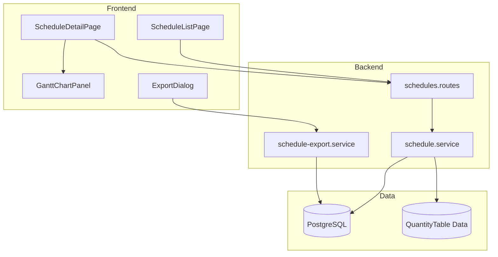
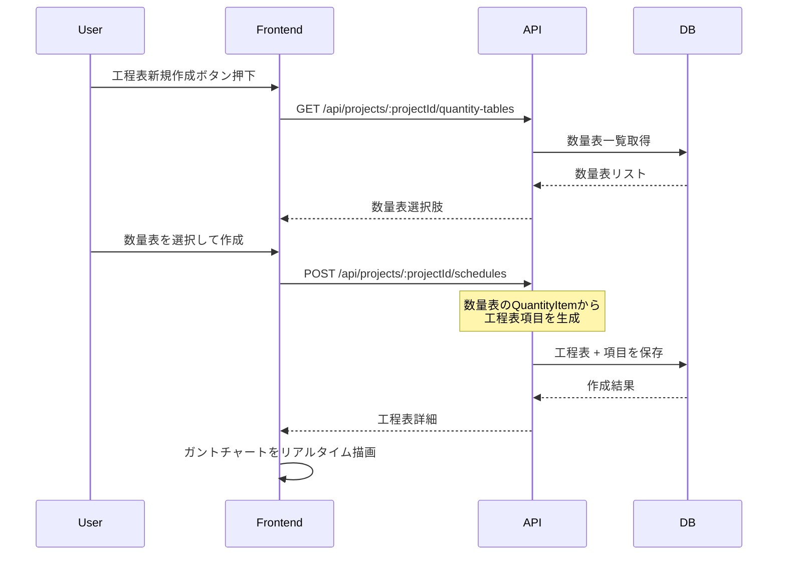
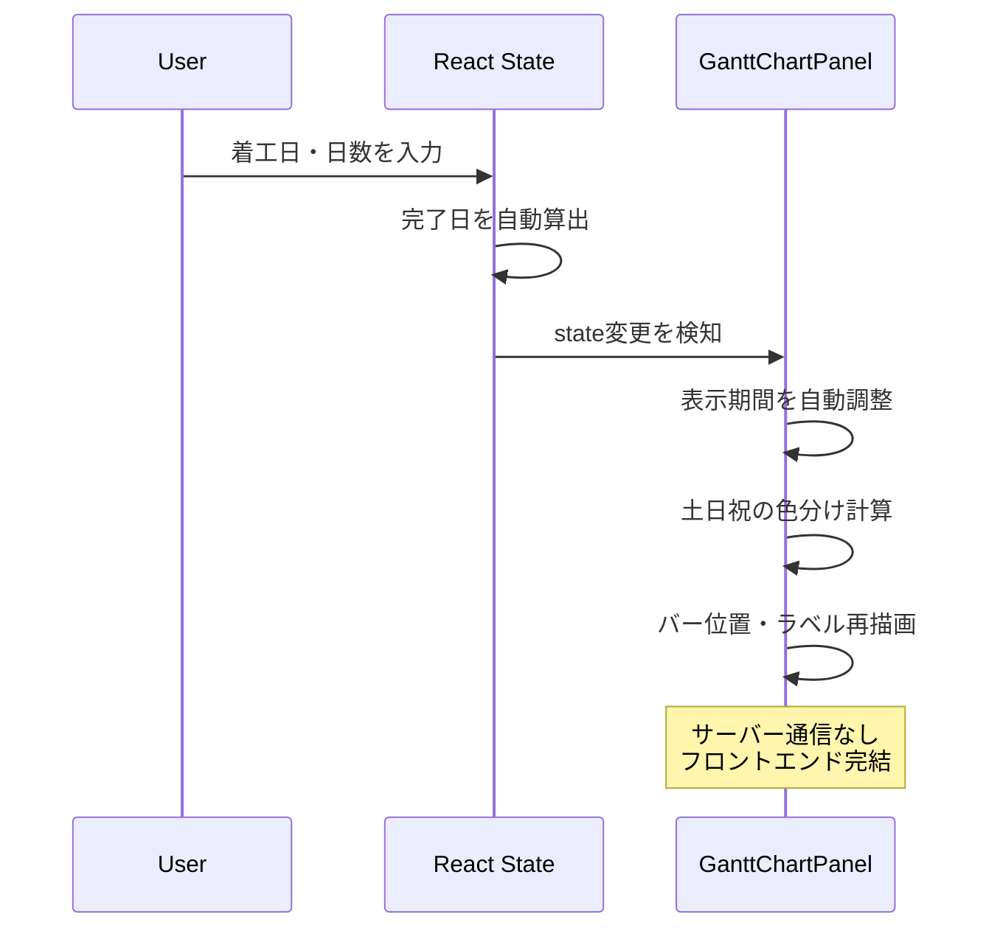
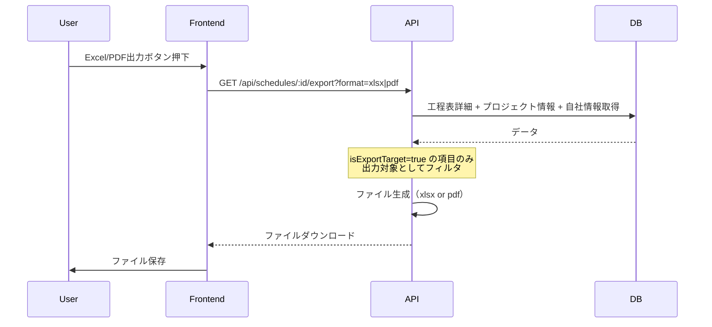

# 技術設計書: 工程表作成機能

## Overview

本機能は、建設プロジェクトの施工スケジュールを視覚的に管理するための工程表作成機能をArchiTrackに追加する。プロジェクト担当者は、数量表との連携による項目自動取得、任意項目の追加、ガントチャート形式でのリアルタイム表示、並び順管理、Excel/PDF出力を通じて、効率的な工程管理を実現する。

**Users**: プロジェクト担当者が施工スケジュールの作成・管理・共有に利用する。

**Impact**: Projectモデルに新たなリレーション（constructionSchedules）を追加し、工程表CRUD、ガントチャート表示、出力機能を提供する。

### Goals
- プロジェクトに紐付く工程表のCRUD管理
- 数量表との連携による項目自動取得（スナップショット方式）
- ガントチャート形式でのリアルタイム表示（フロントエンド完結、土日祝色分け、入力から200ms以内の更新）
- 項目の並び順管理（ドラッグ&ドロップ）
- Excel/PDF形式での出力（プロジェクト名・自社名付き、出力対象選択、エラーハンドリング）
- ラベル文字・詳細文字による工程表の表示カスタマイズ
- 非機能要件: 1工程表あたり最大200項目、Excel/PDF出力30秒以内

### Non-Goals
- 工程間の依存関係（先行・後続関係）管理
- クリティカルパス分析
- リソース（人員・機材）管理
- 複数プロジェクト横断のスケジュール管理
- 数量表とのリアルタイム同期（スナップショット方式を採用）
- ガントチャートの印刷プレビュー画面

## Architecture

> 詳細な調査結果は`research.md`を参照。

### Existing Architecture Analysis

既存のArchiTrackは、プロジェクトに紐付く各種機能（数量表、内訳書、見積依頼、見積書、契約書）をCRUDパターンで提供している。本機能は同一パターンに従い、以下の既存アーキテクチャを踏襲する。

- **ルーティングパターン**: `GET/POST /api/projects/:projectId/schedules` + `GET/PUT/DELETE /api/schedules/:id`
- **認証・認可**: `authenticate` + `requirePermission` ミドルウェア
  - **改訂（2026-10-27、タスク22）**: 上の項は当初の設計の記録として残す。実装はこれをロールの権限の表（`requirePermission`）だけで読み、案件の範囲を判定していなかったため、担当外の利用者もID指定で他の案件の工程表を読み書き・出力でき、工程表の出力は記録を経ずに生成された（user-authentication の機能検証、2026-10-25）。2026-10-27 の判断（Requirement 13 の新設）で、データ分離は案件の閲覧範囲（user-authentication の要件39）とロールの権限の表の両方で判定する。範囲外は不在と同じ 404 とし、403 は閲覧範囲内で権限を持たない操作に限る。出力は生成の前に記録する（詳細は「Requirement 13: 案件の閲覧範囲と出力の記録の適用」章）
- **バリデーション**: Zodスキーマ + `validate` ミドルウェア
- **データアクセス**: Prisma 7 ORM（Driver Adapter Pattern）
- **論理削除**: `deletedAt` フィールド
- **楽観的排他制御**: `version` フィールド

### Architecture Pattern & Boundary Map



**Architecture Integration**:
- Selected pattern: 既存CRUDパターンの拡張（コントラクト管理と同一構造）
- Domain boundaries: 工程表ドメインはプロジェクトに従属し、数量表とは参照時のみ連携
- Existing patterns preserved: 認証・認可、Zodバリデーション、論理削除、楽観的排他制御
- New components rationale: ガントチャート表示はフロントエンド専用コンポーネント、Excel/PDF出力はバックエンドサービス
- Steering compliance: TypeScript型安全性、Prisma 7 ORM、既存テストパターン

### Technology Stack

| Layer | Choice / Version | Role in Feature | Notes |
|-------|------------------|-----------------|-------|
| Frontend | React 19 + TypeScript 5.9 | 工程表UI、ガントチャート表示 | カスタムガントチャートコンポーネント |
| Frontend | @holiday-jp/holiday_jp ^2.5.1 | 日本の祝日判定 | 新規依存関係 |
| Frontend | Tailwind CSS 4 | ガントチャートスタイリング | 既存依存関係 |
| Backend | Express 5 + TypeScript 5.9 | REST API | 既存パターン踏襲 |
| Backend | Prisma 7 | データアクセス | Driver Adapter Pattern |
| Backend | xlsx 0.20.3 | Excel出力 | 既存依存関係 |
| Backend | jsPDF ^4.0.0 | PDF出力 | 既存依存関係 |
| Data | PostgreSQL 15 | 工程表データ永続化 | 新規テーブル追加 |

## System Flows

### 工程表作成フロー（数量表連携あり）



### ガントチャートリアルタイム更新フロー



### Excel/PDF出力フロー



## Requirements Traceability

| Requirement | Summary | Components | Interfaces | Flows |
|-------------|---------|------------|------------|-------|
| 1.1 | 工程表一覧表示 | ScheduleListPage, ScheduleRoutes | GET /api/projects/:projectId/schedules | - |
| 1.2 | 工程表新規作成画面表示 | ScheduleDetailPage, ScheduleForm | - | 工程表作成フロー |
| 1.3 | 工程表保存 | ScheduleService | POST /api/projects/:projectId/schedules | 工程表作成フロー |
| 1.4 | 工程表詳細表示 | ScheduleDetailPage | GET /api/schedules/:id | - |
| 1.5 | 工程表削除 | ScheduleService | DELETE /api/schedules/:id | - |
| 1.6 | 保存失敗時エラー表示 | ScheduleForm | - | - |
| 2.1 | 数量表選択肢表示 | ScheduleForm | GET /api/projects/:projectId/quantity-tables | 工程表作成フロー |
| 2.2 | 数量表なしで空の工程表作成 | ScheduleService | POST /api/projects/:projectId/schedules | - |
| 2.3 | 数量表指定時の項目自動取得 | ScheduleService | POST /api/projects/:projectId/schedules | 工程表作成フロー |
| 2.4 | 数量表項目の着工日・日数入力欄 | ScheduleItemRow | - | - |
| 3.1 | 着工日入力欄 | ScheduleItemRow | - | - |
| 3.2 | 日数入力欄 | ScheduleItemRow | - | - |
| 3.3 | 完了日自動算出 | useScheduleState | - | ガントチャートリアルタイム更新 |
| 3.4 | 着工日未入力バリデーション | ScheduleItemRow | - | - |
| 3.5 | 日数0以下バリデーション | ScheduleItemRow | - | - |
| 4.1 | 任意項目追加 | ScheduleItemRow, useScheduleState | - | - |
| 4.2 | 任意項目の入力欄 | ScheduleItemRow | - | - |
| 4.3 | 任意項目削除 | useScheduleState | - | - |
| 4.4 | 数量表由来・任意項目の混在管理 | useScheduleState | - | - |
| 5.1 | 並び順変更機能 | SortableScheduleList | - | - |
| 5.2 | 並び順リアルタイム反映 | useScheduleState, GanttChartPanel | - | - |
| 5.3 | 並び順の永続化 | ScheduleService | PUT /api/schedules/:id | - |
| 5.4 | 並び順の復元 | ScheduleService | GET /api/schedules/:id | - |
| 6.1 | ガントチャートリアルタイム更新 | GanttChartPanel | - | ガントチャートリアルタイム更新 |
| 6.2 | 土曜日色分け | GanttChartPanel, useHolidayCalendar | - | - |
| 6.3 | 日曜日色分け | GanttChartPanel, useHolidayCalendar | - | - |
| 6.4 | 祝日色分け | GanttChartPanel, useHolidayCalendar | - | - |
| 6.5 | 表示期間自動調整 | GanttChartPanel | - | - |
| 6.6 | サーバー通信なしの更新 | GanttChartPanel, useScheduleState | - | ガントチャートリアルタイム更新 |
| 6.7 | 入力から200ms以内の表示更新 | GanttChartPanel | - | ガントチャートリアルタイム更新 |
| 7.1 | Excelダウンロード | ExportDialog | GET /api/schedules/:id/export?format=xlsx | Excel/PDF出力フロー |
| 7.2 | プロジェクト名含むExcel | ScheduleExportService | - | - |
| 7.3 | 自社名含むExcel | ScheduleExportService | - | - |
| 7.4 | 項目情報含むExcel | ScheduleExportService | - | - |
| 7.5 | ガントチャート出力（項目名・バー・土日祝色分け） | ScheduleExportService | - | - |
| 7.6 | Excel出力失敗時エラー表示 | ExportDialog, ScheduleExportService | - | Excel/PDF出力フロー |
| 8.1 | PDFダウンロード | ExportDialog | GET /api/schedules/:id/export?format=pdf | Excel/PDF出力フロー |
| 8.2 | プロジェクト名含むPDF | ScheduleExportService | - | - |
| 8.3 | 自社名含むPDF | ScheduleExportService | - | - |
| 8.4 | 項目情報含むPDF | ScheduleExportService | - | - |
| 8.5 | ガントチャート出力（項目名・バー・土日祝色分け） | ScheduleExportService | - | - |
| 8.6 | PDF出力失敗時エラー表示 | ExportDialog, ScheduleExportService | - | Excel/PDF出力フロー |
| 9.1 | 出力対象チェックボックス表示 | ScheduleItemRow | - | - |
| 9.2 | チェックボックス初期値ON | ScheduleService | - | - |
| 9.3 | チェックOFF時の出力除外 | ScheduleExportService | - | Excel/PDF出力フロー |
| 9.4 | チェック復帰時の出力復帰 | ScheduleExportService | - | - |
| 9.5 | 出力設定の永続化 | ScheduleService | PUT /api/schedules/:id | - |
| 9.6 | チェックOFF項目のガントチャート表示 | GanttChartPanel | - | - |
| 10.1 | ラベル文字入力欄 | ScheduleItemRow | - | - |
| 10.2 | ラベル文字の左列表示 | GanttChartPanel | - | - |
| 10.3 | ラベル文字リアルタイム更新 | GanttChartPanel, useScheduleState | - | - |
| 10.4 | ラベル文字の永続化 | ScheduleService | PUT /api/schedules/:id | - |
| 10.5 | ラベル文字のExcel/PDF出力 | ScheduleExportService | - | - |
| 11.1 | 詳細文字入力欄 | ScheduleItemRow | - | - |
| 11.2 | 詳細文字のバー上表示 | GanttChartPanel | - | - |
| 11.3 | 詳細文字リアルタイム更新 | GanttChartPanel, useScheduleState | - | - |
| 11.4 | 詳細文字の永続化 | ScheduleService | PUT /api/schedules/:id | - |
| 11.5 | 詳細文字のExcel/PDF出力 | ScheduleExportService | - | - |
| 12.1 | 最大200項目サポート | ScheduleService, useScheduleState | - | - |
| 12.2 | 200項目でのスムーズ描画 | GanttChartPanel | - | - |
| 12.3 | Excel出力30秒以内 | ScheduleExportService | - | - |
| 12.4 | PDF出力30秒以内 | ScheduleExportService | - | - |
| 13.1, 13.2, 13.3, 13.4, 13.5, 13.6, 13.7 | 案件の閲覧範囲と出力の記録 | 工程表の経路, 案件IDの解決関数, 数量表の所属の照合, 出力の記録, 出力のエラー表示 | requireProjectScope, ExportAuditService | - |

> **追記（2026-10-27、利用者の判断。タスク22）**: 13.1〜13.7 は user-authentication の要件39（案件の閲覧範囲）と要件40.9〜40.11（出力の記録）の本機能への適用である。受入基準ごとの追跡は末尾の「Requirement 13: 案件の閲覧範囲と出力の記録の適用」章の追跡表が持つ。本機能の既存の受入基準に、ロールだけで全案件の閲覧・操作を許すと読める条文は無かったため、既存の条文は改訂していない（同章の「既存の条文の検め」節）。

> **追記（2026-10-29、利用者の判断「推奨案で進める」。タスク23・24）**: 本表は行を足していない。13.8（プロジェクトの配下の経路の食い違いの記録）と 14.1・14.2（画面が 404 を受けたときの表示）の追跡は、末尾の章「2026-10-29 の追加: 食い違いの記録・不在の表示」の追跡表が持つ

## Components and Interfaces

| Component | Domain/Layer | Intent | Req Coverage | Key Dependencies | Contracts |
|-----------|-------------|--------|--------------|------------------|-----------|
| ScheduleListPage | UI/Page | 工程表一覧ページ | 1.1 | ScheduleRoutes (P0) | API |
| ScheduleDetailPage | UI/Page | 工程表詳細・編集ページ | 1.2, 1.4 | useScheduleState (P0), GanttChartPanel (P0) | State |
| ScheduleForm | UI/Component | 工程表作成フォーム | 1.2, 1.3, 1.6, 2.1 | QuantityTableAPI (P1) | - |
| ScheduleItemRow | UI/Component | 工程表項目行 | 3.1-3.5, 4.1-4.2, 9.1, 10.1, 11.1 | useScheduleState (P0) | - |
| SortableScheduleList | UI/Component | 項目並び順管理 | 5.1, 5.2 | useScheduleState (P0) | - |
| GanttChartPanel | UI/Component | ガントチャート表示 | 6.1-6.6, 9.6, 10.2-10.3, 11.2-11.3 | useHolidayCalendar (P0) | State |
| ExportDialog | UI/Component | Excel/PDF出力ダイアログ | 7.1, 7.6, 8.1, 8.6 | ScheduleExportAPI (P0) | API |
| useScheduleState | UI/Hook | 工程表状態管理 | 3.3, 4.1-4.4, 5.2, 6.1, 6.6 | - | State |
| useHolidayCalendar | UI/Hook | 祝日カレンダー管理 | 6.2-6.4 | @holiday-jp/holiday_jp (P0) | - |
| ScheduleRoutes | Backend/Route | APIエンドポイント | 1.1-1.5 | ScheduleService (P0) | API |
| ScheduleService | Backend/Service | 工程表ビジネスロジック | 1.1-1.5, 2.2-2.4, 5.3-5.4, 9.2, 9.5, 10.4, 11.4, 12.1 | Prisma (P0) | Service |
| ScheduleExportService | Backend/Service | Excel/PDF出力 | 7.1-7.5, 8.1-8.5, 9.3-9.4, 10.5, 11.5 | xlsx (P0), jsPDF (P0), Prisma (P0) | Service, API |
| ScheduleSchema | Backend/Schema | Zodバリデーション | 全CRUD操作 | Zod (P0) | - |
| ScheduleError | Backend/Error | カスタムエラー | 1.5, 1.6 | - | - |

### Frontend / UI Layer

#### useScheduleState

| Field | Detail |
|-------|--------|
| Intent | 工程表の項目データ・入力状態をフロントエンドで管理し、ガントチャートのリアルタイム更新を実現する |
| Requirements | 3.3, 4.1, 4.2, 4.3, 4.4, 5.2, 6.1, 6.6 |

**Responsibilities & Constraints**
- 工程表項目の追加・削除・更新をReact stateで管理
- 着工日と日数から完了日を自動算出（カレンダー日ベース）
- 並び順の変更をリアルタイムに反映
- サーバーへの保存はユーザーの明示的な操作（保存ボタン）時のみ実行
- 未保存変更の追跡（dirty state）

**Dependencies**
- Outbound: ScheduleAPI -- データ取得・保存 (P0)

**Contracts**: State [x]

##### State Management

```typescript
interface ScheduleItem {
  id: string;
  sourceType: 'QUANTITY_TABLE' | 'MANUAL';
  sourceQuantityItemId: string | null;
  itemName: string;
  labelText: string;
  detailText: string;
  startDate: string | null;
  duration: number | null;
  endDate: string | null;
  displayOrder: number;
  isExportTarget: boolean;
}

interface ScheduleState {
  schedule: {
    id: string;
    name: string;
    quantityTableId: string | null;
    version: number;
  };
  items: ScheduleItem[];
  isDirty: boolean;
}

interface UseScheduleStateReturn {
  state: ScheduleState;
  addItem(): void;
  removeItem(itemId: string): void;
  updateItem(itemId: string, updates: Partial<ScheduleItem>): void;
  reorderItems(fromIndex: number, toIndex: number): void;
  save(): Promise<void>;
  isLoading: boolean;
  error: string | null;
}
```

- Persistence: React useState / useReducer
- Consistency: 保存時にバックエンドのversionと照合（楽観的排他制御）
- Concurrency: 同一ユーザーの単一セッションを想定

**Implementation Notes**
- Integration: 保存時は全項目を一括送信（バルク保存パターン、数量表のbulk-saveと同一方式）
- Validation: 着工日未入力時の日数入力警告、日数0以下のバリデーションをフロントエンドで実施
- Risks: 大量項目時のstate更新パフォーマンス -- useReducerで最適化
- **上の `UseScheduleStateReturn` の項目数の上限の現況（タスク 20.2）**: 上の契約は書いた時点の記録として残し、ここへ現況を併記する（`site-survey` の設計文書 `#### 実測値の書き方（タスク 115.212）` の (a)）。`frontend/src/hooks/useScheduleState.ts` は上限の定数 `MAX_SCHEDULE_ITEMS`（200）を持ち、返り値へ `isItemLimitReached`（項目数が上限以上か）を加えた。`addItem` は上限に達していれば何もしない（項目も dirty も変えない）。表示と保存の扱いは `### Performance & Scalability (Req 12)` の「バルク保存の最大200項目の現況（タスク 20.2）」に記す

#### GanttChartPanel

| Field | Detail |
|-------|--------|
| Intent | 工程表データをガントチャート形式で視覚的に表示し、入力変更時にリアルタイム（200ms以内）で更新する |
| Requirements | 6.1, 6.2, 6.3, 6.4, 6.5, 6.6, 6.7, 9.6, 10.2, 10.3, 11.2, 11.3, 12.2 |

**Responsibilities & Constraints**
- 全項目の着工日〜完了日範囲からガントチャートの表示期間を自動算出
- 土曜日・日曜日・祝日をそれぞれ異なる背景色で色分け表示
- 各項目のバー上に詳細文字を表示
- 左列にラベル文字を表示
- 出力対象チェックがOFFの項目もガントチャート上では表示
- サーバー通信を一切行わず、フロントエンドのprops/stateのみで描画

**Dependencies**
- Inbound: useScheduleState -- 工程表データ (P0)
- Inbound: useHolidayCalendar -- 祝日データ (P0)

**Contracts**: State [x]

##### State Management

```typescript
interface GanttChartPanelProps {
  items: ScheduleItem[];
  holidays: HolidayMap;
}

interface HolidayMap {
  isHoliday(date: Date): boolean;
  isSaturday(date: Date): boolean;
  isSunday(date: Date): boolean;
  getHolidayName(date: Date): string | null;
}
```

- State model: propsから受け取ったデータを描画。内部stateは表示期間の自動計算結果のみ
- Persistence: なし（描画コンポーネント）
- Concurrency: N/A

**Implementation Notes**
- Integration: HTML table/divベースのカスタム実装。日付列はヘッダーに年月日を表示し、各行にバーをCSS positionで配置
- Validation: 着工日・日数が未入力の項目はバーを表示しない
- Performance: 入力変更から200ms以内の描画更新（Req 6.7）。200項目でのスムーズ描画（Req 12.2）
- Risks: 200項目時の描画パフォーマンス -- CSS containment + useMemoによる差分計算で最適化
- **上の Performance と Risks の「CSS containment + useMemo」の現況（タスク 21.1）**: 上の2項は書いた時点の記録として残し、ここへ現況を併記する（`site-survey` の設計文書 `#### 実測値の書き方（タスク 115.212）` の (a)）。**CSS containment は採らず、描く要素の数を減らす方式を採った。** `frontend/src/components/schedule/GanttChartPanel.tsx` の本体の行は日付ごとのセルを持たず、ラベルのセルと、全日付にまたがる1つのタイムラインのセル（`data-testid` は `gantt-timeline-` に項目の id、`colSpan` は表示期間の日数）だけを持つ。200 項目・日付列約 1 年で本体の td は 71,800 個から 400 個になる。バーはタイムラインのセルの中で、`left` を表示期間の先頭からの日数 × 32px、幅を日数 × 32px − 2px に置く。土日祝の色分けと日付の区切り線はタイムラインのセルの背景で描く。背景は区間の少ない gradient の層の重ね合わせで、上から日付の区切り線（各日付の右端の 1px の repeating-linear-gradient）、連続する祝日ごとの1色の層（日付の位置と幅に置く）、土日（曜日は 7 日で繰り返すため、表示期間の先頭の 7 日の並びを 7 日周期の repeating-linear-gradient で描く。祝日の層が上に重なるため祝日の土日は祝日の色になる）、平日の背景色の順に重ねる。日付ごとの区分（祝日を優先した日種別と曜日だけの日種別）は日付ごとに一度だけ判定してヘッダーと背景で共有し、背景の宣言はパネルごとに1つのスタイル規則（パネルの外に置く `<style>` の、`useId` の値を持つ `data-gantt-timeline` 属性の選択子）として全行で共有する。行は `React.memo` で包み、入力で変わった項目の行だけを描き直す。ヘッダーは表示期間と祝日が変わったときだけ作り直す。ヘッダーの日付のセル（`data-day-type` を持つ）と表示の色・バー・ラベル・詳細文字の文言と順序は変えていない。**採った理由と採らなかった案**: (1) 色の区間を日付の数だけ持つ1本の linear-gradient を最初に試したところ、入力から描画までの初回が 176〜192ms になり、背景の画像を外すと 24〜32ms に戻った（区間の多い gradient のラスタライズが重い）。そのため区間の少ない層の重ね合わせに改めた。(2) 背景の値を行ごとのインラインスタイルに持たせると、表示期間が変わる入力で長い値の解析が項目の数（最大 200）だけ起きるため、スタイル規則1つに寄せた。(3) CSS containment は、タイムラインのセルへの paint containment がバーの上へはみ出す詳細文字を切り取り、layout containment が重ね合わせの文脈を作って横に送ったときのバーとラベル列（sticky）の重なり順を変えるため採らなかった。項目一覧とガントチャートの外枠へ `contain: content` を足して測った描画（Paint）の時間に目立つ差は無かった。(4) 行の仮想化は、下の `### Performance & Scalability (Req 12)` の実測で要らなかったため採らなかった。**見た目の同一性**: 修正の前後で同じ工程表（祝日 4/29 と 5/3〜5/6 を含む 6 項目、長いラベル・詳細文字・日付なしの項目を含む）のガントチャートを実ブラウザで撮り、初期・横に 150px 送った位置・右端・日数の入力後の 4 枚がいずれも画素単位で一致した（Playwright の `toMatchSnapshot` で `maxDiffPixels: 0`、2026-10-10）。検証は `frontend/src/components/schedule/GanttChartPanel.test.tsx` が担う。本体の色分けは computed style の背景の層を上から読んで日付ごとの色を求め、91 日の表示期間の全ての日付でヘッダーの色と一致すること、土日に重なる祝日が祝日の色になることを主張する。ほかに、各行がラベルとタイムラインの2つのセルだけを持つこと、日付ごとの区分の判定が行の数によらず日付ごとに一度であること、表示期間が変わらない入力では判定し直さないこと、バーの位置と幅を主張する
- **上の「全日付にまたがる1つのタイムラインのセル」の colspan の上限の扱い（タスク 21.1、独立レビューの是正）**: 上の項は書いた時点の記録として残し、ここへ現況を併記する（`site-survey` の設計文書 `#### 実測値の書き方（タスク 115.212）` の (a)）。HTML の colspan の上限は 1000 で、超える値は 1000 に切り詰められる。日数に上限は無いため、上の項の形では表示期間が 1000 日を超えると、1000 日目より後の本体が土日祝の色分け・日付の区切り線・行の下罫線を持たなかった（独立レビューが日数 1100 で確認した。`td.colSpan` が 1000、表の幅は 35300px）。`frontend/src/components/schedule/GanttChartPanel.tsx` は表示期間を `MAX_TIMELINE_COLSPAN`（1000）日以下の区間に分け（`splitTimelineSegments`）、各行のタイムラインを区間ごとのセル（`data-gantt-segment-start` に区間の先頭の日数、`colSpan` は区間の日数）として描く。1000 日以下では区間は1つで、上の項の形と同じ DOM になる。背景の規則は区間ごとに1つずつ作り（選択子は `data-gantt-timeline` と `data-gantt-segment-start` の組）、その区間の日付だけから土日の 7 日周期の並びと祝日の層を区間の先頭を原点として置く（区間の先頭の日数 × 32px だけ背景をずらすのと同じ）。バーは開始日を含む区間のセルに、`left` を区間の先頭からの日数 × 32px として置き、幅は日数 × 32px − 2px のまま後ろの区間のセルへ重ねて伸ばす（バーは `z-index: 1` のため後ろのセルの背景より上に描かれる）。検証は `frontend/src/components/schedule/GanttChartPanel.test.tsx` の「Task 21.1: 1000 日を超える表示期間」が担い、1100 日の表示期間で、どのセルの colSpan も 1000 以下で合計が日数と一致すること、1000 日目より後の祝日を含む全ての日付で本体の色がヘッダーの色と一致すること、1000 日目より後に始まるバーの位置と幅を主張する。実ブラウザでは一時的な検証（リポジトリへ残していない）で、2026-04-01 から 1100 日の工程表の 1000 日目の前後と後ろの 78 日について、ヘッダーと本体の画素の色が一致し、区間の境界を跨ぐバーが途切れないことを確かめた（修正前の版では 1000 日目より後の本体が外枠の背景色 `#f9fafb` になり一致しなかった）。約 1 年の表示期間の 4 枚の画素比較は修正の後も一致し、200 項目の計測（トレースと録画を止める、2026-10-10）は中ほど・最後の項目の各 5 回で、入力から描画までが最大 72ms、50ms を超えるフレームはどの実行も 0 件であった

#### useHolidayCalendar

| Field | Detail |
|-------|--------|
| Intent | 指定期間の日本の祝日データを取得し、ガントチャートの色分け判定に使用する |
| Requirements | 6.2, 6.3, 6.4 |

**Responsibilities & Constraints**
- `@holiday-jp/holiday_jp`ライブラリを使用して祝日データを取得
- 表示期間の祝日をメモ化してパフォーマンスを確保
- 土曜日・日曜日の判定もまとめて提供

**Dependencies**
- External: @holiday-jp/holiday_jp -- 日本の祝日データ (P0)

**Contracts**: State [x]

##### State Management

```typescript
interface UseHolidayCalendarReturn {
  holidays: HolidayMap;
  isLoading: boolean;
}

function useHolidayCalendar(startDate: Date, endDate: Date): UseHolidayCalendarReturn;
```

**Implementation Notes**
- Integration: useMemoで祝日データをキャッシュし、表示期間変更時のみ再計算
- Risks: 特になし（クライアントサイドの軽量計算）

#### ScheduleItemRow

| Field | Detail |
|-------|--------|
| Intent | 工程表の1項目の入力行を表示し、各種フィールドの入力を受け付ける |
| Requirements | 3.1, 3.2, 3.4, 3.5, 4.1, 4.2, 9.1, 10.1, 11.1 |

**Responsibilities & Constraints**
- 項目名、ラベル文字、詳細文字、着工日、日数、出力対象チェックボックスの入力欄を表示
- フィールドバリデーション（着工日未入力警告、日数0以下エラー）
- 数量表由来の項目は項目名を参照表示（編集可能）
- 任意項目は項目名を自由入力

**Dependencies**
- Inbound: useScheduleState -- 項目データ・更新関数 (P0)

**Implementation Notes**
- Integration: ScheduleDetailPage内で配列レンダリング
- Validation: 着工日未入力で日数のみ入力時にインラインバリデーションメッセージ表示

#### SortableScheduleList

| Field | Detail |
|-------|--------|
| Intent | 工程表項目の並び順をドラッグ&ドロップで変更する |
| Requirements | 5.1, 5.2 |

**Responsibilities & Constraints**
- 全項目（数量表由来・任意を問わず）の並び替えをドラッグ&ドロップで実現
- 並び順変更をuseScheduleStateに即座に反映
- アクセシビリティ対応（キーボード操作によるリオーダー）

**Dependencies**
- Inbound: useScheduleState -- reorderItems関数 (P0)

**Implementation Notes**
- Integration: HTML5 Drag and Drop APIまたは軽量ライブラリを使用
- Risks: モバイルでのタッチ操作対応
- **上の Integration の描画の現況（タスク 21.1）**: 上の項は書いた時点の記録として残し、ここへ現況を併記する（`site-survey` の設計文書 `#### 実測値の書き方（タスク 115.212）` の (a)）。利用者の判断（2026-10-10）でタスク 21.1 の境界を項目一覧の描画まで広げ、1 行の入力で 200 項目すべての行を描き直さないようにした。`frontend/src/components/schedule/ScheduleItemRow.tsx` の `ScheduleItemRow` は `React.memo` で包み、`frontend/src/components/schedule/SortableScheduleList.tsx` は各行を `React.memo` の `SortableRow` として描く。ドラッグの処理関数は行の位置を引数に取る `useCallback` の関数として全行へ同じ参照を渡し、行の中で位置を添えて呼ぶ。`onUpdate` / `onRemove` / `onReorder` は `frontend/src/hooks/useScheduleState.ts` の `updateItem` / `removeItem` / `reorderItems`（いずれも依存の無い `useCallback`）をそのまま渡すため参照が変わらず、`updateItem` は変わらない項目の参照を保つ。このため入力やドラッグの表示の変化では、props の変わった行だけを描き直す。並べ替えは HTML5 Drag and Drop のままで、行の DOM（`sortable-row-` の `data-testid`、`data-dragging`、ドラッグのハンドル、入力欄）とキー操作・入力の処理は変えていない。検証は `frontend/src/components/schedule/SortableScheduleList.test.tsx`（項目のプロパティの読み取りを数える Proxy で、1 行の入力とドラッグの開始で他の行が項目を読まないこと＝描き直されないことを主張する）と `frontend/src/__tests__/hooks/useScheduleState.test.ts`（更新の後も変わらない項目と行へ渡す関数が同じ参照であること）が担う。計測値は `### Performance & Scalability (Req 12)` の「上の「残る長いフレームは項目一覧の描き直しによる」の現況（タスク 21.1）」に記す

#### ScheduleListPage / ScheduleDetailPage / ScheduleForm / ExportDialog

これらのページ・ダイアログコンポーネントは既存パターン（ContractListPage、ContractForm等）に従う。
- **ScheduleListPage**: プロジェクト詳細からの一覧表示、作成・削除操作
- **ScheduleDetailPage**: 工程表の詳細・編集画面。ScheduleItemRow群とGanttChartPanelを並列配置
- **ScheduleForm**: 工程表名入力と数量表選択のダイアログ
- **ExportDialog**: Excel/PDF出力形式選択ダイアログ。出力失敗時はエラーメッセージを表示し、再試行ボタンを提供（Req 7.6, 8.6）

### Backend / Service Layer

#### ScheduleService

| Field | Detail |
|-------|--------|
| Intent | 工程表のCRUD操作および数量表連携のビジネスロジックを提供する |
| Requirements | 1.1-1.5, 2.2-2.4, 5.3-5.4, 9.2, 9.5, 10.4, 11.4 |

**Responsibilities & Constraints**
- 工程表のCRUD（作成・取得・更新・削除）
- 数量表指定時: QuantityItemからScheduleItemへのスナップショットコピー
- 楽観的排他制御（versionフィールド）
- 論理削除（deletedAt）
- バルク保存（全項目一括更新）

**Dependencies**
- Outbound: Prisma Client -- データベースアクセス (P0)
- Outbound: QuantityTable/QuantityItem -- 数量表データ参照 (P1)

**Contracts**: Service [x] / API [x]

##### Service Interface

```typescript
interface ScheduleServiceInterface {
  findByProject(
    projectId: string,
    query: ScheduleListQuery
  ): Promise<{ schedules: ScheduleListItem[]; total: number }>;

  findById(id: string): Promise<ScheduleDetail | null>;

  create(
    projectId: string,
    data: CreateScheduleInput
  ): Promise<ScheduleDetail>;

  update(
    id: string,
    data: UpdateScheduleInput
  ): Promise<ScheduleDetail>;

  bulkSaveItems(
    id: string,
    data: BulkSaveScheduleItemsInput
  ): Promise<{ updatedItemCount: number; updatedAt: string }>;

  delete(id: string): Promise<void>;
}
```

- Preconditions: projectIdが有効なプロジェクトIDであること。更新時はversionが一致すること
- Postconditions: 作成時、数量表指定ありの場合はQuantityItemからScheduleItemが生成される。出力対象チェックボックスの初期値はtrue
- Invariants: deletedAtがnullでないレコードは通常クエリから除外

##### API Contract

| Method | Endpoint | Request | Response | Errors |
|--------|----------|---------|----------|--------|
| GET | /api/projects/:projectId/schedules | ScheduleListQuery (query) | ScheduleListResponse | 400（projectId の形式不正、クエリの不正）, 401, 403, 404（プロジェクトなし・閲覧範囲外。汎用の `NOT_FOUND`） |
| POST | /api/projects/:projectId/schedules | CreateScheduleInput (body) | ScheduleDetail（201） | 400（projectId の形式不正、本文の不正、数量表の項目数の上限超過の `SCHEDULE_ITEMS_LIMIT_EXCEEDED`）, 401, 403, 404（プロジェクトなし・閲覧範囲外。汎用の `NOT_FOUND`）, 422（数量表なし・経路のプロジェクトに属さない数量表。同じ本文の `SCHEDULE_VALIDATION_ERROR`） |
| GET | /api/schedules/:id | - | ScheduleDetail | 400（ID の形式不正）, 401, 403, 404（工程表なし・閲覧範囲外。汎用の `NOT_FOUND`） |
| PUT | /api/schedules/:id | UpdateScheduleInput (body) | ScheduleDetail | 400, 401, 403, 404（工程表なし・閲覧範囲外。汎用の `NOT_FOUND`）, 409 |
| PUT | /api/schedules/:id/bulk-save | BulkSaveScheduleItemsInput (body) | BulkSaveResult | 400, 401, 403, 404（工程表なし・閲覧範囲外。汎用の `NOT_FOUND`）, 409 |
| DELETE | /api/schedules/:id | - | 204 No Content | 400（ID の形式不正）, 401, 403, 404（工程表なし・閲覧範囲外。汎用の `NOT_FOUND`） |
| GET | /api/schedules/:id/export | format=xlsx\|pdf (query) | Binary file download | 400（ID の形式不正、format の不正）, 401, 403, 404（工程表なし・閲覧範囲外。汎用の `NOT_FOUND`）, 500（ファイルの生成の失敗。Requirement 7.6・8.6）, 500（出力の記録の失敗の `EXPORT_RECORD_FAILED`。ファイルを生成せず返さない。Requirement 13.7） |

- **追記（2026-10-27、タスク22）**: 上の表の Errors は当初の設計の記録として残す。全経路で、閲覧範囲外のプロジェクトとそのプロジェクトに属する工程表の指定は不在と同じ汎用の 404 になる（一覧と作成の経路にも 404 が加わる。Requirement 13.2・13.3）。出力の経路は記録の失敗でファイルを含まない 500 を返す（Requirement 13.7）。詳細は「Requirement 13: 案件の閲覧範囲と出力の記録の適用」章
- ミドルウェアは全経路で `authenticate` + `requirePermission` + 経路の ID の形式の検査（一覧・作成は `projectIdParamSchema`、`/:id` 配下は `scheduleIdParamSchema`）+ 案件の閲覧範囲の判定部品（一覧・作成は `requireProjectParamScope('projectId')`、`/:id` 配下は `requireScheduleProjectScope('id')`。Requirement 13）の順とし、その後に本文・クエリの検査と本体を置く
- `/:id` 配下の 5 経路（出力を含む）は `/api/projects/:projectId/schedules/:id` からも届く（二重マウント）。判定は経路の `projectId` でなく工程表の案件で行い、経路の `projectId` と工程表の案件が食い違えば工程表の不在と同じ汎用の 404 にする
- **改訂（2026-10-28、タスク22.1）**: 上の表の Errors と Response、ミドルウェアと二重マウントの箇条を実装に合わせて改めた（上の 2026-10-27 の追記は記録として残す）。改訂前の Errors は、一覧が「401, 403」、作成が「400, 401, 403, 422」、詳細が「401, 403, 404」、更新と一括保存が「400, 401, 403, 404, 409」、論理的な取り除きが「401, 403, 404」、出力が「401, 403, 404」で、作成の Response は「ScheduleDetail」、ミドルウェアの箇条と二重マウントの箇条は無かった。理由は、Requirement 13 の適用で全経路に経路の ID の形式の検査と閲覧範囲の判定部品を置いたことである。これにより振る舞いが次のとおり変わった。存在しない工程表の 404 は、従来の `SCHEDULE_NOT_FOUND`（更新・一括保存・論理的な取り除き）と本文だけの「工程表が見つかりません」（詳細・出力）から、範囲外と区別しない汎用の `NOT_FOUND` になった。論理的に取り除かれた工程表も同じ汎用の 404 になる。存在しないプロジェクトを指定した一覧は、従来は空の 200 を返していたが 404 になる。存在しないプロジェクトを指定した作成は、従来はプロジェクトを照合しなかったが、判定部品の 404 になる。形式の崩れた ID は判定部品へ渡さず 400 で終える。作成の要求が経路のプロジェクトに属さない数量表を指すと、数量表の不在と同じ本文の 422 になる（13.4。従来は「同一プロジェクトに属していません」の本文で分かれていた）。次の 4 点は本タスクの前から実装が返していたが改訂前の表に無かった（本タスクの前からの欠陥）ため、あわせて書き足した。一覧のクエリの不正の 400、作成の数量表の項目数の上限超過の 400（Requirement 12.1、タスク 20 で追加）、出力の format の不正の 400、出力のファイルの生成の失敗の 500（Requirement 7.6・8.6）。作成の成功は従来から 201 を返していたため Response に添えた。出力の記録の失敗の 500（Requirement 13.7）はタスク22.2 の担当で、本改訂の時点では実装していないため表に入れていない
- **改訂（2026-10-28、タスク22.2）**: 上の表の出力の行の Errors に、出力の記録の失敗の 500（`EXPORT_RECORD_FAILED`）を書き足した。改訂前の出力の行の Errors は「400（ID の形式不正、format の不正）, 401, 403, 404（工程表なし・閲覧範囲外。汎用の `NOT_FOUND`）, 500（ファイルの生成の失敗。Requirement 7.6・8.6）」だった。理由は、出力の経路がファイルの生成の前に記録し、記録の失敗ではファイルを生成せず 500 と識別子 `EXPORT_RECORD_FAILED`（`detail` は「出力を記録できなかったため中止しました」）を返すようにしたことである（Requirement 13.6・13.7。詳細は「Requirement 13: 案件の閲覧範囲と出力の記録の適用」章の「出力の記録の実装の決定」）

**Implementation Notes**
- Integration: `app.ts`にルートを登録。`/api/projects/:projectId/schedules`と`/api/schedules`の2パターン
- Validation: Zodスキーマによる入力バリデーション
- Risks: 数量表の項目数が多い場合の一括生成パフォーマンス -- トランザクション内でバッチ処理

#### ScheduleExportService

| Field | Detail |
|-------|--------|
| Intent | 工程表データをExcel/PDF形式でファイル出力する |
| Requirements | 7.1-7.6, 8.1-8.6, 9.3-9.4, 10.5, 11.5, 12.3, 12.4 |

**Responsibilities & Constraints**
- isExportTarget=trueの項目のみを出力対象とする
- プロジェクト名と自社名（CompanyInfo）をヘッダーに含める
- ガントチャートをExcelではセル結合+背景色、PDFではカスタム描画で再現
- Excel: .xlsx形式、xlsxライブラリ使用
- PDF: jsPDFライブラリ使用、横向き（ランドスケープ）

**Dependencies**
- Outbound: Prisma Client -- データベースアクセス (P0)
- External: xlsx 0.20.3 -- Excel生成 (P0)
- External: jsPDF ^4.0.0 -- PDF生成 (P0)

**Contracts**: Service [x]

##### Service Interface

```typescript
interface ScheduleExportServiceInterface {
  exportToExcel(scheduleId: string): Promise<Buffer>;
  exportToPdf(scheduleId: string): Promise<Buffer>;
}
```

- Preconditions: 対象の工程表が存在し、deletedAtがnullであること
- Postconditions: 出力ファイルにプロジェクト名、自社名、出力対象項目のラベル文字・詳細文字・バーが含まれる
- Invariants: isExportTarget=falseの項目は出力に含まれない

**Implementation Notes**
- Integration: ScheduleRoutesからexportエンドポイント経由で呼び出し
- Performance: Excel出力30秒以内（Req 12.3）、PDF出力30秒以内（Req 12.4）
- Error Handling: 出力処理失敗時はエラーメッセージをフロントエンドに返却し、ExportDialogで再試行を促す（Req 7.6, 8.6）
- Risks: PDF出力時のフォント対応（日本語フォントの埋め込み）-- 既存の見積書PDF出力パターンに従う
- **上の Risks の日本語フォントの埋め込みの現況（タスク 18.5）**: 上の項は書いた時点の記録として残し、ここへ現況を併記する（`site-survey` の設計文書 `#### 実測値の書き方（タスク 115.212）` の (a)）。タスク 18.5 より前の実装は `addFileToVFS` / `addFont` を持たず jsPDF の標準フォント（Helvetica）で描いており、日本語が文字化けしていた（機能レベル検証が 2026-09-29 に、実際の API で出力した PDF でプロジェクト名「SMOKE-工程表検証」が読めないことを画像で確かめた）。Requirement 8 の受入基準 2・3・4、Requirement 10 の受入基準 5、Requirement 11 の受入基準 5 に反するため、次のとおり改めた。
  - **埋め込み**: `backend/src/services/schedule-export.service.ts` の `exportToPdf` が、描画より前に `registerPdfJapaneseFont` で Noto Sans JP Regular を `addFileToVFS` / `addFont` で登録し `setFont` で設定する（見積書 PDF の `frontend/src/services/export/PdfFontService.ts` と同じ手順）。プロジェクト名・自社名・表の見出し・項目名・ラベル文字・詳細文字・着工日などの数値・日付見出しのすべてをこのフォントで描く。日付見出しの間引き（`buildPdfDateLayout`）の文字幅もこのフォントで測る。jsPDF は描いた文字の字形だけを埋め込むため、PDF はフォント全体の大きさにならない（2026-09-29 の実測で 3 項目の PDF が約 112KB、200 項目・11 ページの PDF が約 581KB）
  - **フォントの持ち方**: `backend/src/assets/fonts/noto-sans-jp-base64.ts` に Base64 の TS モジュールとして置く。内容は見積書 PDF の `frontend/src/services/export/fonts/noto-sans-jp-base64.ts` と同じデータの複製である（Fontsource japanese-400-normal のサブセット、TTF で約 2.2MB、Base64 で約 3.0MB）。backend から frontend のソースは読まない（backend だけを載せる本番イメージとテスト用コンテナで解決できないため）。TTF を置いて `fs` で読む形を採らなかったのは、本番イメージ（`backend/Dockerfile`）が build の段から `dist` だけを複製し、tsc は `.ts` 以外を `dist` へ出力しないためである。TTF にするとアセットの複製を Dockerfile かビルドの手順に足す必要があり、足し忘れは本番でだけ壊れる。TS モジュールは tsc が `dist/src/assets/fonts/noto-sans-jp-base64.js` へ出力するため、その手当てが要らない。リポジトリの大きさは TTF より約 0.8MB 大きいが、frontend と同じ内容のデータのため git の圧縮で差分として保存されうる
  - **読み込み**: 約 3MB のモジュールを起動時に読まないよう、`loadJapaneseFontBase64` が PDF 出力の初回に動的 import で読み、以降は同じ Promise を使う。読み込みに失敗した場合は保持を外してエラーを返す（標準フォントの文字化けした PDF を返さず、出力の失敗として 500 を返す）。`npm --prefix backend run build` の出力を node で直接読んだ 2026-09-29 の実測（コミット `1f8cf177` に本タスクの変更を載せた作業ツリー）では、初回の PDF 出力（モジュールの読み込みを含む）が約 109ms、2 回目が約 47ms、200 項目が約 106ms であった
  - **ライセンス**: Noto Sans JP は SIL Open Font License 1.1 である。文書への埋め込みは OFL が認める用途であり、PDF の利用者側の条件は生じない。フォントのデータに付ける記載は見積書 PDF の前例に揃え、モジュールの注釈にフォント名・ライセンス・元ソースを書く（ライセンス文書そのものは frontend・backend のいずれにも同梱していない）
  - **検証**: `backend/src/__tests__/unit/services/schedule-export.service.test.ts` が、埋め込みフォントの ToUnicode CMap で PDF に描かれた文字列を読み戻し、日本語のプロジェクト名・自社名・項目名・ラベル文字・詳細文字がそのまま読めることと、すべての文字列を埋め込みフォントで描くことを主張する。フォントを埋め込むと文字は字形の番号の 16 進列（`<...> Tj`）として書かれ、バイト列から `(ITEM-001) Tj` を拾っていたタスク 18.3・18.4 の検証は 0 件を読むようになる（実測で赤）。そのため項目名の読み取りも同じ読み戻しへ改め、200 項目・2 ページ以上・バーの右端の主張は保った。`e2e/specs/schedules/construction-schedule-e2e.spec.ts` は、実際の API が出力した PDF を pdfjs-dist で読み、日本語のプロジェクト名が読めることを主張する

**ガントチャート出力再現方針**
- **Excel**: 日付列をセルとして展開し、バー期間に該当するセルに背景色（塗りつぶし）を設定する方式。土日祝は対応するセルの背景色を変更。ラベル文字は左列セル、詳細文字はバー先頭セルにテキストとして配置する
- **PDF**: jsPDFのrect()による矩形描画でバーを再現。座標計算ロジックは、1日あたりの幅（px）を定数で定義し、着工日からのオフセットでX座標を算出する。用紙はA4横向き（ランドスケープ）。土日祝列は薄い背景色の矩形を全行にわたって描画する。ラベル文字はバー左側のテキスト領域に、詳細文字はバー矩形の上にtext()で配置する
- **上の PDF の方針の現況（タスク 18.4）**: 上の項は書いた時点の記録として残し、ここへ現況を併記する（`site-survey` の設計文書 `#### 実測値の書き方（タスク 115.212）` の (a)）。上の項は改ページと期間の長さに触れておらず、タスク 18.4 より前の実装は 1 ページに収まる行までしか描かず（200 項目中 17 項目）、1日あたり 5mm 固定の日付列はA4横で約 33 日を超える期間をページの外へ描いていた。Requirement 8 の受入基準 4・5 に反するため、利用者の判断（2026-09-29）に従い次のとおり改めた。実装は `backend/src/services/schedule-export.service.ts` の `drawPdfPages` と `buildPdfDateLayout` である。
  - **縦方向（改ページ）**: ページの下端（下余白 15mm の手前）に収まる行数ごとに改ページし、ページごとに表のヘッダー行と土日祝の背景を描き直す。プロジェクト名・自社名は 1 ページ目のみに描き、2 ページ目以降は表のヘッダー行を上余白の位置から始める（1 ページ目 17 行、2 ページ目以降 20 行。200 項目で 11 ページ）
  - **横方向（縮尺合わせ）**: 期間でページを分割せず、全期間が 1 ページの幅（左余白 10mm・固定列 111mm・右余白 10mm を除いた約 166mm）に収まるよう 1日あたりの幅を合わせる。上限は従来の 5mm とし、5mm のまま収まる短い期間（約 33 日まで）は従来の見た目（毎日の「月/日」見出し）を保つ。土日祝の背景は縮めた後も日ごとに描く（Req 8.5 の色分けを保つ）
  - **日付見出しの間引き**: 縮めると毎日の見出しは重なって読めなくなる（6pt で「4/30」は約 4.1mm、「2026/12」は約 7.6mm の幅があり、200 項目・約 1 年の期間では 1 日が約 0.47mm になる）。そこで見出しが隣と重ならない最も細かい段階を、週（月曜日に「月/日」）→ 月（1 日に「年/月」）→ 2・3・6・12 か月ごとの順に選び、見出しの位置に目盛り線を引く。週を最初に試すのは工事の段取りが週単位で組まれることが多く、読み取れる限り細かい方が着工日・完了日との照合に役立つためである。月の見出しに年を含めるのは、年をまたぐ工程で月だけでは位置が定まらないためである。期間の先頭が区切りでない場合は先頭にも見出しを置き、次の見出しと重なるときは省く。どの段階でも重なる極端に長い期間（十数年を超える）では、12 か月ごとの見出しのうち前の見出しと重なるものを順に省く

## Data Models

### Domain Model

```mermaid
erDiagram
    Project ||--o{ ConstructionSchedule : has
    ConstructionSchedule ||--o{ ScheduleItem : contains
    QuantityTable ||--o{ QuantityItem : contains
    ScheduleItem }o--o| QuantityItem : references

    ConstructionSchedule {
        string id PK
        string projectId FK
        string name
        string quantityTableId FK_nullable
        int version
        datetime createdAt
        datetime updatedAt
        datetime deletedAt
    }

    ScheduleItem {
        string id PK
        string scheduleId FK
        string sourceType
        string sourceQuantityItemId FK_nullable
        string itemName
        string labelText
        string detailText
        date startDate
        int duration
        int displayOrder
        boolean isExportTarget
        datetime createdAt
        datetime updatedAt
    }
```

**Aggregates and Boundaries**:
- ConstructionSchedule が集約ルート。ScheduleItem は集約内のエンティティ
- 数量表との関連はスナップショット参照（sourceQuantityItemId）であり、カスケード更新・削除は行わない

**数量表削除時の影響**:
- 数量表が削除された場合、`ConstructionSchedule.quantityTableId`はNULL（ON DELETE SET NULL）に設定される
- `ScheduleItem.sourceQuantityItemId`もNULLに設定されるが、`itemName`はスナップショットとして保持されるため表示上は影響なし
- `sourceType`が`QUANTITY_TABLE`かつ`sourceQuantityItemId`がNULLの場合、UI上では通常の項目として表示し、数量表由来であった旨の表示は行わない（実質的にMANUAL項目と同等の扱いとなる）

**Business Rules & Invariants**:
- 工程表名は必須（1-200文字）
- 着工日が入力されている場合、日数は1以上であること
- 出力対象チェックボックスのデフォルト値はtrue
- displayOrderは0始まりの連番

### Physical Data Model

#### ConstructionSchedule テーブル

```sql
CREATE TABLE construction_schedules (
  id            UUID PRIMARY KEY DEFAULT gen_random_uuid(),
  project_id    UUID NOT NULL REFERENCES projects(id) ON DELETE CASCADE,
  name          VARCHAR(200) NOT NULL,
  quantity_table_id UUID REFERENCES quantity_tables(id) ON DELETE SET NULL,
  version       INTEGER NOT NULL DEFAULT 0,
  created_at    TIMESTAMPTZ NOT NULL DEFAULT now(),
  updated_at    TIMESTAMPTZ NOT NULL,
  deleted_at    TIMESTAMPTZ
);

CREATE INDEX idx_construction_schedules_project_id ON construction_schedules(project_id);
CREATE INDEX idx_construction_schedules_deleted_at ON construction_schedules(deleted_at);
```

#### ScheduleItem テーブル

```sql
CREATE TABLE schedule_items (
  id                       UUID PRIMARY KEY DEFAULT gen_random_uuid(),
  schedule_id              UUID NOT NULL REFERENCES construction_schedules(id) ON DELETE CASCADE,
  source_type              VARCHAR(20) NOT NULL DEFAULT 'MANUAL',
  source_quantity_item_id  UUID REFERENCES quantity_items(id) ON DELETE SET NULL,
  item_name                VARCHAR(500) NOT NULL,
  label_text               VARCHAR(200) NOT NULL DEFAULT '',
  detail_text              VARCHAR(500) NOT NULL DEFAULT '',
  start_date               DATE,
  duration                 INTEGER,
  display_order            INTEGER NOT NULL DEFAULT 0,
  is_export_target         BOOLEAN NOT NULL DEFAULT true,
  created_at               TIMESTAMPTZ NOT NULL DEFAULT now(),
  updated_at               TIMESTAMPTZ NOT NULL
);

CREATE INDEX idx_schedule_items_schedule_id ON schedule_items(schedule_id);
CREATE INDEX idx_schedule_items_display_order ON schedule_items(schedule_id, display_order);
```

### Prisma Schema

```prisma
model ConstructionSchedule {
  id              String    @id @default(uuid())
  projectId       String
  name            String
  quantityTableId String?
  version         Int       @default(0)
  createdAt       DateTime  @default(now())
  updatedAt       DateTime  @updatedAt
  deletedAt       DateTime?

  project       Project        @relation(fields: [projectId], references: [id], onDelete: Cascade)
  quantityTable QuantityTable? @relation(fields: [quantityTableId], references: [id], onDelete: SetNull)
  items         ScheduleItem[]

  @@index([projectId])
  @@index([deletedAt])
  @@map("construction_schedules")
}

model ScheduleItem {
  id                    String   @id @default(uuid())
  scheduleId            String
  sourceType            String   @default("MANUAL")
  sourceQuantityItemId  String?
  itemName              String
  labelText             String   @default("")
  detailText            String   @default("")
  startDate             DateTime? @db.Date
  duration              Int?
  displayOrder          Int      @default(0)
  isExportTarget        Boolean  @default(true)
  createdAt             DateTime @default(now())
  updatedAt             DateTime @updatedAt

  schedule          ConstructionSchedule @relation(fields: [scheduleId], references: [id], onDelete: Cascade)
  sourceQuantityItem QuantityItem?       @relation(fields: [sourceQuantityItemId], references: [id], onDelete: SetNull)

  @@index([scheduleId])
  @@index([scheduleId, displayOrder])
  @@map("schedule_items")
}
```

### Data Contracts & Integration

**API Data Transfer**

```typescript
// 工程表一覧アイテム
interface ScheduleListItem {
  id: string;
  name: string;
  quantityTableName: string | null;
  itemCount: number;
  createdAt: string;
  updatedAt: string;
}

// 工程表一覧レスポンス
interface ScheduleListResponse {
  schedules: ScheduleListItem[];
  total: number;
}

// 工程表一覧クエリ
interface ScheduleListQuery {
  page?: number;
  limit?: number;
  sortBy?: 'createdAt' | 'updatedAt' | 'name';
  sortOrder?: 'asc' | 'desc';
}

// 工程表詳細
interface ScheduleDetail {
  id: string;
  projectId: string;
  name: string;
  quantityTableId: string | null;
  quantityTableName: string | null;
  items: ScheduleItemDetail[];
  version: number;
  createdAt: string;
  updatedAt: string;
}

// 工程表項目詳細
interface ScheduleItemDetail {
  id: string;
  sourceType: 'QUANTITY_TABLE' | 'MANUAL';
  sourceQuantityItemId: string | null;
  itemName: string;
  labelText: string;
  detailText: string;
  startDate: string | null;
  duration: number | null;
  displayOrder: number;
  isExportTarget: boolean;
  createdAt: string;
  updatedAt: string;
}

// 工程表作成入力
interface CreateScheduleInput {
  name: string;
  quantityTableId?: string | null;
}

// 工程表更新入力
interface UpdateScheduleInput {
  name: string;
  version: number;
}

// バルク保存入力
interface BulkSaveScheduleItemsInput {
  version: number;
  items: BulkSaveScheduleItem[];
}

interface BulkSaveScheduleItem {
  id: string | null;  // null: 新規作成、既存ID: 更新
  itemName: string;
  labelText: string;
  detailText: string;
  startDate: string | null;
  duration: number | null;
  displayOrder: number;
  isExportTarget: boolean;
}
// バルク保存の動作仕様:
// - id=null の項目はサーバー側で新規IDを採番して作成する
// - 既存IDの項目は更新する
// - リクエストに含まれない既存項目は削除する（差分削除方式）

// バルク保存レスポンス
interface BulkSaveResult {
  updatedItemCount: number;
  updatedAt: string;
}
```

**Validation Rules**:
- `name`: 必須、1-200文字
- `startDate`: ISO 8601日付形式（YYYY-MM-DD）、null許可
- `duration`: 正の整数（1以上）、null許可
- `labelText`: 0-200文字
- `detailText`: 0-500文字
- `itemName`: 必須、1-500文字
- `isExportTarget`: boolean
- `displayOrder`: 0以上の整数

## Error Handling

### Error Strategy
既存の契約書管理と同一のエラーハンドリングパターンを踏襲する。

### Error Categories and Responses
**User Errors (4xx)**:
- 400: Zodバリデーションエラー（フィールド単位のエラーメッセージ）
- 401: 認証エラー（未ログイン）
- 403: 権限不足（schedule:read/create/update/delete権限なし）
- 404: 工程表が見つからない（ScheduleNotFoundError）
  - **追記（2026-10-27、タスク22）**: 閲覧範囲外のプロジェクトの指定と、閲覧範囲外のプロジェクトに属する工程表の指定も、存在しない場合と区別しない汎用の 404（`NOT_FOUND`）とする（Requirement 13.2・13.3）。範囲外を 403 で返す経路は無い
  - **改訂（2026-10-28、タスク22.1）**: 実装では、存在しない工程表と論理的に取り除かれた工程表の 404 も判定部品の汎用の `NOT_FOUND` になり、上の `ScheduleNotFoundError`（`SCHEDULE_NOT_FOUND`）の 404 は経路から返らない（判定部品の後に工程表が取り除かれる競合のときだけ本体が返しうる）。存在しない・閲覧範囲外のプロジェクトを指定した一覧と作成も同じ汎用の 404 になる。改訂前は「404: 工程表が見つからない（ScheduleNotFoundError）」とその追記だけだった。理由は、判定部品が工程表の不在と範囲外を区別せずに応答するため（13.3）
- 400: 経路の ID（工程表 ID・プロジェクト ID）の形式不正（2026-10-28、タスク22.1 で追記。判定部品の前で検査する）
- 409: 楽観的排他制御競合（ScheduleConflictError）

**Business Logic Errors (422)**:
- 数量表IDが無効（存在しないまたは別プロジェクト）
  - **追記（2026-10-27、タスク22）**: 別プロジェクトの数量表の指定は、存在しない数量表の指定と同じ応答（同じステータスと同じ本文）とし、工程表を作成しない（Requirement 13.4）。現状は本文が二通りに分かれ、他のプロジェクトの数量表の実在を推測させる
  - **実装の記録（2026-10-28、タスク22.1）**: 上の追記どおり実装した。存在しない・論理削除済み・経路のプロジェクトに属さない数量表はいずれも 422 の `SCHEDULE_VALIDATION_ERROR` と本文「指定された数量表が見つかりません」になる。上の追記の「現状は本文が二通りに分かれ」は追記の時点の記録として残す
- 着工日未設定での日数設定

**Export Errors (500)**:
- Excel出力処理失敗（ファイル生成エラー）→ エラーメッセージ返却、フロントエンドで再試行を促す（Req 7.6）
- PDF出力処理失敗（ファイル生成エラー）→ エラーメッセージ返却、フロントエンドで再試行を促す（Req 8.6）
- 出力の記録の失敗 → ファイルを生成せず、500 と識別子 `EXPORT_RECORD_FAILED`（`detail` は「出力を記録できなかったため中止しました」）を返す。出力のダイアログはダウンロードを始めず「出力を記録できなかったため中止しました」を表示し、再試行の釦を残す（Req 13.7）
  - **改訂（2026-10-28、タスク22.2）**: 本項を書き足した。改訂前の Export Errors は上の Excel と PDF の生成の失敗の 2 項だけだった。理由は、出力の経路にファイルの生成の前の記録を置き、その失敗を生成の失敗と区別して返すようにしたことである（Requirement 13.6・13.7）

### Monitoring
- pinoロガーによるCRUD操作ログ
- Sentry統合によるエラー追跡

## Testing Strategy

### Unit Tests
- ScheduleService: CRUD操作、数量表連携、バルク保存、楽観的排他制御
- ScheduleExportService: Excel/PDF出力ロジック、出力対象フィルタ、ヘッダー情報
- ScheduleSchema: Zodバリデーションルール
- useScheduleState: 項目追加/削除/更新、完了日算出、dirty state管理
- useHolidayCalendar: 祝日判定、メモ化動作
- フォーカス表示（タスク 19.1）: `frontend/src/__tests__/accessibility/construction-schedule-focus-visible.test.tsx` が、工程表の作成フォームの部品 4 つ（工程表名称の欄・数量表の選択・キャンセル・作成の釦）が初期の表示・名称の検証エラーの表示中・作成の失敗の表示中のいずれでもインラインの style で outline を打ち消さず影の輪も描かないこと、検証エラーの表示中も名称の欄の赤い枠と文言が残ることを主張する（steering `tech.md` の「フォーカス表示方針」）

### Integration Tests
- GET/POST /api/projects/:projectId/schedules: 一覧取得、作成（数量表あり/なし）
- GET/PUT/DELETE /api/schedules/:id: 詳細取得、更新、削除
- PUT /api/schedules/:id/bulk-save: バルク保存、競合検出
- GET /api/schedules/:id/export: Excel/PDF出力

### E2E Tests
- 工程表一覧の表示・ナビゲーション
- 工程表の新規作成（数量表連携あり/なし）
- 項目の入力（着工日、日数）とガントチャートリアルタイム更新
- 並び順の変更と保存
- Excel/PDF出力のダウンロード
- フォーカス表示（タスク 19.1、要件 1〜11 の画面。受入基準にフォーカス表示を定める項は無いため要件番号は名乗らない）: `e2e/specs/schedules/construction-schedule-focus-visible.spec.ts` が、作成画面の初期の本文・名称の検証エラーの表示中・作成の失敗の表示中・モバイル幅（375px）の本文と、工程表が無い一覧画面・工程表が 1 件ある一覧画面と行の末尾の釦から開く確認のダイアログ・一覧の取得の失敗の本文（再試行の釦）・項目が 1 件ある詳細画面と出力のダイアログ・出力の失敗の後の出力のダイアログ（再試行の釦）・項目が 1 件ある詳細画面のモバイル幅（375px）の本文（横にはみ出してキーボードでスクロールできるガントチャートの領域を含む）を、文書の先頭から Tab だけで一巡し、止まった要素の並びを順序と件数まで主張したうえで、どの要素もフォーカス中に 2px 以上・背景とのコントラスト比 3:1 以上の表示を持ち、離れると消えることを主張する（steering `tech.md` の「フォーカス表示方針」）。作成・一覧の取得・出力の失敗は page.route でその要求だけをパスで判定して差し替え、テスト用の DB に工程表を作らない
- ガントチャートの描画性能（タスク 20.4、Req 6.7, 12.2）: `e2e/specs/schedules/construction-schedule-gantt-performance.spec.ts` が、テスト用の DB へ作った 200 項目の工程表の詳細画面で、中ほどの項目と最後の項目（表示期間の末尾を決める）の日数を 6 回ずつ打ち変え、Chromium の Event Timing と Long Animation Frame を `performance.now()` と同じ単調時計で観測する。Req 6.7 は打鍵ごとに入力から描画までが 200ms 以内であることを、Req 12.2 は編集中とフォーカスを保った静止中に 100ms を超えるフレームが 0 件であることを主張する。判定の仕方と実測は `### Performance & Scalability (Req 12)` の「上の「リポジトリの中の検証はタスク 20.4 が置く」の現況（タスク 20.4）」に記す

## Optional Sections

### Performance & Scalability (Req 12)
- ガントチャートのリアルタイム描画: フロントエンド完結。200項目をターゲットとし、入力変更から200ms以内に表示更新（Req 6.7, 12.2）。CSS containment + useMemoで描画パフォーマンスを最適化
- バルク保存: トランザクション内でバッチ処理。最大200項目（Req 12.1）
- Excel出力: バックエンドでのストリーミング生成。30秒以内に完了（Req 12.3）。メモリ使用量に注意
- PDF出力: バックエンドでのストリーミング生成。30秒以内に完了（Req 12.4）。メモリ使用量に注意
- **上の Excel出力・PDF出力の「ストリーミング生成」の現況（タスク 18.3）**: 上の2項は書いた時点の記録として残し、ここへ現況を併記する（`site-survey` の設計文書 `#### 実測値の書き方（タスク 115.212）` の (a)）。**実装はストリーミング生成ではなく、ファイル全体をメモリ上の `Buffer` へ一括生成してから送る。** `backend/src/services/schedule-export.service.ts` の `exportToExcel` / `exportToPdf` はいずれも `Promise<Buffer>` を返し、`backend/src/routes/schedules.routes.ts` の export ルートは生成を待ってからヘッダーを設定して `res.send(buffer)` で送る。設計は実装へ揃える側を採った——真にストリーミングにするとヘッダー送信後に生成が失敗したとき 500 を返せず、`### Error Categories and Responses` の Export Errors (500) と両立しないためである（18.2 のレビューの所見）。30秒以内の検証は `backend/src/__tests__/unit/services/schedule-export.service.test.ts` の `200項目の出力所要時間 (Req 12.3, 12.4)` が、本物の xlsx / jsPDF で 200 項目（着工日を 1.5 日ずつずらした各 60 日、日付列は約 1 年分）を生成し単調時計（`performance.now()`）で測って主張する。コミット `83379662` の作業ツリーで 2026-09-29 にリポジトリルートから `backend/node_modules/.bin/vitest run --root backend src/__tests__/unit/services/schedule-export.service.test.ts` を実行した実測は、Excel が約 180〜250ms、PDF が約 10〜20ms であった。**ただし PDF の実測は 1 ページ分の描画の時間である**——`drawPdfItemRows` は 1 ページに収まる行までしか描画せず（同日の実測で 200 項目中 17 項目）、200 項目すべてを描画したときの所要時間はまだ測れていない
- **上の「PDF の実測は 1 ページ分」の現況（タスク 18.4）**: 上の項は書いた時点の記録として残し、ここへ現況を併記する（`site-survey` の設計文書 `#### 実測値の書き方（タスク 115.212）` の (a)）。タスク 18.4 が PDF を複数ページに対応させ（`#### ScheduleExportService` の「上の PDF の方針の現況（タスク 18.4）」）、同じ検証（`200項目の出力所要時間 (Req 12.3, 12.4)`）は PDF から 200 項目すべての項目名（ITEM-001〜ITEM-200）とバー 200 本を読み取れることを主張したうえで 30 秒以内を測る形へ強めた。コミット `5a1594c5` に 18.4 の変更を載せた作業ツリーで 2026-09-29 にリポジトリルートから `backend/node_modules/.bin/vitest run --root backend src/__tests__/unit/services/schedule-export.service.test.ts --reporter=verbose` を 3 回実行した実測は、PDF の検証 1 本の所要時間（200 項目・11 ページの生成と中身の読み取りを含む）が約 40ms、Excel が約 245〜260ms であった。上限の 30 秒に対して十分に小さい
- **上の「PDF の検証 1 本の所要時間」の現況（タスク 18.5）**: 上の項は書いた時点の記録として残し、ここへ現況を併記する（`site-survey` の設計文書 `#### 実測値の書き方（タスク 115.212）` の (a)）。タスク 18.5 が PDF に日本語フォントを埋め込み（`#### ScheduleExportService` の「上の Risks の日本語フォントの埋め込みの現況（タスク 18.5）」）、同じ検証の項目名の読み取りを埋め込みフォントの ToUnicode CMap による読み戻しへ改めた。コミット `1f8cf177` に 18.5 の変更を載せた作業ツリーで 2026-09-29 にリポジトリルートから `backend/node_modules/.bin/vitest run --root backend src/__tests__/unit/services/schedule-export.service.test.ts --reporter=verbose` を 3 回実行した実測は、PDF の検証 1 本の所要時間（200 項目・11 ページの生成とフォントの登録と中身の読み取りを含む）が約 75〜107ms、Excel が約 240〜646ms であった。上限の 30 秒に対して十分に小さい
- **上のバルク保存の「最大200項目（Req 12.1）」の現況（タスク 20.2）**: 上の項は書いた時点の記録として残し、ここへ現況を併記する（`site-survey` の設計文書 `#### 実測値の書き方（タスク 115.212）` の (a)）。**上限を強制するのはバックエンドのルートのスキーマである。** `backend/src/routes/schedules.routes.ts` の bulk-save ルートは `validate(bulkSaveScheduleItemsSchema, 'body')` を通し、`backend/src/schemas/schedule.schema.ts` の `bulkSaveScheduleItemsSchema` が items を `MAX_SCHEDULE_ITEMS`（200）件までに制限して、超える入力を 400（detail は「工程表の項目は200件以内で登録してください」）で拒む（タスク 20.1）。画面の側は同じ値を `frontend/src/hooks/useScheduleState.ts` の `MAX_SCHEDULE_ITEMS` に写して持つ（パッケージをまたぐ import は Docker のビルドで解決できないため値を写す。値の一致は `frontend/src/__tests__/hooks/useScheduleState.test.ts` の単体検証が 200 であることを主張する）。`frontend/src/pages/ScheduleDetailPage.tsx` の詳細・編集画面は、項目が 200 件に達すると見出しの行の「+ 項目追加」の釦を `disabled` にし、見出しの行の直下（保存のエラーの表示の上）に「工程表の項目は上限の200件に達しているため、これ以上追加できません」を表示する。表示は常設の `role="status"` の領域の中へ出すため、追加で上限に達した時点で読み上げられ、釦は `aria-describedby` でこの文言を説明として持つ。項目を除いて 200 件を下回ると釦は有効に戻り、表示は消える。保存が 400 になった場合は、従来の保存のエラーの表示（`data-testid="save-error"`）がサーバーの detail をそのまま示す。検証は `frontend/src/__tests__/hooks/useScheduleState.test.ts`（199 件で追加でき 200 件で止まる）、`frontend/src/pages/ScheduleDetailPage.test.tsx`（200 件で釦が無効・文言の表示、199 件から追加すると無効化、400 の detail の表示）、`e2e/specs/schedules/construction-schedule-e2e.spec.ts`（テスト用の DB へ 200 項目の工程表を作り、釦の無効と文言の表示、1 項目を除くと有効に戻り追加で再び無効になることを主張する）が担う
- **上のバルク保存の「最大200項目（Req 12.1）」の数量表からの作成の扱い（タスク 20.3）**: 上の項は書いた時点の記録として残し、ここへ現況を併記する（`site-survey` の設計文書 `#### 実測値の書き方（タスク 115.212）` の (a)）。数量表からの作成は数量表の項目をそのまま写すため、項目が 200 件を超える数量表から作ると上限を超えた工程表ができていた。利用者の判断（2026-10-09）に従い、**200 件を超える数量表からの作成は 400 で拒む**（先頭 200 件だけを写す形と、作成画面で事前に止める形は採らない）。`backend/src/services/schedule.service.ts` の `ScheduleService.create` は、数量表の検証の後、工程表の行を書き込むより前に写す項目を取得し、件数が `MAX_SCHEDULE_ITEMS`（200）を超えると `backend/src/errors/scheduleError.ts` の `ScheduleItemLimitExceededError` を投げる。ルートはこのエラーを捕まえずにエラーハンドラーへ渡し、Problem Details の 400 を返す（`code` は `SCHEDULE_ITEMS_LIMIT_EXCEEDED`、`detail` は「数量表の項目が200件を超えているため工程表を作成できません（201件）」のように末尾へ数量表の項目数を添え、`details` は `itemCount` と `maxItemCount` を持つ）。書き込みより前に拒むため、工程表の行も項目の行も作られない（部分的な作成は起きない）。200 件ちょうどの数量表からは 201 Created で 200 項目の工程表を作る。数量表が見つからない・別プロジェクトに属する場合の 422（`ScheduleValidationError`）とは別のクラスである。`frontend/src/pages/ScheduleCreatePage.tsx` の作成画面は、作成が 400 で失敗したときはサーバーの detail を作成フォームのエラーの表示（`role="alert"`）にそのまま示し、それ以外の失敗では「工程表の作成に失敗しました」を示す。どちらの場合も作成画面に留まり、入力（名称と数量表の選択）は保たれ、作成の釦は再び押せる。検証は `backend/src/__tests__/unit/services/schedule.service.test.ts`（201 件で 400 のエラーとなり書き込みが無いこと、200 件で 200 項目を書き込むこと）、`backend/src/__tests__/integration/schedule.api.integration.test.ts`（201 件の数量表からの作成が 400 と detail を返し工程表と項目の行が増えないこと、200 件の数量表から 201 Created で 200 項目ができること）、`frontend/src/pages/ScheduleCreatePage.test.tsx`（400 の detail の表示と入力の保持、500 での汎用の文言）、`e2e/specs/schedules/construction-schedule-e2e.spec.ts`（テスト用の DB へ 201 項目の数量表を作り、作成画面で選んで作成すると 400 となって detail が見え、工程表が作られないことを主張する）が担う。作成の失敗を 400 に差し替える `e2e/specs/schedules/construction-schedule-focus-visible.spec.ts` の検証は、表示がその detail になったことに合わせて主張する文言を改めた
- **上の「数量表からの作成の扱い（タスク 20.3）」の作成画面のエラーの表示の現況（タスク 21.2）**: 上の項は書いた時点の記録として残し、ここへ現況を併記する（`site-survey` の設計文書 `#### 実測値の書き方（タスク 115.212）` の (a)）。上の項の「作成が 400 で失敗したときはサーバーの detail を……そのまま示し」は、400 であれば理由を問わず detail を示していたため、Prisma 由来の 400（エラーハンドラーが `code` を持たずに返す英語の「Database operation failed」。例: どのプロジェクトにも当たらない ID の指定による外部キー違反）まで利用者に見えていた（タスク 20.3 の独立レビューの指摘、利用者の判断 2026-10-09）。**現況では、`frontend/src/pages/ScheduleCreatePage.tsx` の作成画面がサーバーの detail を示すのは、400 で `code` が `SCHEDULE_ITEMS_LIMIT_EXCEEDED`（上限超過、Req 12.1）または `VALIDATION_ERROR`（`backend/src/middleware/validate.middleware.ts` が Zod の検証の失敗から作る `ValidationError`）のときだけである。** `code` は `frontend/src/api/client.ts` の `getApiErrorCode` で応答の本文から取り出す。それ以外の失敗（`code` を持たない 400、Prisma 由来の 400、そして 422 や 5xx や通信の失敗）は「工程表の作成に失敗しました」を示す。どの場合も作成画面に留まり、入力は保たれ、作成の釦は再び押せる（Req 1.6）。検証は `frontend/src/pages/ScheduleCreatePage.test.tsx`（上限超過と検証エラーの 400 で detail を示すこと、Prisma 由来の 400 と `code` を持たない 400 と 500 で汎用の文言を示すこと、入力の保持）、`e2e/specs/schedules/construction-schedule-e2e.spec.ts`（実際のサーバーの 201 項目の拒否で上限超過の detail が見えること）、`e2e/specs/schedules/construction-schedule-focus-visible.spec.ts`（`code` を持たない 400 に差し替えた作成の失敗で汎用の文言が出た状態のフォーカス表示）が担う
- **上のガントチャートのリアルタイム描画の「入力変更から200ms以内」の現況（タスク 21.1）**: 上の項は書いた時点の記録として残し、ここへ現況を併記する（`site-survey` の設計文書 `#### 実測値の書き方（タスク 115.212）` の (a)）。方式は `#### GanttChartPanel` の「上の Performance と Risks の「CSS containment + useMemo」の現況（タスク 21.1）」に記す。計測はタスク 20.4 の計測の下書き（Playwright の Chromium の実ブラウザで、Event Timing の duration・Long Animation Frame・ガントチャートの変化を MutationObserver で捉えた後の次のフレームを、いずれも `performance.now()` と同じ単調時計で測る）を使い、200 項目（着工日を 1.5 日ずつずらした各 60 日、日付列は約 1 年）の工程表の中ほどの項目の日数を「4」「45」「4」「47」「4」「42」と 6 回打ち変え、その後フォーカスを保ったまま 3 秒待った。1 回の実行は 6〜8 件の操作を測り、各条件を 5 回実行した。Playwright のトレース（操作ごとの DOM のスナップショット）と録画は計測するページのメインスレッドで動き、スクリプトの帰属の無い長いフレーム（71,800 個の td のときは 330〜410ms）を作るため、主な計測はトレースと録画を止めて行った。コミット `01310254` の作業ツリーで 2026-10-10 に測った値は次のとおり。**修正前**（トレースと録画を止めた計測）は、入力から描画までが最小 32ms・中央値 200ms・最大 344ms、ガントチャートの変化の後の次のフレームまでが 177〜367ms、編集中の 50ms を超えるフレームが毎回 6〜7 件（81〜304ms）であった。**修正後**（同じ計測、中ほどの項目）は、入力から描画までが最小 16ms・中央値 56ms・最大 96ms、次のフレームまでが 31〜95ms、編集中の 50ms を超えるフレームは 5 回中 2 回の実行で各 1 件（56ms・58ms）、フォーカスを保った静止中は 0 件であった。表示期間の末尾を決める最後の項目を打ち変えて入力ごとに表示期間を変えた場合は、入力から描画までが最大 104ms、50ms を超えるフレームが 5 回中 2 回の実行で計 3 件（51〜60ms）であった。**残る長いフレームは項目一覧の描き直しによる。** 残る 51〜60ms のフレームはいずれも入力の処理のスクリプト（38〜43ms）が占め、その大半は左側の項目一覧（`frontend/src/components/schedule/SortableScheduleList.tsx` が 200 件の `ScheduleItemRow` を入力ごとに描き直す）である。診断のために `ScheduleItemRow` を一時的に `React.memo` で包んで測ると、入力の処理は 2〜19ms になり、50ms を超えるフレームは 10 回中 1 回の実行の 1 件（60ms、うちスクリプト 13ms）であった（この変更はタスク 21.1 の範囲の外のため作業ツリーへ残していない）。リポジトリの中の検証はタスク 20.4 が置く
- **上の「残る長いフレームは項目一覧の描き直しによる」の現況（タスク 21.1）**: 上の項は書いた時点の記録として残し、ここへ現況を併記する（`site-survey` の設計文書 `#### 実測値の書き方（タスク 115.212）` の (a)）。上の項の末尾の「作業ツリーへ残していない」は境界を広げる前の記録であり、利用者の判断（2026-10-10）で項目一覧の行の memo を正式に入れた（方式は `#### SortableScheduleList` の「上の Integration の描画の現況（タスク 21.1）」）。上の項と同じ計測（トレースと録画を止める）で、コミット `01310254` に 21.1 の変更を載せた作業ツリーにて 2026-10-10 に測った値は次のとおり。中ほどの項目（10 回）は、入力から描画までが最小 16ms・中央値 40ms・最大 80ms、ガントチャートの変化の後の次のフレームまでが 20〜63ms、入力の処理が 2〜17ms で、編集中とフォーカスを保った静止中の 50ms を超えるフレームはどの実行も 0 件であった。最後の項目（入力ごとに表示期間が変わる、20 回）は、入力から描画までが最小 16ms・中央値 48ms・最大 80ms、次のフレームまでが 21〜75ms、入力の処理が 2〜25ms で、静止中は 0 件、編集中は 20 回中 1 回の実行に 54ms のフレームが 1 件あった（表示期間が 56 日縮む最初の打鍵で、そのうちスクリプトは 21ms、描画の更新は 4ms、残りはスクリプトにも描画にも帰属しない）。ほかの 19 回の実行は 0 件であった
- **上の「リポジトリの中の検証はタスク 20.4 が置く」の現況（タスク 20.4）**: 上の項は書いた時点の記録として残し、ここへ現況を併記する（`site-survey` の設計文書 `#### 実測値の書き方（タスク 115.212）` の (a)）。Req 6.7 と 12.2 の検証は、除外一覧 `e2e/requirement-exclusions.json` の Chrome DevTools / Lighthouse による手動の計測から、リポジトリの中の E2E の計測へ置き換えた（利用者の判断 2026-10-09。手動の計測のまま残す形は採らない）。除外の 2 件は取り下げた。検証は `e2e/specs/schedules/construction-schedule-gantt-performance.spec.ts` が担う。テスト用の DB へ 200 項目（着工日を 1.5 日ずつずらした各 60 日、日付列は約 1 年）の工程表を作り、詳細画面で中ほどの項目（100 番目）と最後の項目（200 番目。入力ごとに表示期間が変わる）の日数 60 を全選択して「4」「5」「Backspace」「7」「Backspace」「2」と打ち、打鍵ごとに日数とバーの幅（日数 × 32px − 2px）が変わったことを確かめながら進め、その後フォーカスを保ったまま 3 秒の静止を観測する。時刻はいずれも `performance.now()` と同じ単調時計で取る。Playwright のトレースと録画は計測するページのメインスレッドで動き帰属の無い長いフレームを作るため、ファイル直下の `test.use({ trace: 'off', video: 'off' })` で止める（タスク 21.1 の申し送り）。**判定（利用者の判断 2026-10-10）**: Req 6.7 は、打鍵ごとに入力から描画までが 200ms 以内であることを厳密に主張する。打鍵ごとの値は 2 つの観測で取り、どちらも 200ms 以内であることを求める——(1) その打鍵の keydown から次の打鍵の keydown までに始まった Event Timing の duration の最大（16ms 未満の event はブラウザが報告しないため、報告の無い打鍵は 16ms 未満）、(2) 入力イベントの timeStamp から、ガントチャートの DOM の変化（MutationObserver）の後の次のフレーム（requestAnimationFrame の後の setTimeout）まで。Req 12.2 のフレーム落ちは、編集中（最初の打鍵から静止の観測の開始まで）とフォーカスを保った静止中のいずれにも、100ms を超えるフレーム（Long Animation Frame の duration）が 0 件であることで主張する。50ms を超えるフレームの件数は annotation と標準出力へ記録するだけにする（WSL2 の headless と CI の揺れを考え、修正前の 81〜412ms の長いフレームが確実に赤になる閾値として選んだ）。観測が働いていることは、各項目の計測の後、判定の窓の外に、テストが入れる 250ms の busy loop の keydown の打鍵（ArrowRight。数値の入力欄の値は変わらない）を 1 回置き、Event Timing が 200ms を超える値として、Long Animation Frame が 100ms を超える値として捉えることで主張する。Event Timing と Long Animation Frame に対応しないブラウザでは飛ばさずに失敗する。**実測**（コミット `698daeb1` に同タスクの未コミットの変更を加えた作業ツリー、2026-10-10、E2E のテスト環境の Chromium）: 計測の spec を 3 回実行し（1 回あたり 2 本のテストがそれぞれ 2 項目を測るため、計 12 回の項目の計測・72 打鍵）、いずれも緑であった。打鍵ごとの Event Timing の最大は 16〜72ms、入力から次のフレームまでは 16〜70ms、50ms を超えるフレームは編集中・静止中ともに全 12 回で 0 件であった。1 回の実行の所要時間は約 25 秒である。**変異で赤くなること**: `frontend/src/components/schedule/GanttChartPanel.tsx`・`ScheduleItemRow.tsx`・`SortableScheduleList.tsx` をタスク 21.1 の前（コミット `01310254`）の版へ一時的に戻してフロントエンドを作り直すと、2 本のテストはいずれも再試行を含めて赤になった（打鍵ごとの Event Timing は 128〜312ms で 48 打鍵中 10 打鍵が 200ms を超え、編集中の 100ms を超えるフレームは 8 回の項目の計測のどれにも 6 件ずつ（106〜278ms）あった）。戻した後に作り直して `git diff` に残らないことを確かめてから、上の 3 回を実行した なお、独立レビューが確かめた実装途中の版の実行記録では、修正後のコードでもフォーカス中の静止の計測で 422ms のフレームが 1 回だけ観測された（見えている約 60 回の計測のうち 1 回。確認の打鍵の閾値を改める前の版の再試行での観測で、原因は特定していない）。現在の spec でこれが起きれば 12.2 の主張は赤になる。

## Requirement 13: 案件の閲覧範囲と出力の記録の適用

### Overview

**Purpose**: user-authentication の要件39（案件単位の閲覧範囲）と要件40.9〜40.11（データ出力の記録）を本機能の API と出力へ適用する。上流は判定の部品（`ProjectScopeService` の `evaluateProjectAccess`・`buildProjectScopeWhere`、`canAccessProject`、`requireProjectScope`）と出力の記録の手段（`ExportAuditService`）を実装済みであり、各業務機能への適用は各 spec の所管と定めている（user-authentication の design.md の Boundary Commitments の Out of Boundary）。本章は本機能の適用箇所を設計として固定する。

**Users**: 担当外の案件の工程表を閲覧・操作させたくないシステム管理者と、出力の経緯を追跡する監査の担当者。

**Impact（既存前提の是正）**: user-authentication の機能検証（2026-10-25、HEAD `b85b8124`）と 2026-10-27 の実測で次の三点が確かめられた（タスク22 の経緯）。

1. 本機能の API はロールの権限の表（`schedule:read`・`schedule:create`・`schedule:update`・`schedule:delete`）だけを判定し、案件の範囲を判定しない。担当外の利用者が ID 指定で他の案件の工程表を読み書き・出力できる
2. 工程表の作成は、要求が指す数量表（`quantityTableId`）が経路のプロジェクトに属するかを照合しているが（`ScheduleService` の `create`）、属さない場合は「同一プロジェクトに属していない」旨の本文、存在しない場合は「見つからない」旨の本文と、どちらも 422 ながら本文が分かれ、他のプロジェクトの数量表の実在を推測させる
3. 工程表の Excel・PDF の出力はサーバーで生成されるが（`ScheduleExportService` の `exportToExcel`・`exportToPdf`）、`ExportAuditService.record` を経ない

### 既存の条文の検め（2026-10-27、利用者の判断）

利用者は、案件の範囲を含意する既存の条文があれば改訂して改訂の記録を残すと判断した（採らなかった案は、条文を変えず本書だけで読み替える案）。本機能の requirements.md を `アクセス`・`権限`・`許可`・`閲覧`・`ロール`・`一覧` で検めた（2026-10-27）。ロールや権限だけで閲覧・操作を許すと読める条文は無く、該当したのは Requirement 1 の目的の文（「作成・閲覧・更新・削除したい」）と、Requirement 1.1・1.3 の当該プロジェクトの工程表の一覧、Requirement 2.1・2.3 の同一プロジェクトの数量表の一覧と数量表の項目一覧の語だけだった。これらはどのプロジェクトの工程表・数量表かを経路で受けるため、そのプロジェクトが閲覧範囲に含まれるかは Requirement 13 が定めれば足り、条文の読み方は変わらない。よって既存の条文は改訂していない。当初の設計の記述（Existing Architecture Analysis の「認証・認可」と Error Categories and Responses の 403）は実装と同じくロールの権限の表だけを書いていたため、消さずに残して置き換えの追記を置いた。

### Boundary Commitments

#### This Spec Owns
- 本機能の API の各経路への `requireProjectScope` の適用（`requirePermission` の後に置く）。対象はタスク22.1 の本文が挙げる 1 ルートファイルの 7 経路（13.1-13.3, 13.5）
- 工程表の ID から案件の ID を引く解決関数（新設。置き場所は実装時に決める。`/:id` の経路が用いる）
  - **実装の記録（タスク22.1）**: 置き場所は判定部品と同じ middleware 層のファイルとした（「適用の決定」）
- 工程表の作成の要求が指す数量表が経路の `projectId` の案件に属するかの照合の応答を、数量表の不在の応答へ揃えること（13.4）
- 工程表の出力の経路から生成の前に `ExportAuditService.record` を呼ぶことと、記録の失敗の応答（13.6・13.7）
  - **実装の記録（タスク22.2）**: 経路のファイルに記録の前置きの関数（`recordExportBeforeGeneration`）を置き、記録に添える案件は判定部品と同じ案件IDの解決関数で工程表から引く（「出力の記録の実装の決定」）
- 出力のダイアログ（`ExportDialog`）の記録の失敗の表示（13.7）
  - **実装の記録（タスク22.2）**: ダイアログは従来どおり fetch で応答を受け、失敗の応答の本文の `code` が `EXPORT_RECORD_FAILED` のときだけ記録の失敗の文言を出す（「出力の記録の実装の決定」）

#### Out of Boundary
- 閲覧範囲の判定の規則と判定の部品の実装（user-authentication の要件39 と同 spec の `ProjectScopeService`・`ProjectScopeGuard`）
- 範囲外のアクセスの拒否のセキュリティログ（user-authentication の要件39.7。`requireProjectScope` が記録する）
  - **実装の記録（タスク22.1）**: 記録の内容と部品は上流の所管のまま、工程表の作成の要求が範囲外の案件の数量表を指す拒否（数量表の所属の照合で範囲外とした拒否）は、判定部品を通らないため `ScheduleService` が上流の記録の部品を呼んで同じ形で PROJECT_SCOPE_DENIED を記録する（「適用の決定」）
- 出力の記録の受け口と記録の内容（user-authentication の要件40.9 と `ExportAuditService`）
  - **実装の記録（タスク22.2）**: 記録の内容（`ExportRecordInput` の項目、監査の行の形）と出力の種別の一覧（`EXPORT_KINDS` の `schedule_export`）は上流の所管のまま変えていない。出力の形式（xlsx・pdf）は `ExportRecordInput` に項目が無いため記録に含めない
- 工程表作成画面が数量表の選択肢を得る数量表の一覧の取得（quantity-table-generation の Requirement 50）
- プロジェクト詳細画面の工程表セクションのサマリ（プロジェクト詳細の取得が本機能の `ScheduleService` の `findLatestByProjectId` を呼ぶ。経路は project-management が所管し、閲覧範囲は user-authentication のタスク52.3 で適用済み）
- 署名付きURLの発行の判定（user-authentication の要件39.4）。本機能はファイルの取得用の署名付きURLを発行しない

#### Allowed Dependencies
- 本機能のルート → user-authentication の `requireProjectScope`・`ProjectScopeService`
  - **実装の記録（タスク22.1）**: 工程表の作成の数量表の所属の照合（`ScheduleService`）は、数量表の案件の判定に `evaluateProjectAccess`（`getSharedProjectScopeService` 経由）を、範囲外の拒否の記録に `withSurveyScopeDenialRecording`（`recordProjectScopeDenied` を処理の後に呼ぶ部品）を用いる。サービスは middleware 層に依存しない（要求の識別は経路が `projectScopeDenialContextOf` で切り出して渡す）
- 本機能の出力の経路 → `ExportAuditService`
  - **実装の記録（タスク22.2）**: 経路は `ExportAuditService` を `AuditLogService` と、要求のたびに取り直す共有の `ProjectScopeService`（`getSharedProjectScopeService`）で組み立て、要求の送信元は `getClientIp` で添える（execution-budget-management のタスク17.2 と同じ形）。記録に添える案件は本機能の案件IDの解決関数（`findProjectIdOfSchedule`）で引く
- 本機能の出力の画面 → `EXPORT_RECORD_FAILED_MESSAGE`（`frontend/src/api/export-audit.ts`）

### Components and Interfaces

| Component | Layer | Intent | Req | Key Deps | Contracts |
|-----------|-------|--------|-----|----------|-----------|
| 工程表の経路 | Routes | 範囲外のプロジェクト・工程表の指定を不在と同じ 404 にし、一覧を範囲内へ限る | 13.1, 13.2, 13.3, 13.5 | `requireProjectScope`（P0）, 案件IDの解決関数（P0） | API |
| 案件IDの解決関数 | Middleware | 工程表の ID から案件の ID を引く。工程表が無いか論理的に取り除かれていれば null を返す | 13.2 | Prisma（P0） | Service |
| 数量表の所属の照合 | Service | 作成の要求が指す数量表が経路のプロジェクトに属さないとき、数量表の不在と同じ応答にして作成せず、数量表の案件が範囲外なら範囲外の拒否を記録する | 13.4 | `ScheduleService`（P0）, `evaluateProjectAccess`（P0）, `recordProjectScopeDenied`（P0） | Service |
| 出力の記録 | Routes | 工程表の Excel・PDF の生成の前に記録し、記録の失敗では生成せず 500 と `EXPORT_RECORD_FAILED` を返す | 13.6, 13.7 | `ExportAuditService`（P0）, 案件IDの解決関数（P0） | API |
| 出力のエラー表示 | UI | 記録の失敗の応答（`code` が `EXPORT_RECORD_FAILED`）でダウンロードを始めず、出力を記録できなかった旨を表示する | 13.7 | `EXPORT_RECORD_FAILED_MESSAGE`（P0） | State |

**改訂（2026-10-28、タスク22.1）**: 表の2行を実装に合わせて改めた。改訂前は、案件IDの解決関数の Layer が Service だった。数量表の所属の照合の Intent が「作成の要求が指す数量表が経路のプロジェクトに属さないとき、数量表の不在と同じ応答にして作成しない」まで、Key Deps が `ScheduleService`（P0）だけだった。解決関数を判定部品と同じ middleware 層のファイルに置いたことと、範囲外の案件の数量表を指す作成の拒否を記録する（user-authentication の要件39.7）ことにしたことによる改訂である。

**改訂（2026-10-28、タスク22.2）**: 表の出力の記録と出力のエラー表示の2行を実装に合わせて改めた。改訂前は、出力の記録の Intent が「工程表の Excel・PDF の生成の前に記録し、記録の失敗では生成しない」、Key Deps が `ExportAuditService`（P0）だけで、出力のエラー表示の Intent が「記録の失敗の応答でダウンロードを始めず、出力を記録できなかった旨を表示する」だった。記録に添える案件を案件IDの解決関数で引くことにしたことと、記録の失敗の応答の識別子と画面の判別を `EXPORT_RECORD_FAILED` に定めたことによる改訂である。

**判定の順序**: 認証（401）→ `requirePermission`（403）→ 経路の ID の形式の検査（400）→ `requireProjectScope`（範囲外は 404）→ 本体（本文・クエリのバリデーションの 400、数量表の不在と所属の不一致の 422、競合の 409）の順とする。逆にすると権限なしの 403 を主張する既存の統合テストが 404 で落ちる（user-authentication の tasks.md の Implementation Notes の 52.2 の区分 D）。
  - **補記（2026-10-28、タスク22.1）**: 上の並びに、範囲の判定より先に来る経路の ID の形式の検査（400）を書き足し、本体の 400 を本文・クエリのバリデーションと書き分けた。改訂前は `requirePermission`（403）の次が `requireProjectScope` で、本体は「バリデーションの 400、数量表の不在と所属の不一致の 422、競合の 409」だった。実装は形式の崩れた ID を判定部品へ渡さず 400 で終える（「適用の決定」）

**経路ごとの判定の元**: 本機能のルートは `/api/projects/:projectId/schedules` と `/api/schedules` の両方にマウントされる（2026-10-27、バックエンドのアプリのルートの登録で実測）。一覧と作成は経路の `projectId` で判定する。`/:id` の経路（詳細・更新・一括保存・論理的な取り除き・出力の 5 経路）は、どちらのマウントから届いても案件IDの解決関数が引いた工程表の案件で判定する。プロジェクトの配下のマウントから届き、経路の `projectId` と工程表の案件が食い違うときは、工程表の不在と同じ汎用の 404 にし、範囲外の拒否としては記録しない。工程表が存在しない・論理的に取り除かれているときは、範囲外と同じ汎用の 404（`NOT_FOUND`）とし、範囲外の拒否としては記録しない。`/api/schedules` のマウントから届く一覧と作成は経路に `projectId` が無く、経路の ID の形式の検査の 400 で終わり、工程表を返さず作らない。
  - **改訂（2026-10-29、利用者の判断「推奨案で進める」）**: 上の段落は 2026-10-28 の実装の記録として残す。食い違いは解決関数が null（不在）を返し、判定部品が範囲を判定しないため記録されなかった。13.8 の追加により、解決関数は食い違いを null ではなく上流の `projectMismatch`（工程表の実際の案件 ID）で返し、上流の判定部品が実際の案件を判定して範囲外のときだけ記録する形へ改める（応答は同じ汎用の 404。タスク23.1。末尾の章「2026-10-29 の追加: 食い違いの記録・不在の表示」の「決定」）。工程表が存在しない・論理的に取り除かれているときに記録しない定めは変えない
  - **改訂（2026-10-30、利用者の判断「推奨案で進める」）**: 上の段落と上の改訂の「工程表が存在しない・論理的に取り除かれているときは…範囲外の拒否としては記録しない」「論理的に取り除かれているときに記録しない定めは変えない」のうち、論理的な取り除きの部分を改める。論理的に取り除かれた工程表は、経路の形を問わず工程表の実際の案件で判定し、その案件が実在して範囲外なら記録する（改訂後の 13.8 と 13.9。user-authentication の要件39.8 の 2026-10-30 の改訂）。応答（範囲の内外を問わず不在と同じ汎用の 404）は変えない。工程表の不在を記録しないことは変えない。詳細は末尾の章「2026-10-30 の追加: 論理的に取り除かれた工程表・論理削除済みの数量表の範囲外の記録」の「決定」

**改訂（2026-10-28、タスク22.1）**: 上の段落を実装に合わせて書き分けた。改訂前は「一覧と作成は経路の `projectId` で、`/:id` の経路（詳細・更新・一括保存・論理的な取り除き・出力）は案件IDの解決関数が引いた工程表の案件で判定する。工程表が存在しない・論理的に取り除かれているときは、範囲外と同じ汎用の 404（`NOT_FOUND`）とする。`/:id` の経路はプロジェクトの配下のマウントからも届くが、ハンドラーは経路の `projectId` を読まないため、判定は工程表の案件に拠る（経路の `projectId` を判定に混ぜるかは実装時に確かめ、混ぜるなら食い違いも不在と同じ 404 とする）。`/api/schedules` のマウントから届く一覧と作成は経路に `projectId` が無く、従来はハンドラーの 400 で終わり工程表を返さず作らない。判定を置いた後も工程表を返さず作らないこと（400 か、判定の部品が案件を引けない場合の 404 か）は実装時に確かめる。」だった。実装時に、経路の `projectId` を食い違いの検出に混ぜることに決めた（estimate-creation のタスク62.1・itemized-statement-generation のタスク27.1 と同じ。プロジェクトの配下の経路で他の案件の工程表を指せないようにするため）。`/api/schedules` のマウントから届く一覧と作成は、判定部品の前に置いた経路の ID の形式の検査の 400 で終わることを確かめ、統合テストで固定した。

**既存のテストの扱い**（user-authentication の 52.2 の記録の区分 B）: 工程表の不在の 404 の本文（詳細と出力の経路の「工程表が見つかりません」、更新・一括保存・論理的な取り除きの経路の `SCHEDULE_NOT_FOUND`）を主張する既存の統合テストは、範囲外と不在を同じ本文にする 13.3 に合わせて改める（主張を消さない）。
  - **実装の記録（2026-10-28、タスク22.1）**: 符号を主張していたのは `SCHEDULE_NOT_FOUND` の 3 件（更新・一括保存・論理的な取り除き）で、`NOT_FOUND` へ改めた。詳細と出力の不在の 404 を主張する既存の統合テストはステータスだけを主張しており、変えていない

**作成の数量表**: 工程表の作成は、経路で作成先のプロジェクトを判定したうえで、要求が指す数量表が同じプロジェクトに属するかを照合する（既存の照合）。属さない数量表（範囲外のプロジェクトの数量表と、範囲内の他のプロジェクトの数量表の両方）は、存在しない数量表と同じ応答（現状の不在の応答である 422 の `SCHEDULE_VALIDATION_ERROR` と同じ本文）にし、工程表も工程項目も作成しない（13.4）。範囲の内外や所属の有無で応答を変えると他のプロジェクトの数量表の実在を推測させるため、同じ応答とする。ステータスを 404 へ改める案は、既存の受入基準と統合テスト（存在しない数量表・別プロジェクトの数量表の 422）と作成画面のエラーの表示（タスク 21.2 の 422 の汎用の文言）を動かし、13.4 が求める「不在と同じ応答」には不要なため採らない。照合を閲覧範囲（属するプロジェクトが範囲内か）で行う案は、範囲内の他のプロジェクトの数量表から工程表を作れる余地を残し、Requirement 2.1 の「同一プロジェクトに属する数量表」と食い違うため採らない（itemized-statement-generation の Requirement 18.4、estimate-creation の Requirement 57.4 の判断と同じ）。

**一括保存**: 一括保存（`PUT /:id/bulk-save`）は一つの工程表の工程項目を全件差し替える経路であり、工程表が範囲外なら要求全体を不在と同じ汎用の 404 にしてどの工程項目にも書き込まない（13.2）。要求の工程項目の `id` は既存の工程項目を指して更新するためには使われず（`ScheduleService` の `bulkSaveItems` は工程表の全工程項目を取り除いてから要求の内容で作り直す。2026-10-27 の実測）、他の工程表・他の案件の工程項目を指す余地が無いため、子リソースの所属の照合と全件か無しかの受入基準は置かない。実装が要求の `id` で既存の行を引くよう変わるときは、その時点で所属の照合（属さない ID が一つでも含まれれば要求全体を不在と同じ扱い）を加える。

**一覧**: 本機能の一覧（工程表の一覧）は経路の `projectId` の配下に載り、案件をまたぐ一覧・検索・件数・カレンダーの横断表示の経路は無い（2026-10-27、バックエンドのアプリのルートの登録と工程表のルートファイルの経路の定義、`ScheduleService` の `findByProject` の検索条件、画面の経路の定義で実測）。そのため一覧を範囲内に限ること（13.5）は経路の `requireProjectScope` で成り立ち、範囲外のプロジェクトを指定した一覧は 404 になる。

**適用の決定（2026-10-28、タスク22.1 の実装）**: estimate-creation のタスク62.1・itemized-statement-generation のタスク27.1 と同じ形で、次のとおりとした。

- 判定部品と工程表の ID から案件の ID を引く解決関数は次のファイルに置いた（範囲の判定そのものは `requireProjectScope` に任せる）。
  backend/src/middleware/construction-schedule-project-scope.middleware.ts
- 着手時に測り直した対象は、1 ルートファイルの 7 経路（一覧 105 行、詳細 165 行、作成 231 行、更新 312 行、一括保存 390 行、論理的な取り除き 461 行、出力 527 行。2026-10-28 の実測）で、タスク22.1 の本文の一覧と経路の定義の行まで一致した
- 各経路の並びは `authenticate`、`requirePermission`、経路の ID の形式の検査、判定部品、本文・クエリの検査、本体の順とした。経路の ID の形式の検査は従来は無く、本タスクで工程表 ID とプロジェクト ID の形式のスキーマを足した。一覧と作成のハンドラーが経路の `projectId` の欠落を確かめていた 400 は、形式の検査が先に 400 で終えるため、検査済みの値を読む形に改めた
- 解決関数は論理的に取り除かれた工程表に案件の ID を返さない（本章の Components and Interfaces の「案件IDの解決関数」の定め）。そのため論理的に取り除かれた工程表は、範囲の内外を問わず存在しない工程表と同じ汎用の 404 になり、範囲外の拒否としては記録しない。itemized-statement-generation のタスク27.1 は論理削除を区別せずに案件の ID を引いて範囲内の利用者に本体の 404 を返したが、本機能は本章の定めに従った
  - **改訂（2026-10-30、利用者の判断「推奨案で進める」）**: 上の項は 2026-10-28 の実装の記録として残す。改訂後は、解決関数は論理的に取り除かれた工程表にも実際の案件を上流の `projectMismatch` で返し、判定部品が実際の案件を判定して範囲外のときだけ記録する（応答は同じ汎用の 404。13.8・13.9。タスク25.1。末尾の章「2026-10-30 の追加: 論理的に取り除かれた工程表・論理削除済みの数量表の範囲外の記録」の「決定」）。本章の Components and Interfaces の表の「案件IDの解決関数」の Intent の「論理的に取り除かれていれば null を返す」も同じく改める（表の行は記録として残す）
- 作成の要求が指す数量表の所属の照合（13.4）は、数量表を読む `ScheduleService.create` に置いた。存在しない・論理削除済みの数量表と、作成先のプロジェクトに属さない数量表（範囲外のプロジェクトの数量表と範囲内の他のプロジェクトの数量表の両方）は、いずれも 422 の `SCHEDULE_VALIDATION_ERROR` と同じ本文「指定された数量表が見つかりません」で拒み、本文に数量表や案件の ID を含めない。数量項目の読み出しと工程表の作成の前に投げるため何も書き込まない
- 作成の要求が範囲外の案件（案件は実在し、実行者の閲覧範囲外）の数量表を指したときは、応答は数量表の不在と同じのまま、user-authentication の要件39.7 に従い範囲外の拒否として記録する（PROJECT_SCOPE_DENIED、対象は数量表の案件）。本章は 13.4 の記録の有無を定めていないが、この要求は範囲外の案件の数量項目を写させようとするもので、要件39.7 の「閲覧範囲外の案件へのアクセスが拒否される」に当たると判断した（estimate-creation のタスク62.1・itemized-statement-generation のタスク27.1 と同じ扱い）。範囲外の判定は数量表の案件が作成先のプロジェクトと食い違うときだけ `evaluateProjectAccess` で行い、範囲内の他のプロジェクトの数量表と案件の不在・論理削除は記録しない。記録は作成の処理の終了の後に書く。部品は user-authentication の次のファイルの `withSurveyScopeDenialRecording` を用い、要求の識別は経路が `projectScopeDenialContextOf` で切り出してサービスへ渡す（サービスは middleware 層に依存しない）。
  backend/src/services/project-scope-denial.service.ts
  - **改訂（2026-10-30、利用者の判断「推奨案で進める」）**: 上の 2 つの項は 2026-10-28 の実装の記録として残す。論理削除済みの数量表は所属の照合より先に不在として拒むため、範囲外の案件の論理削除済みの数量表を指す作成も記録されなかった。改訂後は、所属の照合（範囲外なら記録）を論理削除の確かめより先に置き、論理削除済みの数量表も作成先のプロジェクトに属さず属する案件が範囲外なら記録する（13.10。タスク25.2）。応答（数量表の不在と同じ 422 と同じ本文）は変えない。末尾の章「2026-10-30 の追加: 論理的に取り除かれた工程表・論理削除済みの数量表の範囲外の記録」の「決定」
- 一括保存は工程項目を全件差し替え、要求の工程項目の `id` で既存の行を引かないことを着手時にも確かめたため、子リソースの所属の照合は置いていない。範囲外の工程表への一括保存は判定部品が要求全体を 404 にし、どの工程項目にも書き込まないことを統合テストと E2E で固定した
- 案件をまたぐ一覧・検索・件数の経路は無いことを着手時にも確かめたため、`buildProjectScopeWhere` は用いていない
- 出力の経路（`GET /:id/export`）は本タスクで判定部品を置き、範囲外は不在と同じ 404 でファイルを生成しない（13.2）。生成の前の記録（13.6・13.7）はタスク22.2 の担当である

**出力の記録**: 種別は `ExportKind` の `schedule_export` を用い、`projectId` に工程表の案件を、`targetIds` に工程表の ID を、`itemCount` に出力する工程項目の件数（出力対象の工程項目の件数。Requirement 9.3）を添え、形式（xlsx・pdf）は記録の付帯の情報に含めるかを実装時に確定する。`record` は形式の検証の後、ファイルの生成（`exportToExcel`・`exportToPdf`）の前に一つの要求につき 1 回だけ呼ぶ（13.6）。経路が `requireProjectScope` を通った後に呼ぶため、`record` の `PROJECT_OUT_OF_SCOPE` は通常起きないが、起きたときも生成せず不在と同じ 404 とする。

**記録の失敗の応答**: `record` が `RECORD_FAILED` を返したときは、ファイルを生成せず、ファイルを含まない 500 の応答を返す。本文の `detail` は「出力を記録できなかったため中止しました」とし、画面が記録の失敗を他の失敗と区別できる識別子（例 `code: 'EXPORT_RECORD_FAILED'`）を添える。出力のダイアログ（`ExportDialog` の `runExport`）は、この応答でダウンロードを始めず `EXPORT_RECORD_FAILED_MESSAGE` を表示する（13.7）。再試行の釦は従来どおり示し、押すと記録からやり直す。ほかの失敗の文言（Requirement 7.6・8.6 の出力の失敗）は変えない。ブラウザで生成する出力の包み（`runRecordedExport`）は使わない。サーバーが記録する出力をブラウザからも記録すると二重の記録になるため（user-authentication の design.md の「ExportAuditService と ExportAuditClient」の節の、サーバー側で生成する出力は各業務 spec がハンドラーから直接呼ぶ、の定め）。

**出力の記録の実装の決定（2026-10-28、タスク22.2 の実装）**: execution-budget-management のタスク17.2 と同じ形で、次のとおりとした。

- 記録は出力の経路の本体で、範囲の判定（判定部品）・形式の検査（`exportQuerySchema`）・出力データの取得（`getExportData`）の後、`exportToExcel`・`exportToPdf` の前に一つの要求につき 1 回だけ呼ぶ。範囲外と不在の 404、ID と format の 400、権限なしの 403 の要求は記録の前に終わり、記録しない（統合テストで固定した）
- 記録の内容は、種別 `schedule_export`、`projectId` は工程表の案件、`targetIds` は工程表の ID 一つ、`itemCount` は出力対象（`isExportTarget` が真）の工程項目の件数（出力から外した工程項目は数えない。Requirement 9.3）とした。出力の形式（xlsx・pdf）は記録に含めない（上流の `ExportRecordInput` に項目が無く、記録の内容は上流の所管のため）
- 記録に添える案件は、判定部品と同じ案件IDの解決関数（`findProjectIdOfSchedule`）で工程表から引く。`/api/schedules` のマウントの経路には案件 ID が無く、出力データ（`ScheduleExportData`）も案件 ID を持たないため。判定部品の後に工程表が論理的に取り除かれる競合で案件を引けないときは、記録も生成もせず不在と同じ汎用の 404 にする
  - **改訂（2026-10-30、利用者の判断「推奨案で進める」）**: 解決関数が論理的に取り除かれた工程表にも案件を返す形へ改めるため（13.9）、出力の経路は解決関数の戻り値の論理的な取り除きの印を見て、取り除かれていれば上の競合と同じく記録も生成もせず不在と同じ汎用の 404 にする（出力の記録を範囲外の拒否の記録と取り違えない。タスク25.1）
- 記録の失敗（`RECORD_FAILED`）は `InternalServerError` の 500（`code: 'EXPORT_RECORD_FAILED'`、`detail` は「出力を記録できなかったため中止しました」）で、ファイルを生成せず返さない。応答の形は大域のエラーハンドラーの RFC 7807 の形である。本章の「記録の失敗の応答」の例示の識別子をそのまま採った
- 出力のダイアログは従来どおり fetch で応答を受け（apiClient を経ないため、ファイルの応答は Blob として読まれる）、失敗の応答の本文を JSON として読めて `code` が `EXPORT_RECORD_FAILED` のときだけ `EXPORT_RECORD_FAILED_MESSAGE` を表示する。本文が JSON でない・識別子が違う失敗は従来の「工程表の出力に失敗しました」のまま（Requirement 7.6・8.6）。どちらの失敗でもダウンロードを始めず、再試行の釦を示す

### Requirements Traceability

| Requirement | Summary | Components | Interfaces | Flows |
|-------------|---------|------------|------------|-------|
| 13.1 | 範囲内（担当者・作成者・全案件閲覧の権限）は従来どおり使える | 工程表の経路 | `requireProjectScope` | - |
| 13.2 | 範囲外の ID 指定は不在と同じ 404、データを変えずファイルを生成しない | 工程表の経路, 案件IDの解決関数 | `requireProjectScope` | - |
| 13.3 | 404 の本文に存在を推測できる情報を含めない | 工程表の経路 | 汎用の `NOT_FOUND` | - |
| 13.4 | 作成の要求が指す、経路のプロジェクトに属さない数量表は不在と同じ応答、作成しない | 数量表の所属の照合 | `POST /api/projects/:projectId/schedules` | 工程表作成フロー（数量表連携あり） |
| 13.5 | 工程表の一覧は範囲内だけ | 工程表の経路 | `requireProjectScope` | - |
| 13.6 | ファイルの生成の前に出力の記録を 1 回行う | 出力の記録 | `ExportAuditService.record`, `GET /api/schedules/:id/export` | Excel/PDF出力フロー |
| 13.7 | 記録の失敗ではファイルを返さず、画面は出力を記録できなかった旨を表示する | 出力の記録, 出力のエラー表示 | `EXPORT_RECORD_FAILED_MESSAGE` | Excel/PDF出力フロー |

**要件 13.8 の改訂と 13.9・13.10 への追記（2026-10-30、利用者の判断「推奨案で進める」。タスク25）**: 上の表は起票時の記録として残し、行を足していない。13.8 の改訂（論理的に取り除かれた工程表でも、実際の案件が範囲外なら記録する）と 13.9（論理的に取り除かれた工程表の ID 指定の記録）・13.10（作成の要求が指す数量表の範囲外の記録。論理削除済みを含む）の追跡は、末尾の章「2026-10-30 の追加: 論理的に取り除かれた工程表・論理削除済みの数量表の範囲外の記録」の追跡表が持つ

### Error Handling

| 失敗 | 挙動 | 根拠 |
|---|---|---|
| 範囲外のプロジェクト・工程表の ID 指定（詳細・更新・一括保存・論理的な取り除き・出力） | 存在しない場合と同じ 404（`NOT_FOUND`）。本文に案件 ID を含めず、データを変えず、ファイルを生成しない | 13.2, 13.3 |
| 範囲外のプロジェクトの工程表の一覧・工程表の作成 | プロジェクトの不在と同じ 404 | 13.2, 13.5 |
| 作成の要求が経路のプロジェクトに属さない数量表を指す | 数量表の不在と同じ 422 と本文。工程表も工程項目も作成しない | 13.4 |
| 出力の記録が失敗 | ファイルを生成せず 500（`detail` は出力を記録できなかった旨）。画面はダウンロードを始めずエラーメッセージを表示する | 13.7 |

### Testing Strategy

- **統合（バックエンド）**: 担当外の利用者の ID 指定（工程表の一覧・作成・詳細・更新・一括保存・論理的な取り除き・出力）が不在と同じ 404 になり DB が変わらないこと、本文に案件 ID が出ないこと、他の案件の数量表を指す作成が数量表の不在と同じ応答で工程表と工程項目が増えないこと、担当者・作成者・全案件閲覧の権限では従来どおりであること（13.1-13.5）。出力のたびに監査 `DATA_EXPORTED` が種別・案件つきで 1 件記録されること、記録を失敗させるとファイルを返さず 500 になること（13.6, 13.7）
- **E2E**: 担当外の利用者が工程表の URL を直接開くと見つからない扱いになること（13.2）。出力のダイアログからの Excel・PDF の出力が監査の記録を残すこと、出力の記録の失敗の応答でダウンロードが始まらずエラーメッセージが出ること（13.6, 13.7）
- 挙動の変更であるため RED → GREEN で進める（タスク22.1・22.2）

## 2026-10-29 の追加: 食い違いの記録・不在の表示（Requirement 13.8、14.1・14.2）

### Overview

**Purpose**: 利用者の判断（2026-10-29「推奨案で進める」）で起票した二件を設計として固定する。(1) プロジェクトの配下の経路の食い違いで、汎用の 404 を保ったまま、工程表の実際の案件が閲覧範囲外なら範囲外の拒否として記録する（13.8。user-authentication の要件39.8 の本機能への適用）。(2) 工程表の画面が 404 を受けたときに、障害ではなく見つからない旨を表示する（14.1・14.2）。

**Impact（既存前提の是正。2026-10-29 の調査）**:

1. 工程表の判定部品の解決関数（`requireScheduleProjectScope`）は、経路の案件と工程表の案件が食い違うと null（不在）を返し、判定部品は範囲を判定せずに 404 にする。工程表の実際の案件が範囲外でも記録が残らない（Requirement 13 章の「経路ごとの判定の元」）。出力の経路（`GET /:id/export`）も同じ判定部品を通るため同じである
2. 工程表の画面は 404 を分類しない。詳細の画面（`ScheduleDetailPage`）は読み込みの失敗で `ApiError` の `message`（汎用の 404 では応答の `detail` の英語の文言）をそのまま表示する。一覧の画面（`ScheduleListPage`）は読み込みの失敗を一律に取得の失敗の固定の文言と再試行の釦にする。新規作成の画面（`ScheduleCreatePage` と `ScheduleForm`）は数量表の選択肢の読み込みの失敗を無視して入力欄を出し、作成の失敗は 400 の利用者向けの符号を除き一律に作成の失敗の固定の文言にする。操作は、詳細の画面の保存（`useScheduleState` の一括保存）が `ApiError` の `message` をそのまま表示し、一覧の画面の削除は失敗で一覧を削除の失敗の文言と再試行の釦へ置き換え、出力のダイアログ（`ExportDialog`）は記録の失敗（13.7）以外の失敗の応答を一律に出力の失敗の文言と再試行の釦にする（404 では再試行しても同じ 404 になる）

### 受入基準の置き場所の判断

- 13.8 は Requirement 13 の続きの番号とした。13.8 は同要件の In scope（本機能の API への閲覧範囲の適用）の内側にある二重マウントの経路の応答と記録を定める。新しい Requirement を立てると、同じ上流の要件39 の適用が二つの要件に分かれる。本機能には工程表そのものの食い違いの条文が無かった（上流の起票先の一覧が訂正のとおり、13.4 は作成の要求が指す数量表の所属であり、二重マウントの経路の食い違いを定める条文ではない）ため、13.8 は記録だけでなく応答（工程表の不在と同じ 404、データを変えずファイルを生成しない）も条文に含めた。Requirement 13 の目的・In scope・Out of scope は 13.8 を含んで読めるため改訂していない（estimate-creation の 57.9 と同じ）
- 14.1・14.2 は新しい Requirement 14 とした。本機能にはエラーの種別ごとの画面のフィードバックをまとめた要件が無い。Requirement 13 は画面の表示を出力の記録の失敗（13.7）に限っており、置くと In scope の改訂が要る。保存の失敗を定める Requirement 1.6 や出力の失敗を定める Requirement 7.6・8.6 へ寄せる案は、読み込み・削除の 404 の置き場所にならず、同じ 404 の分類を要件ごとに散らすため採らない（itemized-statement-generation の Requirement 19、estimate-creation の Requirement 58 と同じ判断）
- 既存の受入基準の条文は改訂していない。食い違いを記録しないとしていたのは本書の Requirement 13 章の設計の記述と実装であり、その記述には下の「決定」に従い改訂の記録を置いた

### Boundary Commitments

#### This Spec Owns
- 工程表の判定部品の解決関数（`requireScheduleProjectScope` の解決関数）が、食い違いを null ではなく上流の `projectMismatch`（工程表の実際の案件 ID）で返すこと（13.8）
- 食い違いを「範囲を判定しない」「記録しない」と主張する本機能の既存のテストの書き換え（13.8）
- 工程表の画面（一覧・新規作成・詳細）と、作成・保存・削除・出力の操作が 404 を受けたときの表示（14.1・14.2）

#### Out of Boundary
- 食い違いを受けたときの判定と記録の実体（user-authentication の `requireProjectScope`・`projectMismatch`。同 spec のタスク63.1）と記録の内容（同要件39.7）
- サーバーの 404 の応答の形（汎用の `NOT_FOUND`。範囲外と不在を区別しない。user-authentication の要件39.2）。本追加は応答を変えない
- 共通部品 `ResourceNotFound` の見た目と文言（共通部品の所管。本機能は使うだけ）
- 新規作成の画面が数量表の選択肢を得る数量表の一覧の取得の応答（quantity-table-generation の Requirement 50）。本追加はその 404 を受けた本機能の画面の表示だけを持つ
- プロジェクト詳細画面の工程表セクション（project-management の所管）
- 作成の要求が指す数量表の所属の照合（13.4）の記録の扱い。下の「決定」のとおり既に要件39.8 の振る舞いを満たしており、変えない
- 出力の記録の失敗の表示（13.7）。404 の分岐は記録の失敗の分岐を変えない

#### Allowed Dependencies
- 本機能の判定部品 → user-authentication の `projectMismatch`（`ProjectIdResolver` の戻り値の上位の型）
- 本機能の画面 → 共通部品 `ResourceNotFound`

### Components and Interfaces

| Component | Layer | Intent | Req | Key Deps | Contracts |
|-----------|-------|--------|-----|----------|-----------|
| 工程表の食い違いの解決 | Middleware | 経路の案件と工程表の案件が食い違うとき、工程表の実際の案件 ID を食い違いとして判定部品へ返す | 13.8 | `projectMismatch`（P0）, `requireProjectScope`（P0） | Service |
| 404 の分類 | Frontend/Util | 工程表の画面の失敗のうち 404（code `NOT_FOUND` を含む）を見つからない種別に分類し、対象ごとの日本語の文言を返す | 14.1, 14.2 | `ApiError`（P0） | - |
| 工程表の画面の不在の表示 | Frontend/Page | 一覧・新規作成・詳細の画面が読み込みの 404 で見つからない旨と戻り先のリンクを表示する | 14.1 | `ResourceNotFound`（P0）, 404 の分類（P0） | State |
| 操作の不在のメッセージ | Frontend/Page | 作成・保存・削除の 404 で見つからない旨のメッセージを表示する | 14.2 | 404 の分類（P0）, `useScheduleState`（P1） | State |
| 出力のダイアログの不在のメッセージ | Frontend/Component | 出力の応答が 404 のとき、出力の失敗の文言と再試行の釦に代えて見つからない旨のメッセージを表示する | 14.2 | `ExportDialog`（P0） | State |

### 決定

**食い違いの記録（13.8）**: user-authentication の design.md の ProjectScopeGuard の節の「食い違いの記録（39.8）」に従う。`requireScheduleProjectScope` の解決関数は、経路に `projectId` があり工程表の案件と食い違うとき、null ではなく `projectMismatch(工程表の案件 ID)` を返す。判定と記録（工程表の案件が範囲外のときだけ `PROJECT_SCOPE_DENIED`）と、判定の結果に関わらない汎用の 404 は上流の判定部品が行う。工程表の不在は従来どおり null を返し、記録しない。範囲内の案件どうしの食い違い（経路の誤り）は記録しない。経路に `projectId` の無い経路（`/api/schedules/:id`）は食い違いが生じず、変わらない。`/:id` 配下の 5 経路（詳細・更新・一括保存・論理的な取り除き・出力）は同じ解決関数を通るため、いずれも同じ扱いになる。出力の経路は判定部品が 404 で終えるため、記録（13.6）の前に終わり、出力の記録もファイルの生成も行わない（13.2・13.8）。上流のタスク63.1 が入るまで本機能は切り替えられない（タスク23.1 の Depends）。上流を待たずに解決関数の中で範囲を判定して null を返す案は、判定と記録を上流の一か所に置く上流の決定に反するため採らない。

**論理的に取り除かれた工程表の扱い（13.8）**: 本機能の解決関数（`findProjectIdOfSchedule`）は、論理的に取り除かれた工程表に案件 ID を返さず null を返す（Requirement 13 章の Components and Interfaces の「案件IDの解決関数」の定めと「適用の決定」）。本追加はこの定めを保ち、論理的に取り除かれた工程表を経路の案件と照合する前に不在とする。そのため論理的に取り除かれた工程表は、食い違いの経路でも範囲の内外を問わず存在しない工程表と同じ汎用の 404 になり、記録しない。estimate-creation の 57.9（見積書の論理削除を区別せずに案件 ID を引き、論理削除済みの見積書の食い違いも案件が範囲外なら記録する）とは異なるが、本機能の `/api/schedules/:id` の経路で範囲外の論理的に取り除かれた工程表を指したときも記録しないのと揃う。工程表の案件そのものが論理削除済みなら、上流の判定が不在（`not_found`）とするため記録しない。

**改訂（2026-10-30、利用者の判断「推奨案で進める」）**: 上の段落の「論理的に取り除かれた工程表を経路の案件と照合する前に不在とする。そのため…食い違いの経路でも範囲の内外を問わず…記録しない」を改める。拠りどころとした「解決関数が論理的に取り除かれた工程表を不在として扱う」定めは、上流の要件39.8 の 2026-10-30 の改訂（記録しない論理削除は案件そのものの論理削除に限る）で保てなくなった。改訂後は、論理的に取り除かれた工程表は経路の形を問わず実際の案件を `projectMismatch` で返し、範囲外なら記録する（改訂後の 13.8 と 13.9）。応答（不在と同じ汎用の 404）は変えない。工程表の案件そのものが論理削除済みなら記録しないことは変えない。詳細は末尾の章「2026-10-30 の追加: 論理的に取り除かれた工程表・論理削除済みの数量表の範囲外の記録」の「決定」

**改訂（2026-10-29、利用者の判断「推奨案で進める」）**: 本書の Requirement 13 章の「経路ごとの判定の元」は、食い違いを工程表の不在と同じ 404 にし範囲外の拒否としては記録しないと定め、実装もそうしていた（改訂前の文は同章にそのまま残し、本節を指す改訂の注記を置いた）。改訂後は、食い違いのうち工程表の実際の案件が範囲外のものを記録する（13.8）。応答（範囲の内外にかかわらず不在と同じ汎用の 404、データを変えずファイルを生成しない）は改訂の対象外である。理由は上流の要件39.8 の改訂の記録のとおり（範囲内の案件を経路に置いて範囲外の工程表の ID を総当たりする探りが、応答では区別できない一方で記録にも検知にも現れなかったため）。判定部品のファイルの冒頭の注釈（`@fileoverview`）の食い違いの記述にも記録の条件を書き足す。

**作成の要求が指す数量表（13.4）の扱い**: 13.4 も経路のプロジェクトと対象（数量表）の実際の案件の食い違いの型である。既存の決定（Requirement 13 章の「適用の決定」、タスク22.1）は、`ScheduleService.create` が数量表の案件を作成先のプロジェクトと照合し、食い違うときだけ `evaluateProjectAccess` で判定して範囲外のときだけ `PROJECT_SCOPE_DENIED` を記録し（処理の後に `withSurveyScopeDenialRecording` が書く）、応答は範囲の内外にかかわらず数量表の不在と同じ 422（`SCHEDULE_VALIDATION_ERROR`、同じ本文）とする。存在しない・論理削除済みの数量表は所属の照合より先に不在とし、数量表の案件が論理削除済みなら判定が `not_found` を返すため、いずれも記録しない。これは要件39.8 の振る舞い（不在と同じ応答、実際の案件が範囲外のときだけ記録、範囲内・不在・論理削除は記録しない）を既に満たすため、同じ扱いとし、変えない（2026-10-29、`ScheduleService` の作成の処理と経路が実行者と要求の識別を渡すことで確かめた）。判定部品の `projectMismatch` へ移す案は、数量表は経路のパラメータでなく本文で指され、不在の応答が判定部品の汎用の 404 でなくサービスの 422 であるため、移すと応答のステータスと本文が変わるので採らない（itemized-statement-generation の 18.4、estimate-creation の 57.4 と同じ判断）。

**改訂（2026-10-30、利用者の判断「推奨案で進める」）**: 上の段落の「存在しない・論理削除済みの数量表は所属の照合より先に不在とし…いずれも記録しない。これは要件39.8 の振る舞い…を既に満たすため…変えない」のうち、論理削除済みの数量表の部分を改める。上流の要件39.8 の改訂で、論理削除済みの数量表も実在して実際の案件が範囲外なら記録する側になったため、所属の照合を論理削除の確かめより先に置く（13.10。タスク25.2）。応答（数量表の不在と同じ 422 と同じ本文）と、判定部品の `projectMismatch` へ移さない判断は変えない。本章の Boundary Commitments の Out of Boundary の「作成の要求が指す数量表の所属の照合（13.4）の記録の扱い」の項も同じく改める（項は記録として残す）。詳細は末尾の章「2026-10-30 の追加: 論理的に取り除かれた工程表・論理削除済みの数量表の範囲外の記録」の「決定」

**既存のテストの書き換え（13.8）**: 次のテストは食い違いで「範囲を判定しない」「記録しない」ことを主張しており、条文どおりに書き換える（主張を消さない）。

- 単体テスト（`construction-schedule-project-scope.middleware.test.ts`）の「二重マウントで経路の案件 ID と工程表の案件が食い違うときは、範囲を判定せずに不在と同じ 404 にする」: 範囲の判定の回数が 1 回で記録が無いことの主張を、工程表の案件が範囲外の場合に記録が 1 件で 404、範囲内の場合に記録なしで 404 を主張する形へ改め、題名も改める。論理的に取り除かれた工程表の食い違いは範囲を判定せずに 404 で記録しないことを足す
- 統合テスト（`construction-schedule-project-scope.api.integration.test.ts`）の「二重マウントの経路で、経路の案件と工程表の案件が食い違うと工程表の不在と同じ 404 にし、データを変えず、記録しない」は全案件閲覧の権限の利用者（範囲内どうしの食い違い）で記録の差 0 を主張しており、条文どおりで変えない（記録しない理由を述べる注釈の「食い違いは不在の扱いのため」は、範囲内どうしの食い違いであるためと改める）。範囲外の案件の工程表を範囲内の案件の経路で指す場合（詳細・更新・一括保存・論理的な取り除き・出力のいずれも 404、データが変わらずファイルを返さず、記録が 1 件ずつ増える。対象は工程表の実際の案件。出力の記録 `DATA_EXPORTED` は増えない）を足す

**404 の分類（14.1・14.2）**: 工程表の画面の失敗のうち、`ApiError` の状態コードが 404 のもの（汎用の `NOT_FOUND` と、範囲内の利用者に届く本体の 404 の両方）を見つからない種別に分類する部品を本機能の画面の共通に置き（置き場所は実装時に決める）、対象ごとの日本語の文言を返す。文言の逐語は実装時に決め、本節へ記す。詳細の画面の工程表が無い場合の既存の表示（工程表が見つからない旨）と共通部品 `ResourceNotFound` の見出しの形（対象の名前に見つからない旨を続ける）を流儀とし、操作の文言もこれにそろえる。404 は範囲外と不在で同じ応答であり、画面も区別しない（範囲外を示唆する文言を出さない）。再試行で解けないため、読み込みの表示と出力のダイアログでは再試行の釦を出さない。応答の本文（`detail`）は表示しない（汎用の 404 では英語の文言であり、本体の 404 では ID を含むことがあるため）。作成の汎用の 404 はプロジェクトの不在（範囲外を含む）である。作成の数量表の不在・所属の不一致は 422 であり（13.4）、本追加の対象ではない。

**読み込みの表示（14.1）**: 詳細の画面は工程表の詳細の取得の 404 で、一覧の画面は工程表の一覧の取得の 404 で、新規作成の画面は数量表の選択肢の取得（経路のプロジェクトの不在・範囲外で 404 になる）の 404 で、共通部品 `ResourceNotFound` を表示する。詳細の経路（`/schedules/:id`）は案件の ID を持たず、工程表を読めないと案件が分からないため、戻り先はプロジェクトの一覧とする。一覧・新規作成の画面の戻り先もプロジェクトの一覧とする（経路のプロジェクトは見つからない対象そのものであるため）。新規作成の画面の数量表の選択肢の 404 以外の失敗は、従来どおり無視して選択肢を空にする（Requirement 2.1 の振る舞い）。404 の分類を `ScheduleForm` の中で行うか、取得を `ScheduleCreatePage` へ上げるかは実装時に決め、本節へ記す。404 以外の失敗の従来の文言（取得の失敗）と再試行の釦は残す。

**操作のメッセージ（14.2）**: 作成は作成の画面のエラーの欄に、保存は保存のエラーの表示（`useScheduleState` の `error`。詳細の画面の保存のエラーの欄）に、見つからない旨を表示する。一覧の画面の削除は、従来は失敗で一覧を削除の失敗の文言と再試行の釦へ置き換えていたが、404 では見つからない旨を表示し再試行の釦を出さない（一覧を読み直して上にメッセージを出すか、一覧を置き換えるかは実装時に決め、本節へ記す。読み直しが 404 になればプロジェクトの不在の表示〔14.1〕へ移る）。出力のダイアログは、失敗の応答の状態が 404 のとき、出力の失敗の文言と再試行の釦に代えて見つからない旨を表示する（対象は工程表）。記録の失敗（500 と `EXPORT_RECORD_FAILED`）の判別と文言（13.7）、409（楽観的排他制御）と 404 以外の失敗の従来の文言（Requirement 1.6・7.6・8.6）は保つ。

**文言の逐語（2026-10-29、タスク24.1 で決定）**: 404 の分類の文言は、詳細の画面の工程表が無い場合の既存の表示「工程表が見つかりません」に、共通部品 `ResourceNotFound` の説明の文の形を続け、工程表が対象のとき「工程表が見つかりません。存在しないか、削除されています。」、プロジェクトが対象のとき「プロジェクトが見つかりません。存在しないか、削除されています。」とする（定数 `SCHEDULE_NOT_FOUND_MESSAGE`・`PROJECT_NOT_FOUND_MESSAGE`。itemized-statement-generation のタスク29.1・contract-management のタスク21.1・estimate-request のタスク105.1 の文言の型と揃えた）。対象は分類の関数 `getScheduleNotFoundMessage` の第二引数で選ぶ。保存・一覧の画面の削除・出力のダイアログは工程表を、工程表の作成はプロジェクトを対象とする（作成の汎用の 404 は経路のプロジェクトの不在〔範囲外を含む〕）。範囲内の利用者に届く工程表の不在（`SCHEDULE_NOT_FOUND`）も、範囲外の汎用の 404 と同じ固定の文言にそろえ、応答の本文を表示しない。読み込みの 404 の表示は共通部品の見出し「工程表が見つかりません」（詳細の画面）・「プロジェクトが見つかりません」（一覧・新規作成の画面）と、戻り先のリンク「プロジェクト一覧に戻る」（`/projects`）である。

文言の定数と 404 の分類は `frontend/src/utils/scheduleNotFound.ts` に置く（タスク24.1）

**一覧の画面の削除の 404 と新規作成の画面の分類の置き場所（2026-10-29、タスク24.1 で決定）**: 一覧の画面の削除の 404 は、確認のダイアログを閉じ、一覧を読み直さずに保ったまま、一覧の上の欄（`role="alert"`）に工程表が見つからない旨を表示し、再試行の釦を出さない。読み直す案は、案件が範囲外になった・論理削除された場合に一覧全体がプロジェクトの不在の表示（14.1）へ替わり、メッセージが見えなくなるため採らない（itemized-statement-generation のタスク29.1 と同じ判断）。409 と 404 以外の失敗は従来どおり削除の失敗の文言と再試行の釦で一覧を置き換える。新規作成の画面の数量表の選択肢の取得は `ScheduleForm` の中に残し、404 のときだけ `ScheduleForm` の任意の属性 `onProjectNotFound` で `ScheduleCreatePage` へ知らせ、`ScheduleCreatePage` が入力欄に代えて共通部品を表示する。取得を `ScheduleCreatePage` へ上げる案は、`ScheduleForm` を単独で使う既存のテスト（アクセシビリティの検証を含む）の前提を変えるため採らない。

**出力のダイアログの 404 の判別（2026-10-29、タスク24.1 で決定）**: 出力のダイアログは ApiClient を通さず素の fetch で応答を読むため、`ApiError` ではなく応答の状態（`response.status` が 404）で判別し（分類の部品の `isNotFoundResponse`）、本文を読む前に判定する（本文が JSON でない 404 も同じ扱い）。404 では直前に失敗した形式を保持せず（再試行の釦を出さない）、ダウンロードを始めず、ダイアログを開いたまま工程表が見つからない旨を表示する。記録の失敗（500 と `EXPORT_RECORD_FAILED`）の判別は 404 の判別の後に従来どおり行う。

**実装の記録（タスク24.1、2026-10-29）**: 詳細の画面は工程表の詳細の取得の 404 で応答の本文を使わずに共通部品を表示し、404 以外の失敗は従来どおり応答の文言を表示する（データが無い場合の「工程表が見つかりません」の表示は残る）。一覧の画面は工程表の一覧の取得の 404 で、新規作成の画面は数量表の選択肢の取得の 404 で、プロジェクトの不在の表示にする。新規作成の画面の数量表の選択肢の 404 以外の失敗は従来どおり無視する。保存の 404 は `useScheduleState` が保存のエラーの欄へ工程表が見つからない旨を渡し、未保存の変更を保つ。テストは分類の関数の単体テスト（scheduleNotFound.test.ts）、画面の単体テスト（ScheduleNotFound.test.tsx）、出力のダイアログの単体テスト（ExportDialog.test.tsx の 404 の二通り）、E2E は閲覧範囲の spec（construction-schedule-project-scope.spec.ts）の 14.1・14.2 の印のテストである。同 spec の既存のテスト（担当外の利用者が工程表の URL を直接開く）は、本文の領域の表示どうしの比較を保ったまま、両方が不在の表示であることの主張を足した。E2E の操作の 404 は、開いた後に工程表（作成ではプロジェクト）を論理的に取り除いて起こす。

### Requirements Traceability

| Requirement | Summary | Components | Interfaces | Flows |
|-------------|---------|------------|------------|-------|
| 13.8 | プロジェクトの配下の経路の食い違いは不在と同じ 404、工程表の案件が範囲外なら記録 | 工程表の食い違いの解決 | `requireProjectScope`, `projectMismatch` | - |
| 14.1 | 画面の読み込みの 404 で見つからない旨と戻り先のリンク | 工程表の画面の不在の表示, 404 の分類 | `ResourceNotFound` | - |
| 14.2 | 作成・保存・削除・出力の 404 で見つからない旨のメッセージ | 操作の不在のメッセージ, 出力のダイアログの不在のメッセージ, 404 の分類 | `useScheduleState`, `ExportDialog` | - |

### Error Handling

| 失敗 | 挙動 | 根拠 |
|---|---|---|
| プロジェクトの配下の経路で、範囲外の案件の工程表を指す | 不在と同じ汎用の 404。データを変えずファイルを生成しない。`PROJECT_SCOPE_DENIED` を 1 回記録する（対象は工程表の案件） | 13.8 |
| プロジェクトの配下の経路で、範囲内の他の案件の工程表を指す | 不在と同じ汎用の 404。データを変えず、記録しない | 13.8 |
| プロジェクトの配下の経路で、論理的に取り除かれた工程表を指す | 不在と同じ汎用の 404。範囲の内外を問わず記録しない | 13.8 |
| 画面の読み込みが 404 を受ける | `ResourceNotFound` で見つからない旨とプロジェクトの一覧へのリンク。応答の英語の文言・取得の失敗の文言と再試行の釦を出さない | 14.1 |
| 作成・保存・削除が 404 を受ける | 見つからない旨の日本語のメッセージ。応答の英語の文言と操作の失敗の汎用の文言を出さない | 14.2 |
| 出力が 404 を受ける | 出力のダイアログに見つからない旨のメッセージ。出力の失敗の文言と再試行の釦を出さない | 14.2 |
| 出力の記録が失敗する | 記録の失敗の文言（13.7）。本追加では変えない | 13.7 |

**改訂（2026-10-30）**: 上の表の 13.8 の「論理的に取り除かれた工程表を指す」の行の「範囲の内外を問わず記録しない」と、Testing Strategy の「論理的に取り除かれた工程表では同じ 404 で増えない」は 2026-10-29 の記録として残す。改訂後の振る舞い（範囲外の案件の論理的に取り除かれた工程表は記録する）は末尾の章「2026-10-30 の追加: 論理的に取り除かれた工程表・論理削除済みの数量表の範囲外の記録」の Error Handling の表が持つ

### Testing Strategy

- **単体（backend）・統合**: 判定部品の単体テストの書き換えと、範囲外の案件の工程表を範囲内の案件の経路で指すと 404 で記録が 1 件増え、範囲内の他の案件・不在・論理的に取り除かれた工程表では同じ 404 で増えないこと（13.8）
- **E2E（食い違い）**: 範囲外の案件の工程表を範囲内の案件の経路で指す要求が 404 になり監査の記録が 1 件増えること（13.8。上流の要件39.8 の E2E の被覆も兼ねる）
- **単体（frontend）・E2E（表示）**: 404 の分類、各画面が読み込みの 404 で `ResourceNotFound` を表示し応答の英語の文言・取得の失敗の文言と再試行の釦を出さないこと、各操作と出力のダイアログが 404 で見つからない旨を表示すること（現状で赤になることを先に示す）。E2E で担当外の利用者が工程表の詳細の URL を開くと見つからない旨とプロジェクトの一覧へのリンクが出て存在しない工程表と同じ表示になること、範囲外のプロジェクトの一覧・新規作成の URL でプロジェクトが見つからない旨が出ること、開いた後に論理的に取り除かれた工程表の保存・出力と、一覧を開いた後に論理的に取り除かれた工程表の削除で見つからない旨のメッセージが出ること（14.1・14.2）
- 挙動の変更であるため RED → GREEN で進める（タスク23.1・24.1）

## 2026-10-30 の追加: 論理的に取り除かれた工程表・論理削除済みの数量表の範囲外の記録（Requirement 13.8 の改訂、13.9・13.10）

### Overview

**Purpose**: 利用者の判断（2026-10-30「推奨案で進める」）で、user-authentication の要件39.8 の改訂（記録しない「論理削除」は案件そのものの論理削除に限り、対象のデータが論理削除済みでも実在して実際の案件が範囲外なら記録する。同 spec の design.md の ProjectScopeGuard の節の「対象のデータの論理削除の扱い」とその起票先の一覧の construction-schedule の行）を本機能へ適用する。応答は変えず、論理的に取り除かれた工程表と、作成の要求が指す論理削除済みの数量表を範囲外の案件のものとして指す要求を、範囲外の拒否として記録する。

**Impact（既存前提の是正。2026-10-30 の調査）**:

1. 解決関数 `findProjectIdOfSchedule` は、工程表の行が実在しても `deletedAt` が入っていれば null を返す。`requireScheduleProjectScope` は null を不在として範囲を判定せずに 404 にするため、`/:id` 配下の 5 経路（詳細・更新・一括保存・論理的な取り除き・出力）と、二重マウントの経路の食い違い（13.8）のいずれでも、範囲外の案件の論理的に取り除かれた工程表を指す要求が記録されない
2. `ScheduleService` の作成の本体（`createWithin`）は、論理削除済みの数量表を所属の照合より先に 422 で弾くため、数量表が範囲外の案件のものでも `evaluateProjectAccess` の判定を通らず記録されない（Requirement 13 章の「適用の決定」と 2026-10-29 の章の「決定」の 13.4）
3. 出力の経路（`GET /:id/export`）は、記録に添える案件を同じ `findProjectIdOfSchedule` で引き、null なら不在と同じ 404 にしている（判定部品の後に工程表が取り除かれる競合）。解決関数の戻り値を改めると、この経路も論理的な取り除きを見分ける形に合わせる必要がある

### 受入基準の置き場所の判断

- 13.8 は条文を改めた（requirements.md の Requirement 13 の改訂の記録）。13.8 は「論理的に取り除かれている場合は記録しない」を条文に持っていたため、その部分を改めた
- 経路の食い違いの無い ID 指定（`/api/schedules/:id` と、工程表が属するプロジェクトの配下の経路）の記録は 13.9 として新しく置いた。13.2 は応答だけを定め、記録の有無を上流の要件39.7 に委ねており、論理的に取り除かれた工程表を「存在しない」工程表と読む余地が残るため、記録する側であることを条文で明示する（contract-management の 14.10 と同じ判断）
- 作成の要求が指す数量表の記録は 13.10 として新しく置いた。13.4 は応答だけを定めて記録に触れておらず、条文は改訂後も正しいため改めない。記録の有無はこれまで設計（Requirement 13 章の「適用の決定」）だけが定めていたため、論理削除済みでない範囲外の数量表の記録（タスク22.1 で実装済み）も 13.10 の条文に含めた

### Boundary Commitments

#### This Spec Owns
- 解決関数 `findProjectIdOfSchedule` と `requireScheduleProjectScope` の解決関数が、論理的に取り除かれた工程表にも実際の案件を返すこと（13.8・13.9）
- 出力の経路が、記録に添える案件を引くときに論理的な取り除きを見分け、取り除かれていれば記録も生成もせず不在と同じ 404 にすること（13.9）
- 工程表の作成で、論理削除済みの数量表の所属の照合と範囲外の記録を、論理削除の拒否より先に行うこと（13.10）
- 論理的に取り除かれた工程表・論理削除済みの数量表を「記録しない」と主張する本機能の既存のテストの書き換え（13.8・13.9・13.10）

#### Out of Boundary
- 判定と記録の実体（user-authentication の `requireProjectScope`・`projectMismatch`・`recordProjectScopeDenied`・`evaluateProjectAccess`）と記録の内容（同要件39.7）。上流の部品の契約と振る舞いは変えない（同 spec のタスク66.1 が確かめる）
- サーバーの応答の形（汎用の `NOT_FOUND`、数量表の 422 の `SCHEDULE_VALIDATION_ERROR` と本文「指定された数量表が見つかりません」）と画面の表示（14.1・14.2）。本追加は応答と画面を変えない
- 出力の記録（13.6・13.7）の内容。論理的に取り除かれた工程表の出力の要求は判定部品の 404 で終わり、出力の記録もファイルの生成も行わない（従来どおり）

#### Allowed Dependencies
- 本機能の判定部品 → user-authentication の `projectMismatch`（既存の依存。新しい依存は足さない）
- `ScheduleService` → `evaluateProjectAccess`・`withSurveyScopeDenialRecording`（既存の依存）

### 決定

**解決関数の切り分け（13.8・13.9）**: `findProjectIdOfSchedule` は、工程表の行が無いときだけ null を返し、行が実在すれば論理的に取り除かれているかどうかを添えて案件 ID を返す（戻り値の形は実装で決める。contract-management のタスク22.1 の `findProjectIdOfContract` と揃える）。`requireScheduleProjectScope` の解決関数は次のとおりに切り分ける。

| 工程表の状態 | 経路の `projectId` | 解決関数の戻り値 | 判定部品の振る舞い | 応答 |
|---|---|---|---|---|
| 行が無い | 問わない | null | 判定せず、記録しない | 汎用の 404 |
| 実在・取り除かれていない | 無い、または工程表の案件と一致 | 工程表の案件 ID | 判定し、範囲内なら本体へ、範囲外なら記録 | 範囲内は本体の応答、範囲外は汎用の 404 |
| 実在・取り除かれていない | 工程表の案件と食い違う | `projectMismatch(工程表の案件 ID)` | 判定し、範囲外のときだけ記録。本体へ進めない | 汎用の 404 |
| 実在・論理的に取り除かれている | 問わない（食い違いも、同じ案件の経路も、`/api/schedules` のマウントも） | `projectMismatch(工程表の案件 ID)` | 判定し、範囲外のときだけ記録。本体へ進めない | 汎用の 404 |

- 論理的に取り除かれた工程表に素の案件 ID を返さず `projectMismatch` を返すのは、同じ案件の経路（と `/api/schedules` のマウント）で取り除かれた工程表を指したときの従来の不在の 404 を保つためである。素の案件 ID を返すと、範囲内の利用者の要求は判定部品を通って本体へ進み、本体の不在の応答（`ScheduleNotFoundError` の `SCHEDULE_NOT_FOUND`、詳細と出力の経路では本文「工程表が見つかりません」）になって、存在しない工程表の汎用の `NOT_FOUND` と本文が分かれる（応答を変えない方針と 13.3 の区別させない振る舞いに反する）。`projectMismatch` は上流の判定部品で「実際の案件を判定し、範囲外のときだけ記録し、判定の結果に関わらず本体へ進めず汎用の 404」と定まっているため、範囲内の利用者には従来と同じ汎用の 404、範囲外の利用者には同じ 404 と記録になる
- user-authentication の design.md の方針の箇条は「範囲内の利用者には各経路の従来の応答（論理削除の 404 など）を後段のサービスが返す」とするが、本機能の従来の応答は判定部品の汎用の 404 であり後段のサービスの応答ではないため、上の切り分けでその従来の応答を保つ。上流の部品の契約は変えず、`projectMismatch` の名の「食い違い」を、本機能では「経路から本体へ進められない対象の実際の案件」の意で使う（contract-management の 2026-10-30 の追加の章の「決定」と同じ。同じ形の判定と記録を受けるため）。このことを解決関数の注釈に書く
- 工程表が属する案件そのものが論理削除済み・不在のときは、判定が `not_found` となり記録しない（上流の要件39.8 の改訂）
- 範囲内の案件どうしの食い違いと、範囲内の利用者の論理的に取り除かれた工程表の指定は記録しない（判定が `allowed` のため）
- 論理的に取り除かれた工程表の出力の要求は判定部品の 404 で終わるため、出力の記録（`DATA_EXPORTED`）は増えず、ファイルを生成しない。出力の経路が記録に添える案件を引く箇所（`recordExportBeforeGeneration` の前）は、解決関数の戻り値の論理的な取り除きの印を見て、取り除かれていれば従来の競合の扱い（`NotFoundError` の汎用の 404。記録も生成もしない）とする

**数量表の照合の順（13.10）**: `createWithin` の数量表の照合の順を、(1) 行が無い → 422（記録しない）、(2) 作成先のプロジェクトに属さない → `evaluateProjectAccess` で判定し範囲外なら `deniedProjectIds` へ入れたうえ 422、(3) 作成先のプロジェクトに属し論理削除済み → 422（記録しない）に改める。論理削除済みかどうかに関わらず、所属が食い違えば実際の案件を判定する。応答は 3 通りとも 13.4 と同じ 422 の `SCHEDULE_VALIDATION_ERROR` と本文「指定された数量表が見つかりません」のままで、数量項目を読まず、工程表と工程項目を作成しない。記録は既存の `withSurveyScopeDenialRecording` が処理の後（作成しないので 422 を投げた後）に案件ごとに 1 回書く（論理削除済みでない範囲外の数量表の記録と同じ経路）。論理削除の確かめを所属の照合の後に置く形とし、論理削除の分岐の中で判定する形を採らないのは、記録の判定の入口を一つにし、contract-management のタスク22.2 の基となる契約書の照合の順と揃えるためである。

**既存のテストの書き換え**（条文どおりに。主張を消さない）: 次のテストは論理的に取り除かれた工程表・論理削除済みの数量表を「null を返す」「範囲を判定しない」「記録しない」と主張しており、改訂後の 13.8・13.9・13.10 のとおりに書き換える（user-authentication の design.md の起票先の一覧の construction-schedule の行の、単体の判定部品 3 本・統合 2 本・単体のサービスへの追加）。

- 単体（判定部品）の 3 本: 「工程表の ID から案件 ID を引き、工程表が無いか論理的に取り除かれていれば null を返す」は、行が無いときだけ null で、論理的に取り除かれた工程表は案件 ID と取り除きの印を返す主張へ改める。「論理的に取り除かれた工程表は、案件が範囲外でも範囲を判定せずに不在と同じ 404 にし、記録しない」は、範囲外なら記録 1 件で汎用の 404、範囲内なら記録なしで同じ 404、どちらも本体へ進まない主張へ改め、経路の形（`/schedules/:id` と二重マウントの同じ案件）を加える。「二重マウントで論理的に取り除かれた工程表を指すと、工程表の案件が範囲外で経路の案件と食い違っても、範囲を判定せずに不在と同じ 404 にし、記録しない（13.8）」は、工程表の案件を判定して記録 1 件で汎用の 404 の主張へ改め、題名も改める。所在は次のファイル
  backend/src/__tests__/unit/middleware/construction-schedule-project-scope.middleware.test.ts
- 統合の 2 本: 「論理的に取り除かれた工程表は、範囲の内外を問わず存在しない工程表と同じ汎用の 404 を返す」（範囲外の利用者で記録の差 0）は、範囲外の利用者で記録が 1 件増え範囲内の利用者で増えない主張へ改める。「二重マウントの経路で、範囲外の案件の論理的に取り除かれた工程表を範囲内の案件の経路で指すと、不在と同じ 404 になり、記録せず、データを変えずファイルを生成しない」は、記録が要求ごとに 1 件ずつ増える（対象は工程表の実際の案件。出力の記録 `DATA_EXPORTED` は増えない）主張へ改め、題名も改める。2 本とも応答の本文が存在しない工程表と同じでデータが変わらずファイルを返さない主張を保つ。所在は次のファイル
  backend/src/__tests__/integration/construction-schedule-project-scope.api.integration.test.ts
- 単体（サービス）の追加: 既存の「論理削除された数量表が指定された場合バリデーションエラーになること」は作成先のプロジェクトの論理削除済みの数量表で範囲の判定に触れておらず、そのまま保つ（判定も記録もしない主張を足す）。範囲外の案件の論理削除済みの数量表を指す作成が、判定して記録 1 回（対象は数量表の案件）で数量表の不在と同じ 422 と本文になり、数量項目を読まず作成しない主張と、範囲内の他のプロジェクト・案件の不在の論理削除済みの数量表では記録しない主張を足す。所在は次のファイル
  backend/src/__tests__/unit/services/schedule.service.test.ts
- 統合の追加: 作成の要求が範囲外の案件の論理削除済みの数量表を指すと、存在しない数量表と同じ 422 の本文で `PROJECT_SCOPE_DENIED` が 1 件増え、工程表と工程項目が増えないこと。所在は上の統合のファイル（「作成の要求が指す数量表（13.4）」の describe）
- 判定部品のファイルの冒頭の注釈（`@fileoverview`）と `findProjectIdOfSchedule` の注釈の「論理的な取り除きは null で記録しない」の記述と、`createWithin` の照合の注釈を改める

### Requirements Traceability

| Requirement | Summary | Components | Interfaces | Flows |
|-------------|---------|------------|------------|-------|
| 13.8 | 二重マウントの経路の食い違いで工程表の案件が範囲外なら、論理的に取り除かれた工程表でも記録する | 工程表の食い違いの解決, 案件IDの解決関数 | `requireProjectScope`, `projectMismatch` | - |
| 13.9 | 論理的に取り除かれた工程表の ID 指定で、工程表の案件が範囲外なら不在と同じ 404 のうえ記録する | 案件IDの解決関数, 工程表の食い違いの解決, 出力の記録 | `requireProjectScope`, `projectMismatch` | Excel/PDF出力フロー |
| 13.10 | 作成の要求が指す数量表が作成先に属さず範囲外なら、論理削除済みでも不在と同じ応答のうえ記録する | 数量表の所属の照合 | `POST /api/projects/:projectId/schedules` | 工程表作成フロー（数量表連携あり） |

### Error Handling

| 失敗 | 挙動 | 根拠 |
|---|---|---|
| 論理的に取り除かれた工程表の ID 指定（詳細・更新・一括保存・論理的な取り除き・出力。経路の形を問わない）で、工程表の案件が範囲外 | 存在しない工程表と同じ汎用の 404。データを変えずファイルを生成せず、出力の記録もしない。`PROJECT_SCOPE_DENIED` を 1 回記録する（対象は工程表の案件） | 13.2, 13.8, 13.9 |
| 論理的に取り除かれた工程表の ID 指定で、工程表の案件が範囲内 | 存在しない工程表と同じ汎用の 404（従来どおり）。データを変えず、記録しない | 13.2, 13.9 |
| 論理的に取り除かれた工程表の ID 指定で、工程表の案件そのものが論理削除済み | 存在しない工程表と同じ汎用の 404。記録しない | 13.9 |
| 作成の要求が、範囲外の案件の論理削除済みの数量表を指す | 数量表の不在と同じ 422 と本文。工程表と工程項目を作成しない。`PROJECT_SCOPE_DENIED` を 1 回記録する（対象は数量表の案件） | 13.4, 13.10 |
| 作成の要求が、作成先のプロジェクトまたは範囲内の他のプロジェクトの論理削除済みの数量表を指す | 数量表の不在と同じ 422 と本文。作成せず、記録しない | 13.4, 13.10 |
| 判定の DB の失敗 | 404 にせずエラーハンドラーへ渡す（上流の判定部品の既存の振る舞い）。記録の失敗は応答を変えない | 13.8, 13.9, 13.10 |

### Testing Strategy

- **単体（backend）**: 判定部品で、論理的に取り除かれた工程表が範囲外なら記録 1 件で汎用の 404、範囲内なら記録なしで同じ 404、案件が論理削除済み（判定が `not_found`）なら記録なしで同じ 404、いずれも本体へ進まないこと（`/schedules/:id` と二重マウントの同じ案件・食い違いの経路）。`findProjectIdOfSchedule` が行の無いときだけ null を返すこと。`ScheduleService` の作成で、範囲外の案件の論理削除済みの数量表は判定と記録 1 回、作成先のプロジェクトの論理削除済みの数量表は判定も記録もせず、どちらも不在と同じ 422 と本文で作成しないこと（13.8・13.9・13.10）
- **統合（backend）**: 範囲外の案件の論理的に取り除かれた工程表を、`/api/schedules/:id` と範囲内の案件の配下の経路で指すと、存在しない工程表と同じ 404 と本文で `PROJECT_SCOPE_DENIED` が 1 件増え（対象は工程表の案件）、範囲内の利用者は同じ 404 で増えず、データが変わらず出力の経路でファイルと `DATA_EXPORTED` が増えないこと。範囲外の案件の論理削除済みの数量表を指す作成が、存在しない数量表と同じ 422 と本文で 1 件増え、作成先のプロジェクトの論理削除済みの数量表では増えず、工程表の件数が変わらないこと（13.8・13.9・13.10）
- **E2E**: 担当外の利用者が範囲外の案件の論理的に取り除かれた工程表を API で指す要求（`/api/schedules/:id` の詳細と、範囲内の案件の配下の経路）が存在しない工程表と同じ 404 になり、監査ログに `PROJECT_SCOPE_DENIED` が 1 件ずつ増えること。範囲外の案件の論理削除済みの数量表を指す作成が不在と同じ 422 になり 1 件増え、工程表が作られないこと。`@requirement construction-schedule/REQ-13.8`・`REQ-13.9`・`REQ-13.10` と、上流の 39.8 の改訂の被覆の印（user-authentication のタスク66.1 の申し送り）を置く。既存の E2E（同ファイルの二重マウントの 13.8 のテストと、開いた後に論理的に取り除かれた工程表の保存・出力・削除の 14.2 のテスト）が緑のままであることを確かめる
- 挙動の変更であるため RED → GREEN で進め、書き換えたテストが現状で赤になることを先に示す（タスク25.1・25.2）
