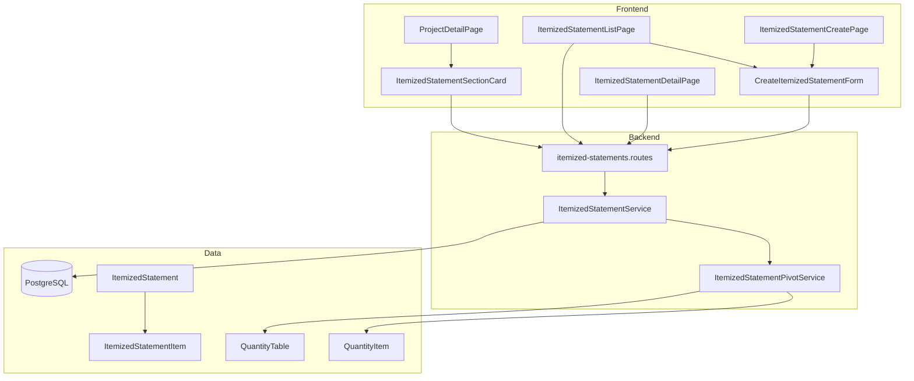
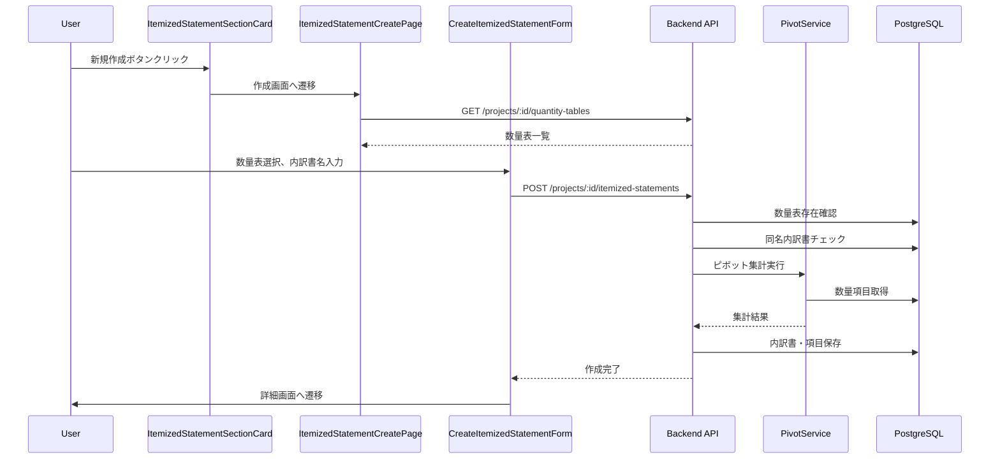
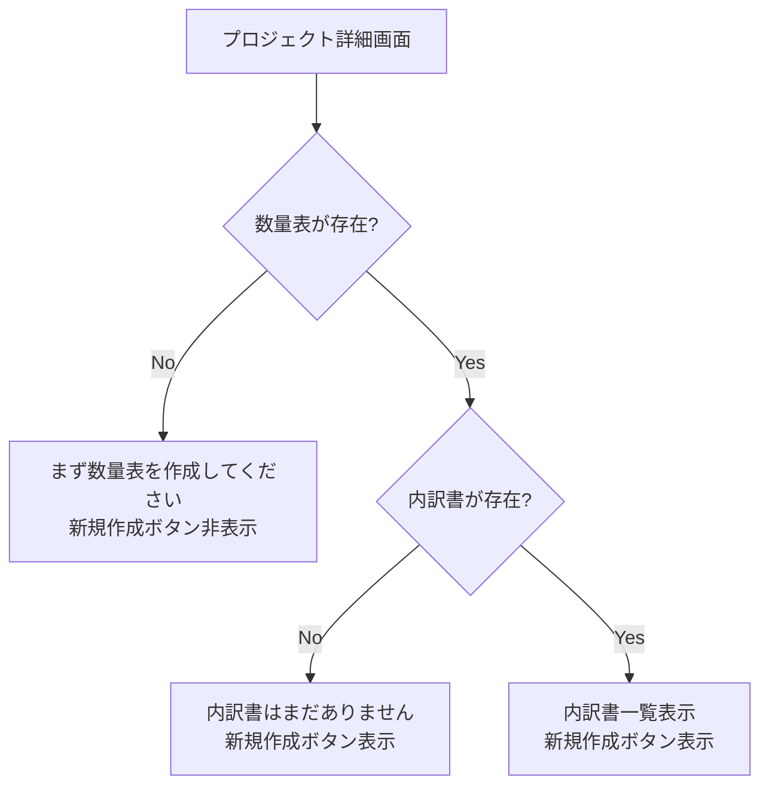
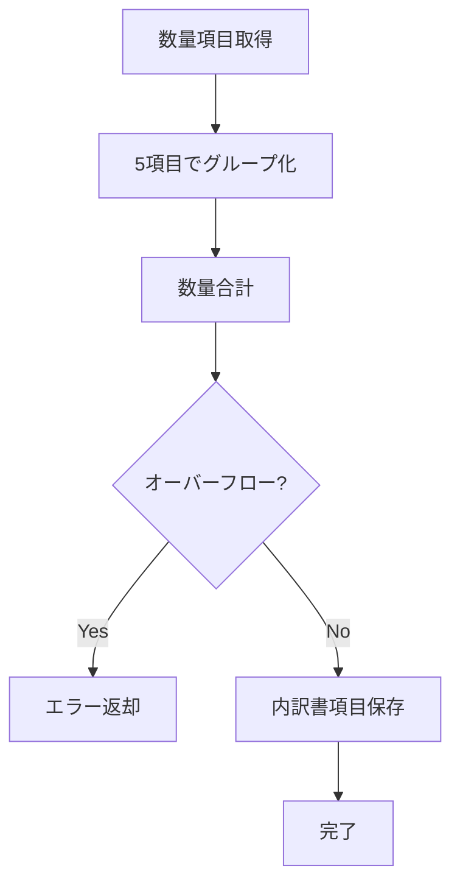
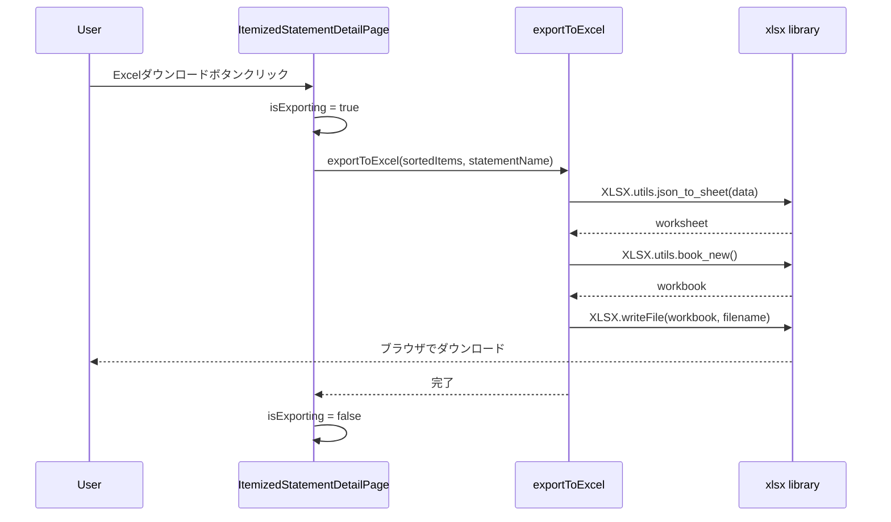
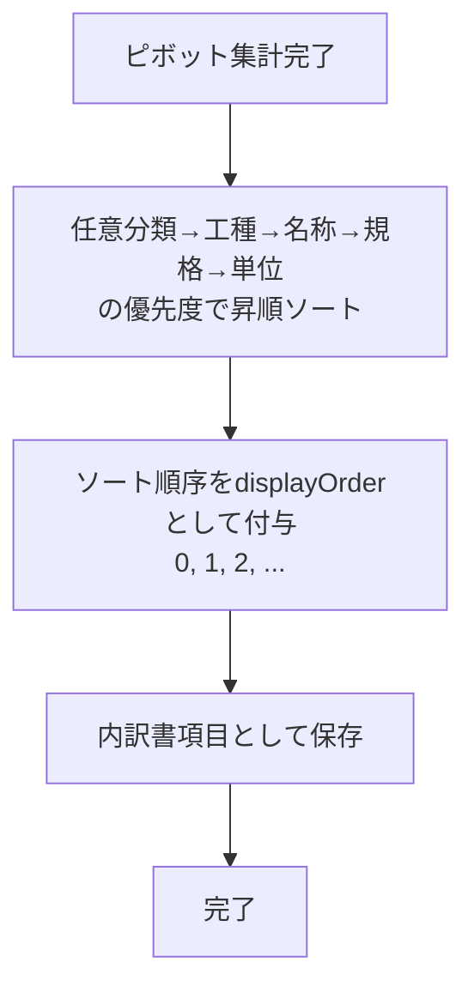
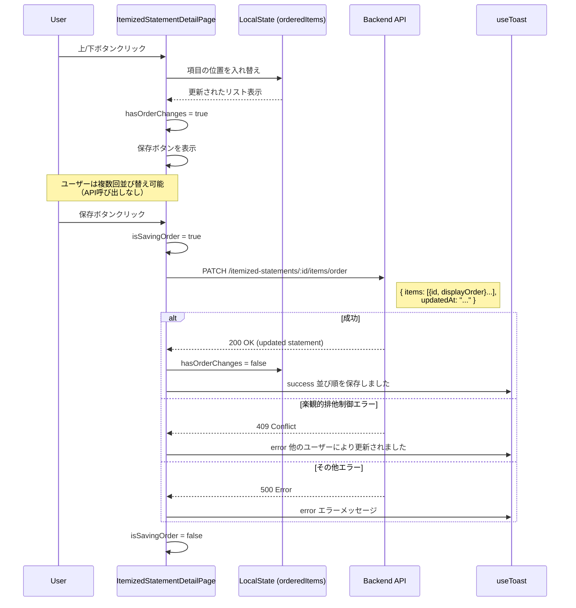
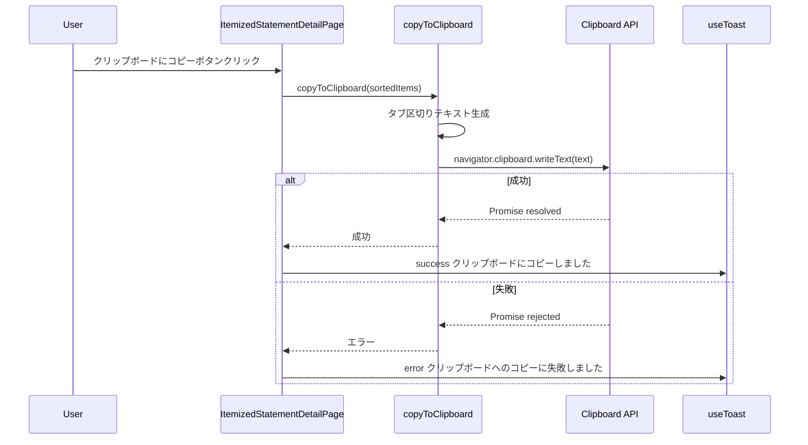
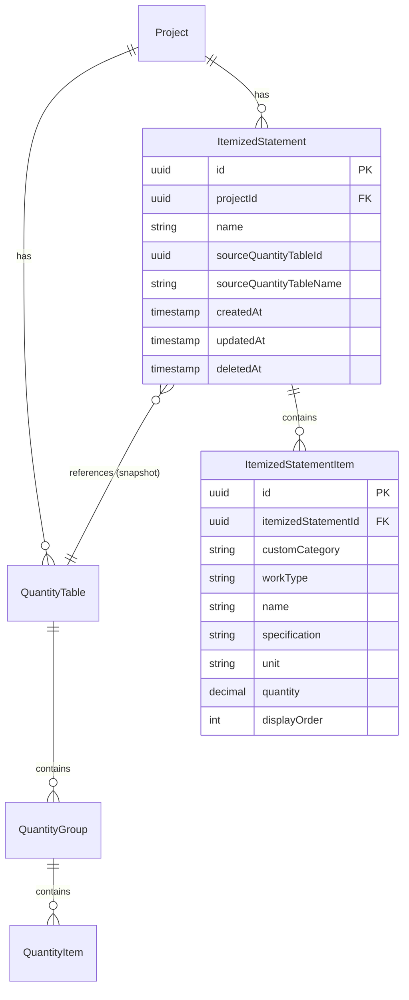

# Technical Design Document: 内訳書作成機能

## Overview

本機能は、プロジェクト配下の数量表項目を「任意分類」「工種」「名称」「規格」「単位」の5項目でピボット集計し、内訳書として保存・閲覧する機能を提供する。内訳書は作成時点のスナップショットとして独立して保持され、元の数量表が変更されても影響を受けない。

**Purpose**: プロジェクト担当者が数量拾い出し結果を分類別に集計した帳票として活用できる。

**Users**: プロジェクト担当者がプロジェクト詳細画面から内訳書を作成・閲覧・削除する。

**Impact**: 既存のプロジェクト詳細画面に内訳書セクションを追加し、数量表セクションと同様の操作感を提供する。専用の内訳書新規作成画面により、現場調査・数量表機能と統一されたUI体験を実現する。

### Goals

- 数量表の項目を5項目の組み合わせでグループ化し、数量を合計した内訳書を作成する
- 内訳書をスナップショットとして独立保持し、数量表変更の影響を受けないようにする
- 内訳書詳細画面でのソート・フィルタリング・ページネーションを提供する
- 内訳書作成時にピボット集計結果を分類順（任意分類→工種→名称→規格→単位）でソートし、初期表示順を設定する
- 内訳書詳細画面での上下ボタンによる手動並び替えと一括保存を提供する
- 既存UIパターン（現場調査・数量表）との一貫性を保ち、操作性を統一する
- 専用作成画面により、数量表有無に応じた適切なユーザーガイダンスを提供する

### Non-Goals

- 複数の数量表をまたいだ集計機能（Requirement 1.5で1つのみ選択可能と定義）
- 内訳書の項目値の編集機能（スナップショットの不変性を維持。ただし表示順序の変更は可能）
- 数量表の自動再計算機能（スナップショット独立性の維持）
- バックエンドでのExcel生成（フロントエンドで完結）
- CSVエクスポート機能（Excel出力とクリップボードコピーで代替）

## Architecture

### Existing Architecture Analysis

本機能は既存の数量表機能を拡張する形で実装する。主要な統合ポイントは以下の通り。

- **プロジェクト詳細画面**: `QuantityTableSectionCard`と同様のパターンで`ItemizedStatementSectionCard`を追加
- **楽観的排他制御**: 既存の`updatedAt`ベースのパターンを踏襲
- **論理削除**: `deletedAt`フィールドによる論理削除パターンを踏襲
- **監査ログ**: 既存の`auditLogService`を使用した操作記録
- **専用作成画面パターン**: `SiteSurveyCreatePage`、`QuantityTableCreatePage`と同様の画面構成

### Architecture Pattern & Boundary Map



**Architecture Integration**:
- Selected pattern: レイヤードアーキテクチャ（既存パターンの踏襲）
- Domain boundaries: 内訳書ドメインは数量表ドメインを参照するが、作成後は独立
- Existing patterns preserved: 楽観的排他制御、論理削除、監査ログ、ページネーション、専用作成画面パターン
- New components rationale: ピボット集計ロジックの分離（`ItemizedStatementPivotService`）、専用作成画面（`ItemizedStatementCreatePage`）
- Steering compliance: TypeScript型安全性、Zodバリデーション、Prisma ORM統合

### Technology Stack

| Layer | Choice / Version | Role in Feature | Notes |
|-------|------------------|-----------------|-------|
| Frontend | React 19.2.0 / TypeScript 5.9.3 | 内訳書UI（作成画面、一覧、詳細） | 既存パターン踏襲 |
| Frontend | xlsx 0.20.3 (SheetJS) | Excelファイル生成 | CDNからインストール（npm公式は古い） |
| Backend | Express 5.2.0 / TypeScript 5.9.3 | API実装 | 既存ルーティングパターン |
| Data | Prisma 7.0.0 / PostgreSQL 15 | 内訳書データ永続化 | 新規テーブル追加 |
| Validation | Zod 4.1.12 | リクエストバリデーション | 既存スキーマパターン |
| Calculation | decimal.js 10.6.0 | 高精度10進数計算 | 小数点以下2桁精度 |

## System Flows

### 内訳書作成フロー（専用作成画面経由）



### 数量表有無による条件分岐フロー



### ピボット集計ロジック



### Excel出力フロー



### ピボット集計結果の初期ソート順序



### 手動並び替えフロー



### クリップボードコピーフロー



> **改訂（2026-10-29、利用者の判断「推奨案で進める」。タスク28.1）**: 上の流れは改訂前の記録として残す。コピーは出力の記録（Requirement 18.9・18.10）を経るよう改め、詳細画面は `copyToClipboard` の書き込みを使わず、user-authentication の `runRecordedClipboardWrite` にタブ区切りテキストの生成（`formatItemsForClipboard`）を渡す。改訂後の流れ（記録の成功の後にだけ中身が入る、記録の失敗では何も書き込まない）は末尾の章「2026-10-29 の追加: クリップボードへのコピーの記録・食い違いの記録・不在の表示」の「決定」が持つ

## Requirements Traceability

| Requirement | Summary | Components | Interfaces | Flows |
|-------------|---------|------------|------------|-------|
| 1.1, 1.2, 1.3, 1.4, 1.5, 1.6, 1.7, 1.9, 1.10 | 内訳書の新規作成 | ItemizedStatementCreatePage, CreateItemizedStatementForm, ItemizedStatementService | createItemizedStatementSchema, POST /itemized-statements | 作成フロー |
| 1.8 | 数量表未存在時のメッセージ | ItemizedStatementSectionCard, ItemizedStatementListPage | - | 条件分岐フロー |
| 2.1, 2.2, 2.3, 2.4, 2.5 | ピボット集計ロジック | ItemizedStatementPivotService | PivotResult, groupAndSum | 集計ロジック |
| 3.1, 3.2, 3.4, 3.5, 3.6 | 内訳書一覧表示 | ItemizedStatementSectionCard, ItemizedStatementListPage | GET /itemized-statements | - |
| 3.3 | 数量表有無による表示分岐 | ItemizedStatementSectionCard | - | 条件分岐フロー |
| 4.1, 4.2, 4.3, 4.4, 4.5, 4.6, 4.7, 4.8, 4.9 | 内訳書詳細画面 | ItemizedStatementDetailPage | GET /itemized-statements/:id | - |
| 5.1, 5.2, 5.3, 5.4, 5.5 | 内訳項目の並び替え | ItemizedStatementDetailPage | sortBy, sortOrder | - |
| 6.1, 6.2, 6.3, 6.4, 6.5, 6.6, 6.7 | 内訳項目のフィルタリング | ItemizedStatementDetailPage | filterParams | - |
| 7.1, 7.2, 7.3, 7.4 | 内訳書の削除 | ItemizedStatementDetailPage, ItemizedStatementService | DELETE /itemized-statements/:id | - |
| 8.1, 8.2, 8.3, 8.4 | スナップショット独立性 | ItemizedStatementService | ItemizedStatementItem | - |
| 9.1, 9.2, 9.3, 9.4, 9.5, 9.6, 9.7 | パンくずナビゲーション | ItemizedStatementListPage, ItemizedStatementDetailPage, ItemizedStatementCreatePage, Breadcrumb | - | - |
| 10.1, 10.2, 10.3, 10.4 | 楽観的排他制御 | ItemizedStatementService | updatedAt | - |
| 11.1, 11.2, 11.3, 11.4, 11.5, 11.6 | プロジェクト詳細画面への統合 | ItemizedStatementSectionCard | - | - |
| 12.1, 12.2, 12.3, 12.4, 12.5 | ローディング表示 | 全UI Components | isLoading state | - |
| 13.1, 13.2, 13.3, 13.4, 13.5, 13.6, 13.7, 13.8 | Excel出力機能 | ItemizedStatementDetailPage, exportToExcel | ExportToExcelOptions | Excel出力フロー |
| 14.1, 14.2, 14.3, 14.4, 14.5, 14.6, 14.7, 14.8 | クリップボード出力機能 | ItemizedStatementDetailPage, copyToClipboard | CopyToClipboardOptions | クリップボードコピーフロー |
| 15.1, 15.2, 15.3, 15.4, 15.5, 15.6, 15.7, 15.8, 15.9 | 内訳書新規作成画面 | ItemizedStatementCreatePage, CreateItemizedStatementForm | - | 作成フロー |
| 16.1, 16.2, 16.3, 16.4 | 内訳項目の初期ソート順序 | ItemizedStatementPivotService | aggregateByQuantityTable | 初期ソート順序 |
| 17.1, 17.2, 17.3, 17.4, 17.5, 17.6, 17.7, 17.8, 17.9, 17.10, 17.11, 17.12, 17.13, 17.14 | 内訳項目の手動並び替え | ItemizedStatementDetailPage, ItemizedStatementService | PATCH /itemized-statements/:id/items/order | 手動並び替えフロー |
| 18.1, 18.2, 18.3, 18.4, 18.5, 18.6, 18.7, 18.8 | 案件の閲覧範囲と出力の記録 | 内訳書の経路, 案件IDの解決関数, 数量表の所属の照合, 並び順の保存の内訳項目の所属の照合, Excel出力の開始の処理 | requireProjectScope, runRecordedExport | - |

> **追記（2026-10-27、利用者の判断。タスク27）**: 18.1〜18.8 は user-authentication の要件39（案件の閲覧範囲）と要件40.9〜40.11（出力の記録）の本機能への適用である。受入基準ごとの追跡は末尾の「Requirement 18: 案件の閲覧範囲と出力の記録の適用」章の追跡表が持つ。本機能の既存の受入基準に、ロールだけで全案件の閲覧・操作を許すと読める条文は無かったため、既存の条文は改訂していない（同章の「既存の条文の検め」節）。

> **追記（2026-10-29、利用者の判断「推奨案で進める」。タスク28・29）**: 本表は行を足していない。18.9・18.10（クリップボードへのコピーの記録）・18.11（プロジェクトの配下の経路の食い違いの記録）と 19.1・19.2（画面が 404 を受けたときの表示）の追跡は、末尾の章「2026-10-29 の追加: クリップボードへのコピーの記録・食い違いの記録・不在の表示」の追跡表が持つ

## Components and Interfaces

| Component | Domain/Layer | Intent | Req Coverage | Key Dependencies | Contracts |
|-----------|--------------|--------|--------------|-----------------|-----------|
| ItemizedStatementService | Backend/Service | 内訳書CRUD、ビジネスロジック、並び順更新 | 1, 3, 4, 7, 8, 10, 17 | PrismaClient (P0), AuditLogService (P1), PivotService (P0) | Service |
| ItemizedStatementPivotService | Backend/Service | ピボット集計・初期ソート | 2, 16 | PrismaClient (P0), Decimal.js (P0) | Service |
| itemized-statements.routes | Backend/Routes | APIエンドポイント定義 | 1, 3, 4, 7, 10, 17 | ItemizedStatementService (P0) | API |
| ItemizedStatementCreatePage | Frontend/Page | 内訳書新規作成画面 | 15 | CreateItemizedStatementForm (P0), quantity-tables API (P1) | State |
| CreateItemizedStatementForm | Frontend/UI | 内訳書作成フォーム | 1, 15 | quantity-tables API (P1) | State |
| ItemizedStatementSectionCard | Frontend/UI | プロジェクト詳細画面の内訳書セクション | 1.8, 3, 11 | - | - |
| ItemizedStatementListPage | Frontend/Page | 内訳書一覧画面 | 3, 9.1, 15.8, 15.9 | itemized-statements API (P0) | State |
| ItemizedStatementDetailPage | Frontend/UI | 内訳書詳細・削除・ソート・フィルタ・出力・手動並び替え | 4, 5, 6, 7, 9, 12, 13, 14, 17 | xlsx (P0), useToast (P1), SortOrderButtons (P0), useUnsavedChanges (P0) | State |
| exportToExcel | Frontend/Utility | Excelファイル生成・ダウンロード | 13 | xlsx (P0) | Function |
| copyToClipboard | Frontend/Utility | タブ区切りテキストのクリップボードコピー | 14 | Clipboard API (P0) | Function |

> **改訂の注記（2026-10-31、機能検証の指摘。利用者の判断「推奨案で進める」）**: 本表と上の Requirements Traceability の 14 の行の `copyToClipboard` は改訂前の記録である。タスク28.1（`0f1970a5`）で詳細画面のコピーの書き込みは user-authentication の `runRecordedClipboardWrite` へ移り、`copyToClipboard` の書き込みの関数は呼び出し元が無くなったため除いた。本部品が持ち続けるのはタブ区切りテキストの生成（`formatItemsForClipboard`）である。現在の正本は末尾の章「2026-10-29 の追加: クリップボードへのコピーの記録・食い違いの記録・不在の表示」の「決定」の節（`copyToClipboard` の扱いの項）

### Backend / Service Layer

#### ItemizedStatementService

| Field | Detail |
|-------|--------|
| Intent | 内訳書のCRUD操作とビジネスロジックを担当 |
| Requirements | 1.1-1.10, 3.1-3.6, 4.1-4.9, 7.1-7.4, 8.1-8.4, 10.1-10.4 |

**Responsibilities & Constraints**
- 内訳書の作成・取得・削除を担当
- ピボット集計の実行をPivotServiceに委譲
- 楽観的排他制御（updatedAt比較）を実装
- 論理削除パターンを使用
- トランザクション境界を管理

**Dependencies**
- Inbound: itemized-statements.routes — APIリクエスト処理 (P0)
- Outbound: PrismaClient — データ永続化 (P0)
- Outbound: ItemizedStatementPivotService — 集計処理 (P0)
- Outbound: AuditLogService — 操作ログ記録 (P1)

**Contracts**: Service [x] / API [ ] / Event [ ] / Batch [ ] / State [ ]

##### Service Interface

```typescript
interface ItemizedStatementServiceDependencies {
  prisma: PrismaClient;
  auditLogService: IAuditLogService;
  pivotService: ItemizedStatementPivotService;
}

interface ItemizedStatementInfo {
  id: string;
  projectId: string;
  name: string;
  sourceQuantityTableId: string;
  sourceQuantityTableName: string;
  itemCount: number;
  createdAt: Date;
  updatedAt: Date;
}

interface ItemizedStatementDetail extends ItemizedStatementInfo {
  project: { id: string; name: string };
  items: ItemizedStatementItemInfo[];
}

interface ItemizedStatementItemInfo {
  id: string;
  customCategory: string | null;
  workType: string | null;
  name: string | null;
  specification: string | null;
  unit: string | null;
  quantity: number; // 小数点以下2桁
  displayOrder: number; // 表示順序（0始まり連番）
}

interface ProjectItemizedStatementSummary {
  totalCount: number;
  latestStatements: ItemizedStatementInfo[];
}

interface PaginatedItemizedStatements {
  data: ItemizedStatementInfo[];
  pagination: {
    page: number;
    limit: number;
    total: number;
    totalPages: number;
  };
}

interface CreateItemizedStatementInput {
  projectId: string;
  name: string;
  quantityTableId: string;
}

interface UpdateItemOrderInput {
  itemizedStatementId: string;
  items: Array<{ id: string; displayOrder: number }>;
  expectedUpdatedAt: Date;
}

class ItemizedStatementService {
  constructor(deps: ItemizedStatementServiceDependencies);

  create(input: CreateItemizedStatementInput, actorId: string): Promise<ItemizedStatementInfo>;
  findById(id: string): Promise<ItemizedStatementDetail | null>;
  findByProjectId(
    projectId: string,
    filter: { search?: string },
    pagination: { page: number; limit: number },
    sort: { sort: 'createdAt' | 'name'; order: 'asc' | 'desc' }
  ): Promise<PaginatedItemizedStatements>;
  findLatestByProjectId(projectId: string, limit?: number): Promise<ProjectItemizedStatementSummary>;
  updateItemOrder(input: UpdateItemOrderInput, actorId: string): Promise<ItemizedStatementDetail>;
  delete(id: string, actorId: string, expectedUpdatedAt: Date): Promise<void>;
}
```

- Preconditions:
  - create: プロジェクトが存在し論理削除されていない、数量表が存在し項目が1件以上
  - updateItemOrder: 内訳書が存在し論理削除されていない、updatedAtが一致、全項目IDが内訳書に属する
  - delete: 内訳書が存在し論理削除されていない、updatedAtが一致
- Postconditions:
  - create: 内訳書と集計済み項目がソート済みdisplayOrderでスナップショットとして保存される
  - updateItemOrder: 全項目のdisplayOrderが更新され、内訳書のupdatedAtが更新される
  - delete: 内訳書が論理削除される
- Invariants: 作成済み内訳書は元データの変更に影響されない

#### ItemizedStatementPivotService

| Field | Detail |
|-------|--------|
| Intent | 数量項目のピボット集計ロジックを担当 |
| Requirements | 2.1-2.5 |

**Responsibilities & Constraints**
- 5項目（任意分類、工種、名称、規格、単位）でグループ化
- 同一グループの数量を合計
- null/空文字を同一グループとして扱う
- 小数点以下2桁精度で計算
- オーバーフロー検出（-999999.99 〜 9999999.99）
- 集計結果を「任意分類」「工種」「名称」「規格」「単位」の優先度で昇順ソートして返却する（Requirement 16）

**Dependencies**
- Inbound: ItemizedStatementService — 集計処理呼び出し (P0)
- Outbound: PrismaClient — 数量項目取得 (P0)
- External: decimal.js — 高精度計算 (P0)

**Contracts**: Service [x] / API [ ] / Event [ ] / Batch [ ] / State [ ]

##### Service Interface

```typescript
interface PivotGroupKey {
  customCategory: string | null;
  workType: string | null;
  name: string | null;
  specification: string | null;
  unit: string | null;
}

interface PivotResultItem extends PivotGroupKey {
  quantity: number; // 小数点以下2桁
}

interface PivotResult {
  items: PivotResultItem[];
  sourceItemCount: number;
}

class ItemizedStatementPivotService {
  constructor(deps: { prisma: PrismaClient });

  aggregateByQuantityTable(quantityTableId: string): Promise<PivotResult>;
}
```

- Preconditions: 数量表が存在し、項目が1件以上存在する
- Postconditions: グループ化された集計結果が返却される
- Invariants: 合計値が許容範囲内（-999999.99 〜 9999999.99）

**Implementation Notes**
- Integration: Decimal.jsを使用して浮動小数点誤差を回避
- Validation: オーバーフロー検出時はQuantityOverflowErrorをスロー
- Risks: 大量データ時のメモリ使用量（項目数上限2000件で制限）

### Backend / Routes Layer

#### itemized-statements.routes

| Field | Detail |
|-------|--------|
| Intent | 内訳書APIエンドポイントの定義 |
| Requirements | 1.1-1.10, 3.1-3.6, 4.1-4.9, 7.1-7.4, 10.1-10.4 |

**Contracts**: Service [ ] / API [x] / Event [ ] / Batch [ ] / State [ ]

##### API Contract

| Method | Endpoint | Request | Response | Errors |
|--------|----------|---------|----------|--------|
| POST | /api/projects/:projectId/itemized-statements | CreateItemizedStatementRequest | ItemizedStatementInfo | 400, 404（プロジェクトなし・閲覧範囲外は汎用の `NOT_FOUND`。数量表なし・経路のプロジェクトに属さない数量表は `QUANTITY_TABLE_NOT_FOUND`）, 409, 422（数量のオーバーフロー。`QUANTITY_OVERFLOW`）, 500 |
| GET | /api/projects/:projectId/itemized-statements | QueryParams | PaginatedItemizedStatements | 400, 404（プロジェクトなし・閲覧範囲外。汎用の `NOT_FOUND`）, 500 |
| GET | /api/projects/:projectId/itemized-statements/latest | { limit?: number } | ProjectItemizedStatementSummary | 400, 404（プロジェクトなし・閲覧範囲外。汎用の `NOT_FOUND`）, 500 |
| GET | /api/itemized-statements/:id | - | ItemizedStatementDetail | 400（ID の形式不正）, 404（内訳書なし・閲覧範囲外は汎用の `NOT_FOUND`。範囲内の論理削除済みは `ITEMIZED_STATEMENT_NOT_FOUND`）, 500 |
| DELETE | /api/itemized-statements/:id | { updatedAt: string } | void | 400, 404（内訳書なし・閲覧範囲外は汎用の `NOT_FOUND`。範囲内の論理削除済みは `ITEMIZED_STATEMENT_NOT_FOUND`）, 409, 500 |
| PATCH | /api/itemized-statements/:id/items/order | UpdateItemOrderRequest | ItemizedStatementDetail | 400（対象の内訳書に属さない内訳項目の ID を含む場合を含む）, 404（内訳書なし・閲覧範囲外は汎用の `NOT_FOUND`。範囲内の論理削除済みは `ITEMIZED_STATEMENT_NOT_FOUND`）, 409, 500 |

- ミドルウェアは全経路で `authenticate` + `requirePermission` + 経路の ID の形式の検査（`projectIdParamSchema` または `itemizedStatementIdParamSchema`）+ 案件の閲覧範囲の判定部品（作成・一覧・直近は `requireProjectParamScope('projectId')`、`/:id` 配下は `requireItemizedStatementProjectScope('id')`。Requirement 18）の順とし、その後に本文の検査と本体を置く
- `/:id` 配下の 3 経路は `/api/projects/:projectId/itemized-statements/:id` からも届く（二重マウント）。判定は経路の `projectId` でなく内訳書の案件で行い、経路の `projectId` と内訳書の案件が食い違えば内訳書の不在と同じ汎用の 404 にする
- **改訂（2026-10-28、タスク27.1）**: 上の表の Errors とミドルウェアの箇条を実装に合わせて改めた。改訂前の Errors は、POST が「400, 404, 409, 500」、一覧と直近が「400, 500」、詳細が「404, 500」、DELETE と PATCH が「400, 404, 409, 500」で、ミドルウェアの箇条と二重マウントの箇条は無かった。理由は、Requirement 18 の適用で全経路に閲覧範囲の判定部品を置いたことである。これにより振る舞いが次のとおり変わった。存在しない内訳書の 404 は、従来の `ITEMIZED_STATEMENT_NOT_FOUND`（本文に要求した ID を含む）から範囲外と区別しない汎用の `NOT_FOUND` になった。存在しないプロジェクトを指定した一覧と直近は、従来は空の 200 を返していたが 404 になる。存在しないプロジェクトを指定した作成は、従来はプロジェクトを照合しなかった（数量表があれば作成へ進み、外部キーの違反の 500 になりえた）が、判定部品の 404 になる。作成の要求が経路のプロジェクトに属さない数量表を指すと、数量表の不在と同じ 404 になる（18.4）。詳細の 400（ID の形式不正）は従来から返していたが表に無かったため書き足した。POST の 422（数量のオーバーフロー。経路が `QuantityOverflowError` を 422 に変換する）も従来から返していたが改訂前の表に無かった（本タスクの前からの欠陥）ため、あわせて書き足した

**Error Responses**:
- 400 Bad Request: バリデーションエラー（必須項目未入力、形式不正）
- 404 Not Found: リソース未発見（プロジェクト、数量表、内訳書）。閲覧範囲外のプロジェクト・内訳書の指定も、存在しない場合と同じ汎用の 404（`NOT_FOUND`）とする（Requirement 18.2・18.3。2026-10-28、タスク27.1 で追記）
- 409 Conflict: 同名の内訳書が既に存在、楽観的排他制御エラー、オーバーフローエラー
- 422 Unprocessable Entity: 数量のオーバーフロー（`QUANTITY_OVERFLOW`）。2026-10-28、タスク27.1 で追記。上の 409 の「オーバーフローエラー」は当初の設計の記述として残すが、実装は作成の経路で `QuantityOverflowError` を 422 に変換して返す
- 500 Internal Server Error: サーバー内部エラー

### Frontend / Page Layer

#### ItemizedStatementCreatePage

| Field | Detail |
|-------|--------|
| Intent | 内訳書新規作成画面（専用ページ） |
| Requirements | 15.1, 15.2, 15.3, 15.4, 15.5, 15.6, 15.7, 9.1, 9.2 |

**Responsibilities & Constraints**
- 内訳書名入力フィールド（デフォルト値「内訳書」）
- 数量表選択リスト
- 作成/キャンセルボタン
- パンくずナビゲーション（ダッシュボード > プロジェクト一覧 > {プロジェクト名} > 内訳書一覧 > 新規作成）
- プロジェクト詳細画面への戻りリンク
- SiteSurveyCreatePage、QuantityTableCreatePageと同様のレイアウト

**Dependencies**
- Outbound: quantity-tables API — 数量表一覧取得 (P1)
- Outbound: CreateItemizedStatementForm — フォームコンポーネント (P0)
- Outbound: Breadcrumb — ナビゲーション表示 (P1)

**Contracts**: Service [ ] / API [ ] / Event [ ] / Batch [ ] / State [x]

##### State Management

```typescript
interface ItemizedStatementCreatePageState {
  // プロジェクト情報
  project: ProjectDetail | null;
  isLoadingProject: boolean;
  projectError: string | null;

  // 数量表情報
  quantityTables: QuantityTableInfo[];
  isLoadingQuantityTables: boolean;
  quantityTablesError: string | null;

  // 作成状態
  isCreating: boolean;
  createError: string | null;
}
```

**Implementation Notes**
- Integration: 既存のSiteSurveyCreatePage、QuantityTableCreatePageと同様の構造を採用
- Validation: 数量表が存在しない場合の適切なエラーメッセージ表示
- Risks: 数量表が0件の場合はフォームを表示しつつ、選択必須のバリデーションで対応

### Frontend / UI Layer

#### CreateItemizedStatementForm

| Field | Detail |
|-------|--------|
| Intent | 内訳書作成フォームUI（再利用可能コンポーネント） |
| Requirements | 1.1-1.10, 15.3, 15.4, 15.5, 15.6, 15.7 |

**Responsibilities & Constraints**
- 数量表選択ドロップダウン（1つのみ選択可能）
- 内訳書名入力（最大200文字、デフォルト「内訳書」）
- バリデーションエラー表示
- ローディング状態の管理
- 作成成功時のコールバック実行

**Dependencies**
- Outbound: itemized-statements API — 内訳書作成 (P0)

**Contracts**: Service [ ] / API [ ] / Event [ ] / Batch [ ] / State [x]

##### State Management

```typescript
interface CreateItemizedStatementFormState {
  quantityTableId: string;
  name: string;
  isSubmitting: boolean;
  errors: {
    quantityTableId?: string;
    name?: string;
    general?: string;
  };
}

interface CreateItemizedStatementFormProps {
  projectId: string;
  quantityTables: Array<{ id: string; name: string; itemCount: number }>;
  onSuccess: (statement: ItemizedStatementInfo) => void;
  onCancel: () => void;
  /** 内訳書名のデフォルト値（デフォルト: "内訳書"） */
  defaultName?: string;
  /** テスト用送信関数（オプション） */
  onSubmit?: (input: CreateItemizedStatementInput) => Promise<ItemizedStatementInfo>;
}
```

**Implementation Notes**
- Validation: 数量表未選択、内訳書名未入力、項目数0件のチェック
- Risks: 数量表なしの場合は作成ボタン無効化

#### ItemizedStatementSectionCard

| Field | Detail |
|-------|--------|
| Intent | プロジェクト詳細画面の内訳書セクション |
| Requirements | 1.8, 3.1-3.6, 11.1-11.6 |

**Responsibilities & Constraints**
- QuantityTableSectionCardと同様のレイアウト・スタイル
- 数量表有無に応じた条件分岐表示:
  - 数量表なし: 「まず数量表を作成してください」（新規作成ボタン非表示）
  - 数量表あり・内訳書なし: 「内訳書はまだありません」（新規作成ボタン表示）
  - 数量表あり・内訳書あり: 内訳書一覧（新規作成ボタン表示）
- 新規作成ボタンクリックで内訳書新規作成画面へ遷移

**Dependencies**
- Outbound: itemized-statements API — 最新内訳書取得 (P1)

**Contracts**: Service [ ] / API [ ] / Event [ ] / Batch [ ] / State [x]

##### State Management

```typescript
interface ItemizedStatementSectionCardProps {
  /** プロジェクトID */
  projectId: string;
  /** 内訳書の総数 */
  totalCount: number;
  /** 直近N件の内訳書 */
  latestStatements: ItemizedStatementInfo[];
  /** 利用可能な数量表一覧 */
  quantityTables: QuantityTableInfo[];
  /** ローディング状態 */
  isLoading: boolean;
}
```

**Implementation Notes**
- Integration: 新規作成ボタンは`/projects/${projectId}/itemized-statements/new`へのLinkとして実装
- Validation: 数量表が存在しない場合は新規作成ボタンを非表示
- 変更点: インライン作成フォームから専用作成画面へのナビゲーションに変更

#### ItemizedStatementListPage

| Field | Detail |
|-------|--------|
| Intent | 内訳書一覧画面（専用ページ） |
| Requirements | 3.2-3.6, 9.1, 15.8, 15.9 |

**Responsibilities & Constraints**
- 作成済み内訳書を作成日時の降順で一覧表示
- パンくずナビゲーション（ダッシュボード > プロジェクト一覧 > {プロジェクト名} > 内訳書一覧）
- 数量表有無に応じた条件分岐表示:
  - 数量表なし: 「まず数量表を作成してください」（新規作成ボタン非表示）
  - 数量表あり・内訳書なし: 「内訳書はまだありません」（新規作成ボタン表示）
- 新規作成ボタンクリックで内訳書新規作成画面へ遷移
- キャンセル時は内訳書一覧画面に戻る

**Dependencies**
- Outbound: itemized-statements API — 内訳書一覧取得 (P0)
- Outbound: quantity-tables API — 数量表一覧取得 (P1)
- Outbound: Breadcrumb — ナビゲーション表示 (P1)

**Contracts**: Service [ ] / API [ ] / Event [ ] / Batch [ ] / State [x]

**Implementation Notes**
- Integration: 新規作成ボタンは`/projects/${projectId}/itemized-statements/new`へのLinkとして実装
- 変更点: インライン作成フォームから専用作成画面へのナビゲーションに変更
- パンくず: ダッシュボード > プロジェクト一覧 > {プロジェクト名} > 内訳書一覧

#### ItemizedStatementDetailPage

| Field | Detail |
|-------|--------|
| Intent | 内訳書詳細表示、ソート、フィルタリング、削除、Excel出力、クリップボードコピー |
| Requirements | 4.1-4.9, 5.1-5.5, 6.1-6.7, 7.1-7.4, 9.3-9.7, 12.1-12.5, 13.1-13.8, 14.1-14.8 |

**Responsibilities & Constraints**
- テーブル形式での項目表示（任意分類、工種、名称、規格、数量、単位の順）
- カラムヘッダーによるソート切り替え
- フィルタ入力によるAND条件絞り込み
- ページネーション（50件/ページ、最大2000件）
- 削除確認ダイアログと楽観的排他制御エラー表示
- Excel出力ボタン（.xlsx形式でダウンロード）
- クリップボードコピーボタン（タブ区切り形式）

**Dependencies**
- Outbound: itemized-statements API — 詳細取得、削除 (P0)
- Outbound: Breadcrumb — ナビゲーション表示 (P1)
- External: xlsx — Excel生成ライブラリ (P0)
- External: Clipboard API — クリップボード操作 (P0)
- Outbound: useToast — 成功・エラー通知 (P1)

**Contracts**: Service [ ] / API [ ] / Event [ ] / Batch [ ] / State [x]

##### State Management

```typescript
interface ItemizedStatementDetailPageState {
  statement: ItemizedStatementDetail | null;
  isLoading: boolean;
  isDeleting: boolean;
  isExporting: boolean; // Excel出力中フラグ
  error: string | null;
  showDeleteDialog: boolean;

  // ソート状態
  sortColumn: 'customCategory' | 'workType' | 'name' | 'specification' | 'unit' | 'quantity';
  sortDirection: 'asc' | 'desc';

  // フィルタ状態
  filters: {
    customCategory: string;
    workType: string;
    name: string;
    specification: string;
    unit: string;
  };

  // ページネーション状態
  currentPage: number;
  pageSize: number;

  // 手動並び替え状態（Requirement 17）
  orderedItems: ItemizedStatementItemInfo[]; // ローカルで管理する並び替え済み項目リスト
  hasOrderChanges: boolean; // 未保存の並び替え変更があるか
  isSavingOrder: boolean; // 並び順保存中フラグ
}
```

**Implementation Notes**
- Integration: クライアントサイドでのソート・フィルタ実装（最大2000件のため）
- Validation: フィルタ結果0件時のメッセージ表示
- Risks: 大量データ時のレンダリングパフォーマンス（仮想スクロール検討可）
- Excel出力・クリップボードコピーはフィルタ後のデータ（sortedItems）を対象とする
- 手動並び替え: orderedItemsをローカルStateで管理し、上下ボタン操作時はState更新のみ行う。保存ボタン押下時に1回のPATCHリクエストで全項目のdisplayOrderを一括更新する。フィルタ・カラムソートが適用されている場合は並び替えボタンを非表示とする
- 離脱防止: beforeunloadイベントとReact Routerのブロック機能で未保存の並び替え変更がある場合に確認ダイアログを表示する
- ページネーション×並び替え方針: 内訳書の全項目はAPI応答時に一括取得済み（最大2000件）のため、並び替え操作はクライアント側で全件に対して行う。ページネーションはあくまで表示制御であり、上下ボタンはページ境界を越えて前後ページの項目と入れ替え可能とする。保存時は全項目のdisplayOrderを送信する
- デフォルト表示順の移行方針: Requirement 16の導入により、デフォルト表示順（sortState.column === null時）は既存のapplyDefaultSort（クライアントサイドの任意分類→工種→名称→規格昇順ソート）からdisplayOrder昇順表示に変更する。カラムヘッダークリックによるソートは従来通りクライアントサイドで適用し、ソート解除時はdisplayOrder順に戻る。これにより手動並び替え後の表示順序が保持される。Requirement 5.5のデフォルトソート順は、初回作成時のdisplayOrder設定により「任意分類→工種→名称→規格→単位」昇順と同等の結果となる

### Frontend / Utility Layer

#### exportToExcel

| Field | Detail |
|-------|--------|
| Intent | 内訳書データをExcelファイル（.xlsx形式）として生成・ダウンロード |
| Requirements | 13.1, 13.2, 13.3, 13.4, 13.5, 13.6, 13.7, 13.8 |

**Responsibilities & Constraints**
- フィルタ後のデータ（sortedItems）をExcelワークシートに変換
- ヘッダー行を含む形式でシートを生成
- 数量カラムは数値型として出力（小数点以下2桁精度維持）
- ファイル名は `{内訳書名}_{YYYYMMDD}.xlsx` 形式
- 生成中はローディングインジケーターを表示

**Dependencies**
- External: xlsx (SheetJS) — Excelファイル生成 (P0)

**Contracts**: Service [ ] / API [ ] / Event [ ] / Batch [ ] / State [ ] / Function [x]

##### Function Interface

```typescript
/**
 * Excelエクスポートオプション
 */
interface ExportToExcelOptions {
  /** 内訳書項目一覧（フィルタ・ソート適用後） */
  items: ItemizedStatementItemInfo[];
  /** 内訳書名（ファイル名に使用） */
  statementName: string;
}

/**
 * Excelエクスポート結果
 */
interface ExportToExcelResult {
  success: boolean;
  error?: string;
}

/**
 * 内訳書データをExcelファイルとしてダウンロード
 *
 * Requirements:
 * - 13.2: .xlsx形式でファイル生成
 * - 13.3: 任意分類、工種、名称、規格、数量、単位のカラム
 * - 13.4: ファイル名は {内訳書名}_{YYYYMMDD}.xlsx
 * - 13.5: 数量は数値として出力、小数点以下2桁精度
 * - 13.6: フィルタ適用後のデータのみ出力
 *
 * @param options - エクスポートオプション
 * @returns エクスポート結果
 */
function exportToExcel(options: ExportToExcelOptions): ExportToExcelResult;
```

- Preconditions: items配列が定義されていること
- Postconditions: Excelファイルがダウンロードされる、またはエラーが返却される
- Invariants: ファイルの内容はitemsの内容と一致

**Implementation Notes**
- Integration: SheetJS (xlsx) ライブラリを使用。npm公式ではなくSheetJS CDNからインストール
- Validation: 項目が0件の場合でもヘッダーのみのExcelを生成
- Risks: 大量データ（2000件）での生成時間（通常は1秒未満）

#### copyToClipboard

| Field | Detail |
|-------|--------|
| Intent | 内訳書データをタブ区切り形式でクリップボードにコピー |
| Requirements | 14.1, 14.2, 14.3, 14.4, 14.5, 14.6, 14.7, 14.8 |

**Responsibilities & Constraints**
- フィルタ後のデータ（sortedItems）をタブ区切りテキストに変換
- ヘッダー行（任意分類、工種、名称、規格、数量、単位）を含める
- 各行はタブ文字（\t）で区切り、行末は改行文字（\n）で終端
- 数量は小数点以下2桁の文字列として出力
- コピー成功時はトースト通知を表示
- コピー失敗時はエラートーストを表示

**Dependencies**
- External: Clipboard API (navigator.clipboard) — クリップボード操作 (P0)

**Contracts**: Service [ ] / API [ ] / Event [ ] / Batch [ ] / State [ ] / Function [x]

##### Function Interface

```typescript
/**
 * クリップボードコピーオプション
 */
interface CopyToClipboardOptions {
  /** 内訳書項目一覧（フィルタ・ソート適用後） */
  items: ItemizedStatementItemInfo[];
}

/**
 * クリップボードコピー結果
 */
interface CopyToClipboardResult {
  success: boolean;
  error?: string;
}

/**
 * 内訳書データをタブ区切り形式でクリップボードにコピー
 *
 * Requirements:
 * - 14.2: タブ区切り形式でコピー
 * - 14.3: ヘッダー行を含む
 * - 14.4: 各行はタブ文字で区切り、行末は改行文字
 * - 14.5: フィルタ適用後のデータのみコピー
 * - 14.8: 数量は小数点以下2桁の文字列
 *
 * @param options - コピーオプション
 * @returns コピー結果（Promise）
 */
async function copyToClipboard(options: CopyToClipboardOptions): Promise<CopyToClipboardResult>;
```

- Preconditions: items配列が定義されていること、Clipboard APIが利用可能
- Postconditions: クリップボードにタブ区切りテキストがコピーされる、またはエラーが返却される
- Invariants: コピーされたテキストはitemsの内容と一致

**Implementation Notes**
- Integration: navigator.clipboard.writeText() を使用（async/await）
- Validation: Clipboard APIが利用不可の場合はエラーを返却
- Risks: HTTPSでないローカル環境ではClipboard APIが制限される可能性あり（開発環境は除外）

> **改訂（2026-10-29、利用者の判断「推奨案で進める」。タスク28.1）**: 詳細画面のコピーは出力の記録を経るため、書き込みを本部品の `copyToClipboard` から user-authentication の `runRecordedClipboardWrite` へ移す。本部品はタブ区切りテキストの生成（`formatItemsForClipboard`。14.2〜14.4・14.8）を持ち続ける。`copyToClipboard` の書き込みの関数を残すか除くかは実装時に決める（末尾の章「2026-10-29 の追加: クリップボードへのコピーの記録・食い違いの記録・不在の表示」の「決定」）

### Frontend / Routing Layer

#### ルーティング設定

| Field | Detail |
|-------|--------|
| Intent | 内訳書機能のルーティング定義 |
| Requirements | 15.1, 15.8, 15.9 |

**新規追加ルート**:

```typescript
// 内訳書新規作成画面（/projects/:projectId/itemized-statements より先に定義する必要あり）
// REQ-15.1: 内訳書新規作成画面を独立したページとして提供する
// REQ-9.2: パンくずナビゲーション「ダッシュボード > プロジェクト一覧 > {プロジェクト名} > 内訳書一覧 > 新規作成」
{
  path: '/projects/:projectId/itemized-statements/new',
  element: <ItemizedStatementCreatePage />,
}
```

**Implementation Notes**
- Integration: 既存のルーティングパターン（`/projects/:projectId/quantity-tables/new`、`/projects/:projectId/site-surveys/new`）を踏襲
- 変更点: 内訳書一覧画面（`/projects/:projectId/itemized-statements`）より先に定義

## Data Models

### Domain Model



**Aggregates and boundaries**:
- ItemizedStatement: 集約ルート。プロジェクトに紐付く内訳書を管理
- ItemizedStatementItem: 集約内のエンティティ。内訳書に紐付く集計済み項目

**Business rules & invariants**:
- 内訳書作成後は元の数量表・項目の変更に影響されない（スナップショット）
- 同一プロジェクト内で同名の内訳書は作成不可
- 数量の合計値は -999999.99 〜 9999999.99 の範囲内

### Logical Data Model

**Structure Definition**:

| Entity | Attribute | Type | Constraints | Notes |
|--------|-----------|------|-------------|-------|
| ItemizedStatement | id | UUID | PK | 内訳書ID |
| ItemizedStatement | projectId | UUID | FK → Project, NOT NULL | プロジェクトID |
| ItemizedStatement | name | VARCHAR(200) | NOT NULL | 内訳書名 |
| ItemizedStatement | sourceQuantityTableId | UUID | NOT NULL | 集計元数量表ID（参照情報のみ） |
| ItemizedStatement | sourceQuantityTableName | VARCHAR(200) | NOT NULL | 集計元数量表名（スナップショット） |
| ItemizedStatement | createdAt | TIMESTAMP | NOT NULL, DEFAULT NOW() | 作成日時 |
| ItemizedStatement | updatedAt | TIMESTAMP | NOT NULL, @updatedAt | 更新日時 |
| ItemizedStatement | deletedAt | TIMESTAMP | NULL | 論理削除日時 |
| ItemizedStatementItem | id | UUID | PK | 項目ID |
| ItemizedStatementItem | itemizedStatementId | UUID | FK → ItemizedStatement, CASCADE DELETE | 内訳書ID |
| ItemizedStatementItem | customCategory | VARCHAR(100) | NULL | 任意分類 |
| ItemizedStatementItem | workType | VARCHAR(100) | NULL | 工種 |
| ItemizedStatementItem | name | VARCHAR(200) | NULL | 名称 |
| ItemizedStatementItem | specification | VARCHAR(500) | NULL | 規格 |
| ItemizedStatementItem | unit | VARCHAR(50) | NULL | 単位 |
| ItemizedStatementItem | quantity | DECIMAL(10,2) | NOT NULL | 数量 |
| ItemizedStatementItem | displayOrder | INT | NOT NULL | 表示順序 |

**Consistency & Integrity**:
- プロジェクト削除時は内訳書もカスケード削除
- 内訳書削除時は項目もカスケード削除
- 楽観的排他制御による同時更新の検出

### Physical Data Model

**For PostgreSQL**:

```sql
-- 内訳書テーブル
CREATE TABLE itemized_statements (
  id UUID PRIMARY KEY DEFAULT gen_random_uuid(),
  project_id UUID NOT NULL REFERENCES projects(id) ON DELETE CASCADE,
  name VARCHAR(200) NOT NULL,
  source_quantity_table_id UUID NOT NULL,
  source_quantity_table_name VARCHAR(200) NOT NULL,
  created_at TIMESTAMP NOT NULL DEFAULT NOW(),
  updated_at TIMESTAMP NOT NULL DEFAULT NOW(),
  deleted_at TIMESTAMP NULL,

  -- 一意制約は部分インデックスで実装（deleted_atがNULLの場合のみ適用）
);

-- インデックス
CREATE INDEX idx_itemized_statements_project_id ON itemized_statements(project_id);
CREATE INDEX idx_itemized_statements_deleted_at ON itemized_statements(deleted_at);

-- 同名内訳書の一意制約（論理削除されていないレコードのみ）
CREATE UNIQUE INDEX idx_unique_name_per_project
  ON itemized_statements(project_id, name)
  WHERE deleted_at IS NULL;
CREATE INDEX idx_itemized_statements_created_at ON itemized_statements(created_at);

-- 内訳書項目テーブル
CREATE TABLE itemized_statement_items (
  id UUID PRIMARY KEY DEFAULT gen_random_uuid(),
  itemized_statement_id UUID NOT NULL REFERENCES itemized_statements(id) ON DELETE CASCADE,
  custom_category VARCHAR(100) NULL,
  work_type VARCHAR(100) NULL,
  name VARCHAR(200) NULL,
  specification VARCHAR(500) NULL,
  unit VARCHAR(50) NULL,
  quantity DECIMAL(10, 2) NOT NULL,
  display_order INT NOT NULL
);

-- インデックス
CREATE INDEX idx_itemized_statement_items_statement_id ON itemized_statement_items(itemized_statement_id);
CREATE INDEX idx_itemized_statement_items_display_order ON itemized_statement_items(itemized_statement_id, display_order);
```

### Data Contracts & Integration

**API Data Transfer**:

```typescript
// 作成リクエスト
interface CreateItemizedStatementRequest {
  name: string;           // 1-200文字、必須
  quantityTableId: string; // UUID、必須
}

// 一覧レスポンス
interface ItemizedStatementListResponse {
  data: ItemizedStatementInfo[];
  pagination: {
    page: number;
    limit: number;
    total: number;
    totalPages: number;
  };
}

// 詳細レスポンス
interface ItemizedStatementDetailResponse {
  id: string;
  projectId: string;
  name: string;
  sourceQuantityTableId: string;
  sourceQuantityTableName: string;
  itemCount: number;
  createdAt: string;      // ISO 8601
  updatedAt: string;      // ISO 8601
  project: { id: string; name: string };
  items: Array<{
    id: string;
    customCategory: string | null;
    workType: string | null;
    name: string | null;
    specification: string | null;
    unit: string | null;
    quantity: number;     // 小数点以下2桁
    displayOrder: number; // 表示順序（0始まり連番）
  }>;
}

// 並び順更新リクエスト
interface UpdateItemOrderRequest {
  items: Array<{
    id: string;            // 項目ID（UUID）
    displayOrder: number;  // 新しい表示順序（0始まり連番）
  }>;
  updatedAt: string;       // ISO 8601、楽観的排他制御用
}

// 削除リクエスト
interface DeleteItemizedStatementRequest {
  updatedAt: string;      // ISO 8601、楽観的排他制御用
}
```

## Error Handling

### Error Strategy

| Error Type | HTTP Status | User Message | Recovery |
|------------|-------------|--------------|----------|
| ValidationError | 400 | フィールドごとのエラーメッセージ | 入力修正 |
| QuantityTableNotFoundError | 404 | 指定された数量表が見つかりません | 数量表選択し直し |
| ItemizedStatementNotFoundError | 404 | 指定された内訳書が見つかりません | 一覧に戻る |
| DuplicateNameError | 409 | 同名の内訳書が既に存在します | 名前変更 |
| OptimisticLockError | 409 | 他のユーザーにより更新されました。画面を再読み込みしてください | 画面リロード |
| QuantityOverflowError | 422 | 数量の合計が許容範囲を超えています | 数量表の項目修正 |
| EmptyQuantityItemsError | 400 | 選択された数量表に項目がありません | 別の数量表選択 |
| ExcelExportError | N/A (Frontend) | Excelファイルの生成に失敗しました | 再試行ボタン |
| ClipboardError | N/A (Frontend) | クリップボードへのコピーに失敗しました | 手動でコピー |
| InvalidItemOrderError | 400 | 並び順データが不正です | 画面リロード |
| ItemNotBelongError | 400 | 指定された項目がこの内訳書に属していません | 画面リロード |

### Error Categories and Responses

**User Errors (4xx)**:
- 400: Zodバリデーションエラー → フィールドレベルメッセージ表示
- 404: リソース未発見 → 一覧画面へ誘導
  - **追記（2026-10-27、タスク27）**: 閲覧範囲外のプロジェクトの指定と、閲覧範囲外のプロジェクトに属する内訳書の指定、内訳書の作成の要求が経路のプロジェクトに属さない数量表を指す場合も、存在しない場合と区別しない 404 とする（Requirement 18.2〜18.4）。範囲外を 403 で返す経路は無い
- 409: 競合エラー（同名重複、楽観的排他制御） → 具体的なアクション指示
  - **是正の記録（2026-10-30）**: 不具合: 内訳書詳細画面の削除と並び順の保存は、楽観的排他制御の 409（Requirement 10.4・17.14）を、エラーが `status` の属性を持ち 409 であるかで判定していた。frontend の `ApiError` は `statusCode` しか持たないため、実際の API の 409 はこの判定に当たらず、その他のエラーの分岐へ落ちてサーバーの detail（`ItemizedStatementConflictError` の文言）をそのまま表示していた。サーバーの文言が画面の想定の文言と同じであったため症状は出ていなかったが、サーバーの文言が変わると表示が変わる状態だった。原因: 単体テストがモックで存在しない `status` の属性を付けたエラーを作っており、実際の形を確かめていなかった。E2E は画面の文言を主張していたが、サーバーの文言と同じため区別できなかった。是正: ほかの画面と同じく `ApiError` の `statusCode` が 409 であるかで判定し（画面の内部の判定関数 `isOptimisticLockConflict`）、画面の固定の文言「他のユーザーにより更新されました。画面を再読み込みしてください」を表示する。409 の判定は 404 の分岐（Requirement 19.2）より前に置く順序を保つ。単体テストは実際の `ApiError` の 409（サーバーの文言を画面の文言と別にしたもの）で確かめるように改め、並び順の保存の 409 の単体テストを足した。E2E は並び順の保存の spec の楽観的排他制御の節に、実際の 409 の本文の detail を `page.route` で別の文言に差し替えても並び順の保存と削除の両方で画面の文言が出て差し替えた文言が出ないことを主張するテストを 1 本足した（旧の判定へ一時的に戻すと、このテストだけが赤になり既存の 409 のテストは緑のままであることを確かめた）
- 422: 処理不可能エラー（オーバーフロー） → 入力データ修正指示

**System Errors (5xx)**:
- 500: 内部エラー → 一般的なエラーメッセージ、再試行ボタン

### Monitoring

- 監査ログ: 内訳書の作成・削除をAuditLogServiceで記録
- エラーログ: Pinoロガーによる構造化ログ出力
- Sentry連携: 500エラー発生時の自動通知

## Testing Strategy

### Unit Tests

- ItemizedStatementService: CRUD操作、楽観的排他制御、エラーハンドリング、並び順更新
- ItemizedStatementPivotService: グループ化ロジック、数量合計、オーバーフロー検出、初期ソート順序
- Zodスキーマ: バリデーションルール（必須チェック、文字数制限、UUID形式、並び順更新スキーマ）
- exportToExcel: Excelファイル生成、カラム順序、数量精度、ファイル名形式
- copyToClipboard: タブ区切り変換、ヘッダー行、数量精度、エラーハンドリング
  - **改訂の注記（2026-10-31）**: 上の項は改訂前の記録である。タスク28.1（`0f1970a5`）で `copyToClipboard` とその単体テスト 6 件を除き、タブ区切り変換・ヘッダー行・数量精度は `formatItemsForClipboard` の単体テストが受け持つ。コピーの書き込みと記録は `runRecordedClipboardWrite` を経る（末尾の章「2026-10-29 の追加: クリップボードへのコピーの記録・食い違いの記録・不在の表示」の Testing Strategy）
- ItemizedStatementCreatePage: 画面レンダリング、フォーム送信、ナビゲーション
- ItemizedStatementSectionCard: 数量表有無による条件分岐表示
- ItemizedStatementListPage: 数量表有無による条件分岐表示、ナビゲーション
- ItemizedStatementDetailPage: 上下ボタンによる並び替え、保存ボタン表示/非表示、未保存変更の離脱防止
- フォーカス表示（タスク 25.1）: `frontend/src/__tests__/accessibility/itemized-statement-generation-focus-visible.test.tsx` が、内訳書の作成フォームの内訳書名の欄・数量表の選択・キャンセルと作成の釦（初期の表示・入力の誤りの表示・作成の失敗の表示・数量表が無い表示）と、内訳書詳細画面の本文の部品（パンくず・戻る導線・コピーと Excel 出力と内訳書を取り除く釦・フィルタのクリアの釦と 5 つの欄・並び替えの釦。初期の表示と並び順の保存の釦が出た表示）がインラインの style で outline を打ち消さず影の輪も描かないこと、誤りの表示の枠の色は残ることを主張する。取り除く操作の確認の釦とプロジェクト詳細の内訳書のセクションの導線は、網羅のための見張りとして同じことを主張する（steering `tech.md` の「フォーカス表示方針」）

### Integration Tests

- API統合テスト: エンドポイント動作確認（認証、バリデーション、レスポンス形式）
- データベース統合: トランザクション、カスケード削除、一意制約

### E2E Tests

- 内訳書作成フロー: プロジェクト詳細画面 → 作成画面 → 数量表選択 → 名前入力 → 作成 → 詳細画面表示
- 内訳書一覧表示: プロジェクト詳細からの遷移、ページネーション
- 内訳書詳細操作: ソート、フィルタリング、削除
- エラーケース: 重複名、空の数量表、楽観的排他制御エラー
- 数量表有無による条件分岐: 数量表なし時のメッセージ表示、数量表あり・内訳書なし時のメッセージ表示
- Excel出力フロー: ボタンクリック → ファイルダウンロード → ファイル名検証
- クリップボードコピーフロー: ボタンクリック → 成功トースト表示 → 貼り付け検証
- フィルタ後の出力: フィルタ適用 → Excel/クリップボード出力 → フィルタ後データのみ出力検証
- 手動並び替えフロー: 上下ボタン操作 → 保存ボタンクリック → 並び順保存 → トースト通知
- 初期ソート順序: 数量表から内訳書作成 → 項目が分類順でソートされていることを検証
- フォーカス表示（タスク 25.1。受入基準にフォーカス表示を定める項は無いため要件番号は名乗らない）: `e2e/specs/itemized-statements/itemized-statement-focus-visible.spec.ts` が、作成画面の初期の本文・入力の誤りを表示した本文・作成の失敗の本文・数量表が無いプロジェクトの本文・モバイル幅（375px）の本文と、詳細画面の初期の本文・並び替えて未保存の変更がある本文・並び順の保存の失敗の本文・フィルタの結果が 0 件の本文・ページ送りのある内訳書の 1 ページ目と 2 ページ目の本文・取り除く操作の失敗の本文・内訳書の取得の失敗の本文・モバイル幅（375px）の本文・取り除く操作の確認のダイアログ・未保存の変更の確認のダイアログを、文書の先頭から Tab で一巡し、止まった要素ごとにフォーカス中は 2px 以上・隣接する背景とのコントラスト比 3:1 以上の表示が出て、離れると消えることを、通る要素の順序と件数まで主張する。内訳書一覧（本文・取り除く操作の確認のダイアログ・取得の失敗・内訳書が無い 2 通り・モバイル幅）とプロジェクト詳細の内訳書のセクション（3 通り。セクションの region だけを巡る）は、変更の前から満たしており網羅のための見張りとして置く

### Performance Tests

- 大量項目集計: 2000件の項目を持つ数量表の集計時間
- 一覧表示: 50件/ページのレンダリング時間
- Excel出力: 2000件のExcel生成時間（目標: < 1秒）

## Security Considerations

- 認証: JWT認証ミドルウェアによるアクセス制御（既存パターン踏襲）
- 認可: プロジェクトへのアクセス権限チェック
  - **改訂（2026-10-27、タスク27）**: 上の項は当初の設計の記録として残す。実装はこれをロールの権限の表（`requirePermission`）だけで読み、プロジェクトへの関与を判定していなかったため、担当外の利用者もID指定で他の案件の内訳書を読み書きでき、内訳書のExcel出力は記録を経ずに生成された（user-authentication の機能検証、2026-10-25）。2026-10-27 の判断（Requirement 18 の新設）で、データ分離は案件の閲覧範囲（user-authentication の要件39）とロールの権限の表の両方で判定する。範囲外は不在と同じ 404 とし、403 は閲覧範囲内で権限を持たない操作に限る。出力は生成の前に記録する（詳細は「Requirement 18: 案件の閲覧範囲と出力の記録の適用」章）
- 入力バリデーション: Zodスキーマによる型安全なバリデーション
- SQLインジェクション対策: Prismaによるパラメータ化クエリ

## Performance & Scalability

**Target metrics**:
- 内訳書作成: < 2秒（2000項目の数量表）
- 詳細取得: < 500ms
- 一覧取得: < 300ms

**Optimization techniques**:
- ピボット集計はバックエンドで実行（フロントエンドへの転送量削減）
- 詳細画面のソート・フィルタはクライアントサイド（2000件以下のため）
- インデックス最適化（projectId、deletedAt、createdAt）
- **2000件制限**: サービス層でピボット集計結果が2000件を超える場合はエラーを返却（将来的な拡張に備えた安全策）
- **Excel出力**: フロントエンドで完結（バックエンドAPI不要）、sortedItemsを直接利用してメモリ効率を維持
- **クリップボードコピー**: 軽量なテキスト変換のみ（< 10ms）

## Requirement 18: 案件の閲覧範囲と出力の記録の適用

### Overview

**Purpose**: user-authentication の要件39（案件単位の閲覧範囲）と要件40.9〜40.11（データ出力の記録）を本機能の API と出力へ適用する。上流は判定の部品（`ProjectScopeService` の `evaluateProjectAccess`・`buildProjectScopeWhere`、`canAccessProject`、`requireProjectScope`）と出力の記録の手段（`ExportAuditService`、`runRecordedExport`）を実装済みであり、各業務機能への適用は各 spec の所管と定めている（user-authentication の design.md の Boundary Commitments の Out of Boundary）。本章は本機能の適用箇所を設計として固定する。

**Users**: 担当外の案件の内訳書を閲覧・操作させたくないシステム管理者と、出力の経緯を追跡する監査の担当者。

**Impact（既存前提の是正）**: user-authentication の機能検証（2026-10-25、HEAD `b85b8124`）で次の二点が確かめられた（タスク27 の経緯）。

1. 本機能の API はロールの権限の表（`itemized_statement:*`）だけを判定し、案件の範囲を判定しない。担当外の利用者が ID 指定で他の案件の内訳書を読み書きできる。あわせて、内訳書の作成は要求が指す数量表（`quantityTableId`）を ID だけで引き、経路の `projectId` の案件に属するかを照合しない（2026-10-27、`ItemizedStatementService` の `create` と `ItemizedStatementPivotService` の `aggregateByQuantityTable` で実測。数量表の `projectId` を読み出しているが比べていない）。他の案件の数量表の任意分類・工種・名称・規格・単位・数量を集計して自分の案件の内訳書として読み出せる
2. 内訳書の Excel 出力はブラウザで生成され（`exportToExcel`。サーバーの経路は無い）、記録を経ない。`runRecordedExport` を本番で呼び出す箇所は無い

### 既存の条文の検め（2026-10-27、利用者の判断）

利用者は、案件の範囲を含意する既存の条文があれば改訂して改訂の記録を残すと判断した（採らなかった案は、条文を変えず本書だけで読み替える案）。本機能の requirements.md を `アクセス`・`権限`・`許可`・`閲覧`・`ロール`・`一覧` で検めた（2026-10-27）。ロールや権限だけで閲覧・操作を許すと読める条文は無く、該当したのは Requirement 3・11 の目的の文（「アクセスできる」「アクセスする」）と、画面の名前（内訳書一覧画面・プロジェクト一覧）・パンくずの表示（9.1〜9.7・4.4）・削除の目的の文（Requirement 7）だけだった。Requirement 3・11 の受入基準は project-management の Requirement 26 へ移してあり、本機能の受入基準として残る条文はどのプロジェクトの内訳書かを経路で受けるため、そのプロジェクトが閲覧範囲に含まれるかは Requirement 18 が定めれば足り、条文の読み方は変わらない。よって既存の条文は改訂していない。当初の設計の記述（Security Considerations の「認可: プロジェクトへのアクセス権限チェック」）は実装と食い違っていたため、消さずに残して置き換えの追記を置いた。

### Boundary Commitments

#### This Spec Owns
- 本機能の API の各経路への `requireProjectScope` の適用（`requirePermission` の後に置く）。対象はタスク27.1 の本文が挙げる 1 ルートファイルの 6 経路（18.1-18.3, 18.6）
- 内訳書の ID から案件の ID を引く解決関数（新設。置き場所は実装時に決める。`/:id` の経路が用いる）
  - **実装の記録（タスク27.1）**: 置き場所は判定部品と同じ middleware 層のファイルとした（「適用の決定」）
- 内訳書の作成の要求が指す数量表が経路の `projectId` の案件に属するかの照合（18.4）
- 並び順の保存の、対象の内訳書に属さない内訳項目の ID を要求全体で拒否する扱い（18.5。既存の仕組みを本要件の受入基準として持つ）
- 内訳書詳細画面の Excel 出力の開始の処理を `runRecordedExport` で包むこと（18.7・18.8）。対象は `ItemizedStatementDetailPage` の `handleExportToExcel`（種別 `itemized_statement_xlsx`）
  - **実装の記録（タスク27.2）**: 包んだのは `handleExportToExcel` だけで、クリップボードへのコピーの処理（Requirement 14）は変えていない。記録の要求中に詳細画面が破棄されたときの扱い（画面の側の描画の状態の参照）も本章が持つ（「出力の記録」の「実装の決定」）

#### Out of Boundary
- 閲覧範囲の判定の規則と判定の部品の実装（user-authentication の要件39 と同 spec の `ProjectScopeService`・`ProjectScopeGuard`）
- 範囲外のアクセスの拒否のセキュリティログ（user-authentication の要件39.7。`requireProjectScope` が記録する）
  - **実装の記録（タスク27.1）**: 記録の内容と部品は上流の所管のまま、内訳書の作成の要求が範囲外の案件の数量表を指す拒否（数量表の所属の照合で範囲外とした拒否）は、判定部品を通らないため `ItemizedStatementService` が上流の記録の部品を呼んで同じ形で PROJECT_SCOPE_DENIED を記録する（「適用の決定」）
- 出力の記録の受け口と記録の内容（user-authentication の要件40.9 と `ExportAuditService`）
- 内訳書新規作成画面が数量表の選択肢と項目数を得る数量表の一覧の取得（quantity-table-generation の Requirement 50）
- プロジェクト詳細画面の表示そのもの（project-management の Requirement 26。プロジェクト詳細の取得の閲覧範囲は user-authentication のタスク52.3 で適用済み）。内訳書セクションが呼ぶ本機能の直近の内訳書の要約の経路は本章が受ける
- 内訳書を元にする見積書の作成（estimate-creation の Requirement 57.4 が、経路のプロジェクトに属さない内訳書を不在と同じ 404 にする）
- Requirement 14 のクリップボードへのコピー。ファイルを生成せずダウンロードも伴わず、是正計画 §5.9 が出力の記録の対象を Requirement 13 の Excel 出力に限り、上流の `ExportKind` にもクリップボードの種別が無いため、記録の対象にしない
  - **改訂（2026-10-29、利用者の判断「推奨案で進める」）**: 上の項は改訂前の記述として残す。クリップボードへのコピーは記録の対象とし、本機能の適用（Requirement 18.9・18.10）は本書の末尾の章「2026-10-29 の追加: クリップボードへのコピーの記録・食い違いの記録・不在の表示」が持つ。改訂前は、ファイルを生成しないこと・是正計画 §5.9 の対象・上流に種別が無いことを理由に記録の対象外としていた。理由: コピーはフィルタ後の内訳書の全項目を利用者の手元へ持ち出す点で Excel 出力と同じ出力であり、Excel 出力だけを記録しても同じ内容を記録なしに持ち出せたため（requirements.md の Requirement 18 の改訂の記録）。上流は種別 `itemized_statement_clipboard` と包み `runRecordedClipboardWrite` を設ける（user-authentication のタスク64.1）。Out of Boundary に残るのは、包みと種別の実装（上流の所管）である
- 署名付きURLの発行の判定（user-authentication の要件39.4）。本機能はファイルの取得用の署名付きURLを発行しない

#### Allowed Dependencies
- 本機能のルート → user-authentication の `requireProjectScope`・`ProjectScopeService`
  - **実装の記録（タスク27.1）**: 内訳書の作成の数量表の所属の照合（`ItemizedStatementService`）は、数量表の案件の判定に `evaluateProjectAccess`（`getSharedProjectScopeService` 経由）を、範囲外の拒否の記録に `withSurveyScopeDenialRecording`（`recordProjectScopeDenied` を処理の後に呼ぶ部品）を用いる。サービスは middleware 層に依存しない
- 本機能の出力の画面 → `runRecordedExport`・`EXPORT_RECORD_FAILED_MESSAGE`（`frontend/src/api/export-audit.ts`）

### Components and Interfaces

| Component | Layer | Intent | Req | Key Deps | Contracts |
|-----------|-------|--------|-----|----------|-----------|
| 内訳書の経路 | Routes | 範囲外のプロジェクト・内訳書の指定を不在と同じ 404 にし、一覧と直近の内訳書の要約を範囲内へ限る | 18.1, 18.2, 18.3, 18.6 | `requireProjectScope`（P0）, 案件IDの解決関数（P0） | API |
| 案件IDの解決関数 | Middleware | 内訳書の ID から案件の ID を引く | 18.2 | Prisma（P0） | Service |
| 数量表の所属の照合 | Service | 作成の要求が指す数量表が経路のプロジェクトに属するかを確かめ、属さなければ不在と同じ 404 にして作成せず、数量表の案件が範囲外なら範囲外の拒否を記録する | 18.4 | `ItemizedStatementService`（P0）, `evaluateProjectAccess`（P0）, `recordProjectScopeDenied`（P0） | Service |
| 並び順の保存の内訳項目の所属の照合 | Service | 並び順の保存の要求の内訳項目の ID が対象の内訳書に属するかを確かめ、一つでも属さなければ要求全体を拒否する | 18.5 | `ItemizedStatementService`（P0） | Service |
| Excel出力の開始の処理 | UI | 内訳書の Excel の生成を記録の成功の後に始め、記録の失敗では中止し、記録の要求中に画面が破棄されたら生成しない | 18.7, 18.8 | `runRecordedExport`（P0）, `EXPORT_RECORD_FAILED_MESSAGE`（P0） | State |

**改訂（2026-10-28、タスク27.1）**: 表の2行を実装に合わせて改めた。改訂前は、案件IDの解決関数の Layer が Service だった。数量表の所属の照合の Intent が「作成の要求が指す数量表が経路のプロジェクトに属するかを確かめ、属さなければ不在と同じ 404 にして作成しない」まで、Key Deps が `ItemizedStatementService`（P0）だけだった。解決関数を判定部品と同じ middleware 層のファイルに置いたことと、範囲外の案件の数量表を指す作成の拒否を記録する（user-authentication の要件39.7）ことにしたことによる改訂である。

**改訂（2026-10-28、タスク27.2）**: 表の「Excel出力の開始の処理」の行を実装に合わせて改めた。改訂前は、Intent が「内訳書の Excel の生成を記録の成功の後に始め、記録の失敗では中止する」まで、Key Deps が `runRecordedExport`（P0）だけだった。記録の失敗の表示に Allowed Dependencies が挙げる `EXPORT_RECORD_FAILED_MESSAGE` を用いたことと、記録の要求中に画面が破棄されたら記録の成功の後も生成しないことにした（「出力の記録」の「実装の決定」）ことによる改訂である。

**判定の順序**: 認証（401）→ `requirePermission`（403）→ 経路の ID の形式の検査（400）→ `requireProjectScope`（範囲外は 404）→ 本体（内訳書・数量表の不在の 404、バリデーションの 400、競合の 409、オーバーフローの 422）の順とする。逆にすると権限なしの 403 を主張する既存の統合テストが 404 で落ちる（user-authentication の tasks.md の Implementation Notes の 52.2 の区分 D）。
  - **補記（2026-10-28、タスク27.1）**: 上の並びに、範囲の判定より先に来る経路の ID の形式の検査（400）を書き足した。改訂前は `requirePermission`（403）の次が `requireProjectScope` だった。実装は形式の崩れた ID を判定部品へ渡さず 400 で終える（「適用の決定」）

**経路ごとの判定の元**: 本機能のルートは `/api/projects/:projectId/itemized-statements` と `/api/itemized-statements` の両方にマウントされる（2026-10-27、バックエンドのアプリのルートの登録で実測）。作成・一覧・直近の内訳書の要約は経路の `projectId` で判定する。`/:id` の経路（詳細・並び順の保存・論理的な取り除きの 3 経路）は、どちらのマウントから届いても案件IDの解決関数が引いた内訳書の案件で判定する。プロジェクトの配下のマウントから届き、経路の `projectId` と内訳書の案件が食い違うときは、内訳書の不在と同じ汎用の 404 にし、範囲外の拒否としては記録しない。内訳書が存在しないときは、範囲外と同じ汎用の 404（`NOT_FOUND`）とする。
  - **改訂（2026-10-29、利用者の判断「推奨案で進める」）**: 上の段落は 2026-10-28 の実装の記録として残す。食い違いは解決関数が null（不在）を返し、判定部品が範囲を判定しないため記録されなかった。18.11 の追加により、解決関数は食い違いを null ではなく上流の `projectMismatch`（内訳書の実際の案件 ID）で返し、上流の判定部品が実際の案件を判定して範囲外のときだけ記録する形へ改める（応答は同じ汎用の 404。タスク28.2。末尾の章「2026-10-29 の追加: クリップボードへのコピーの記録・食い違いの記録・不在の表示」の「決定」）

**改訂（2026-10-28、タスク27.1）**: 上の段落を実装に合わせて書き分けた。改訂前は「作成・一覧・直近の内訳書の要約は経路の `projectId` で、`/:id` の経路（詳細・並び順の保存・論理的な取り除き）は案件IDの解決関数が引いた内訳書の案件で判定する。内訳書が存在しないときは、範囲外と同じ汎用の 404（`NOT_FOUND`）とする。`/:id` の経路はプロジェクトの配下のマウントからも届くが、ハンドラーは経路の `projectId` を読まないため、判定は内訳書の案件に拠る（経路の `projectId` を判定に混ぜるかは実装時に確かめ、混ぜるなら食い違いも不在と同じ 404 とする）。」だった。実装時に、経路の `projectId` を食い違いの検出に混ぜることに決めた（estimate-creation のタスク62.1 と同じ。プロジェクトの配下の経路で他の案件の内訳書を指せないようにするため）。

**既存のテストの扱い**（user-authentication の 52.2 の記録の区分 B）: 内訳書の不在の 404 の本文（`ITEMIZED_STATEMENT_NOT_FOUND` と要求した ID）を主張する既存の統合テストは、範囲外と不在を同じ本文にする 18.3 に合わせて改める（主張を消さない）。

**作成の数量表**: 内訳書の作成は、経路で作成先のプロジェクトを判定したうえで、要求が指す数量表が同じプロジェクトに属するかを照合する。属さない数量表（範囲外のプロジェクトの数量表と、範囲内の他のプロジェクトの数量表の両方）は存在しない数量表と同じ 404（`QUANTITY_TABLE_NOT_FOUND`）にし、集計も内訳書の作成も行わない（18.4）。範囲の内外で応答を変えると範囲外の数量表の実在を推測させるため、同じ応答とする。照合を閲覧範囲（属するプロジェクトが範囲内か）で行う案は、範囲内の他のプロジェクトの数量表から内訳書を作れる余地を残し、本機能の Introduction の「プロジェクト配下に実装済みの数量表機能の項目を集計」と食い違うため採らない（estimate-creation の Requirement 57.4 の判断と同じ）。

**並び順の保存（全件か無しか）**: 並び順の保存は、対象の内訳書が範囲外なら要求全体を不在と同じ汎用の 404 にしてどの内訳項目にも書き込まない（18.2）。範囲内の内訳書の要求に対象の内訳書に属さない内訳項目の ID（他の案件の内訳書の内訳項目を含む）が混じるときは、既存の検証（`ItemizedStatementService` の `updateItemOrder` が書き込みの前に全 ID を照合し `ItemNotBelongToStatementError` を投げる。400 と「指定された項目がこの内訳書に属していません」）が要求全体を拒否する。この応答は存在しない ID と他の内訳書の ID を区別しないため、他の案件の内訳項目の実在を推測させない。18.5 はこの既存の振る舞いを本要件の受入基準として固定するものであり、応答の形（400）は変えない。属さない ID だけを除いて残りを書き込む案は、全件か無しかの契約を部分適用へ変えるため採らない（site-survey のタスク119.1・construction-photo のタスク30.2・estimate-creation の Requirement 57.5 の決定と同じ）。

**一覧**: 本機能の一覧（内訳書の一覧・直近の内訳書の要約）はいずれも経路の `projectId` の配下に載り、案件をまたぐ一覧・検索・件数の経路は無い（2026-10-27、バックエンドのアプリのルートの登録と `backend/src/routes/itemized-statements.routes.ts` の経路の定義、`ItemizedStatementService` の `findByProjectId`・`findLatestByProjectId` の検索条件で実測）。そのため一覧を範囲内に限ること（18.6）は経路の `requireProjectScope` で成り立ち、範囲外のプロジェクトを指定した一覧は 404 になる。`/api/itemized-statements` のマウントから届く一覧と直近の内訳書の要約は経路に `projectId` が無く、従来はバリデーションの 400 で終わり内訳書を返さない。判定を置いた後も内訳書を返さないこと（バリデーションの 400 か、判定の部品が案件を引けない場合の 404 か）は実装時に確かめる。
  - **実装の記録（2026-10-28、タスク27.1）**: 判定部品は経路の ID の形式の検査の後に置いたため、`/api/itemized-statements` と `/api/itemized-statements/latest` は判定部品に届く前にバリデーションの 400 で終わり、内訳書を返さない。統合テストで固定した

**適用の決定（2026-10-28、タスク27.1 の実装）**: estimate-creation のタスク62.1・quantity-table-generation のタスク104.1 と同じ形で、次のとおりとした。

- 判定部品と内訳書の ID から案件の ID を引く解決関数は次のファイルに置いた（範囲の判定そのものは `requireProjectScope` に任せる）。
  backend/src/middleware/itemized-statement-project-scope.middleware.ts
- 着手時に測り直した対象は、1 ルートファイルの 6 経路（作成 123 行、直近 240 行、一覧 323 行、詳細 389 行、並び順の保存 484 行、論理的な取り除き 608 行。2026-10-28 の実測）で、タスク27.1 の本文の一覧と経路の定義の行まで一致した
- 各経路の並びは `authenticate`、`requirePermission`、経路の ID の形式の検査、判定部品、本文の検査、本体の順とした
- 内訳書の論理削除は区別せずに案件の ID を引く。範囲内の利用者には本体の従来の 404（論理削除された内訳書の `ITEMIZED_STATEMENT_NOT_FOUND`）がそのまま届く。存在しない内訳書・プロジェクトは範囲外と区別できないよう汎用の 404（`NOT_FOUND`）になる
- 作成の要求が指す数量表の所属の照合（18.4）は、作成のトランザクションの中で数量表を読む `ItemizedStatementService.create` に置いた。数量表の不在の符号（`QUANTITY_TABLE_NOT_FOUND`）を保ったまま、他のプロジェクトの数量表と存在しない数量表を同じ応答にするためである。集計と内訳書の作成の前に投げるため何も書き込まない
- 作成の要求が範囲外の案件（案件は実在し、実行者の閲覧範囲外）の数量表を指したときは、応答は数量表の不在と同じのまま、user-authentication の要件39.7 に従い範囲外の拒否として記録する（PROJECT_SCOPE_DENIED、対象は数量表の案件）。この要求は範囲外の案件の数量項目を集計して読ませようとするもので、要件39.7 の「閲覧範囲外の案件へのアクセスが拒否される」に当たると判断した（estimate-creation のタスク62.1 の内訳書の照合と同じ扱い）。範囲外の判定は数量表の案件が作成先のプロジェクトと食い違うときだけ `evaluateProjectAccess` で行い、範囲内の他のプロジェクトの数量表と案件の不在・論理削除は記録しない。範囲外の 404 はトランザクションを巻き戻すため、記録はトランザクションの外（処理の終了の後）で書く。部品は user-authentication の次のファイルの `withSurveyScopeDenialRecording` を用い、要求の識別は経路が `projectScopeDenialContextOf` で切り出してサービスへ渡す（サービスは middleware 層に依存しない）。
  backend/src/services/project-scope-denial.service.ts
  - **改訂（2026-10-30）**: 上の項は 2026-10-28 の実装の記録として残す。実装は数量表の論理削除を所属の照合より先に確かめるため、範囲外の案件の論理削除済みの数量表は判定も記録もしなかった。改訂後は、論理削除済みの数量表でも所属が食い違えば数量表の案件を判定し、範囲外なら記録する（18.12。末尾の章「2026-10-30 の追加: 論理削除済みの数量表の範囲外の記録」の「決定」）。項の「案件の不在・論理削除は記録しない」は案件そのものの不在・論理削除を指し、この定めは変えない
- 並び順の保存（18.5）は、既存の `ItemNotBelongToStatementError` の 400 をそのまま用い、応答の形を変えていない。範囲外の内訳書の並び順の保存は判定部品が要求全体を 404 にし、範囲内の内訳書の要求に他の案件の内訳書の内訳項目の ID が混じるときは存在しない ID と同じ 400 で書き込まない。どちらも統合テストと E2E で固定した
- 案件をまたぐ一覧・検索・件数の経路は無いことを着手時にも確かめたため、`buildProjectScopeWhere` は用いていない

**出力の記録**: 種別は `ExportKind` の `itemized_statement_xlsx` を用い、`projectId` に内訳書の案件（詳細の応答の `projectId`）を、`targetIds` に内訳書の ID を、`itemCount` に出力する内訳項目の件数（フィルタ後の `sortedItems` の件数。Requirement 13.6）を添える。記録は生成中の二重の開始の抑止（`isExporting`）の判定の後、`exportToExcel` の呼び出しより前に 1 回だけ要求する（18.7）。記録の失敗では生成もダウンロードも始めず、詳細画面の出力のエラー表示（`exportError`）に `EXPORT_RECORD_FAILED_MESSAGE` を表示し、ローディングの表示（13.7）を解く（18.8）。記録の後の生成の失敗（13.8）は従来の文言で表示し、記録は再送しない。

**実装の決定（2026-10-28、タスク27.2 の実装）**: estimate-creation のタスク62.2・quantity-table-generation のタスク104.2 と同じ形で、次のとおりとした。

- `handleExportToExcel` は生成中の表示（`isExporting`、13.7）を立ててから `runRecordedExport` を呼び、`exportToExcel` の呼び出しを記録の成功の後にだけ呼ばれる生成の処理の中に置いた。Excel の生成とダウンロード（`exportToExcel` がブラウザでファイルを書き出す）はすべてこの中で行う
- 記録の要求中も生成中の表示のまま Excel 出力のボタンを止める（`disabled`）。要求中に押し直しても `isExporting` の判定で戻るため、記録の要求は 1 回だけである（18.7）
- 記録の要求中に詳細画面が破棄された（画面を離れた）ときは、記録の成功の後も生成もダウンロードも始めない。画面の描画の状態を `isMountedRef` で参照し、生成の処理の入口で確かめる。React の StrictMode の二重の effect（破棄の後の再実行）でも描かれている状態へ戻すため、effect の本体で `true` に戻す。この場合は記録だけが残り出力は無い（記録は「出力を始めた」ことの記録であり、記録の後の生成の失敗と同じ扱い）
- 記録に添える件数は、生成に渡す項目（フィルタとソートを適用した `sortedItems`）の件数とした。ソートは件数を変えないため、フィルタ後の件数（Requirement 13.6）と一致する
- 記録の後の生成の失敗は、従来どおり `exportToExcel` の返す失敗の文言（無ければ「Excelファイルの生成に失敗しました」）を表示する。生成の処理が例外を投げたときは、従来の `catch` と同じく例外の文言を表示する（`runRecordedExport` の `GENERATION_FAILED` の原因から読む）。どちらも記録は再送しない（13.8）
- クリップボードへのコピー（Requirement 14）の処理は変えていない（Out of Boundary）
  - **改訂（2026-10-29）**: 上の項は 2026-10-28 の実装の記録として残す。コピーの記録は Requirement 18.9・18.10 として適用する（タスク28.1。末尾の章「2026-10-29 の追加: クリップボードへのコピーの記録・食い違いの記録・不在の表示」）
- 単体テストは詳細画面の Excel 出力のテストの「出力の記録」で、E2E は内訳書の Excel の出力の事前記録の spec（`@requirement itemized-statement-generation/REQ-18.7`・`REQ-18.8`）で固定した。E2E はダウンロードの実発生を Playwright のダウンロードの出来事で確かめ、記録の応答がダウンロードより前に返ることを主張する

### Requirements Traceability

| Requirement | Summary | Components | Interfaces | Flows |
|-------------|---------|------------|------------|-------|
| 18.1 | 範囲内（担当者・作成者・全案件閲覧の権限）は従来どおり使える | 内訳書の経路 | `requireProjectScope` | - |
| 18.2 | 範囲外の ID 指定は不在と同じ 404、データを変えない | 内訳書の経路, 案件IDの解決関数 | `requireProjectScope` | - |
| 18.3 | 404 の本文に存在を推測できる情報を含めない | 内訳書の経路 | 汎用の `NOT_FOUND` | - |
| 18.4 | 作成の要求が指す、経路のプロジェクトに属さない数量表は不在と同じ 404、作成しない | 数量表の所属の照合 | `POST /api/projects/:projectId/itemized-statements` | 内訳書作成フロー |
| 18.5 | 並び順の保存は属さない内訳項目が一つでも含まれれば全体を拒否、書き込まない | 並び順の保存の内訳項目の所属の照合 | `PATCH /api/itemized-statements/:id/items/order` | 手動並び替えフロー |
| 18.6 | 内訳書の一覧・直近の内訳書の要約は範囲内だけ | 内訳書の経路 | `requireProjectScope` | - |
| 18.7 | 生成の前に出力の記録を 1 回要求する | Excel出力の開始の処理 | `runRecordedExport`, `POST /api/v1/audit-logs/exports` | Excel出力フロー |
| 18.8 | 記録の失敗では生成せずエラーメッセージを表示する | Excel出力の開始の処理 | `runRecordedExport`, `EXPORT_RECORD_FAILED_MESSAGE` | - |

### Error Handling

| 失敗 | 挙動 | 根拠 |
|---|---|---|
| 範囲外のプロジェクト・内訳書の ID 指定 | 存在しない場合と同じ 404（`NOT_FOUND`）。本文に案件 ID を含めず、データを変えない | 18.2, 18.3 |
| 範囲外のプロジェクトの内訳書の一覧・直近の内訳書の要約・内訳書の作成 | プロジェクトの不在と同じ 404 | 18.2, 18.6 |
| 作成の要求が経路のプロジェクトに属さない数量表を指す | 数量表の不在と同じ 404。内訳書を作成しない | 18.4 |
| 並び順の保存の要求に対象の内訳書に属さない内訳項目の ID が一つでも含まれる | 要求全体を 400（既存の所属の検証）。どの内訳項目にも書き込まない | 18.5 |
| 出力の記録の要求が失敗 | 生成もダウンロードも始めず、エラーメッセージを表示する | 18.8 |
| 出力の記録の後に Excel の生成が失敗 | 従来の生成の失敗の文言を表示する。記録は再送しない | 13.8, 18.7 |
| 出力の記録の要求中に詳細画面が破棄される | 記録の成功の後も生成もダウンロードも始めない | 18.7 |

**追記（2026-10-28、タスク27.2）**: 表の末尾の2行（記録の後の生成の失敗、記録の要求中の画面の破棄）を実装に合わせて書き足した。改訂前の表は出力について「出力の記録の要求が失敗」の1行だけだった。記録の後の生成の失敗の扱いは「出力の記録」の段落に書かれていたが表に無く、画面の破棄の扱いは実装時に決めた（「出力の記録」の「実装の決定」）ためである。

### Testing Strategy

- **統合（バックエンド）**: 担当外の利用者の ID 指定（内訳書の作成・一覧・直近の内訳書の要約・詳細・並び順の保存・論理的な取り除き）が不在と同じ 404 になり DB が変わらないこと、本文に案件 ID が出ないこと、他の案件の数量表を指す作成が 404 で内訳書が増えないこと、他の案件の内訳書の内訳項目の ID を混ぜた並び順の保存が要求全体の拒否でどの行も変わらないこと、担当者・作成者・全案件閲覧の権限では従来どおりであること（18.1-18.6）
- **E2E**: 担当外の利用者が内訳書の URL を直接開くと見つからない扱いになること（18.2）。内訳書の Excel 出力が生成より前に `POST /api/v1/audit-logs/exports` を種別・案件つきで 1 回要求すること、記録を 500 にすると生成もダウンロードも始まらずエラーメッセージが出ること（18.7, 18.8）
- **単体（フロントエンド）**（2026-10-28、タスク27.2 で追記。改訂前は統合と E2E の2項だけだった）: 詳細画面の Excel 出力で、記録の成功の後にだけ生成すること、記録に添える種別・案件・内訳書・フィルタ後の件数、記録の失敗と記録の ID の無い応答で生成せず文言を出すこと、記録の後の生成の失敗の文言と記録の再送の無いこと、記録の要求中のボタンの停止と押し直しで記録が1回であること、記録の要求中の画面の破棄で生成しないこと、StrictMode でも生成すること（18.7, 18.8）
- 挙動の変更であるため RED → GREEN で進める（タスク27.1・27.2）

## 2026-10-29 の追加: クリップボードへのコピーの記録・食い違いの記録・不在の表示（Requirement 18.9・18.10・18.11、19.1・19.2）

### Overview

**Purpose**: 利用者の判断（2026-10-29「推奨案で進める」）で起票した三件を設計として固定する。(1) 内訳書詳細画面のクリップボードへのコピーを出力の記録の対象にし、記録の成功の後にだけ中身を書き込み、記録の失敗では何も書き込まない（18.9・18.10。user-authentication の要件40.10・40.11 の本機能への適用）。(2) プロジェクトの配下の経路の食い違いで、汎用の 404 を保ったまま、内訳書の実際の案件が閲覧範囲外なら範囲外の拒否として記録する（18.11。同要件39.8 の本機能への適用）。(3) 内訳書の画面が 404 を受けたときに、障害ではなく見つからない旨を表示する（19.1・19.2）。

**Impact（既存前提の是正。2026-10-29 の調査）**:

1. 詳細画面のコピー（`ItemizedStatementDetailPage` の `handleCopyToClipboard`）は `copyToClipboard` で `navigator.clipboard.writeText` を呼ぶだけで、出力の記録を経ない。Excel 出力（18.7）を記録しても、同じフィルタ後の全項目をコピーで記録なしに持ち出せた（本書の「Requirement 18」章の Out of Boundary が記録の対象外としていた）
2. 内訳書の判定部品の解決関数（`requireItemizedStatementProjectScope`）は、経路の案件と内訳書の案件が食い違うと null（不在）を返し、判定部品は範囲を判定せずに 404 にする。内訳書の実際の案件が範囲外でも記録が残らない（同章の「経路ごとの判定の元」）
3. 内訳書の画面は 404 を分類しない。詳細の画面は読み込みの失敗で応答の本文（汎用の 404 では英語の `Not found`）を優先して表示し（`error || '内訳書が見つかりません'` の形のため、固定の日本語の文言に届かない）、再試行の釦を出す。一覧の画面は取得の失敗の固定の文言と再試行の釦を、新規作成の画面はプロジェクトの取得の失敗の文言を出す。操作は、詳細の画面の削除・並び順の保存と作成のフォームが応答の本文をそのまま表示し、一覧の画面の削除は削除の失敗の汎用の文言で一覧を置き換える

### 受入基準の置き場所の判断

- 18.9〜18.11 は Requirement 18 の続きの番号とした。18.9・18.10 は同要件の 18.7・18.8（Excel 出力の記録）と同じ上流の要件40.10・40.11 の適用で、対象の出力を足すものである。18.11 は同要件の In scope（本機能の API への閲覧範囲の適用）の内側にある二重マウントの経路の応答と記録を定める。新しい Requirement を立てると、同じ上流の要件の適用が二つの要件に分かれる。本機能には食い違いの条文が無かった（上流の起票先の一覧は 18.4・18.5 を挙げるが、18.4 は作成の要求が指す数量表、18.5 は並び順の保存の内訳項目の所属であり、二重マウントの経路の食い違いを定める条文ではない）ため、18.11 は記録だけでなく応答（内訳書の不在と同じ 404）も条文に含めた
- クリップボードを記録の対象外とした Requirement 18 の Out of scope の記述と目的・In scope は、条文の改訂として改訂の記録を requirements.md に置いた（利用者の判断）。Requirement 14 の受入基準は改訂していない。14.7（コピーの失敗のエラーメッセージ）は記録の成功の後の書き込みの失敗に用い、記録の失敗は 18.10 が 14.7 に代わる文言を定める
- 19.1・19.2 は新しい Requirement 19 とした。本機能にはエラーの種別ごとの画面のフィードバックをまとめた要件も、アクセスの拒否の表示を定める要件（estimate-request の Requirement 10 に相当）も無い。Requirement 18 は API と出力の記録を In scope とし画面の表示を含まないため、置くと In scope の改訂がさらに要る。Requirement 4（詳細画面）・7（削除）・17（並び替え）など画面・操作ごとの要件に分けて置く案は、同じ 404 の分類を要件ごとに散らし、一覧の画面（本機能の Requirement 3 の受入基準は project-management の Requirement 26 へ移してある）の置き場所も無いため採らない
- 既存の受入基準の条文は改訂していない（Requirement 18 の目的・In scope・Out of scope の改訂を除く）。食い違いを記録しないとしていたのは本書の Requirement 18 章の設計の記述と実装であり、その記述には下の「決定」に従い改訂の記録を置いた

### Boundary Commitments

#### This Spec Owns
- 詳細画面のクリップボードへのコピーの開始の処理が、上流の `runRecordedClipboardWrite` を種別 `itemized_statement_clipboard` で呼び、記録の成功の後にだけ書き込み、記録の失敗では何も書き込まずに記録の失敗の文言を表示すること（18.9・18.10）
- 内訳書の判定部品の解決関数（`requireItemizedStatementProjectScope` の解決関数）が、食い違いを null ではなく上流の `projectMismatch`（内訳書の実際の案件 ID）で返すこと（18.11）
- 食い違いを「範囲を判定しない」「記録しない」と主張する本機能の既存のテストの書き換え（18.11）
- 内訳書の画面（一覧・新規作成・詳細）と、作成・削除・並び順の保存の操作が 404 を受けたときの表示（19.1・19.2）

#### Out of Boundary
- 出力の種別 `itemized_statement_clipboard` と包み `runRecordedClipboardWrite` の実装、記録の受け口と記録の内容（user-authentication のタスク64.1 と要件40.9）
- 食い違いを受けたときの判定と記録の実体（user-authentication の `requireProjectScope`・`projectMismatch`。同 spec のタスク63.1）と記録の内容（同要件39.7）
- サーバーの 404 の応答の形（汎用の `NOT_FOUND`。範囲外と不在を区別しない。user-authentication の要件39.2）。本追加は応答を変えない
- 共通部品 `ResourceNotFound` の見た目と文言（共通部品の所管。本機能は使うだけ）
- プロジェクト詳細画面の内訳書セクション（project-management の Requirement 26 の所管）
- 作成の要求が指す数量表の所属の照合（18.4）の記録の扱い。下の「決定」のとおり既に要件39.8 の振る舞いを満たしており、変えない

#### Allowed Dependencies
- 本機能のコピーの処理 → user-authentication の `runRecordedClipboardWrite`・`EXPORT_RECORD_FAILED_MESSAGE`（`frontend/src/api/export-audit.ts`）
- 本機能の判定部品 → user-authentication の `projectMismatch`（`ProjectIdResolver` の戻り値の上位の型）
- 本機能の画面 → 共通部品 `ResourceNotFound`

### Components and Interfaces

| Component | Layer | Intent | Req | Key Deps | Contracts |
|-----------|-------|--------|-----|----------|-----------|
| クリップボードへのコピーの開始の処理 | UI | 詳細画面のコピーの書き込みを記録の成功の後にだけ行い、記録の失敗では何も書き込まず記録の失敗の文言を表示する | 18.9, 18.10 | `runRecordedClipboardWrite`（P0）, `EXPORT_RECORD_FAILED_MESSAGE`（P0）, `formatItemsForClipboard`（P1） | State |
| 内訳書の食い違いの解決 | Middleware | 経路の案件と内訳書の案件が食い違うとき、内訳書の実際の案件 ID を食い違いとして判定部品へ返す | 18.11 | `projectMismatch`（P0）, `requireProjectScope`（P0） | Service |
| 404 の分類 | Frontend/Util | 内訳書の画面の失敗のうち 404（code `NOT_FOUND` を含む）を見つからない種別に分類し、対象ごとの日本語の文言を返す | 19.1, 19.2 | `ApiError`（P0） | - |
| 内訳書の画面の不在の表示 | Frontend/Page | 一覧・新規作成・詳細の画面が読み込みの 404 で見つからない旨と戻り先のリンクを表示する | 19.1 | `ResourceNotFound`（P0）, 404 の分類（P0） | State |
| 操作の不在のメッセージ | Frontend/Page | 作成・削除・並び順の保存の 404 で見つからない旨のメッセージを表示する | 19.2 | 404 の分類（P0）, `CreateItemizedStatementForm`（P1） | State |

### 決定

**クリップボードへのコピーの記録（18.9・18.10）**: user-authentication の design.md の「ExportAuditService と ExportAuditClient」の節の「クリップボードへの書き込みの記録」に従う。`handleCopyToClipboard` は、二重の開始の抑止（`isCopying`）の判定と表示の状態の切り替え（同期の `setState`）の後、最初の `await` より前に `runRecordedClipboardWrite` を呼ぶ。記録には、種別 `itemized_statement_clipboard`、`projectId` に内訳書の案件（詳細の応答の `projectId`）、`targetIds` に内訳書の ID、`itemCount` にコピーする内訳項目の件数（フィルタ後の `sortedItems` の件数。14.5）を添える。中身の生成には、クリックの時点の `sortedItems` を写した配列を `formatItemsForClipboard` へ渡す関数を渡す（記録の件数と書き込む中身を同じ時点の項目にそろえる）。

- Safari（WebKit）はクリックの処理の中で同期的に始めた書き込みしか許さないため、記録の応答を待ってから書く `runRecordedExport` は使わない。包みはクリックの処理の中で中身の Promise を値に持つ `ClipboardItem` で書き込みを始め、記録の成功の後にだけ中身を解決する（上流の決定）。本機能の処理が包みの呼び出しより前に `await` を置くと、この前提が崩れる
- 結果の扱い: 成功では従来どおり成功の通知（14.6）を出す。`RECORD_FAILED`（記録の失敗、記録の ID の無い応答、記録の要求の 404 を含む）ではクリップボードは変わらず、コピーのエラーの表示（`copyError`）に `EXPORT_RECORD_FAILED_MESSAGE` を出す（18.10。Excel 出力の 18.8 と同じ文言）。`GENERATION_FAILED`（記録の後の書き込みの失敗と、`navigator.clipboard` が無く記録せずに返る失敗）では 14.7 の文言を出す。従来は書き込みの例外の文言（英語の DOMException の文言を含む）を表示していたが、14.7 の文言にそろえる。記録は再送しない
- 記録の要求の 404（案件が範囲外になった・論理削除された）は記録の失敗として扱い、19.2 の見つからない旨の表示にしない（上流の包みは記録の失敗を `RECORD_FAILED` にまとめ、要件40.11 が記録の失敗の表示を定めるため。Excel 出力と同じ）
- 記録の要求中も `isCopying` でコピーのボタンを止め、押し直しで記録が 2 回にならないようにする（18.9 の 1 回）。記録の要求中に画面が破棄されたときは、書き込みはクリックで始まっており中身の解決は包みが行うため、本機能は結果の表示だけを `isMountedRef`（Excel 出力と同じ）で抑える
- `copyToClipboard`（書き込みの関数）は詳細画面から呼ばれなくなる。本番の呼び出し元が無くなれば除き、`formatItemsForClipboard` は残す（実装時に呼び出し元を測って決める）
- **実装の記録（タスク28.1、2026-10-29）**:
  - 置き場所: 開始の処理は `ItemizedStatementDetailPage` の `handleCopyToClipboard`。`isCopying` の判定の後、クリックの時点の `sortedItems` を写した配列（`[...sortedItems]`）を作り、表示の状態を同期で切り替えてから、最初の `await` として `runRecordedClipboardWrite` を呼ぶ。記録の件数（`itemCount`）と中身の生成（`() => formatItemsForClipboard(items)`）は同じ配列を使う
  - 文言の逐語: `RECORD_FAILED` では `EXPORT_RECORD_FAILED_MESSAGE`（上流の定数。逐語は 18.10 の条文の文言）を、`GENERATION_FAILED` と包みの想定外の拒否では 14.7 の文言を `copyError` に出す。14.7 の文言は同じページのファイルの定数 `COPY_FAILED_MESSAGE` に置き、例外の文言（英語の DOMException の文言を含む）は表示しない。成功では従来どおり 14.6 の通知を 3 秒出す
  - 画面の破棄: 包みの結果の後、`isMountedRef` が偽なら表示を変えない（Excel 出力と同じ参照を使う。StrictMode の二重の effect の後も真に戻る）
  - `copyToClipboard` の扱い: 本番の呼び出し元は詳細画面だけだった（2026-10-29 に `frontend/src` を測った）ため、関数と引数・結果の型（`CopyToClipboardOptions`・`CopyToClipboardResult`）を除き、その単体テスト 6 件を除いた。`formatItemsForClipboard`（14.2〜14.4・14.8）とその単体テストは残した。project-management の design.md の別の `copyToClipboard`（文字列を受ける例示）は本機能の関数ではなく、変えていない
  - テスト: 単体は `ItemizedStatementDetailPage.clipboard.test.tsx`（包みを差し替え、記録の入力・中身・クリックの処理の中の同期の呼び出し・要求中の停止・各結果の文言・画面の破棄・StrictMode を主張）。E2E は `itemized-statement-export-audit.spec.ts` の describe「内訳書のクリップボードへのコピーの事前記録」（18.9・18.10 の印）。実ブラウザ（Chromium と WebKit）の確認の手順と結果は tasks.md の Implementation Notes

**食い違いの記録（18.11）**: user-authentication の design.md の ProjectScopeGuard の節の「食い違いの記録（39.8）」に従う。`requireItemizedStatementProjectScope` の解決関数は、経路に `projectId` があり内訳書の案件と食い違うとき、null ではなく `projectMismatch(内訳書の案件 ID)` を返す。判定と記録（内訳書の案件が範囲外のときだけ `PROJECT_SCOPE_DENIED`）と、判定の結果に関わらない汎用の 404 は上流の判定部品が行う。内訳書の不在は従来どおり null を返し、記録しない。範囲内の案件どうしの食い違い（経路の誤り）は記録しない。内訳書の論理削除は区別しない（Requirement 18 章の「適用の決定」の、内訳書の論理削除を区別せずに案件 ID を引く定めを保つ）ため、論理削除済みの内訳書の食い違いもその案件が範囲外なら記録する（`/api/itemized-statements/:id` の経路で範囲外の論理削除済みの内訳書を指したときに記録されるのと揃う）。経路に `projectId` の無い経路（`/api/itemized-statements/:id`）は食い違いが生じず、変わらない。上流のタスク63.1 が入るまで本機能は切り替えられない（タスク28.2 の Depends）。上流を待たずに解決関数の中で範囲を判定して null を返す案は、判定と記録を上流の一か所に置く上流の決定に反するため採らない。

**改訂（2026-10-29、利用者の判断「推奨案で進める」）**: 本書の Requirement 18 章の「経路ごとの判定の元」は、食い違いを内訳書の不在と同じ 404 にし範囲外の拒否としては記録しないと定め、実装もそうしていた（改訂前の文は同章にそのまま残し、本節を指す改訂の注記を置いた）。改訂後は、食い違いのうち内訳書の実際の案件が範囲外のものを記録する（18.11）。応答（範囲の内外にかかわらず不在と同じ汎用の 404、データを変えない）は改訂の対象外である。理由は上流の要件39.8 の改訂の記録のとおり（範囲内の案件を経路に置いて範囲外の内訳書の ID を総当たりする探りが、応答では区別できない一方で記録にも検知にも現れなかったため）。判定部品のファイルの冒頭の注釈（`@fileoverview`）の食い違いの記述にも記録の条件を書き足す。

**作成の要求が指す数量表（18.4）の扱い**: 18.4 も経路のプロジェクトと対象（数量表）の実際の案件の食い違いの型である。既存の決定（Requirement 18 章の「適用の決定」、タスク27.1）は、`ItemizedStatementService.create` が数量表の案件を作成先のプロジェクトと照合し、食い違うときだけ `evaluateProjectAccess` で判定して範囲外のときだけ `PROJECT_SCOPE_DENIED` を記録し、応答は範囲の内外にかかわらず数量表の不在と同じ 404（`QUANTITY_TABLE_NOT_FOUND`）とする。これは要件39.8 の振る舞い（不在と同じ応答、実際の案件が範囲外のときだけ記録、範囲内・案件の不在・論理削除は記録しない）を既に満たすため、同じ扱いとし、変えない。判定部品の `projectMismatch` へ移す案は、数量表は経路のパラメータでなく本文で指され、不在の応答が判定部品の汎用の 404 でなくサービスの `QUANTITY_TABLE_NOT_FOUND` であるため、移すと応答の符号が変わるので採らない（estimate-request の 42.10 は内訳書の不在の応答が判定部品の汎用の 404 であるため判定部品に置いた。置き場所の違いは不在の応答の違いによる）。なお 18.4 の照合は数量表の論理削除を所属の照合より先に確かめ、論理削除済みの数量表は案件が範囲外でも記録しない。これは数量表の不在と同じ扱いとする既存の決定であり、本追加では変えない（内訳書の解決関数が論理削除を区別しないのとは異なる。論理削除済みの数量表は集計の元として読めず、範囲外の案件のデータを読ませる要求に当たらないため）。

**改訂（2026-10-30、利用者の判断「推奨案で進める」）**: 上の段落の最後の文（論理削除済みの数量表は案件が範囲外でも記録しない）は 2026-10-29 の決定の記録として残す。user-authentication の要件39.8 の改訂（記録しない「論理削除」を案件そのものの論理削除に限る）により、論理削除済みの数量表でも作成先のプロジェクトに属さず数量表の案件が範囲外なら記録する（18.12）。「集計の元として読めない」ことは応答（数量表の不在と同じ 404）と集計をしないことの理由として残るが、記録の要否の理由にはしない。設計は末尾の章「2026-10-30 の追加: 論理削除済みの数量表の範囲外の記録」が持つ。判定部品の `projectMismatch` へ移さない決定と、応答の符号（`QUANTITY_TABLE_NOT_FOUND`）は変えない

**既存のテストの書き換え（18.11）**: 次のテストは食い違いで「範囲を判定しない」「記録しない」ことを主張しており、条文どおりに書き換える（主張を消さない）。

- 単体テスト（`backend/src/__tests__/unit/middleware/itemized-statement-project-scope.middleware.test.ts`）の「二重マウントで経路の案件 ID と内訳書の案件が食い違うときは、範囲を判定せずに不在と同じ 404 にする」: 範囲の判定の回数が 1 回で記録が無いことの主張を、内訳書の案件が範囲外の場合に記録が 1 件で 404、範囲内の場合に記録なしで 404 を主張する形へ改め、題名も改める
- 統合テスト（`backend/src/__tests__/integration/itemized-statement-project-scope.api.integration.test.ts`）の「二重マウントの経路で、経路の案件と内訳書の案件が食い違うと内訳書の不在と同じ 404 にし、記録しない」は全案件閲覧の権限の利用者（範囲内どうしの食い違い）で記録の差 0 を主張しており、条文どおりで変えない。範囲外の案件の内訳書を範囲内の案件の経路で指す場合（記録が 1 件増える。対象は内訳書の実際の案件）を足す

**404 の分類（19.1・19.2）**: 内訳書の画面の失敗のうち、`ApiError` の状態コードが 404 のもの（汎用の `NOT_FOUND` と、範囲内の利用者に届く本体の 404 の両方）を見つからない種別に分類する部品を本機能の画面の共通に置き（置き場所は実装時に決める）、対象ごとの日本語の文言を返す。文言の逐語は実装時に決め、本節へ記す。404 は範囲外と不在で同じ応答であり、画面も区別しない（範囲外を示唆する文言を出さない）。再試行で解けないため再試行の釦は出さない。本体の固有の符号を持つ 404 で本文が日本語のもの（作成の数量表の不在 `QUANTITY_TABLE_NOT_FOUND`）はその本文を表示する。作成の汎用の 404 はプロジェクトの不在（範囲外を含む）である。

**読み込みの表示（19.1）**: 詳細の画面は内訳書の読み込みの 404 で、一覧・新規作成の画面はプロジェクトの読み込み（一覧の画面の内訳書の一覧・数量表の一覧・プロジェクトの取得、新規作成の画面のプロジェクトと数量表の一覧の取得。いずれも経路のプロジェクトの不在・範囲外で 404 になる）の 404 で、共通部品 `ResourceNotFound` を表示する。詳細の経路（`/itemized-statements/:id`）は案件の ID を持たず、内訳書を読めないと案件が分からないため、戻り先はプロジェクトの一覧とする。一覧・新規作成の画面の戻り先もプロジェクトの一覧とする。詳細の画面の応答の本文を優先する表示（`error || '内訳書が見つかりません'`）は、404 では応答の本文を使わない形へ改める。404 以外の失敗の従来の文言（取得の失敗）と再試行の釦は残す。

**操作のメッセージ（19.2）**: 詳細の画面の削除は削除のエラーの欄（`deleteError`）に、並び順の保存は保存のエラーの欄（`saveOrderError`）に、作成はフォームの全体のエラー（`CreateItemizedStatementForm` の `getErrorMessage`）に、見つからない旨を表示する。並び順の保存の 404 では未保存の並び順の扱い（17.10）を変えない。一覧の画面の削除は、従来は失敗で一覧全体を削除の失敗の表示へ置き換えていたが、404 では見つからない旨のメッセージを表示する（一覧を保つか、一覧を取り直すかは実装時に決め、本節へ記す）。409（楽観的排他制御、10.4）と 404 以外の失敗の従来の文言は保つ。Excel 出力とクリップボードへのコピーは、記録の要求の失敗を 404 を含めて記録の失敗の文言で表示する（18.8・18.10）ため本要件の対象としない。

**文言の逐語（2026-10-29、タスク29.1 で決定）**: 404 の分類の文言は、内訳書が対象のとき「内訳書が見つかりません。存在しないか、削除されています。」、プロジェクトが対象のとき「プロジェクトが見つかりません。存在しないか、削除されています。」とする（定数 `ITEMIZED_STATEMENT_NOT_FOUND_MESSAGE`・`PROJECT_NOT_FOUND_MESSAGE`）。共通部品 `ResourceNotFound` の見出しと説明の文に揃え、contract-management のタスク21.1・estimate-request のタスク105.1 の文言の型とも揃えた。対象は分類の関数 `getItemizedStatementNotFoundMessage` の第二引数で選ぶ。詳細の画面の削除と並び順の保存、一覧の画面の削除は内訳書を、内訳書の作成はプロジェクトを対象とする（作成の汎用の 404 は経路のプロジェクトの不在〔範囲外を含む〕）。内訳書の不在の符号（`ITEMIZED_STATEMENT_NOT_FOUND`）の本文は内訳書の ID を含み、範囲外の汎用の 404 と文言が異なるため、本文を出さずに固定の文言にそろえる。作成の数量表の不在（`QUANTITY_TABLE_NOT_FOUND`）のように本体の固有の符号を持ち本文が日本語の 404 は、その本文を表示する。読み込みの 404 の表示は共通部品の見出し「内訳書が見つかりません」（詳細の画面）・「プロジェクトが見つかりません」（一覧・新規作成の画面）と、戻り先のリンク「プロジェクト一覧に戻る」（`/projects`）である。

文言の定数と 404 の分類は `frontend/src/utils/itemizedStatementNotFound.ts` に置く（タスク29.1）

**一覧の画面の削除の 404 の扱い（2026-10-29、タスク29.1 で決定）**: 一覧を保ち、取り直さない。確認のダイアログを閉じ、一覧の上の欄（`role="alert"`）に内訳書が見つからない旨を表示する。一覧を取り直す案は、案件が範囲外になった・プロジェクトが論理的に取り除かれた場合に取り直しが 404 を受けて画面全体がプロジェクトの不在の表示へ替わり、操作の結果のメッセージが見えなくなるため採らない。一覧に残った内訳書の行を開くと、詳細の画面が読み込みの 404 で内訳書が見つからない旨を表示する（19.1）。409 と 404 以外の失敗は従来どおり削除の失敗の文言で一覧を置き換える。

**実装の記録（タスク29.1、2026-10-29）**: 詳細の画面は内訳書の読み込みの 404 で応答の本文を使わずに共通部品を表示し、404 以外の失敗は従来どおり応答の文言と再試行の釦を表示する（`error || '内訳書が見つかりません'` の形は 404 以外の失敗の表示として残る）。一覧の画面は内訳書の一覧・数量表の一覧・プロジェクトの取得のいずれかが 404 を受けると、新規作成の画面はプロジェクトの取得と数量表の一覧の取得のいずれかが 404 を受けると、プロジェクトの不在の表示にする。作成のフォーム（`CreateItemizedStatementForm` の `getErrorMessage`）は 404 を符号ごとの文言の分岐より先に分類する。並び順の保存の 404 では未保存の並び順と保存の釦を保つ。テストは画面と作成のフォームの単体テスト（ItemizedStatementNotFound.test.tsx）と分類の関数の単体テスト、E2E は閲覧範囲の spec（itemized-statement-project-scope.spec.ts）の 19.1・19.2 の印のテストである。同 spec の既存のテスト（担当外の利用者が内訳書の URL を直接開く）は、`main` の中の `role="alert"` の本文の比較を、不在の表示の主張と本文の領域の表示どうしの比較へ改めた（共通部品は `role="alert"` を持たないため。存在しない内訳書と同じ表示であるという主張は保つ）。

### Requirements Traceability

| Requirement | Summary | Components | Interfaces | Flows |
|-------------|---------|------------|------------|-------|
| 18.9 | コピーの書き込みの前に出力の記録を 1 回要求し、記録の成功の後にだけ書き込む | クリップボードへのコピーの開始の処理 | `runRecordedClipboardWrite`, `POST /api/v1/audit-logs/exports` | クリップボードコピーフロー |
| 18.10 | 記録の失敗では何も書き込まず記録の失敗の文言を表示する | クリップボードへのコピーの開始の処理 | `runRecordedClipboardWrite`, `EXPORT_RECORD_FAILED_MESSAGE` | - |
| 18.11 | プロジェクトの配下の経路の食い違いは不在と同じ 404、内訳書の案件が範囲外なら記録 | 内訳書の食い違いの解決 | `requireProjectScope`, `projectMismatch` | - |
| 19.1 | 画面の読み込みの 404 で見つからない旨と戻り先のリンク | 内訳書の画面の不在の表示, 404 の分類 | `ResourceNotFound` | - |
| 19.2 | 作成・削除・並び順の保存の 404 で見つからない旨のメッセージ | 操作の不在のメッセージ, 404 の分類 | `CreateItemizedStatementForm` | - |

### Error Handling

| 失敗 | 挙動 | 根拠 |
|---|---|---|
| コピーの出力の記録の要求が失敗する（404・500・記録の ID の無い応答） | クリップボードへ何も書き込まず、記録の失敗の文言を表示する。記録は再送しない | 18.10 |
| 記録の後にクリップボードへの書き込みが失敗する、`navigator.clipboard` が無い | 14.7 の文言を表示する。記録は再送しない（`navigator.clipboard` が無いときは記録しない） | 14.7, 18.9 |
| プロジェクトの配下の経路で、範囲外の案件の内訳書を指す | 不在と同じ汎用の 404。データを変えない。`PROJECT_SCOPE_DENIED` を 1 回記録する（対象は内訳書の案件） | 18.11 |
| プロジェクトの配下の経路で、範囲内の他の案件の内訳書を指す | 不在と同じ汎用の 404。データを変えず、記録しない | 18.11 |
| 画面の読み込みが 404 を受ける | `ResourceNotFound` で見つからない旨とプロジェクトの一覧へのリンク。取得の失敗の文言・応答の英語の文言と再試行の釦を出さない | 19.1 |
| 作成・削除・並び順の保存が 404 を受ける | 見つからない旨の日本語のメッセージ。応答の英語の文言と操作の失敗の汎用の文言を出さない | 19.2 |

### Testing Strategy

- **単体（frontend、コピー）**: コピーのボタンで `runRecordedClipboardWrite` が種別・案件・内訳書・フィルタ後の件数で 1 回呼ばれ、その呼び出しより前に `await` が無いこと、成功で 14.6 の通知、`RECORD_FAILED` で記録の失敗の文言、`GENERATION_FAILED` で 14.7 の文言、記録の要求中のボタンの停止と押し直しで記録が 1 回であること（18.9・18.10）。既存のコピーの単体テスト（`ItemizedStatementDetailPage.clipboard.test.tsx`）は `copyToClipboard` の差し替えから包みの差し替えへ改め、14.x の主張を消さない
- **E2E（コピー）**: 内訳書の出力の事前記録の spec（`e2e/specs/itemized-statements/itemized-statement-export-audit.spec.ts`）に、コピーのボタンで `POST /api/v1/audit-logs/exports` が種別 `itemized_statement_clipboard`・案件つきで 1 回送られ、記録の後にクリップボードの中身がタブ区切りのフィルタ後の項目になること、記録を 500 にすると記録の失敗の文言が出てクリップボードが前の中身のまま変わらないことを足す。既存のコピーの E2E（`itemized-statement-crud.spec.ts` の 14.x）は記録の経路が加わっても緑であることを確かめる
- **実ブラウザ（Chromium と WebKit）**: 本番ビルドの詳細画面で、コピーのボタンのクリックで書き込みが成立し記録の後に中身が入ること、記録の失敗で何も書き込まれないことを Chromium と WebKit の両方で確かめる（E2E の設定は Chromium だけであり、擬似の `ClipboardItem` では利用者の操作の制約を再現できないため。上流のタスク64.1 の検証の画面への適用）。手順と結果（ブラウザの版を含む）を tasks.md の Implementation Notes に記す
- **単体（backend）・統合**: 判定部品の単体テストの書き換えと、範囲外の案件の内訳書を範囲内の案件の経路で指すと 404 で記録が 1 件増え、範囲内の他の案件・不在の内訳書では同じ 404 で増えないこと（18.11）
- **E2E（食い違い）**: 範囲外の案件の内訳書を範囲内の案件の経路で指す要求が 404 になり監査の記録が 1 件増えること（18.11。上流の要件39.8 の E2E の被覆も兼ねる）
- **単体（frontend、表示）・E2E（表示）**: 404 の分類、各画面が読み込みの 404 で `ResourceNotFound` を表示し取得の失敗の文言・応答の英語の文言と再試行の釦を出さないこと、各操作が 404 で見つからない旨を表示すること（現状で赤になることを先に示す）。E2E で担当外の利用者が内訳書の詳細の URL を開くと見つからない旨とプロジェクトの一覧へのリンクが出て存在しない内訳書と同じ表示になること、範囲外のプロジェクトの一覧・新規作成の URL でプロジェクトが見つからない旨が出ること、開いた後に論理的に取り除かれた内訳書の削除・並び順の保存で見つからない旨のメッセージが出ること（19.1・19.2）
- 挙動の変更であるため RED → GREEN で進める（タスク28.1・28.2・29.1）

## 2026-10-30 の追加: 論理削除済みの数量表の範囲外の記録（Requirement 18.12）

### Overview

**Purpose**: 利用者の判断（2026-10-30「推奨案で進める」）で、user-authentication の要件39.8 の改訂（記録しない「論理削除」は案件そのものの論理削除に限り、対象のデータが論理削除済みでも実在して実際の案件が範囲外なら記録する。同 spec の design.md の ProjectScopeGuard の節の「対象のデータの論理削除の扱い」とその起票先の一覧の itemized-statement-generation の行）を本機能へ適用する。応答は変えず、内訳書の作成の要求が範囲外の案件の論理削除済みの数量表を指すとき、範囲外の拒否として記録する。

**Impact（既存前提の是正。2026-10-30 の調査）**:

1. `ItemizedStatementService` の作成の本体（`createWithin`）は、数量表の行が無いときと論理削除済みのときを一つの分岐で数量表の不在と同じ 404（`QUANTITY_TABLE_NOT_FOUND`）にし、その後で作成先のプロジェクトとの所属を照合する。このため論理削除済みの数量表は、範囲外の案件のものでも `evaluateProjectAccess` の判定を通らず記録されない（Requirement 18 章の「適用の決定」、2026-10-29 の章の「決定」の「作成の要求が指す数量表（18.4）の扱い」）。所在は次のファイル
   backend/src/services/itemized-statement.service.ts
2. 内訳書そのものの案件 ID の解決関数（`findProjectIdOfItemizedStatement`）は、内訳書の行を `deletedAt` の条件なしに引き、行が無いときだけ null を返す。論理削除済みの内訳書も実際の案件で判定され、範囲外なら判定部品が記録する（`/api/itemized-statements/:id` の経路と、二重マウントの食い違いの `projectMismatch` の両方。18.11 の条文と 2026-10-29 の章の「決定」の「食い違いの記録（18.11）」のとおり）。上流の方針を既に満たすため変えない（2026-10-30 に解決関数の本体と判定部品のファイルの冒頭の注釈で確かめた）。所在は次のファイル
   backend/src/middleware/itemized-statement-project-scope.middleware.ts
3. 論理削除済みの数量表を指す作成について、記録しないことを主張する既存のテストは無い（2026-10-30、サービスの単体テストの 18.4 の表と、閲覧範囲の統合テスト・E2E の 18.4 の印のテストで確かめた。いずれも論理削除済みの数量表を使っていない）。書き換えは要らず、テストを新しく足す

### 受入基準の置き場所の判断

- 作成の要求が指す数量表の記録は 18.12 として新しく置いた。18.4 は応答だけを定めて記録に触れておらず、条文は改訂後も正しいため改めない。記録の有無はこれまで設計だけが定めていたため、論理削除済みでない範囲外の数量表の記録（タスク27.1 で実装済み）も 18.12 の条文に含めた（construction-schedule の 13.10 と同じ判断）
- 内訳書そのものの論理削除は 18.11 が「論理削除された内訳書も、それが属するプロジェクトで判定する」と既に定め、経路の食い違いの無い ID 指定（18.2）も解決関数が論理削除を区別しないため記録されている。contract-management の 14.10・construction-schedule の 13.9 に当たる受入基準は要らない

### Boundary Commitments

#### This Spec Owns
- 内訳書の作成で、論理削除済みの数量表の所属の照合と範囲外の記録を、論理削除の拒否より先に行うこと（18.12）
- 範囲外の案件の論理削除済みの数量表を指す作成の記録を主張する本機能のテスト（単体・統合・E2E）

#### Out of Boundary
- 判定と記録の実体（user-authentication の `evaluateProjectAccess`・`withSurveyScopeDenialRecording`・`recordProjectScopeDenied`）と記録の内容（同要件39.7）。上流の部品の契約と振る舞いは変えない（同 spec のタスク66.1 が確かめる）
- 内訳書の案件 ID の解決関数と判定部品（論理削除を区別せず、上流の方針を既に満たす）
- サーバーの応答の形（数量表の不在の 404 の `QUANTITY_TABLE_NOT_FOUND` と本文）と画面の表示（19.2 の作成のフォームの表示）。本追加は応答と画面を変えない

#### Allowed Dependencies
- `ItemizedStatementService` → `evaluateProjectAccess`・`withSurveyScopeDenialRecording`（既存の依存。新しい依存は足さない）

### 決定

**数量表の照合の順（18.12）**: `createWithin` の数量表の照合の順を、(1) 行が無い → 数量表の不在の 404（記録しない）、(2) 作成先のプロジェクトに属さない → `evaluateProjectAccess` で判定し範囲外なら `deniedProjectIds` へ入れたうえ数量表の不在の 404、(3) 作成先のプロジェクトに属し論理削除済み → 数量表の不在の 404（記録しない）に改める。論理削除済みかどうかに関わらず、所属が食い違えば実際の案件を判定する。応答は 3 通りとも 18.4 と同じ 404 の `QUANTITY_TABLE_NOT_FOUND` と本文のままで、集計（`aggregateByQuantityTable`）を呼ばず、内訳書と内訳項目を作成しない。記録は既存の `withSurveyScopeDenialRecording` が処理の後（例外でトランザクションを巻き戻した後）に案件ごとに 1 回書く（論理削除済みでない範囲外の数量表の記録と同じ経路）。

- 論理削除の確かめを所属の照合の後に置く形とし、論理削除の分岐の中で判定する形を採らないのは、記録の判定の入口を一つにし、construction-schedule のタスク25.2 の数量表の照合の順・contract-management のタスク22.2 の基となる契約書の照合の順と揃えるためである
- 数量表が属する案件そのものが論理削除済み・不在のときは判定が `not_found` となり記録しない。範囲内の他のプロジェクトの論理削除済みの数量表は判定が `allowed` となり記録しない（上流の要件39.8 の改訂）
- 照合の注釈（「作成先のプロジェクトに属さない数量表は…」のコメント）と `create` の `@throws` の注釈に、論理削除済みの数量表も所属の照合を経ることを書き足す

**内訳書の解決関数を変えない理由**: `findProjectIdOfItemizedStatement` は内訳書の行の有無だけで null を返し、論理削除を区別しない。範囲外の案件の論理削除済みの内訳書の ID 指定は判定部品が記録し、範囲内の利用者には本体の従来の 404（`ITEMIZED_STATEMENT_NOT_FOUND`）が届く（Requirement 18 章の「適用の決定」）。上流の方針の箇条（解決関数は論理削除済みでも行が実在する限り案件 ID を返す）と一致するため、切り替えは要らない。上流の起票先の一覧の「調べて切り替えの要らない spec と箇所」とも一致する。

### Requirements Traceability

| Requirement | Summary | Components | Interfaces | Flows |
|-------------|---------|------------|------------|-------|
| 18.12 | 作成の要求が指す数量表が作成先に属さず範囲外なら、論理削除済みでも不在と同じ 404 のうえ記録する | 数量表の所属の照合 | `POST /api/projects/:projectId/itemized-statements` | 内訳書作成フロー |

### Error Handling

| 失敗 | 挙動 | 根拠 |
|---|---|---|
| 作成の要求が、範囲外の案件の論理削除済みの数量表を指す | 数量表の不在と同じ 404 と本文。集計も内訳書の作成もしない。`PROJECT_SCOPE_DENIED` を 1 回記録する（対象は数量表の案件） | 18.4, 18.12 |
| 作成の要求が、作成先のプロジェクトまたは範囲内の他のプロジェクトの論理削除済みの数量表を指す | 数量表の不在と同じ 404 と本文。作成せず、記録しない | 18.4, 18.12 |
| 作成の要求が、案件そのものが論理削除済みの数量表を指す | 数量表の不在と同じ 404 と本文。作成せず、記録しない | 18.12 |
| 判定の DB の失敗 | 数量表の不在にせずエラーハンドラーへ渡す（従来どおり）。記録の失敗は応答を変えない | 18.12 |

### Testing Strategy

- **単体（backend）**: サービスの単体テストの「作成先のプロジェクトに属さない数量表（Requirement 18.4、タスク27.1）」の表に、論理削除済みの数量表の場合（範囲外は判定して記録 1 回で対象は数量表の案件、範囲内の他のプロジェクト・案件の不在は記録なし。どれも数量表の不在と同じ例外で集計も作成もしない）を足す。作成先のプロジェクトの論理削除済みの数量表が判定も記録もせず数量表の不在と同じ例外になり集計も作成もしないことを足す（既存のテストに論理削除済みの数量表の主張は無い）。所在は次のファイル
  backend/src/__tests__/unit/services/itemized-statement.service.test.ts
- **統合（backend）**: 閲覧範囲の統合テストの「作成の要求が指す数量表（18.4）」の describe に、範囲外の案件の論理削除済みの数量表を指す作成が存在しない数量表と同じ 404 の本文で `PROJECT_SCOPE_DENIED` が 1 件増え（対象は数量表の案件）、内訳書が増えないことと、作成先のプロジェクトの論理削除済みの数量表では同じ 404 で記録が増えないことを足す。所在は次のファイル
  backend/src/__tests__/integration/itemized-statement-project-scope.api.integration.test.ts
- **E2E**: 閲覧範囲の E2E に、担当外の利用者が自分の案件の経路で範囲外の案件の論理削除済みの数量表を指す作成の要求が、存在しない数量表と同じ 404 になり監査ログに `PROJECT_SCOPE_DENIED` が 1 件増え、内訳書が作られないことを主張するテストを足し、`@requirement itemized-statement-generation/REQ-18.12` と上流の 39.8 の改訂の被覆の印（user-authentication のタスク66.1 の申し送り）を置く。既存の 18.4・18.11 のテストが緑のままであることを確かめる。所在は次のファイル
  e2e/specs/itemized-statements/itemized-statement-project-scope.spec.ts
- 挙動の変更であるため RED → GREEN で進め、足したテストが現状で赤になることを先に示す（タスク30.1）
