# Design Document: 数量表作成機能

## Overview

**Purpose**: 本機能は、積算担当者が現場調査結果に基づいて数量を拾い出し、注釈付き調査写真と紐づけながら数量表を作成するための機能を提供する。

**Users**: 積算担当者が、プロジェクトに紐付く数量表の作成・編集・管理、コピーによる効率的な再利用、計算機能（面積・体積、ピッチ）を使用して効率的な積算作業を実施する。さらに、ExcelファイルおよびPDFファイルから数量項目をインポートし、手入力作業を大幅に削減する。

**Impact**: プロジェクト詳細画面に数量表セクションを追加し、QuantityTable、QuantityGroup、QuantityItemエンティティを導入する。数量表コピー機能、タイトル行表示最適化、パンくずナビゲーション改善（「ダッシュボード」起点の階層構造）、注釈付き写真の全画面統一表示、写真変更・プレビューダイアログでの注釈付き写真表示、写真コメント表示によるUI改善を含む。数量グループの名前変更機能、数量グループおよび数量項目の並び順管理（上下ボタンUI）、画面スクロールバー表示、数量表のPDF出力機能を追加する。さらに、ExcelファイルのデータパースおよびPDFファイルのOCR処理（pdfjs-dist + Tesseract.js + Claude Vision API）によるインポート機能を追加し、数量項目の一括取り込みを実現する。加えて、写真コメント表示の不具合修正（写真選択時・初回表示時・写真変更時のコメント取得・表示を修正）および数量項目のアクションボタン統合（並び替えボタン・削除ボタンをアクションメニュー内に集約しUI簡素化）を行う。

### Goals

- プロジェクトに対して複数の数量表を作成・管理可能にする
- 数量グループと現場調査写真の紐づけによるトレーサビリティ確保
- 計算方法（標準・面積体積・ピッチ）による効率的な数量算出
- オートコンプリートによる入力支援と一貫性確保
- クライアントサイド編集と明示保存モデルによる操作応答性の向上とサーバー負荷・ネットワーク往復の削減（REQ-42）
- 未保存変更の離脱ガード（REQ-43）と未保存インジケーター（REQ-44）による編集内容の意図しない消失防止
- ヘッダー操作ボタンの固定表示（REQ-45）による主要操作への常時アクセス確保
- 厳密なフィールド仕様に基づく入力制御と統一された表示書式
- 数量表コピーによる類似案件での作業効率化
- タイトル行表示最適化による画面の視認性向上
- パンくずナビゲーション改善による画面階層の明確化（「ダッシュボード」起点）
- 注釈付き写真の全画面統一表示
- 写真コメント表示による積算作業時の情報参照性向上
- 数量グループ名前変更による柔軟なグループ管理
- 数量グループ・数量項目の並び順の上下ボタンUIによる変更
- 画面スクロールバー表示による小画面環境での操作性確保
- PDF出力機能による数量表の帳票化と関係者への共有・提出の効率化
- インポート機能によるExcel・PDFからの数量項目一括取り込みと手入力作業の大幅削減
- 写真コメント表示の不具合修正によるRequirement 21の受け入れ基準の完全充足
- 数量項目のアクションボタン統合による表の視認性・操作性の向上
- 数量項目アクションメニューの表示不具合解消（REQ-46）。水平スクロール領域の overflow によるクリップを Portal 描画で回避し、REQ-36 で統合した操作を実際に使用可能にする
- 計算方法「箇所数」の追加（REQ-47）。ピッチ計算では表現できない不規則配置・実数え上げケースの数量拾い出しに対応する

### Non-Goals

- 見積書・請求書の自動生成（別機能として計画）
- 単価マスタとの連携（将来の拡張）
- リアルタイム共同編集（WebSocket同期は対象外）
- 編集内容の自動保存（一定間隔での保存）。REQ-42 により永続化は保存操作時のみとし、従来の useAutoSave（1500msデバウンス自動保存）は廃止する
- 編集中のサーバーへの差分逐次反映。REQ-42 により編集はクライアントサイドのドラフト状態に対して行い、保存操作時に一括同期する（参照系のデータ取得は対象外＝許可）
- 数量表のExcel出力（将来対応、PDF出力は本機能で対応）
- インポート時の単価・金額フィールドの取り込み（数量項目フィールドのみ対象）
- 写真選択ダイアログの仮想スクロール化・ページング（REQ-39 はレイアウトの重なり解消のみで、写真取得方式は既存のまま）
- 現場調査からの一括生成時の数量項目の自動生成（REQ-40 はグループ生成と写真1枚紐づけのみ。各グループは数量項目0件の初期状態）
- 写真・コメントの縦方向固定（sticky-top）やテーブルヘッダー固定（REQ-41 は水平スクロール時の画像・コメント固定のみが対象）
- Portal ドロップダウンの共通化（REQ-46 は `QuantityItemActionMenu` 単体の修正に限定し、`AutocompleteInput` の既存 Portal 実装には手を入れない）
- 数量表インポートへの「箇所数」取り込みマッピング（REQ-47 でスコープ外と明記。`field-mapping.ts` の `calculationMethod: 'STANDARD'` 固定を維持）
- backend `CalculationEngine` をプロダクション経路へ組み込む設計変更（現状フロントのみが数量を確定する構造を維持する）

## Boundary Commitments

本セクションは REQ-46・REQ-47 の追加スコープに対する責務境界を定義する（REQ-1〜45 の既存境界は実装済みであり本節では再定義しない）。

### This Spec Owns

- **数量項目アクションメニューの描画位置と可視性**（REQ-46）。`QuantityItemActionMenu` のドロップダウンをどの DOM ツリーへ、どの座標系で描画するか、およびその開閉判定。
- **計算方法の値域とその意味論**（REQ-47）。`CalculationMethod` の取りうる値、各値に対応する計算用フィールド定義、計算式、バリデーション規則、表示ラベル。
- **`quantity_items.calculationParams`（JSON）のスキーマ**。計算方法ごとのパラメータ形状と、その永続化・復元の契約。
- **計算方法の表示ラベルの単一情報源**。セレクトボックス・PDF出力の双方が参照するラベル定義。

### Out of Boundary

- `AutocompleteInput` の Portal 実装（動作中のため変更しない。参照実装として踏襲するのみ）
- `estimate-requests/LineItemEditor.tsx` の `LineItemActionMenu`（同種のクリップ問題を抱える可能性があるが、本スペックの対象外）
- `frontend/src/hooks/useMemoizedCalculation.ts`（import 元ゼロのデッドコード。PITCH ロジックが `calculation-engine.ts` と乖離しているが、参照されないため実害なし。COUNT 対応も削除も行わない。**「import 元ゼロ」は再実測でも真である**——`grep -rlE 'useMemoizedCalculation' frontend/src e2e --include=*.ts --include=*.tsx` の出力から定義ファイル自身を差し引くと 0 件である。タスク 115.234。コミット `6b84be3`。2026-09-02 にリポジトリルートで実測）
- `frontend/src/components/quantity-table/FieldValidatedItemRow.tsx`（**本番コードからの import がゼロのデッドコード**。テストとストーリーからの import は 4 件あり、「本体以外からの import がゼロ」は本項を書いた時点でも成り立っていなかった——当該のテスト・ストーリー 4 件は、本項を書いたコミット `01b46ca`（2026-07-17）より前に追加されている（3 件が `0ee7c79`（2026-01-16）、`FieldValidatedItemRow.autocomplete.test.tsx` の 1 件が `cf7c165`（2026-02-17）。`git log --diff-filter=A` で一件ずつ確かめた）。再実測は `grep -rlE 'from .*FieldValidatedItemRow' frontend/src e2e` の出力のうち、テスト・ストーリーを除いたものが 0 件、テスト・ストーリーが 4 件である（タスク 115.234。コミット `6b84be3`。2026-09-02 にリポジトリルートで実測）。本項が支えたい主張——実際にレンダリングされる行コンポーネントは 2 つだけ——は本番コードの 0 件の方に依るため、成り立つ。`CalculationMethodSelect` / `CalculationFields` の呼び出しと `!== 'STANDARD'` ガードを多数持つため一見 COUNT 対応が必要に見えるが、実際にレンダリングされる行コンポーネントは `EditableQuantityItemRow`（編集）と `QuantityItemRow`（閲覧）のみである。**COUNT 対応は行わない**）
- 数量表インポート（REQ-27〜34）への「箇所数」マッピング
- `field-validation.ts` の `NUMERIC_FIELD_RANGES` / `validateNumericRange` 重複定義の統合
- REQ-36 で定義したメニュー項目の構成・活性制御・各操作の動作（REQ-46 は表示のみを扱う）

### Allowed Dependencies

- `react-dom` の `createPortal`（`AutocompleteInput.tsx` で既に採用済み。新規依存の追加はない）
- Prisma enum `CalculationMethod` と `quantity_items.calculationParams`（JSON カラム）。**カラム追加は行わない**
- `PUT /api/quantity-tables/:id/save`（saveDraft）。「箇所数」の永続化はこの既存経路のみを使う。新規エンドポイントは追加しない
- 既存の `QuantityValidationService` / `calculation-engine`（フロント・バックエンド双方）

### Revalidation Triggers

以下の変更が生じた場合、下流（内訳書生成・工程表の数量表連携・PDF出力・インポート）は統合を再確認する必要がある。

- `CalculationMethod` の値の追加・削除・リネーム（DB enum と TS ユニオン型の双方）
- `calculationParams` の JSON 形状変更（キー名・必須性の変更）
- 数量算出式の変更（箇所数・調整係数・丸め処理の適用順序）
- `PUT /api/quantity-tables/:id/save` のリクエストスキーマ変更
- 計算方法の表示ラベル変更（PDF出力の表示文字列に直結する）

## Architecture

### Existing Architecture Analysis

現行システムはSiteSurvey機能で確立されたパターンを踏襲する:

- **サービス層**: 依存性注入パターン（PrismaClient、AuditLogService）
- **ルーティング**: プロジェクト配下のネストルート構造
- **UI統合**: プロジェクト詳細画面へのセクションカード統合
- **楽観的排他制御**: updatedAtフィールドによるバージョンチェック
- **OCR/インポートパターン**: 受領見積書登録機能（estimate-request）で確立されたOCRパイプライン（pdfjs-dist + Tesseract.js + Claude Vision API）を再利用

### Architecture Pattern & Boundary Map

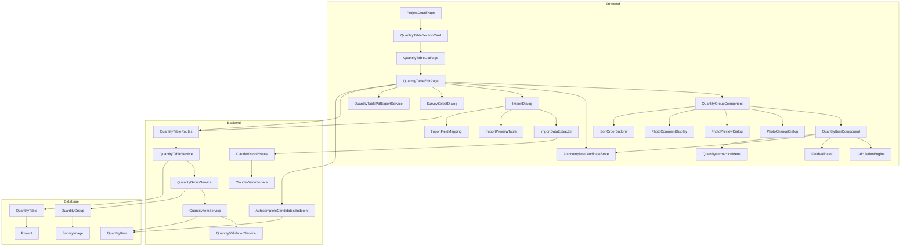

**Architecture Integration**:

- 選択パターン: 階層型サービス（QuantityTable → QuantityGroup → QuantityItem）
- ドメイン境界: 数量表管理は独立したドメインとして分離、プロジェクトとの関連はIDリレーションのみ
- 既存パターン: SiteSurveyパターンを継承（CRUD、一覧、詳細、楽観的排他制御）
- 新規コンポーネント: 計算エンジン（フロントエンド・バックエンド両方で共有）、フィールドバリデーター、AutocompleteCandidateStore
- 追加コンポーネント（REQ-17, 18）: コピー機能（QuantityTableService.copy）、CopyQuantityTableDialog、QuantityGroupTitleRow
- 追加コンポーネント（REQ-19, 20, 21）: PhotoChangeDialog、PhotoPreviewDialog、PhotoCommentDisplay
- 追加コンポーネント（REQ-22, 23, 24）: 数量グループ名前変更（既存QuantityGroupCard拡張）、SortOrderButtons
- 追加コンポーネント（REQ-25）: スクロールバー表示（QuantityTableEditPage CSSスタイル調整）
- 追加コンポーネント（REQ-26）: QuantityTablePdfExportService（数量表PDF出力、フロントエンドjsPDF）
- 追加コンポーネント（REQ-27-34）: ImportDialog、ImportDataExtractor、ImportPreviewTable、ImportFieldMapping（数量表インポート機能、受領見積書登録機能のOCRパイプラインを再利用）
- 修正コンポーネント（REQ-35）: PhotoCommentDisplay・QuantityGroupCard・QuantityTableEditPageの写真コメント取得・表示ロジック修正
- 変更コンポーネント（REQ-36）: EditableQuantityItemRow内のアクションセルを再構成。SortOrderButtonsと削除ボタンを個別表示から削除し、アクションメニュー内に「上へ移動」「下へ移動」「削除」を統合。QuantityItemActionMenuを新設
- 変更コンポーネント（REQ-37）: EditableQuantityItemRow および CalculationFields のレイアウト変更。計算用フィールド群（面積・体積／ピッチ）を「メイン行の下に別行表示」から「メイン行の操作列の右側に同一行で水平配置（ラベル+テキストボックス交互、行高さ不変）」へ変更。`calculationFieldsRow` 別行 div を削除し、`CalculationFields` を inline 配置に書き換え
- 追加コンポーネント（REQ-38）: QuantityGroupCard表題部にコピーボタンを追加（ダイアログ無し、押下即実行）、QuantityGroupService.copy（同一数量表内へグループ複製、数量項目・写真紐づけを保持）、`POST /api/quantity-groups/:id/copy` ルートを新設
- 修正コンポーネント（REQ-39）: QuantityTableEditPage 内のインライン写真選択ダイアログ（`photoGrid`/`photoItem` スタイル）のCSSを修正し、写真枚数増加時の重なりを解消。選択・変更とも同一インラインダイアログのため1箇所で両対応。未使用の `PhotoChangeDialog.tsx`（参照は単体テストのみ）は本要件のスコープ外（残置）。**「参照は単体テストのみ」は再実測では偽である**——`PhotoChangeDialog.stories.tsx` も同じ部品を参照する。定義ファイル自身を除く参照は 4 ファイルで、内訳は単体テスト 2 件・ストーリー 1 件・`QuantityTableEditPage.test.tsx` の注釈 1 件である。本行が入ったコミット `628fbe9`（2026-06-06）より前の `d0663e6`（2026-02-26）でストーリーが加わっているため、書かれた時点でも偽であった（`git log --diff-filter=A` で一件ずつ確かめた）。(a) に従い記述は残して再実測を併記する。タスク 115.234。コミット `6b84be3`。2026-09-02 にリポジトリルートで実測
- 追加コンポーネント（REQ-40）: QuantityTableEditPage に「現場調査から一括追加」ボタンと現場調査選択ダイアログ（SurveySelectDialog）を新設、QuantityGroupService.createGroupsFromSurvey（現場調査の全写真の枚数分グループを原子的に生成・写真紐づけ・連番命名）、`POST /api/quantity-tables/:tableId/groups/from-survey` ルートを新設。命名・切り詰めは REQ-38 のグループ名生成ロジックを汎用化して共有
- 変更コンポーネント（REQ-41）: QuantityGroupCard のレイアウトを再構成。カード全体に掛かっていた `overflowX:'auto'` を数量項目テーブルのラッパーへ限定し、画像・コメント（photoArea）を水平スクロール対象外（カード直下のflex列）へ移動して常時固定表示。折りたたみ・垂直スクロール・REQ-37 の水平展開と両立
- アーキテクチャ変更（REQ-42）: 編集画面の書き込みパスを「操作即サーバー反映」から「クライアントサイドのドラフト編集 ＋ 保存操作時のフル状態同期」へ転換。バックエンドは `QuantityTableService.saveDraft`（既存 `bulk-save` を全状態同期へ拡張：グループ/項目の作成・更新・削除・並び替え・グループ名・写真紐づけ・数量表名を単一トランザクション＋楽観ロックで差分適用）を新設。フロントは `QuantityTableEditPage` の state を単一 `useReducer` のドラフトモデル（仮IDによる新規行管理、dirty 追跡）へ再設計。従来の useAutoSave および編集画面からの個別ミューテーションAPI呼び出し（group/item の create/update/delete/copy/reorder、from-survey、編集画面での数量表名 PUT）は廃止し、保存操作時の `saveDraft` 一本に集約（個別エンドポイントは一覧画面の数量表名変更 PUT 等を除き編集フローから未使用化）。グループコピー（REQ-38）・現場調査一括生成（REQ-40）はクライアントサイドのドラフト複製/生成（仮ID・同一 surveyImageId 参照）へ移し、保存時に確定。現場調査写真一覧の取得は参照系GETとして許可
- 追加コンポーネント（REQ-43, 44）: `useUnsavedChanges` フック（既存 `frontend/src/hooks/useUnsavedChanges.ts`）と `useBlocker(isDirty)`（React Router v7、既存 CompanyInfoPage/ItemizedStatementDetailPage/SiteSurveyDetailPage で実績）を流用し、未保存変更時の画面遷移・タブクローズ・リロードに離脱ガードを適用。未保存インジケーター（UnsavedChangesBadge）をヘッダーの保存ボタン付近に表示
- 変更コンポーネント（REQ-45）: `QuantityTableEditPage` の `styles.header` を `position: sticky; top: 0; zIndex` 付きへ変更し、ヘッダー操作ボタン群（インポート/PDF出力/保存/＋グループを追加/現場調査から一括追加）を垂直スクロール時も固定表示。祖先に overflow スクロールコンテナが無いこと（現状 main は padding のみ）を前提とし、既存 EstimateDetailPage/SiteSurveyDetailPage の固定ヘッダーパターンに準拠
- Steering準拠: 型安全性、テスト駆動、コンポーネント分離原則を維持

### Technology Stack

| Layer | Choice / Version | Role in Feature | Notes |
|-------|------------------|-----------------|-------|
| Frontend | React 19.2 + TypeScript 5.9 | 数量表編集UI、計算プレビュー、インポートUI | 既存スタック |
| Frontend | decimal.js ^10.5.0 | 高精度数値計算 | 既存（数量表で使用中） |
| Frontend | @dnd-kit/core ^6.x | ドラッグ&ドロップ操作 | 既存（数量表で使用中） |
| Frontend | xlsx 0.20.3 (SheetJS) | Excelデータパース（インポート） | 既存（内訳書・見積書で使用中） |
| Frontend | pdfjs-dist (react-pdf依存) | PDFテキスト抽出（インポート） | 既存（受領見積書で使用中） |
| Frontend | tesseract.js ^7.0.0 | OCR文字認識（スキャンPDFフォールバック） | 既存（受領見積書で使用中） |
| Frontend | react-pdf ^10.3.0 | PDFインラインプレビュー | 既存（受領見積書で使用中） |
| Frontend | jsPDF ^4.0.0 | PDF出力 | 既存（現場調査・見積書で使用中） |
| Backend | Express 5.2 + TypeScript 5.9 | REST API | 既存スタック |
| Backend | Prisma 7.0 | データアクセス | 既存スタック |
| Backend | Zod 4.1 | バリデーション | 既存スタック |
| Backend | @anthropic-ai/sdk ^0.74.0 | Claude Vision API（高精度PDF抽出） | 既存（受領見積書で使用中） |
| Data | PostgreSQL 15 | データ永続化 | 既存スタック |

## File Structure Plan

本節は REQ-46・REQ-47 の追加スコープで作成・変更するファイルを列挙する（REQ-1〜45 のファイルは実装済みであり、Components and Interfaces 各節に記載済み）。

### 新規作成

```
frontend/src/
└── utils/
    └── calculation-method.ts          # 計算方法の単一情報源: 表示順・表示ラベル・選択肢・
                                       # 有効パラメータキー（PARAM_KEYS_BY_METHOD）。
                                       # Record<CalculationMethod, ...> により、
                                       # 型に値を足すと定義漏れが型エラーになる

backend/prisma/migrations/
└── <timestamp>_add_calculation_method_count/
    └── migration.sql                  # ALTER TYPE "CalculationMethod" ADD VALUE 'COUNT'; の1文のみ

e2e/specs/quantity-tables/
├── quantity-item-action-menu-clipping.spec.ts       # REQ-46: boundingBox ベースのクリップ検証
├── calculation-method-count.spec.ts                 # REQ-47: 箇所数の計算・フィールド表示・入力検証
├── calculation-method-count-persistence.spec.ts     # REQ-47: 保存復元・グループコピー・PDF出力
└── calculation-method-switch.spec.ts                # REQ-48: 切替後に入力した値が保存で失われないこと
```

**注記**: REQ-47 の E2E を2ファイルに分けるのは、前段（計算・表示・入力検証）と後段（永続化・コピー・PDF出力）で依存する実装タスクが異なり、別ファイルにすることで並行実行可能になるためである。

**注記**: Storybook ストーリーは `CalculationFields` / `CalculationMethodSelect` / `QuantityItemActionMenu` / `EditableQuantityItemRow` の**4件とも既に実在する**（新規作成ではなく変更対象）。下表に記載する。

### 変更（REQ-46: アクションメニュー）

| ファイル | 変更内容 |
|---|---|
| `frontend/src/components/quantity-table/QuantityItemActionMenu.tsx` | ドロップダウンを `createPortal(document.body)` + `position: fixed` へ変更。`getBoundingClientRect` による座標算出、capture フェーズの `scroll` / `resize` 追従、`zIndex: 1000`。閉じ判定を `onBlur`/`relatedTarget` から document レベルの outside-click（`mousedown`）+ Escape へ変更 |
| `frontend/src/components/quantity-table/EditableQuantityItemRow.tsx` | 行ラッパーに張られた二重の `onBlur` → `handleCloseMenu` を撤去（Portal 化で DOM ツリーが分離し `relatedTarget` の内外判定が成立しなくなるため） |
| `frontend/src/components/quantity-table/QuantityItemActionMenu.stories.tsx` | **既存**。Portal 描画に追随（メニューが `document.body` 直下へ出るため、ストーリーのデコレータ・アサーションの見直しが必要） |
| `frontend/src/__tests__/components/quantity-table/QuantityItemActionMenu.test.tsx` | Portal 描画（`document.body` 直下）と outside-click / Escape の閉じ挙動を検証。**クリップ検証は jsdom では不可能なため E2E に委譲する** |
| `frontend/src/__tests__/components/quantity-table/EditableQuantityItemRow.actionMenu.test.tsx` | 二重 onBlur 撤去に伴う既存テストの追随 |

### 変更（REQ-47: 計算方法「箇所数」）

**Backend**

| ファイル | 変更内容 |
|---|---|
| `backend/prisma/schema.prisma` の `enum CalculationMethod` | enum `CalculationMethod` に `COUNT` を追加 |
| `backend/src/schemas/quantity-table.schema.ts` | `CALCULATION_METHODS` に `'COUNT'` を追加 |
| `backend/src/schemas/quantity-table.schema.ts` | `countParamsSchema` を新設。**形状推測の `z.union` を廃止し、`calculationMethod` を判別子としてスキーマを選ぶ方式へ変更**（REQ-48。詳細は「計算方法切替時のパラメータ整合」節） |
| `backend/src/routes/quantity-items.routes.ts` | 直接の変更は不要（`createQuantityItemSchema` / `updateQuantityItemSchema` を参照しているため、スキーマ側の判別子化が自動的に適用される）。**適用されていることを統合テストで確認する** |
| `backend/src/routes/quantity-tables.routes.ts` | ハードコードされた `z.enum([...])` を `CALCULATION_METHODS` 参照へ置換（再発防止）。値の追加漏れで保存が 400 になるのを防ぐ |
| `backend/src/services/quantity-validation.service.ts` | `CalculationMethodType` に `'COUNT'` を追加。switch に `case 'COUNT'` と `validateCountMode()` を追加。**未知モードを素通りさせないよう `default` 節を追加** |
| `backend/src/services/calculation-engine.ts` | enum に `COUNT`、`CountParams` 型、`calculateCount()`、`generateCountFormula()`、switch case を追加 |
| `backend/src/services/quantity-table.service.ts` | 3箇所のリテラル直書きユニオン型に `'COUNT'` を追加 |

**上の表の `backend/src/services/quantity-table.service.ts` の欄が数える「3箇所」は着手前の計画の記述であり、欄そのものは書き換えない（タスク 115.234。`site-survey` の design.md「実測値の書き方（タスク 115.212）」の (a) が求める併記をここへ置く。完了した計画の欄へ現況を書き入れると、表の主題である「何を変えるか」と食い違うためである）。同じ数え方の再実測は 0 である**——`git show 01b46ca^:backend/src/services/quantity-table.service.ts` へ `STANDARD` と `AREA_VOLUME` を同じ行に持つ行を数える式を掛けると `3`、現況の同ファイルへの同じ式は `0` を返す（2026-09-02 にリポジトリルートで実測）。計画が `CalculationMethodType` への置換として実施され、リテラルの列挙自体が本文から無くなったためである。

**Frontend**

| ファイル | 変更内容 |
|---|---|
| `frontend/src/types/quantity-edit.types.ts` | `CalculationMethod` に `'COUNT'` を追加、`CountParams` インターフェースを新設。**ここが型の起点**であり、Record 化した箇所の漏れをコンパイラが検出する |
| `frontend/src/types/quantity-table.types.ts` | 重複ユニオン型と `CalculationParams` 合成型に追随 |
| `frontend/src/api/quantity-tables.ts` | ユニオン型に追随 |
| `frontend/src/utils/calculation-engine.ts` | `calculateCount()`、`generateCountFormula()`、switch case を追加 |
| `frontend/src/utils/numeric-range-validation.ts` | `NumericRangeFieldType` に `'count'` を追加。`RangeConfig` を `integer?: boolean` で拡張。`validateNumericRange` に整数チェックを追加 |
| `frontend/src/components/quantity-table/CalculationFields.tsx` | `FieldDefinition` に `integer?: boolean` を追加。`COUNT_FIELDS` を新設。**三項演算子を `Record<Exclude<CalculationMethod,'STANDARD'>, FieldDefinition[]>` へ置換**。`NumberInputField` の blur 整形を `toFixed(2)` 固定から整数分岐へ |
| `frontend/src/components/quantity-table/CalculationMethodSelect.tsx` | ローカルの `CALCULATION_METHOD_OPTIONS` を撤去し、新設の `utils/calculation-method.ts` から import |
| `frontend/src/components/quantity-table/EditableQuantityItemRow.tsx` | **`handleCalculationMethodChange` で `resetParamsForMethod()` を適用**し、切替後の計算方法で使用しないパラメータキーを破棄する（REQ-48 AC1, AC2, AC7） |
| `frontend/src/pages/quantityTableEditReducer.ts` | `CalculationMethod` 型に追随。新規項目のデフォルトは `STANDARD` のまま。計算方法変更のドラフト反映は既存の `onUpdate` 経路をそのまま使う |
| `frontend/src/pages/QuantityTableEditPage.tsx` | **ネスト三項のラベル変換を `CALCULATION_METHOD_LABELS` 参照へ置換**（放置すると PDF に「ピッチ」と誤表示される） |
| `frontend/src/hooks/useQuantityTableSave.ts` | `checkIntegrity` に COUNT の分岐を追加（計算パラメータ未設定の警告） |
| `frontend/src/components/quantity-table/CalculationFields.stories.tsx` | **既存**。COUNT のストーリーを追加 |
| `frontend/src/components/quantity-table/CalculationMethodSelect.stories.tsx` | **既存**。選択肢に「箇所数」が増えることへの追随 |
| `frontend/src/components/quantity-table/EditableQuantityItemRow.stories.tsx` | **既存**。COUNT の行ストーリーを追加 |

**テスト**

| ファイル | 変更内容 |
|---|---|
| `backend/src/__tests__/unit/services/calculation-engine.test.ts` | `describe('calculateCount')` を追加。既存の「未知の計算方法は0を返す」テストと整合させる |
| `backend/src/__tests__/unit/services/quantity-validation.service.test.ts` | モード別 describe に「箇所数」を追加（必須・整数・範囲） |
| `backend/src/__tests__/unit/schemas/quantity-table.schema.test.ts` | `calculationParamsSchema` に「箇所数計算パラメータ」の describe を追加。**union の strip 事故を検知する回帰テストを必ず含める**（`expect(result.data).toEqual(countParams)`） |
| `frontend/src/utils/calculation-engine.test.ts` | `calculateCount` / `generateCountFormula` のテスト |
| `frontend/src/components/quantity-table/CalculationFields.test.tsx` | COUNT 選択時のフィールド順序・整数表示・PITCH へフォールバックしないことの検証 |
| `frontend/src/components/quantity-table/CalculationMethodSelect.test.tsx` | 選択肢に「箇所数」が含まれること |

## System Flows

### 数量計算フロー（箇所数モード・REQ-47）

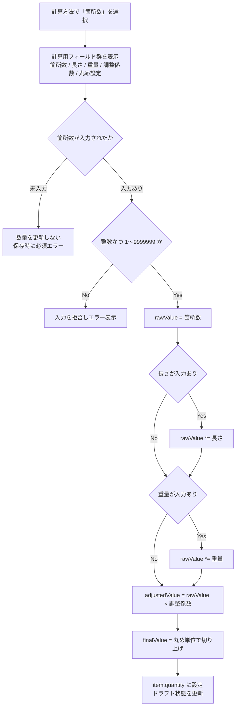

ピッチとの唯一の差分は `rawValue` の初期値である。ピッチは `floor((範囲長 − 端長1 − 端長2) / ピッチ長) + 1` で箇所数を算出するのに対し、箇所数モードは入力値をそのまま使う。以降の乗算・調整係数・丸めは `calculate()` の共通経路を通るため、ピッチと同一の挙動が構造的に保証される。

### アクションメニューの描画・追従フロー（REQ-46）

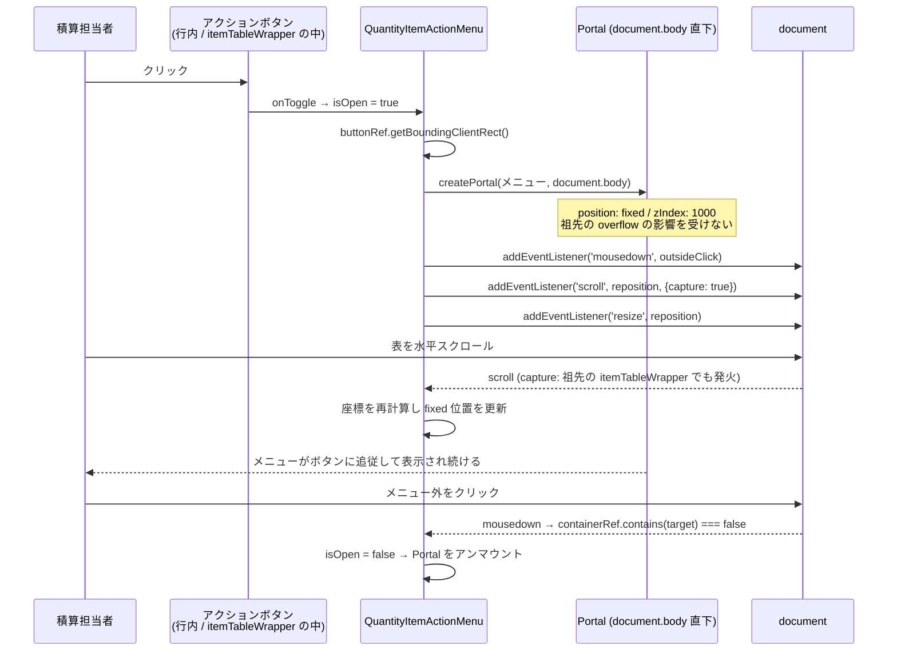

`scroll` を **capture フェーズ**で購読するのが要点である。`itemTableWrapper` のスクロールイベントは `window` までバブルしないため、capture: true を指定しない限り水平スクロールに追従できない（`AutocompleteInput.tsx` が同じ理由で同じ実装を採っている）。

### 数量計算フロー（面積・体積モード）

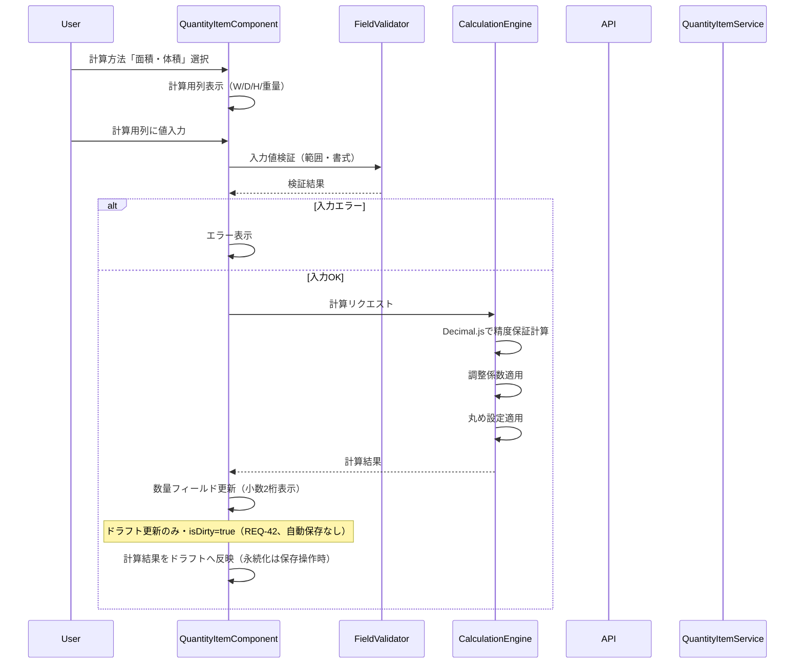

### 数量表コピーフロー

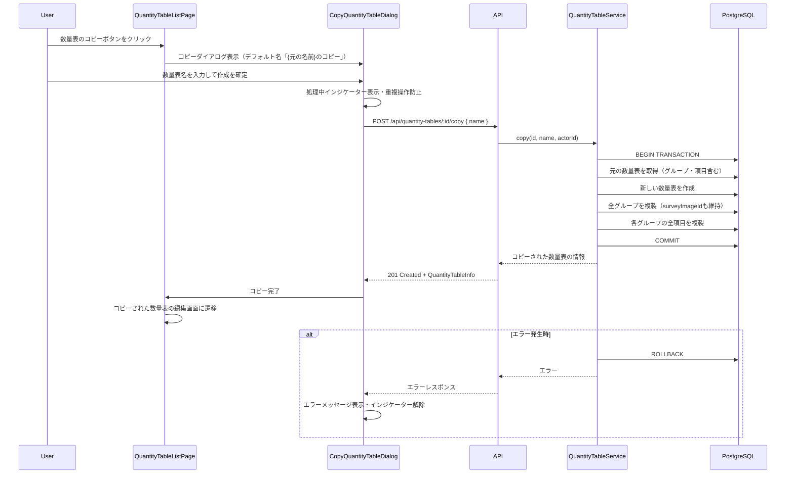

### 数量グループコピーフロー（REQ-38）

> **REQ-42 による更新**: 以下は当初の「コピー押下即サーバー実行（POST /copy）」フロー。REQ-42 適用後、編集画面ではグループコピーをクライアントサイドのドラフト複製（仮ID採番・同一 surveyImageId 参照・直下挿入・displayOrder シフト）として実行し、永続化は保存操作時の `saveDraft` で確定する。サーバー側 `POST /copy` は編集フローから未使用化（命名・切り詰めロジックはクライアントの複製処理で再利用）。

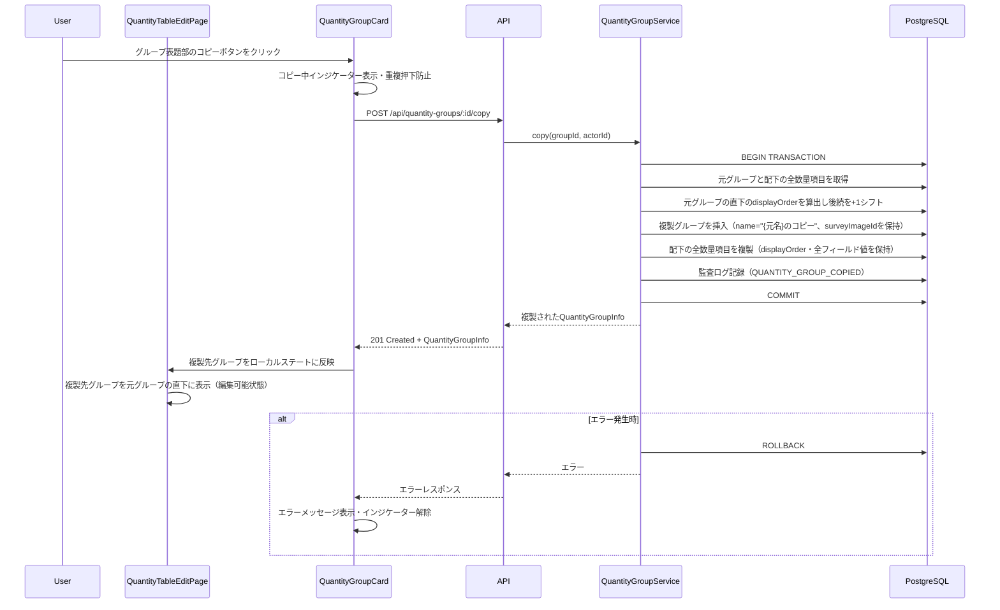

### 現場調査からの数量グループ一括生成フロー（REQ-40）

> **REQ-42 による更新**: 以下は当初の「実行即サーバー生成（POST /from-survey）」フロー。REQ-42 適用後、編集画面では対象現場調査の写真一覧を参照系GETで取得し、写真枚数分の数量グループをクライアントサイドのドラフトに生成（仮ID・連番命名・写真順 surveyImageId 紐づけ・末尾追加）する。永続化は保存操作時の `saveDraft` で確定し、サーバー側 `POST /from-survey` は編集フローから未使用化。命名・切り詰めロジックはクライアント生成処理で再利用する。

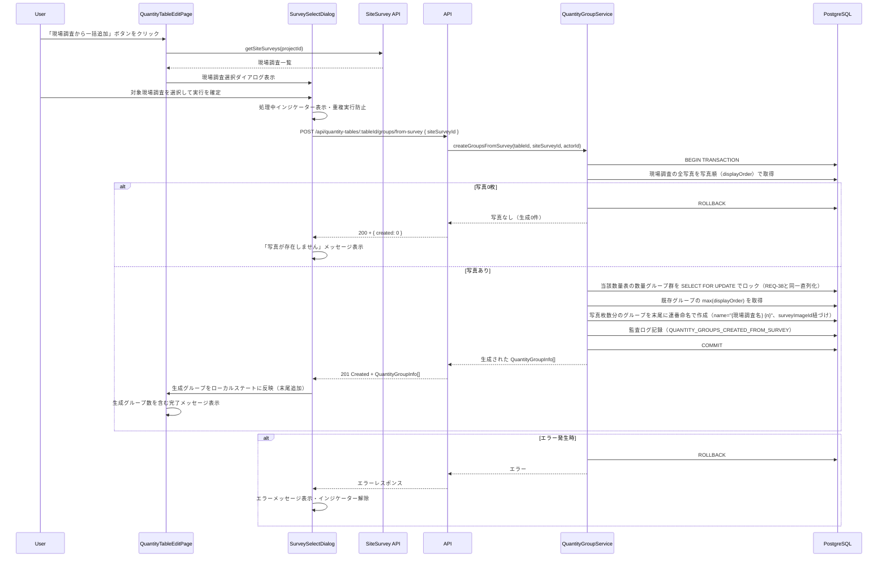

### オートコンプリート候補取得・利用フロー（初回一括読み込み方式）

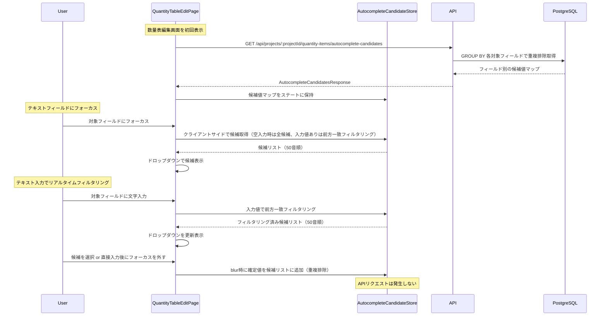

### 数量表PDF出力フロー

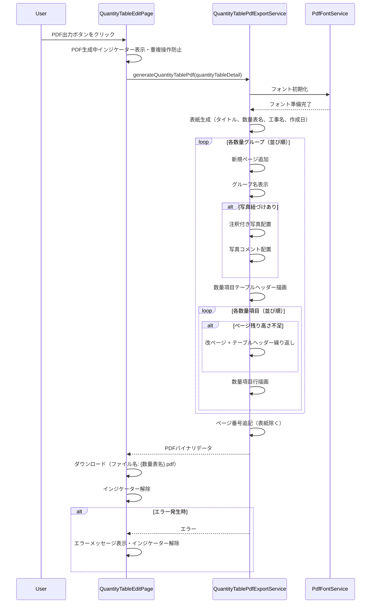

### 数量表インポートフロー

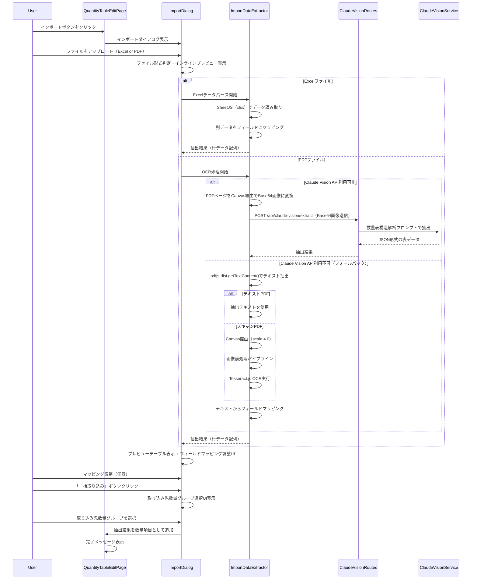

### クライアントサイド編集・明示保存フロー（REQ-42）

```mermaid
sequenceDiagram
    participant U as 積算担当者
    participant QTE as QuantityTableEditPage(draft reducer)
    participant API as QuantityTableRoutes
    participant SV as QuantityTableService.saveDraft
    participant DB as PostgreSQL

    Note over QTE: 初回表示（参照系GET=許可）
    QTE->>API: GET /api/quantity-tables/:id
    API-->>QTE: QuantityTableDetail
    QTE->>QTE: serverSnapshot/draft 初期化, isDirty=false

    Note over U,QTE: 以降の編集はクライアントのみ（サーバー永続化アクセスなし）
    U->>QTE: グループ/項目 追加・削除・コピー・並び替え・名称・写真紐づけ・一括生成・取り込み
    QTE->>QTE: draft 更新（新規行は仮ID付与）, isDirty=true, 未保存インジケーター表示

    U->>QTE: 保存ボタン押下
    QTE->>QTE: クライアント検証（必須/計算整合 REQ-11.2/11.3）
    QTE->>API: PUT /api/quantity-tables/:id/save (expectedUpdatedAt, name, groups[全状態])
    API->>SV: saveDraft(input)
    SV->>DB: BEGIN（任意で SELECT ... FOR UPDATE）
    SV->>SV: updatedAt 照合（楽観ロック・不一致→409）, 全状態検証
    SV->>DB: 差分適用（無い行=削除 / id無=作成 / 既存=更新, displayOrder/name/surveyImageId）
    SV->>DB: 数量表 updatedAt 更新; COMMIT; 監査ログ
    SV-->>API: QuantityTableDetail（採番済みID）
    API-->>QTE: 200 QuantityTableDetail
    QTE->>QTE: draft/serverSnapshot を再同期, isDirty=false, 「保存しました」表示

    alt 保存失敗（409 競合 / 検証 / サーバーエラー）
        API-->>QTE: 409 / 400 / 500
        QTE->>QTE: エラー表示, draft（未保存変更）を保持し再保存可能（REQ-42 AC9）
    end
```

### 未保存変更の離脱ガードフロー（REQ-43）

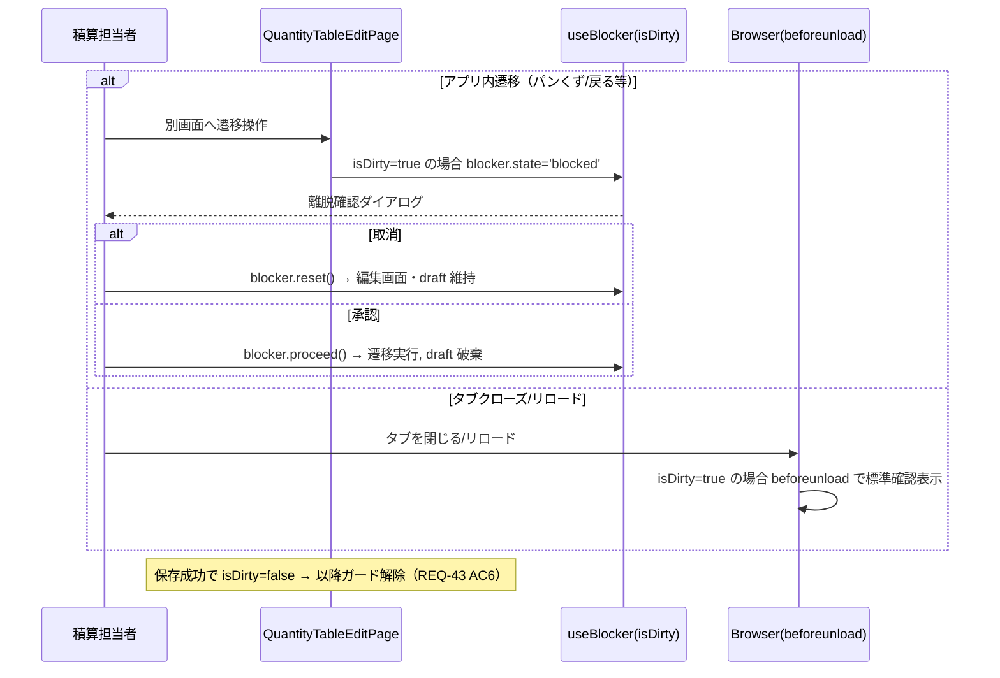

## Requirements Traceability

| Requirement | Summary | Components | Interfaces | Flows |
|-------------|---------|------------|------------|-------|
| 1.1-1.7 | プロジェクト詳細画面の数量表セクション | QuantityTableSectionCard, ProjectDetailPage | GET /api/projects/:id/quantity-tables/summary | - |
| 2.1-2.5 | 数量表の作成・管理 | QuantityTableListPage, QuantityTableForm | QuantityTableService, QuantityTable API | - |
| 3.1-3.4 | 数量表編集画面の表示（注釈付き写真表示含む） | QuantityTableEditPage, QuantityGroupComponent, PhotoCommentDisplay | GET /api/quantity-tables/:id | - |
| 4.1-4.5 | 数量グループの作成・管理（注釈付き写真選択） | QuantityGroupComponent, PhotoSelector | QuantityGroupService | - |
| 5.1-5.5 | 数量項目の追加・編集 | QuantityItemComponent, QuantityItemRow | QuantityItemService | - |
| 6.1-6.5 | 数量項目のコピー・移動 | QuantityItemComponent, DragDropContext | QuantityItemService | - |
| 7.1-7.7 | 入力支援・オートコンプリート | AutocompleteInput, AutocompleteCandidateStore | GET /api/projects/:projectId/quantity-items/autocomplete-candidates | オートコンプリートフロー |
| 8.1-8.11 | 計算方法の選択 | CalculationMethodSelector, CalculationFields | CalculationEngine | 数量計算フロー |
| 9.1-9.8 | 調整係数 | AdjustmentFactorInput | CalculationEngine, FieldValidator | - |
| 10.1-10.8 | 丸め設定 | RoundingSettingInput | CalculationEngine, FieldValidator | - |
| 11.1-11.5 | 数量表の保存（明示保存・自動保存廃止） | QuantityTableEditPage(draft reducer), SaveButton, QuantityTableService.saveDraft | PUT /api/quantity-tables/:id/save | クライアントサイド編集・明示保存フロー |
| 12.1-12.5 | パンくずナビゲーション | Breadcrumb, QuantityTableListPage, QuantityTableEditPage | - | - |
| 13.1-13.4 | テキストフィールドの入力制御 | FieldValidator, TextFieldConstraints | QuantityValidationService | - |
| 14.1-14.5 | 数値フィールドの表示書式 | NumericFormatter, QuantityItemRow | - | - |
| 15.1-15.3 | 数量フィールドの入力制御 | FieldValidator, NumericInputConstraints | QuantityValidationService | - |
| 16.1-16.12 | フォーカス時の入力値全選択 | AutocompleteInput, FieldValidatedItemRow | - | - |
| 17.1-17.7 | 数量表コピー機能 | CopyQuantityTableDialog, QuantityTableService.copy | POST /api/quantity-tables/:id/copy | 数量表コピーフロー |
| 18.1-18.5 | 数量項目タイトル行の表示最適化 | QuantityGroupCard, QuantityGroupTitleRow | - | - |
| 19.1-19.4 | 写真変更ダイアログでの注釈付き写真表示 | PhotoChangeDialog | QuantityGroupService.linkSurveyImage | - |
| 20.1-20.3 | 写真プレビューダイアログでの注釈付き写真表示 | PhotoPreviewDialog | - | - |
| 21.1-21.5 | 写真選択時のコメント表示 | PhotoCommentDisplay | - | - |
| 22.1-22.5 | 数量グループの名前変更 | QuantityGroupCard | PUT /api/quantity-groups/:id | - |
| 23.1-23.8 | 数量グループの並び順管理 | SortOrderButtons, QuantityGroupCard | PUT /api/quantity-tables/:tableId/groups/display-order | - |
| 24.1-24.8 | 数量項目の並び順管理 | SortOrderButtons, EditableQuantityItemRow | PUT /api/quantity-groups/:groupId/items/display-order | - |
| 25.1-25.6 | 画面スクロールバー表示 | QuantityTableEditPage | - | - |
| 26.1-26.12 | 数量表のPDF出力 | QuantityTablePdfExportService, QuantityTableEditPage | - | 数量表PDF出力フロー |
| 27.1-27.8 | 数量表インポート（ファイルアップロード・処理起動） | ImportDialog, ImportDataExtractor | - | 数量表インポートフロー |
| 28.1-28.7 | Excelデータパースによる数量項目抽出 | ImportDataExtractor | SheetJS xlsx | 数量表インポートフロー |
| 29.1-29.10 | PDF OCR処理による数量項目抽出 | ImportDataExtractor | pdfjs-dist, tesseract.js | 数量表インポートフロー |
| 30.1-30.7 | Claude Vision API連携による高精度抽出 | ImportDataExtractor | ClaudeVisionService, POST /api/claude-vision/extract | 数量表インポートフロー |
| 31.1-31.9 | 抽出結果から数量項目への一括取り込み | ImportDialog, ImportPreviewTable | QuantityTableEditState | 数量表インポートフロー |
| 32.1-32.6 | フィールドマッピング調整 | ImportFieldMapping, ImportPreviewTable | - | 数量表インポートフロー |
| 33.1-33.5 | OCR再実行・リトライ機能 | ImportDialog, ImportDataExtractor | - | - |
| 34.1-34.5 | インラインプレビュー | ImportDialog | react-pdf, SheetJS xlsx | - |
| 35.1-35.7 | 写真コメント表示の不具合修正 | PhotoCommentDisplay, QuantityGroupCard, QuantityTableEditPage | GET /api/quantity-tables/:id | - |
| 36.1-36.9 | 数量項目のアクションボタン統合 | QuantityItemActionMenu, EditableQuantityItemRow | - | - |
| 37.1-37.12 | 計算用フィールドの行内水平配置（面積・体積／ピッチ） | EditableQuantityItemRow, CalculationFields, gridConstants | - | - |
| 38.1-38.12 | 数量グループのコピー機能（同一数量表内） | QuantityGroupCard, QuantityGroupService.copy | POST /api/quantity-groups/:id/copy | 数量グループコピーフロー |
| 39.1-39.6 | 写真選択・変更ダイアログの写真一覧レイアウト改善（重なり解消） | QuantityTableEditPage（インライン写真選択ダイアログ photoGrid/photoItem） | - | - |
| 40.1-40.13 | 現場調査からの数量グループ一括生成 | QuantityTableEditPage, SurveySelectDialog, QuantityGroupService.createGroupsFromSurvey | POST /api/quantity-tables/:tableId/groups/from-survey, GET /api/projects/:projectId/site-surveys | 現場調査からの数量グループ一括生成フロー |
| 41.1-41.6 | 水平スクロール時の画像・コメント固定表示 | QuantityGroupCard, PhotoCommentDisplay | - | - |
| 42.1-42.10 | クライアントサイド編集と明示保存モデル | QuantityTableEditPage(draft reducer), QuantityTableService.saveDraft | PUT /api/quantity-tables/:id/save | クライアントサイド編集・明示保存フロー |
| 43.1-43.6 | 未保存変更の離脱ガード | QuantityTableEditPage, useUnsavedChanges, useBlocker | - | 未保存変更の離脱ガードフロー |
| 44.1-44.4 | 未保存変更インジケーター | UnsavedChangesBadge, QuantityTableEditPage | - | - |
| 45.1-45.4 | ヘッダー操作ボタンの固定表示 | QuantityTableEditPage（styles.header sticky） | - | - |
| 46.1-46.4 | アクションメニューがクリップされず全項目表示される | QuantityItemActionMenu（Portal 描画） | createPortal(document.body), position: fixed | アクションメニューの描画・追従フロー |
| 46.5-46.6 | 水平・垂直スクロール時のボタン追従 | QuantityItemActionMenu（useDropdownPosition 相当のローカル実装） | getBoundingClientRect, scroll(capture:true) / resize | アクションメニューの描画・追従フロー |
| 46.7 | 固定ヘッダーより前面に表示 | QuantityItemActionMenu | zIndex: 1000（sticky ヘッダーの 50 を上回る） | - |
| 46.8-46.9 | 外側クリック・項目選択でメニューを閉じる | QuantityItemActionMenu, EditableQuantityItemRow（二重 onBlur 撤去） | document mousedown outside-click + Escape | アクションメニューの描画・追従フロー |
| 46.10-46.11 | REQ-36 の動作および REQ-37/41 の水平スクロールを阻害しない | QuantityItemActionMenu, QuantityGroupCard | - | - |
| 47.1-47.2 | 計算方法「箇所数」の選択とフィールド表示 | CalculationMethodSelect, CalculationFields, calculation-method.ts | CALCULATION_METHOD_LABELS/OPTIONS | 数量計算フロー（箇所数モード） |
| 47.3-47.7 | 箇所数の手入力と、ピッチと同一の乗算・調整係数・丸め処理 | CalculationEngine（FE/BE 双方の calculateCount） | calculate(), applyRounding() | 数量計算フロー（箇所数モード） |
| 47.8-47.11 | 箇所数の必須・整数・範囲バリデーション | numeric-range-validation, QuantityValidationService.validateCountMode, countParamsSchema | validateNumericRange（integer 拡張） | - |
| 47.12-47.14 | 値変更時の自動再計算と計算方法切替時のフィールド差し替え | CalculationFields, EditableQuantityItemRow | Record<CalculationMethod, FieldDefinition[]> | 数量計算フロー（箇所数モード） |
| 47.15 | 保存・再読み込みでの値の完全復元 | QuantityTableService.saveDraft, countParamsSchema（union 評価順序） | PUT /api/quantity-tables/:id/save | クライアントサイド編集・明示保存フロー |
| 47.16 | 数量グループコピーでの箇所数の複製 | QuantityGroupCard（クライアントサイド複製） | - | 数量グループコピーフロー |
| 47.17 | PDF出力での「箇所数」表示 | QuantityTableEditPage（ラベル変換）, QuantityTablePdfExportService | CALCULATION_METHOD_LABELS | 数量表PDF出力フロー |
| 47.18 | 箇所数の編集もドラフト状態に対して行う | QuantityTableEditPage(draft reducer) | PUT /api/quantity-tables/:id/save | クライアントサイド編集・明示保存フロー |
| 48.1-48.2, 48.7 | 計算方法切替時に旧方式のパラメータを破棄し、共通フィールドは引き継ぐ | EditableQuantityItemRow.handleCalculationMethodChange, calculation-method.ts (PARAM_KEYS_BY_METHOD) | resetParamsForMethod() | 計算方法切替時のパラメータ整合 |
| 48.3-48.6 | 計算方法を判別子としたパラメータ検証（形状推測の廃止） | quantity-table.schema.ts (PARAMS_SCHEMA_BY_METHOD), quantity-items.routes.ts, quantity-tables.routes.ts | withCalculationParams() superRefine | 計算方法切替時のパラメータ整合 |

## Field Specifications

### テキストフィールド仕様

| フィールド | 必須 | 配置 | 最大文字数 | デフォルト値 | 備考 |
|-----------|------|------|------------|--------------|------|
| 大項目 | - | 左寄せ | 全角25/半角50 | 空白 | - |
| 中項目 | - | 左寄せ | 全角25/半角50 | 空白 | - |
| 小項目 | - | 左寄せ | 全角25/半角50 | 空白 | - |
| 任意分類 | - | 左寄せ | 全角25/半角50 | 空白 | - |
| 工種 | 必須 | 左寄せ | 全角8/半角16 | 空白 | - |
| 名称 | 必須 | 左寄せ | 全角25/半角50 | 空白 | - |
| 規格 | - | 左寄せ | 全角25/半角50 | 空白 | - |
| 単位 | 必須 | 左寄せ | 全角3/半角6 | 空白 | - |
| 計算方法 | 必須 | 左寄せ | 全角25/半角50 | 標準 | - |
| 備考 | - | 左寄せ | 全角25/半角50 | 空白 | - |

### 数値フィールド仕様（計算パラメータ）

| フィールド | 必須 | 配置 | 入力可能範囲 | デフォルト値 | 表示書式 | 空白時動作 |
|-----------|------|------|--------------|--------------|----------|------------|
| 調整係数 | 必須 | 右寄せ | -9.99〜9.99 | 1.00 | 小数2桁常時表示 | デフォルト値を自動入力 |
| 丸め設定 | 必須 | 右寄せ | 0.01〜99.99 | 0.01 | 小数2桁常時表示 | 0または空白でデフォルト値を自動入力 |
| 数量 | 必須 | 右寄せ | -999999.99〜9999999.99 | 0 | 小数2桁常時表示 | デフォルト値を自動入力 |

**この表の範囲の出所は `frontend/src/utils/numeric-range-validation.ts` の `FIELD_RANGE_CONFIG` 一つである**（タスク 80.1）。同ファイルが数量表の数値欄の範囲の正典であり、範囲の定数を他所へ書き写さないこと。`frontend/src/utils/field-validation.ts` は同名の `validateNumericRange` と独自の範囲定数を併せ持っており、**丸め設定の上限が `99.99` と `999.99` へ静かに割れていた**。タスク 80.1 で同ファイルから範囲の定数と範囲の判定を取りやめ、正典へ委譲する形へ一本化した。二系統を残す案は、現に食い違いが起きていた事実をもって採らなかった。逆に `field-validation.ts` へ寄せる案も採らなかった——正典の側だけが本番経路（`CalculationFields`）から呼ばれ、寸法・箇所数も扱い、箇所数で `COUNT_MIN` / `COUNT_MAX` を参照する単一情報源の作法を既に持つためである。

**丸め設定の下限を `0.01` としたのは、条文（REQ-10.3 が改訂前に書いていた `-99.99〜99.99`）の側を改めた結果である。** REQ-10.2 が丸め設定を切り上げ**単位**と定め、REQ-10.4 が `0` に「未設定」の意味を与え、`applyRounding()` が単位 `0` 以下で例外を投げる以上、負の下限は「範囲判定を通った値が計算で落ちる」領域を作るだけである。改訂の根拠と採らなかった案は `requirements.md` の Requirement 10 の直後と、正典ファイルの `FIELD_RANGE_CONFIG` の説明に置いた。

**値 `0` は範囲判定の層に属さない**: REQ-10.4（0 と空白は既定値 `0.01` へ差し替える）が REQ-10.3（範囲判定）に**優先する**。正典が丸め設定の `0` を範囲外と返すのは意図であり、呼び出し側が差し替えを先に行う。描画される実装は既にこの順序で動いている——`frontend/src/components/quantity-table/CalculationFields.tsx` の `AdjustmentField` が焦点喪失の時点で `0` を既定値へ差し替える。**結線では範囲判定をその差し替えの後に置くこと。** 順序の根拠と採らなかった案は `requirements.md` の Requirement 10 の直後にある。

**受入検証に、改訂によって偽になった主張が一件残っている**: `e2e/specs/quantity-tables/field-specification.spec.ts` の `10.1, 10.3: 面積・体積選択時に丸め設定フィールドが表示され-99.99〜99.99の範囲で入力できる` は、表題も本体も改訂前の範囲を主張しており、丸め設定へ `-99.99` を入れて保持されることを確かめている。結線が無い現状では通るが、範囲判定を結ぶと落ちる。**是正は受入検証の所管であって、本節の正典の確定とは別の作業である。**

**バックエンドは本タスクの境界外であり、二系統が残っている**: `backend/src/services/quantity-field-validation.service.ts` の `FIELD_CONSTRAINTS.ROUNDING_UNIT` が `-99.99〜99.99`、同ファイルの `validateItemFieldSpecs` が直書きの `0.01〜999.99` である。フロントの正典はこの双方より狭いため「保存できない数量表が残る」向きの害は生じないが、バックエンドの正典化は別途起票が要る。

**範囲判定を描画される欄へ結線した（タスク 80.2）。** 結線先は `frontend/src/components/quantity-table/EditableQuantityItemRow.tsx` の数量欄と、`frontend/src/components/quantity-table/CalculationFields.tsx` の調整係数・丸め設定・寸法・ピッチ計算・箇所数計算の各欄である。`frontend/src/components/quantity-table/FieldValidatedItemRow.tsx` は本番の描画経路から参照されないため直していない（そのまま残す判断とその根拠は同ファイルの冒頭の説明に置いた）。層の順序は正典のとおり「既定値差し替え → 範囲判定」であり、差し替えの規則も `frontend/src/utils/numeric-range-validation.ts` の `FIELD_DEFAULT_SUBSTITUTION` へ置いて単一の出所とした。範囲外の値は欄で確定させず、範囲内の値の入力を求める。

**調整係数の `0` は既定値へ差し替えない（同タスク）。** REQ-9.4 は空白だけを既定値「1.00」の対象と定めており、`0` は REQ-9.3 の有効域 `-9.99〜9.99` の内側である。改める前の `AdjustmentField` は `0` も既定値へ差し替えていたが、これは丸め設定（REQ-10.4）のための差し替えが同一部品を使う調整係数へ相乗りしたものであった。**80.1 が確定させた「AC 4 が先」の順序は丸め設定の条文に根拠を持つものであり、調整係数へは横展開しない。** あわせて、両欄に置かれていた `warningCondition={(v) => v <= 0}` を撤去した——同条件は REQ-9.3 が有効域と定める `-9.99〜0` に対して警告を出しており、要件と食い違っていた。丸め設定側の同条件は範囲判定（下限 `0.01`）に包含される。

**保存前の整合性チェック（REQ-11.2）と欄の層は、規則ではなく役割が違う（同タスク）。** `frontend/src/pages/QuantityTableEditPage.tsx` の `handleSave` は丸め設定を検め、以前は `<= 0` を直書きしていた。これを正典の `validateNumericRange` へ委ね、範囲の出所を一つにした。**同層は `0` を既定値へ差し替えず拒否する。** 欄は未設定を繕う層であり、保存前の検査は繕われた後の最終状態を検める層である。ここまで残った `0` は利用者が打った「未設定の印」ではなく、どの欄の層にも触れられずに紛れ込んだ値であり、`applyRounding()` が単位 `0` 以下で例外を投げる以上、REQ-11.2 が保存を中断すべき不整合そのものである。

**数量欄の負の値は範囲外ではない（同タスク）。** REQ-15.1 の有効域 `-999999.99〜9999999.99` は負を含み、REQ-8.3 は計算方法「標準」での負値に対し**警告して確認を求める**ことを課す。結線にあたり両者を分け、範囲外は誤り（赤・確定させない）、負値は警告（黄・確定させる）として提示する。

**「保存できない数量表が残る向きの害は生じない」は丸め設定についての主張であり、調整係数には及ばない（タスク 80.2 の是正）。** 上のバックエンドの段は丸め設定を見て書かれたものであり、記述はそのまま残す。調整係数については次のとおりである——保存経路 `backend/src/routes/quantity-tables.routes.ts` の `saveDraftItemSchema` は `adjustmentFactor` に `z.number().positive()` を課しており、REQ-9.3 の有効域 `-9.99〜9.99` が内側に含む `0` と負値を 400 で拒む。**フロントの正典は保存経路より広い。**

**この食い違いは条文の側の誤りとは読まなかった（同タスク）。** 根拠は三点である。(1) 条文が内部で食い違っていない——REQ-9.2 / REQ-9.3 / REQ-9.4 は整合しており、丸め設定における REQ-10.4 のように `0` へ別の意味を与える条文が無い。(2) 計算が落ちない——`applyAdjustmentFactor()` は単なる乗算であり例外を投げないため、タスク 80.1 が下限拡張を退けた根拠「範囲判定を通った値が計算の時点で落ちる」は調整係数には当てはまらない。(3) 少数派は保存経路の側である——同じバックエンドの `backend/src/services/quantity-field-validation.service.ts` の `FIELD_CONSTRAINTS.ADJUSTMENT_FACTOR` は `-9.99〜9.99` であり、条文および本節の数値フィールド仕様表と一致する。**採らなかった案**: REQ-9.3 の有効域を `0.01〜9.99` へ狭めて条文を保存経路へ合わせる（タスク 80.1 が REQ-10.3 に対して行った形）。上の三点により条文の側に誤りを見いだせず、「実装が要件に合っていないから要件を書き換える」を既定の解にしない作法にも反するため採らなかった。**是正の向きはバックエンドであり、別途の起票を要する。**

**それまでの間、画面が黙って行き止まりへ導かないようにした（同タスク）。** 調整係数の `0` と負値については、範囲エラーとは**別の層・別の文言**で「保存できない」ことを欄の時点で告げ、`handleSave` の整合性チェック（REQ-11.2）でも保存を中断して問題箇所を名指す。範囲外の誤りと混同させないため、文言は範囲を語らない。判定の出所は `frontend/src/utils/numeric-range-validation.ts` の `validateSavePersistability` 一つであり、条文が有効と認める領域を「範囲外」と呼び替えてはいない。**採らなかった案**: 画面では何も告げず保存時の 400 に委ねる。改める前の実装は `0` を既定値へ差し替えていたためこの行き止まりは到達不能であり、相乗りを断つ是正が到達可能にした以上、到達可能にした側で塞ぐ。

**範囲外を拒むときの見え方は欄ごとに揃っていない（同タスク。判断の材料として記録する）。** 数量欄（`EditableQuantityItemRow`）と調整係数・丸め設定（`AdjustmentField`）は小数2桁へ整形してから拒む（REQ-14.2 の常時2桁表示に合わせた）。寸法・ピッチ計算・箇所数計算の各欄（`NumberInputField`）は生の入力を保ったまま拒む（箇所数でタスク 68.2 が定めた既存の作法をそのまま広げた）。**揃えるには箇所数欄の既存の見え方を変えることになるため、本タスクでは揃えていない。** 受入検証（タスク 80.3）が提示の作法を決めるときの材料である。いずれの欄も共通して、拒んだ値を親の状態へ確定させない。

### 寸法フィールド仕様（面積・体積計算用）

| フィールド | 必須 | 配置 | 入力可能範囲 | デフォルト値 | 表示書式 |
|-----------|------|------|--------------|--------------|----------|
| 幅(W) | - | 右寄せ | 0.01〜9999999.99または空白 | 空白 | 数値入力時は小数2桁、空白時は表示なし |
| 奥行き(D) | - | 右寄せ | 0.01〜9999999.99または空白 | 空白 | 数値入力時は小数2桁、空白時は表示なし |
| 高さ(H) | - | 右寄せ | 0.01〜9999999.99または空白 | 空白 | 数値入力時は小数2桁、空白時は表示なし |
| 重量（面積・体積用） | - | 右寄せ | 0.01〜9999999.99または空白 | 空白 | 数値入力時は小数2桁、空白時は表示なし |

**制約**: 計算方法が「面積・体積」の場合、幅(W)、奥行き(D)、高さ(H)のうち最低1つの入力が必須

### ピッチ計算フィールド仕様

| フィールド | 必須 | 配置 | 入力可能範囲 | デフォルト値 | 表示書式 |
|-----------|------|------|--------------|--------------|----------|
| 範囲長 | 必須 | 右寄せ | 0.01〜9999999.99または空白 | 空白 | 数値入力時は小数2桁、空白時は表示なし |
| 端長1 | 必須 | 右寄せ | 0.01〜9999999.99または空白 | 空白 | 数値入力時は小数2桁、空白時は表示なし |
| 端長2 | 必須 | 右寄せ | 0.01〜9999999.99または空白 | 空白 | 数値入力時は小数2桁、空白時は表示なし |
| ピッチ長 | 必須 | 右寄せ | 0.01〜9999999.99または空白 | 空白 | 数値入力時は小数2桁、空白時は表示なし |
| 長さ（ピッチ用） | - | 右寄せ | 0.01〜9999999.99または空白 | 空白 | 数値入力時は小数2桁、空白時は表示なし |
| 重量（ピッチ用） | - | 右寄せ | 0.01〜9999999.99または空白 | 空白 | 数値入力時は小数2桁、空白時は表示なし |

**制約**: 計算方法が「ピッチ」の場合、範囲長、端長1、端長2、ピッチ長の4項目すべてが必須

### 箇所数計算フィールド仕様（REQ-47）

| フィールド | 必須 | 配置 | 入力可能範囲 | デフォルト値 | 表示書式 |
|-----------|------|------|--------------|--------------|----------|
| 箇所数 | 必須 | 右寄せ | 1〜9999999（**整数のみ**） | 空白 | 整数表示（小数桁を付与しない）、空白時は表示なし |
| 長さ（箇所数用） | - | 右寄せ | 0.01〜9999999.99または空白 | 空白 | 数値入力時は小数2桁、空白時は表示なし |
| 重量（箇所数用） | - | 右寄せ | 0.01〜9999999.99または空白 | 空白 | 数値入力時は小数2桁、空白時は表示なし |

**制約**: 計算方法が「箇所数」の場合、箇所数が必須。小数を含む値は入力を拒否する。

**フィールド順序**: 箇所数 → 長さ → 重量 → 調整係数 → 丸め設定

**書式上の注意**: 既存の `NumberInputField`（`CalculationFields.tsx`）は blur 時に `numValue.toFixed(2)` を**無条件で適用**しており、数量表内に整数専用フィールドの前例が1つも存在しない。本設計では `FieldDefinition` と `NumberInputField` に `integer?: boolean` を追加し、`integer` が真のときのみ `parseInt` による整数整形と `inputMode="numeric"` を適用する。これにより既存の小数フィールドの挙動は一切変わらない。

**この二つの断言（無条件の適用・整数専用フィールドの前例が 1 つも無いこと）は本節を書いた時点の記録であり書き換えない（タスク 115.234。`site-survey` の design.md「実測値の書き方（タスク 115.212）」の (a) に従う）。再実測ではどちらも偽である**——`CalculationFields.tsx` の整形は `formatFieldValue` に集約され `integer` で分岐するため `toFixed(2)` は無条件ではなく、整数専用フィールドは同ファイルの `COUNT_FIELDS` が持つ `count`（箇所数）の 1 件がある。本節の設計がコミット `01b46ca`（2026-07-17）で実装され、同じコミットに本節の記述も入っているため、記述はそのコミットの時点で既に偽であった（`git log -S` と `git show 01b46ca^` で一件ずつ確かめた）。コミット `6b84be3`。2026-09-02 にリポジトリルートで実測。

## Components and Interfaces

### Component Summary

| Component | Domain/Layer | Intent | Req Coverage | Key Dependencies | Contracts |
|-----------|--------------|--------|--------------|------------------|-----------|
| QuantityTableService | Backend/Service | 数量表のCRUD操作・コピー | 2.1-2.5, 11.1-11.5, 17.1-17.7 | PrismaClient (P0), AuditLogService (P1) | Service, API |
| QuantityGroupService | Backend/Service | 数量グループのCRUD操作と画像紐付け | 3.1-3.3, 4.1-4.5, 22.1-22.5, 23.1-23.8 | PrismaClient (P0) | Service, API |
| QuantityItemService | Backend/Service | 数量項目のCRUD・計算検証 | 5.1-5.5, 6.1-6.5, 8.1-8.11, 9.1-9.8, 10.1-10.8, 24.1-24.8 | PrismaClient (P0), CalculationEngine (P0), QuantityValidationService (P0) | Service, API |
| QuantityValidationService | Backend/Service | フィールドバリデーション | 8.3, 8.4, 8.7, 8.10, 9.3-9.5, 10.3-10.5, 13.1-13.4, 14.1-14.5, 15.1-15.3 | - | Service |
| AutocompleteCandidatesEndpoint | Backend/Route | オートコンプリート候補一括取得 | 7.1, 7.2 | PrismaClient (P0) | API |
| CalculationEngine | Shared/Utility | 数量計算ロジック | 8.1-8.11, 9.1-9.8, 10.1-10.8 | decimal.js (P0) | Service |
| QuantityTableEditPage | Frontend/Page | 数量表編集画面 | 3.1-3.3, 7.1, 25.1-25.6, 27.1 | QuantityGroupComponent (P0), AutocompleteCandidateStore (P0), ImportDialog (P1) | State |
| QuantityTableSectionCard | Frontend/Component | プロジェクト詳細の数量表セクション | 1.1-1.7 | - | - |
| AutocompleteCandidateStore | Frontend/State | オートコンプリート候補のクライアントサイド管理 | 7.1-7.7 | - | State |
| AutocompleteInput | Frontend/Component | オートコンプリート対応テキスト入力 | 7.3-7.7, 16.1-16.7 | AutocompleteCandidateStore (P0) | - |
| CopyQuantityTableDialog | Frontend/Component | 数量表コピーダイアログ | 17.1, 17.3, 17.6 | - | - |
| QuantityGroupTitleRow | Frontend/Component | 数量グループのメインタイトル行 | 18.1, 18.2, 18.5 | - | - |
| PhotoChangeDialog | Frontend/Component | 注釈付き写真変更ダイアログ | 19.1-19.4 | QuantityGroupCard (P0) | - |
| PhotoPreviewDialog | Frontend/Component | 注釈付き写真プレビューダイアログ | 20.1-20.3 | QuantityGroupCard (P0) | - |
| PhotoCommentDisplay | Frontend/Component | 写真コメント表示 | 21.1-21.5, 35.1-35.7 | QuantityGroupCard (P0) | - |
| SortOrderButtons | Frontend/Component | 並び順変更ボタンUI | 23.3-23.8 | - | - |
| QuantityItemActionMenu | Frontend/Component | 数量項目アクションメニュー（並び替え・削除・コピー統合／Portal 描画） | 36.1-36.9, 46.1-46.11 | EditableQuantityItemRow (P0), react-dom createPortal (P0) | - |
| CalculationMethodRegistry | Frontend/Utility | 計算方法の表示順・表示ラベル・選択肢の単一情報源（`utils/calculation-method.ts`） | 47.1, 47.17 | - | - |
| CalculationFields | Frontend/Component | 計算方法別の計算用フィールド群の描画（面積・体積／ピッチ／箇所数） | 8.5, 8.8, 8.13, 37.1-37.13, 47.2, 47.12-47.14 | CalculationEngine (P0), numeric-range-validation (P0) | - |
| QuantityTablePdfExportService | Frontend/Service | 数量表PDF出力サービス | 26.1-26.12 | jsPDF (P0), PdfFontService (P0) | Service |
| FieldValidator | Frontend/Utility | フィールド入力制御・書式 | 13.1-13.4, 14.1-14.5, 15.1-15.3 | - | Service |
| ImportDialog | Frontend/Component | 数量表インポートダイアログ | 27.1-27.8, 31.1-31.9, 33.1-33.5, 34.1-34.5 | ImportDataExtractor (P0), ImportPreviewTable (P0), ImportFieldMapping (P0) | State |
| ImportDataExtractor | Frontend/Service | インポートデータ抽出サービス | 28.1-28.7, 29.1-29.10, 30.1-30.7 | SheetJS (P0), pdfjs-dist (P0), tesseract.js (P1), ClaudeVisionAPI (P1) | Service |
| ImportPreviewTable | Frontend/Component | インポート抽出結果プレビューテーブル | 28.4-28.7, 31.1, 32.1-32.6 | ImportFieldMapping (P0) | - |
| ImportFieldMapping | Frontend/Component | インポートフィールドマッピング調整UI | 32.1-32.6 | - | - |

### Backend Services

#### QuantityTableService

| Field | Detail |
|-------|--------|
| Intent | 数量表のライフサイクル管理とCRUD操作、コピー機能を担当 |
| Requirements | 2.1, 2.2, 2.3, 2.4, 2.5, 11.1, 11.2, 11.3, 11.4, 11.5, 17.1, 17.2, 17.3, 17.4, 17.5, 17.6, 17.7 |

**Responsibilities & Constraints**

- 数量表の作成・更新・削除・一覧取得・コピー
- プロジェクトとの関連付け検証
- 楽観的排他制御（updatedAt）
- トランザクション境界の管理
- コピー時の全データ（グループ・項目・写真紐づけ）のディープコピー

**Dependencies**

- Inbound: QuantityTableRoutes (P0)
- Outbound: QuantityGroupService (P1)
- External: PrismaClient (P0), AuditLogService (P1)

**Contracts**: Service [x] / API [x]

##### Service Interface

```typescript
interface QuantityTableService {
  create(input: CreateQuantityTableInput, actorId: string): Promise<QuantityTableInfo>;
  findById(id: string): Promise<QuantityTableDetail | null>;
  findByProjectId(
    projectId: string,
    filter: QuantityTableFilter,
    pagination: PaginationInput,
    sort: SortInput
  ): Promise<PaginatedQuantityTables>;
  findLatestByProjectId(projectId: string, limit?: number): Promise<ProjectQuantityTableSummary>;
  update(
    id: string,
    input: UpdateQuantityTableInput,
    actorId: string,
    expectedUpdatedAt: Date
  ): Promise<QuantityTableInfo>;
  delete(id: string, actorId: string): Promise<void>;
  copy(id: string, input: CopyQuantityTableInput, actorId: string): Promise<QuantityTableInfo>;
}

interface CreateQuantityTableInput {
  projectId: string;
  name: string;
}

interface UpdateQuantityTableInput {
  name?: string;
}

interface CopyQuantityTableInput {
  name: string;
}

interface QuantityTableInfo {
  id: string;
  projectId: string;
  name: string;
  groupCount: number;
  itemCount: number;
  createdAt: Date;
  updatedAt: Date;
}

interface QuantityTableDetail extends QuantityTableInfo {
  project: { id: string; name: string };
  groups: QuantityGroupInfo[];
}

interface ProjectQuantityTableSummary {
  totalCount: number;
  latestTables: QuantityTableInfo[];
}
```

##### API Contract

| Method | Endpoint | Request | Response | Errors |
|--------|----------|---------|----------|--------|
| POST | /api/projects/:projectId/quantity-tables | CreateQuantityTableInput | QuantityTableInfo | 400, 404, 409 |
| GET | /api/projects/:projectId/quantity-tables | QueryParams | PaginatedQuantityTables | 400, 404 |
| GET | /api/projects/:projectId/quantity-tables/summary | - | ProjectQuantityTableSummary | 404 |
| GET | /api/quantity-tables/:id | - | QuantityTableDetail | 404 |
| PUT | /api/quantity-tables/:id | UpdateQuantityTableInput | QuantityTableInfo | 400, 404, 409 |
| DELETE | /api/quantity-tables/:id | - | 204 No Content | 404 |
| POST | /api/quantity-tables/:id/copy | CopyQuantityTableInput | QuantityTableInfo | 400, 404, 500 |

**Implementation Notes**

- Integration: 既存のSiteSurveyServiceパターンを踏襲
- Validation: Zodスキーマによる入力検証
- Copy: `copy`メソッドは単一トランザクション内で数量表・全グループ・全項目をディープコピーする。写真紐づけ（surveyImageId）はコピー先でも維持する。エラー時はROLLBACKにより不完全なコピーデータが残らないことを保証する
- Risks: 大量のグループ・項目を持つ数量表の取得パフォーマンス

---

#### QuantityGroupService

| Field | Detail |
|-------|--------|
| Intent | 数量グループのCRUD操作と現場調査画像との紐付け管理、名前変更、並び順管理、現場調査からの一括生成を担当 |
| Requirements | 3.1, 3.2, 3.3, 4.1, 4.2, 4.3, 4.4, 4.5, 22.1, 22.2, 22.3, 22.4, 22.5, 23.1, 23.2, 23.3, 23.4, 23.5, 23.6, 23.7, 23.8, 40.3, 40.4, 40.5, 40.6, 40.7, 40.9, 40.10, 40.12 |

**Responsibilities & Constraints**

- 数量グループの作成・更新・削除
- 現場調査画像との紐付け・解除
- グループの表示順序管理
- グループ内の数量項目の集約取得

**Dependencies**

- Inbound: QuantityTableRoutes (P0), QuantityTableService (P1)
- Outbound: QuantityItemService (P1)
- External: PrismaClient (P0)

**Contracts**: Service [x] / API [x]

##### Service Interface

```typescript
interface QuantityGroupService {
  create(input: CreateQuantityGroupInput): Promise<QuantityGroupInfo>;
  findById(id: string): Promise<QuantityGroupDetail | null>;
  findByQuantityTableId(quantityTableId: string): Promise<QuantityGroupInfo[]>;
  update(
    id: string,
    input: UpdateQuantityGroupInput,
    expectedUpdatedAt: Date
  ): Promise<QuantityGroupInfo>;
  delete(id: string): Promise<void>;
  linkSurveyImage(id: string, surveyImageId: string): Promise<QuantityGroupInfo>;
  unlinkSurveyImage(id: string): Promise<QuantityGroupInfo>;
  reorder(quantityTableId: string, orderedIds: string[]): Promise<QuantityGroupInfo[]>;
  /**
   * 現場調査からの数量グループ一括生成（REQ-40）
   * 対象現場調査の全写真（注釈有無問わず）を写真順に取得し、写真枚数分のグループを
   * 既存グループの末尾に連番命名で原子的に生成する。各グループに写真を1枚ずつ紐づける。
   * 写真0枚の場合は何も生成せず created: 0 を返す。エラー時はトランザクションをロールバックする。
   */
  createGroupsFromSurvey(
    input: CreateGroupsFromSurveyInput,
    actorId: string
  ): Promise<CreateGroupsFromSurveyResult>;
}

interface CreateGroupsFromSurveyInput {
  quantityTableId: string;
  siteSurveyId: string;
}

interface CreateGroupsFromSurveyResult {
  /** 生成された数量グループ（末尾追加、写真順） */
  groups: QuantityGroupInfo[];
  /** 生成件数（写真0枚の場合は 0） */
  created: number;
}

interface CreateQuantityGroupInput {
  quantityTableId: string;
  name?: string;
  surveyImageId?: string;
}

interface UpdateQuantityGroupInput {
  name?: string;
  surveyImageId?: string | null;
}

interface QuantityGroupInfo {
  id: string;
  quantityTableId: string;
  name: string | null;
  surveyImageId: string | null;
  displayOrder: number;
  itemCount: number;
  createdAt: Date;
  updatedAt: Date;
}

interface QuantityGroupDetail extends QuantityGroupInfo {
  surveyImage: SurveyImageSummary | null;
  items: QuantityItemInfo[];
}

interface SurveyImageSummary {
  id: string;
  url: string;
  thumbnailUrl: string;
  annotatedThumbnailUrl: string | null;
  comment: string | null;
  annotations: Annotation[];
}
```

##### API Contract

| Method | Endpoint | Request | Response | Errors |
|--------|----------|---------|----------|--------|
| POST | /api/quantity-tables/:tableId/groups | CreateQuantityGroupInput | QuantityGroupInfo | 400, 404 |
| GET | /api/quantity-tables/:tableId/groups | - | QuantityGroupInfo[] | 404 |
| GET | /api/quantity-groups/:id | - | QuantityGroupDetail | 404 |
| PUT | /api/quantity-groups/:id | UpdateQuantityGroupInput | QuantityGroupInfo | 400, 404, 409 |
| DELETE | /api/quantity-groups/:id | - | 204 No Content | 404 |
| PUT | /api/quantity-groups/:id/survey-image | { surveyImageId: string } | QuantityGroupInfo | 400, 404 |
| DELETE | /api/quantity-groups/:id/survey-image | - | QuantityGroupInfo | 404 |
| PUT | /api/quantity-tables/:tableId/groups/reorder | { orderedIds: string[] } | QuantityGroupInfo[] | 400, 404 |
| POST | /api/quantity-tables/:tableId/groups/from-survey | { siteSurveyId: string } | CreateGroupsFromSurveyResult | 400, 404 |

---

#### QuantityItemService

| Field | Detail |
|-------|--------|
| Intent | 数量項目のCRUD、計算検証、並び順管理を担当 |
| Requirements | 5.1-5.5, 6.1-6.5, 8.1-8.11, 9.1-9.8, 10.1-10.8, 24.1-24.8 |

**Responsibilities & Constraints**

- 数量項目の作成・更新・削除・コピー・移動
- 計算方法に応じた数量算出
- 調整係数・丸め設定の適用
- フィールド仕様に基づく入力値検証

**Dependencies**

- Inbound: QuantityTableRoutes (P0)
- Outbound: CalculationEngine (P0), QuantityValidationService (P0)
- External: PrismaClient (P0), decimal.js (P0)

**Contracts**: Service [x] / API [x]

##### Service Interface

```typescript
interface QuantityItemService {
  create(groupId: string, input: CreateQuantityItemInput): Promise<QuantityItemInfo>;
  update(id: string, input: UpdateQuantityItemInput, expectedUpdatedAt: Date): Promise<QuantityItemInfo>;
  delete(id: string): Promise<void>;
  copy(id: string): Promise<QuantityItemInfo>;
  move(id: string, targetGroupId: string, position: number): Promise<QuantityItemInfo>;
  batchOperation(operation: BatchOperation): Promise<QuantityItemInfo[]>;
  calculateQuantity(input: CalculationInput): CalculationResult;
}

type CalculationMethod = 'STANDARD' | 'AREA_VOLUME' | 'PITCH';

interface CalculationParams {
  width?: number;
  depth?: number;
  height?: number;
  weight?: number;
  rangeLength?: number;
  endLength1?: number;
  endLength2?: number;
  pitchLength?: number;
  length?: number;
}

interface CalculationInput {
  method: CalculationMethod;
  params: CalculationParams;
  adjustmentFactor: number;
  roundingUnit: number;
}

interface CalculationResult {
  rawValue: number;
  adjustedValue: number;
  finalValue: number;
  formula: string;
}

interface QuantityItemInfo {
  id: string;
  quantityGroupId: string;
  majorCategory: string;
  middleCategory: string | null;
  minorCategory: string | null;
  customCategory: string | null;
  workType: string;
  name: string;
  specification: string | null;
  unit: string;
  calculationMethod: CalculationMethod;
  calculationParams: CalculationParams | null;
  adjustmentFactor: number;
  roundingUnit: number;
  quantity: number;
  remarks: string | null;
  displayOrder: number;
  createdAt: Date;
  updatedAt: Date;
}
```

##### API Contract

| Method | Endpoint | Request | Response | Errors |
|--------|----------|---------|----------|--------|
| POST | /api/quantity-groups/:groupId/items | CreateQuantityItemInput | QuantityItemInfo | 400, 404 |
| GET | /api/quantity-groups/:groupId/items | - | QuantityItemInfo[] | 404 |
| PUT | /api/quantity-groups/:groupId/items/reorder | { orderedIds: string[] } | QuantityItemInfo[] | 400, 404 |
| GET | /api/quantity-items/:id | - | QuantityItemInfo | 404 |
| PUT | /api/quantity-items/:id | UpdateQuantityItemInput + expectedUpdatedAt | QuantityItemInfo | 400, 404, 409 |
| DELETE | /api/quantity-items/:id | - | 204 No Content | 404 |
| POST | /api/quantity-items/:id/copy | - | QuantityItemInfo | 404 |
| POST | /api/quantity-items/:id/move | { targetGroupId: string, position: number } | QuantityItemInfo | 400, 404 |
| POST | /api/quantity-items/batch | BatchOperation | QuantityItemInfo[] | 400, 404 |

---

#### AutocompleteCandidatesEndpoint

| Field | Detail |
|-------|--------|
| Intent | プロジェクト単位でオートコンプリート対象フィールドの候補値を一括取得するエンドポイント |
| Requirements | 7.1, 7.2 |

**Contracts**: API [x]

##### API Contract

| Method | Endpoint | Request | Response | Errors |
|--------|----------|---------|----------|--------|
| GET | /api/projects/:projectId/quantity-items/autocomplete-candidates | - | AutocompleteCandidatesResponse | 404 |

```typescript
type AutocompleteFieldName =
  | 'majorCategory'
  | 'middleCategory'
  | 'minorCategory'
  | 'customCategory'
  | 'workType'
  | 'name'
  | 'specification'
  | 'unit'
  | 'remarks';

interface AutocompleteCandidatesResponse {
  candidates: Record<AutocompleteFieldName, string[]>;
}
```

---

#### CalculationEngine

| Field | Detail |
|-------|--------|
| Intent | 高精度な数量計算ロジックを提供 |
| Requirements | 8.1-8.11, 9.1-9.8, 10.1-10.8 |

**Contracts**: Service [x]

##### Service Interface

```typescript
interface CalculationEngine {
  calculateAreaVolume(params: AreaVolumeParams): Decimal;
  calculatePitch(params: PitchParams): Decimal;
  applyAdjustmentFactor(value: Decimal, factor: Decimal): Decimal;
  applyRounding(value: Decimal, unit: Decimal): Decimal;
  calculate(input: CalculationInput): CalculationResult;
}

interface AreaVolumeParams {
  width?: Decimal;
  depth?: Decimal;
  height?: Decimal;
  weight?: Decimal;
}

interface PitchParams {
  rangeLength: Decimal;
  endLength1: Decimal;
  endLength2: Decimal;
  pitchLength: Decimal;
  length?: Decimal;
  weight?: Decimal;
}
```

---

### Frontend Components

#### QuantityTableEditPage

| Field | Detail |
|-------|--------|
| Intent | 数量表の編集画面を提供。編集はクライアントサイドのドラフト状態に対して行い、保存操作時にのみサーバーへ同期（REQ-42） |
| Requirements | 3.1-3.4, 7.1, 25.1-25.6, 27.1, 42.1-42.10, 43.1-43.6, 44.1-44.4, 45.1-45.4 |

**Contracts**: State [x]

##### State Management

編集対象データは単一の `useReducer` で「サーバースナップショット」と「編集ドラフト」を分離管理する。すべての編集アクション（グループ/項目の add/delete/copy/reorder、グループ名・数量表名変更、写真紐づけ、現場調査一括生成、インポート取り込み）は `dispatch` でドラフトのみを更新し、`isDirty=true` とする。永続化APIは保存操作時の `saveDraft` のみ（REQ-42 AC1〜7）。

```typescript
/** 新規行はサーバー採番前のため null id + クライアント仮ID（tempId）で管理 */
type DraftId = { id: string } | { id: null; tempId: string };

interface DraftItem extends DraftId {
  majorCategory: string | null;
  middleCategory: string | null;
  minorCategory: string | null;
  customCategory: string | null;
  workType: string;
  name: string;
  specification: string | null;
  calculationMethod: CalculationMethod;
  // 計算用フィールド（面積・体積／ピッチ）、数量・単位・備考・調整係数・丸め設定 等
  quantity: string;
  unit: string;
  remarks: string | null;
  displayOrder: number;
  // ...（Field Specifications 準拠の全フィールド）
}

interface DraftGroup extends DraftId {
  name: string;
  surveyImageId: string | null; // 写真紐づけ（参照のみ、blob複製なし）
  displayOrder: number;
  items: DraftItem[];
}

interface QuantityTableDraft {
  id: string;
  name: string;
  groups: DraftGroup[];
}

interface QuantityTableEditState {
  /** 最後にロード/保存したサーバー状態（差分計算・リセット用の基準） */
  serverSnapshot: QuantityTableDetail | null;
  /** 編集中のドラフト（画面表示・編集対象） */
  draft: QuantityTableDraft | null;
  isLoading: boolean;
  isSaving: boolean;
  saveStatus: 'idle' | 'saving' | 'saved' | 'error';
  saveError: string | null;
  /** 未保存変更フラグ（REQ-43 離脱ガード／REQ-44 インジケーターの起点） */
  isDirty: boolean;
  validationErrors: ValidationError[];
  selectedItems: string[];
  expandedGroups: string[];
  autocompleteCandidates: Record<AutocompleteFieldName, string[]>;
  isAutocompleteCandidatesLoading: boolean;
  isImportDialogOpen: boolean;
}
```

**Implementation Notes**

- 仮ID生成: 新規グループ/項目は `crypto.randomUUID()` を `temp-` 接頭辞付きで採番し、React key およびドラフト内参照に使用。保存レスポンス（採番済み `QuantityTableDetail`）でドラフト/スナップショットを置換して解決（REQ-42 AC8、idMap不要）
- dirty 追跡: 既存 `useUnsavedChanges`（`markAsChanged`/`markAsSaved`）を編集 dispatch と保存成功にフックし、`isDirty` を駆動。`useBlocker(isDirty)` で離脱ガード（REQ-43）、保存ボタン付近に `UnsavedChangesBadge`（REQ-44）を表示
- 保存: `saveDraft` 1回でフル状態を同期。失敗時はドラフトを保持し再保存可能（REQ-42 AC9）
- 廃止: useAutoSave（1500msデバウンス）および編集画面からの個別ミューテーションAPI呼び出しを削除
- Header: `styles.header` を `position: sticky; top: 0` 化（REQ-45）。`UnsavedChangesBadge` は固定ヘッダー内に配置（REQ-45 AC4）
- Scroll: CSS `overflow: auto`による水平・垂直スクロールバー表示（REQ-25）。ヘッダー sticky の祖先に overflow コンテナを作らないこと
- Risks: 大量項目での再レンダリングパフォーマンス（react-windowで対応）。ドラフト更新は対象グループ/項目のみの不変更新で再描画範囲を限定

---

#### AutocompleteCandidateStore

| Field | Detail |
|-------|--------|
| Intent | オートコンプリート候補値のクライアントサイド管理を担当 |
| Requirements | 7.1, 7.2, 7.3, 7.5, 7.6 |

**Contracts**: State [x]

##### State Management / Hook Interface

```typescript
interface UseAutocompleteCandidateStoreOptions {
  projectId: string;
}

interface UseAutocompleteCandidateStoreResult {
  isLoading: boolean;
  error: Error | null;
  getSuggestions(field: AutocompleteFieldName, inputText: string): string[];
  addCandidateOnBlur(field: AutocompleteFieldName, value: string): void;
}

function useAutocompleteCandidateStore(
  options: UseAutocompleteCandidateStoreOptions
): UseAutocompleteCandidateStoreResult;
```

---

#### ImportDialog

| Field | Detail |
|-------|--------|
| Intent | 数量表インポートダイアログを提供し、ファイルアップロード・抽出・プレビュー・一括取り込みの一連のフローを管理する |
| Requirements | 27.1-27.8, 31.1-31.9, 33.1-33.5, 34.1-34.5 |

**Responsibilities & Constraints**

- ファイルアップロードエリアの表示とファイル形式バリデーション（.xlsx, .xls, .pdf）
- アップロード時のファイル種別判定と適切な処理の自動起動
- 処理中インジケーターの表示とUI無効化制御
- 抽出結果プレビューテーブルとインラインプレビューの並列表示
- 一括取り込み先の数量グループ選択UIの提供
- リトライ機能と別ファイル再アップロードの制御
- 取り込み完了メッセージの表示

**Dependencies**

- Inbound: QuantityTableEditPage (P0)
- Outbound: ImportDataExtractor (P0), ImportPreviewTable (P0), ImportFieldMapping (P0)
- External: react-pdf (P1)

**Contracts**: State [x]

##### State Management

```typescript
interface ImportDialogState {
  /** ダイアログの表示状態 */
  isOpen: boolean;
  /** アップロードされたファイル */
  uploadedFile: File | null;
  /** 処理状態 */
  processingStatus: 'idle' | 'processing' | 'completed' | 'error';
  /** エラーメッセージ */
  errorMessage: string | null;
  /** 抽出された行データ */
  extractedRows: ImportExtractedRow[];
  /** フィールドマッピング設定 */
  fieldMapping: ImportFieldMappingConfig;
  /** 取り込み先数量グループID */
  targetGroupId: string | null;
  /** PDFプレビューの現在ページ */
  pdfPreviewCurrentPage: number;
  /** PDFの総ページ数 */
  pdfPreviewTotalPages: number;
}

interface ImportDialogActions {
  openDialog(): void;
  closeDialog(): void;
  uploadFile(file: File): void;
  retryProcessing(): void;
  updateFieldMapping(columnIndex: number, targetField: ImportTargetField): void;
  selectTargetGroup(groupId: string): void;
  importItems(): void;
  setPdfPreviewPage(page: number): void;
}
```

##### Props Interface

```typescript
interface ImportDialogProps {
  /** ダイアログの表示状態 */
  isOpen: boolean;
  /** ダイアログを閉じるコールバック */
  onClose: () => void;
  /** 数量グループ一覧（取り込み先選択用） */
  quantityGroups: QuantityGroupInfo[];
  /** 一括取り込み実行コールバック */
  onImport: (targetGroupId: string, items: ImportQuantityItem[]) => void;
}
```

**Implementation Notes**

- Integration: QuantityTableEditPageのツールバーに「インポート」ボタンを追加。ダイアログはモーダルとして表示
- Validation: ファイル形式チェック（accept属性 + MIME type検証）。サポート対象外の場合はエラーメッセージ表示
- PDFプレビュー: react-pdfのDocumentコンポーネントを使用してインライン表示。ページナビゲーション（前/次ボタン、ページ番号表示）を提供
- Excelプレビュー: SheetJSで読み取ったデータをHTMLテーブルとして表示
- Retry: 処理失敗時に「リトライ」ボタンを表示。別ファイルのアップロードは常に許可
- Layout: インラインプレビュー（左側）と抽出結果プレビューテーブル（右側）を同一ダイアログ内に並列配置

---

#### ImportDataExtractor

| Field | Detail |
|-------|--------|
| Intent | ExcelデータパースおよびPDF OCR処理による数量項目データ抽出を担当 |
| Requirements | 28.1-28.7, 29.1-29.10, 30.1-30.7 |

**Responsibilities & Constraints**

- Excelファイル: SheetJS（xlsx）ライブラリで全シートを解析し、列データを数量項目フィールドにマッピング
- PDFファイル: Claude Vision API優先、pdfjs-dist + Tesseract.jsフォールバックのハイブリッドアプローチ
- Claude Vision API使用時: PDFページをCanvas経由でBase64画像に変換し、数量表構造解析用プロンプトで抽出
- pdfjs-distフォールバック: テキストPDF判定→直接テキスト抽出、スキャンPDF判定→Canvas描画(scale 4.0)→画像前処理パイプライン→Tesseract.js OCR
- OCR処理のタイムアウト: 30秒
- 受領見積書登録機能（OcrDataExtractor）の既存パイプラインを再利用

**Dependencies**

- Inbound: ImportDialog (P0)
- External: SheetJS xlsx (P0), pdfjs-dist (P0), tesseract.js (P1), ClaudeVision API (P1)

**Contracts**: Service [x]

##### Service Interface

```typescript
/**
 * インポート抽出結果の行データ
 */
interface ImportExtractedRow {
  /** 元データの列値（抽出されたままの値） */
  columns: string[];
  /** 元データの行インデックス */
  sourceRowIndex: number;
}

/**
 * インポート抽出結果（ヘッダー情報を含む）
 */
interface ImportExtractionResult {
  /** 抽出されたヘッダー名リスト */
  headers: string[];
  /** 抽出された行データ */
  rows: ImportExtractedRow[];
  /** 処理タイプ */
  extractionType: 'excel-parse' | 'pdf-text' | 'pdf-ocr' | 'pdf-claude-vision';
  /** シート名（Excelの場合） */
  sheetNames?: string[];
}

/**
 * インポートデータ抽出フック
 */
interface UseImportDataExtractorOptions {
  file: File | null;
  autoStart?: boolean;
}

interface UseImportDataExtractorResult {
  /** 処理状態 */
  status: 'idle' | 'processing' | 'completed' | 'error';
  /** 進捗率（0-100） */
  progress: number;
  /** 進捗メッセージ */
  progressMessage: string;
  /** 抽出結果 */
  result: ImportExtractionResult | null;
  /** エラーメッセージ */
  error: string | null;
  /** 処理開始 */
  startExtraction(): void;
  /** リトライ */
  retry(): void;
}

function useImportDataExtractor(
  options: UseImportDataExtractorOptions
): UseImportDataExtractorResult;
```

##### Excelパース処理

```typescript
/**
 * Excelファイルをパースして行データを抽出する
 *
 * 1. SheetJS（xlsx）で全シートを読み取り
 * 2. 各シートのデータ範囲を特定
 * 3. ヘッダー行を自動検出（最初の非空行）
 * 4. データ行を抽出し、列値の配列として返却
 *
 * @param file Excelファイル
 * @returns 抽出結果
 */
async function parseExcelFile(file: File): Promise<ImportExtractionResult>;
```

##### PDF OCR処理（Claude Vision API優先）

```typescript
/**
 * PDFファイルからOCR処理でデータを抽出する
 *
 * 処理フロー:
 * 1. Claude Vision APIが利用可能か判定
 * 2. 利用可能: PDFページをBase64画像に変換 → Claude Vision API送信 → JSON抽出
 * 3. 利用不可/エラー: pdfjs-dist + Tesseract.jsフォールバック
 *    a. pdfjs-dist getTextContent()でテキスト抽出
 *    b. テキストPDF（閾値50文字以上）: 抽出テキストを使用
 *    c. スキャンPDF: Canvas描画(scale 4.0) → 画像前処理 → Tesseract.js OCR
 * 4. 抽出テキストから表構造を解析し行データに変換
 *
 * @param file PDFファイル
 * @param onProgress 進捗コールバック
 * @returns 抽出結果
 */
async function extractPdfData(
  file: File,
  onProgress?: ProgressCallback
): Promise<ImportExtractionResult>;
```

##### Claude Vision API連携（数量表インポート用プロンプト）

```typescript
/**
 * Claude Vision APIへの数量表構造解析リクエスト
 *
 * 受領見積書登録機能のextractWithClaudeVision()を再利用するが、
 * プロンプトは数量表のフィールド構造に合わせてカスタマイズする必要がある。
 *
 * バックエンドの既存 POST /api/claude-vision/extract エンドポイントを使用する。
 * 数量表用のプロンプトはバックエンドのClaudeVisionServiceに新規メソッドとして追加する。
 */
interface ClaudeVisionQuantityExtractRequest {
  images: ClaudeVisionImageInput[];
  /** 抽出モード: 'estimate'（見積書）または 'quantity-table'（数量表） */
  mode: 'estimate' | 'quantity-table';
}

/**
 * 数量表用のClaude Vision抽出結果
 */
interface ClaudeVisionQuantityLineItem {
  majorCategory: string | null;
  middleCategory: string | null;
  minorCategory: string | null;
  customCategory: string | null;
  workType: string | null;
  name: string | null;
  specification: string | null;
  quantity: number | null;
  unit: string | null;
  remarks: string | null;
}

interface ClaudeVisionQuantityExtractResponse {
  lineItems: ClaudeVisionQuantityLineItem[];
  pageCount: number;
}
```

**Implementation Notes**

- Integration: 受領見積書登録機能の`pdf-text-extractor.ts`、`OcrDataExtractor.tsx`のパイプラインを再利用。主な変更は出力フィールドのマッピング（見積書: unitPrice/amount → 数量表: majorCategory/middleCategory等）
- Claude Vision API: 既存の`POST /api/claude-vision/extract`エンドポイントを拡張し、`mode`パラメータで見積書用と数量表用のプロンプトを切り替える。バックエンドのClaudeVisionServiceに`extractQuantityTableData`メソッドを追加
- Validation: OCRタイムアウト30秒。ファイル読み取り失敗時はエラーメッセージを表示
- Performance: React.lazy()による動的インポートでバンドルサイズ影響を回避
- Risks: OCR精度はPDFの品質に依存。特にスキャンPDFでは表構造の解析精度が低下する可能性がある

---

#### ImportPreviewTable

| Field | Detail |
|-------|--------|
| Intent | インポート抽出結果のプレビューテーブルを表示し、フィールドマッピング調整UIを提供する |
| Requirements | 28.4-28.7, 31.1, 32.1-32.6 |

**Contracts**: -（Props-based UI component）

```typescript
interface ImportPreviewTableProps {
  /** 抽出結果 */
  extractionResult: ImportExtractionResult;
  /** 現在のフィールドマッピング設定 */
  fieldMapping: ImportFieldMappingConfig;
  /** マッピング変更コールバック */
  onFieldMappingChange: (columnIndex: number, targetField: ImportTargetField) => void;
}
```

**Implementation Notes**

- テキストはユーザーが選択・コピーできる状態で表示（user-select: text）
- 各列ヘッダーにマッピング先フィールドのドロップダウンを表示
- プレビューテーブルの下に「一括取り込み」ボタンを配置

---

#### ImportFieldMapping

| Field | Detail |
|-------|--------|
| Intent | インポートプレビューのフィールドマッピング調整機能を提供する |
| Requirements | 32.1-32.6 |

**Responsibilities & Constraints**

- 抽出結果の列名やデータ内容に基づくマッピング先フィールドの自動推定
- ユーザーによるマッピング変更の即座反映
- 必須フィールド（工種・名称・単位）へのマッピング未設定時の警告表示

**Contracts**: Service [x]

##### Service Interface

```typescript
/**
 * マッピング先フィールド
 */
type ImportTargetField =
  | 'majorCategory'
  | 'middleCategory'
  | 'minorCategory'
  | 'customCategory'
  | 'workType'
  | 'name'
  | 'specification'
  | 'quantity'
  | 'unit'
  | 'remarks'
  | 'skip';  // 「取り込まない」

/**
 * フィールドマッピング設定
 */
interface ImportFieldMappingConfig {
  /** 列インデックスからマッピング先フィールドへのマップ */
  mappings: Record<number, ImportTargetField>;
}

/**
 * 一括取り込み用の数量項目データ
 */
interface ImportQuantityItem {
  majorCategory: string;
  middleCategory: string;
  minorCategory: string;
  customCategory: string;
  workType: string;
  name: string;
  specification: string;
  quantity: number;
  unit: string;
  remarks: string;
  calculationMethod: 'STANDARD';
  adjustmentFactor: number;   // 1.00
  roundingUnit: number;       // 0.01
}

/**
 * フィールドマッピング自動推定
 *
 * ヘッダー名やデータ内容に基づいてマッピング先を推定する。
 *
 * 推定ルール:
 * - 「大項目」「大分類」を含む → majorCategory
 * - 「中項目」「中分類」を含む → middleCategory
 * - 「小項目」「小分類」を含む → minorCategory
 * - 「任意分類」「分類」を含む → customCategory
 * - 「工種」を含む → workType
 * - 「名称」「品名」「品目」を含む → name
 * - 「規格」「仕様」を含む → specification
 * - 「数量」を含む → quantity
 * - 「単位」を含む → unit
 * - 「備考」「摘要」「コメント」を含む → remarks
 * - 上記に該当しない → skip
 *
 * @param headers ヘッダー名リスト
 * @param sampleRows サンプル行データ（推定精度向上用）
 * @returns マッピング設定
 */
function autoDetectFieldMapping(
  headers: string[],
  sampleRows: ImportExtractedRow[]
): ImportFieldMappingConfig;

/**
 * 抽出結果をマッピング設定に基づいて数量項目に変換する
 *
 * @param rows 抽出された行データ
 * @param mapping フィールドマッピング設定
 * @returns 数量項目データの配列
 */
function convertToQuantityItems(
  rows: ImportExtractedRow[],
  mapping: ImportFieldMappingConfig
): ImportQuantityItem[];
```

**Implementation Notes**

- 自動推定結果はユーザーが自由に変更可能
- 必須フィールド（工種・名称・単位）にマッピングされた列がない場合は警告メッセージを表示するが、一括取り込み自体は許可する
- 一括取り込み時の計算方法は「標準」に固定、調整係数1.00、丸め設定0.01をデフォルト適用
- 取り込み先数量グループに既存の数量項目がある場合は末尾に追加（上書きしない）

---

### 不具合修正・UI改善コンポーネント

#### PhotoCommentDisplay修正（REQ-35）

| Field | Detail |
|-------|--------|
| Intent | 写真コメント表示の不具合を修正し、写真選択時・初回表示時・写真変更時にコメントを正しく取得・表示する |
| Requirements | 35.1, 35.2, 35.3, 35.4, 35.5, 35.6, 35.7 |

**不具合分析**

現在の実装では`PhotoCommentDisplay`コンポーネント自体は正しく実装されているが、`QuantityGroupCard`から渡されるcommentプロパティが正しく設定されていない。具体的には以下の問題が存在する:

**この段落と続く 3 箇条の「現在」は書かれた時点の現在であって、読まれる時点の現在ではない。** site-survey の設計文書 `#### 実測値の書き方（タスク 115.212）` の (a) に従い、当時の記述は消さずに残し、現況の再実測を同じ場所へ並べる（各箇条の末尾と直下の表の各行）。**再実測の結果、3 箇条はいずれも現況ではない。** **本タスクが測ったのはこの 3 箇条と直下の `修正対象コンポーネントと変更内容` の表だけであり、本節の他の欄（`Responsibilities & Constraints`・`Implementation Notes`）および本書の他節の状態記録は測っていない。** タスク 79.1。コミット `3aee62b0`。2026-09-10 にリポジトリルートで実測

1. **写真選択時のコメント未取得**: `QuantityGroupCard`で写真を選択（`linkSurveyImage`）した際、レスポンスに含まれる`comment`フィールドをローカルステートに反映していない。**`linkSurveyImage` は再実測では実装にも検証にも一件も見当たらない**——`grep -rn 'linkSurveyImage' frontend/src backend/src e2e` の出力は空（終了コード `1`）であり、絞り込みを外した `grep -rln 'linkSurveyImage' --include=*.ts --include=*.tsx . | grep -v node_modules | wc -l` の出力も `0` でリポジトリ全域に一件も無い。現在の写真選択は永続化APIを呼ばずドラフトへ反映する `handlePhotoSelect`（`frontend/src/pages/QuantityTableEditPage.tsx`）であり、選択した写真の `comment` を描画用サマリへ載せている（`grep -cF 'comment: selectedImage.comment ?? null' frontend/src/pages/QuantityTableEditPage.tsx` の出力が `1`）。**この箇条が名指す欠落も、欠落の主体として名指す API も、現況ではない。** タスク 79.1。コミット `3aee62b0`。2026-09-10 にリポジトリルートで実測
2. **初回表示時のコメント未伝播**: `QuantityTableEditPage`から`QuantityGroupCard`へデータを渡す際、`surveyImage.comment`の値が適切に伝播されていない場合がある。**伝播は再実測では結線済みである**——`grep -cF 'PhotoCommentDisplay comment={group.surveyImage.comment ?? null}' frontend/src/components/quantity-table/QuantityGroupCard.tsx` の出力が `1` であり、`QuantityGroupCard` は写真サマリのローカルステートを持たず props の `group.surveyImage` をそのまま渡す。親側の `surveyImage` は詳細API応答のスナップショットと選択時のサマリから解決される（`grep -cF 'snapshotImages[g.surveyImageId] = g.surveyImage;' frontend/src/pages/QuantityTableEditPage.tsx` の出力が `1`）。タスク 79.1。コミット `3aee62b0`。2026-09-10 にリポジトリルートで実測
3. **写真変更ダイアログでの更新未反映**: `PhotoChangeDialog`で写真を変更した後、変更後の写真のコメントを取得してQuantityGroupCardのステートを更新するフローが欠落している。**`PhotoChangeDialog` は再実測では本番経路から到達できず、この箇条が求める「要修正」は現況ではない**——同部品を参照するのは `grep -rl 'PhotoChangeDialog' frontend/src --include=*.tsx --include=*.ts` の 4 ファイルで、内訳は定義ファイル自身 1・単体検証 2・ストーリー 1 である。取り込みの側から見ても `grep -rn "PhotoChangeDialog'" frontend/src --include=*.tsx --include=*.ts | grep -c import` の出力は `3`（単体検証 2・ストーリー 1）で、画面・経路の部品からの取り込みは一つも無い。写真の変更は同部品ではなく `QuantityGroupCard` の `handleChangePhoto` が `onSelectImage` を呼び、`QuantityTableEditPage` のインライン写真選択ダイアログを開く経路で行われる（`grep -cF 'const handleChangePhoto = useCallback' frontend/src/components/quantity-table/QuantityGroupCard.tsx` の出力が `1`）。すなわち変更後のコメントは選択と同じ `handlePhotoSelect` が載せる。**本書が同じ部品を二通りに扱っていた矛盾はこれで解ける**——`### Architecture Pattern & Boundary Map` の修正コンポーネント（REQ-39）の行と `#### 写真選択・変更ダイアログのレイアウト修正（REQ-39）` が書く「未使用・残置」の側が現況であり、**陳腐化しているのは本箇条の「要修正」の側である**。**参照の件数は起票時の記録（5 ファイル）からも動いている**——`QuantityTableEditPage.test.tsx` の註の中での言及がコミット `b701ad53`（2026-09-10）で消えたためで、`git show b701ad53 -- frontend/src/pages/QuantityTableEditPage.test.tsx | grep -cE '^-.*PhotoChangeDialog'` の出力が `1` である。**「未使用・残置」を書く箇所は 2 箇所ではなく 3 箇所である**——起票文（`tasks.md` の Task 79）は 2 箇所と述べるが、着手時に数え直すと `grep -cE '未使用[の]' .kiro/specs/quantity-table-generation/design.md` の出力が `3` であり、上に挙げた 2 節に加えて `#### 影響ファイル一覧（REQ-39〜41）` が同じ扱いを書いている（本書で `未使用` に `の` が続く行は現在この 3 行だけであり、いずれも同部品の残置を述べる行である）。**綴りを `未使用[の]` と括弧で割るのは、この文自身が同じ字面を引くと素の形が自分を数えるためである**（site-survey の設計文書 `#### 実測値の書き方（タスク 115.212）` が (a) の副作用として警告する自己言及の型）。タスク 79.1。コミット `3aee62b0`。2026-09-10 にリポジトリルートで実測

**修正対象コンポーネントと変更内容**

| コンポーネント | 修正内容 |
|---------------|---------|
| QuantityGroupCard | 写真選択（linkSurveyImage）レスポンスのcommentフィールドをローカルステートに反映する。初回表示時にpropsのsurveyImage.commentを正しくPhotoCommentDisplayに伝播する。**再実測では `linkSurveyImage` は存在せず、伝播は結線済みである**（上の箇条 1・2 の再実測を見よ）。この欄が求める修正は現況では対象を失っている。行は起票時の記述として残す。タスク 79.1。コミット `3aee62b0`。2026-09-10 にリポジトリルートで実測 |
| QuantityTableEditPage | 数量表詳細API（GET /api/quantity-tables/:id）のレスポンスに含まれるsurveyImage.commentをグループステートに正しくマッピングする。**再実測では詳細API応答の写真サマリはグループの表示状態へ解決済みである**（`grep -cF 'snapshotImages[g.surveyImageId] = g.surveyImage;' frontend/src/pages/QuantityTableEditPage.tsx` の出力が `1`）。行は起票時の記述として残す。タスク 79.1。コミット `3aee62b0`。2026-09-10 にリポジトリルートで実測 |
| PhotoChangeDialog | 写真変更確定後、変更後の写真のcommentを含むレスポンスを親（QuantityGroupCard）に返却し、コメント表示を更新する。**再実測では同部品は本番経路から到達できず（参照は定義ファイル自身 1・単体検証 2・ストーリー 1 の 4 ファイルのみ）、この欄が求める修正には担い手が無い**（上の箇条 3 の再実測を見よ）。本書の他の箇所が書く「未使用・残置」が現況である（箇所と数え直しは上の箇条 3 の再実測を見よ。表のセルには縦棒を書けないため再現コマンドはそちらに置く）。行は起票時の記述として残す。タスク 79.1。コミット `3aee62b0`。2026-09-10 にリポジトリルートで実測 |

**Responsibilities & Constraints**

- 既存のPhotoCommentDisplayコンポーネントの実装は変更不要（propsの型・表示ロジックは正しい）
- バックエンドAPI（QuantityTableService、QuantityGroupService）は既にcommentフィールドを返却している（修正不要）
- 修正はフロントエンドのステート管理とデータフロー（コメントの伝播経路）に限定される
- 折りたたみ・展開時のコメント表示制御は既存の`isExpanded`制御に従い、追加対応不要

**Implementation Notes**

- Integration: QuantityGroupCard内の`handleLinkImage`コールバックで、APIレスポンスの`comment`フィールドをローカルステートの`surveyImage`オブジェクトに含める
- Integration: PhotoChangeDialogの`onPhotoChanged`コールバックの型を拡張し、変更後の写真のcommentを含める
- Validation: コメントがnullの場合はPhotoCommentDisplayが空白表示を行うため、null安全性を維持する
- Risks: APIレスポンスのcommentフィールドが既に正しく返却されていることが前提。バックエンド側の修正が不要であることを確認済み

---

#### QuantityItemActionMenu（REQ-36）

| Field | Detail |
|-------|--------|
| Intent | 数量項目の行アクション（上へ移動・下へ移動・削除・コピー）を単一のドロップダウンメニューに統合し、表のボタン数を削減する |
| Requirements | 36.1, 36.2, 36.3, 36.4, 36.5, 36.6, 36.7, 36.8, 36.9 |

**Responsibilities & Constraints**

- アクションメニューボタン（三点メニューアイコン）の1つのみを行の右端に表示する
- メニュー内に「上へ移動」「下へ移動」「コピー」「削除」の操作項目を含める
- 最上位の項目では「上へ移動」をdisabled、最下位の項目では「下へ移動」をdisabledにする
- メニュー外クリックでドロップダウンを閉じる
- 既存のSortOrderButtonsコンポーネントを行から削除し、アクションメニュー内の「上へ移動」「下へ移動」に置き換える
- 既存の削除ボタンを行から削除し、アクションメニュー内の「削除」に置き換える
- 「削除」はメニュー内で赤文字スタイルを適用し、視覚的に区別する

**Dependencies**

- Inbound: EditableQuantityItemRow (P0)

**Contracts**: State [x]

##### State Management

```typescript
interface QuantityItemActionMenuProps {
  /** メニュー開閉状態 */
  isOpen: boolean;
  /** メニュー開閉トグルコールバック */
  onToggle: () => void;
  /** メニューを閉じるコールバック */
  onClose: () => void;
  /** 上に移動コールバック */
  onMoveUp: () => void;
  /** 下に移動コールバック */
  onMoveDown: () => void;
  /** コピーコールバック */
  onCopy: () => void;
  /** 削除コールバック */
  onDelete: () => void;
  /** 上に移動可能かどうか（falseの場合はdisabled） */
  canMoveUp: boolean;
  /** 下に移動可能かどうか（falseの場合はdisabled） */
  canMoveDown: boolean;
}
```

**EditableQuantityItemRow変更内容**

| 変更箇所 | Before | After |
|----------|--------|-------|
| アクションセル構成 | SortOrderButtons + 削除ボタン + メニューボタン（コピー・移動） | QuantityItemActionMenuボタンのみ |
| メニュー項目 | コピー、上に移動（条件付き）、下に移動（条件付き） | 上へ移動（disabled対応）、下へ移動（disabled対応）、コピー、削除（赤文字） |
| ボタン数（行表示） | 最大4個（上・下・削除・メニュー） | 1個（メニューボタンのみ） |
| gridTemplateColumns | アクション列80px | アクション列40pxに縮小可能 |

**Implementation Notes**

- Integration: EditableQuantityItemRowのアクションセルからSortOrderButtonsコンポーネントの参照と削除ボタンを除去し、QuantityItemActionMenuに統合する
- Integration: 既存のonMoveUp、onMoveDown、onDelete、onCopyコールバックはそのまま維持し、QuantityItemActionMenuに転送する
- Integration: メニュー外クリック検出はonBlurイベント（`e.currentTarget.contains(e.relatedTarget)`パターン）を維持する
- Validation: canMoveUp=falseの場合は「上へ移動」にdisabled属性を付与、canMoveDown=falseの場合は「下へ移動」にdisabled属性を付与
- Risks: SortOrderButtonsは数量グループの並び順変更（REQ-23）では引き続き使用されるため、コンポーネント自体は削除しない。EditableQuantityItemRowからの参照のみを削除する

---

#### 計算用フィールドの行内水平配置（REQ-37）

| Field | Detail |
|-------|--------|
| Intent | 計算方法「面積・体積」または「ピッチ」選択時の計算用フィールド群を、メイン行の操作列右側に同一行で水平配置し、ラベルとテキストボックスを交互に並べる。行高さは増やさず、画面右側へのはみ出しは水平スクロールで対応する |
| Requirements | 37.1, 37.2, 37.3, 37.4, 37.5, 37.6, 37.7, 37.8, 37.9, 37.10, 37.11, 37.12 |

**Responsibilities & Constraints**

- 計算用フィールド群は CSS Grid メイン行の外側ではなく、メイン行の操作列セルの直右側に inline-flex で水平配置される
- ラベルとテキストボックスはペア単位で `flex-direction: row` 配置（既存の縦ペアから横ペアに変更）
- ラベル幅・高さを縮小し、メイン行高さ（37px）と同等以下に収める
- 計算用フィールド群の表示順序は要件で固定（面積・体積: W → D → H → 重量 → 調整係数 → 丸め設定／ピッチ: 範囲長 → 端長1 → 端長2 → ピッチ長 → 長さ → 重量 → 調整係数 → 丸め設定）
- 計算方法「標準」では計算用フィールド群を一切表示しない
- 計算方法切替時は即時に計算用フィールド群を表示／非表示する（既存の reactive レンダリングを維持）
- 計算用フィールドのバリデーション・自動計算・小数桁表示・デフォルト値は既存実装（REQ-8/9/10）と同等に維持する（配置変更のみで動作変更なし）
- 計算用フィールド群の専用タイトル行（別行）を表示しない（REQ-18 AC3/AC4 と整合）

**Dependencies**

- Inbound: QuantityGroupCard (P0) — itemList を介して EditableQuantityItemRow を描画
- Outbound: CalculationEngine (P0) — 計算ロジックの呼び出しは既存どおり

**Contracts**: State [x]

**修正対象ファイルと変更内容**

| ファイル | 変更内容 |
|---------|---------|
| `frontend/src/components/quantity-table/EditableQuantityItemRow.tsx` | `calculationFieldsRow` 別行 div を削除し、メイン行（`itemRow`）の操作セルの直右側に `<CalculationFields>` を inline 配置。行高さ 37px を維持するため `flex-direction: row` + 縦パディング縮小 |
| `frontend/src/components/quantity-table/CalculationFields.tsx` | `container` / `fieldsGrid` を縦ペア grid から水平 flex（label + input ペアの連続配置）に変更。各 NumberInputField / AdjustmentField のラベル高さを 14px、入力高さを 22px に統一 |
| `frontend/src/components/quantity-table/gridConstants.ts` | 計算用フィールド領域は Grid 内列ではなく Grid 外の inline 領域として扱う方針を定数コメントに記載 |
| `frontend/src/components/quantity-table/QuantityGroupTitleRow.tsx` | 計算用フィールド専用タイトル列は追加しない（REQ-18 整合）。タイトル行はメイン列のみ |

**Layout Strategy**

採用案（デフォルト）と contingency 案を以下のとおり明示する。実装は採用案で着手し、採用案で行高さ不変（37px）が満たせない／既存テスト回帰が許容範囲を超えるなどの実測結果が出た場合に限り contingency 案に切り替える。

- **採用案（操作列セル wrapper 拡張）**:
  - メイン行は既存どおり 12列 CSS Grid（1180px）で描画する
  - 操作列セル（最右列）内に `wrapper` div を新設し、`display: flex; flex-direction: row; align-items: center; gap: 4px` で「既存操作ボタン群 + `<CalculationFields>`」を横並び配置
  - 計算用フィールド群は wrapper 内で `flex-shrink: 0` を指定し、操作ボタンと同列内に水平展開
  - **採用理由**: 既存 Grid メイン行のレイアウト構造（12列定義・gridTemplateColumns・gap）を維持できるため、Storybook デコレータ・scrollbar test の改修範囲が最小化される。回帰影響を局所化できる
- **Contingency 案（最上位 flex 化）**:
  - EditableQuantityItemRow の最上位コンテナを `display: flex; flex-direction: row` に変更し、Grid メイン行と inline 計算用フィールド群を兄弟要素として並べる
  - **採用条件**: 採用案で行高さ 37px を維持できない場合、または操作列セル内に計算用フィールド群を収めると DOM 構造が複雑化しすぎる場合に切り替える
  - 切り替え時は `QuantityTableEditPage.scrollbar.test.tsx` と Storybook デコレータの assertion 全面書き換えが必要になることを Spike タスクで事前確認する
- **共通仕様**:
  - 計算用フィールド群がビューポート右端を超えても表領域は `overflow-x: visible` を維持し、ページ全体（REQ-25）の水平スクロールで閲覧する
  - 行ごとに計算方法が異なる場合（標準／面積・体積／ピッチ混在）、各行の右端位置が揃わない点は許容仕様とする（REQ-37 AC8）

**Implementation Notes**

- Integration: `item.calculationMethod` の値に応じて `<CalculationFields>` を条件レンダリングする既存パターンを継続
- Integration: `onUpdate` コールバック・`calculationParams` の状態管理は既存どおり継続使用
- Validation: 行高さが 37px を超えないこと（DOM 計測テスト）、ラベルが visually-hidden ではないこと（getByLabelText で取得可能なこと）を回帰テストで担保
- Risks: 既存の Storybook デコレータ・スクロールバーテスト（`QuantityTableEditPage.scrollbar.test.tsx`）が「行下表示」を暗黙前提にしている可能性。実装時に当該テストの assertion を新レイアウト前提に書き換える
- Risks: `CalculationFields.test.tsx` の縦ペア前提テストを全面的に書き換える
- Risks: 既存 e2e の数量項目編集シナリオで `getByLabelText('幅(W)')` 等のラベルベースセレクタが引き続き動作することを確認

---

#### 数量グループのコピー機能（REQ-38）

| Field | Detail |
|-------|--------|
| Intent | 各数量グループパネルの表題部にコピーボタンを追加し、押下時に当該グループ（配下の全数量項目および写真紐づけを含む）を同一数量表内に複製する。複製先のグループは元グループの直下に挿入し、名前は「{元名}のコピー」とする |
| Requirements | 38.1, 38.2, 38.3, 38.4, 38.5, 38.6, 38.7, 38.8, 38.9, 38.10, 38.11, 38.12 |

**Responsibilities & Constraints**

- グループパネル表題部に「コピー」ボタンを追加（ダイアログ無し、押下即実行）
- 既存ボタン（展開／グループ名／並替↑↓／削除）との視覚干渉を避ける配置（並替ボタンと削除ボタンの間に挿入）
- コピーボタンのアイコンは Copy 系アイコン（中立色、削除ボタンの赤系とは区別）
- 複製処理はバックエンドで `$transaction` 一括実行（部分書き込み残留を防止）
- 複製先のグループ名は「{元名}のコピー」。最大文字数（全角25/半角50、REQ-22 AC4）を超える場合は元名部分を切り詰めて「のコピー」を末尾に付与
- 複製先の displayOrder は元グループの displayOrder + 1。後続グループの displayOrder を +1 シフトする一括 UPDATE を同一トランザクション内で実行
- 写真紐づけ（surveyImageId）は元グループと同じ値を保持（中間テーブルなし、直接 FK の再利用）
- 数量項目は元グループの全項目をフィールド値・displayOrder ともに複製
- 複製処理中はボタンを disabled 化して重複押下を防止、スピナーを表示
- エラー時は ROLLBACK し、部分的に作成された複製データを残さない
- 監査ログに `QUANTITY_GROUP_COPIED` アクションを記録（既存 `auditLogService.createLog()` を再利用）

**Dependencies**

- Inbound: QuantityTableEditPage (P0) — `handleCopyGroup` ハンドラの配線
- Outbound: QuantityGroupCard (P0) — `onCopyGroup` プロップの追加
- Outbound: QuantityGroupService (P0) — `copy()` メソッドの新設
- Outbound: PostgreSQL via Prisma (P0) — `$transaction` 内で QuantityGroup・QuantityItem を新規 INSERT

**Contracts**: Service [x], API [x]

##### Service Interface

```typescript
// backend/src/services/quantity-group.service.ts
class QuantityGroupService {
  /**
   * 数量グループを同一数量表内に複製する
   * @param groupId 複製元グループID
   * @param actorId 操作ユーザーID（監査ログ用）
   * @returns 複製されたグループの情報
   * @throws QuantityGroupNotFoundError 元グループが存在しない／論理削除済みの場合
   * @throws ForbiddenError 数量表への書き込み権限がない場合
   * @throws OptimisticLockError 並行操作により displayOrder シフトが競合した場合、
   *                              または copy 処理中に元グループが他セッションで削除された場合
   */
  async copy(
    groupId: string,
    actorId: string,
  ): Promise<QuantityGroupInfo>;
}

interface QuantityGroupInfo {
  id: string;
  quantityTableId: string;
  name: string;
  surveyImageId: string | null;
  displayOrder: number;
  itemCount: number;
  createdAt: Date;
  updatedAt: Date;
}
```

##### Concurrency Control

複製先 displayOrder の挿入と後続グループの +1 シフトは、同一数量表に対する別セッションからの並行操作（グループ追加・並び替え・別グループの copy）と競合する可能性がある。これを防ぐため、`$transaction` 開始直後に親 QuantityTable 行へ排他ロックを取得して serialize する。

```typescript
await prisma.$transaction(async (tx) => {
  // 1. 親 QuantityTable に行ロックを取得（並行 displayOrder 操作を serialize）
  await tx.$queryRaw`
    SELECT id FROM "QuantityTable"
    WHERE id = ${quantityTableId} AND "deletedAt" IS NULL
    FOR UPDATE
  `;

  // 2. 元グループの再取得（ロック取得後の最新状態で確認）
  const sourceGroup = await tx.quantityGroup.findUnique({
    where: { id: groupId },
    include: { items: true },
  });
  if (!sourceGroup) throw new QuantityGroupNotFoundError(groupId);

  // 3. 後続グループの displayOrder を +1 シフト
  await tx.quantityGroup.updateMany({
    where: {
      quantityTableId: sourceGroup.quantityTableId,
      displayOrder: { gt: sourceGroup.displayOrder },
    },
    data: { displayOrder: { increment: 1 } },
  });

  // 4. 複製グループの挿入
  // 5. 配下数量項目の複製
  // 6. 監査ログ記録
});
```

- **ロック粒度**: QuantityTable 行単位。同一数量表内の並行 displayOrder 操作のみ serialize し、別の数量表への操作はブロックしない
- **失敗ハンドリング**: ロック取得タイムアウト（既存 Prisma デフォルト 5 秒）または `SELECT FOR UPDATE` で対象行が削除済みの場合、`OptimisticLockError` を投げて API 層で 409 にマップする
- **代替案不採用**: `isolationLevel: 'Serializable'` も検討したが、PostgreSQL の Serializable は実行時にシリアライズ失敗を検出するため、ロック取得時点で失敗させる `FOR UPDATE` の方が動作が予測可能で既存サービス層パターン（`quantity-table.service.ts`）と整合する

##### API Contract

| 項目 | 内容 |
|------|------|
| Method / Path | `POST /api/quantity-groups/:id/copy` |
| 認証 | 必須（既存 JWT 認証） |
| 権限 | `quantity_table:create`（REQ-17 の copyQuantityTable と同等） |
| Request Body | 無し（空オブジェクトを許容） |
| Response (201) | `QuantityGroupInfo`（複製先グループ） |
| Response (404) | 元グループが存在しない、または論理削除済み（Service 層の `QuantityGroupNotFoundError` をマッピング） |
| Response (403) | 権限不足（Service 層の `ForbiddenError` をマッピング） |
| Response (409) | 並行制御競合（Service 層の `OptimisticLockError` をマッピング）。原因: ロック取得タイムアウト／ロック後の元グループ削除検出／並行 displayOrder 操作の serialize 失敗 |
| Response (500) | サーバー内部エラー（ROLLBACK 済み、上記以外） |
| Idempotency | 非べき等（押下ごとに新グループが作成される）。フロント側で重複押下をスピナーで防止 |
| 409 ハンドリング（フロント） | ユーザーに「他のユーザーが操作中です。再試行してください」メッセージを表示し、コピーボタンを再有効化（リトライ可能状態に戻す） |

##### Frontend Interface

```typescript
// frontend/src/api/quantity-groups.ts
export async function copyQuantityGroup(
  groupId: string,
): Promise<QuantityGroupInfo>;

// frontend/src/components/quantity-table/QuantityGroupCard.tsx の拡張プロップ
interface QuantityGroupCardProps {
  // 既存プロップに加えて:
  onCopyGroup?: (groupId: string) => void | Promise<void>;
  isCopying?: boolean;
}
```

**修正対象ファイルと変更内容**

| ファイル | 変更内容 |
|---------|---------|
| `frontend/src/components/quantity-table/QuantityGroupCard.tsx` | 表題部の並替ボタン（`onMoveUp` / `onMoveDown`）と削除ボタン（`onDelete`）の間に「コピー」ボタンを追加。`onCopyGroup` / `isCopying` プロップを追加し、isCopying 中は disabled + スピナー表示 |
| `frontend/src/pages/QuantityTableEditPage.tsx` | `handleCopyGroup(groupId)` ハンドラを追加し `QuantityGroupCard` に配線。API 成功時に複製先グループをローカルステートに反映し、元グループの直下に挿入 |
| `frontend/src/api/quantity-tables.ts`（既存 API クライアントに追記） | `copyQuantityGroup(groupId): Promise<QuantityGroupInfo>` を追加（`POST /api/quantity-groups/:id/copy` を呼び出し） |
| `backend/src/routes/quantity-groups.routes.ts` | `POST /:id/copy` ルートを追加（既存ファイルへ追記）。権限ミドルウェア `requirePermission('quantity_table:create')` を適用 |
| `backend/src/services/quantity-group.service.ts` | `copy(groupId, actorId): Promise<QuantityGroupInfo>` メソッドを追加。`quantity-table.service.ts` の copy パターンを参考に縮小実装 |
| `backend/src/schemas/quantity-table.schema.ts`（または分離ファイル） | リクエストボディは空のため新規スキーマ不要（ルート側で空オブジェクト許容） |

**Implementation Notes**

- Integration: 既存の `quantity-group.service.ts` の `create()` / `update()` メソッドを内部から呼ばず、`copy()` 内で直接 `prisma.quantityGroup.create()` / `prisma.quantityItem.createMany()` を実行する（REQ-17 と同パターン）
- Integration: 後続グループの displayOrder シフトは `prisma.quantityGroup.updateMany({ where: { quantityTableId, displayOrder: { gt: srcGroup.displayOrder } }, data: { displayOrder: { increment: 1 } } })` を `$transaction` 内で実行
- Concurrency: トランザクション開始直後に親 QuantityTable 行への `SELECT ... FOR UPDATE` を取得し、同一数量表に対する並行 displayOrder 操作（追加・並び替え・別グループの copy）を serialize する（詳細: 上記 Concurrency Control セクション）
- Concurrency: ロック取得失敗・タイムアウト・ロック後の元グループ削除検出は `OptimisticLockError` として上位に伝播し、API 層で 409 にマップする
- Validation: 元グループの存在チェック → 数量表 ID 経由で書き込み権限チェック → トランザクション開始の順
- Validation: 名前文字数超過時の切り詰めロジックは `QuantityValidationService` に `truncateForCopy(originalName: string, suffix: string): string` を新設して再利用可能化
- Risks: 数量項目が大量（数百件）にあるグループのコピーは DB 負荷が増加する。既存 REQ-17（数量表コピー）と同等のサイズ想定（最大 100 項目程度）でテストし、必要に応じてレート制限を後追い検討（design 外 / out of scope）
- Risks: 監査ログのアクション名は既存パターン（`QUANTITY_TABLE_COPIED`, `QUANTITY_ITEM_COPIED`）に合わせ `QUANTITY_GROUP_COPIED` を新設
- Open Question: コピーボタンの配置位置（並替↑↓の右／削除ボタンの左）は実装段階で UI レビューを経て確定（research.md Section 5 #5 と整合）

---

#### 写真選択・変更ダイアログのレイアウト修正（REQ-39）

| Field | Detail |
|-------|--------|
| Intent | 写真選択ダイアログの写真一覧で、写真枚数が増加した際に写真同士が重なる不具合を解消し、各写真を重なりなく表示・選択可能にする |
| Requirements | 39.1, 39.2, 39.3, 39.4, 39.5, 39.6 |

**不具合分析**

写真一覧は専用コンポーネント `PhotoChangeDialog.tsx` ではなく、`QuantityTableEditPage.tsx` 内のインライン実装（`styles.photoGrid` / `styles.photoItem`、描画は `availablePhotos.map`）で表示される。写真選択（グループ追加時）・写真変更（「別の写真を選択」）とも同一の `handleSelectImage` を経由するため、本インラインダイアログ1箇所の修正で両ダイアログに対応できる。現状 `photoGrid` は `gridTemplateColumns: 'repeat(auto-fill, minmax(150px, 1fr))'`、`photoItem` は `aspectRatio: '1'` のみで `grid-auto-rows` が未指定。`overflowY:'auto'` + `flex:1` のコンテナ内で行高さが `aspect-ratio` から正しく確定せず、枚数増加時に行が潰れて写真が重なる。

**この「現状」の記述は本節を書いた時点の記録であり書き換えない（タスク 115.234。`site-survey` の design.md「実測値の書き方（タスク 115.212）」の (a) に従う）。再実測では偽である**——`QuantityTableEditPage.tsx` の `styles.photoGrid` は `gridAutoRows: '150px'` を持ち、`styles.photoItem` も `aspectRatio` ではなく `height: '150px'` と `minHeight: '150px'` を持つ。本節が述べる REQ-39 の修正がコミット `628fbe9`（2026-06-06）で実装され、同じコミットに本節の記述も入っているため、記述はそのコミットの時点で既に偽であった（`git log -S` と `git show 628fbe9^` で一件ずつ確かめた）。コミット `6b84be3`。2026-09-02 にリポジトリルートで実測。

**修正対象コンポーネントと変更内容**

| コンポーネント | 修正内容 |
|---------------|---------|
| QuantityTableEditPage（インライン写真選択ダイアログ） | `photoGrid` に `gridAutoRows` を明示（各セルの高さを列幅に追従させる、またはサムネイル固定高を設定）し、行が潰れて写真が重なる事象を解消する。`gap` による間隔を維持し、隣接写真と重複しないことを保証する。写真枚数がコンテナを超える場合は既存の `overflowY:'auto'` で縦スクロール表示する |

**Responsibilities & Constraints**

- 修正対象はレイアウト（CSS）のみ。写真取得方式（`handleSelectImage` の `getSiteSurveys`→`getSiteSurvey` バッチ取得）・注釈付き写真の表示内容・注釈バッジ（REQ-3.3）は変更しない
- 未使用の `PhotoChangeDialog.tsx`（参照は単体テストのみ）は本要件のスコープ外（残置・削除しない）。**「参照は単体テストのみ」は再実測では偽である**——ストーリーからも参照される。再実測の内訳は本書 `### Architecture Pattern & Boundary Map` の修正コンポーネント（REQ-39）の行へ併記した（タスク 115.234。2026-09-02 に実測）
- ビューポート幅が狭い場合も写真が重ならないこと（狭幅でも最低1列で潰れず表示）

**Implementation Notes**

- **根本原因先行（必須・最初のステップ）**: CSS を変更する前に、写真多数枚・複数ビューポート幅で**重なりを実機再現し、DevTools で原因要素・原因プロパティを特定する**（root-cause-first）。下記の `gridAutoRows` 欠如は有力仮説だが確定ではないため、特定結果に基づいて修正内容を確定する。誤った箇所の修正による重なり残存を防ぐ
- Integration: 原因特定後、`styles.photoGrid` / `styles.photoItem` の調整に限定。仮説どおりであれば `gridAutoRows`（明示高、またはセルに `minHeight`）でロウ高さを確定させる
- Validation: 重なりゼロの確認は実機（複数ビューポート幅・多数枚）で行う。重なりの矩形判定（`getBoundingClientRect`）は実レイアウトが必要なため **E2E（Playwright）** で実施する（jsdom 単体テストでは検証不可）
- Risks: `aspect-ratio` とグリッド行高さの相互作用はブラウザ実装差があるため、固定高フォールバックを併用する

---

#### 現場調査からの数量グループ一括生成（REQ-40）

| Field | Detail |
|-------|--------|
| Intent | 対象現場調査を指定し、その現場調査の全写真（注釈有無問わず）の枚数分の数量グループを既存グループ末尾に連番命名で原子的に生成し、各グループに写真を1枚ずつ紐づける |
| Requirements | 40.1, 40.2, 40.3, 40.4, 40.5, 40.6, 40.7, 40.8, 40.9, 40.10, 40.11, 40.12, 40.13 |

**Responsibilities & Constraints**

- バックエンド: `QuantityGroupService.createGroupsFromSurvey` が現場調査の全写真を写真順（`displayOrder`）に取得し、既存グループの `max(displayOrder)+1` から連番でグループを末尾追加する。全処理を単一トランザクションで実行し、エラー時はロールバックする（AC12）
- 並行制御: REQ-38 `copy()` と同一の方針を採用する。当該数量表の数量グループ群に対して `SELECT FOR UPDATE`（行ロック）を取得してから `max(displayOrder)` 算出・末尾追加を行い、同一数量表への add/copy/reorder/一括生成が並行しても displayOrder 衝突・順序破綻が起きないよう直列化する。ロック取得タイムアウト時は `OptimisticLockError` を送出し、API 層で 409 にマップする（design.md「数量グループのコピー機能（REQ-38）」`##### Concurrency Control` と整合）
- グループ名は「{現場調査名} {連番}」（連番1始まり）。最大文字数（全角25/半角50、REQ-22 AC4）超過時は現場調査名部分を切り詰めて連番を付与する（REQ-38 の `truncateForCopy` を汎用化した命名ヘルパーを共有）
- 各グループは数量項目0件の初期状態で作成する（AC9）。数量項目の自動生成は行わない
- 写真0枚の場合はグループを生成せず `created: 0` を返し、フロントで「写真が存在しません」メッセージを表示する（AC10）
- 写真コメント表示は既存の REQ-21・REQ-35 のコメント取得・表示ロジックに委譲する（本コンポーネントはコメントを生成・保持しない、AC8）
- フロントエンド: `QuantityTableEditPage` の「グループを追加」ボタン近傍に「現場調査から一括追加」ボタンを追加し、`SurveySelectDialog`（プロジェクトの現場調査一覧から1件選択）を表示する。実行中はインジケーター表示・重複実行防止（AC11）、完了時は生成グループ数を含むメッセージを表示（AC13）

**Dependencies**

- Inbound: QuantityTableEditPage (P0), SurveySelectDialog (P0)
- Outbound: 現場調査API（`getSiteSurveys` / `getSiteSurvey`、写真と `displayOrder` 取得）(P0)、PrismaClient (P0)、auditLogService (P1)

**Contracts**: Service [x] / API [x] / State [x]

##### Service Interface（命名ヘルパー）

```typescript
/**
 * グループ連番命名ヘルパー（REQ-40）。REQ-38 のコピー命名（truncateForCopy）と
 * 同一の文字数規則（全角25/半角50、REQ-22 AC4）に従って生成する。
 * @param surveyName 現場調査名
 * @param sequence 連番（1始まり）
 * @returns 「{切り詰めた現場調査名} {連番}」
 */
function buildGroupNameFromSurvey(surveyName: string, sequence: number): string;
```

##### State Management（SurveySelectDialog）

```typescript
interface SurveySelectDialogProps {
  /** ダイアログ開閉状態 */
  isOpen: boolean;
  /** 選択肢となる現場調査一覧（当該プロジェクト） */
  siteSurveys: SiteSurveySummary[];
  /** 生成中フラグ（true でボタンdisabled・インジケーター表示） */
  isCreating: boolean;
  /** 実行確定コールバック（選択された現場調査ID） */
  onConfirm: (siteSurveyId: string) => void;
  /** 閉じるコールバック */
  onClose: () => void;
}

interface SiteSurveySummary {
  id: string;
  name: string;
  photoCount: number;
}
```

**Implementation Notes**

- Integration: バックエンドは `QuantityGroupService.copy` のトランザクション + `createMany` パターンを流用し、写真枚数分のグループ生成 + 写真紐づけを一括実行する
- Integration: フロントは生成後 `CreateGroupsFromSurveyResult.groups` をローカルステート末尾に追加し、再フェッチを最小化する
- Validation: 現場調査が当該数量表の属するプロジェクトに属することをバックエンドで検証（403/404）。`siteSurveyId` は Zod で検証
- Risks: 写真枚数が多い場合の生成件数。トランザクション内 `createMany` で1リクエスト・1コミットとし、N回API呼び出しを避ける

---

#### 水平スクロール時の画像・コメント固定表示（REQ-41）

| Field | Detail |
|-------|--------|
| Intent | 数量グループ内の水平スクロール時に、画像と現場調査コメントが左へスクロールアウトして消える不具合を解消し、画像・コメントを水平スクロール対象から外して常時固定表示する |
| Requirements | 41.1, 41.2, 41.3, 41.4, 41.5, 41.6 |

**不具合分析**

`QuantityGroupCard` ではカード全体（`styles.card`）に `overflowX:'auto'` が掛かっており、`photoArea`（画像 + コメント、`display:flex`）と数量項目テーブル行群が同一の水平スクロールコンテナ内に存在する。数量項目テーブルはグリッド列幅合計（`QUANTITY_ITEM_GRID_COLUMNS` ≈ 1264px、REQ-37 でさらに拡大）が常にビューポートを超えるため水平スクロールが発生し、右へスクロールすると `photoArea` も一緒に左へ流れて消える。

**修正対象コンポーネントと変更内容**

| コンポーネント | 修正内容 |
|---------------|---------|
| QuantityGroupCard | カード全体の `overflowX:'auto'` を撤去し、`content` 内を縦flex（`flex-direction: column`）に再構成。`photoArea`（画像・コメント・写真変更ボタン）はスクロール外に配置して固定表示する。数量項目テーブル部分のみを `overflowX:'auto'` のラッパー div で囲み、水平スクロールをテーブルに限定する |
| PhotoCommentDisplay | スクロールコンテナ外に配置されるため水平方向の追加対応は不要（既存の `overflowY:'auto'` を維持）。コメントは画像の右側に固定表示される |

**Responsibilities & Constraints**

- 水平スクロール対象は数量項目テーブル（メイン行 + REQ-37 計算用フィールド群）のみに限定する（AC3）
- 画像・コメントの固定表示は折りたたみ（REQ-3 AC4 / REQ-21 AC5、`content` の `maxHeight` 制御）と両立する。折りたたみ時は画像・コメントも非表示、再展開時は固定表示で再表示する（AC5, AC6）
- 垂直スクロール（REQ-25 AC2）・テーブルの水平スクロール機能（REQ-25 / REQ-37 AC6）を阻害しない（AC4）
- sticky ではなくスクロールコンテナの分割で実現する（背景の重なり・z-index 問題を回避）

**Implementation Notes**

- Integration: `QuantityGroupCard` の DOM 構造を「ヘッダー / photoArea（固定） / itemTableWrapper（`overflowX:'auto'`）」の縦並びに再構成する
- Validation: 右端までスクロールしても画像・コメントが見え続けること、テーブルの右端フィールドが閲覧できることを実機・E2Eで確認
- Risks: 既存の `QuantityGroupCard.stories.tsx` および関連単体テストへの影響。DOM再構成後に回帰確認が必要

---

#### 影響ファイル一覧（REQ-39〜41）

| 区分 | ファイル | 変更種別 | 責務 |
|------|---------|---------|------|
| FE | `frontend/src/pages/QuantityTableEditPage.tsx` | 変更 | REQ-39: 写真選択ダイアログ `photoGrid`/`photoItem` CSS修正 / REQ-40: 「現場調査から一括追加」ボタン・ハンドラ・SurveySelectDialog 統合 |
| FE | `frontend/src/components/quantity-table/SurveySelectDialog.tsx` | 新規 | REQ-40: 現場調査選択ダイアログ |
| FE | `frontend/src/components/quantity-table/QuantityGroupCard.tsx` | 変更 | REQ-41: 水平スクロールをテーブルへ限定し画像・コメントを固定表示 |
| FE | `frontend/src/api/quantity-tables.ts` | 変更 | REQ-40: `createGroupsFromSurvey` クライアント関数追加 |
| FE | `frontend/src/utils/`（命名ヘルパー、既存の命名ロジックがある箇所） | 変更/新規 | REQ-40: `buildGroupNameFromSurvey`（REQ-38 命名規則の汎用化・共有） |
| BE | `backend/src/services/quantity-group.service.ts` | 変更 | REQ-40: `createGroupsFromSurvey`（トランザクション一括生成） |
| BE | `backend/src/routes/`（数量表/グループのルート定義ファイル） | 変更 | REQ-40: `POST /api/quantity-tables/:tableId/groups/from-survey` |
| TEST | `e2e/specs/quantity-tables/` 配下 | 新規 | REQ-39/40/41 の E2E（重なり・一括生成・スクロール固定） |

未使用の `frontend/src/components/quantity-table/PhotoChangeDialog.tsx` は本スコープでは変更しない（残置）。

---

### クライアントサイド編集・明示保存・離脱ガード・固定ヘッダー（REQ-42〜45）

#### Boundary Commitments（REQ-42〜45）

- **本spec が所有する範囲**:
  - 数量表編集画面（`QuantityTableEditPage`）の書き込みパスをドラフト編集＋明示保存（フル状態同期）へ再設計すること
  - フル状態同期の保存エンドポイント `PUT /api/quantity-tables/:id/save`（`QuantityTableService.saveDraft`）の新設（既存 `bulk-save` を全状態同期へ拡張・置換）
  - 編集画面の離脱ガード（REQ-43）・未保存インジケーター（REQ-44）・ヘッダー固定表示（REQ-45）
- **Out of Boundary（所有しない）**:
  - 数量表一覧画面の数量表名変更（REQ-2 AC5）は従来どおり即時 PUT を維持（編集画面の明示保存対象外）
  - 参照系API（数量表取得、オートコンプリート候補、写真コメント、現場調査写真一覧、インポートOCR/パース）の挙動変更（REQ-42 AC10 によりスコープ外＝従来どおり随時実行）
  - リアルタイム共同編集・WebSocket同期（Non-Goals）
  - 数量計算ロジック・フィールド仕様・PDF出力・インポート抽出の挙動（REQ-8〜10/26〜34 は不変、配置・保存タイミングのみ整合）
- **Allowed Dependencies**:
  - フロント: `frontend/src/hooks/useUnsavedChanges.ts`、React Router v7 `useBlocker`、`crypto.randomUUID()`、既存 API クライアント `frontend/src/api/quantity-tables.ts`
  - バックエンド: `QuantityTableService`/`QuantityGroupService`/`QuantityItemService`/`QuantityValidationService`、Prisma `$transaction` ＋ `SELECT FOR UPDATE`（REQ-38/40 と同一の直列化方針）、Zod、`AuditLogService`
- **Revalidation Triggers（下流再検証が必要になる変更）**:
  - `saveDraft` のペイロード契約（グループ/項目の作成・削除・並び替え・名称・写真紐づけ・仮ID表現）の変更
  - 楽観ロック方式（`expectedUpdatedAt`）や競合時の挙動の変更
  - `useUnsavedChanges`/`useBlocker` の共有実装の変更
  - REQ-37（計算用フィールド水平展開）・REQ-41（画像・コメント固定）・REQ-25（スクロール）のレイアウト前提が変わり、ヘッダー sticky の祖先 overflow 条件に影響する場合

#### QuantityTableService.saveDraft（フル状態同期保存）

| Field | Detail |
|-------|--------|
| Intent | 数量表のドラフト全状態を単一トランザクションで差分適用して永続化（REQ-42, 11.1-11.4） |
| Requirements | 11.1, 11.2, 11.3, 11.4, 42.5, 42.8, 42.9 |

**Responsibilities & Constraints**

- 受領した「数量表の全グループ・全項目の最終状態」と DB 現状を差分比較し、作成（id=null/tempId）／更新（既存id）／削除（payloadに存在しないDB行）／並び替え（displayOrder）／グループ名・数量表名・写真紐づけ（surveyImageId）を適用
- 並行制御は `expectedUpdatedAt` による楽観的排他制御を主とする（不一致は 409 `QuantityTableConflictError`。既存 `bulkSave` と同一方針）。REQ-42 適用後は saveDraft が編集画面の唯一の書き込み手段となり、並行 save は後発が 409 となるため整合は楽観ロックで担保される。`SELECT ... FOR UPDATE` によるテーブル行ロックは追加の防御として任意（必須ではない）
- 全フィールドを `QuantityValidationService` で検証（文字数・数値範囲・計算整合）。不整合時は保存中断（REQ-11.2/11.3）
- 単一 `$transaction`。失敗時 ROLLBACK で部分反映を残さない。完了後 `updatedAt` 更新・監査ログ記録・最新 `QuantityTableDetail` を返却

**Dependencies**: Inbound: QuantityTableRoutes (P0) / Outbound: QuantityGroupService, QuantityItemService, QuantityValidationService (P1) / External: PrismaClient (P0), AuditLogService (P1)

**Contracts**: Service [x] / API [x]

##### Service Interface

```typescript
interface QuantityTableService {
  // ... 既存メソッド（create/findById/update/delete/copy 等）に追加 ...
  saveDraft(
    id: string,
    input: SaveQuantityTableDraftInput,
    actorId: string
  ): Promise<QuantityTableDetail>;
}

interface SaveQuantityTableDraftInput {
  expectedUpdatedAt: string;          // ISO8601。楽観ロック
  name: string;                       // 数量表名（編集画面での変更を含む）
  groups: SaveDraftGroupInput[];      // 数量表の全グループ最終状態（表示順）
}

interface SaveDraftGroupInput {
  id: string | null;                  // 既存=UUID / 新規=null
  tempId?: string;                    // 新規グループのクライアント仮ID（任意・トレース用）
  name: string;
  surveyImageId: string | null;       // 写真紐づけ（参照のみ）
  displayOrder: number;
  items: SaveDraftItemInput[];        // 当該グループの全項目最終状態（表示順）
}

interface SaveDraftItemInput {
  id: string | null;                  // 既存=UUID / 新規=null
  tempId?: string;
  // Field Specifications 準拠の全フィールド（大項目〜備考、計算用フィールド、調整係数、丸め設定）
  displayOrder: number;
}
```

##### API Contract

| Method | Endpoint | Request | Response | Errors |
|--------|----------|---------|----------|--------|
| PUT | /api/quantity-tables/:id/save | SaveQuantityTableDraftInput | QuantityTableDetail | 400, 403, 404, 409 |

**Implementation Notes**

- 差分アルゴリズム: グループ→DB id 集合と payload id 集合の差分で delete/create/update を決定。項目も各グループ内で同様に処理。`displayOrder` は payload の配列順を正とする
- 既存 `bulk-save`（項目更新のみ）は本エンドポイントへ統合・置換。編集画面はこのエンドポイントのみを書き込みに使用
- グループコピー（REQ-38）・現場調査一括生成（REQ-40）のサーバー側ロジックは編集フローからは不要化（クライアントがドラフトで複製/生成し、`saveDraft` で確定）。既存の `POST .../copy`・`POST .../from-survey` は編集フロー未使用となるが、本spec では削除を必須とせず、二重書き込みパス回避のため編集画面からの呼び出しを停止する（クリーンアップはタスクで扱う）
- 権限: 既存の書き込み系ルートと同一の `requirePermission('quantity_table:update')` を要求（既存RBAC。`bulk-save` ルートと同一）

#### UnsavedChangesBadge / 離脱ガード / 固定ヘッダー（REQ-43, 44, 45）

| Field | Detail |
|-------|--------|
| Intent | 未保存状態の可視化（REQ-44）・離脱ガード（REQ-43）・ヘッダー固定表示（REQ-45）を提供 |
| Requirements | 43.1-43.6, 44.1-44.4, 45.1-45.4 |

**Implementation Notes**

- 離脱ガード: `const blocker = useBlocker(isDirty)`。`blocker.state==='blocked'` で確認UIを表示し、`blocker.proceed()`/`blocker.reset()` で遷移/取消（REQ-43 AC1,3,4）。タブクローズ/リロードは `useUnsavedChanges` の beforeunload ハンドラ（`enabled: isDirty`）で標準確認（REQ-43 AC2）。`isDirty=false` 時はガードしない（AC5,6）
- インジケーター: `isDirty` true の間、保存ボタン付近に `UnsavedChangesBadge`（「未保存の変更があります」/ボタン強調）を表示。編集で表示、保存成功で非表示（REQ-44 AC1-4）
- 固定ヘッダー: `styles.header` に `position: 'sticky' as const, top: 0, zIndex: 50, background` を付与。`UnsavedChangesBadge` を `headerActions` 内に配置（REQ-45 AC4）。既存 `EstimateDetailPage`/`SiteSurveyDetailPage` の固定ヘッダーに準拠

#### File Structure Plan（REQ-42〜45）

| ファイル | 区分 | 責務 |
|---------|------|------|
| `backend/src/services/quantity-table.service.ts` | 変更 | `saveDraft` 追加（フル状態差分同期、FOR UPDATE 直列化、楽観ロック、検証、監査ログ）。既存 `bulkSave` を統合・置換 |
| `backend/src/routes/quantity-tables.routes.ts` | 変更 | `PUT /:id/save` ルート追加＋Zodスキーマ（`saveQuantityTableDraftSchema`）。既存 `/bulk-save` を置換 |
| `frontend/src/api/quantity-tables.ts` | 変更 | `saveQuantityTableDraft(id, input)` 追加（PUT /:id/save）。`bulkSaveQuantityTable` を置換 |
| `frontend/src/pages/QuantityTableEditPage.tsx` | 変更 | state を `useReducer` ドラフトモデルへ再設計。全編集ハンドラをドラフト更新に変更（即時API呼び出し除去）。`useUnsavedChanges`+`useBlocker` 結線、保存ハンドラを `saveDraft` 化。`styles.header` を sticky 化 |
| `frontend/src/pages/quantityTableEditReducer.ts` | 新規 | ドラフト reducer（add/delete/copy/reorder group・item、rename、photo link、from-survey 生成、import 取り込み、save 同期、仮ID採番）と型定義 |
| `frontend/src/components/quantity-table/UnsavedChangesBadge.tsx` | 新規 | 未保存インジケーター（REQ-44） |
| `frontend/src/hooks/useUnsavedChanges.ts` | 流用 | 既存フックを変更なしで利用（isDirty/markAsChanged/markAsSaved/beforeunload） |
| `frontend/src/components/quantity-table/QuantityGroupCard.tsx` | 変更 | グループ操作コールバックをドラフト dispatch 経由へ（即時API呼び出し撤去）。コピー（REQ-38）をクライアント複製に変更 |
| `frontend/src/components/quantity-table/EditableQuantityItemRow.tsx` | 変更 | 項目操作（add/delete/copy/reorder/フィールド編集）をドラフト dispatch 経由へ |

#### 影響を受ける既存E2E（REQ-42 移行）

編集モデル変更により「操作即時反映」を前提とする既存 約25本のうち、CRUD/コピー/並び替え/名称変更/写真紐づけ/一括生成/インポートを検証する spec（`quantity-table-crud`/`quantity-group-copy`/`group-rename-e2e`/`group-sort-e2e`/`create-groups-from-survey-e2e`/`import-e2e` 等）を「編集→保存ボタン→保存後にサーバー反映を検証」へ更新する。前提による無効化（skip）は行わず、未更新で失敗する状態を許容して顕在化させる（第3原則）。

### Backend Extension（インポート機能用）

#### ClaudeVisionService拡張

| Field | Detail |
|-------|--------|
| Intent | Claude Vision APIによる数量表構造解析を追加 |
| Requirements | 30.1-30.7 |

**Responsibilities & Constraints**

- 既存の`ClaudeVisionService`に`extractQuantityTableData`メソッドを追加
- 数量表のフィールド構造に合わせたプロンプトを使用
- 既存の見積書抽出（`extractEstimateData`）との共存

**Dependencies**

- Inbound: ClaudeVisionRoutes (P0)
- External: @anthropic-ai/sdk (P0)

**Contracts**: Service [x] / API [x]

##### API Contract拡張

| Method | Endpoint | Request | Response | Errors |
|--------|----------|---------|----------|--------|
| POST | /api/claude-vision/extract | ClaudeVisionQuantityExtractRequest | ClaudeVisionQuantityExtractResponse | 400, 503, 408, 500 |

**Implementation Notes**

- Integration: 既存の`POST /api/claude-vision/extract`エンドポイントに`mode`パラメータを追加。`mode: 'quantity-table'`の場合は数量表用プロンプトを使用
- Fallback: Claude Vision API利用不可時（ANTHROPIC_API_KEY未設定、HTTP 503等）はHTTP 503を返却し、フロントエンドがpdfjs-dist + Tesseract.jsにフォールバック
- Prompt: 数量表の列構成（大項目・中項目・小項目・任意分類・工種・名称・規格・数量・単位・備考）を解析するプロンプトを定義。JSON配列形式でレスポンスを要求

### アクションメニュー表示不具合修正（REQ-46）

#### QuantityItemActionMenu（Portal 描画）

| Field | Detail |
|-------|--------|
| Intent | 数量項目のアクションメニューを、祖先のスクロール領域にクリップされない位置へ描画し、スクロールに追従させる |
| Requirements | 46.1-46.11 |

**Responsibilities & Constraints**

- ドロップダウンの**描画先 DOM ツリーと座標系**を所有する。メニュー項目の構成・活性制御・各操作の動作は REQ-36 の既存実装をそのまま維持し、本コンポーネントの変更対象としない。
- 祖先の `QuantityGroupCard.itemTableWrapper`（`overflowX: auto` / `overflowY: hidden`、REQ-41）および `card`（`overflowY: hidden`）によるクリップを構造的に回避する。

**根本原因と対処方針**

現行の `styles.dropdown` は `position: absolute; top: 100%; zIndex: 10` で、包含ブロックは同コンポーネントの `wrapper { position: relative }` である。この wrapper は水平スクロール領域の内側にあるため、行の下へ開くドロップダウンは**スクロール領域のパディングボックスでクリップされる**。開閉 state は正しく `true` になっており、DOM も存在するが視覚的に切り取られている。したがって症状は「クリックしても表示されない」（メニューが領域外に開くケース＝最下行・項目1件のグループ）と「はみ出た部分が欠ける」（部分的に領域内に収まるケース）として観測される。

対処は CSS では成立しない。祖先に `overflow` が設定されている限り、子孫の `absolute` 要素は必ずクリップされるためである（`overflow: visible` へ戻すと REQ-41 の水平スクロールが壊れる）。**描画ツリーそのものをスクロール領域の外へ出す（Portal）以外に解はない。**

**採用パターン（Build vs. Adopt）**: 同一画面の `AutocompleteInput.tsx` が、**まったく同一の根本原因**（`itemTableWrapper` の overflow による候補リストのクリップ）を Portal 化で解決済みである（PR #647 / `e6d7edd`、実装コメントに「REQ-41 回帰」として経緯が記録されている）。本設計はこの検証済みパターンをそのまま踏襲し、新しい抽象は導入しない。

##### State Management

- State model: `isOpen`（呼び出し元 `EditableQuantityItemRow` が保持、既存のまま）＋ `dropdownRect: { top: number; left: number } | null`（本コンポーネントのローカル state）
- 座標算出: `buttonRef.current.getBoundingClientRect()` を `useLayoutEffect` で実行し、`{ top: rect.bottom + 2, left: rect.right - MENU_WIDTH }`（右揃えを維持）を保持
- 追従: `window.addEventListener('scroll', reposition, true)` — **capture: true が必須**。`itemTableWrapper` のスクロールイベントは `window` までバブルしないため、capture フェーズで購読しない限り水平スクロールに追従できない。あわせて `resize` も購読する
- Concurrency: 同時に開けるメニューは1つ（既存の `isOpen` 管理を維持）

**Implementation Notes**

- 描画: `createPortal(<div role="menu" style={{ ...styles.dropdown, top: dropdownRect.top, left: dropdownRect.left }} />, document.body)`。`styles.dropdown` は `position: 'fixed'`, `zIndex: 1000`（`QuantityTableEditPage.tsx` の sticky ヘッダーが `zIndex: 50` のため、これを上回る必要がある — REQ-46 AC7）
- **閉じ判定の方式変更（重要）**: 現行は `QuantityItemActionMenu.tsx` と `EditableQuantityItemRow.tsx` が**二重に `onBlur` → `onClose`** を張り、`relatedTarget` が自要素の内側かで判定している。Portal 化すると DOM ツリーが分離するため **`relatedTarget` の内外判定が成立しなくなり、この方式は必ず壊れる**。`document.addEventListener('mousedown', ...)` + `containerRef.contains(target)` によるアウトサイドクリック判定＋Escape キーへ移行し、`EditableQuantityItemRow` 側の二重 `onBlur` は撤去する。参照実装は `estimate-requests/LineItemEditor.tsx`
- Portal 先のメニュー項目クリックでボタンの blur が先行しないよう、項目には `onMouseDown={(e) => e.preventDefault()}` を付与する（`AutocompleteInput.tsx` と同じ理由）
- Risks: 閉じ挙動（REQ-36 AC9 / REQ-46 AC8）のデグレが最大のリスク。単体テストで outside-click / Escape / 項目選択後クローズの3経路を固定する

### 計算方法「箇所数」（REQ-47）

#### CalculationMethodRegistry（`frontend/src/utils/calculation-method.ts`）

| Field | Detail |
|-------|--------|
| Intent | 計算方法の表示順・表示ラベル・選択肢を単一情報源として提供し、値の追加漏れを型エラーとして検出させる |
| Requirements | 47.1, 47.17 |

**新設の根拠（Generalization）**: 計算方法のラベルは現在2箇所に独立して存在し、いずれも**型エラーを出さずに壊れる**。`CalculationMethodSelect.tsx` の `CALCULATION_METHOD_OPTIONS` は配列のため値の追加を型的に強制されず、`QuantityTableEditPage.tsx` のネスト三項は最終 else が `'ピッチ'` 固定のため、**新方式が PDF 上で「ピッチ」と誤表示される**（`QuantityTablePdfExportService.ts` は `calculationMethod: string` を受けるだけなので型でも検出されない）。`Record<CalculationMethod, string>` へ集約すれば、ユニオン型に値を足した時点で両方がコンパイルエラーになる。

**上の「現在2箇所」は本節を書いた時点（新設前）の記録であり書き換えない（タスク 115.234。`site-survey` の design.md「実測値の書き方（タスク 115.212）」の (a) に従う）。新設は実施済みで、再実測では独立した2箇所は残っていない**——ラベルの定義は `frontend/src/utils/calculation-method.ts` の `CALCULATION_METHOD_LABELS` の一箇所であり、`grep -rlE 'CALCULATION_METHOD_LABELS' frontend/src --include=*.ts --include=*.tsx | grep -vE '\.test\.|\.stories\.|__tests__'` が挙げる非テストのファイルは 3 件（定義 1・消費 2＝`frontend/src/utils/calculation-params-validation.ts` と `frontend/src/pages/QuantityTableEditPage.tsx`）である。`frontend/src/components/quantity-table/CalculationMethodSelect.tsx` は `CALCULATION_METHOD_OPTIONS` を import して消費する（コミット `6b84be3`。2026-09-02 にリポジトリルートで実測）。**この 3 件はテストとストーリーを除いた数であり、除いていない全件は別の値になる。**

##### Service Interface

```typescript
import type { CalculationMethod } from '../types/quantity-edit.types';

/** セレクトボックスの表示順（標準 → 面積・体積 → ピッチ → 箇所数） */
export const CALCULATION_METHOD_ORDER: readonly CalculationMethod[] = [
  'STANDARD',
  'AREA_VOLUME',
  'PITCH',
  'COUNT',
] as const;

/** 計算方法の表示ラベル（セレクトボックスとPDF出力の共通情報源） */
export const CALCULATION_METHOD_LABELS: Record<CalculationMethod, string> = {
  STANDARD: '標準',
  AREA_VOLUME: '面積・体積',
  PITCH: 'ピッチ',
  COUNT: '箇所数',
};

export interface CalculationMethodOption {
  readonly value: CalculationMethod;
  readonly label: string;
}

export const CALCULATION_METHOD_OPTIONS: readonly CalculationMethodOption[] =
  CALCULATION_METHOD_ORDER.map((value) => ({
    value,
    label: CALCULATION_METHOD_LABELS[value],
  }));
```

- Invariants: `CALCULATION_METHOD_LABELS` は `Record<CalculationMethod, string>` であるため、`CalculationMethod` に値を追加するとラベル未定義がコンパイルエラーになる。

#### CalculationEngine（`calculateCount` の追加）

| Field | Detail |
|-------|--------|
| Intent | 手入力された箇所数から、ピッチと同一の後段処理で最終数量を算出する |
| Requirements | 47.3-47.7, 47.12 |

**Responsibilities & Constraints**

- 「箇所数」はピッチの**箇所数算出部分のみ**を手入力に置き換えたものである。調整係数の適用と丸め処理は `calculate()` の共通経路（`frontend/src/utils/calculation-engine.ts`）を通るため、REQ-47 AC7（ピッチと同一の挙動）は**構造的に保証される**（分岐は `rawValue` の算出方法のみ）。
- 数量を確定するのはフロントエンドのみである（backend の `CalculationEngine` はプロダクションコードから未 import）。ただし既存のユニットテスト資産と実装の対称性を維持するため、backend 側にも同一ロジックを追加する。

##### Service Interface

```typescript
export interface CountParams {
  /** 箇所数（必須・1〜9999999の整数） */
  count: number;
  /** 長さ（任意） */
  length?: number;
  /** 重量（任意） */
  weight?: number;
}

/**
 * 箇所数計算。ピッチ計算（calculatePitch）との差分は rawValue の初期値のみ。
 * ピッチ: count = floor((rangeLength - endLength1 - endLength2) / pitchLength) + 1
 * 箇所数: count = params.count（手入力値）
 */
export function calculateCount(params: CountParams): {
  rawValue: number;
  formula: string;
};
```

- Preconditions: `Number.isInteger(params.count) && params.count >= 1 && params.count <= 9999999`
- Postconditions: `rawValue = count × (length ?? 1) × (weight ?? 1)`。長さ・重量がいずれも未入力なら `rawValue = count`（REQ-47 AC5）
- Invariants: `calculate()` は `finalValue = applyRounding(rawValue × adjustmentFactor, roundingUnit)` を計算方法によらず適用する

**Implementation Notes**

- 計算式文字列: `generateCountFormula()` は `5 x 2.5 x 1.5 = 18.75` の形式で生成する（既存 `generatePitchFormula()` の書式に揃える。同関数は `toFixed` を使わず素の値を埋め込むため、小数2桁で揃えない。小数2桁は入力フィールドの**表示整形**の話であり、計算式文字列とは別物）
- switch 分岐: `frontend/src/utils/calculation-engine.ts` と `backend/src/services/calculation-engine.ts` の双方に `case COUNT` を追加する

#### CalculationFields（フィールド定義の Record 化と整数入力）

| Field | Detail |
|-------|--------|
| Intent | 計算方法ごとの計算用フィールド群を、フォールバックなく正しく描画する |
| Requirements | 47.2, 47.12-47.14, 37.13 |

**Responsibilities & Constraints**

- 現行の `CalculationFields.tsx` は `method === 'AREA_VOLUME' ? AREA_VOLUME_FIELDS : PITCH_FIELDS` という**二値の三項演算子**であり、第4の計算方法を追加すると **`STANDARD` 以外はすべて `PITCH_FIELDS` に無言でフォールバックする**。`Record` 化は「足すだけでは直らない」ため必須の変更である。

##### Service Interface

```typescript
interface FieldDefinition {
  key: string;
  label: string;
  required?: boolean;
  step?: number;
  /** 真の場合、整数のみを受け付け、小数桁を付与せずに表示する（REQ-47 AC8, REQ-14 AC6） */
  integer?: boolean;
}

const COUNT_FIELDS: FieldDefinition[] = [
  { key: 'count', label: '箇所数', required: true, integer: true },
  { key: 'length', label: '長さ', step: 0.01 },
  { key: 'weight', label: '重量', step: 0.01 },
];

/** STANDARD 以外の計算方法に対するフィールド定義。値の追加漏れは型エラーになる */
const FIELDS_BY_METHOD: Record<Exclude<CalculationMethod, 'STANDARD'>, FieldDefinition[]> = {
  AREA_VOLUME: AREA_VOLUME_FIELDS,
  PITCH: PITCH_FIELDS,
  COUNT: COUNT_FIELDS,
};
```

**Implementation Notes**

- `NumberInputField`（`frontend/src/components/quantity-table/CalculationFields.tsx` 内のローカルサブコンポーネント）に `integer?: boolean` を追加する。**`toFixed(2)` は blur 時だけでなく、`useState` の初期値と props 同期時の計3箇所で無条件に適用されている**。3箇所すべてを整数分岐にしないと、保存・再読み込み後に箇所数が「5.00」と表示され REQ-47 AC15 / REQ-14 AC6 を満たさない。`integer` が真のときのみ `String(parseInt(raw, 10))` で整形し、`inputMode` を `"numeric"` にする。既存の小数フィールドの挙動は変更しない

**この「計3箇所で無条件」は本項を書いた時点の記録であり書き換えない（タスク 115.234。`site-survey` の design.md「実測値の書き方（タスク 115.212）」の (a) に従う）。再実測では「無条件」が偽である**——3 経路（`useState` の初期値・props 同期・blur 整形）はいずれも `formatFieldValue` を経由し、`integer` が真のときは `toFixed(2)` を通らない。経路が 3 本であること自体は変わっていない。本項が述べる変更がコミット `01b46ca`（2026-07-17）で実装され、同じコミットに本項の記述も入っているため、記述はそのコミットの時点で既に偽であった（`git log -S` と `git show 01b46ca^` で一件ずつ確かめた）。コミット `6b84be3`。2026-09-02 にリポジトリルートで実測。
- `resetParamsForMethod()` と `PARAM_KEYS_BY_METHOD` はいずれも `utils/calculation-method.ts`（CalculationMethodRegistry）に置き、`EditableQuantityItemRow` は消費するのみとする（単体テストの対象を1箇所に定める）
- Validation: 整数以外・範囲外は入力を拒否しエラー表示（REQ-47 AC10, AC11）
- Risks: `toFixed(2)` の分岐を誤ると既存の面積・体積／ピッチの表示書式が壊れる。`CalculationFields.test.tsx` で既存2方式の書式を回帰テストとして固定する

### 計算方法切替時のパラメータ整合（REQ-48）

#### 根本原因: 「形状推測」による計算パラメータの silent strip

本節は REQ-47 の**前提条件**である。設計レビューで発見し、実測で確認した欠陥を扱う。

**問題の連鎖**:

1. `EditableQuantityItemRow.tsx` の `handleCalculationMethodChange` は `calculationMethod` を差し替えるだけで、**`calculationParams` をクリアしない**
2. `CalculationFields.tsx` の `handleFieldChange` は `{ ...params, [fieldKey]: value }` と**既存キーを spread する**
3. 結果、「ピッチ」→「箇所数」へ切り替えて箇所数を入力すると、`calculationParams` は `{rangeLength, endLength1, endLength2, pitchLength, count}` という**混合状態**になる
4. `quantity-table.schema.ts` の `calculationParamsSchema` は素の `z.union` であり、**パラメータの形状から計算方法を推測する**。`pitchParamsSchema` は必須4キーが揃っているため**正当にマッチし、`count` を strip する**

**実測結果**（プロジェクトの zod で再現）:

| 保存時に送られる `calculationParams` | 永続化される値 |
|---|---|
| `{rangeLength:100, endLength1:10, endLength2:10, pitchLength:5, count:5}` | `{rangeLength:100, endLength1:10, endLength2:10, pitchLength:5}` — **`count` が消失** |
| `{rangeLength:100, endLength1:10, endLength2:10, pitchLength:5, width:3}` | `{rangeLength:100, endLength1:10, endLength2:10, pitchLength:5}` — **`width` が消失（既存バグ）** |

**重要**: union への挿入位置を調整するだけでは解決しない。`pitchParamsSchema` は `countParamsSchema` より前で**正当にマッチする**ため、順序を入れ替えても混合状態では誤判定が残る。**形状推測そのものを廃止する必要がある。**

#### 対処: 判別子ベースの検証 ＋ 切替時のパラメータリセット

**(A) backend: `calculationMethod` を判別子としてスキーマを選ぶ**

`calculationParams` を単独で `union` に通すのをやめ、**数量項目単位で `calculationMethod` に対応するスキーマを適用する**。これにより形状推測が原理的に消え、既存バグ（REQ-48 AC4）も同時に解消する。

```typescript
/** 計算方法ごとのパラメータスキーマ。値の追加漏れは型エラーになる */
const PARAMS_SCHEMA_BY_METHOD: Record<CalculationMethod, z.ZodTypeAny> = {
  STANDARD: z.null(),
  AREA_VOLUME: areaVolumeParamsSchema,
  PITCH: pitchParamsSchema,
  COUNT: countParamsSchema,
};

export const countParamsSchema = z.object({
  count: z.number().int().min(1).max(9999999),
  length: z.number().positive().optional(),
  weight: z.number().positive().optional(),
});

/**
 * 数量項目の calculationParams を calculationMethod に基づいて検証・整形する。
 * 形状からの推測は行わない（REQ-48 AC5）。
 * 指定された計算方法で使用しないキーは zod の既定挙動により破棄される（REQ-48 AC6）。
 */
const withCalculationParams = <T extends z.ZodTypeAny>(itemSchema: T) =>
  itemSchema.superRefine((item, ctx) => {
    const schema = PARAMS_SCHEMA_BY_METHOD[item.calculationMethod];
    const result = schema.safeParse(item.calculationParams ?? null);
    if (!result.success) {
      ctx.addIssue({
        code: z.ZodIssueCode.custom,
        path: ['calculationParams'],
        message: `計算方法「${item.calculationMethod}」の計算パラメータが不正です`,
      });
      return;
    }
    item.calculationParams = result.data; // 使用しないキーを除去した結果で置換
  });
```

- 適用先: `createQuantityItemSchema` / `updateQuantityItemSchema`（`quantity-items.routes.ts` が参照）および `saveDraftItemSchema`（`quantity-tables.routes.ts`）
- Invariants: 永続化される `calculationParams` は、必ずその行の `calculationMethod` に対応するキーのみを持つ

**(B) frontend: 計算方法切替時に有効キーのみを残す**

`handleCalculationMethodChange` で、切替後の計算方法で使用するキーのみを残した新しい `calculationParams` を構築する。共通フィールド（「長さ」「重量」）の入力値は引き継ぐ（REQ-48 AC2）。

```typescript
/** 計算方法ごとの有効なパラメータキー。CalculationFields の FIELDS_BY_METHOD から導出する */
const PARAM_KEYS_BY_METHOD: Record<CalculationMethod, readonly string[]> = {
  STANDARD: [],
  AREA_VOLUME: ['width', 'depth', 'height', 'weight'],
  PITCH: ['rangeLength', 'endLength1', 'endLength2', 'pitchLength', 'length', 'weight'],
  COUNT: ['count', 'length', 'weight'],
};

/** 切替後の計算方法で使用するキーのみを残す（共通キーの値は引き継ぐ） */
function resetParamsForMethod(
  params: CalculationParams | null,
  method: CalculationMethod
): CalculationParams | null {
  if (method === 'STANDARD' || !params) return null;
  const allowed = PARAM_KEYS_BY_METHOD[method];
  return Object.fromEntries(
    Object.entries(params).filter(([key]) => allowed.includes(key))
  ) as CalculationParams;
}
```

- 切替直後は新方式の必須パラメータが未入力になるため、`calculate()` は例外を投げ、既存の `catch` により数量は更新されない（REQ-48 AC7）。旧パラメータを流用した誤った数量が表示されることはない
- リセット処理の置き場: `handleCalculationMethodChange`（`EditableQuantityItemRow.tsx`）。ドラフト状態への反映は既存の `onUpdate` 経路（`quantityTableEditReducer.ts`）を通る

**Implementation Notes**

- **回帰テスト必須**: `quantity-table.schema.test.ts` に、混合状態のパラメータ（ピッチ4キー＋`count`）を `calculationMethod: 'COUNT'` で検証すると `count` が保持され、ピッチのキーが破棄されることを確認するテストを追加する。同様に `calculationMethod: 'AREA_VOLUME'` で `width` が保持されることも確認する（既存バグの回帰テスト）
- `quantity-tables.routes.ts` の一括保存スキーマは `CALCULATION_METHODS` を参照せず `z.enum(['STANDARD','AREA_VOLUME','PITCH'])` を**ハードコード**している。ここを更新しないと「箇所数」の保存が 400 で失敗する。再発防止のため `CALCULATION_METHODS` 参照へ置換する
- `quantity-validation.service.ts` の switch には **`default` 節が無く、未知モードが無検証で `isValid: true` を返す**。`case 'COUNT'` と `validateCountMode()` を追加すると同時に、`default` 節で明示的にバリデーションエラーを返すよう変更し、将来の追加漏れを fail-fast にする
- 既存の `calculationParamsSchema`（形状推測の union）は、(A) の導入後は**参照元が無くなる**。削除するか、後方互換のためにエクスポートを残す場合は「新規コードでは使用しない」旨をコメントで明記する

## Data Models

### Domain Model

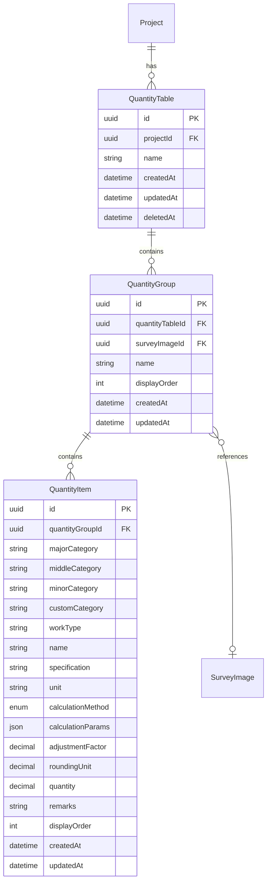

**Business Rules & Invariants**:

- 数量表名は1-200文字
- 必須フィールド: 工種、名称、単位、計算方法、調整係数、丸め設定、数量
- テキストフィールドの文字数制限:
  - 大項目・中項目・小項目・任意分類・名称・規格・計算方法・備考: 全角25文字/半角50文字
  - 工種: 全角8文字/半角16文字
  - 単位: 全角3文字/半角6文字
- 調整係数の範囲: -9.99〜9.99、デフォルト1.00
- 丸め設定の範囲: 0.01〜99.99、デフォルト0.01
- 数量の範囲: -999999.99〜9999999.99、デフォルト0
- 寸法・ピッチフィールドの範囲: 0.01〜9999999.99または空白
- 計算方法「面積・体積」では幅(W)・奥行き(D)・高さ(H)のうち最低1項目の入力必須
- 計算方法「ピッチ」では範囲長・端長1・端長2・ピッチ長が必須
- インポート時の一括取り込みでは計算方法を「標準」に固定

### Logical Data Model

**QuantityTable**

| Column | Type | Constraints | Description |
|--------|------|-------------|-------------|
| id | UUID | PK, DEFAULT uuid() | 数量表ID |
| projectId | UUID | FK, NOT NULL | プロジェクトID |
| name | VARCHAR(200) | NOT NULL | 数量表名 |
| createdAt | TIMESTAMP | NOT NULL, DEFAULT NOW() | 作成日時 |
| updatedAt | TIMESTAMP | NOT NULL, @updatedAt | 更新日時 |
| deletedAt | TIMESTAMP | NULL | 論理削除日時 |

**QuantityGroup**

| Column | Type | Constraints | Description |
|--------|------|-------------|-------------|
| id | UUID | PK, DEFAULT uuid() | 数量グループID |
| quantityTableId | UUID | FK, NOT NULL, ON DELETE CASCADE | 数量表ID |
| surveyImageId | UUID | FK, NULL | 紐付け現場調査画像ID |
| name | VARCHAR(200) | NULL | グループ名 |
| displayOrder | INT | NOT NULL | 表示順序 |
| createdAt | TIMESTAMP | NOT NULL, DEFAULT NOW() | 作成日時 |
| updatedAt | TIMESTAMP | NOT NULL, @updatedAt | 更新日時 |

**QuantityItem**

| Column | Type | Constraints | Description |
|--------|------|-------------|-------------|
| id | UUID | PK, DEFAULT uuid() | 数量項目ID |
| quantityGroupId | UUID | FK, NOT NULL, ON DELETE CASCADE | 数量グループID |
| majorCategory | VARCHAR(50) | NOT NULL | 大項目 |
| middleCategory | VARCHAR(50) | NULL | 中項目 |
| minorCategory | VARCHAR(50) | NULL | 小項目 |
| customCategory | VARCHAR(50) | NULL | 任意分類 |
| workType | VARCHAR(16) | NOT NULL | 工種 |
| name | VARCHAR(50) | NOT NULL | 名称 |
| specification | VARCHAR(50) | NULL | 規格 |
| unit | VARCHAR(6) | NOT NULL | 単位 |
| calculationMethod | ENUM | NOT NULL, DEFAULT 'STANDARD' | 計算方法 |
| calculationParams | JSONB | NULL | 計算用パラメータ |
| adjustmentFactor | DECIMAL(5,2) | NOT NULL, DEFAULT 1.00 | 調整係数 |
| roundingUnit | DECIMAL(6,2) | NOT NULL, DEFAULT 0.01 | 丸め単位 |
| quantity | DECIMAL(12,2) | NOT NULL | 数量 |
| remarks | VARCHAR(50) | NULL | 備考 |
| displayOrder | INT | NOT NULL | 表示順序 |
| createdAt | TIMESTAMP | NOT NULL, DEFAULT NOW() | 作成日時 |
| updatedAt | TIMESTAMP | NOT NULL, @updatedAt | 更新日時 |

**Indexes**:

- `@@index([projectId])` on QuantityTable
- `@@index([deletedAt])` on QuantityTable
- `@@index([quantityTableId, displayOrder])` on QuantityGroup
- `@@index([quantityGroupId, displayOrder])` on QuantityItem

**Enum Definition**:

```prisma
enum CalculationMethod {
  STANDARD      // 標準（直接入力）
  AREA_VOLUME   // 面積・体積
  PITCH         // ピッチ
  COUNT         // 箇所数（REQ-47）
}
```

**calculationParams（JSONB）の形状**:

計算方法ごとに格納されるキーが異なる。DB 上のカラム追加は不要で、REQ-47 で必要な DB 変更は enum 値の追加のみである。

| 計算方法 | calculationParams のキー |
|---|---|
| STANDARD | `null`（未設定） |
| AREA_VOLUME | `width?`, `depth?`, `height?`, `weight?` |
| PITCH | `rangeLength`, `endLength1`, `endLength2`, `pitchLength`, `length?`, `weight?` |
| COUNT | `count`, `length?`, `weight?` |

`adjustmentFactor` / `roundingUnit` は `quantity_items` の独立カラム（`Decimal(10,4)`）であり、計算方法によらず共通である。

### Migration Strategy（REQ-47）

**実測による裏付け**: 既存29マイグレーションに `ALTER TYPE ... ADD VALUE` の前例がゼロであったため、PostgreSQL 15.17（`postgres:15-alpine`、本番と同一イメージ）上で挙動を実測した。

**この二値（29 と ゼロ）は本節を書いた時点の記録であり書き換えない（タスク 115.234。`site-survey` の design.md「実測値の書き方（タスク 115.212）」の (a) に従う）。同じ二つの数え方の再実測は 34 と 2 である**——`ls -d backend/prisma/migrations/*/ | wc -l` の出力が `34`、`grep -rlE 'ALTER TYPE .* ADD VALUE' backend/prisma/migrations | wc -l` の出力が `2`（コミット `6b84be3`。2026-09-02 にリポジトリルートで実測）。前例が 2 件へ増えた内訳は、本節の設計が生んだ当のマイグレーション（`add_calculation_method_count`）と、別機能のマイグレーション（`add_estimate_item_note_type`）である。**上の設計上の帰結は再実測で動かない**——`ADD VALUE` を単文に限るという制約は前例の有無ではなく PostgreSQL の挙動から導いたものであり、その挙動の実測結果（上の表）は再実測の対象に含めていない。

| 検証ケース | 結果 |
|---|---|
| `BEGIN; ALTER TYPE "CalculationMethod" ADD VALUE 'COUNT'; COMMIT;` を単独実行し、**コミット後**に新値を INSERT | **成功**。PostgreSQL 12 以降、`ADD VALUE` はトランザクション内で実行可能 |
| **同一トランザクション内**で `ADD VALUE` した値を直後に使用（INSERT） | **失敗**（`ERROR: unsafe use of new value "..." of enum type` / `HINT: New enum values must be committed before they can be used.`） |

**設計上の帰結**:

- マイグレーションファイルは `ALTER TYPE "CalculationMethod" ADD VALUE 'COUNT';` の**1文のみ**とし、**同一マイグレーション内で `COUNT` を参照する DEFAULT 変更・UPDATE・INSERT を一切含めない**。この条件下では `prisma migrate deploy`（Docker entrypoint／Railway 自動適用）で安全に適用できる。
- 既存行への影響はない。`calculationMethod` のデフォルトは `STANDARD` のまま変更せず、既存データのバックフィルも不要である。
- enum 値は末尾に追加される（`STANDARD < AREA_VOLUME < PITCH < COUNT`）。アプリケーションは enum の序数に依存していないため影響はない。
- 前方互換性: 旧バージョンのアプリケーションコードが `COUNT` を含む行を読み込むと、TS のユニオン型に存在しない値を受け取ることになる。ただし数量表編集画面は enum 値追加と同一リリースで更新されるため、実運用上のリスクはない。ロールバックが必要な場合、PostgreSQL は enum 値の削除をサポートしないため、**enum 値は残したままアプリケーションコードのみを戻す**（`COUNT` の行が存在すると旧コードでは表示が壊れるため、ロールバック前に該当行の有無を確認する）。

## Error Handling

### Error Categories and Responses

**User Errors (4xx)**:

- `400 BAD_REQUEST`: 入力バリデーションエラー（必須フィールド未入力、計算方法と入力値の不整合、範囲外入力、文字数超過、サポート対象外ファイル形式）
- `404 NOT_FOUND`: 数量表・グループ・項目が存在しない、プロジェクトが存在しない
- `409 CONFLICT`: 楽観的排他制御エラー（他ユーザーによる更新との競合）。saveDraft では `expectedUpdatedAt` 不一致時に返却し、フロントはエラー表示のうえドラフト（未保存変更）を保持して再保存を可能にする（REQ-42 AC9）
- `422 UNPROCESSABLE_ENTITY`: ビジネスロジックエラー
- `500 INTERNAL_SERVER_ERROR`: コピー処理・保存処理中の予期しないエラー。saveDraft 失敗時もドラフトは保持され、編集内容は失われない（REQ-42 AC9）

**Business Logic Errors**:

- 計算不整合エラー: 問題のフィールドをハイライト
- 必須項目未入力エラー: 面積・体積やピッチモードでの必須項目チェック
- 範囲外入力エラー: 各フィールドの入力可能範囲を超えた値
- 文字数超過エラー: テキストフィールドの最大文字数超過
- 空白グループ名エラー: 数量グループ名が空白のまま確定された場合
- PDF生成エラー: PDF生成中の予期しないエラー

**インポート関連エラー**:

- ファイル形式エラー: サポート対象外のファイル形式（対応形式: .xlsx, .xls, .pdf）
- Excelパースエラー: SheetJSによるファイル読み取り失敗 → エラーメッセージ表示、手動入力を促す
- OCR処理エラー: pdfjs-dist/Tesseract.js/Claude Vision APIの処理失敗 → エラーメッセージ表示、リトライボタン表示
- OCRタイムアウト: 30秒超過 → タイムアウトエラー表示、リトライボタン表示
- Claude Vision APIフォールバック: API利用不可（ANTHROPIC_API_KEY未設定、HTTP 503、タイムアウト）→ pdfjs-dist + Tesseract.jsで自動フォールバック

**オートコンプリート関連エラー**:

- 初回候補取得失敗: オートコンプリート機能を無効化し手入力のみで運用（graceful degradation）

### Monitoring

- 保存エラー率の監視（saveDraft の失敗率・409競合率）
- saveDraft の成功率・保存所要時間
- 計算エラー発生頻度
- バリデーションエラー分布
- オートコンプリート候補取得APIのレスポンスタイム
- インポートOCR処理のエラー率・フォールバック率
- Claude Vision APIのレスポンスタイム・エラー率（数量表インポート用）

## Testing Strategy

### Unit Tests

- CalculationEngine: 各計算方法（標準、面積・体積、ピッチ、箇所数）のテスト
- CalculationEngine.calculateCount（REQ-47）: 長さ・重量なしで箇所数がそのまま rawValue になること、長さ・重量ありで乗算されること、箇所数が同一のときピッチ計算と最終数量が一致すること、整数以外・範囲外で例外となること
- countParamsSchema（REQ-47）: `calculationMethod: 'COUNT'` の数量項目で `count` / `length` / `weight` が保持されること
- 判別子ベースのパラメータ検証（REQ-48）: **混合状態のパラメータ**（ピッチの4キー＋`count`）を `calculationMethod: 'COUNT'` で検証すると、`count` が保持されピッチのキーが破棄されること。同じ混合状態を `calculationMethod: 'AREA_VOLUME'` ＋ `width` で検証すると `width` が保持されること（既存バグの回帰テスト）。**形状推測の union では両方とも失敗する**ため、判別子化の有無を直接検出する
- resetParamsForMethod（REQ-48）: 「ピッチ」→「箇所数」で `rangeLength` 等が破棄され `length` / `weight` が引き継がれること。「面積・体積」→「ピッチ」で `width` / `depth` / `height` が破棄され `weight` が引き継がれること。`STANDARD` への切替で `null` になること
- QuantityValidationService.validateCountMode（REQ-47）: 箇所数の必須・整数・範囲（1〜9999999）検証。あわせて switch の `default` 節が未知モードをエラーにすること
- CalculationMethodRegistry（REQ-47）: `CALCULATION_METHOD_LABELS` が全計算方法を網羅し、`CALCULATION_METHOD_OPTIONS` が表示順どおりに生成されること
- CalculationFields（REQ-47）: COUNT 選択時に COUNT_FIELDS が描画されること（PITCH_FIELDS へフォールバックしないこと）、箇所数が整数表示され小数桁が付与されないこと、既存の面積・体積／ピッチの小数2桁書式が変わらないこと
- QuantityItemActionMenu（REQ-46）: メニューが `document.body` 直下に Portal 描画されること、outside-click（`mousedown`）と Escape で閉じること、項目選択で操作実行後に閉じること。**クリップ検証は jsdom がレイアウトを再現しないため単体テストでは不可能であり、E2E に委譲する**
- QuantityTableService: CRUD操作、楽観的排他制御のテスト
- QuantityTableService.copy: ディープコピー（全グループ・全項目の複製、写真紐づけ維持）
- QuantityGroupService: CRUD操作、写真紐付けのテスト
- QuantityItemService: 計算検証のテスト
- QuantityValidationService: フィールド仕様バリデーション（文字数制限・数値範囲）
- AutocompleteCandidateStore: フィルタリング・blur時候補追加のテスト
- CopyQuantityTableDialog: デフォルト名設定、処理中インジケーター、エラーメッセージ表示
- QuantityGroupTitleRow: メインタイトル行の全列テキスト表示
- SortOrderButtons: ボタン有効/無効制御、コールバック呼び出し
- QuantityTablePdfExportService: 表紙生成、グループセクション生成、改ページヘッダー繰り返し
- ImportDataExtractor: Excelパース処理のテスト（SheetJSによるデータ読み取り、全シート解析）
- ImportDataExtractor: PDF OCR処理のテスト（テキストPDF/スキャンPDF判定、フォールバック処理）
- ImportFieldMapping: autoDetectFieldMapping（ヘッダー名からの自動推定）のテスト
- ImportFieldMapping: convertToQuantityItems（マッピング適用と変換）のテスト
- ImportDialog: ファイル形式バリデーション、処理状態管理、リトライ機能のテスト
- ImportPreviewTable: プレビューテーブル表示、テキスト選択可能性のテスト
- ClaudeVisionService: 数量表用プロンプトでの抽出テスト
- PhotoCommentDisplay: コメントあり/なし/null時の表示テスト（既存テストで対応済み、修正後の回帰確認）
- QuantityGroupCard: 写真選択時のコメント伝播テスト（linkSurveyImageレスポンスのcommentフィールド反映）
- QuantityItemActionMenu: メニュー開閉、disabled制御（canMoveUp/canMoveDown）、各アクションコールバック呼び出し
- EditableQuantityItemRow (REQ-37): 計算方法切替時の計算用フィールド群の表示/非表示、行高さが37px以下を維持すること、ラベルとテキストボックスが交互配置されること
- CalculationFields (REQ-37): 面積・体積モードでW→D→H→重量→調整係数→丸め設定の順、ピッチモードで範囲長→端長1→端長2→ピッチ長→長さ→重量→調整係数→丸め設定の順で水平配置されること、ラベルが visually-hidden ではないこと
- QuantityValidationService.truncateForCopy (REQ-38): 文字数超過時の元名切り詰めとサフィックス付与
- QuantityGroupService.copy (REQ-38): グループと配下項目の複製、surveyImageId保持、displayOrderの +1 シフト、監査ログ記録、エラー時のロールバック
- QuantityGroupCard (REQ-38): コピーボタンの表示、isCopying中のdisabled・スピナー表示、onCopyGroupコールバック呼び出し
- QuantityTableEditPage 写真選択ダイアログ (REQ-39): 多数枚（例: 30枚以上）が全件レンダリングされること、グリッドレイアウト用スタイル（`gridAutoRows` 等の修正後プロパティ）が適用されること。※写真同士の「重なりゼロ」の矩形判定は実レイアウトを要し jsdom では検証不可のため E2E（Playwright）で実施する（前提による無効化を避ける）
- buildGroupNameFromSurvey (REQ-40): 「{現場調査名} {連番}」生成、文字数超過時の現場調査名切り詰め＋連番付与（REQ-22 AC4 と整合）
- QuantityGroupService.createGroupsFromSurvey (REQ-40): 写真枚数分のグループ生成、写真順（displayOrder）紐づけ、末尾追加（max+1起点の連番）、写真0枚時 created:0、エラー時ロールバック、監査ログ記録
- SurveySelectDialog (REQ-40): 現場調査一覧表示、isCreating中のdisabled・インジケーター表示、onConfirm（選択ID）コールバック呼び出し
- QuantityGroupCard (REQ-41): 画像・コメント（photoArea）が水平スクロールラッパーの外に配置されること、数量項目テーブルのみが overflowX コンテナ内にあること、折りたたみ時に photoArea も非表示・再展開時に再表示されること
- quantityTableEditReducer (REQ-42): 各編集アクション（group/item の add/delete/copy/reorder、rename、photo link、from-survey 生成、import 取り込み）がドラフトのみを更新し `isDirty=true` になること、新規行に仮ID（`temp-`）が採番されること、save 同期アクションでサーバーレスポンスからドラフト/スナップショットが置換され `isDirty=false` になること
- QuantityTableService.saveDraft (REQ-42/11): payload に無いDB行の削除・id=nullの作成・既存idの更新・displayOrder反映・グループ名/数量表名/surveyImageId 反映、検証エラー時の中断、`expectedUpdatedAt` 不一致時の 409、エラー時ロールバック、監査ログ記録
- QuantityTableEditPage 離脱ガード (REQ-43): `isDirty=true` で `useBlocker` がブロック状態となり確認UIが出ること、proceed/reset の挙動、`isDirty=false` ではブロックしないこと、保存成功後にガード解除されること
- UnsavedChangesBadge (REQ-44): `isDirty` true で表示・false で非表示、編集で表示・保存成功で非表示に更新されること
- QuantityTableEditPage ヘッダー (REQ-45): `styles.header` に `position: sticky`/`top:0`/`zIndex` が適用されること、未保存インジケーターがヘッダー内に配置されること（実スクロールでの固定追従は E2E で検証）

### Integration Tests

- 数量表作成 → グループ追加 → 項目追加 → 保存の一連フロー
- saveDraft フル状態同期 (REQ-42): 新規グループ・新規項目の作成、削除されたグループ・項目のDB削除、並び替え（displayOrder）、グループ名・数量表名・写真紐づけの反映が単一 PUT /save で原子的に行われること、`expectedUpdatedAt` 競合で 409・編集状態保持を確認できること、他プロジェクト/権限不足で 403/404、並行 save で後発が 409 となり displayOrder 衝突・部分反映が起きないこと（楽観ロック）
- 計算方法の切り替えと数量再計算の正確性テスト
- 楽観的排他制御の競合シナリオ
- フィールドバリデーションエラー時の保存阻止（saveDraft で全状態検証・保存中断）
- オートコンプリート候補一括取得API: GROUP BYで重複排除された候補値の返却
- 数量表コピーAPI: 全データが正しく複製されること
- 数量グループコピーAPI (REQ-38): 元グループの全項目・写真紐づけが複製されること、displayOrderが元グループ+1の位置に挿入されること、後続グループのdisplayOrderが+1シフトされること、監査ログが記録されること
- 数量グループコピー並行制御 (REQ-38): 同一数量表に対する copy/add/reorder 操作が並行実行された場合、`SELECT FOR UPDATE` ロックにより serialize されること（先発操作完了まで後発操作はブロックされる）、ロック取得タイムアウト時に `OptimisticLockError` が返却され API 層で 409 にマップされること
- Claude Vision API（数量表モード）: 数量表用プロンプトで正しい列マッピングが返却されること
- 現場調査一括生成API (REQ-40): POST /api/quantity-tables/:tableId/groups/from-survey が現場調査の写真枚数分のグループを末尾に連番命名で生成し、各グループに写真が写真順で1枚ずつ紐づくこと、写真0枚時に created:0 を返すこと、他プロジェクトの現場調査指定時に 403/404 となること、トランザクションでエラー時に部分生成が残らないこと
- 現場調査一括生成 並行制御 (REQ-40): 同一数量表に対する from-survey/copy/add/reorder が並行実行された場合、`SELECT FOR UPDATE` ロックにより直列化され displayOrder の衝突・欠番・重複が発生しないこと、ロック取得タイムアウト時に 409 が返却されること（REQ-38 並行制御と同一方針）

### E2E Tests

- 数量表新規作成から編集・保存までのフロー
- 計算方法変更と数量再計算
- コピー・移動操作
- パンくずナビゲーション
- 入力制限の動作確認
- オートコンプリート操作
- 数量表コピー操作
- タイトル行表示最適化
- 数量グループ名前変更操作
- 数量グループ並び順操作
- 数量項目並び順操作
- スクロールバー表示
- PDF出力操作
- インポート操作（Excelファイル）
  - インポートボタンクリック → ダイアログ表示 → Excelファイルアップロード → プレビュー表示 → マッピング調整 → 一括取り込みの一連フロー
  - 取り込まれた数量項目のフィールド値が正しいことの確認
  - 取り込み完了メッセージの表示確認
- インポート操作（PDFファイル）
  - PDFファイルアップロード → OCR処理 → プレビュー表示 → 一括取り込みの一連フロー
  - PDFインラインプレビューとページナビゲーションの動作確認
- 写真コメント表示
  - 数量グループに写真を紐づけた際にコメントが写真の右側に正しく表示されること
  - 数量表編集画面の初回表示時に既存写真のコメントが表示されること
  - 写真変更ダイアログで写真を変更した後、変更後の写真のコメントが表示されること
  - コメントが存在しない写真の場合、コメント表示エリアが空白であること
- 数量項目アクションメニュー
  - アクションメニューボタンのみが行の右端に表示されること
  - メニュー内から「上へ移動」「下へ移動」「コピー」「削除」が実行できること
  - 最上位項目の「上へ移動」がdisabled、最下位項目の「下へ移動」がdisabledであること
  - メニュー外クリックでメニューが閉じること
- 計算用フィールド配置（REQ-37）
  - 計算方法を「面積・体積」「ピッチ」に切り替えると、計算用フィールド群がメイン行の操作列右側に同一行で水平表示されること（行の下に別行として表示されないこと）
  - ラベルとテキストボックスが交互に配置され、すべてのラベルがDOMで可視であること
  - メイン行の行高さがレイアウト変更前と同等であること
  - 計算方法「標準」では計算用フィールド群が表示されないこと
  - 計算用フィールド群がビューポート右端を超えても、ページ全体の水平スクロールで閲覧可能であること
  - 同一グループ内に標準／面積・体積／ピッチが混在しても、各行が独立して正しく描画されること
- 数量グループコピー（REQ-38）
  - グループパネル表題部のコピーボタンをクリックすると、複製先グループが元グループの直下に出現すること
  - 複製先グループの名前が「{元名}のコピー」となること（文字数超過時は元名が切り詰められること）
  - 複製先グループに元グループの全数量項目（フィールド値・並び順を含む）が含まれること
  - 元グループに紐づけられていた写真が複製先グループにも紐づけられていること
  - 後続グループの並び順が +1 シフトされ、表全体の並び順が正しく更新されていること
  - コピー処理中はボタンがdisabled化され、スピナーが表示されること
  - 複製先グループのグループ名が直ちにインライン編集可能であること（既存 REQ-22 と整合）
- インポートエラーハンドリング
  - サポート対象外ファイル形式のエラー表示
  - OCR処理失敗時のリトライ動作確認
  - 別ファイルアップロードによる前回結果のクリア確認
- 写真選択ダイアログのレイアウト（REQ-39）
  - 写真枚数が多い現場調査で写真選択ダイアログを開いた際、写真同士が重ならずに一覧表示されること（隣接サムネイルの `getBoundingClientRect` 矩形が重複しないことを検証）
  - 狭幅ビューポートでも写真が潰れず重ならないこと
  - 写真変更（「別の写真を選択」）からも同じく重なりのない一覧が表示されること
- 現場調査からの数量グループ一括生成（REQ-40）
  - 「現場調査から一括追加」→現場調査選択→実行で、選択した現場調査の写真枚数分の数量グループが既存グループの末尾に生成されること
  - 各生成グループに写真が写真順で1枚ずつ紐づき、グループ名が「{現場調査名} 連番」となること
  - 紐づいた写真にコメントがある場合、写真の右側にコメントが表示されること（REQ-21/35 と整合）
  - 写真が0枚の現場調査を選択した場合、グループが生成されず「写真が存在しません」メッセージが表示されること
  - 生成完了時に生成グループ数を含む完了メッセージが表示されること
- 水平スクロール時の画像・コメント固定表示（REQ-41）
  - 数量グループ内の数量項目テーブルを右端まで水平スクロールしても、画像と現場調査コメントが常に表示され続けること
  - 水平スクロールで右側のはみ出したフィールド（REQ-37 計算用フィールド含む）が閲覧できること
  - 数量グループを折りたたむと画像・コメントも非表示になり、再展開で固定表示が復帰すること
- クライアントサイド編集・明示保存（REQ-42）
  - グループ/項目の追加・削除・コピー・並び替え・グループ名変更・写真紐づけ・現場調査一括生成・インポート取り込みを行っても、保存ボタンを押すまでサーバーへ永続化リクエストが飛ばないこと（ネットワーク監視で確認）
  - 保存ボタン押下で全変更が1回の PUT /save で永続化され、リロード後も反映が保持されること
  - 保存前にリロードすると未保存変更が破棄され、保存後はサーバー状態に一致すること
- 未保存変更の離脱ガード（REQ-43）
  - 未保存変更がある状態でパンくず等の画面遷移を行うと確認ダイアログが表示され、取消で留まり・承認で遷移すること
  - 未保存変更がある状態のリロード/タブクローズでブラウザ標準の離脱確認が出ること
  - 保存後は離脱確認が出ないこと
- 未保存インジケーター（REQ-44）
  - 編集を行うと保存ボタン付近に未保存インジケーターが表示され、保存後に消えること
- ヘッダー固定表示（REQ-45）
  - 編集画面を下方向にスクロールしても、インポート/PDF出力/保存/＋グループを追加ボタンが画面内に常に表示され続けること
  - 固定ヘッダー内に未保存インジケーターが表示されること
- アクションメニューの表示不具合修正（REQ-46）— `e2e/specs/quantity-tables/quantity-item-action-menu-clipping-e2e.spec.ts`
  - **`toBeVisible()` だけでは不十分**: Playwright の `toBeVisible()` は「空でない bounding box を持ち `visibility !== hidden`」の判定であり、**祖先の `overflow` によるクリップを検出しない**。既存の `quantity-item-action-menu.spec.ts` はこの理由で本不具合を素通りさせている（全テスト緑のまま機能は使用不能だった）。以下は `boundingBox()` による幾何検証と Portal 描画の直接確認を用いる
  - グループ**最下行**のアクションボタンを開き、メニューの3項目すべてが `boundingBox()` を持ち、かつ `toBeInViewport()` を満たすこと（REQ-46 AC1, AC3）
  - 数量項目が**1件のみ**のグループでも同様にメニュー全体が表示されること（REQ-46 AC4）
  - メニュー要素が `document.body` の直下に描画されていること（`evaluate((el) => el.parentElement === document.body)`）。これにより祖先クリップが構造的に発生しないことを保証する（REQ-46 AC2）
  - メニューを開いたまま数量項目の表を水平スクロールし、メニューの `x` 座標がアクションボタンの `x` 座標に追従すること（スクロール前後の差分を比較。REQ-46 AC5）
  - メニューを開いたまま画面を垂直スクロールし、メニューの `y` 座標がボタンに追従すること（REQ-46 AC6）
  - 固定ヘッダーと重なる位置でメニューを開き、メニューがヘッダーより前面に表示されること（重なり領域の `elementFromPoint` がメニュー側であること。REQ-46 AC7）
  - メニュー外クリックで閉じること、メニュー項目選択で操作が実行されメニューが閉じること（REQ-46 AC8, AC9 / REQ-36 AC9 の回帰確認）
  - メニューを開閉しても表の水平スクロール位置が保持され、REQ-37/41 の挙動が壊れないこと（REQ-46 AC11）
  - 既存流儀: `boundingBox()` ベースの幾何検証は `e2e/specs/quantity-tables/photo-select-overlap-e2e.spec.ts:66-95` のヘルパーパターンに準拠する
- 計算方法「箇所数」（REQ-47）— `e2e/specs/quantity-tables/quantity-count-calculation-e2e.spec.ts` と `e2e/specs/quantity-tables/quantity-count-persistence-e2e.spec.ts`
  - 計算方法セレクトに「箇所数」が選択肢として存在すること（REQ-47 AC1）
  - 「箇所数」を選択すると計算用フィールドが「箇所数 → 長さ → 重量 → 調整係数 → 丸め設定」の順で行内に水平表示されること。**ピッチのフィールド（範囲長・端長1・端長2・ピッチ長）が表示されないこと**（フォールバック回帰の検出。REQ-47 AC2）
  - 箇所数=5 / 長さ・重量 未入力 → 数量が 5 になること（REQ-47 AC5）
  - 箇所数=5 / 長さ=2.00 / 重量=1.50 / 調整係数=1.00 / 丸め=0.01 → 数量が 15.00 になること（REQ-47 AC4, AC6）
  - 同じ入力値に対し、ピッチ計算（箇所数が5になるパラメータ）と箇所数計算の最終数量が一致すること（REQ-47 AC7 の同一性検証）
  - 箇所数を未入力のまま保存 → 必須エラーが表示され保存されないこと（REQ-47 AC9）
  - 箇所数に小数（例 2.5）を入力 → 拒否されエラーが表示されること（REQ-47 AC10）
  - 箇所数に 0 または 10000000 を入力 → 範囲エラーが表示されること（REQ-47 AC11）
  - 箇所数・長さ・重量・調整係数・丸め設定のいずれかを変更すると数量が自動再計算されること（REQ-47 AC12）
  - 計算方法を「ピッチ」→「箇所数」→ 他方式へ切り替えるとフィールド群が正しく差し替わること（REQ-47 AC13, AC14）
  - **保存 → リロード後に計算方法・箇所数・長さ・重量・調整係数・丸め設定・数量がすべて復元されること**（REQ-47 AC15。zod union の strip 事故を E2E レベルでも検出する）
  - 「箇所数」の数量項目を含むグループをコピーすると、計算方法と全パラメータが複製されること（REQ-47 AC16）
  - 「箇所数」の数量項目を含む数量表を PDF 出力すると、計算方法欄が「ピッチ」ではなく**「箇所数」**と表示されること（REQ-47 AC17。ラベル変換のフォールバック回帰の検出）
- 計算方法切替時のパラメータ整合（REQ-48）— `e2e/specs/quantity-tables/quantity-count-method-switch-e2e.spec.ts`
  - **「ピッチ」で範囲長・端長1・端長2・ピッチ長を入力 →「箇所数」へ切替 → 箇所数を入力 → 保存 → リロード**した後、箇所数が保持されていること（REQ-48 AC3。これが今回の欠陥の直接の再現手順）
  - **「ピッチ」で全パラメータを入力 →「面積・体積」へ切替 → 幅を入力 → 保存 → リロード**した後、幅が保持されていること（REQ-48 AC4。既存バグの回帰テスト）
  - 計算方法を切り替えると、切替前の方式に固有のフィールド（範囲長等）が画面から消え、値も保持されないこと（REQ-48 AC1）
  - 「ピッチ」→「箇所数」の切替で、共通フィールドである「長さ」「重量」の入力値が引き継がれること（REQ-48 AC2）
  - 切替直後（新方式の必須パラメータが未入力）に、旧パラメータを流用した数量が表示されないこと（REQ-48 AC7）

### Performance Tests

- 100項目以上の数量表での操作レスポンス（クライアントサイド編集の応答性）
- saveDraft フル状態同期の保存レスポンスタイム（100項目以上の一括同期）
- オートコンプリート候補一括取得APIのレスポンスタイム
- クライアントサイドフィルタリングの応答時間
- 計算エンジンの大量項目での処理時間
- Excelインポートの処理時間（100行以上のファイル）
- PDF OCR処理の処理時間（5ページ以上のファイル）

## Security Considerations

- 認証済みユーザーのみアクセス可能（既存のProtectedRoute使用）
- プロジェクトへのアクセス権限チェック（既存のRBAC使用）
- オートコンプリート候補一括取得APIは`quantity_table:read`権限を要求
- Claude Vision API（数量表インポート用）は`quantity_table:write`権限を要求
- 入力値のサニタイズ（Zodスキーマ）
- 数値範囲の厳格なバリデーション（オーバーフロー防止）
- インポートファイルのサイズ制限（既存のmulterファイルサイズ制限に準拠）
- アップロードファイルのMIMEタイプ検証

## Performance & Scalability

- 仮想スクロール: react-windowで100項目以上の数量表に対応
- 遅延読み込み: 数量グループの展開時にのみ項目をフェッチ
- メモ化: 計算結果のキャッシュ（useMemo）
- 明示保存: 編集はクライアントサイドのドラフトで完結し、保存操作時に saveDraft で全状態を1回同期（操作ごとのAPI往復を排除、REQ-42）
- バッチ処理: 保存はフル状態を単一トランザクションで適用
- 入力制御の最適化: 文字幅計算のキャッシュ
- オートコンプリート最適化: 初回一括取得によりテキスト入力中のAPIリクエストを完全排除
- 並び順変更: 隣接2要素のdisplayOrderのみを更新（最小限の更新件数）
- PDF出力: 写真のData URL変換はPromise.allで並列実行
- インポート: React.lazy()による動的インポートでバンドルサイズ影響を回避
- OCR処理: Claude Vision API用のCanvas描画スケールは2.0（トークン量削減）、Tesseract.js用は4.0（精度向上）

## Requirement 49: 数量グループ数によらない写真表示の効率

### Overview

**Purpose**: 数量表編集画面と写真選択ダイアログで発生するサーバーリクエストの件数と通信量を、数量グループ数および選択可能な写真の枚数から切り離す。

**Users**: 数量グループが多い数量表を扱う積算担当者と、サーバー負荷を管理するシステム運用者。

**Impact（既存前提の是正）**: 本要件が対象とする経路のうち2点は是正済みである。

1. 数量グループ表題部が縮小表示に原本画像を読み込んでいた（`QuantityGroupCard.tsx`）。**是正済み**。サムネイルを渡し `preferThumbnail` を指定する。
2. 数量表詳細APIが `annotatedThumbnailUrl` を署名付きURLへ変換せず `/api/storage/<path>` の内部パスのまま返していた（`quantity-tables.routes.ts` の `enrichQuantityTableSignedUrls`）。当該パスは配信されないため、合成済みサムネイルは表示に使えずクライアント合成へ退行していた。**是正済み**。

残る差分は、拡大表示が原本を取得しないこと（49.7）、表示領域外の取得抑止（49.8）、写真選択ダイアログの一括取得（49.9）である。

#### Goals
- 数量表編集画面の表示で発生するリクエストを、数量表詳細の取得1回と、表示領域に入った写真の取得のみに限定する
- 拡大表示の操作時点で原本画像を取得し、縮小表示用の画像を引き伸ばさない
- 写真選択ダイアログの写真一覧を、現場調査ごとの個別リクエストに分割せず取得する
- 写真選択ダイアログの対象を Requirement 4.3 / 19.2 が定める注釈付き写真のみへ揃える

**利用者から見える変化**: 写真選択ダイアログに注釈のない写真が表示されなくなる。現行実装は要件の規定に反して全写真を表示していたため、これは要件への追従であり機能の縮小ではない。ただし注釈を付けずに写真を数量グループへ紐づける運用が存在する場合、当該操作は行えなくなる。

#### Non-Goals
- 表示領域到達の観測機構そのもの（共有コンポーネント `AnnotatedImageThumbnail` と `useInViewport` が担い、site-survey スペックの Requirement 38 が所管する）
- 注釈をレンダリングしたサムネイル画像の生成（site-survey の Requirement 20.4 / 23 が所管）
- 2つある拡大表示経路（プレビューと注釈ビューア）の統合。表示要素が異なるため本要件では扱わない
- 未結線の `PhotoChangeDialog` の扱い（Requirement 19・39 の所管）
- 写真選択ダイアログの絞り込み・検索UI（Requirement 4・19 の所管）

### Boundary Commitments

#### This Spec Owns
- `frontend/src/components/quantity-table/QuantityGroupCard.tsx` が `AnnotatedImageThumbnail` へ渡す画像情報（表示元URL・実寸・縮小表示指定）
- `frontend/src/components/quantity-table/PhotoPreviewDialog.tsx` の拡大表示の表示元
- `frontend/src/pages/QuantityTableEditPage.tsx` の写真選択ダイアログにおける写真一覧の取得手段
- 数量表詳細レスポンスの `surveyImage` が持つフィールド（`quantity-table.service.ts` の写真サマリ生成、`quantity-tables.routes.ts` の署名付きURL変換）
- **プロジェクト単位の現場調査写真一覧を返す新規エンドポイントの契約**（後述の「境界をまたぐ変更」を参照）

#### Out of Boundary
- `AnnotatedImageThumbnail` の表示元選択規則と取得タイミングの制御（site-survey の Requirement 38 が所管）。本スペックは**利用者**であり、同コンポーネントを変更しない
- `useInViewport` の実装（同上）
- 注釈をレンダリングしたサムネイルの生成契機と生成結果（site-survey の Requirement 20.4 / 23 が所管）
- `hasAnnotations` の導出規則。現場調査API・数量表APIとも「注釈レコードの存在」で一致しており変更しない
- 未結線の `PhotoChangeDialog.tsx` の存廃。Requirement 19・39 が2つのダイアログを前提としている一方、実装は写真の追加・変更を同一ダイアログで扱う。この不一致の解消は本要件の対象外
- 写真選択ダイアログのレイアウト（Requirement 39 が所管）

#### 境界をまたぐ変更（明示）
49.9 を満たすには、プロジェクト内の現場調査写真をまとめて取得する手段が必要である。この能力は既存のどのスペックにも存在せず、データ自体は現場調査機能が保持する。本設計は次の方針を採る。

- **契約は本スペックが所有する**。当該エンドポイントは写真選択ダイアログのためだけに存在し、他の利用者を想定しない
- **実装は現場調査機能が所有するファイルへ加える**。画像一覧の権限検証と署名付きURL生成の規約（site-survey Requirement 38.4 の問い合わせ回数の契約）を二重に持たないため
- この変更は site-survey の Requirement 38.4 が定める「問い合わせ回数を枚数に比例させない」規約を満たす形で行う。違反した場合は同要件の回帰となる

#### Allowed Dependencies
- 依存方向: `types` → `api` → `components` → `pages`。左方向のみ import 可
- `QuantityGroupCard` → `AnnotatedImageThumbnail`, `PhotoPreviewDialog`。注釈取得APIを直接呼ばない
- `PhotoPreviewDialog` → `AnnotatedImageThumbnail`。Fabric.js を直接扱わない
- `QuantityTableEditPage` → 新規の写真一覧取得API。現場調査詳細取得（`getSiteSurvey`）を写真収集の目的で呼ばない
- バックエンド: 新規エンドポイント → `ImageListService`, `SignedUrlService`。Prisma へ直接問い合わせる経路を新設しない
- 新規の外部ライブラリ依存を追加しない

#### Revalidation Triggers
- site-survey の Requirement 38 が `AnnotatedImageThumbnail` の観測条件（実寸が正の値であること）を変更した場合 → 数量表が渡す画像情報を再検証
- `SurveyImageSummary` の利用箇所（PDF出力・一括生成）が増えた場合 → 実寸フィールド追加の影響を再検証
- プロジェクトあたりの現場調査数・写真枚数が新規エンドポイントの上限を超えるようになった場合 → ページング方針を再設計
- `PhotoChangeDialog` が結線された場合 → 49.9・49.10 の対象範囲を再検証

### 設計合成（Design Decisions）

- **Generalization**: 49.2・49.3・49.8 はいずれも「表示元の選択と取得タイミング」という単一の関心であり、共有コンポーネント `AnnotatedImageThumbnail` が既に所管している。数量表側で独自の遅延読み込みを実装せず、**同コンポーネントが観測を成立させるために必要な入力（実寸）を供給する**ことに作業を絞る。
- **Build vs Adopt（Adopt）**: 拡大表示の注釈反映は、注釈ビューア（`QuantityTableEditPage.tsx`）が既に採っている「原本画像＋クライアント合成」方式を採用する。`PhotoPreviewDialog` の `annotatedThumbnailUrl || originalUrl` は、合成済みサムネイル（縮小解像度）を拡大表示に用いるため 49.7 を満たさない。
- **Build vs Adopt（Adopt）**: 新規エンドポイントの権限検証と署名付きURL生成は `SignedUrlService` / `ImageListService` の既存規約を採用する。プロジェクト単位の権限判定は `SignedUrlService` が内部に持つプロジェクト判定を公開して用い、判定基準を複製しない。
- **Simplification**: 写真一覧の取得を「現場調査一覧の取得 → 各現場調査の詳細取得」の2段構えから、1エンドポイントの1リクエストへ置き換える。中間の現場調査詳細は写真収集のためだけに取得されており、他の情報は使われていない。
- **選択対象を注釈付き写真のみへ絞る（設計レビューでの是正）**: Requirement 4.3 / 19.2 は選択対象を「同一プロジェクトの注釈付き現場写真一覧（注釈エディタで編集済みの画像）」と定めているが、現行実装（`QuantityTableEditPage.tsx`）は絞り込みを行わず全写真を描画し、注釈ありにバッジを付けるのみである。**要件どおりサーバー側で注釈付きのみへ絞る**ことにより、応答件数と通信量が要件の範囲へ収まり、上限到達の可能性も大きく下がる。要件を変更せず実装を要件へ寄せる方向であり、変更範囲が最小となる。
- **Simplification（設計レビューでの是正）**: 一覧が返す表示用の署名付きURLを1件あたり1本（`displayUrl`）に統一する。当初は `thumbnailUrl` / `annotatedThumbnailUrl` / `originalUrl` の3本を返す設計だったが、R2 実装（`r2-storage.provider.ts`）の SigV4 presigned URL は1本あたり数百バイト規模であり、件数に比例して応答が肥大する。Requirement 49 の Objective は「件数**と通信量**」を対象としており、件数削減と引き換えに通信量を増やす設計は目的の半分しか満たさない。優先順位の解決をサーバー側へ寄せることで、呼び出し側の分岐も不要になる。
- **Simplification**: 上限は件数のみで表現し、ページングを導入しない。注釈付きのみへ絞ったことで想定件数が大きく下がるため、既定200・最大500とする。現行実装は現場調査を先頭100件までしか見ておらず既に暗黙の上限がある。上限を応答で明示することで、暗黙の切り捨てを可視化する。
- **Rejected**: 数量表側で `useInViewport` を直接使い `QuantityGroupCard` の描画自体を遅延させる案。遅延読み込みの実装が2箇所に分かれ、同じ問題への対処が重複する。design.md の境界（取得タイミングは共有コンポーネントの所管）にも反する。
- **Rejected**: 既存の現場調査一覧APIへ `includeImages` クエリを追加する案。同APIは一覧表示用に代表画像1枚のURLのみを返す設計であり、全画像を返す責務を持ち込むと応答形状が用途によって変わる。
- **Rejected（設計レビューで検討し不採用）**: 写真選択を「現場調査を選ぶ → その写真を見る」の2段構えへ変更し、新規エンドポイント自体を不要にする案。上限到達と応答サイズの双方を解消できるが、Requirement 4.3 / 19.2 が明示する「同一プロジェクトの写真一覧」と正面から矛盾し、承認済み要件2件の改定と稼働中の操作体験の変更を伴う。注釈付きへの絞り込みで同じ問題が解消できるため採らない。

### Architecture

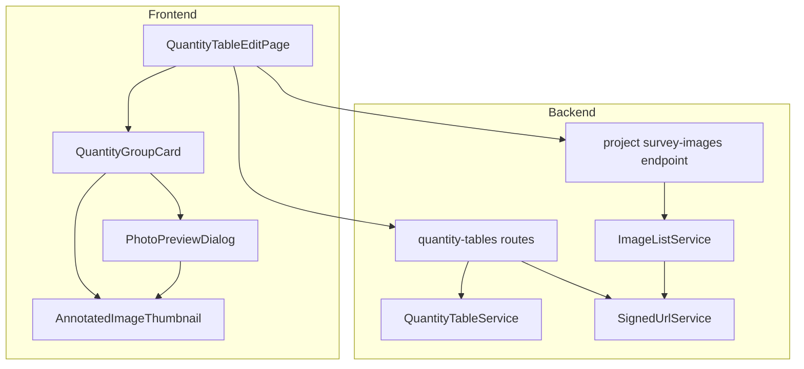

**Key Decisions**

- `AnnotatedImageThumbnail` は本スペックの境界外にある共有部品である。図中で数量表側から一方向に依存しており、逆向きの依存や数量表固有の分岐を同コンポーネントへ持ち込まない。
- 写真選択ダイアログの取得先が `ProjectImages` の1経路に集約される。現行の「現場調査一覧 → 現場調査詳細 × N」の経路は廃止する。

### File Structure Plan

| ファイル | 区分 | 責務 |
|---|---|---|
| `backend/src/services/image-list.service.ts` | 変更 | プロジェクト単位で注釈付き現場調査写真を一括取得する経路を追加する。表示用URLを1本へ解決し、問い合わせ回数を写真枚数に比例させない |
| `backend/src/services/signed-url.service.ts` | 変更 | プロジェクト単位のアクセス可否判定を公開する（既存の内部判定を公開するのみで判定基準は変更しない） |
| `backend/src/routes/site-surveys.routes.ts` | 変更 | プロジェクト配下の写真一覧エンドポイントを追加する |
| `backend/src/services/quantity-table.service.ts` | 変更 | 写真サマリへ実寸（幅・高さ）を含める |
| `backend/src/routes/quantity-tables.routes.ts` | 変更なし（実装済み） | `annotatedThumbnailUrl` の署名付きURL変換は是正済み |
| `frontend/src/types/quantity-table.types.ts` | 変更 | 写真サマリの型へ実寸を追加する |
| `frontend/src/api/site-surveys.ts` | 変更 | プロジェクト単位の写真一覧取得を追加する |
| `frontend/src/components/quantity-table/QuantityGroupCard.tsx` | 変更 | 表題部の画像情報へ実寸を渡す |
| `frontend/src/components/quantity-table/PhotoPreviewDialog.tsx` | 変更 | 拡大表示を原本画像＋クライアント合成へ切り替える |
| `frontend/src/pages/QuantityTableEditPage.tsx` | 変更 | 写真選択ダイアログの取得を一括取得へ置き換える。表示元は `displayUrl` を用い、注釈の有無による分岐とバッジ表示は不要になる（全件が注釈付きのため） |

### Components and Interfaces

| Component | Domain | Intent | Requirements | Dependencies | Contracts |
|---|---|---|---|---|---|
| プロジェクト写真一覧エンドポイント | Backend/API | プロジェクト内の注釈付き現場調査写真を表示用URL1本でまとめて返す | 49.9, 49.10 | `ImageListService`（P0）, `SignedUrlService`（P0） | API |
| `ImageListService`（プロジェクト単位） | Backend/Service | 枚数非依存の問い合わせ回数で写真とURLを返す | 49.9 | `SignedUrlService`（P0）, `StorageProvider`（P0） | Service |
| `QuantityTableService` の写真サマリ | Backend/Service | 表示に必要な情報へ実寸を加える | 49.8 | Prisma（P0） | Service |
| `QuantityGroupCard` | Frontend/Component | 表題部の表示元と実寸を供給する | 49.2, 49.3, 49.4, 49.5, 49.6, 49.8 | `AnnotatedImageThumbnail`（P0） | — |
| `PhotoPreviewDialog` | Frontend/Component | 拡大表示で原本を用い注釈を反映する | 49.7 | `AnnotatedImageThumbnail`（P0） | — |
| `QuantityTableEditPage` の写真選択 | Frontend/Page | 選択可能な写真を一括取得する | 49.9, 49.10 | 写真一覧API（P0） | — |

#### プロジェクト写真一覧エンドポイント

```
GET /api/projects/:projectId/survey-images
```

| 項目 | 内容 |
|---|---|
| クエリ | `limit`（既定 200、最大 500） |
| 認可 | `site_survey:read` 権限、およびプロジェクトへのアクセス可否判定 |
| 対象 | **注釈が存在する写真のみ**（Requirement 4.3 / 19.2 が定める「注釈エディタで編集済みの画像」） |
| 並び | 現場調査の調査日降順 → 写真の表示順昇順 |
| 応答 | `{ images: ProjectSurveyImage[]; hasMore: boolean }` |
| エラー | 400（クエリ不正）、401、403、404（プロジェクト不在） |

```typescript
export interface ProjectSurveyImage {
  id: string;
  surveyId: string;
  surveyName: string;
  fileName: string;
  /**
   * 一覧表示に用いる画像（署名付きURL）
   *
   * 注釈をレンダリングしたサムネイルを優先し、無い場合は通常のサムネイルへ解決した
   * 結果を1本だけ返す。呼び出し側が優先順位を再実装する必要をなくし、
   * 応答に含まれる署名付きURLの本数を抑える。
   */
  displayUrl: string | null;
  /** 原本画像（署名付きURL）。選択確定後の拡大表示に用いる */
  originalUrl: string | null;
  comment: string | null;
  /** 画像の実寸（表示領域確保に用いる） */
  width: number;
  height: number;
  displayOrder: number;
}
```

**契約**

- **注釈が存在しない写真は返さない**。Requirement 4.3 / 19.2 は選択対象を「注釈エディタで編集済みの画像」と定めており、絞り込みをサーバー側で行うことで応答件数と通信量を要件の範囲へ収める
- `hasAnnotations` は返さない。全件が注釈ありであることが本エンドポイントの不変条件であり、常に真となるフィールドを持たせない
- 表示用の署名付きURLは1件あたり1本に限る。優先順位（注釈付きサムネイル > 通常サムネイル）はサーバー側で解決する
- `hasMore` が `true` の場合、上限に達して切り捨てが発生したことを示す。呼び出し側はその旨を利用者へ提示できる
- 問い合わせ回数は写真枚数・現場調査数に比例させない。現場調査の抽出・注釈付き画像の抽出をそれぞれ1回で行い、アクセス可否の判定はプロジェクト単位で1回とする
- 署名付きURLは画像の抽出結果に含まれるストレージキーから生成し、画像ごとの再照会を行わない

#### 写真サマリへの実寸追加

```typescript
export interface SurveyImageSummary {
  // 既存フィールドは変更しない
  /** 画像の実寸（ピクセル）。未読込時に表示領域を確保するために用いる */
  width: number;
  height: number;
}
```

- 実寸が正の値でない場合、共有コンポーネントは表示領域を確保できず観測を行わない（site-survey の設計が定める縮退規則）。したがって本フィールドの供給が 49.8 の成立条件である

#### `PhotoPreviewDialog`（差分）

- 表示元を `annotatedThumbnailUrl || originalUrl` から、共有コンポーネントへの委譲（原本画像＋クライアント合成）へ変更する
- 縮小表示指定を行わず、即時取得を指定する。拡大表示は利用者の明示操作を契機とするため遅延させない
- 注釈の反映結果は Requirement 3.3 の規定を維持する

### System Flows

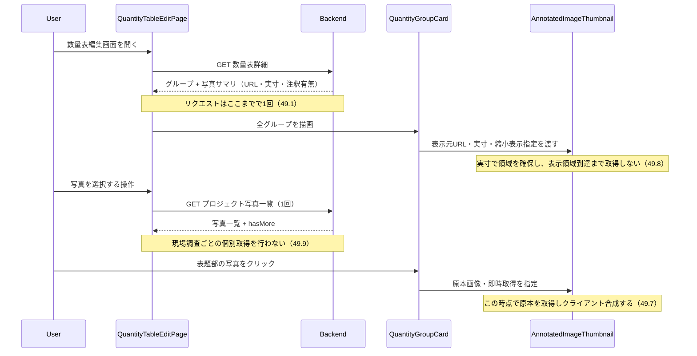

### Requirements Traceability

| Requirement | Summary | Components | Interfaces | Flows |
|---|---|---|---|---|
| 49.1 | 写真の表示情報をまとめて取得 | `QuantityTableService` の写真サマリ, `quantity-tables routes` | 数量表詳細レスポンス | 画面表示 |
| 49.2 | 注釈のためのグループごと追加リクエストなし | `QuantityGroupCard`, `AnnotatedImageThumbnail`（境界外） | 表示元URLの供給 | 画面表示 |
| 49.3 | リクエスト件数をグループ数に比例させない | `QuantityGroupCard` | 実寸の供給 | 画面表示 |
| 49.4 | 表題部はサムネイル | `QuantityGroupCard` | 縮小表示指定 | 画面表示 |
| 49.5 | 合成済みサムネイル優先 | `QuantityGroupCard` | `annotatedThumbnailUrl` の供給 | 画面表示 |
| 49.6 | 利用不可時の表示維持 | `AnnotatedImageThumbnail`（境界外） | フォールバック | 画面表示 |
| 49.7 | 拡大表示時に原本を取得 | `PhotoPreviewDialog` | 原本＋即時取得の指定 | 拡大表示 |
| 49.8 | 表示領域外は取得しない | `QuantityTableService` の写真サマリ, `QuantityGroupCard`, （境界外）`AnnotatedImageThumbnail` | 実寸フィールド | 画面表示 |
| 49.9 | 選択可能な写真をまとめて取得 | プロジェクト写真一覧エンドポイント, `QuantityTableEditPage` | `ProjectSurveyImage` | 写真選択 |
| 49.10 | ダイアログ一覧はサムネイル | プロジェクト写真一覧エンドポイント, `QuantityTableEditPage` | `displayUrl`（サムネイル解像度へ解決済み） | 写真選択 |

### Error Handling

| 失敗 | 挙動 | 根拠 |
|---|---|---|
| 写真一覧の取得に失敗 | ダイアログへ取得失敗を提示し、既存の写真紐づけは変更しない | 49.9。部分的に取得した一覧で選択させない |
| 上限に達して切り捨てが発生 | `hasMore` を真として返し、一覧に全件が含まれない旨を提示する | 49.9。暗黙の切り捨てを可視化する |
| 注釈付き写真が1件も存在しない | 空一覧を返す。ダイアログは「注釈付きの写真がありません」と、注釈エディタでの編集を促す旨を提示する | Requirement 4.3 / 19.2。対象が注釈付きに限られることを利用者へ明示する |
| 実寸が欠落した写真 | 共有コンポーネントが観測を行わず即時取得へ縮退する。表示は成立する | 49.8 の縮退。表示破綻より機能劣化を選ぶ |
| 原本画像の取得に失敗（拡大表示） | 既存のエラー表示を維持する。縮小表示用の画像で代替しない | 49.7 |

### Testing Strategy

**単体（バックエンド）**

- プロジェクト写真一覧: 現場調査3件・写真30枚でアクセス可否の判定が1回のみ呼ばれ、画像ごとの再照会が発生しないこと（49.9）／**注釈のない写真が応答へ含まれないこと**（Requirement 4.3, 19.2）／`displayUrl` が注釈付きサムネイル優先で解決され、応答に表示用URLが1件あたり1本しか含まれないこと（49.9）／上限を超えた場合に `hasMore` が真になり件数が上限で打ち切られること／プロジェクトへのアクセス権がない場合に拒否されること／並びが調査日降順・表示順昇順であること
- 写真サマリ: 数量表詳細の応答に実寸が含まれること（49.8）

**単体（フロントエンド）**

- `QuantityGroupCard`: 表題部へ渡す画像情報に実寸が含まれること（49.8）／サムネイルと合成済みサムネイルの優先順が維持されること（49.4, 49.5、実装済み・回帰固定）
- `PhotoPreviewDialog`: 拡大表示の表示元が合成済みサムネイルではなく原本になること、および即時取得が指定されること（49.7）
- `QuantityTableEditPage`: 写真選択ダイアログを開いたときに写真一覧APIを1回だけ呼び、現場調査詳細の取得が発生しないこと（49.9）／一覧の表示元が `displayUrl`（サムネイル解像度）であること（49.10）／`hasMore` が真のとき切り捨ての旨が提示されること／注釈付き写真が0件のとき注釈エディタでの編集を促す旨が提示されること

**E2E**

- 数量グループを多数持つ数量表の編集画面を開き、初期表示時点で発生した画像関連リクエストの合計がグループ数より少ないこと（49.2, 49.3, 49.8）。観測はパス基準で行う
- 写真選択ダイアログを開いたときに現場調査詳細への個別リクエストが発生しないこと（49.9）
- 注釈のない写真が写真選択ダイアログに現れないこと（Requirement 4.3, 19.2）。注釈を付けた写真のみが選択できることを実操作で確認する

### Migration Strategy

**順序制約**: 49.8 の成立は site-survey の共有コンポーネント改修（同スペック Task 111.3）の完了を前提とする。実寸の供給を先行して行っても表示は変わらず、害はない。

**他スペックへの依存の扱い（設計レビューでの是正）**: 本スペックの作業は実寸の供給のみであり、それだけでは表示領域外の取得は止まらない。したがって **49.8 の検証タスクは site-survey の Task 111.3 完了までブロック扱いとする**。タスク生成時に当該依存を明記し、未完了の間は検証タスクへ `_Blocked:_` を付す。本スペックのタスクをすべて完了しても、この依存が解消されるまで 49.8 は未達であることを、タスク側で可視化する。

1. バックエンドの実寸供給とフロントエンドの受け渡しを先行して反映する（単独で安全）
2. 共有コンポーネントの観測導入が完了した時点で 49.8 が成立する
3. 写真一覧エンドポイントと拡大表示の是正は上記と独立に反映できる

**ロールバック**: 実寸の供給と拡大表示の是正は既存フィールドを削除せず、応答の追加とフロントエンドの表示元変更に留まるため個別にリバート可能である。

**利用者への影響を伴う変更**: 写真選択ダイアログの対象を注釈付きのみへ絞る変更は、利用者から見える挙動が変わる唯一の項目である。注釈を付けずに写真を紐づける運用が存在する場合は影響を受けるため、反映前に運用実態を確認する。要件（4.3 / 19.2）への追従であり、要件側の改定は行わない。
