# 技術設計書: 現場調査機能

## Overview

**Purpose**: 現場調査機能は、工事案件のプロジェクトに紐付く現場調査データを管理し、撮影した写真や図面に対して寸法・マーキング・コメント等の注釈を追加することで、工事計画の基礎資料を作成する機能を提供する。

**Users**: プロジェクト担当者および現場調査担当者が、現場での情報収集から報告書作成までのワークフローで本機能を利用する。

**Impact**: 既存のプロジェクト管理機能を拡張し、プロジェクト配下に現場調査エンティティを追加する。画像ストレージ、Canvas描画、PDFエクスポートなどの新規技術スタックを導入する。

### Goals

- プロジェクトに紐付く現場調査データのCRUD操作を提供する
- 画像アップロード、圧縮、サムネイル生成を実現する
- Canvas上での注釈編集（寸法線、マーキング、コメント）を可能にする
- 注釈付き画像のエクスポートおよびPDF報告書生成を実現する
- 手動保存と未保存変更の検出機能を提供する
- **写真ごとのコメント管理と報告書出力フラグによる選択的PDF出力を実現する**
- **プロジェクト詳細画面での現場調査セクション表示を実現する**
- **画像削除機能をUI上で提供する**
- **PDF報告書出力時のAPIリクエスト最適化（バッチ注釈取得）を実現する**
- **ブレッドクラムナビゲーションを「ダッシュボード > プロジェクト一覧 > プロジェクト > 現場調査一覧 > 現場調査 > 画像」の階層構造に統一する**
- **画面タイトルを「現場調査一覧」に変更し、画像プレビュー画面から「← 現場調査に戻る」リンクを削除する**
- **注釈付きサムネイル画像の生成・表示をプレビュー画面、詳細画面サムネイル、一覧画面サムネイルで実現する**
- **画像アップロード時の拡張子チェックを廃止し、マジックバイトによる画像形式判定のみでアップロード可否を決定する**
- **注釈エディタ（編集モード）での90度単位の背景画像回転機能を提供する（描画済み注釈は回転に追従しない）**

### Non-Goals

- リアルタイム共同編集機能（将来の拡張として検討）
- 3D/AR機能との連携
- OCR（光学文字認識）による自動寸法読み取り
- 動画ファイルのサポート

### 呼称規約（部品名の表記ルール）

本設計書は部品を指すときに**実装に存在する名前をそのまま使う**。「その名前が論理名なのか実ファイル名なのか」を読み手が判別できない状態は、設計と実装の乖離をレビューで見逃す原因になるため、以下を**文書全体の規約**とする。

1. **フロントエンドの画面・コンポーネント・フック**は、**実ファイル名（拡張子なしの basename）** で呼ぶ。この層はファイル名とエクスポート名が一致している。パスを示すときはリポジトリルートからの相対パス（例: `frontend/src/pages/SiteSurveyDetailPage.tsx`）を書く。定数・トークン等のモジュール（`annotation-style-tokens.ts` など）は kebab-case のファイル名で呼び、参照するシンボル名は別途バッククォートで示す。**この基準に節ごとの例外は設けない。** 要件24-30 節と要件31-32 節の「Modified Files（主要変更点サマリー）」小節はかつて `frontend/src/` 相対を節の宣言として置いていたが、タスク 115.115 でルート相対へ統一した。規約側へ例外条項を置く案は採らなかった。基準が節ごとに分かれると実在照合が節の境界を状態として持たねばならず、宣言を欠く節や新設の節で同じ二重基準が再発するためである（規約7 のプレースホルダ表記だけは深さの自由を持つが、実在の主張ではないため本規約の照合対象ではない）。
   - **ファイル構成ブロックの実在照合は「行」を単位とする。** 表のブロックでは「ファイル」列または「パス」列を持つデータ行 1 行、ツリーのブロックではインデントから完全パスを復元できる枝行のうち末尾が `/` でない行 1 行を、それぞれ 1 件と数える。**数えないもの**は、ツリーのブロック見出し行、配下のディレクトリ行（末尾が `/`）、枝行に続くコメントだけの継続行、および「Modified Files（主要変更点サマリー）」小節の箇条書き（同小節は自前の基準宣言を持つ別枠である）である。**行が単位であって実体の異なり数ではない**ため、`上記再掲` の行も 1 件として数える。「ZIP 内構造（参考、永続化なし）」のツリーはリポジトリ内の配置を示すものではないため対象外である。
   - **件数を報告するときは本定義を明示すること。** 本定義での件数は **128 件**（ツリーの実体行 85 + 表のデータ行 43）である。過去にこの照合へ報告された 146 と 154 は同じ集合へ別の行種を足したもので、146 = 128 + 箇条書き 18 行、154 = 146 + ディレクトリ行 8 行として再現できる。定義を欠いた件数は次の再検証で**偽の不一致**に見えるため、単独では記録しない。内訳の 4 数は次のコマンドで再現でき、出力はそれぞれ `85` / `43` / `18` / `8` である（いずれもリポジトリルートで実行する）。
     - ツリーの実体行: `grep -E '^[ │]*(├──|└──) ' .kiro/specs/site-survey/design.md | sed 's/#.*//; s/[[:space:]]*$//' | grep -vE '\{|\.\.\.$' | grep -cv '/$'`
     - 表のデータ行: `awk '/^### File Structure Plan/{f=1;next} /^### /{f=0} f&&/^\| /&&!/^\| (ファイル|パス) /{n++} END{print n+0}' .kiro/specs/site-survey/design.md`
     - 箇条書き行: `awk '/^#### Modified Files（主要変更点サマリー）/{f=1;next} /^#### |^### /{f=0} f&&/^- /{n++} END{print n+0}' .kiro/specs/site-survey/design.md`
     - ディレクトリ行: `grep -cE '^[ │]*(├──|└──) [^ ]*/( +#.*)?$' .kiro/specs/site-survey/design.md`
2. **バックエンドのサービス**は、**実エクスポート名（PascalCase のクラス名）** で呼ぶ。ファイル名は kebab-case の別体系（`SiteSurveyService` ⇔ `backend/src/services/site-survey.service.ts`）なので、パスを示すときは相対パスを併記する。一方、**バックエンドのルートは PascalCase のエクスポートを持たない**。`backend/src/routes/site-surveys.routes.ts` / `survey-images.routes.ts` / `annotation.routes.ts` はいずれも `export default router` を主エクスポートとし、PascalCase のエクスポートを持たない（`survey-images.routes.ts` は他に camelCase の `export async function initializeStorageServices()` を公開する。同ディレクトリでは `construction-photo-images.routes.ts` の `initializeConstructionPhotoImageServices` と `invitation.routes.ts` の `createInvitationRoutes` が同じく camelCase 関数を公開する）。したがって**ルートは実ファイル名**（`annotation.routes.ts` 等）で呼び、パスを示すときはリポジトリルートからの相対パスを書く。
3. 実装に 1:1 で対応する実体を持たない**論理部品名**は、下の「論理名と実体の対応表」に列挙したものだけを使う。**部品名については、表に無い名前は実ファイル名または実エクスポート名そのもの**とみなしてよい。**この既定則が適用されるのは規約6 が定義する「部品名」に限る**（契約名には適用しない。規約6 を参照）。**プレースホルダ表記にも適用しない**（規約7 を参照）。
4. **Mermaid 図**に限り、ノードID・participant 別名・表示ラベルに短縮形を許容する。使用する短縮形は下表に列挙する。本文・見出し・表・ファイル構成ブロックでは短縮形を使わない。**実在しないファイル名・クラス名を、あたかも実体であるかのようにラベルへ書いてはならない。**
5. 新しい部品名を本文に書くときは、実装が存在するなら 1/2 に従い、存在しないなら下表へ追記する。**実在しないファイル名を実ファイル名として書いてはならない。**
6. **規約1〜3・5 の適用対象は「部品名」に限る。** 部品名とは、ページ / コンポーネント / フック / サービス / ルート / ミドルウェア / マネージャのように、実装ファイルまたは実エクスポートとして配置される実行時の構成要素を指す。これに対し、`interface` / `type` 定義ブロックに現れる**型名**、および「Requirements Traceability」表の Interfaces 列に現れる **API 契約名**（`SurveyAPI` / `ImageAPI` 等）は、本設計書が定義する**設計上の抽象契約**であって、**実装のエクスポート名の主張ではない**。したがって規約3 の既定則（表に無い名前は実名とみなしてよい）は契約名には適用しない。同じ既定則は規約7 のプレースホルダ表記にも適用しない（規約7 を参照）。**契約名が実装に実体を持つかどうかは、名前の見た目からは判別できない**（例: `IAuditLogService` は実在し `ISurveyService` は実在しない。どちらも同じ `I*Service` 表記である）。判別は下の「契約名の実在対照表」だけを根拠とし、**表に無い契約名を実在するものとして扱ってはならない**。新しい契約名を書くときは同表へ追記する。
7. **名前・パスの「型」だけを示す表記（プレースホルダ表記）は、可変部を必ず `*` で書く。** プレースホルダ表記とは、`hooks/use*.ts` / `services/*Service.ts` / `*API` / `*.test.tsx` のように、**特定の実体ではなく命名や配置の型を示す**記述である。実体を指していないため**実在の主張ではなく**、規約1/2/5 の実名義務と規約3 の既定則は適用しない（規約5 の禁止――実在しない名前を実体であるかのように書くこと――にも、本規約の書式に従う限り抵触しない）。ただし実名と同じ見た目で書くと**実在照合が毎回偽陽性を出す**ため、可変部は必ず `*` に置き換える。`Xxx` のような英字の伏字、`(x)` のような拡張子の省略記号（`*.test.ts` / `*.test.tsx` と列挙する）は使わない。`*` は実ファイル名にも実エクスポート名にも現れない文字なので、**パス／名前トークンのうち `*` を含むものを機械的に実在照合の対象外にできる**。プレースホルダは実体を指さないため、規約1 の「リポジトリルートからの相対パス」は適用せず、文脈で通じる深さで書いてよい。本規約は部品名・契約名・パスのいずれにも適用する（規約6 の適用範囲の切り分けとは独立）。
   - **`*` では型が示せない場合に限り、説明語による可変部 `<説明語>`（日本語の説明語を `<>` で囲む。例: `<名前>` / `<ファイル名>`）を使ってよい。** 許すのは次の四つの場合だけである。(1) シェルコマンドの例の内部、(2) 注釈行・タグ・**コード行**の**書式の断片**（`- <番号>: <本文>` / `@requirement site-survey/REQ-<番号>` / `import { type <名前>, ... }` のように、行やタグの並びそのものを示すもの）、(3) 手順の散文で可変部を**単独語として名指し**するとき（「各ファイル名（…）について」の `<ファイル名>` など）、(4) **本規約が `<>` 表記の形式を定義するために自己引用する箇所**（例: 本項および規約7 本文が書式を示すために置く `<説明語>` / `<名前>` / `<ファイル名>`、および `<` と `>` そのものへの言及）。規約が定義のために引用する表記は、許可形・禁止形のいずれであっても使用に当たらない。`<` と `>` は実ファイル名にも実エクスポート名にも現れないため、`*` と同様に**`<>` を含むトークンも機械的に実在照合の対象外にできる**。加えてコマンド例は一つのバッククォート内に空白を含むため、パスの実在照合はコマンド例全体を対象外とする。TypeScript のジェネリクス（`Promise<string>` 等）や HTML 要素（`` 等）は `<>` を含むがプレースホルダ表記ではない。判別は**日本語の説明語を囲んでいるか**で行う。
   - **逆に、`*` を含まないパス／名前トークンはすべて実在の主張として扱う。** したがって**ブレース展開 `{a,b}` を使ってはならない**。複数の実ファイルを一度に指すときは各パスを個別に列挙する。ブレース展開は実在を主張しているのに literal 照合器が展開できず、**恒久的な偽陽性**になる（要件31-32 節の 5 ツールの記述が該当し、タスク 115.80 で個別列挙へ展開済み）。
   - **禁止の形を規約自身が引用する箇所は、本規約の適用対象外とする。** 本規約が名指しで禁じる `Xxx`（英字の伏字）・`(x)`（拡張子の省略記号）・`{a,b}`（ブレース展開）は、**禁止対象を指し示すための引用**であって記述としての使用ではない。引用と使用を区別しないと、規約の条文自体が規約違反として挙がる。引用であることは、**その形を禁じる文の中に置かれていること**で判別する。規約の条文の外でこれらの形を使ってはならない。
   - **本規約の対象はリポジトリ内のパスと部品名・契約名に限る。** R2 オブジェクトキーや URL の**テンプレート**（`annotated-thumbnails/{imageId}.jpg` / `orphaned/{originalPath}` / `/api/site-surveys/images/*/annotations` など）はいずれにも当たらないため対象外であり、実行時に値が埋まる変数部は `{変数名}` のまま書いてよい（実在照合はリポジトリ内のパスだけを見る）。
   - 規約4 の Mermaid 短縮形、および下の「論理名と実体の対応表」に載る論理名は、**いずれも特定の実体（または実体の集合）を指す名前**であってプレースホルダ表記ではない。これらは引き続き規約3/4 が扱う。
   - **実在照合の基準線は文書全体を対象に置く。** 対象とするトークンの形は、**バッククォートで囲まれた文字列全体が `[A-Za-z0-9_.@-]+(/[A-Za-z0-9_.@-]+)+` に一致し（末尾の `/` は任意）、かつ先頭セグメントがリポジトリ最上位の版管理下エントリ名と一致するもの**である。この2条件により対象から落ちるトークンは **43 件**ある。その内訳はモジュール指定子 `@aws-sdk/client-s3`、MIME 型 `image/png`、要件タグ `site-survey/REQ-5.5`、併記記法 `scaleX/scaleY` の4種にとどまらず、**第2条件は非ルート相対で書かれたリポジトリ内のパス参照も落とす**（以下はいずれも落ちるトークンそのものの引用であって、パスの記述としての使用ではない: `api/client.ts` / `hooks/useInViewport.ts` / `types/upload.types.ts` / `utils/sentry.ts` / `gestures/touchGestureManager.ts` など）。43 件のうち版管理下の実ファイルへ接尾一致するものは **20 件**で、これは規約1 が根絶しようとしているルート相対でないパス記述そのものである。残る 23 件には非実在の `tools/index.ts`（`frontend/src/components/site-surveys/tools/index.ts` の撤去の記録）も含まれ、**この免除の陰は空ではない**。したがって `*` を含むトークン・`<>` を含むトークンと同じく、第2条件で落ちるトークンについても**対象外であることは実配置と一致している証拠ではない**（照合が届かない範囲は目視で守る）。件数は次のコマンドで再現でき、出力はそれぞれ `43` / `20` である（本小節の再現コマンドはいずれもプロセス置換を用いるため bash で実行する。規約1 の4コマンドは POSIX シェルの範囲である）。
     - 落ちる全件: `grep -oE "$(printf '\140')[A-Za-z0-9_.@-]+(/[A-Za-z0-9_.@-]+)+/?$(printf '\140')" .kiro/specs/site-survey/design.md | tr -d "$(printf '\140')" | sed 's:/$::' | sort -u | awk -F/ 'NR==FNR{split($0,a,"/");top[a[1]]=1;next} !($1 in top)' <(git ls-files) - | wc -l`（出力は `43`）
     - うち版管理下の実ファイルへ接尾一致するもの: 上のコマンドの `wc -l` を `awk 'NR==FNR{L[++m]=$0;next}{for(i=1;i<=m;i++) if(substr(L[i],length(L[i])-length($0))=="/" $0){print;break}}' <(git ls-files) - | wc -l` へ差し替える（出力は `20`）
     - **どちらを実在の権威に置くかで件数が変わる。** 版管理の一覧（`git ls-files`）を権威にすると非実在は **11 件**、実ディスク（`test -e`）を権威にすると **10 件**である。差の1件は生成物 `backend/coverage`（`.gitignore` の `coverage/` に該当する）で、**実ディスクを見るほうが実在する資材が一件増える**。件数を報告するときはどちらの権威かを必ず添える。
       - 版管理の一覧: `grep -oE "$(printf '\140')[A-Za-z0-9_.@-]+(/[A-Za-z0-9_.@-]+)+/?$(printf '\140')" .kiro/specs/site-survey/design.md | tr -d "$(printf '\140')" | sed 's:/$::' | sort -u | awk -F/ 'NR==FNR{f[$0]=1;n=split($0,a,"/");p="";for(i=1;i<n;i++){p=(i==1?a[1]:p"/"a[i]);d[p]=1}top[a[1]]=1;next} ($1 in top)&&!($0 in f)&&!($0 in d)' <(git ls-files) - | wc -l`（出力は `11`）
       - 実ディスク: `grep -oE "$(printf '\140')[A-Za-z0-9_.@-]+(/[A-Za-z0-9_.@-]+)+/?$(printf '\140')" .kiro/specs/site-survey/design.md | tr -d "$(printf '\140')" | sed 's:/$::' | sort -u | awk -F/ 'NR==FNR{split($0,a,"/");top[a[1]]=1;next} ($1 in top)' <(git ls-files) - | while read -r q; do [ -e "$q" ] || echo "$q"; done | wc -l`（出力は `10`）
     - **10 件はすべて撤去・削除の記録であり、実在の主張ではない。** 内訳は、撤去済みと本文に明記した 7 件（`frontend/src/components/site-surveys/SiteSurveyListView.tsx` / `frontend/src/components/site-surveys/SiteSurveySearchFilter.tsx` / `frontend/src/components/site-surveys/SiteSurveyErrorDisplay.tsx` / `frontend/src/hooks/useSiteSurveyError.ts` / `frontend/src/components/site-surveys/index.ts` / `frontend/src/components/site-survey/index.ts` / `frontend/src/components/site-surveys/tools/index.ts`）と、区分が `削除` の 3 件（`frontend/src/components/site-surveys/LazyImage.tsx` / `frontend/src/components/site-surveys/LazyImage.stories.tsx` / `frontend/src/__tests__/components/site-surveys/LazyImage.test.tsx`）である。したがってこの 10 件は欠陥ではなく**基準線**である。次の再検証でこの集合から外れた非実在が出たときだけ、それが是正対象である。
     - **この基準線はタスク 115.173 で機械化した。** 検査は `scripts/check-design-path-references.ts`（`npm run check:design-path-refs`）で、押下前の関門と統合の両方に算入されている。走査対象は本書に限らず `.kiro` 配下の全設計文書であり、判定は**バッククォートで囲まれたトークンのうち、ルート相対パス（先頭セグメントが最上位のエントリ。実装は実ディスクの直下を走査するため**版管理下とは限らない**——本小節の再現コマンドが使う `git ls-files` とはこの一点で異なる）と、拡張子が `.ts` / `.tsx` / `.css` の裸のファイル名**の実在である。**撤去の記録は、当該ファイルを名指したうえで不在を述べる行が同じ文書内に一つでもあれば免除される**（「撤去済み」「削除」「実在しない」等）。上に挙げた各件はいずれもこの条件を満たすため、機械化しても本小節の記述を書き換える必要はなかった（なお、上の件数は当時の走査の記録である。現況との差の所管は本小節ではない）。**免除は名指しの許容リストではなく、文書が不在を書いているかだけで決まる。**したがって今後の撤去では、部品を消す変更の中で本書に不在を一行記録することが検査上の義務になる（タスク 115.169 の教訓「部品を消すときは、その部品を指す記述を同じ変更で数え上げること」の機械化）。**開示済みの限界は二つある。**(1) 不在の語が何を指すかまでは見ないため、現存主張の行に別事由の「削除」等があると免除されてしまう（着手時に `estimate-request` の設計文書で実測。当該一件は 115.173 で人手是正した）。(2) 一度でも不在を記録すれば、その文書内の同じファイルへの他の言及はすべて免除される。**シンボル名の実在は対象外である**——下の「契約名の実在対照表」が示すとおり、意図的に実体を持たない契約名と失効した名前は見た目で区別できず、機械で分けるには当該表を許容リストとして読むほかないためである。
     - **規約1 の行単位の照合とは対象範囲が異なる。** 規約1 はファイル構成ブロックの行だけを見るため、上の 10 件のうち同ブロックに現れるのは 4 件（区分が `削除` の 3 行と、撤去の記録を添えた `frontend/src/components/site-surveys/index.ts` の行）にとどまる。残る 6 件（`frontend/src/components/site-surveys/SiteSurveyListView.tsx` / `frontend/src/components/site-surveys/SiteSurveySearchFilter.tsx` / `frontend/src/components/site-surveys/SiteSurveyErrorDisplay.tsx` / `frontend/src/hooks/useSiteSurveyError.ts` / `frontend/src/components/site-survey/index.ts` / `frontend/src/components/site-surveys/tools/index.ts`）は同ブロックの外（本節と「未結線部品の扱い」小節）に現れる。**件数の差は対象範囲の差であって不一致ではない。** また、ファイル構成ブロックのみを対象とした照合へ記録された **3 件**（タスク 115.116 の `tasks.md` 記録「不一致の集合そのものは三件で完全に一致している」）は、この 4 行のうち区分が `削除` の 3 行だけを数えたもので、4 件はそこへ文書化済み例外の `frontend/src/components/site-surveys/index.ts` の行を加えた数である。**3 と 4 は同一集合の別の数え方**であり、範囲の逸脱でも不一致でもない。**この 3 件をタスク 115.78 に帰属させてはならない。** 本小節を起票したタスク 115.117 の起票文は「ファイル構成ブロックのみを対象とした 115.78 の三件」と書くが、`tasks.md` の 115.78 自身の記録は「不一致は七件である（要件24〜30 が六件、要件29.4 と33〜34 が一件）」であり、その走査は「区分が削除の行の除外」を含むため当該 3 行を数に入れていない。

#### 論理名と実体の対応表

**この表に載せてよいのは、1:1 の実体を持たないことを確認できる名前だけ**である。掲載の可否は次の手順で機械的に判定する。

- `git ls-files` で該当ファイルが存在しないこと、または `grep -n 'export class'` / `grep -n 'export'` で単一の実エクスポートに解決できないことを示す
- 複数ファイル・複数エクスポートの**集約**、実装ファイルを持たない**概念**、複数実体の**総称**、および規約4 が許容する **Mermaid 短縮形**のみが該当する
- 逆に 1:1 の実体が確認できた名前は、この表へ逃がさず**規約1/2 に従って実名へ書き換える**。「表に載せれば論理名を使ってよい」という運用は禁止する

| 本文中の名前 | 種別 | 実体 |
|---|---|---|
| `SurveyRoutes` | 論理名（集約） | `backend/src/routes/site-surveys.routes.ts`、`backend/src/routes/survey-images.routes.ts`、`backend/src/routes/annotation.routes.ts` の総称 |
| `AuthMiddleware` | 論理名（集約） | `backend/src/middleware/authenticate.middleware.ts`、`backend/src/middleware/authorize.middleware.ts` |
| `CanvasEngine` | 論理概念 | Fabric.js の Canvas 実体。専用の実装ファイルは持たない |
| `ShapeTool` | 論理概念（総称） | `frontend/src/components/site-surveys/tools/` 配下の図形ツール（`RectangleTool` / `CircleTool` / `ArrowTool` / `PolygonTool` / `PolylineTool` / `FreehandTool`）の総称 |
| `DetailPage` / `SurveyPage` / `Detail` / `Page` / `SurveyDetail`（Mermaid 内のみ） | 短縮形 | `SiteSurveyDetailPage`（`frontend/src/pages/SiteSurveyDetailPage.tsx`）。**`SurveyDetail` は下の契約名の実在対照表にある同名の抽象契約（DTO）とは別物**である。Mermaid ノードID としての用例は要件31-32 節にあり、いずれも表示ラベルへ実名 `SiteSurveyDetailPage` を併記している |
| `ImageViewerPage`（Mermaid 内のみ） | 短縮形 | `SiteSurveyImageViewerPage`（`frontend/src/pages/SiteSurveyImageViewerPage.tsx`） |
| `Uploader`（Mermaid 内のみ） | 短縮形 | `ImageUploader`（`frontend/src/components/site-surveys/ImageUploader.tsx`） |
| `survey-images`（Mermaid 内のみ） | 短縮形 | `backend/src/routes/survey-images.routes.ts` |
| `Site Survey API`（Mermaid 内のみ） | 短縮形 | 上記 `SurveyRoutes`（現場調査系ルート群） |

**注**: `ExportService` は論理名ではなく実装がある（`frontend/src/services/ExportService.ts`）。`frontend/src/services/export/` 配下ではない点に注意する。

**適用済みの是正**: 以下の名前は以前**実在しない論理名**で呼ばれていた。本規約の導入に伴い、いずれも実名へ統一済みである。

| 旧称 | 統一後の名前 | 実体 |
|---|---|---|
| `SurveyDetailPage` | `SiteSurveyDetailPage` | `frontend/src/pages/SiteSurveyDetailPage.tsx` |
| `SurveyListPage` | `SiteSurveyListPage` | `frontend/src/pages/SiteSurveyListPage.tsx` |
| `SiteSurveyAnnotationEditorPage` | `SiteSurveyImageViewerPage` | `frontend/src/pages/SiteSurveyImageViewerPage.tsx` |
| `SurveyService` | `SiteSurveyService` | `backend/src/services/site-survey.service.ts`（`export class SiteSurveyService`） |
| `ImageService` | `SurveyImageService` | `backend/src/services/survey-image.service.ts`（`export class SurveyImageService`。`validateFile` / `detectMimeTypeByMagicBytes` も同ファイル内のメソッド） |
| `SurveyImagesRoutes` | `survey-images.routes.ts` | `backend/src/routes/survey-images.routes.ts`（規約2 によりルートは実ファイル名で呼ぶ） |
| `QuotaWarningDialog` | `StorageWarningBanner` | `frontend/src/components/site-surveys/StorageWarningBanner.tsx`（要件15.8 / 15.9 の警告 UI。**タスク 115.81 で `AnnotationEditor` へ結線済み。経緯は下の「未結線部品の扱い」を参照**） |

#### 未結線部品の扱い（タスク 115.64 の判断）

`frontend/src/components/site-surveys/` および `frontend/src/components/site-survey/` 配下の各実装ファイルについて、本番コードからの import を機械的に数え、未結線のものを全件洗い出した。抽出手順は次のとおり。

- 各ファイル名（プレースホルダ表記は規約7 に従い `<ファイル名>` と書く）について `grep -rlE "from '[^']*/<ファイル名>'|from '\./<ファイル名>'" frontend/src e2e` を実行し、`__tests__/` 配下・`*.stories.tsx`・`*.test.ts` / `*.test.tsx`・自ファイルを参照元から除外する
- 残った参照元が `index.ts`（まとめ出力）だけ、または 0 件のものを未結線とする
- **`frontend/src/components/site-surveys/index.ts` と `frontend/src/components/site-survey/index.ts` は、本番コードのどこからも import されていない**。したがってまとめ出力への再エクスポートは結線とみなさない（**この2ファイルはタスク 115.85 で撤去済み**。下の「参照されないまとめ出力と検証専用の判定の撤去（タスク 115.85）」を参照）
- 副作用 import（`import './tools/registerCustomShapes'`）は `from` を伴わないため、上記の式では拾えない。個別に確認し結線ありと判定した

撤去の可否は「現在使われているか」ではなく **「要件上使われうるか」** で判断した。

**撤去したもの**（出荷済みの別実装が同じ受入基準を満たしており、要件上この部品が使われる余地が無い）:

| 撤去した部品 | 自称していた担当要件 | 当該要件を満たす出荷済みの実装 |
|---|---|---|
| `SiteSurveyListView`（`frontend/src/components/site-surveys/SiteSurveyListView.tsx`） | 3.1, 3.5 | `SiteSurveyResponsiveView`（`frontend/src/components/site-surveys/SiteSurveyResponsiveView.tsx`）。`SiteSurveyListPage` から結線済みで、テーブル/カード切替に加えグリッド表示も持つ上位互換 |
| `SiteSurveySearchFilter`（`frontend/src/components/site-surveys/SiteSurveySearchFilter.tsx`） | 3.2, 3.3, 3.4 | `SiteSurveyListPage`（`frontend/src/pages/SiteSurveyListPage.tsx`）が検索フォーム・調査日範囲・並び替え・クリアをページ内に直接実装している |
| `SiteSurveyErrorDisplay`（`frontend/src/components/site-surveys/SiteSurveyErrorDisplay.tsx`）と `useSiteSurveyError`（`frontend/src/hooks/useSiteSurveyError.ts`） | 16.8 | 表示は `SiteSurveyListPage` / `SiteSurveyDetailPage` の `role="alert"` エラー表示と再試行ボタンが担う。Sentry 送信の**仕組み**は `frontend/src/components/ErrorBoundary.tsx` と `frontend/src/utils/logger.ts` にあるが、`ErrorBoundary` が拾うのは描画時の未捕捉例外だけである。**画面が `catch` で捕捉した誤りは、その画面が `logger.exception` を呼ばない限り監視へ届かない**（当初この欄は仕組みの所在だけを記しており、履行を記していなかった。タスク 115.84 で両画面の捕捉処理へ送出を結線済み。下の「捕捉した誤りの監視送出（タスク 115.84）」を参照） |

**撤去しなかったもの**（撤去すると要件の実装または要件カバレッジが失われるもの。理由は行ごとに異なり、(a) 要件が表示・機能を求めているのに出荷済みの代替実装が無い、(b) 出荷済みの代替実装はあるが受入基準カバレッジの主張が当該部品の単体検証にしか無い、のいずれかである。(a) の正しい是正は結線、(b) の正しい是正は主張を結線側へ移してからの撤去である）:

| 未結線の部品 | 担当要件 | 撤去せず存置する理由（＝結線されていない理由） |
|---|---|---|
| `StylePanel`（`frontend/src/components/site-surveys/StylePanel.tsx`）と `style-panel.constants.ts` | 24.5, 25.2, 26.3, 26.4, 26.6, 28.7 | 実際に描画されるのは `AnnotationToolbar.tsx` が内包する同名の関数コンポーネントである。**存置の理由（＝結線側に同等の主張が無いこと）は、タスク 115.70 と 115.96 の二段階で解消した**。115.70 は要件26.4 / 26.6 の主張を `AnnotationEditor`（`styleOptionsRef`）側へ移したが、**移せたのはその二つだけ**で、要件24.5 / 25.2 / 26.3 / 28.7 の主張は本部品側に残っていた。115.96 が白縁取りの切替UI自体を結線側（`AnnotationToolbar.tsx` の `StylePanel` と `annotation-toolbar.constants.ts` の `StyleOptions.outlineEnabled`）へ出荷し、要件24.5 / 25.2 の主張を結線側の単体検証（`AnnotationEditor.outline-toggle.test.tsx`）と E2E（`e2e/specs/site-surveys/site-survey-outline-toggle.spec.ts`）へ置いた。残る要件26.3 は `annotation-style-tokens.ts` とその単体検証、要件28.7 は `AnnotationToolbar.mobile-gap.test.tsx` が結線側で主張している（タスク 115.96 の実測）。したがって**本部品の撤去を阻む受入基準カバレッジはもう無い**。撤去そのものはタスク 115.96 の境界（白縁取りの切替UIと注釈の道具帯）の外であり、別タスクの所管とする |

**`ImageViewer` はタスク 115.146 で撤去した（上表から行を落とした）。** 本表は 115.146 の直前まで `ImageViewer`（`frontend/src/components/site-surveys/ImageViewer.tsx`）を「要件30.5 / 33.10 の受入基準カバレッジの所在であるため、主張を結線側へ移すまで撤去できない」として掲げていた。115.146 はその前提条件を先に満たしたうえで撤去した。

- **主張の移管先**: 要件33.10（編集モードと閲覧モードのジェスチャー操作体系の一貫性）は `frontend/src/__tests__/components/site-surveys/AnnotationEditor.gesture-attach.test.tsx` へ移した。本番の閲覧モードは `SiteSurveyImageViewerPage` が `AnnotationEditor` を `readOnly` で描画したものであるため、「同一の `touchGestureManager` が同一の `canvasViewportController` 契約で両モードとも attach される」ことを主張する。要件30.5（描画ツール使用中にマルチタッチが起きても要件17 の選択防止を維持する）は `AnnotationEditor.gesture-interrupt.test.tsx` へ移し、割り込みの前後で `canvas.selection` と既存注釈の `selectable` / `evented` が無効のままであることを主張する
- **旧タグは主張を伴っていなかった**: 撤去した `ImageViewer.test.tsx` は要件30.5 のタグを持っていたが、同部品は描画ツールを持たないため選択防止を一度も検証していなかった。**タグだけが存在した状態**であり、移管は「番号の付け替え」ではなく主張の新設である。両主張とも変異（閲覧モードで attach しない／割り込み時に選択を有効化する）で赤くなることを確認した
- **撤去の効果**: `scripts/check-requirement-coverage.ts` の「本番の経路から到達しない受入基準」は 27 件から 25 件へ減り、site-survey の該当は 0 件になった。本番到達を加味した被覆率は 99.0% から 99.1% へ改善した
- **要件33-36 節などの波ごとの設計記述、および過去の是正の経緯を記録した節に残る `ImageViewer` の言及は書き換えていない。** それらは当時の設計判断・実測の記録であり、現在の部品構成を述べる箇所ではないためである（撤去後は、そこに書かれた `ImageViewer.tsx` を対象とする `grep` 等の実測値は再現しない）。現在の部品構成については本節・`### Component Summary`・「契約名の実在対照表」が権威である

#### 自動保存・復元基盤の結線（タスク 115.81）

タスク 115.64 が「基盤ごとの結線は撤去タスクの境界を超える」として存置した部品群を、タスク 115.81 で `AnnotationEditor`（`frontend/src/components/site-surveys/AnnotationEditor.tsx`）へ結線した。結線先が `AnnotationEditor` である根拠は、本書の「AutoSaveManager」小節の Dependencies が **Inbound: AnnotationEditor — 自動保存要求 (P0)** と定めていることである。

| 結線した部品 | 担当要件 | 結線の内容（本番の描画経路からの到達方法） |
|---|---|---|
| `AutoSaveManager`（`frontend/src/services/AutoSaveManager.ts`） | 15.4, 15.7, 15.9, 15.10 | `AnnotationEditor` が単一インスタンスを保持する。`fabricCanvas` の `object:added` / `object:modified` / `object:removed` を購読し、`saveToLocal` を呼ぶ。発火は既定30秒の**一定間隔**（下記「自動保存の発火条件（タスク 115.119）」を参照）。生成時に `disableAutoSave: !isLocalStorageAvailable()` を渡す |
| `frontend/src/utils/storage-error.ts` | 15.9, 15.10 | `AutoSaveManager` が `isLocalStorageAvailable` / `isQuotaExceededError` / `isSecurityError` を消費する。容量超過の判定は `e instanceof DOMException && e.name === 'QuotaExceededError'` から `isQuotaExceededError` へ置き換え、`code===22` / `code===1014` / `name===NS_ERROR_DOM_QUOTA_REACHED` も容量超過として扱う |
| `useAnnotationRestoration`（`frontend/src/hooks/useAnnotationRestoration.ts`） | 15.5 | `AnnotationEditor` から呼び、サーバー保存済み注釈（`getAnnotation` の応答）とローカル下書きを比較させる |
| `RestoreAnnotationDialog`（`frontend/src/components/site-survey/RestoreAnnotationDialog.tsx`） | 15.5 | 上記フックの `showRestoreDialog` に従って描画する。復元確定時は `util.enlivenObjects` で下書きを実体化し、保存時と現在のキャンバス寸法の比から表示倍率を適用してキャンバスへ載せる |
| `StorageWarningBanner`（`frontend/src/components/site-surveys/StorageWarningBanner.tsx`） | 15.8, 15.9 | `setOnQuotaExceeded` の通知で `quota-exceeded`（「今すぐ保存」は手動保存 `handleSave` へ接続）、自動保存が無効な環境では `private-browsing` を表示する |

**結線にあたって定めた挙動**:

- **閲覧モード（`readOnly`）では自動保存・復元・警告帯のいずれも動かさない。** 復元は編集中の状態を編集画面へ戻す操作であり、描画できない閲覧キャンバスへ適用しても要件を満たさないためである。画像ビューア画面（`SiteSurveyImageViewerPage`）で「編集モード」に入った時点で復元確認が出る
- **読み込み・復元でキャンバスへ載る注釈は自動保存の対象にしない。** サーバー保存済み注釈の復元も `object:added` を発火するため、これを下書きとして書き出すと「未保存の編集」と区別できなくなる。読み込みの開始時に受付を閉じ、読み込み完了時に開く
- **手動保存が成功したらローカル下書きを削除する。** 残したままだと次回訪問時に復元確認が常時表示され、実際の未保存編集と区別できなくなる
- **復元処理の表示倍率適用は、サーバー保存済み注釈の復元（要件9.2）と共有する。** 二重実装にするとタスク 115.73（要件32.2）の是正が片側にしか効かないため、`AnnotationEditor` 内の共有関数へ集約した

**E2E 除外一覧の是正**: `e2e/requirement-exclusions.json` は要件15.4 / 15.5 を「統合テストで検証」として E2E から除外していたが、その統合検証は結線されていないコードだけを回していた。結線が済んだため除外の根拠は失われ、タスク 115.81 で当該2件を除外一覧から削除し、`e2e/specs/site-surveys/site-survey-responsive.spec.ts` の受入レベルの検証へ置き換えた。要件15.7-15.10 は除外一覧に無いまま恒真の判定で「検証済み」に見えていたため、同ファイルの当該検証も本番経路を通る形へ書き直した。

#### 自動保存の発火条件（タスク 115.119）

**発火条件は「最初の変更を起点とした一定間隔」である。** `AutoSaveManager`（`frontend/src/services/AutoSaveManager.ts`）は、未保存の変更を受け取ってから既定30秒ごとに `saveToLocal` の保留分を書き出す。**編集が続いていてもタイマーを張り直さない**ため、描き続けている最中にも保存が起こる。未保存の変更が無い周期でタイマーを止めるので、変更が無いあいだに書き込みは走らない。

**タスク 115.81 までの実装は debounce（最後の操作から30秒待つ）であり、要件15.4 を満たしていなかった。** 要件15.4 は `While 注釈編集中, the Site Survey Service shall 一定間隔（30秒）で自動保存を実行する` である。EARS の `While` は状態が続いているあいだを指し、「一定間隔」は周期的な発火を指す。debounce は最後の操作から30秒後に一度発火するため、**30秒より短い間隔で描き続けているかぎり自動保存は一度も起こらない**。要件が名指しする「編集中」こそ保存されない、という取り違えであった。タスク 115.119 で実装を一定間隔へ改めた。

**承認済みタスク 18.1 の本文との食い違いを、要件を正として決着させた。** `.kiro/specs/site-survey/tasks.md` のタスク 18.1「AutoSaveManagerを実装する」は箇条書きに「30秒間隔のdebounce自動保存」と明記する。実装はこの文言から意図的に外れている。判断の根拠は次の3点である。

- **要件が上位の契約である。** タスクは要件を実現する手段の記録であり、要件そのものではない。手段の記述と受入基準が食い違うときに従うべきは受入基準の側である
- **18.1 が自己申告する要件は自動保存の要件ではない。** 18.1 の `_Requirements:_` は `13.4` だが、現在の要件13.4 は `The Site Survey Service shall 操作履歴を最大50件まで保持し、超過時は最古の履歴から削除する`（Undo/Redo）であり、自動保存を定めていない。したがって 18.1 の本文は要件15.4 の解釈として権威を持たない
- **18.1 は完了済みの履歴であって現況の契約ではない。** 本書は 18.1 の文言を書き換えないが、実装の現況は本小節が示すとおり一定間隔である

**旧契約を書いていた検証の書き換え**: `frontend/src/__tests__/services/AutoSaveManager.test.ts` は「後続の呼び出しでタイマーが張り直される」ことを正の仕様として確かめていた。この主張は旧契約であるため、**削除せず**「後続の呼び出しで保留中の保存を先送りしない」へ書き換えた。あわせて `frontend/src/__tests__/components/site-surveys/AnnotationEditor.autosave-wiring.test.tsx` へ、間隔より短い間隔で操作が届き続ける最中に保存が起こることを見る検証を加えた。タスク 115.81 が加えた検証は単発の操作と静止しか通らず、この欠落を構造的に検出できなかったためである。

**受入レベルでは新しい発火条件が区別されない（本タスクの境界外）**: 上の「E2E 除外一覧の是正」が要件15.4 の置き換え先とした受入レベルの検証は、`e2e/specs/site-surveys/site-survey-responsive.spec.ts:635` の `test('注釈編集中に一定間隔（30秒）で未保存状態がlocalStorageへ自動保存される (site-survey/REQ-15.4)'` である。この検証は同ファイル:646 で `await drawRectangleAnnotation(page);` を**一度だけ**呼び（`sed -n '635,670p' e2e/specs/site-surveys/site-survey-responsive.spec.ts | grep -c 'drawRectangleAnnotation'` の出力が `1`。書く直前の実測）、以後は描かない。続く:649-650 の `await page.waitForTimeout(5000);` と `expect(await readDraft(page, draftKey)).toBeNull();` で即時保存でないことを確かめ、:653-655 の `await expect.poll(() => readDraft(page, draftKey), { timeout: 60_000, intervals: [2000] }).not.toBeNull();` で下書きが生えるのを待つ。**単発の操作のあと静止する形**であるため、debounce（最後の操作から30秒）でも一定間隔でも同じ判定が成立する。

**帰結**: 本タスクが導入した唯一の挙動である**要件15.4 の新しい発火条件は、受入レベルでは区別されていない**。識別力を持つのは、本番の `AnnotationEditor` の描画経路を実際の `AutoSaveManager` とともに通す結線の検証（`frontend/src/__tests__/components/site-surveys/AnnotationEditor.autosave-wiring.test.tsx:429` の `it('描き続けている最中でも一定間隔で自動保存される'`）と、単体の検証（`frontend/src/__tests__/services/AutoSaveManager.test.ts`）だけである。

**後続タスクの提案**: 上記の受入レベルの検証を、**一間隔を超えて描き続けたうえで書き込みが繰り返し起こること**を確かめる形へ拡張するタスクを別途起票すること。**本タスク（115.119）の境界は `AutoSaveManager` の発火条件の実装と、それを見る単体・結線の検証であり、実行時間の上限（当該検証の `test.setTimeout(180_000)`）の見直しを伴う受入検証の再設計は含まないため、ここでは手を入れない。**

**名称の是正**: 発火条件が debounce でなくなったため、実装の設定項目 `debounceInterval` と取得子 `getDebounceInterval` をそれぞれ `autoSaveIntervalMs` / `getAutoSaveIntervalMs` へ改名した。既定値の定数も `DEFAULT_AUTO_SAVE_INTERVAL_MS` である。

**要件番号の是正**: `frontend/src/services/AutoSaveManager.ts` の冒頭とクラスの JSDoc は `@see requirements.md - 要件13.4, 13.5` と書いていたが、要件13.4 / 13.5 は Undo/Redo の履歴（保持上限とクリア）であって自動保存を定めていない。上の 18.1 の `_Requirements:_` と同じ番号の取り違えであるため、自動保存と復元を実際に定める要件15.4 / 15.5 へ改めた。

#### 寸法値入力欄の結線（タスク 115.82）

タスク 115.64 が「本部品が要件6.2/6.3 の唯一の実装である」として存置した `DimensionValueInput`（`frontend/src/components/site-surveys/tools/DimensionValueInput.tsx`）を、タスク 115.82 で `AnnotationEditor`（`frontend/src/components/site-surveys/AnnotationEditor.tsx`）へ結線した。結線先が `AnnotationEditor` である根拠は、要件6.2 が「寸法線が描画される」ことを表示の契機と定めており、寸法線を描画するのが同画面の `mouse:up` ハンドラ（`createDimensionLine` の呼び出し）だけだからである。

| 結線した部品 | 担当要件 | 結線の内容（本番の描画経路からの到達方法） |
|---|---|---|
| `DimensionValueInput`（`frontend/src/components/site-surveys/tools/DimensionValueInput.tsx`） | 6.2, 6.3 | 寸法線ツールを選んでキャンバスをドラッグすると、`AnnotationEditor` の `mouse:up` ハンドラが `createDimensionLine` の戻り値（`DimensionLine`）を入力欄の対象として保持し、`dimensionValueInput` 状態を立てて本部品を描画する（6.2）。確定時は対象の `setDimensionWithLabel(canvas, value, unit)` を呼び、寸法線 Group の `labelText` へ「数値 単位」を書き込む（6.3） |

**結線にあたって定めた挙動**:

- **入力欄は `position: fixed` の重ね合わせ層へ置く。** キャンバス要素の DOM は Fabric が所有するため React で内側へ描画できず、祖先の `overflow` で切り取られる事故も避ける必要がある。既に同じ理由で固定層を使っている `AnnotationContextMenu` に合わせた
- **表示位置はポインタのクライアント座標を基準にする。** マウス／ペンは元イベントの `clientX`/`clientY`、タッチは `changedTouches[0]` から取り出す（`resolveClientPoint`）。取り出せない場合はキャンバス座標（`scenePoint`）へ退避するが、これは入力欄を置く `position: fixed` の層とは**座標系が異なるため位置がずれうる**。ずれを許容しているのは、Fabric が `mouse:up` へ必ず元の DOM イベント（`options.e`）を渡すため退避経路が実際には到達しないからである。正しい退避には `viewportTransform` とキャンバス要素の `getBoundingClientRect()` による逆変換が要るが、本番経路から到達しない分岐のために検証不能なコードを増やさない判断とした
- **閲覧モード（`readOnly`）では開かない。** `mouse:up` を含む描画イベントの購読自体が `!readOnly` のときにしか登録されないため、構造上到達しない
- **寸法線が作られなかったときは開かない。** `createDimensionLine` は 2 点間距離が下限未満だと `null` を返す。要件6.2 の契機は「寸法線が描画される」ことなので、線が無い場合に入力欄を出さない
- **確定時に `object:modified` を発火する。** 寸法値の書き込みは注釈の変更であり、Undo 履歴とタスク 115.81 で結線した自動保存の双方へ伝える必要がある
- **キャンセルでは寸法線を残す。** 要件6.3 は値の入力を「オプションの単位」を含めて任意としており、値なしの寸法線（要件6.1 の成果）を取り消す根拠が無い
- **数値が空のまま確定した場合は単位も表示しない。** 要件6.3 が表示を求めるのは「数値とオプションの単位」であり、単位は数値に付随する任意要素である。したがって**数値が無いときは単位も表示しない**と解釈する。`DimensionLine.setDimensionWithLabel` はラベルを `` `${value} ${unit}` `` で組み立てるため、空の数値をそのまま渡すと `" mm"` のような単位だけのラベルが描かれ、`_hasLabel` も真になってしまう（結線前は到達しなかった経路で、結線によって初めて到達可能になった）。`handleDimensionValueConfirm` は `value.trim()` が空のとき `setDimensionWithLabel(canvas, '', '')` を呼ぶ。入力欄を閉じるだけにせず書き込みを通すのは、既に値を持つ寸法線を空で確定した場合にラベルを確実に消す（`_hasLabel` を false へ戻す）ためであり、この経路でも `object:modified` を発火して「値を消した」変更を Undo と自動保存へ伝える
- **ツールを切り替えたら未確定の入力欄を閉じる。** 別ツールでの描画対象と入力欄の対象が食い違う状態を残さないため

**E2E 除外一覧の是正**: `e2e/requirement-exclusions.json` は要件6.2 / 6.3 を「統合テストで検証」として E2E から除外していたが、その統合検証は結線されていない `DimensionValueInput` を単体で組み立てて回すだけだった。結線が済んだため除外の根拠は失われ、タスク 115.82 で当該2件を除外一覧から削除した。あわせて `e2e/specs/site-surveys/site-survey-annotation-tools.spec.ts` の要件6.2 / 6.3 を名乗る2件は、実際にはスタイルオプションの表示と色設定（要件6.7 と重複）しか見ていなかったため、寸法線の描画→入力欄の表示→確定→寸法線上のラベル表示という本番経路を通す検証へ書き直した。

#### 除外一覧の根拠の全件監査（タスク 115.121）

`e2e/requirement-exclusions.json` の全項目について、**除外の根拠が本番へ到達する検証を指しているか**を機械的に確かめた。判定の原則はタスク 115.81 が確定させた「除外の根拠は『検証が存在すること』ではなく『本番へ到達すること』」である。本タスクの境界は根拠の成否の洗い出しと是正であり、**未結線の解消（結線）は扱わない**。

**対象の件数**: 除外は **261 件**である（`node -e "console.log(require('./e2e/requirement-exclusions.json').exclusions.length)"` の出力が `261`。書く直前の実測）。うち現場調査スペックの項目は **66 件**である（`node -e "console.log(require('./e2e/requirement-exclusions.json').exclusions.filter(e=>e.id.startsWith('site-survey/')).length)"` の出力が `66`）。

**手順**: 各項目について (1) 根拠が名指す検証成果物をリポジトリから特定し、(2) その検証が触れる実装の本番参照を、上の「未結線部品の扱い」と同じ式（`frontend/src` 配下から `__tests__` 配下・`*.test.*`・`*.stories.*`・自ファイルを除いた import 元の数）で数えた。**0 件なら、その検証は出荷されていない部品を回しているので根拠にならない。**

**内訳**: 現場調査の 66 件は、根拠が自動検証を主張しないもの（負荷試験・監視・設定レビュー・セキュリティ監査・実機試験・視覚回帰・ライブラリ挙動）が **16 件**、自動検証を主張するものが **50 件**である（`node -e "const s=require('./e2e/requirement-exclusions.json').exclusions.filter(e=>e.id.startsWith('site-survey/'));const a=new Set(['integration-test','unit-test','api-test']);console.log(s.filter(e=>a.has(e.alternativeVerification.method)).length, s.filter(e=>!a.has(e.alternativeVerification.method)).length)"` の出力が `50 16`）。50 件のうち**根拠が失効していたのは 2 件**であり、残る **48 件**（50 − 2）は根拠が名指す検証成果物を特定でき、その検証が触れる実装が本番から参照されていることを確かめた。

| 根拠が失効した項目 | 旧根拠 | 実測 | 本タスクの是正 |
|---|---|---|---|
| 要件15.6（ネットワーク切断時の警告） | 「ネットワーク切断のシミュレーションはE2E範囲外。統合テストで検証」 | 警告表示と保存ブロックの唯一の実装 `frontend/src/components/NetworkStatusIndicator.tsx` の本番参照が **0 件**。その唯一の利用元 `frontend/src/hooks/useNetworkStatus.ts` も当該部品からしか呼ばれず、切断を検知して画面へ届く経路が存在しない。代替検証 `frontend/src/__tests__/components/NetworkStatusIndicator.test.tsx` は出荷されていない部品だけを回している | 根拠を失っている事実と実測を当該項目の `reason` へ記録した。**タスク 115.81 が是正した自動保存・復元の除外と完全に同型**であり、結線と当該項目の見直しは**タスク 115.105**（「通信が切れた状態への対応が皆無である状態を解消する」。同タスクは「あわせて除外一覧の当該項目を見直すこと」を指示している）の所管とする |
| 要件9.6（注釈データのJSONエクスポート） | 「JSONエクスポート機能は現在未実装。実装後に検証方法を決定」 | 未充足であること自体を除外の理由にしており根拠として成立しない。加えて**旧根拠は事実としても失効している**: エクスポート経路は `backend/src/routes/annotation.routes.ts` に出荷済みで、`backend/src/__tests__/unit/routes/annotation.routes.test.ts` が supertest で当該ルートを叩いている。E2E から外れる現在の理由は、`frontend/src/api/survey-annotations.ts` の `exportAnnotationJson` を呼ぶ本番コードが **0 件**で画面からの到達経路が無いことである | `reason` と `alternativeVerification` を実測へ差し替えた。画面側の未結線の解消は後続タスクの所管とする |

**起票文が挙げた前提の測り直し**: タスク 115.121 の起票文は 3 つの前提を挙げるが、**そのうち 2 つは着手時点で既に成立していない**。

- **寸法値の入力に関する二件（要件6.2 / 6.3）は、そもそも除外一覧に存在しない。** タスク 115.82（コミット `1a62076`）が撤去済みで、上の「寸法値入力欄の結線（タスク 115.82）」がその撤去を記録している。非存在は `node -e "console.log(require('./e2e/requirement-exclusions.json').exclusions.filter(e=>e.id==='site-survey/REQ-6.2'||e.id==='site-survey/REQ-6.3').length)"` の出力が `0` であることで確かめられる。**起票文の「その担い手は本番参照が零」は起票時点の観測であって現況ではない**（`DimensionValueInput` は `frontend/src/components/site-surveys/AnnotationEditor.tsx` が import して描画している）
- **寸法線の選択と削除の二件（要件6.4 / 6.6）が「同じ未結線の経路に依存している疑い」は偽である。** 寸法線の実体 `frontend/src/components/site-surveys/tools/DimensionTool.ts` は結線タスク以前から `AnnotationEditor` が import しており（`1a62076` の親コミットの `AnnotationEditor.tsx` に既に import 行がある）、Delete / Backspace の処理も同画面に実装がある。根拠が名指す単体検証も実在する（要件6.4 は `frontend/src/__tests__/components/site-surveys/DimensionTool.test.tsx` の「寸法値の再編集（6.4）」と「選択状態の管理」、要件6.6 は `frontend/src/__tests__/components/site-surveys/AnnotationEditor.test.tsx` の Delete / Backspace 検証）。**2 件とも根拠は成立している**
- **「機能が未実装」を根拠にする一件（要件9.6）は、根拠が成立しない点は起票文のとおりだが、理由が起票文と異なる。** 上表のとおり実装は出荷済みであり、失効の型は「未充足を理由にしている」ことに加えて「根拠の記述が古い」ことである

**あわせて是正した除外一覧の記述**: `summary` の集計が実態から乖離していた。`totalExclusions` は `584`（実測 261）、`byCategory` は全区分が旧値で、区分 `removed-from-spec` は欄ごと欠落していた。実測値へ書き換えた。

**境界外に残る観測（是正は後続タスクを要する。ただし後に決着した項目があるため、各項に現況を明記する）**:

- **代替検証手段に Jest を挙げる項目は、是正前は 124 件あった。**本リポジトリに Jest の依存も設定ファイルも存在せず、`frontend/package.json` と `backend/package.json` はいずれも Vitest を使う（両ファイルとも `vitest` を持ち `jest` を持たない。`frontend/vitest.config.ts` と `backend/vitest.config.ts` が実在する）。**根拠が名指す道具が実在しない。**124 件の内訳は現場調査スペックの項目が **32 件**、他機能スペックの項目が **92 件**であった。**このうち現場調査の 32 件は本タスクの境界内であるため、すべて Vitest へ改めた**（上表の 2 件は根拠ごと差し替え、残る 30 件は道具名の先頭 `Jest` を `Vitest` へ置換し `React Testing Library` / `Supertest` などの併記部分は据え置いた）。**是正後に Jest を挙げる項目は 92 件で、すべて他機能スペックの所管である**（`node -e "const j=require('./e2e/requirement-exclusions.json');const k=j.exclusions.filter(e=>/Jest/.test(e.alternativeVerification.tool));console.log(k.length, k.filter(e=>e.id.startsWith('site-survey/')).length)"` の出力が `92 0`。書く直前の実測）。他機能スペックの項目は本タスクの境界外であるため記録にとどめた。**この `92 0` は 115.121 時点の実測であり、タスク 115.172 の再実行では `90 0` である**（現場調査の項目が 0 件である点は変わらない。他機能スペック側の項目の増減で数は動くため、この値を引くときは必ずどの時点のものかを添えること）。**後続タスクの提案（タスク 115.172 時点で未起票）**: 各機能スペックで自機能の項目の道具名を実測へ改めること
- **要件9.3（未保存変更時の確認ダイアログ）は、当時、検証が本番へ到達するが要件が名指す経路へは到達しなかった（**タスク 115.102 で決着済み。現在の欠落ではない**）。** 当時の観測は次のとおりであった——根拠が指す `frontend/src/hooks/useUnsavedChanges.ts` は本番から 5 箇所に結線されており、現場調査ではそのうち `frontend/src/pages/SiteSurveyDetailPage.tsx` が使う。しかし同ページの未保存対象は画像コメントと並び順であり、要件9.3 が名指す「注釈を編集中に画面を離れようとする」経路を担う `AnnotationEditor.tsx` には離脱確認の実装が無い。**「本番へ到達する」と「要件の経路へ到達する」は別の主張である。**この読み分け自体は現在も有効な教訓である。**後続タスクの提案とその結末（提案は消化済み）**: 115.121 が残した申し送り「注釈編集中の離脱確認の有無を要件9.3 に照らして決着させること」は、下の `#### 注釈編集画面の未実装受入基準の結線（タスク 115.102）` で決着した。現在は `AnnotationEditor`（`frontend/src/components/site-surveys/AnnotationEditor.tsx`）が未保存判定を持って `onDirtyChange` でホストへ通知し、`frontend/src/pages/SiteSurveyImageViewerPage.tsx` が `useBlocker` と `useUnsavedChanges` の `setDirty` で離脱を止める。**上の「5 箇所」も当時の実測であり、タスク 115.172 の再実測では 6 ファイルである**（`grep -rln "hooks/useUnsavedChanges'" frontend/src --include=*.ts --include=*.tsx | grep -v '\.test\.' | wc -l` の出力が `6`。`useUnsavedChangesGuard` は別部品であり、名前の前方一致で数えると混入するため上の形で数える）

#### 注釈編集画面の未実装受入基準の結線（タスク 115.102）

最終検証が「要件が定めながら実装が存在しない受入基準」を注釈編集画面に六つ検出した（要件8.5 / 8.6 / 9.3 / 9.5 / 9.6 / 13.5）。六件はいずれも `e2e/requirement-exclusions.json` で E2E から除外されており、除外の根拠は「キャンバス上の操作は E2E 範囲外」「保存失敗の模擬は E2E 範囲外」等であった。**未充足そのものを除外の理由にしている点で、上のタスク 115.121 が是正した二件と同型である。**本タスクは六件を実装し、受入水準の検証（`e2e/specs/site-surveys/site-survey-annotation-editor-acceptance.spec.ts`）を置いたうえで、当該六件を除外一覧から撤去した。

| 受入基準 | 着手時点の実測 | 決着 |
|---|---|---|
| 8.5（文字の背景色） | 道具帯のスタイル設定（`annotation-toolbar.constants.ts` の `StyleOptions`）に背景色の項目そのものが無く、型の水準で選択が不可能だった | 既定値の供給元を `annotation-style-tokens.ts`（`textBackgroundColor`）へ置き、道具帯へ「背景」の有無と「背景色」の入力を追加、`AnnotationEditor` から `createTextAnnotation` の `backgroundColor` へ結線した。透明の表現は道具帯が空文字・テキストツールが `'transparent'` であり、結線点で橋渡しする |
| 8.6（吹き出し形式） | 形式の宣言（`BalloonStyleType`）と保持・シリアライズは `TextTool.ts` にあったが、編集画面も道具帯も参照せず、**描画に用いる箇所がどこにも無かった**（`_render` の上書きが無く、形式を選んでも見た目が変わらない） | 宣言を資材（`annotation-style-tokens.ts`）へ移して道具帯の設定から参照できるようにし、選択欄を追加、`AnnotationEditor` から結線した。あわせて `TextAnnotation._render` を上書きし、四角・角丸・楕円・雲の輪郭を文字の背後へ描く。**吹き出しは文字の外形より外へ描くため、当該形式が有効な間はオブジェクトキャッシュを使わない**（Fabric のキャッシュ用キャンバスは文字の外形から割り当てられ、外側が切り落とされるため） |
| 9.3（未保存離脱の確認） | 当該画面の全文に離脱を捕捉する仕組みが存在しなかった（`useUnsavedChanges` は現場調査詳細画面のコメント・並び順にしか結線されていない。タスク 115.121 の観測どおり） | 未保存かどうかの判定を `AnnotationEditor` が持ち（読み込み・復元由来の変更は数えない）、`onDirtyChange` でホスト画面へ通知する。離脱の捕捉はホストの `SiteSurveyImageViewerPage` が担い、アプリ内遷移は `useBlocker` + `UnsavedChangesDialog`、タブクローズ・リロードは `useUnsavedChanges` の `beforeunload` で確認する（`CompanyInfoPage` / `QuantityTableEditPage` と同一の確立済みパターン）。**判定と捕捉を分けたのは、`useBlocker` がデータルーターの経路（ルート要素）でのみ成立する一方、未保存かどうかを知っているのはキャンバスの変更を受け取る注釈エディタだけだからである。**注釈エディタ自身は経路を持たない部品であり、離脱を止める責務を負えない |
| 9.5（保存失敗時の再試行） | 誤りの表示（`role="alert"`）はあったが、再実行の手段が無かった | 誤りの出所を状態（`saveFailed`）で区別し、保存の失敗のときだけ誤りの表示に「再試行」を添える。再試行は同じ `handleSave` を呼ぶ |
| 9.6（注釈のJSON書き出し） | 書き出し経路はバックエンドに出荷済みだが、`frontend/src/api/survey-annotations.ts` の `exportAnnotationJson` を呼ぶ本番コードが 0 件だった。**加えて当該関数は実際には動かなかった**: サーバーは `Content-Type: application/json` で返すため `apiClient` は解析済みオブジェクトを返すが、関数は型の上でだけ文字列を名乗っていた（呼び出す本番コードが無かったため露見していなかった） | 関数を「受け取った形に依らず JSON 文字列を返す」契約へ揃え、画像書き出しダイアログ（`ImageExportDialog`）へ「注釈データ(JSON)をダウンロード」の導線を足して `AnnotationEditor` から結線した |
| 13.5（保存時の履歴破棄） | 履歴を捨てる呼び出しが本番に無かった（`useUndoState.clearOnSave` は存在するが注釈編集画面は `UndoManager` を直に持つ） | `handleSave` の中、注釈保存の応答を得た直後に `undoManager.clear()` を呼ぶ。**合成済みサムネイルの更新可否より前に置く**。注釈本体は既に確定しており、サムネイル更新の失敗で早期 return する経路でも履歴を残してはならないためである |

**13.5 を「呼び出しを足すだけ」で終わらせない理由**: 保存後も履歴が残っていると、保存前の状態へ「元に戻す」ことができ、その状態のまま次に保存すると保存済みの注釈がサーバー上から消える。受入水準の検証はこの筋書き（保存成功 → 取り消し → 再保存）をそのまま辿り、送信された注釈の件数とサーバー上の件数がいずれも減らないことを確かめる。

**除外一覧の撤去**: 上記六件を `e2e/requirement-exclusions.json` から削除した。要件9.3 についてタスク 115.121 が残した申し送り（「注釈編集中の離脱確認の有無を要件9.3 に照らして決着させること」）と、要件9.6 の「画面側の未結線の解消は後続タスクの所管とする」は、いずれも本タスクで決着した。

#### 画像ビューアの担当付け替えと閲覧時の表示操作の結線（タスク 115.83）

**追記（タスク 115.146）**: 本節が担当を付け替えた `ImageViewer` は、その後タスク 115.146 で**ファイルごと撤去した**。以下は撤去前の記述であり、当時の判断の記録として残す。

タスク 115.64 が「要件33-34 節にフェーズ4 の移行計画があるため設計上の役割が現存する」として存置した `ImageViewer`（`frontend/src/components/site-surveys/ImageViewer.tsx`）について、タスク 115.83 で**要件5 の担当を実態へ付け替えた**。決定の根拠は次の3点である。

- **本番から到達しない。** タスク 115.83 の実測時点で `ImageViewer` を import していたのは `frontend/src/components/site-surveys/index.ts`（バレル再エクスポート）、`ImageViewer.stories.tsx`、単体テスト2件だけで、バレル経由で `ImageViewer` を取り込む本番コードも存在しなかった（`frontend/src` 全走査の実測）。**そのバレル自体がタスク 115.85 で撤去されたため、現在の import 元は `ImageViewer.stories.tsx` と単体テスト2件のみである。**ルート `/site-surveys/:id/images/:imageId`（`frontend/src/routes.tsx`）が描画するのは `SiteSurveyImageViewerPage` であり、その中で画像を描いているのは `AnnotationEditor` である
- **存置の根拠だった移行計画は既に完了している。** 「フェーズ4: `ImageViewer` を共通コントローラへ移行し二重実装解消」は、タスク 97 で実施済みである。現在の `ImageViewer.tsx` は `createCanvasViewportController` を import し、ズーム・パン・等倍時抑止・範囲補正をコントローラへ委譲している。したがって「これから移行するので存置する」という理由はもはや成立しない
- **結線し直すと二重描画になる。** 画像ビューア画面は既に `AnnotationEditor` を閲覧/編集の両方で使っており、ここへ `ImageViewer` を差し込むと同一画面に2つの描画実装が並ぶ。要件33.10 が解消しようとしている二重実装を再導入することになるため採らない

**したがって計画の実施（結線）ではなく、追跡表の担当を実態へ付け替える方を選んだ。**

| 付け替え後の担当 | 担当要件 | 本番の描画経路からの到達方法 |
|---|---|---|
| `SiteSurveyDetailPage`（`frontend/src/pages/SiteSurveyDetailPage.tsx`） | 5.1 | 写真管理パネルの画像を押すと `navigate('/site-surveys/{id}/images/{imageId}')` で専用画面へ遷移する |
| `SiteSurveyImageViewerPage`（`frontend/src/pages/SiteSurveyImageViewerPage.tsx`） | 5.1, 5.6 | 上記ルートの描画先。`AnnotationEditor` を `readOnly={!isEditMode}` で閲覧/編集に切り替え、表示状態を保持して両モードへ渡す |
| `AnnotationEditor`（`frontend/src/components/site-surveys/AnnotationEditor.tsx`） | 5.2, 5.3, 5.4, 5.6 | 閲覧・編集の双方で Fabric キャンバスを所有し、`useCanvasViewport` が生成する単一の `canvasViewportController` でビューポートを操作する |
| `ZoomControls`（`frontend/src/components/site-surveys/ZoomControls.tsx`） | 5.2, 5.3 | 画面下部右端の固定コントロール。閲覧モードでは回転ボタンも本コントロールへ載せる |
| `touchGestureManager`（`frontend/src/components/site-surveys/gestures/touchGestureManager.ts`） | 5.5 | canvas への attach は `readOnly` で分岐しないため、閲覧モードでも2本指ピンチ／2本指パンが同じコントローラを駆動する |

**担当の付け替えだけでは要件5 を満たさなかったため、あわせて欠けていた機能を実装した**（タスク 115.83 の後半）。付け替え先の実態には次の欠落があった。

- **閲覧のみの状態に拡大・縮小の手段が無かった（5.2）。** `ZoomControls` の描画条件が `!readOnly && !state.isLoading` で、閲覧モードでは倍率バッジもボタンも現れなかった。条件から `!readOnly` を外し、閲覧モードでも表示する
- **閲覧のみの状態に回転の手段が無かった（5.3）。** 回転ボタンは `AnnotationToolbar` にしかなく、そのツールバー自体が `!readOnly` でしか描画されない。要件22.7 が「注釈エディタの回転ボタンを**既存のツールバーに**配置する」と定めているためツールバー側は動かさず、**閲覧モードのときだけ** `ZoomControls` に回転ボタンを載せる（`onRotate` が渡されたときのみ描画する任意 props）。両モードに置くと同一ラベルのボタンが二重に現れるため、モード排他とする
- **閲覧のみの状態に単一ポインタのパンが無かった（5.4）。** 2本指パンは `touchGestureManager` 経由で閲覧モードでも動くが、マウスや1本指では動かせなかった。本書「Requirements 33-34」の「既存 `ImageViewer`（閲覧モード）との差異」が「1本指パンは閲覧モードの入力割当、編集モードは2本指パンで代替」と定めているため、その割当どおり**閲覧モードのコンテナにのみ** `onPointerDown/Move` を結線する。等倍時の抑止と範囲補正は `canvasViewportController` が担う（要件34.7）
- **表示状態が共有されていなかった（5.6）。** `SiteSurveyImageViewerPage` はズーム・回転・パンを **setter を持たない定数**（`const [zoom] = useState(1)` 等）として宣言しており、`AnnotationEditor` 側も `initialRotation` を分解代入すらしていなかった。閲覧⇄編集の切り替えでは `readOnly` が canvas 生成 effect の依存に含まれるため Fabric キャンバスが作り直され、表示状態は画面側が保持しない限り失われる

**結線にあたって定めた挙動**:

- **表示状態の保持はホスト画面（`SiteSurveyImageViewerPage`）が持つ。** `AnnotationEditor` は canvas を作り直す側なので自身では保持できない。`onViewStateChange` で最新値を上げ、ホストが `initialZoom` / `initialRotation` / `initialPan` として次のモードへ渡し戻す
- **初回表示では初期表示状態を渡さない。** ホストの保持値は `null` で始める。既定値（等倍・無回転）を初回から渡すと、保存済みの回転の復元（要件22.5）を「まだ何も操作していない既定値」で上書きしてしまうためである。逆に**共有値が指定されている場合は保存済みの回転より優先する**。共有値は「いまこの画面で見えている向き」であり、保存済みの値より新しい
- **初期ビューの適用は画像の読み込み完了後に行う。** canvas 生成直後の表示寸法はコンテナ実寸の当て込みで暫定であり、その中心を基準にズームすると復元位置がずれる
- **パンは絶対位置として復元する。** `canvasViewportController.pan` は相対量を足す API であり、ズーム適用後の `viewportTransform` の平行移動量は 0 とは限らない。現在位置との差分を渡さないと共有された位置を再現できない
- **初期ビュー適用が済むまで表示状態を通知しない。** 作り直した直後の canvas は一時的に等倍を示すため、その途中経過を通知するとホストの保持値を等倍で上書きしてしまう
- **表示状態の通知はポインタ操作の終了時と倍率変化時に行う。** `touchGestureManager` は2本指パンの終了コールバックを公開せず、パンは倍率も変えないため、コンテナの `pointerup` / `pointercancel` / `pointerleave` を**両モードで**購読して確定値を通知する。毎フレーム通知しないのは、ホストの再描画をジェスチャー中に走らせないためである
- **同値の通知ではホストの状態を更新しない。** 通知→再描画→通知の連鎖を避ける
- **表示する画像が変わったら共有状態を破棄する。** 共有状態は「いま見ている画像の表示状態」であり、別画像へ持ち越すと、その画像の保存済み回転（要件22.5）を前の画像の回転で上書きしてしまう

**E2E 除外一覧の是正**: `e2e/requirement-exclusions.json` は要件5.5（`site-survey/REQ-5.5`）を「タッチデバイス操作の検証はE2E範囲外。デバイステストで検証」として除外していたが、この根拠は本リポジトリの実態と食い違っていた。マルチタッチはタスク 98.1 が CDP `Input.dispatchTouchEvent`（複数 touchPoints）で送出する手法を確立しており、編集モードのピンチズームは `e2e/specs/site-surveys/site-survey-annotation-mobile.spec.ts` で実測検証済みだからである。同じ手法を閲覧モードへ適用できるため、タスク 115.83 で当該除外を削除し、`e2e/specs/site-surveys/site-survey-viewer.spec.ts` に閲覧モードのピンチズーム検証（2本指を広げて `window.__fabricCanvas.getZoom()` の増加を確認）を追加した。

あわせて、要件5.1-5.4 / 5.6 を名乗る同ファイルの E2E は、`expect(true).toBeTruthy()` や「キャンバスまたはエディタが見えていればよい」といった恒真の判定で「検証済み」に見えていたため、本タスクで本番経路の受入レベルの検証（倍率バッジの遷移、`viewportTransform` の平行移動量、背景画像の `angle`、モード切替をまたいだ倍率・回転の引き継ぎ）へ書き直した。

#### 捕捉した誤りの監視送出（タスク 115.84）

要件16.8 は「エラー発生時に**適切なエラーメッセージを表示し**、**Sentry にログを送信する**」の2点を求める。前半（表示）は `SiteSurveyListPage` / `SiteSurveyDetailPage` の `role="alert"` 表示として出荷済みだったが、**後半（送出）はどちらの画面でも履行されていなかった**。両画面の `catch` は `setError(...)` を呼ぶだけで、監視基盤への記録を送っていなかった（撤去以前から未結線であり、タスク 115.64 による退行ではない）。

本書の「撤去したもの」表は Sentry 送信の担い手を `ErrorBoundary` と `utils/logger.ts` と記していたが、**これは仕組みの所在の記述であって履行の記述ではない**。`ErrorBoundary` の `componentDidCatch` が拾うのは**描画中に throw された未捕捉例外**だけであり、`await` した API 呼び出しを画面が `catch` した時点で例外は消費されるため、`ErrorBoundary` には到達しない。したがって捕捉済みの通信の誤りは、画面自身が送らなければ監視へ届かない。タスク 115.84 で当該欄を履行の記述へ改め、両画面の捕捉処理から送出を行うようにした。

| 送出を結線した捕捉処理 | 送出の内容 |
|---|---|
| `SiteSurveyListPage`（`frontend/src/pages/SiteSurveyListPage.tsx`）の `fetchData` | `operation: 'fetchSiteSurveyList'`、`projectId` |
| `SiteSurveyDetailPage`（`frontend/src/pages/SiteSurveyDetailPage.tsx`）の `fetchData` | `operation: 'fetchSiteSurveyDetail'`、`surveyId` |
| `SiteSurveyDetailPage` の `handleSaveMetadata` | `operation: 'saveImageMetadata'`、`surveyId` |
| `SiteSurveyDetailPage` の `handleDeleteConfirm` | `operation: 'deleteSiteSurvey'`、`surveyId` |
| `SiteSurveyDetailPage` の `handleImageDelete` | `operation: 'deleteSurveyImage'`、`imageId` |

**結線にあたって定めた挙動**:

- **送出の呼び先は `logger.exception`（`frontend/src/utils/logger.ts`）とする。** 本書が Sentry 送信の担い手として定めている経路であり、新たな送出ラッパを設けない。`logger.exception` は `utils/sentry.ts` の `captureException` を呼ぶ前に付帯情報のマスキング（`password` / `token` / `authorization` 等のキーを `[REDACTED]` 化）を通すため、送出経路を一本化する利点がある
- **付帯情報は画面と操作の特定に必要な最小限に限る。** 送るのは画面名・操作名・対象の識別子（`projectId` / `surveyId` / `imageId`）だけとし、**資格情報・トークン・個人情報・現場調査名やファイル名といった利用者由来の文字列は含めない**。未結線の経路を結線すると、その画面が保持している値をすべて送れてしまうため、送出対象を明示的に列挙する形とした
- **`Error` 以外がスローされた場合は `Error` へ正規化してから送る。** 表示側は文言のフォールバックを持つが、`captureException` は `Error` を前提とする。文字列がスローされた場合に送出が欠落しては要件16.8 を満たさない
- **表示の直後に送る。** 表示（`setError`）と送出は同じ捕捉処理の中で必ず対になる。画像削除のように捕捉後に再スローする経路（呼び出し元の `PhotoManagementPanel` へ伝播させる）でも、再スローの前に送出する
- **誤りが起きていないときは送らない。** 成功経路からの送出は監視のノイズになるため行わない

**E2E 除外一覧の判断**: `e2e/requirement-exclusions.json` の `site-survey/REQ-16.8` は「エラーログ送信の検証は E2E 範囲外。統合テストで検証」として除外されている。**この除外そのものは維持する**。E2E 環境（フロント :5174 / バックエンド :3100）には `VITE_SENTRY_DSN` が設定されておらず、`utils/sentry.ts` の `captureException` は DSN 未設定時に何も送らずに戻るため、**E2E からは送出を観測できない**（**この点はタスク 115.123 で宛先を配備の設定として定義したあとも変わらない**。定義したのは設定の口であって値ではなく、E2E 環境にも本リポジトリにも値は置かれていないため、E2E からは依然として観測できない）。ただし除外が挙げていた代替検証は `frontend/src/utils/sentry.test.ts`（送出ユーティリティ単体）しか無く、**画面の捕捉処理を一切通っていなかった**ため、除外の記述をタスク 115.84 で結線後の実体へ改めた。代替検証は `frontend/src/__tests__/pages/SiteSurveyListPage.error-reporting.test.tsx` と `frontend/src/__tests__/pages/SiteSurveyDetailPage.error-reporting.test.tsx` が担い、いずれも `utils/sentry` だけを差し替えて `logger` は本番実装を通し、**画面の描画経路から `captureException` へ到達すること**を検証する。

#### 画像アップロードの失敗経路の監視送出（タスク 115.122）

タスク 115.84 の境界は「画面の誤り捕捉処理」であり、画像アップロードの失敗は**二経路が境界の外に残っていた**。どちらも誤りを表示するだけで監視へ届いていなかった。

| 塞いだ経路 | 元の状態 | 送出の内容 |
|---|---|---|
| `SiteSurveyDetailPage` の `handleImageUpload` の失敗分岐（`frontend/src/pages/SiteSurveyDetailPage.tsx`） | `uploadSurveyImages`（`frontend/src/api/survey-images.ts`）が集約した失敗の一覧を受け、`setError` で通知するだけだった。`catch` ではないためタスク 115.84 の結線対象に入らなかった | `operation: 'uploadSurveyImages'`、`failureScope: 'perFile'`、`surveyId`、`failureKinds`、`failedCount`、`succeededCount` |
| `ImageUploader` の `submitFiles` の捕捉処理（`frontend/src/components/site-surveys/ImageUploader.tsx`） | `catch` は `setUploadError` と `onError` の呼び出しを行うが、**詳細画面が `onError` を渡していなかった**ため送出に至らなかった | `operation: 'uploadSurveyImages'`、`failureScope: 'request'`、`surveyId` |

**結線にあたって定めた挙動**（タスク 115.84 で定めた挙動を引き継ぎ、アップロード特有の点だけを足す）:

- **送出の呼び先は同じ `reportCaughtError`（`logger.exception` 経由）とする。** 新たな送出ラッパを設けない
- **二経路は `failureScope` の許可列挙で区別する。** `perFile` は API 層が集約した個別ファイルの失敗、`request` は送信そのものが例外で終わった失敗を表す。操作名は共通の `uploadSurveyImages` とし、経路の別は列挙値だけで表す
- **付帯情報は許可列挙・識別子・件数に限る。** `failureKinds` は `frontend/src/types/upload.types.ts` の `UploadFailureKind`（`permanent` / `retriable` の2値）だけを安定順で畳み込んだ文字列であり、**ファイル名やサーバーが返した失敗文言は一切含めない**。表示用の文言（`errorDetails`）はファイル名を含むため、送出側では組み立て直さず、件数と区分だけを送る
- **`perFile` 経路が送る例外は固定文言の `Error` とする。** 集約された失敗には単一の例外が存在せず、サーバー文言を連結すると利用者由来の文字列が混入するため、文言を固定して内訳は付帯情報側で表す
- **`request` 経路には共有部品からファイルが渡らない。** `ImageUploader` の `onError` の引数は `Error` だけであり、ファイル名が混入する経路は構造上存在しない
- **全件成功のときは送らない。** タスク 115.84 と同じくノイズ化を避ける

**代替検証**: `frontend/src/__tests__/pages/SiteSurveyDetailPage.error-reporting.test.tsx` の「画像アップロード失敗の誤り送出（タスク 115.122, Requirement 16.8）」が二経路を独立に検証し、あわせて**ファイル名・サーバー文言・例外文言が付帯情報へ現れないこと**を否定形で主張する。

**充足の判断は本タスクでは保留した**: 本タスクで塞いだのはコード上の結線であって、送出の宛先（`VITE_SENTRY_DSN`）は当時リポジトリのどの環境設定にも無く、`utils/sentry.ts` の `captureException` は宛先未設定なら何もせずに戻るため、**当時の全ビルドで実効は生じなかった**。**この保留はタスク 115.123 で決着済みである**（次の小節を参照）。

#### 監視送出の宛先の決着（タスク 115.123）

タスク 115.122 は送出の結線を終えたうえで**要件16.8 の充足の判断を保留**していた（直前の小節）。先行するタスク 115.84 も同じ事情を教訓として記録しており、`tasks.md` の当該記録は「結線しても宛先が無ければ実効はない（115.84）」と題して「**コード上の結線と、要件が求める効果の発生は別の主張である。**外部基盤へ送る要件は、配備側の設定まで含めて充足を判断すること」と述べる。保留の理由はいずれも宛先の不在である。`frontend/src/utils/sentry.ts` は `initSentry` も `captureException` も宛先が未設定なら即座に戻る作りであり、その宛先（`VITE_SENTRY_DSN`）が**リポジトリのどの環境設定にも存在しなかった**ため、結線した送出も画面共通の送出も全ビルドで何も行っていなかった。バックエンドの `SENTRY_DSN` は配備の設定として既に登録されていた（`docs/deployment/environment-variables.md` の Backend Service 表、`backend/.env.example`）ため、**欠けていたのはフロントエンド側だけ**という非対称な状態であった。

**決着**: 宛先を**配備の設定として供給する**方針を採る。要件16.8 の後半（Sentry へログを送信する）を取り下げる案は採らない。供給したのは設定の口であって値ではなく、**値はリポジトリへ置かない**（DSN は配備先の秘密であり、版管理下に置く対象ではない）。

**供給の内訳**:

- `frontend/.env.example` に `VITE_SENTRY_DSN` の項を追加した。既定は未設定（コメントアウト）であり、**未設定なら送出が行われないこと**を項の説明に明記した
- `frontend/Dockerfile` に `ARG VITE_SENTRY_DSN` と対応する `ENV` の行を追加した。**Vite は接頭辞 `VITE_` を持つ変数をビルド時にバンドルへ埋め込む**（`frontend/vite.config.ts` の `envPrefix` 設定）ため、宛先が届く口はビルド引数であり、**実行中のコンテナへ環境変数を置いても読まれない**。既存の `VITE_API_URL` と同じ受け口を設けたことが、配備側の設定が実際にバンドルへ届く条件である。**文書だけを足して受け口を欠くと、設定しても無効のままという同じ状態が残る**ため、口の側を構造として設けた
- 配備手順の三書へフロントエンドの変数として登録した。`docs/deployment/environment-variables.md`（Frontend Service の表へ 必須度=推奨 で追加。バックエンドの `SENTRY_DSN` 行と対称にした）、`docs/deployment/railway-setup.md`（Frontend Service の環境変数）、`docs/deployment/production-deployment.md`（Frontend 環境変数と「Sentry設定」）。いずれもビルド時に埋め込まれる性質と、未設定時は送出しない性質を併記した

**要件16.8 の後半についての判断**: **宛先は配備の設定として定義され、設定された環境では送出が有効になる。未設定の環境では意図的に no-op である。** 送出処理そのものは常に配備されており（`frontend/src/main.tsx` が起動時に `initSentry` を呼び、画面の捕捉処理と `ErrorBoundary` が送出経路へ到達する）、動作を分けるのは配備側の設定値だけである。

**ただし「本リポジトリで満たしていること」を主張するものではない。** 値はどのビルドにも置かれていないため、**この版のどのビルドでも実際の送出は起きていない**。要件16.8 の後半は**配備の設定によって満たされる状態**にあるのであって、**本リポジトリ内で実証された状態ではない**。この区別を崩して「監視が稼働している」と記述してはならない。

**E2E 除外は維持する**: 上記は E2E からの観測可能性を何も変えない。E2E 環境（フロント :5174 / バックエンド :3100）にも値は置かれておらず、`captureException` は戻るだけである。したがって `e2e/requirement-exclusions.json` の `site-survey/REQ-16.8` の除外はそのまま維持し、代替検証（画面の描画経路から `captureException` へ到達することの単体検証）が引き続き充足の根拠を担う。

#### 参照されないまとめ出力と検証専用の判定の撤去（タスク 115.85）

タスク 115.64 は「撤去した部品の再エクスポート行だけを除き、まとめ出力そのものは撤去範囲を超える」として存置していた。タスク 115.85 で、現場調査のまとめ出力と、本番から呼ばれない誤り応答の判定を撤去した。

**撤去したまとめ出力**（いずれも本番・検証・Storybook・E2E のどこからも import されていないことを全拡張子の全文走査で確認した）:

| 撤去したファイル | 撤去前の参照元 |
|---|---|
| `frontend/src/components/site-surveys/index.ts` | 0 件 |
| `frontend/src/components/site-survey/index.ts` | 0 件 |
| `frontend/src/components/site-surveys/tools/index.ts` | 1 件（`frontend/src/components/site-surveys/index.ts` のみ。上の撤去により 0 件になるため同時に撤去した） |

起票時の対象は上2件だったが、`tools/index.ts` は上位のまとめ出力だけが参照する下位のまとめ出力であり、**上位を消した時点で新たな死んだ集約点になる**ため同時に撤去した。撤去後も各ツール（`DimensionTool` / `PolylineTool` / `DimensionValueInput` 等）は `AnnotationEditor` が個別パスで直接 import しており、本番経路は変わらない。

**撤去した判定**: `frontend/src/types/site-survey.types.ts` が持つタイプガードは12件あり、**本番の実行経路から呼ばれるのは `isNoAnnotationResponse` の1件だけ**である（`frontend/src/api/survey-annotations.ts` の `getAnnotation` が「注釈なし」応答を null へ畳むために呼ぶ）。残る11件を撤去した。

| 撤去した判定 | 撤去前の状態 |
|---|---|
| `isSiteSurveyConflictErrorResponse` | タスク 115.64 の `useSiteSurveyError` 撤去で本番参照を失った（起票が数え漏らした「競合を表す判定」） |
| `isSiteSurveyNotFoundErrorResponse` | 同上 |
| `isUnsupportedFileTypeErrorResponse` | 同上 |
| `isProjectNotFoundForSurveyErrorResponse` | 当初から本番呼び出しなし（JSDoc の言及のみ） |
| `isImageNotFoundErrorResponse` | 同上 |
| `isAnnotationImageNotFoundErrorResponse` | 同上 |
| `isAnnotationNotFoundErrorResponse` | 同上 |
| `isAnnotationConflictErrorResponse` | 同上 |
| `isInvalidAnnotationDataErrorResponse` | 同上 |
| `isSiteSurveySortableField` | **検証からも参照されない完全な死蔵**（全拡張子の全文走査で宣言以外 0 件） |
| `isCommentTooLongErrorResponse` | **同じく完全な死蔵**（同 0 件） |

**撤去の基準**: 「本番の実行経路から呼ばれず、要件の実装でも要件カバレッジの担い手でもない判定は撤去する」。JSDoc が「`is*(error.response)` で識別可能」と書いていることは結線ではない（本書の「未結線部品の扱い」が定めた、死んだ集約点を経由した参照を結線と数えない原則の同型である）。**`*ErrorResponse` の型宣言はいずれも残した**ため、実際に誤り分岐を結線する時点で判定を書き直せる。判定の消滅で説明が失われないよう、各 API 関数の JSDoc の識別方法は判定名から**エラーコードの値**（`error.response.code === 'SITE_SURVEY_CONFLICT'` 等）へ書き換えた。

**要件カバレッジへの影響なし**: 撤去に伴い削除した検証ファイル・検証ブロックには `@requirement site-survey/REQ-*` 形式のカバレッジタグが1件も無く（実測 0 件）、`scripts/check-requirement-coverage.ts` は撤去前後とも PASSED である。要件4.5（許可されない形式の拒否）・要件9.4（楽観的排他制御エラー）の実装は判定側ではなく `ImageUploader` と `AnnotationEditor` の保存処理にあり、判定の撤去で失われる実装は無い。

**撤去の妥当性はテスト件数で機械的に確かめた**: 520ファイル11930件から519ファイル11884件へ減り、差分46件は削除した検証の件数（`site-survey-image.types.test.ts` 全17件 + `site-survey-annotation.types.test.ts` の4判定分21件 + `api/site-surveys.test.ts` の「タイプガード関数」8件）と一致する。`api/site-surveys.test.ts` の API 挙動側の検証は削除せず、判定呼び出しを応答の構造主張（`toMatchObject({ status, code })`）へ書き換えて残した。

**スタイルパネルの資材は本タスクの対象外**: 撤去に伴い `style-panel.constants.ts` が表示確認専用になったが、その扱いは切替UIを結線するかどうかを決めるタスク 115.96 の判断に従う。

#### 契約名の実在対照表

規約6 の判別根拠となる表である。規約6 は**文書全体**に効くため、本表の対象範囲も文書全体と一致させる。すなわち対象は**`## Architecture` 以降の全域（文書末尾まで）の `interface` / `type` 定義ブロックに現れる型名**と、**「Requirements Traceability」表（文書内に7つある）の Interfaces 列に現れる契約名**（`*API` 形式に限らない）である。当初は要件1〜30 節だけを対象としていたが、規約の適用範囲と食い違うためタスク 115.74 で全域へ広げた。次の手順で機械的に抽出・対照した。

- 型名の抽出: 対象範囲から `^[[:space:]]*(export )?(declare )?(interface|type) [A-Z][A-Za-z0-9_]*` に一致する宣言名を全件列挙する。**行頭固定にすると字下げされた宣言を取りこぼす**ため先頭の空白を許す。抽出結果は 102 件（重複除去後）
- 追跡表の契約名の抽出: 全追跡表の Interfaces 列を全行から取り出し、バッククォートの有無によらず PascalCase トークンを全件列挙する。**`*API` 形式だけを見てはならない**。`*API` 形式が現れるのは冒頭の総合追跡表だけ（節別の6表はいずれも 0 件。実測）だが、要件24-30 の節別追跡表には `*API` でない契約名（`GestureEvent` / `CursorStrategy` / `HandleSizeStrategy`）があり、`*API` に限ると取りこぼす
- 実在判定: 各名について `grep -rn --include=*.ts --include=*.tsx -E "^[[:space:]]*(export )?(declare )?(interface|type|class) <名前>\b" backend frontend e2e scripts`（`node_modules` を除く）を実行する。**走査範囲を `backend/src` / `frontend/src` に限ってはならない**。`backend/scripts` 配下の宣言を取りこぼす（`BackfillResult` が該当）
- 実在判定の誤検出の除去: 上記の式は `import { type <名前>, ... }` の継続行にも一致する。ヒットが import 文だけの名前は**宣言ではない**ため実体なしと判定する。またヒットが `__tests__/` 配下・`*.test.ts` / `*.test.tsx` だけの名前も実装の実体とはみなさない
- 実体ありと記す行は、**記録したパスを実際に開いて当該名の宣言が存在することを目視で照合する**。JSDoc の開始行を宣言行と取り違える誤りが起きるため、grep のヒット数だけで確定してはならない。**本表を含む本書の全域は、本番コードを行番号で指してはならない**。本書から本番コードへの参照は「パス（行番号なし）＋シンボル名」で指す。理由はタスク 115.100 が本番コード側へ課した禁止と同一であり、**向きを入れ替えても同じく成立する**——本番コードの行数は改修のたびに変わるため、`パス:行` は原理的に維持できない。従前の本書は「実装へ行の増減を伴う変更を加えたタスクは、当該ファイルを指す本書の `パス:行` を全件測り直す責任を負う」と定めていたが、**規約は各タスクの境界内でしか働かない**ため、境界外の失効は測り直されずに残り続けた。タスク 115.149 の実測では、本表の `| 契約名 | パス:行 |` 形式 69 件のうち **16 件が失効**していた（`AnnotationData` の記載は宣言から百行以上、`BatchAnnotationRequest` と `BatchAnnotationResponse` は二百行以上ずれ、`ShapeOutlineAttribute` は JSDoc ひとつ分ずれていた。ずれ幅は JSDoc ひとつ分から数百行まで幅がある）。これは 115.88 / 115.98 / 115.107 が各々の境界内で測り直した**後**の残数である。115.149 は本書および他 spec の `design.md` から、**検出器が見える形**の参照 486 件を撤去した（内訳は `パス:行` 形式 343 件、後置の「N 行」「N 行目」形式 127 件、相対行参照 16 件。本書が 411 件、`quantity-table-generation` が 47 件、`estimate-creation` が 16 件、`estimate-request` が 7 件、`project-management` が 4 件、`user-authentication` が 1 件。うち 6 件は表の件数とファイル分量の記述であって行番号ではなく、検出器が区別できないため書き方の方を改めた）。あわせて、**再混入を機械的に検出する検査 `npm run check:design-code-refs`（`scripts/check-design-code-reference-format.ts`。自己検査は `npm run check:design-code-refs:selftest`）を置いた**。**ただし上の禁止は検査より広い。検査には死角があり、本規約の全域を機械が保証しているわけではない。**なお、この掃き出しは**三度失敗した**——一度目のレビューが 9 箇所、二度目の是正が非 `.ts` 拡張子の 2 件、三度目のレビューが `L###` / `Line N` 形の 19 件を、いずれも残存として指摘した。三度とも「既に知っている形を一つ潰す」やり方で掃いたため、**次の形が必ず残った**。そこで第3回の是正では掃き方そのものを変え、形から出発せず**数値から出発**した。手順は次のとおり。(a) 13 件の `design.md` から数値を含む記述を機械的に全件抽出する（形を限定しない。**16,754 件**）。(b) 各数値の**隣接語彙**（直前・直後の 1 語）を全件列挙し、位置の標識になりうる語の集合を実測から導く。導かれた標識は `:` / `#` / `L` / `Line` / `line` / 前置の「行」 / 後置の「行」「行目」 / 「付近」の 8 種で、これを伴う数値は **775 件**であった。(c) その 775 件を一件ずつ分類する。内訳は、**本番コードの位置を指すもの 27 件**、文書（`.md`）またはテストコードの位置を指すもの 49 件（本規約の境界外）、位置ではないもの（件数・要件番号・HTTP ステータス・ポート番号・設定値・表の行数・ファイルの分量）699 件（27 + 49 + 699 = 775）。前者の 27 件は、併記（`コード行NNN, NNN-NNN` の後半など）を数え直すと**行番号参照 28 件**にあたり、これらは 5 ファイル・のべ 25 箇所の行に分布していた。標識を伴わない残り 15,979 件は**未検査のまま除外した**（うち 1,737 件は同じ行に本番コードのパスを持つ）。当時はこれを「位置を指すには『どのファイルか』と『どこか』の両方が要り、後者は標識でしか書けない」という前提で位置ではないと断じたが、**この前提は未検証であり、しかも同じ段落が死角として挙げていた `同ファイル NNN / NNN` がその反例だった**。第5回の是正はこの前提を撤回する。(d) 上の 28 件をすべて是正した（`estimate-creation` 11 件、`quantity-table-generation` 6 件、`estimate-request` 5 件、`project-management` 3 件、本書 3 件）。**この 28 件は第3回のレビューが挙げた 19 件を含み、9 件多い**。差の 9 件は、レビューが一件も挙げなかった 2 ファイル（`project-management` 3 件・本書 3 件、いずれも `（行NNN-NNN）` という**前置**の「行」）と、既に挙がっていた 2 ファイルに別形で残っていた 3 件（`estimate-creation` の前置の「行」2 件、`estimate-request` の「行 NNN-NNN 付近」1 件）である。あわせて検出器へ `L###` / `[Ll]ines? N` / 前置の「行」 / 「N 付近」の 4 規則を追加し、上の実物を陽性対照として自己検査（`npm run check:design-code-refs:selftest`）へ据えた。**第5回の是正では、掃き出しの主張の形そのものを変えた。** 四度とも「掃き終えた」——**未検査の母集団に対する全称否定**——を書き、機械保証と人手の演繹という強度の異なる根拠を区別せずに束ねたため、反例の提示でしか誤りが露見しなかった。以後は次の三層に分けて書く。**結論は「残存0」ではなく「(A) と (B) の範囲で0件であり、範囲外は保証しない」である。** **(A) 機械保証（コマンドで再現できる）**: `npm run check:design-code-refs` は行単位の9規則と表走査1規則の計10規則で 13 件の `design.md` を走査し、検出0件である。第5回で規則を2つ足した——`delimited-line-list`（区切り `、` / `,` / `/` / `／` で連ねた数値列。同じ行に本番コードの言及があることを門番にし、3桁以上の要素を一つも含まない列・千位区切り・`Req` / `Requirement` / `REQ-` / `要件` / `規約` の直後を外す）と `line-column-table`（表頭に `行` 列を持つ表の当該列。行単位の走査では表の構造が見えないため、文書単位で表を辿ってから当該列を読む）。**規則を足した時点で、是正前の本書から実物を捕捉することを先に確かめた**——`#### SurveyImageService` 節の2箇所、`#### ImageViewer` 節の記録表の6箇所、および本節が死角の実例として書いていた1箇所（計9件・1ファイル）を検出し、他の12件の `design.md` では誤検出0であった。これらは陽性対照として自己検査（`npm run check:design-code-refs:selftest`）に据えてある。**(A) は継続して働く唯一の層である。** **(B) 人手走査（範囲をコマンドで宣言し、目視した件数を併記する）**: 走査範囲は `grep -hE '(frontend|backend)/[A-Za-z0-9_@./-]+\.(tsx?|jsx?|cjs|mjs)|[A-Za-z0-9_@-][A-Za-z0-9_@.-]*\.(tsx?|jsx?|cjs|mjs)' .kiro/specs/*/design.md | grep -oP '(?<![\d.\w])\d{3,4}(?![\d.\w])'` の出力——**本番コードのファイルに言及する行に現れる3〜4桁の裸数値の全件**——であり、是正後の出力は **94 件**（`grep -oP` を `grep -cP` に替えると、それが分布する行数は **53**）。この全件を一件ずつ目視して分類した。内訳は HTTP ステータス 44 件、件数・実測値 18 件、閾値と設定値 7 件、ポート番号 4 件、表示領域の寸法 3 件、日付 2 件、ファイルの分量 2 件、DOM の例外コード 1 件、PR 番号 1 件、テストコード・E2E・他文書（`tech.md`）の位置を指すもの 12 件（本規約の境界外）、そして**本番コードの位置を指すもの 0 件**である（44 + 18 + 7 + 4 + 3 + 2 + 2 + 1 + 1 + 12 + 0 = 94）。**範囲を日本語で宣言してはならない**——先行の是正では、同じ自然言語の記述から出発した二者の走査範囲が2倍ずれた。 なお `grep -nE '(frontend|backend)/[A-Za-z0-9_@./-]+\.(tsx?|jsx?|cjs|mjs)' .kiro/specs/*/design.md | grep -cE '[0-9]{3,4}'` の出力は **684** だが、これは `grep -n` が付ける行番号の接頭辞まで数え、裸数値を持たない行も含むため、上の範囲の**上界**にあたる。 **(C) 未走査の残余（反例を示せば偽になる命題として挙げる）**: (A) の規則にも (B) の範囲にも入らない書き方が残る。**「残っていない」とは言わない。** (1) **単独の裸数値**（`` `foo.ts` の NNN のみ ``）。`delimited-line-list` は2要素以上の列を要求し、単独の数値は件数の記述と機械的に区別できない。**真に判定不能な残余である。** (B) はこれを範囲に含むため現時点の全件は目視したが、以後に書かれるものを (A) は捕まえない。 (2) **全要素が2桁の数値列**（`` `foo.ts` の NN、NN ``）。`delimited-line-list` は3桁以上の要素を一つも含まない列を外し、(B) も3〜4桁に限っているため走査していない。 (3) 同じ行に本番コードの言及が**無い**行番号——後置の「N 行」「N 行目」、相対参照 `` `:NNN` ``、`L###`、「N 付近」、区切りの数値列、表の `行` 列。これらの規則は門番付きで、何の行番号か判らない数値を拾わない。 (4) **空白を挟む前置の「行」**（`実体行 NN`）。`3行1セット` と同型の件数の書き方と区別できない。 (5) **`.ts` / `.tsx` / `.js` 系以外の拡張子**を指す `パス:行`（`schema.prisma` など）。 (6) **`design.md` 以外の文書**（`requirements.md` / `tasks.md` など）に置かれた同種の参照、および**テストコード・E2E・本書自身**を指す行番号。本規約の境界外であり掃いていない。 (7) **参照先の実在**。(A) は形式だけを見るため、存在しないファイル・シンボルを指す参照は形式が正しければ通る。 **上の (C) を (A) の規則および (B) の範囲と突き合わせ、矛盾が無いことを確認した**——(C)(1) は (B) の範囲内だが (A) は捕まえない、(C)(2) と (C)(3) は (A) にも (B) にも入らない、(C)(4)〜(7) は本規約または本検査の境界の外である。**除外の論拠に全称命題を置いてはならない。** 第4回までの是正は「位置を指すには標識でしか書けない」という**未検証の前提**だけを論拠に 15,979 件を目視せず除外していたが、当時の死角一覧が自ら挙げていた `同ファイル NNN / NNN` がその前提の反例であり、**同じ段落の中で矛盾していた**。 人手の測り直しは次の実装変更で再び失効するため、測り直しではなく「行番号を書かない形式」と (A) の検査で所管する。**死角に当たる書き方を新たに置いてよい理由に「検査が通ること」を挙げてはならない**——検査の合格は規約の充足ではなく、検出できる形が無いことしか意味しない

**実装に実体がある契約名**（設計書の記述は実装の型を指す。以下のパスは宣言があるファイル）:

| 契約名 | 実体 |
|---|---|
| `AnnotatedImageWithComment` | `frontend/src/services/export/PdfReportService.ts` |
| `AnnotationData` | `frontend/src/types/site-survey.types.ts` |
| `AnnotationContextMenuProps` | `frontend/src/components/site-surveys/AnnotationContextMenu.tsx` |
| `AnnotationInfo` | `backend/src/services/annotation.service.ts` |
| `AnnotationToolDefaults` | `frontend/src/components/site-surveys/annotation-style-tokens.ts` |
| `ArrowJSON` | `frontend/src/components/site-surveys/tools/ArrowTool.ts` |
| `ArrowOutlineAttribute` | `frontend/src/components/site-surveys/annotation-style-tokens.ts` |
| `BaseAnnotationOverlayProps` | `frontend/src/components/site-surveys/AnnotationContextMenu.tsx` |
| `ContextMenuAction` | `frontend/src/components/site-surveys/AnnotationContextMenu.tsx` |
| `GesturePayload` | `frontend/src/components/site-surveys/gestures/touchGestureManager.ts` |
| `AutoSaveState` | `frontend/src/services/AutoSaveManager.ts` |
| `BatchAnnotationRequest` | `frontend/src/types/site-survey.types.ts` |
| `BatchAnnotationResponse` | `frontend/src/types/site-survey.types.ts` |
| `BatchUpdateImageMetadataInput` | `backend/src/services/image-metadata.service.ts` |
| `BatchUploadProgress` | `backend/src/services/batch-upload.service.ts` |
| `BatchUploadResult` | `backend/src/services/batch-upload.service.ts` |
| `CacheEntry` | `frontend/src/services/AutoSaveManager.ts` |
| `ExportImageOptions` | `frontend/src/services/ExportService.ts` |
| `FabricSerializedObject` | `backend/src/services/annotation.service.ts` |
| `IAuditLogService` | `backend/src/types/audit-log.types.ts` |
| `IAutoSaveManager` | `frontend/src/services/AutoSaveManager.ts` |
| `IExportService` | `frontend/src/services/ExportService.ts` |
| `IUndoManager` | `frontend/src/services/UndoManager.ts` |
| `IText` | Fabric.js の標準クラス（外部ライブラリ。本リポジトリでは宣言せず `fabric` から import する） |
| `ImageExportDialogProps` | `frontend/src/components/site-surveys/ImageExportDialog.tsx` |
| `ImageOrderItem` | `frontend/src/types/site-survey.types.ts` |
| `LocalStorageData` | `frontend/src/services/AutoSaveManager.ts` |
| `PhotoManagementPanelProps` | `frontend/src/components/site-surveys/PhotoManagementPanel.tsx` |
| `ProjectSurveySummary` | `backend/src/services/site-survey.service.ts` |
| `SaveAnnotationInput` | `backend/src/services/annotation.service.ts` |
| `SiteSurveySectionCardProps` | `frontend/src/components/projects/SiteSurveySectionCard.tsx` |
| `TextAnnotationJSON` | `frontend/src/components/site-surveys/tools/TextTool.ts` |
| `TextOutlineAttribute` | `frontend/src/components/site-surveys/annotation-style-tokens.ts` |
| `TouchGestureManager` | `frontend/src/components/site-surveys/gestures/touchGestureManager.ts` |
| `TouchState` | `frontend/src/components/site-surveys/gestures/touchGestureManager.ts` |
| `SurveyImageInfo` | 同名宣言が4箇所に存在する（`backend/src/services/site-survey.service.ts`、`backend/src/services/image-list.service.ts`、`backend/src/services/survey-image.service.ts`、`frontend/src/types/site-survey.types.ts`）。**1:1 の実体ではない**ため、参照時はどの宣言を指すかをパスで明示する |
| `ToolType` | `frontend/src/components/site-surveys/annotation-toolbar.constants.ts` |
| `UndoCommand` | `frontend/src/services/UndoManager.ts` |
| `UndoManagerState` | `frontend/src/services/UndoManager.ts` |
| `UpdateImageMetadataInput` | `backend/src/services/image-metadata.service.ts` |
| `UploadImageInput` | `backend/src/services/survey-image.service.ts` |
| `UseUnsavedChangesResult` | `frontend/src/hooks/useUnsavedChanges.ts` |
| `AnnotationEditorState` | `frontend/src/components/site-surveys/AnnotationEditor.tsx`（**非エクスポート**のモジュールローカル型。外部から import できない） |
| `AnnotatedImageInput` | `frontend/src/components/site-surveys/AnnotatedImageThumbnail.tsx` |
| `AnnotationMode` | 同名宣言が2箇所に存在する（`frontend/src/components/site-surveys/ExportSettingsForm.tsx`、`frontend/src/services/export/bulkExportService.ts`）。値集合は同一だが**1:1 の実体ではない**ため、参照時はどの宣言を指すかをパスで明示する |
| `BackfillResult` | `backend/scripts/backfill-annotated-thumbnails.ts`（**`backend/src` の外**にある。実在判定の走査範囲を `backend/scripts` まで広げないと取りこぼす） |
| `BulkExportDialogProps` | `frontend/src/components/site-surveys/BulkExportDialog.tsx`。**同名の別物**が `frontend/src/components/construction-photos/BulkExportDialog.tsx`（工事写真側の Props）にある。本設計書が指すのは前者 |
| `BulkExportFailure` | `frontend/src/services/export/bulkExportService.ts` |
| `BulkExportInput` | `frontend/src/services/export/bulkExportService.ts` |
| `BulkExportProgress` | `frontend/src/services/export/bulkExportService.ts` |
| `BulkExportProgressDialogProps` | `frontend/src/components/site-surveys/BulkExportProgressDialog.tsx`。**同名の別物**が `frontend/src/components/construction-photos/BulkExportProgressDialog.tsx` にある。本設計書が指すのは前者 |
| `BulkExportResult` | `frontend/src/services/export/bulkExportService.ts` |
| `BulkExportService` | `frontend/src/services/export/bulkExportService.ts` |
| `ExportFormat` | 同名宣言が7箇所に存在し、**値集合が二系統に分かれる**。現場調査系（`'jpeg' \| 'png'`）は `frontend/src/components/site-surveys/ExportSettingsForm.tsx`、`frontend/src/services/export/zip-naming.ts`、`frontend/src/services/export/bulkExportService.ts`。無関係な**同名の別物**（`'xlsx' \| 'pdf'`）が `frontend/src/api/order-detail.ts`、`frontend/src/api/schedules.ts`、`frontend/src/api/progress.ts`、`frontend/src/components/estimate/EstimateExportDialog.tsx` にある。**1:1 の実体ではない** |
| `ExportResolution` | 同名宣言が2箇所に存在する（`frontend/src/components/site-surveys/ExportSettingsForm.tsx`、`frontend/src/services/export/bulkExportService.ts`）。**1:1 の実体ではない** |
| `ExportSettings` | 同名宣言が2箇所に存在する（`frontend/src/components/site-surveys/ExportSettingsForm.tsx`、`frontend/src/services/export/bulkExportService.ts`）。**1:1 の実体ではない** |
| `ExportSettingsFormProps` | `frontend/src/components/site-surveys/ExportSettingsForm.tsx`。**同名の別物**が `frontend/src/components/construction-photos/ExportSettingsForm.tsx`（`value` の型が `ConstructionPhotoExportSettings`）にある。本設計書が指すのは前者 |
| `FailedUpload` | `frontend/src/types/upload.types.ts` |
| `FormDataMethod` | `frontend/src/api/client.ts`（**非エクスポート**のモジュールローカル型。外部から import できない） |
| `ImageUploaderProps` | `frontend/src/components/site-surveys/ImageUploader.tsx` |
| `PartialFailureChoice` | `frontend/src/components/site-surveys/BulkExportProgressDialog.tsx` |
| `PendingUpload` | `frontend/src/types/upload.types.ts` |
| `PendingUploadPanelProps` | `frontend/src/components/site-surveys/PendingUploadPanel.tsx` |
| `RectangleJSON` | `frontend/src/components/site-surveys/tools/RectangleTool.ts` |
| `SendFormDataOptions` | `frontend/src/api/client.ts`（**非エクスポート**のモジュールローカル型。外部から import できない） |
| `ShapeOutlineAttribute` | `frontend/src/components/site-surveys/annotation-style-tokens.ts`。同ファイルの `ArrowOutlineAttribute` は本型の別名 |
| `UploadFailureKind` | `frontend/src/types/upload.types.ts` |
| `UploadOutcome` | `frontend/src/types/upload.types.ts` |
| `UseInViewportOptions` | `frontend/src/hooks/useInViewport.ts` |
| `UseInViewportResult` | `frontend/src/hooks/useInViewport.ts` |
| `UsePendingUploadsResult` | `frontend/src/hooks/usePendingUploads.ts` |
| `ZipNamingInput` | `frontend/src/services/export/zip-naming.ts` |
| `ZipNamingStrategy` | `frontend/src/services/export/zip-naming.ts` |
| `SiteSurveyServiceDependencies` | `backend/src/services/site-survey.service.ts`（タスク 115.76 で設計側の名前と項目を実体へ合わせ、下の「実体を持たない契約名」表から移した） |
| `SurveyImageServiceDependencies` | `backend/src/services/survey-image.service.ts`（同上） |

**実装に実体を持たない契約名（設計上の抽象契約）**: 以下は本設計書が契約の形を示すために定義した名前であり、**同名の宣言が実装のどこにも存在しない**（各名について上記 grep が `backend` / `frontend` / `e2e` / `scripts` の全域で 0 件）。実装時に同名の型を作る義務はなく、これらの名前を実装のエクスポート名として引用してはならない。**下表の全行はタスク 115.74 で走査範囲を全域へ広げたうえで再確認済みである**（範囲を広げても新たに実体が見つかった行は無い）。 **タスク 115.75 の時点では下表は43件あり、その全行について実装するのか設計から落とすのか抽象契約として残すのかの判断を一件ずつ決着させた**（後述の「実体を持たない契約名の扱い」。判別可能にしたことと乖離が無いことは別の主張であるため、判断を省いてはならない）。**その後タスク 115.76 で、依存注入契約の2件（旧 `SurveyServiceDependencies` / 旧 `ImageServiceDependencies`）を設計側の名前も項目も実装の実体へ合わせたため、当該2件は上の「実装に実体がある契約名」表へ移った（この時点で41件）。さらにタスク 115.107 で `IAnnotatedThumbnailService` の宣言を撤去したため同名は上表から下表へ移り、42件になった（41 − 0 + 1 = 42）。**さらにタスク 115.146 で `frontend/src/components/site-surveys/ImageViewer.tsx` を撤去したため、`ImageViewerProps` / `ImageViewerState` の2件が上表から下表へ移り、下表は現在44件である**（42 + 2 = 44）。

| 種別 | 契約名 |
|---|---|
| サービス契約（`I*`） | `ISurveyService`、`IImageService`、`IAnnotationService`、`IImageDeleteService`、`IImageMetadataService`、`IAnnotatedThumbnailService`（**タスク 115.107 で宣言を撤去したため本表へ移った**。下の「`I*Service` の非対称の理由」の改訂注記を参照） |
| API 契約（追跡表 Interfaces 列） | `SurveyAPI`、`SurveyListAPI`、`ImageAPI`、`ImageDeleteAPI`、`ImageMetadataAPI`、`ImageOrderAPI`、`AnnotationAPI`、`AnnotationBatchAPI`、`ExportAPI`、`ThumbnailAPI` |
| DTO・入出力契約 | `SurveyInfo`、`SurveyDetail`、`PaginatedSurveys`、`SurveyFilter`、`CreateSurveyInput`、`UpdateSurveyInput`、`SaveAnnotationResponse`、`AnnotationDataV1`、`AnnotationSaveDataV1`、`AutoSaveConfig`、`ExportPdfOptions`、`PdfReportLayoutConfig`、`ToolOptions`、`OrderChangeHandlers`、`PendingOrderRef` |
| 画面状態契約（`*State`） | `ImageExportDialogState`、`PhotoManagementState`、`SiteSurveyDetailPageState`、`SiteSurveySectionCardState` |
| 追跡表 Interfaces 列の非 `*API` 契約名（要件24-30） | `GestureEvent`、`CursorStrategy`、`HandleSizeStrategy` |
| 図形シリアライズ・型拡張契約（要件31 以降） | `DimensionJSON`、`ShapeJSONExt`、`ShapeOutlineMethods`、`AnnotationToolDefaultsExt` |
| 撤去済み部品の契約（タスク 115.146） | `ImageViewerProps`、`ImageViewerState`（本書「#### ImageViewer」が定義する。**実装は撤去済み**であり同名の宣言はどこにも存在しない） |

**注（追跡表 Interfaces 列の非 `*API` 契約名の行について）**: `GestureEvent` / `CursorStrategy` / `HandleSizeStrategy` の3件は要件24-30 の追跡表（`## Requirements 24-30` 節の追跡表。要件27.1-27.10 行と要件29.1-29.8 行）の Interfaces 列にだけ現れる名前で、設計書内に `interface` / `type` 定義ブロックを持たず、**`backend` / `frontend` / `e2e` / `scripts` の全域で宣言も参照も 0 件**である（タスク 115.74 で実測。`grep -rnw` でも一致なし）。なお `GestureEvent` は WebKit 独自の DOM 型と同名だが、本設計書のそれは touchGestureManager のジェスチャー判定契約を指す名前であり、実装に同名の宣言は無い。 3件の扱いはタスク 115.75 で決着させた（下の「実体を持たない契約名の扱い」の #37-39 を参照）。

**注（`図形シリアライズ・型拡張契約（要件31 以降）` の行について）**: これら4件は要件31-32 節が契約の形を示すために書いた名前で、**同名の宣言は実装に無い**。ただし近い名前の宣言は存在する（`DimensionJSON` に対し `frontend/src/components/site-surveys/tools/DimensionTool.ts` の `DimensionLineJSON`、`AnnotationToolDefaultsExt` に対し `frontend/src/components/site-surveys/annotation-style-tokens.ts` の `AnnotationToolDefaults`。後者は宣言直上の JSDocが「design.md の `AnnotationToolDefaults` (Req 26) と `AnnotationToolDefaultsExt` (Req 32) を統合」と記す）。**名前が異なる以上これらは同名の実体ではない**ため本表では実体なしとして扱う。同一物とみなして設計書側の名前を改めるか、実装側を設計に合わせるか、抽象契約のまま残すかの判断はタスク 115.75 で行い、**4件とも「抽象契約として残す」で決着した**（下の「実体を持たない契約名の扱い」の #40-43 を参照）。

**警告（規約6 の要点）**: `I*Service` / `I*Manager` 表記は上表の**両方**に現れる。`IAuditLogService` / `IAutoSaveManager` / `IExportService` / `IUndoManager` は実在し、`ISurveyService` / `IImageService` / `IAnnotationService` / `IImageDeleteService` / `IImageMetadataService` / `IAnnotatedThumbnailService` は実在しない。**表記だけで実在を推定してはならない。**

**注**: 追跡表 Interfaces 列には契約名以外に `Breadcrumb`（部品名。`frontend/src/components/common/Breadcrumb.tsx`。規約1 が適用される）、`R2 Lifecycle Rule` / `SignedURL検証` / `localStorage`（外部機構・ブラウザ API を指す説明語）も現れる。要件19 以降の追跡表では加えて次の4種が現れる。いずれも型の契約名ではないため本表の対象外とする。

- **ブラウザ API・DOM 例外名**: `AbortSignal`（31.10-31.12）、`ResizeObserver`（36.4）、`AbortError`（37.19）、`window.confirm`
- **メソッド修飾名（`型.メソッド` 形式）**: `Arrow.setOutline` / `Arrow.toObject` / `TextAnnotation.setOutline` / `TextAnnotation.toObject` / `Dimension.setLabelOutline`。ドットの前は図形部品のクラス名であり、規約6 の契約名ではなく**規約1 の部品名**として扱う（`Arrow` は `frontend/src/components/site-surveys/tools/ArrowTool.ts`、`TextAnnotation` は同ディレクトリの `TextTool.ts` に実在。ただし `Dimension` は実装では `DimensionLine`（同 `DimensionTool.ts`）であり、`Dimension` という名前のクラスは存在しない）。修飾名そのものは本表へ収録しない
- **関数・ハンドラ・プロパティ名・定数名**: `clampZoom` / `computeFitScale` / `zoomToPoint` / `discardAll` / `onRetry`、`UPLOAD_TIMEOUT_MS` など
- **バッククォートを伴わない説明句**: `Fabric selection/object:moving`（33.11-33.12）、`既存 Req 14 経路`（31.16）、`各 Tool の setOutline/toObject/fromObject`（32.1-32.10）、`画像一覧レスポンス（URL同梱）`（38.1）、`原本URLのみ検証結果で出し分け`（38.9）。語として `Fabric` / `Req` / `Tool` / `URL` を含むが、いずれも型名ではない

タスク 115.74 で、要件19 以降の全追跡表（要件24-30 / 31-32 / 33-34 / 35-36 / 37 / 38 の6表と、冒頭の総合追跡表の要件19 以降の行）の Interfaces 列から PascalCase トークンを機械的に再抽出し、上記4種を除いた残りが**全件上の2表のいずれかに収録済み**であることを確認した（`ExportSettings`、`BulkExportInput`、`PendingUploadPanelProps`、`UseInViewportResult`、`ZipNamingStrategy`、`TextOutlineAttribute`、`ContextMenuAction`、`TouchState` 等）。

#### 実体を持たない契約名の扱い（タスク 115.75 の決着とタスク 115.76 の是正）

本節の「実装に実体を持たない契約名（設計上の抽象契約）」表がタスク 115.75 の時点で持っていた**43行**について、一件ずつ「実装する / 設計から落とす / 抽象契約として残す」のいずれかへ決着させた結果を示す。**うち #6 / #7 の2件はタスク 115.76 で設計側を実態へ合わせた結果、実体を持つ契約名になったため上の表へ移った**が、経緯を追えるよう決着表の行番号は 115.75 当時のまま据え置く（本節を参照する他の記述の #番号を無効化しないため）。したがって決着表は43行、「実装に実体を持たない契約名」表は現在42行である。差は #6 / #7 の2件が同表から抜けたことと、タスク 115.107 で宣言を撤去した `IAnnotatedThumbnailService` の1件が同表へ加わったことで説明される（43 − 2 + 1 = 42）。**`IAnnotatedThumbnailService` は決着表には無い**。同名を持つ実装が一度は存在した点で 115.75 当時の43件とは性質が異なるため、決着表の行番号を動かさずに本節の改訂注記で扱いを記録する。判断は名前の見た目ではなく、**各契約名が設計書中で担当する要件と役割を読み、実装側に近い名前・同等の役割を持つ実体があるかを `grep` で確かめ、実体ありと記した行は当該ファイルの当該行を開いて照合**して行った。

**結論**: タスク 115.75 では43件すべてを**抽象契約として残す**と決着させた。その後タスク 115.76 で #6 / #7 の2件を設計側の名前・項目とも実装の実体へ合わせたため、**現在は41件が抽象契約、2件（#6 / #7）が実体を持つ契約名**である。実装のエクスポート名として新たに設けるべきものは無い。**ただし「実体を持たない」ことと「役割が実装されていない」ことは別であり、43件のいずれについても、下表に記した実装側の機構が同等の役割を果たしていることを確認した**（役割の担い手が皆無の行は無い）。

**内容の食い違いについて**: 「役割の担い手がある」ことと「設計の記述と実装の中身が一致する」ことも別である。タスク 115.75 の時点で下表が内容の食い違いを明記していた行は**6件（#2・#6・#7・#24・#28・#32）**であった。うち #6 と #7 の依存の受け渡し項目の食い違いは**タスク 115.76 で解消済み**（設計の型定義ブロックを実装の項目構成へ書き直した）、残る #2 `IImageService.validateSignedUrl` / #24 `SaveAnnotationResponse` / #28 `ExportPdfOptions` / #32 `PendingOrderRef` の4件は**タスク 115.111 で解消済み**（4件とも設計の記述を実装の実態へ書き直した）であり、**現在この決着表に内容の食い違いが残る行は無い**。決着の内訳と根拠は後述の「内容の食い違いの決着（タスク 115.111）」に示す。この6件以外の行にも名称の差はあるが（#18-23 の `Site` 接頭辞、#27 の `maxCacheSize`→`maxCacheSizeBytes` 等）、項目が1対1で対応するため内容の食い違いとしては数えていない。

##### 決着表

| # | 契約名 | 決定 | 根拠（実装側で同等の役割を果たす実体。`パス:行` は照合済み） |
|---|---|---|---|
| 1 | `ISurveyService` | 抽象契約として残す | 実体は具象クラス `SiteSurveyService`（`backend/src/services/site-survey.service.ts`）。ルータが直接 `new` する（`backend/src/routes/site-surveys.routes.ts`、`backend/src/routes/survey-images.routes.ts`、`backend/src/routes/projects.routes.ts`）。下の「`I*Service` の非対称の理由」を参照 |
| 2 | `IImageService` | 抽象契約として残す | **単一の実装クラスは存在せず、6メソッドが5つの具象クラスへ分解されている**（`upload`→`ImageUploadService.upload`＝`backend/src/services/image-upload.service.ts`、`uploadBatch`→同ファイルの `uploadBatch` と `BatchUploadService.uploadBatch`＝`backend/src/services/batch-upload.service.ts`、`findBySurveyId`→`ImageListService.findBySurveyId`＝`backend/src/services/image-list.service.ts`、`updateOrder`→`ImageOrderService.updateImageOrder`＝`backend/src/services/image-order.service.ts`、`getSignedUrl`→`SignedUrlService.generateSignedUrl`＝`backend/src/services/signed-url.service.ts`、`validateSignedUrl`→同ファイルの `validateSignedUrlAccess`。**メソッド名と第1引数の意味の食い違いはタスク 115.111 で解消済み**で、本書の宣言ブロックは実装どおり `validateSignedUrlAccess(imageId, userId)` と書く。引数の個数は当初から2で一致していた）。**同名に見える `SurveyImageService`（`backend/src/services/survey-image.service.ts`）は `IImageService` の実装ではない**：公開メソッドは `validateFile` / `sanitizeFileName` / `getStoragePath` / `detectMimeTypeByMagicBytes` 等のみで、上記6メソッドとの重複は 0 件である。同クラスを `new` する箇所は、`__tests__` 配下とカバレッジ生成物（`backend/coverage/`）を除いた本番コードでは**3箇所**である（`grep -rn "new SurveyImageService" backend frontend e2e scripts` で集計）。うち本番リクエスト経路は `backend/src/routes/survey-images.routes.ts` と `backend/src/routes/construction-photo-images.routes.ts` の2箇所で、残る1箇所は保守スクリプト `backend/scripts/restore-plain-thumbnails.ts`（`createRestoreRuntimeDependencies` 内。注釈が焼き込まれた通常サムネイルの是正用であり、リクエスト経路からは呼ばれない）である。下の「`I*Service` の非対称の理由」の #2 の項を参照 |
| 3 | `IAnnotationService` | 抽象契約として残す | 実体は `AnnotationService`（`backend/src/services/annotation.service.ts`）。`backend/src/routes/annotation.routes.ts` で直接 `new` |
| 4 | `IImageDeleteService` | 抽象契約として残す | 実体は `ImageDeleteService`（`backend/src/services/image-delete.service.ts`）。`backend/src/routes/survey-images.routes.ts` で直接 `new` |
| 5 | `IImageMetadataService` | 抽象契約として残す | 実体は `ImageMetadataService`（`backend/src/services/image-metadata.service.ts`）。`backend/src/routes/survey-images.routes.ts` で直接 `new` |
| 6 | 旧 `SurveyServiceDependencies` → 現 `SiteSurveyServiceDependencies` | **タスク 115.76 で設計を実態へ合わせた（実体あり）** | 実体は `SiteSurveyServiceDependencies`（`backend/src/services/site-survey.service.ts`）。115.75 時点の設計は名前が `Site` 接頭辞を欠くうえ、項目に `imageService: IImageService` を含んでいたが、**実装は `prisma` / `auditLogService` の2項目のみ**で、`SiteSurveyService` は画像サービスをまったく注入されていない（`grep -n "imageService\|ImageService" backend/src/services/site-survey.service.ts` が 0 件。論理削除は `SiteSurvey.deletedAt` の更新のみで関連画像は `deleteSiteSurvey` 直上のコメントどおり親の削除フィルタで除外される）。115.76 で設計側の名前を `SiteSurveyServiceDependencies` へ、項目を実装の2項目へ改めた |
| 7 | 旧 `ImageServiceDependencies` → 現 `SurveyImageServiceDependencies` | **タスク 115.76 で設計を実態へ合わせた（実体あり）** | 実体は `SurveyImageServiceDependencies`（`backend/src/services/survey-image.service.ts`）。115.75 時点の設計は `prisma` / `s3Client`（必須）/ `sharpProcessor` の3項目だったが、**実装は `prisma`（必須）と保存先に関する3項目 `s3Client?` / `bucketName?` / `storageProvider?`（いずれも任意。前2つは `@deprecated`）**で、`sharpProcessor` に相当する項目は無く `survey-image.service.ts` は `sharp` を一切参照しない（`grep -n sharp backend/src/services/survey-image.service.ts` が 0 件）。115.76 で設計側の名前を `SurveyImageServiceDependencies` へ、項目を実装の4項目（任意性・`@deprecated` を含む）へ改めた |
| 8 | `SurveyAPI` | 抽象契約として残す | HTTP エンドポイント群の呼称であり型ではない。実体は `backend/src/routes/site-surveys.routes.ts` の `POST /` / `GET /:id` / `PUT /:id` / `DELETE /:id`。マウントは `backend/src/app.ts` |
| 9 | `SurveyListAPI` | 抽象契約として残す | 同上。`backend/src/routes/site-surveys.routes.ts` の `GET /` と `GET /latest` |
| 10 | `ImageAPI` | 抽象契約として残す | `backend/src/routes/survey-images.routes.ts` の `GET /` / `POST /`。マウントは `backend/src/app.ts` |
| 11 | `ImageDeleteAPI` | 抽象契約として残す | `backend/src/routes/survey-images.routes.ts` の `DELETE /:imageId` |
| 12 | `ImageMetadataAPI` | 抽象契約として残す | `backend/src/routes/survey-images.routes.ts` の `PATCH /:imageId` と `PATCH /batch` |
| 13 | `ImageOrderAPI` | 抽象契約として残す | `backend/src/routes/survey-images.routes.ts` の `PUT /order` |
| 14 | `AnnotationAPI` | 抽象契約として残す | `backend/src/routes/annotation.routes.ts` の `GET /:imageId/annotations` と `PUT /:imageId/annotations`。マウントは `backend/src/app.ts` |
| 15 | `AnnotationBatchAPI` | 抽象契約として残す | `backend/src/routes/annotation.routes.ts` の `POST /annotations/batch`。マウントは `backend/src/app.ts` |
| 16 | `ExportAPI` | 抽象契約として残す | **要件11-12 のエクスポートに対応する HTTP エンドポイントは存在しない**。本設計書自身が「画像エクスポートおよびPDF生成はクライアントサイドで実行（Fabric.js toDataURL + jsPDF）」と明記しており、実体はクライアント側の `PdfReportService`（`frontend/src/services/export/PdfReportService.ts`）と `ExportService`（`frontend/src/services/ExportService.ts`。`IExportService` を `implements` する）。名前が `*API` であっても HTTP 契約とは限らない。なお注釈JSON のエクスポートだけは `GET /:imageId/annotations/export`（`backend/src/routes/annotation.routes.ts`）に実体がある |
| 17 | `ThumbnailAPI` | 抽象契約として残す | `backend/src/routes/survey-images.routes.ts` の `PATCH /:imageId/annotated-thumbnail` と `DELETE /:imageId/annotated-thumbnail` |
| 18 | `SurveyInfo` | 抽象契約として残す | 実体は `SiteSurveyInfo`（`backend/src/services/site-survey.service.ts`）。`Site` 接頭辞の有無だけが異なる短縮形 |
| 19 | `SurveyDetail` | 抽象契約として残す | 実体は `SiteSurveyDetail`（`backend/src/services/site-survey.service.ts`。`SiteSurveyInfo` を継承）。フロント側の受け皿も同名（`frontend/src/pages/SiteSurveyDetailPage.tsx` の `useState<SiteSurveyDetail \| null>`） |
| 20 | `PaginatedSurveys` | 抽象契約として残す | 実体は `PaginatedSiteSurveys`（`backend/src/services/site-survey.service.ts`） |
| 21 | `SurveyFilter` | 抽象契約として残す | 実体は `SiteSurveyFilter`（`backend/src/services/site-survey.service.ts`） |
| 22 | `CreateSurveyInput` | 抽象契約として残す | 実体は `CreateSiteSurveyInput`（backend は Zod 由来の `backend/src/schemas/site-survey.schema.ts`、frontend は `frontend/src/types/site-survey.types.ts`） |
| 23 | `UpdateSurveyInput` | 抽象契約として残す | 実体は `UpdateSiteSurveyInput`（`backend/src/schemas/site-survey.schema.ts`、`frontend/src/types/site-survey.types.ts`） |
| 24 | `SaveAnnotationResponse` | 抽象契約として残す | 応答の形を説明するためだけの名前。実装はルータが `AnnotationInfo` をそのまま返しており型宣言を置いていない（`backend/src/routes/annotation.routes.ts` の `res.json(annotation)`）。**入れ子と平坦の食い違いはタスク 115.111 で解消済み**（設計の宣言を平坦な形へ書き直した）。**タスク 115.107 で `annotatedThumbnailUrl` を応答から撤去した**ため、当該項目は本契約に含まれない（「Requirement 23」節の「変更4: SaveAnnotation レスポンスに annotatedThumbnailUrl を含める」の改訂注記を参照） |
| 25 | `AnnotationDataV1` | 抽象契約として残す | 実体は `AnnotationData`（`frontend/src/types/site-survey.types.ts`、`frontend/src/services/AutoSaveManager.ts`）。`V1` は型名ではなく `version` フィールドの値（`'1.0'`）を指す版名である。実装側も対応を明記している（`frontend/src/services/AutoSaveManager.ts` の JSDoc `@see design.md - AnnotationDataV1`）。**タスク 115.81 で、`AutoSaveManager` 側の宣言は `frontend/src/types/site-survey.types.ts` の同名型と同じ形（`version` は任意、`canvasWidth` / `canvasHeight` / `imageRotation` を持つ）へそろえた**。形が違うとサーバー保存とローカル自動保存で同じ注釈データを受け渡せないためである |
| 26 | `AnnotationSaveDataV1` | 抽象契約として残す | 同上。要件31-32 節が「既存」として再掲した同一物であり、`canvasWidth` / `canvasHeight` / `imageRotation` を含む形は `frontend/src/types/site-survey.types.ts` の `AnnotationData` が満たす |
| 27 | `AutoSaveConfig` | 抽象契約として残す | 実体は `AutoSaveManagerOptions`（`frontend/src/services/AutoSaveManager.ts`）。設計の `autoSaveIntervalMs` / `maxCacheSize` / `maxCachedImages` / `privateBrowsingMode.disableAutoSave` は、それぞれ `autoSaveIntervalMs` / `maxCacheSizeBytes` / `maxCachedImages` / `disableAutoSave` に対応する（間隔の項目名は、タスク 115.119 で発火条件を一定間隔へ改めた際に実装側を `debounceInterval` から `autoSaveIntervalMs` へ改名したため、現在は設計と同名である） |
| 28 | `ExportPdfOptions` | 抽象契約として残す | 実体は `PdfReportOptions`（`frontend/src/services/export/PdfReportService.ts`）。**項目の食い違いはタスク 115.111 で解消済み**（設計の項目を実装の4項目へ書き直した） |
| 29 | `PdfReportLayoutConfig` | 抽象契約として残す | すべての項目がリテラル型の**定数設定**であり、実装では型ではなく定数オブジェクトが担う（`frontend/src/services/export/PdfReportService.ts` の `PDF_REPORT_LAYOUT`、同ファイルの `PDF_REPORT_LAYOUT_V2`）。定数で足りるため型宣言を要しない |
| 30 | `ToolOptions` | 抽象契約として残す | 実体は `StyleOptions`。宣言は2箇所（`frontend/src/components/site-surveys/annotation-toolbar.constants.ts`、`frontend/src/components/site-surveys/style-panel.constants.ts`）。**ただしこの2つは同名だが形が異なる**：前者は `strokeColor` / `strokeWidth` / `fillColor` / `fontSize` の4項目で **`fontColor` を持たない**。後者は `strokeColor` / `fillColor` / `strokeWidth` / `fontSize` / `fontColor` の5項目に加え任意項目 `arrowOutlineEnabled?` / `textOutlineEnabled?` を持つ。**設計 `ToolOptions` の5項目（`strokeColor` / `strokeWidth` / `fillColor` / `fontSize` / `fontColor`）を満たすのは後者 `style-panel.constants.ts` の方だけ**である。`AnnotationEditorState`（`frontend/src/components/site-surveys/AnnotationEditor.tsx`）も設計の `toolOptions` に相当するフィールドを `styleOptions: StyleOptions` として持つが、その `StyleOptions` は `AnnotationToolbar.tsx` が再エクスポートする**前者**（`annotation-toolbar.constants.ts` の4項目版。`AnnotationToolbar.tsx` の import 元）である |
| 31 | `OrderChangeHandlers` | 抽象契約として残す | ハンドラ3つを束ねた説明用の型。実装は React コンポーネント内の個別の `useCallback` として存在し、束ねる型を必要としない（`frontend/src/components/site-surveys/PhotoManagementPanel.tsx` の `handleMoveUp`、同ファイルの `handleMoveDown` と `handleDrop`。設計の `handleDragReorder` に相当するのは `handleDrop` である） |
| 32 | `PendingOrderRef` | 抽象契約として残す | 実体は `useRef` の宣言（`frontend/src/pages/SiteSurveyDetailPage.tsx` の `const pendingOrderRef = useRef<ImageOrderItem[] \| null>(null)`）。ref そのものであり型名を要しない。**要素型の食い違いはタスク 115.111 で解消済み**（設計の要素型を配列へ書き直した） |
| 33 | `ImageExportDialogState` | 抽象契約として残す | 画面状態を説明するための名前。実装は Props と `useState` に分かれて実在し、状態をまとめる型を持たない（開閉は Props の `open`＝`frontend/src/components/site-surveys/ImageExportDialog.tsx` の `ImageExportDialogProps`、`isExporting` は同 Props の `exporting`、書式・解像度・注釈有無は同ファイルの `useState<ExportSettings>`）。**設計の `error` は当該コンポーネントに Props も `useState` も存在せず、呼び出し側が保持する**（`AnnotationEditorState.error`＝`frontend/src/components/site-surveys/AnnotationEditor.tsx`。エクスポート失敗時の設定箇所も同ファイル）。エラー表示を親へ引き上げた実装であるため子側に状態型は不要 |
| 34 | `PhotoManagementState` | 抽象契約として残す | 同上。実装は個別の `useState` 群（`frontend/src/components/site-surveys/PhotoManagementPanel.tsx` の `deleteTargetId`、同ファイルの `draggingId` と `dragOverId` 等）で表現される |
| 35 | `SiteSurveyDetailPageState` | 抽象契約として残す | 同上。実装は `frontend/src/pages/SiteSurveyDetailPage.tsx` の `survey` / `isLoading` / `error` 等の個別 `useState` |
| 36 | `SiteSurveySectionCardState` | 抽象契約として残す | **実装ではこれは状態ではない**。`totalCount` / `latestSurveys` / `isLoading` は Props であり（`frontend/src/components/projects/SiteSurveySectionCard.tsx` の `SiteSurveySectionCardProps`。当該ファイルに `useState` は 0 件）、取得と保持は親が行う（`frontend/src/pages/ProjectDetailPage.tsx` の `useState<ProjectSurveySummary \| null>` を `<SiteSurveySectionCard>` へ `projectId` / `totalCount` / `latestSurveys` / `isLoading` として受け渡す）。**設計の `error` も同じく親が保持する**（`frontend/src/pages/ProjectDetailPage.tsx` の `useState<string \| null>`。`getProjectDetailSummary`（同ファイルで `sections.siteSurveys` を取得）の失敗時に設定され、同ファイルで表示される）。状態を親へ引き上げた設計であるため子側に状態型は不要 |
| 37 | `GestureEvent` | 抽象契約として残す | 実体は `GesturePayload`（`frontend/src/components/site-surveys/gestures/touchGestureManager.ts`）。ジェスチャー判定の受け渡し契約という役割は同一。**設計側の名前を `GestureEvent` のまま置くのは、WebKit 独自の DOM 型 `GestureEvent` と同名で紛らわしい**ため、参照時は必ず実体名 `GesturePayload` を併記すること |
| 38 | `CursorStrategy` | 抽象契約として残す | 型ではなく方式の呼称。実体は定数表と適用関数（`frontend/src/components/site-surveys/annotation-visual-feedback.ts` の `TOOL_CURSOR_MAP`、同ファイルの `applyToolCursor`）。要件29 のカーソル切替はこの2つで満たされる |
| 39 | `HandleSizeStrategy` | 抽象契約として残す | 同じく方式の呼称。実体は `frontend/src/components/site-surveys/annotation-visual-feedback.ts` の `TOUCH_HANDLE` / `MOUSE_HANDLE` / `configureHandleSizes`。要件29.4 の指向けハンドル拡大は `TOUCH_HANDLE` が持つ `touchCornerSize: 44` / `cornerSize: 20` で満たされる。**ただし `TOUCH_HANDLE` / `MOUSE_HANDLE` は `export` されていないモジュール内 `const`** であり、当該ファイルの `export` は `configureHandleSizes` / `TOOL_CURSOR_MAP` / `applyToolCursor` の3つだけである。外部から参照できる窓口は `configureHandleSizes` の呼び出しのみで、サイズ値そのものは他モジュールから読めない |
| 40 | `DimensionJSON` | 抽象契約として残す | 実体は `DimensionLineJSON`（`frontend/src/components/site-surveys/tools/DimensionTool.ts`）。**設計側の名前を実装へ合わせない理由**: 実装はシリアライズの `type` ID を `'dimensionLine'` に維持しており（`classRegistry` の後方互換のため）、`Dimension` / `DimensionLine` の呼び分けは既に本節の注（メソッド修飾名の項）に「`Dimension` は実装では `DimensionLine`」として記録済みである。JSON 型名だけを改名すると同じ物に2つの規約が並立するため、短縮形の扱いに揃えて設計側は `DimensionJSON` のまま残す |
| 41 | `ShapeJSONExt` | 抽象契約として残す | 「6形状共通パターン」を説明するための名前で、実体は各形状の JSON 型が個別に持つ `outline?: ShapeOutlineAttribute` である（`RectangleTool.ts`、`CircleTool.ts`、`PolygonTool.ts`、`PolylineTool.ts`、`FreehandTool.ts`。いずれも `frontend/src/components/site-surveys/tools/` 配下）。共通の基底型を作らず各型へ同じ任意フィールドを持たせる実装方針であるため、共通型の実体は不要 |
| 42 | `ShapeOutlineMethods` | 抽象契約として残す | ジェネリック契約であり、各ツールクラスが `implements` 節を持たずに**構造的に**実装している（`setOutline` は `RectangleTool.ts` / `CircleTool.ts` / `PolygonTool.ts` / `PolylineTool.ts` / `FreehandTool.ts` / `DimensionTool.ts`、`getOutline` も同じ6クラスに揃っている）。共有インターフェースを介さずとも6クラス全部にメソッドが揃っているため、宣言の実体は不要 |
| 43 | `AnnotationToolDefaultsExt` | 抽象契約として残す | **実装は意図的に統合済み**。`AnnotationToolDefaults`（`frontend/src/components/site-surveys/annotation-style-tokens.ts`）が拡張分（`rectangleOutline` / `circleOutline` / `polygonOutline` / `polylineOutline` / `freehandOutline` / `dimensionOutline` / `dimensionLabelOutline`）を内包し、宣言直上の JSDoc が「design.md の `AnnotationToolDefaults` (Req 26) と `AnnotationToolDefaultsExt` (Req 32) を統合」と明記する。既定値の実体は同ファイルの `ANNOTATION_DEFAULTS` |

##### `I*Service` の非対称の理由（#1-5 の判断根拠）

> **改訂（タスク 115.107）**: 本節は当初 `IAuditLogService` と `IAnnotatedThumbnailService` の2件を「実在する側」の対照として挙げていた。**`IAnnotatedThumbnailService` は 115.107 で宣言ごと撤去したため、現在は実在しない。** 撤去の理由は、当該契約の唯一の注入点（`AnnotationServiceDependencies.annotatedThumbnailService`）が本番の結線で一度も注入されず、唯一の実装 `AnnotatedThumbnailService` も 115.6 で構築時に失敗する形へ封鎖されていたため、契約も注入点も到達不能だったことである（詳細は「Requirement 23」節の冒頭の改訂注記）。
>
> **この撤去は本節の結論を強めるものであり、覆すものではない。** 当初の対照は「単一の実装クラスがあり、かつ差し替えが実際に要求される」ことを実在の条件としていたが、`IAnnotatedThumbnailService` はそのうち後者（差し替えが実際に要求される）を満たしていなかった。**任意依存であること自体は実在の根拠にならない**。現在「実在する側」の対照は `IAuditLogService` の1件である。
>
> **`IAnnotatedThumbnailService` の扱い**: 名前は「Requirement 20」節の「変更3: AnnotatedThumbnailService（バックエンド）」の封鎖済みの記録の中にだけ残る（`interface IAnnotatedThumbnailService` の定義ブロック）。当該節は「当初設計の記録であり現行の実体ではない」と明記しているため、**抽象契約として残す**（実装側に同名の型を作る義務は無い）。

`IAuditLogService` は実在し、`ISurveyService` 以下5件は実在しない。**この非対称は単一の規則では説明できない**。とくに「他サービスへ注入される側だけにインターフェースを置く」という規則は #2 で成立しないため採らない（後述）。以下、5件それぞれの実測値と個別の根拠を示す。

**実在する側（対照）**: `IAuditLogService`（`backend/src/types/audit-log.types.ts`）は `SiteSurveyServiceDependencies.auditLogService`（`backend/src/services/site-survey.service.ts`）ほか多数のサービスの依存項目の型であり、`AuditLogService`（`backend/src/services/audit-log.service.ts`）が `implements` する。「単一の実装クラスがあり、かつ差し替えが実際に要求される」ことが実在の条件である。

**実測値（`grep -rnw` を `backend` / `frontend` / `e2e` / `scripts` の全域に対して実行し、`__tests__` 配下を除いた本番コードで集計）**:

| # | 契約名 | 対応する具象クラス | 他サービスへの注入 | 個別の根拠 |
|---|---|---|---|---|
| 1 | `ISurveyService` | `SiteSurveyService` | **0 件**（`backend/src/services/` 配下で当該クラスを参照するのは自ファイル `site-survey.service.ts` のみ） | ルータが末端で `new` するだけ（`site-surveys.routes.ts`、`survey-images.routes.ts`、`projects.routes.ts`）。差し替え先が無いためインターフェースの実体を要しない |
| 2 | `IImageService` | **単一の対応クラスが無い**（6メソッドが `ImageUploadService` / `BatchUploadService` / `ImageListService` / `ImageOrderService` / `SignedUrlService` の5クラスへ分解済み。決着表 #2 参照） | **他の4件と違い 0 件ではない**。ただし注入されているのは `IImageService` の実装ではなく同名系の別クラス `SurveyImageService` で、**3 件**（`batch-upload.service.ts`、`image-upload.service.ts`、`construction-photo-image.service.ts`） | 下の「#2 を『残す』と判断した根拠」を参照 |
| 3 | `IAnnotationService` | `AnnotationService` | **0 件**（`backend/src/services/` 配下の参照は自ファイル `annotation.service.ts` のみ） | `annotation.routes.ts` で末端 `new`。差し替え先が無い |
| 4 | `IImageDeleteService` | `ImageDeleteService` | **0 件**（自ファイル `image-delete.service.ts` のみ） | `survey-images.routes.ts` で末端 `new`。差し替え先が無い |
| 5 | `IImageMetadataService` | `ImageMetadataService` | **0 件**（自ファイル `image-metadata.service.ts` 以外の参照は同ファイル内の静的定数参照のみ） | `survey-images.routes.ts` で末端 `new`。差し替え先が無い |

**#2 を「抽象契約として残す」と判断した根拠（#1/#3/#4/#5 とは理由が異なる）**:

`IImageService` は #1/#3/#4/#5 と違い、「注入されないから不要」では説明できない。以下の2点が根拠である。

1. **`IImageService` を宣言しても、それを `implements` できるクラスが存在しない。** 設計の6メソッド（`upload` / `uploadBatch` / `findBySurveyId` / `updateOrder` / `getSignedUrl` / `validateSignedUrlAccess`）は決着表 #2 のとおり5つの具象クラスへ分解済みで、**6メソッドを揃えて持つクラスは1つも無い**。インターフェースを実体化するには5クラスの統合（ないしファサードの新設）という設計変更が要る。これは「宣言の書き忘れ」ではなく**実装アーキテクチャが設計より細粒度に分解された結果**であり、細粒度側を正とする。
2. **具象クラス `SurveyImageService` は3つのサービスへ注入されているが、それは `IImageService` の注入点ではない。** 注入点は `BatchUploadDependencies.surveyImageService`（`backend/src/services/batch-upload.service.ts`）、`ImageUploadServiceDependencies.surveyImageService`（`backend/src/services/image-upload.service.ts`）、`ConstructionPhotoImageServiceDependencies.surveyImageService`（`backend/src/services/construction-photo-image.service.ts`）の3箇所で、いずれも**具象クラス型のまま**受け取っている。しかし注入先が実際に呼ぶメソッドは `validateFile` と `sanitizeFileName` の2つだけであり（呼び出しは `batch-upload.service.ts`・`image-upload.service.ts`・`construction-photo-image.service.ts` の計7箇所。`this.surveyImageService.` の全出現がこの7箇所）、**設計の `IImageService` の6メソッドとは1つも重ならない**。`construction-photo-image.service.ts` の JSDoc も当該依存を「マジックバイト検証・ファイル名サニタイズを再利用（ステートレスなヘルパー）」と記す。したがってこの3箇所は「画像サービス契約の差し替え口」ではなく**ステートレスなバリデータの共有**であり、`IImageService` を実体化してもこの注入点には適合しない（適合させるには別途 `IImageValidator` 相当の契約を新設する話になり、設計書の `IImageService` とは別物である）。

**注意（過去の誤った説明の撤回）**: 本節は以前「実在しない側は他サービスへ注入されない」「将来注入されるようになった時点で初めてインターフェースが必要になる」と記していたが、**`SurveyImageService` は既に上記3箇所へ注入されており、どちらの記述も事実に反する**ため撤回した。注入の有無は #1/#3/#4/#5 について個別に成立する実測事実であって、5件を貫く規則ではない。

##### 内容の食い違いの決着（タスク 115.111）

決着表で内容の食い違いを記した行は、タスク 115.75 の時点で6件（#2・#6・#7・#24・#28・#32）あった。うち #6（旧 `SurveyServiceDependencies`）と #7（旧 `ImageServiceDependencies`）は依存の受け渡し項目の食い違いであり**タスク 115.76 で解消済み**である。**残る4件（#2・#24・#28・#32）をタスク 115.111 で決着させた**。

**決定**: 4件とも「抽象契約として残す」判断は変えず、**設計の記述を実装の実態へ書き直した**（実装側は一切変更していない）。いずれも実装が要件に違反していないことを確かめたうえでの判断であり、その根拠を下表の「実装を正とした根拠」欄に示す。本節の適用後、決着表で内容の食い違いに触れる6行のうち、**タスク 115.111 で解消したと記す行は 4 行**（#2・#24・#28・#32）であり（`grep -cE '^\| .*タスク 115\.111 で解消済み' .kiro/specs/site-survey/design.md` の結果が 4）、残る #6・#7 はタスク 115.76 で解消済みである。すなわち**未解決の内容の食い違いを記す行は決着表に無い**。

| 契約名 | 設計をどう書き直したか | 実装を正とした根拠 |
|---|---|---|
| `SaveAnnotationResponse` | 入れ子の `{ annotation; annotatedThumbnailUrl }` を、`AnnotationInfo` を展開した**平坦**な形へ改めた（「変更4: SaveAnnotation レスポンスに annotatedThumbnailUrl を含める」節の宣言ブロック） | **［以下の2文はタスク 115.111 執筆時点の状態の記録であって現存の主張ではない］** ルータは `res.json({ ...annotation, annotatedThumbnailUrl })` で平坦に返す（`backend/src/routes/annotation.routes.ts`）。受け側の `saveAnnotation` は戻り値を `AnnotationInfo` として受け（`frontend/src/api/survey-annotations.ts`）、その `AnnotationInfo` は `annotatedThumbnailUrl?: string \| null` を**同じ階層に**宣言済みである（`frontend/src/types/site-survey.types.ts`）。**［タスク 115.107 による撤去。現行の実測値］** ルータは `backend/src/routes/annotation.routes.ts` の `res.json(annotation)` で `AnnotationInfo` をそのまま返し、`annotatedThumbnailUrl` を**付けない**。`frontend/src/types/site-survey.types.ts` の `AnnotationInfo` は当該項目を**持たない**（`saveAnnotation` が戻り値を `AnnotationInfo` として受ける点は現在も変わらない）。**平坦であるという 115.111 の決着自体は現在も成立する**（入れ子の `annotation` フィールドは無い）。撤去の経緯は「変更4: SaveAnnotation レスポンスに annotatedThumbnailUrl を含める」節の改訂注記を参照。要件23.5 が求めるのは再生成後のサムネイル表示を最新へ更新することであって応答の入れ子構造ではない。入れ子化は要件の裏付けが無いまま送受信の両側を壊す変更になるため採らない |
| `ExportPdfOptions` | `title?` / `includeMetadata` / `imageQuality` を、`includeCoverPage?` / `includeInfoSection?` / `includeImages?` / `includePageNumbers?` の4項目へ差し替えた（`IExportService` の Service Interface 節） | 実体 `PdfReportOptions`（`frontend/src/services/export/PdfReportService.ts`）が上記4項目であり、`PdfExportService` の `PdfExportOptions` もこれを `extends` して進捗コールバックとファイル名を足す（`frontend/src/services/export/PdfExportService.ts`）。要件11 の受入基準9項目（`awk '/^### Requirement 11:/{f=1;next} /^### Requirement 12:/{f=0} f' .kiro/specs/site-survey/requirements.md \| grep -cE '^[0-9]+\. '` の結果が 9）のいずれも、表題の差し替え・メタデータ有無・画像品質の指定を求めていない。画像品質の選択可能性を定めるのは個別画像エクスポートの要件12.3 であり、対応する契約は同じ節の `ExportImageOptions` である。したがって設計側の3項目には要件の裏付けが無い |
| `PendingOrderRef` | `current: Map<string, number> \| null` を `current: ImageOrderItem[] \| null` へ改め、同じ節の `handleOrderChange` / `handleSaveMetadata` の例も配列を保持する実装どおりに書き直した（`SiteSurveyDetailPage` の State Management 節） | 保持した値はそのまま `updateSurveyImageOrder(surveyId, imageOrders: ImageOrderItem[])`（`frontend/src/api/survey-images.ts`）へ渡され、画像削除時の順序詰め直しも配列の `filter` と `map` で行う（`frontend/src/pages/SiteSurveyDetailPage.tsx` の `pendingOrderRef`）。Map で保持すると送信直前に必ず配列へ変換する処理が要る。要件4.11-4.13 と要件10.5-10.7 は順序変更を即時保存せず未保存状態にすることだけを定めており、保持形式を定めていない |
| `IImageService.validateSignedUrl` | 宣言を `validateSignedUrlAccess(imageId: string, userId: string): Promise<boolean>` へ改め、第1引数が画像 ID である理由をコメントで併記した（`IImageService` 宣言ブロック） | 実装は `SignedUrlService.validateSignedUrlAccess(imageId, userId)` で、画像 ID から現場調査・プロジェクトを引いて関係者か admin ロールかを判定する（`backend/src/services/signed-url.service.ts`）。呼び出し元は同クラスの `getSignedUrlWithValidation` であり、**権限を確かめてから署名付き URL をその場で発行する**流れであるため、アプリケーションが署名付き URL 文字列を受け取って検証する経路はそもそも存在しない。要件14.4 が求める「有効期限とアクセス権限の検証」のうち、有効期限はストレージが署名へ埋め込んで強制し（`generateSignedUrl` の `expiresIn`）、アクセス権限を本メソッドが担う分担であり、実装は要件を満たしている |

**#2 `IImageService.validateSignedUrl` の所管についての補足**: 本節は以前「本件を扱うタスクは `tasks.md` に存在せず、現時点で未起票であるため是正には新規の起票を要する」と記していた。**タスク 115.111 が起票され本節のとおり決着したため、この記述は撤回する**。タスク 115.76 の `_Boundary: 設計文書の依存受け渡し型の記述_` の所管に入らない（これは依存の受け渡し項目ではなくメソッド署名の不一致である）という点は変わらない。

## Architecture

### Existing Architecture Analysis

**現行アーキテクチャパターン**:
- Backend: Express 5 + Prisma 7 + PostgreSQL (Driver Adapter Pattern)
- Frontend: React 19 + Vite 7 + TailwindCSS 4
- 認証: JWT (EdDSA) + RBAC
- 監査: AuditLogServiceによる操作履歴記録
- 楽観的排他制御: updatedAtフィールドによる競合検出

**既存ドメイン境界**:
- Project: 工事案件の管理（現場調査はProjectに紐付く）
- User: 担当者情報の参照
- TradingPartner: 取引先情報（現場調査では直接参照しない）

**再利用可能なコンポーネント**:
- 認証/認可ミドルウェア（authenticate, requirePermission）
- バリデーションミドルウェア（Zodスキーマ）
- 監査ログサービス（AuditLogService）
- ページネーション/検索/フィルタリングパターン
- 論理削除パターン（deletedAtフィールド）
- 楽観的排他制御パターン（expectedUpdatedAt）
- **useUnsavedChangesフック（isDirty、beforeunload、confirmNavigation）**

**既存実装の活用**（要件10〜12向け）:
- PdfExportService: クライアントサイドPDF生成（jsPDF 2.5.x）
- PdfReportService: PDF報告書レイアウト（表紙、基本情報、画像一覧）
- PdfFontService: 日本語フォント埋め込み（Noto Sans JP）
- AnnotationRendererService: 注釈付き画像レンダリング（Fabric.js → dataURL）

### Architecture Pattern & Boundary Map

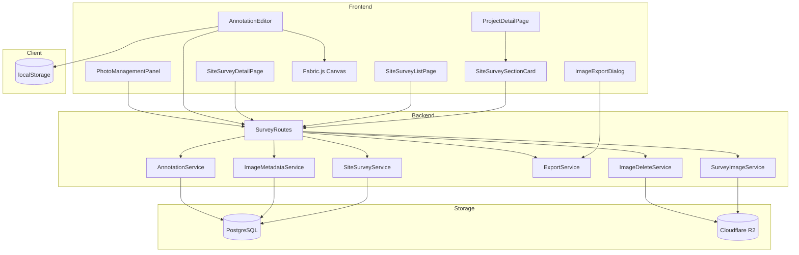

**Architecture Integration**:
- Selected pattern: Clean Architecture（サービス層によるビジネスロジック分離）
- Domain boundaries: SiteSurveyドメインをProject配下の独立モジュールとして配置
- Existing patterns preserved: 認証/認可、監査ログ、楽観的排他制御
- New components rationale:
  - SurveyImageService: 画像処理と外部ストレージ連携の責務分離
  - AnnotationService: 注釈データの永続化と復元
  - ExportService: PDF/画像エクスポートのビジネスロジック
  - **ImageMetadataService**: 写真コメント・報告書出力フラグの管理（要件10対応）
  - **ImageDeleteService**: 画像削除のストレージ連携（要件4.7、10.10、10.11対応）
  - **PhotoManagementPanel**: フルサイズ写真一覧管理UI（サムネイル一覧なし、要件10対応）
  - **ImageExportDialog**: 個別画像エクスポートUI（要件12対応）
  - **SiteSurveySectionCard**: プロジェクト詳細画面の現場調査セクション（要件2.1対応）
- Steering compliance: TypeScript strict mode、ESLint、Prettier、Conventional Commits

### Technology Stack

| Layer | Choice / Version | Role in Feature | Notes |
|-------|------------------|-----------------|-------|
| Frontend | React 19.2.0 + TypeScript 5.9.3 | UI/UXの実装 | 既存スタック継続 |
| Canvas Library | Fabric.js 6.x | 注釈描画・編集 | TypeScript対応、豊富なオブジェクト操作 |
| Local Storage | localStorage API | 編集状態の一時保存 | ブラウザ標準API、追加依存なし |
| Backend | Express 5.2.0 + TypeScript | API実装 | 既存スタック継続 |
| Image Processing | Sharp 0.33.x | 画像圧縮・サムネイル生成 | 高速、メモリ効率良好 |
| File Upload | Multer 1.4.x | マルチパートファイル処理 | Express標準ミドルウェア |
| PDF Generation | jsPDF 2.5.x | PDF報告書生成 | クライアントサイド生成 |
| Object Storage | Cloudflare R2 | 画像ファイル保存 | S3互換API、転送料金無料、10GB/月無料枠 |
| Database | PostgreSQL 15 + Prisma 7 | メタデータ・注釈データ保存 | 既存スタック継続 |

## System Flows

### 画像アップロードフロー

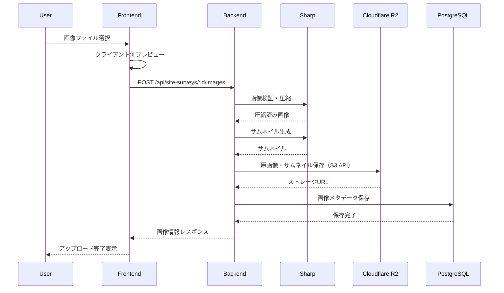

**Key Decisions**:
- 画像は300KB超過時にサーバーサイドで段階的圧縮
- サムネイルは200x200pxで自動生成
- バッチアップロードは5件ずつキュー処理して順次アップロード（並列アップロードによるサーバー負荷を防止）

### 注釈編集フロー（手動保存）

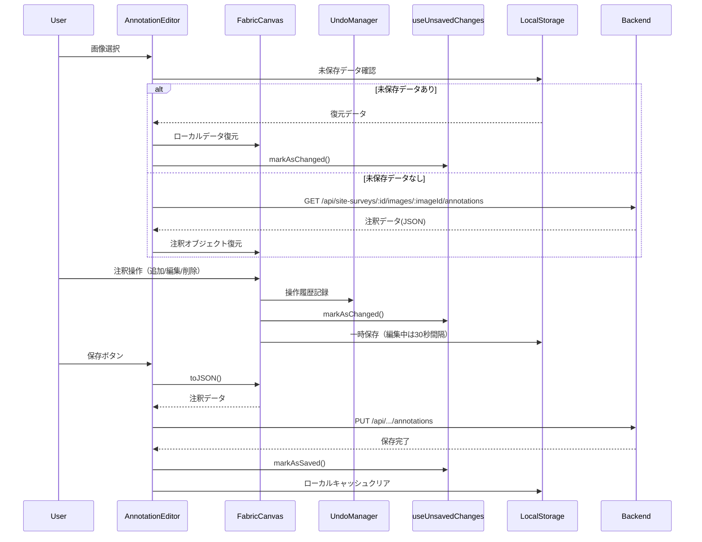

**Key Decisions**:
- 注釈データはFabric.js JSON形式で保存
- Undo/Redo履歴は最大50件保持し、超過時は最古の履歴から削除（FIFO）、保存時にクリア
- **手動保存方式**: 保存ボタンクリックでサーバーに保存（オートセーブからの変更）
- **未保存変更検出**: useUnsavedChangesフックでisDirty状態を管理
- **ページ離脱警告**: beforeunloadイベントで確認ダイアログを表示
- 注釈編集中は30秒間隔で自動的にlocalStorageに一時保存（要件15.4。描き続けている最中も保存される）
- ページリロード時にlocalStorageから未保存データを復元

### ネットワーク状態管理フロー

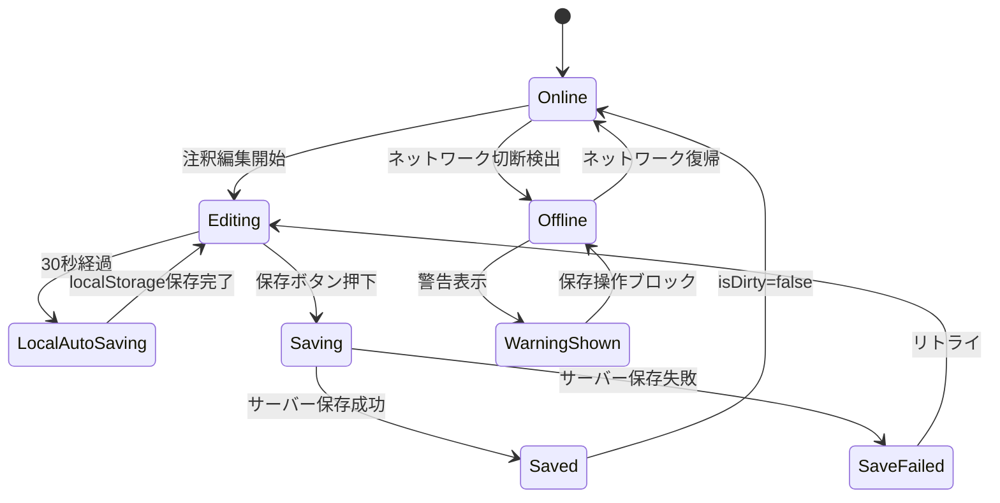

**Key Decisions**:
- ネットワーク切断時は警告を表示し、サーバー保存をブロック
- localStorageへの一時保存は継続（データ損失防止）
- オンライン復帰後に手動で保存操作を実行

### 写真メタデータ・順序更新フロー（要件4.10-4.13、10対応）

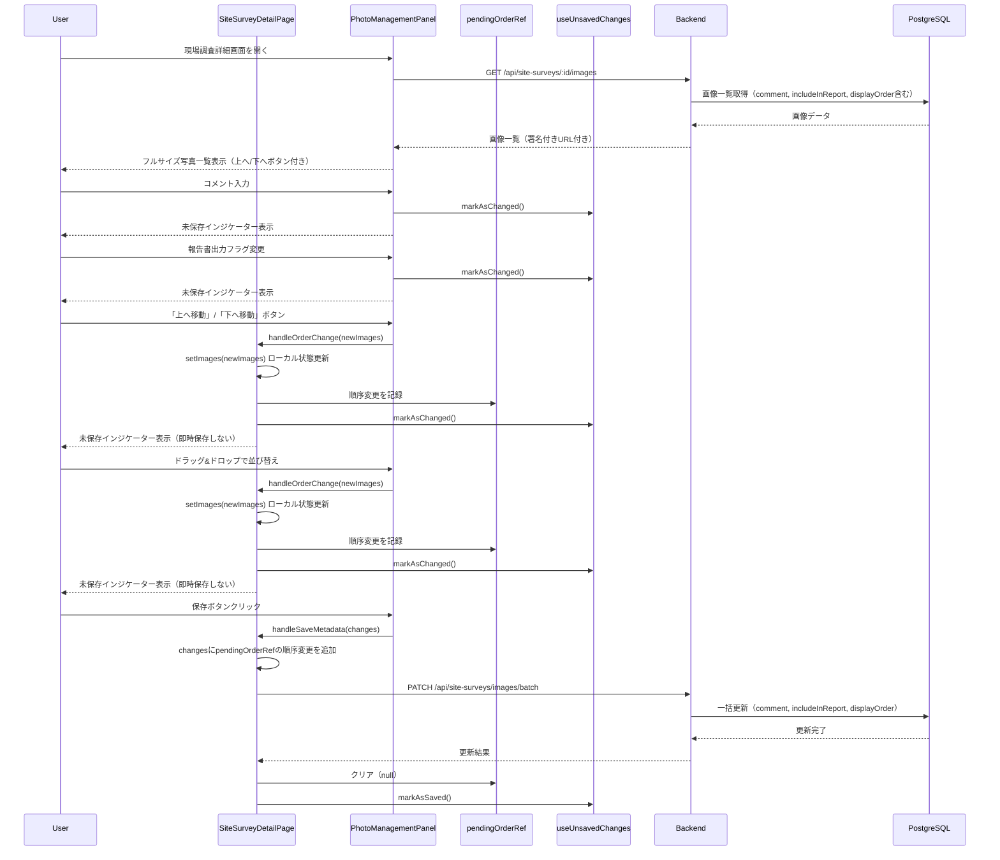

**Key Decisions**:
- **手動保存方式**: コメント入力・フラグ変更・**順序変更**は未保存状態としてマーク、保存ボタンで一括保存
- **順序変更の即時保存廃止**: ドラッグ&ドロップ、「上へ移動」「下へ移動」ボタンはローカル状態のみ更新（要件4.11-4.13、10.5-10.7）
- **pendingOrderRefパターン**: 未保存の順序変更をRefで追跡し、保存時にメタデータ変更と統合
- **未保存変更検出**: useUnsavedChangesフックでisDirty状態を管理
- **ページ離脱警告**: 未保存変更がある場合は確認ダイアログを表示
- 現場調査詳細画面ではサムネイル一覧タブを設けず、フルサイズ写真を直接表示（要件10.1準拠）
- パフォーマンス最適化のため、一覧表示用に中解像度画像（800x600px程度）を使用し、クリック時に元画像を表示

### 画像削除フロー（要件10.10、10.11対応）

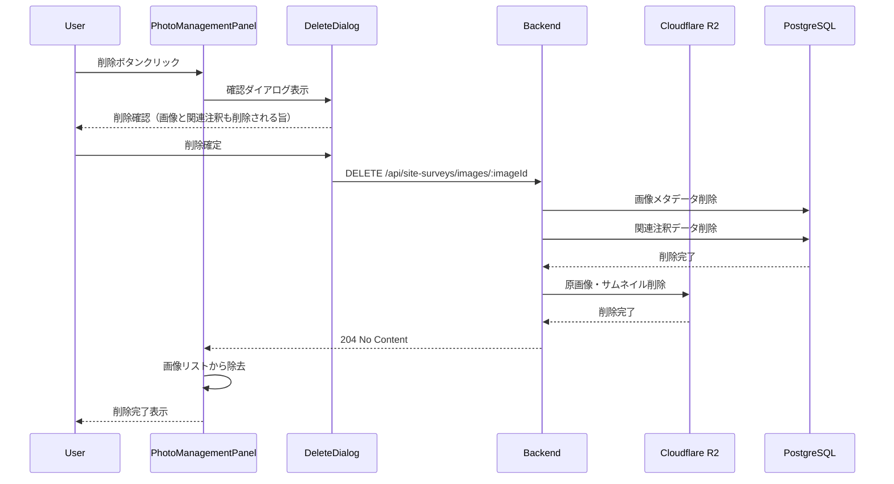

**Key Decisions**:
- 削除前に確認ダイアログを表示（誤削除防止）
- 画像削除時は関連する注釈データも連動削除
- PostgreSQLとR2は非トランザクション（R2削除失敗時は孤立ファイルとしてログ記録）
- 既存のDELETE /api/site-surveys/images/:imageIdエンドポイントを利用
- **画像削除成功時にpendingOrderRef/pendingChangesから該当imageIdをクリア**（未保存変更の整合性確保）

### PDF報告書生成フロー（要件11、18対応）

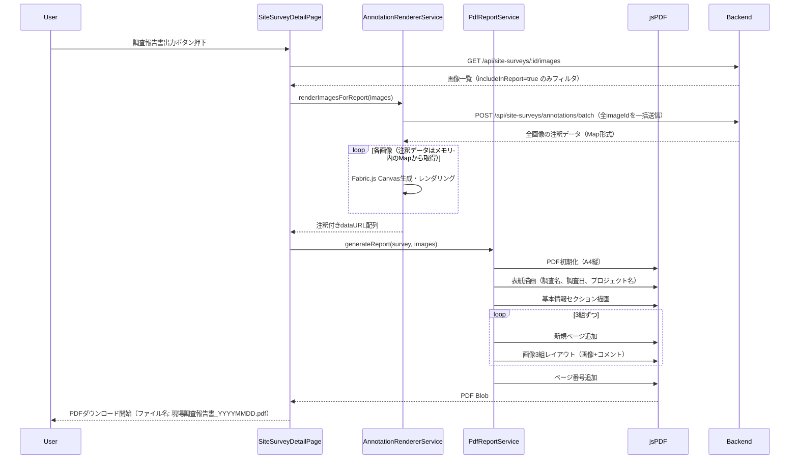

**Key Decisions**:
- PDFダウンロード時のファイル名は「現場調査報告書_YYYYMMDD.pdf」形式とする（YYYYMMDDは調査日、要件11.9対応）
- 報告書出力フラグ（includeInReport）がONの画像のみをPDFに含める
- 1ページあたり3組の画像+コメントを配置
- 画像は表示順序（displayOrder）の昇順で配置
- 注釈付き画像はAnnotationRendererServiceでレンダリング（既存実装を拡張）
- **要件18対応**: 注釈データの取得を個別APIリクエスト（N回）からバッチAPI（1回）に変更し、リクエスト数を大幅に削減

### 個別画像エクスポートフロー（要件12対応）

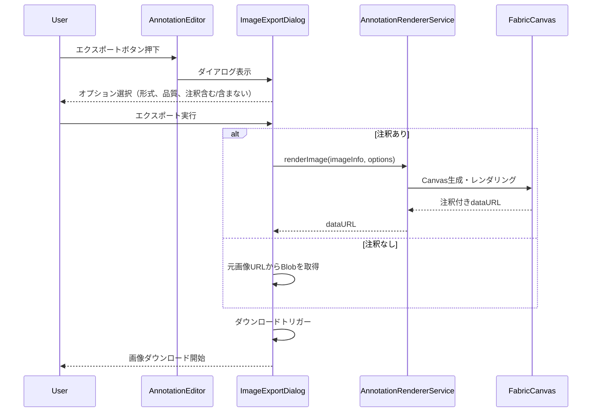

**Key Decisions**:
- JPEG/PNG形式を選択可能
- 品質（解像度）を3段階で選択可能（低/中/高）
- 注釈あり/なしを選択可能
- クライアントサイドで完結（サーバー負荷なし）

## Requirements Traceability

| Requirement | Summary | Components | Interfaces | Flows |
|-------------|---------|------------|------------|-------|
| 1.1-1.6 | 現場調査CRUD | SiteSurveyService, SurveyRoutes, SiteSurveyForm, SiteSurveyCreatePage, SiteSurveyEditPage, SiteSurveyDetailInfo | SurveyAPI | - |
| **2.1** | **プロジェクト詳細画面の現場調査セクション** | **SiteSurveySectionCard, ProjectDetailPage** | **SurveyListAPI** | - |
| 2.3-2.4 | 画面遷移（一覧→詳細、詳細→ビューア） | SiteSurveyListPage, SiteSurveyDetailPage, SiteSurveySectionCard, SiteSurveyImageViewerPage | Breadcrumb | - |
| **2.5** | **全現場調査関連画面にブレッドクラム表示** | **全SiteSurvey画面, siteSurveyBreadcrumb** | **Breadcrumb** | - |
| **2.6** | **一覧画面ブレッドクラム: ダッシュボード > プロジェクト一覧 > プロジェクト > 現場調査一覧** | **SiteSurveyListPage, siteSurveyBreadcrumb** | **Breadcrumb** | - |
| **2.7** | **詳細画面ブレッドクラム: ダッシュボード > プロジェクト一覧 > プロジェクト > 現場調査一覧 > 現場調査** | **SiteSurveyDetailPage, siteSurveyBreadcrumb** | **Breadcrumb** | - |
| **2.8** | **画像プレビュー画面（閲覧モード）ブレッドクラム: ... > 現場調査 > 画像** | **SiteSurveyImageViewerPage, siteSurveyBreadcrumb** | **Breadcrumb** | - |
| **2.9** | **画像プレビュー画面（編集モード）ブレッドクラム: ... > 現場調査 > 画像** | **SiteSurveyImageViewerPage, siteSurveyBreadcrumb** | **Breadcrumb** | - |
| **2.10** | **ブレッドクラム各項目クリックで対応画面へ遷移** | **Breadcrumb, siteSurveyBreadcrumb** | **Breadcrumb** | - |
| **2.11** | **一覧画面タイトルを「現場調査一覧」に変更** | **SiteSurveyListPage** | - | - |
| **2.12** | **画像プレビュー画面から「← 現場調査に戻る」リンクを削除** | **SiteSurveyImageViewerPage** | - | - |
| 3.1-3.5 | 一覧・検索 | SiteSurveyListPage, SiteSurveyService, SiteSurveyListCard, SiteSurveyListTable | SurveyListAPI | - |
| 4.1-4.6, 4.9 | 画像アップロード・管理 | ImageUploadService (4.1), BatchUploadService (4.2, 4.3), ImageProcessorService (4.4, 4.6), SurveyImageService (4.5, 4.9), ImageUploader | ImageAPI | アップロードフロー |
| **4.7** | **画像削除** | **ImageDeleteService, PhotoManagementPanel** | **ImageDeleteAPI** | **画像削除フロー** |
| **4.8** | **R2孤立ファイル処理** | **ImageDeleteService** | **R2 Lifecycle Rule** | **R2孤立ファイル処理フロー** |
| **4.10** | **画像一覧の固定表示順序** | **PhotoManagementPanel, SiteSurveyDetailPage** | **ImageAPI** | - |
| **4.11** | **ドラッグ&ドロップ順序変更（ローカル状態のみ）** | **PhotoManagementPanel, SiteSurveyDetailPage** | - | - |
| **4.12** | **「上へ移動」ボタン（ローカル状態のみ）** | **PhotoManagementPanel** | - | - |
| **4.13** | **「下へ移動」ボタン（ローカル状態のみ）** | **PhotoManagementPanel** | - | - |
| **5.1** | **画像クリックで専用画面の画像ビューアを開く** | **SiteSurveyDetailPage, SiteSurveyImageViewerPage** | - | - |
| **5.2-5.4** | **閲覧時の拡大・縮小・回転・パン** | **AnnotationEditor, ZoomControls, useCanvasViewport, canvasViewportController, CanvasEngine, SiteSurveyImageViewerPage** | - | **中点ズームフロー** |
| **5.5** | **ピンチ操作によるズーム** | **touchGestureManager, canvasViewportController** | - | **中点ズームフロー** |
| **5.6** | **表示状態（ズーム・回転・位置）を注釈編集モードと共有** | **SiteSurveyImageViewerPage, AnnotationEditor** | - | - |
| 6.1-6.7 | 寸法線 | DimensionTool, DimensionValueInput, AnnotationService, AnnotationEditor, AnnotationToolbar, StylePanel | AnnotationAPI | 注釈編集フロー |
| 7.1-7.10 | マーキング | ShapeTool, AnnotationService, AnnotationEditor, AnnotationToolbar, StylePanel | AnnotationAPI | 注釈編集フロー |
| 8.1-8.7 | コメント | TextTool, AnnotationService, AnnotationEditor, AnnotationToolbar, StylePanel | AnnotationAPI | 注釈編集フロー |
| **9.1** | **手動保存（保存ボタン）** | **AnnotationEditor, useUnsavedChanges** | **AnnotationAPI** | **注釈編集フロー** |
| 9.2 | 注釈データ復元 | AnnotationService, localStorage | AnnotationAPI | 注釈編集フロー |
| **9.3** | **ページ離脱時確認ダイアログ** | **useUnsavedChanges, SiteSurveyDetailPage** | - | - |
| 9.4-9.6 | 保存インジケーター・リトライ・エクスポート | AnnotationService | AnnotationAPI | 注釈編集フロー |
| **10.1** | **写真一覧管理（削除ボタン付き）** | **PhotoManagementPanel** | **ImageMetadataAPI** | **写真メタデータ更新フロー** |
| 10.2-10.4 | コメント・フラグ入力 | PhotoManagementPanel, ImageMetadataService | ImageMetadataAPI | 写真メタデータ更新フロー |
| **10.5** | **ドラッグ順序変更（ローカル状態のみ）** | **PhotoManagementPanel, SiteSurveyDetailPage** | - | - |
| **10.6** | **「上へ移動」ボタン（ローカル状態のみ）** | **PhotoManagementPanel** | - | - |
| **10.7** | **「下へ移動」ボタン（ローカル状態のみ）** | **PhotoManagementPanel** | - | - |
| **10.8** | **写真一覧の表示順序** | **PhotoManagementPanel** | - | - |
| **10.9** | **保存ボタン（メタデータ+順序一括保存）** | **PhotoManagementPanel, SiteSurveyDetailPage, useUnsavedChanges** | **ImageMetadataAPI, ImageOrderAPI** | **写真メタデータ更新フロー** |
| **10.10** | **ページ離脱時確認ダイアログ** | **useUnsavedChanges** | - | - |
| **10.11, 10.12** | **画像削除（確認ダイアログ付き）** | **PhotoManagementPanel, ImageDeleteService** | **ImageDeleteAPI** | **画像削除フロー** |
| **11.1-11.8** | **調査報告書PDF出力** | **PdfReportService, AnnotationRendererService, SiteSurveyDetailInfo** | **ExportAPI** | **PDF報告書生成フロー** |
| **12.1-12.5** | **個別画像エクスポート** | **ImageExportDialog, AnnotationRendererService, AnnotationEditor** | **ExportAPI** | **個別画像エクスポートフロー** |
| 13.1-13.5 | Undo/Redo | UndoManager | - | 注釈編集フロー |
| 14.1-14.5 | アクセス制御 | AuthMiddleware, RBACService, SignedUrlService | SignedURL検証 | - |
| 15.1-15.6 | レスポンシブ・自動保存 | AutoSaveManager, localStorage | - | ネットワーク状態管理フロー |
| **15.7** | **QuotaExceededError LRUリトライ** | **AutoSaveManager** | **localStorage** | - |
| **15.8** | **保存失敗時ユーザー警告・今すぐ保存促進** | **AutoSaveManager, StorageWarningBanner** | - | - |
| **15.9** | **プライベートブラウジング検出・自動保存無効化** | **AutoSaveManager, StorageWarningBanner** | - | - |
| **15.10** | **クロスブラウザQuotaExceededError検出** | **AutoSaveManager (isQuotaExceededError)** | - | - |
| 16.1-16.8 | 非機能要件 | 全コンポーネント | - | - |
| **18.1** | **バッチ注釈取得エンドポイント提供** | **AnnotationService, SurveyRoutes** | **AnnotationBatchAPI** | **PDF報告書生成フロー** |
| **18.2** | **PDF出力時にバッチAPIを使用** | **AnnotationRendererService, survey-annotations API** | **AnnotationBatchAPI** | **PDF報告書生成フロー** |
| **18.3** | **全画像の注釈データをまとめて返却** | **AnnotationService** | **AnnotationBatchAPI** | - |
| **18.4** | **注釈なし画像に空データ返却** | **AnnotationService** | **AnnotationBatchAPI** | - |
| **18.5** | **APIリクエスト数の大幅削減** | **AnnotationRendererService** | **AnnotationBatchAPI** | **PDF報告書生成フロー** |
| **18.6** | **バッチAPI権限検証** | **SurveyRoutes, AuthMiddleware** | **AnnotationBatchAPI** | - |
| **18.7** | **バッチAPIエラーハンドリング** | **AnnotationRendererService, SurveyRoutes** | **AnnotationBatchAPI** | - |
| **18.8** | **既存個別APIとのレスポンス互換性** | **AnnotationService** | **AnnotationBatchAPI** | - |
| **20.1** | **画像プレビュー画面（閲覧モード）で注釈レンダリング表示** | **SiteSurveyImageViewerPage, AnnotatedImageThumbnail** | **AnnotationAPI** | - |
| **20.2** | **詳細画面サムネイルに注釈レンダリング表示** | **PhotoManagementPanel, AnnotatedImageThumbnail** | **AnnotationAPI** | - |
| **20.3** | **一覧画面代表画像サムネイルに注釈レンダリング表示** | **SiteSurveyListPage, SiteSurveyListTable, SiteSurveyListCard, AnnotatedImageThumbnail** | **AnnotationAPI** | - |
| **20.4** | **注釈保存時にサムネイル画像を生成・更新** | **AnnotationEditor, AnnotatedThumbnailService, SurveyImageService** | **ThumbnailAPI** | **注釈付きサムネイル生成フロー** |
| **21.1** | **拡張子不一致でもマジックバイト判定がサポート対象ならアップロード許可** | **SurveyImageService (validateFile)** | **ImageAPI** | **アップロードフロー** |
| **21.2** | **拡張子.pngだが実際はJPEGのファイルを許可** | **SurveyImageService (detectMimeTypeByMagicBytes)** | **ImageAPI** | - |
| **21.3** | **拡張子.jpgだが実際はPNGのファイルを許可** | **SurveyImageService (detectMimeTypeByMagicBytes)** | **ImageAPI** | - |
| **21.4** | **拡張子.jpegだが実際はWEBPのファイルを許可** | **SurveyImageService (detectMimeTypeByMagicBytes)** | **ImageAPI** | - |
| **21.5** | **画像以外の拡張子(.txt等)でもマジックバイトがサポート対象なら許可** | **SurveyImageService (detectMimeTypeByMagicBytes)** | **ImageAPI** | - |
| **21.6** | **マジックバイトがサポート対象外の場合は拡張子に関わらず拒否** | **SurveyImageService (detectMimeTypeByMagicBytes)** | **ImageAPI** | - |
| **21.7** | **Content-Typeをマジックバイトの実際の画像形式に基づいて設定** | **SurveyImageService (validateFile)** | **ImageAPI** | **アップロードフロー** |
| **21.8** | **拡張子ベースのバリデーション廃止** | **SurveyImageService (validateFile)** | **ImageAPI** | - |
| **22.1** | **注釈エディタで回転ボタンにより背景画像を90度単位で回転** | **AnnotationEditor** | - | **画像回転フロー** |
| **22.2** | **回転時に描画済み注釈は追従せず現在の位置・サイズを維持** | **AnnotationEditor** | - | - |
| **22.3** | **回転後の画像サイズに合わせてキャンバスサイズを調整** | **AnnotationEditor** | - | - |
| **22.4** | **回転状態を含む画像データの永続化** | **AnnotationEditor, AnnotationService** | **AnnotationAPI** | **注釈編集フロー** |
| **22.5** | **保存された回転状態の復元** | **AnnotationEditor** | **AnnotationAPI** | - |
| **22.6** | **回転操作のUndo/Redo履歴記録** | **AnnotationEditor, UndoManager** | - | - |
| **22.7** | **回転ボタンを既存ツールバーに配置** | **AnnotationEditor** | - | - |
| **22.8** | **累積回転角度（0/90/180/270度）の管理** | **AnnotationEditor** | - | - |
| **23.1** | **注釈追加・編集・削除保存時のサムネイル再生成** | **AnnotationEditor, survey-images.routes.ts** | **ThumbnailAPI** | - |
| **23.2** | **画像回転保存時のサムネイル再生成** | **AnnotationEditor, survey-images.routes.ts** | **ThumbnailAPI** | - |
| **23.3** | **回転+注釈編集併用時の最終状態サムネイル再生成** | **AnnotationEditor, survey-images.routes.ts** | **ThumbnailAPI** | - |
| **23.4** | **保存処理のサムネイル再生成完了保証** | **AnnotationEditor** | **ThumbnailAPI** | - |
| **23.5** | **再生成後の詳細・一覧画面サムネイル表示更新** | **AnnotationEditor, PhotoManagementPanel, SiteSurveyListTable, SiteSurveyListCard, SiteSurveyDetailPage** | **ThumbnailAPI, SurveyAPI, SurveyListAPI, ImageAPI** | - |
| **23.6** | **サムネイル再生成失敗時のエラー通知と旧状態残留防止** | **AnnotationEditor** | **ThumbnailAPI** | - |
| **23.7** | **再オープン時のサムネイル一致保証** | **survey-images.routes.ts** | **ImageAPI** | - |
| **23.8** | **冪等なサムネイル再生成処理（既存サムネイル破損防止）** | **survey-images.routes.ts** | **ThumbnailAPI** | - |

> **改訂（タスク 115.107）**: 要件23 の 23.1-23.4 / 23.6-23.8 行は、当初 `AnnotationService` / `AnnotatedThumbnailService` によるサーバー側の同期再生成を担当としていた。当該経路は本番へ結線されないまま到達不能であり、115.107 で撤去した。担当は合成を行う `AnnotationEditor` と、その受け口である `survey-images.routes.ts` の `PATCH` / `DELETE /:imageId/annotated-thumbnail`（`ThumbnailAPI`）である。「サムネイル同期再生成フロー」節は当初設計の記録として残っているため、Flows 列からは外した。
> **23.5 行の Interfaces 列から `AnnotationAPI` を外した理由**: 注釈保存の応答（`AnnotationAPI`）はもはや合成済みサムネイルの表示元URLを供給しない（115.107 で撤去）。23.5 の「表示を最新へ更新する」は、更新直後の表示元を返す `ThumbnailAPI`（`PATCH` の応答を `AnnotationEditor` が `onAnnotationSaved` で親へ渡す）と、再取得時に表示元を供給する現場調査詳細取得（`SurveyAPI`）・一覧取得（`SurveyListAPI`）・画像一覧取得（`ImageAPI`）で満たされる。合成の起点である `AnnotationEditor` を Components 列へ加えた。

### 部品の自己申告と追跡表の突き合わせ（タスク 115.113）

タスク 115.77 は保存容量の警告帯（`StorageWarningBanner`）の一件だけを是正したが、**同型の取りこぼしは他にも残っていた**。本節は 115.77 と同じ手順を、文書内の追跡表**7つ全件**（合計**166 行**。是正の直前に計数）へ機械的に適用した結果である。

#### 突き合わせの手順

1. **対象ファイルを決める。** `frontend/src/components/site-surveys/`・`frontend/src/components/site-survey/`・`frontend/src/pages/SiteSurvey*.tsx`・`frontend/src/components/projects/SiteSurveySectionCard.tsx`・`frontend/src/utils/siteSurveyBreadcrumb.ts` の実装ファイル（`*.test.ts` / `*.test.tsx` / `*.stories.tsx` を除く）と、これら以外で `@requirement site-survey/REQ-*` を持つ実装ファイルを対象とする。**実測53件**（`{ git ls-files 'frontend/src/components/site-surveys/*' 'frontend/src/components/site-survey/*' 'frontend/src/pages/SiteSurvey*.tsx' 'frontend/src/components/projects/SiteSurveySectionCard.tsx' 'frontend/src/utils/siteSurveyBreadcrumb.ts'; grep -rl '@requirement site-survey/REQ-' frontend/src; } | grep -vE '\.test\.tsx?$|\.stories\.tsx$' | sort -u | wc -l` の出力。書く直前に再測した。うち1件は `frontend/src/pages/SiteSurveyImageViewerPage.css` で、`@requirement site-survey/REQ-36.4` / `REQ-36.7` のタグを持つため対象に入る）。バックエンドの資材と共用フックは、同じ番号体系を他の仕様と共有していて自己申告がどの仕様の番号か機械的に確定できないため、本走査の対象外とした（別途の走査が要る）
2. **各ファイルの自己申告を抽出する。** 形式は2つある。先頭の `/** */` ブロックの `Requirements:` 見出しに続く `- <番号>: <本文>` の箇条書きと、`@requirement site-survey/REQ-<番号>` タグである（後者は `grep -n "@requirement site-survey/REQ-" <ファイル>` で全件取れる）
3. **追跡表の全行の Requirement 列を番号へ展開する。** `24.1-24.10` のような範囲と `31.4, 31.5, 31.6` のような列挙をいずれも個別番号へ開く
4. **照合する。** 自己申告した番号を含む行の Components 列に当該部品名が現れるかを見る。単一の部品ではなく**集合を指す表記**は、指す実体へ展開したうえで一致とみなす。展開しないと**その表記を持つ行が全件偽陽性になる**。本走査で展開した表記は合計7件で、次の2群に分かれる（書く直前に該当行を数え直した実測値）
   - **本書「論理名と実体の対応表」に登録済みの論理名（3件）**: `ShapeTool`（要件7.1-7.10 の行、1行）/ `SurveyRoutes`（要件1.1-1.6・18.1・18.6・18.7 の行、4行）/ `AuthMiddleware`（要件14.1-14.5・18.6 の行、2行）。行数はいずれも書く直前に追跡表7表を走査して数え直した。対応表が定める実体へ展開した
   - **対応表に未登録のまま集合を指している表記（4件）**: `全SiteSurvey画面`（要件2.5 の行）/ `StyleTokens`（要件24.1-24.10・25.1-25.12・32.1-32.7, 32.9-32.10 の行、3行）/ `Rectangle/Circle/Polygon/Polyline/Freehand/Dimension Tools`（要件32.1-32.7, 32.9-32.10 の行）/ `全コンポーネント`（要件16.1-16.8 の行）。いずれも「論理名と実体の対応表」に行が無く、**呼称規約の掲載可否の判定を受けていない**。本走査では便宜上、名称が示す集合へ展開して照合した。とくに `StyleTokens` は**実体を持たない名前**である（`grep -rn "StyleTokens" frontend/src | wc -l` の出力が `0`。書く直前の実測で、宣言も参照も0件。実体は `frontend/src/components/site-surveys/annotation-style-tokens.ts` であり、同じ追跡表の要件26.1-26.6・32.11, 32.13 の行は実名 `annotation-style-tokens` を用いている）。照合では `annotation-style-tokens` へ展開した

   **後続タスクの提案**: 上の未登録4件について、「論理名と実体の対応表」へ登録するか実名へ統一するかを決めて適用するタスクを別途起票すること。`StyleTokens` は 1:1 の実体（`annotation-style-tokens`）へ解決できるため、対応表の掲載基準（「1:1 の実体を持たない名前だけを載せる」）に照らすと**実名への統一**が妥当である。**本タスク（115.113）の境界は追跡表の担当行であり、呼称規約の対応表そのものと Mermaid 図・要件24-30 の対照表の表記は含まないため、ここでは手を入れない。**
5. **一致しない組（部品×要件番号）を不一致として列挙する**

#### 是正前後の計数（いずれも書く直前に再測した実測値）

| 項目 | 件数 |
|---|---|
| 走査した追跡表 | 7 表 / 166 行 |
| 走査した実装ファイル | 53 |
| 是正前の不一致 | 105 |
| 追跡表へ追加した部品名 | 51 名 / 26 行 |
| 是正後に残る不一致 | 18 |
| 是正で解消した組 | 87（`18 + 87 = 105` で閉じる） |

計数の再現手順（いずれも本表を書く直前に再実行した）:

- **追跡表と行数**: `grep -nE '^\| *Requirement \| *Summary \| *Components \|' .kiro/specs/site-survey/design.md` が返す 7 箇所を表頭とし、各表頭の2行下から `|` で始まらない行の直前までを本文行として数える（合計166行）
- **実装ファイル**: 上の手順1に記した `git ls-files` と `grep -rl` の合成を `sort -u | wc -l` で数える（53件）
- **不一致**: 手順2〜5 をそのまま適用し、部品×要件番号の組を数える。集合を指す表記は手順4 の2群を**名称が示す実体の集合へ展開**し、`bulkExportService finalize` のように**実名に修飾語が続く表記は実名の一致として扱う**（是正前105件、是正後18件）。展開の内訳は次のとおりで、ここを取り違えると件数がずれる
  - `ShapeTool` → 対応表が定める6ツール、`SurveyRoutes` → 3ルート、`AuthMiddleware` → 2ミドルウェア、`StyleTokens` → `annotation-style-tokens`、`Rectangle/Circle/Polygon/Polyline/Freehand/Dimension Tools` → 表記が列挙する6ツール（`Rectangle` / `Circle` / `Polygon` / `Polyline` / `Freehand` / `Dimension`。書く直前に表記を `/` で区切って数え直した実測。同じ行の要約欄も「6 形状の白縁取り共通仕様」と記す（`### Requirements Traceability` の `32.1-32.7, 32.9-32.10` の行。**本書の行を行番号で指さない**——行番号は本書の編集で失効するため、節名と行の見出し語で指す））
  - `全SiteSurvey画面` → `git ls-files 'frontend/src/pages/SiteSurvey*.tsx'` が返す**5画面**（`SiteSurveyCreatePage` / `SiteSurveyDetailPage` / `SiteSurveyEditPage` / `SiteSurveyImageViewerPage` / `SiteSurveyListPage`）。**「全」を全部品への無条件一致と読んではならない**。`siteSurveyBreadcrumb`（`frontend/src/utils/siteSurveyBreadcrumb.ts`）は画面ではなく生成の補助であり、この展開に含まれない。したがって同部品の要件2.5 の組は是正前の不一致に数える（是正で当該行へ実名を追加済み）
  - `全コンポーネント` → 走査対象の全部品（要件16.1-16.8 の非機能要件の行であり、部品を限定しない）
- **不一致の実測出力**（本表を書く直前に再実行）: 是正前の版（`git show HEAD:.kiro/specs/site-survey/design.md`）に対し `tables=7 rows=166 files=53 declared_pairs=296 mismatch=105`、是正後の版に対し `tables=7 rows=166 files=53 declared_pairs=296 mismatch=18`。組の集合差も同時に取り、解消 87 件・退行 0 件であることを確認した
- **追加した部品名と行**: 是正前後の追跡表の Components 列を行キー（Requirement 列）で突き合わせ、増えた名前を数える（51名 / 26行）。写さなかった側の18件は下の3区分に分かれ、内訳は 7件 + 10件 + 1件 である
- **突き合わせの閉じ**: 「51名 / 26行」の追加で解消する組は **87 件**であり、`是正後18 + 解消87 = 是正前105` で閉じる。解消 87 件の部品別内訳は `AnnotationEditor` 15 / `StylePanel` 7 / `SiteSurveyImageViewerPage` 4 / `FreehandTool` 4 / `AnnotationToolbar`・`ArrowTool`・`CircleTool`・`PolygonTool`・`PolylineTool`・`RectangleTool`・`TextTool`・`registerCustomShapes`・`SiteSurveyDetailInfo` 各3 / `BulkExportDialog`・`DimensionTool`・`ImageUploader`・`SiteSurveyForm`・`SiteSurveyListCard`・`SiteSurveyListTable`・`annotation-visual-feedback`・`siteSurveyBreadcrumb`・`style-panel.constants`・`touchGestureManager` 各2 / `AnnotationContextMenu`・`AnnotationRendererService`・`ImageViewer`・`SiteSurveyCreatePage`・`SiteSurveyDetailPage`・`SiteSurveyEditPage`・`SiteSurveySectionCard`・`annotation-toolbar.constants`・`canvasViewportController`・`gesture-thresholds` 各1（合計87）。**この閉じを取らずに是正前の件数だけを書くと、取り違えを検出できない**（実際、本節の初稿は 105 を 104 と誤っていた）。以後この節の件数を更新する際は、解消件数まで数えて `是正後 + 解消 = 是正前` の成立を確認すること

#### 自己申告をそのまま写さなかった 18 件

**自己申告は無条件には信用しない。** 箇条書きの自己申告は「番号」と「本文」を併記するため、`requirements.md` の当該番号の本文と突き合わせれば真偽を機械的に判定できる。**本文が別の要件のものである場合、その番号を追跡表へ写すと新たな虚偽記載になる**ため写さない。内訳は次の3種、合計18件である（各区分の件数は書く直前に列挙を数え直した実測値）。

**(1) 担当を出荷経路へ付け替え済みの部品（7件）**

`ImageViewer` の要件5.1・5.2・5.3・5.4・5.5・5.6・13.2。内訳は要件5 系の6件と要件13.2 の1件である。

- **要件5.1-5.6（6件）**: 上の「未結線部品の扱い」のとおり、タスク 115.83 が `ImageViewer` の担当を出荷経路へ付け替え**担当なし**と決着させた範囲である。115.83 の `_Requirements:_` は `5.1, 5.2, 5.3, 5.4, 5.5, 5.6`、`_Boundary:_` は「要件5 の担当部品の設計記述と、閲覧時の表示操作の結線」であり、上の付け替え表（本書「画像ビューアの担当付け替えと閲覧時の表示操作の結線（タスク 115.83）」の表）も 5.1-5.6 しか挙げていない。自己申告の側が陳腐化しているため、追跡表へ写すと 115.83 の決着を覆す
- **要件13.2（1件）**: 番号自体の誤記である（自己申告の本文は「タッチ操作に最適化された注釈ツール」だが要件13.2 の本文は取り消した操作の再実行）。**その是正はタスク 115.114 の所管**であり、本節では写さない（**タスク 115.114 で当該注釈は `15.2` へ是正済み**。`grep -c '13\.2' frontend/src/components/site-surveys/ImageViewer.tsx` の出力は現在 `0`）

**要件12.1 は本区分に含めず、追跡表へ追加した。** 判断の根拠は次の3点で、**うち第2点は本是正と食い違う既存記述の明示である**。

1. **タスク 115.83 の射程は要件5.1-5.6 に限られる。** 同タスクの `_Requirements:_` は `5.1, 5.2, 5.3, 5.4, 5.5, 5.6` であり、`_Boundary:_` も「要件5 の担当部品の設計記述と、閲覧時の表示操作の結線」である。上の付け替え表も 5.1-5.6 しか挙げていない。**要件12.1 はこの射程の外にある**
2. **ただし設計文書の側は、要件12 も付け替え済みと記している。** 本書「未結線部品の扱い」の `ImageViewer` 行は担当要件欄を「**担当なし**（要件5.1-5.6 / **12** / 20.1 の担当は出荷経路へ付け替え済み）」と書いており、要件**12** を明示的に含めている。**この記述は、要件12.1-12.5 の行へ `ImageViewer` を加えた本是正と直接矛盾する**。タスク 115.83 の一次資料（`_Requirements:_` / `_Boundary:_`）が要件12 を射程に含めていない以上、設計文書側のこの欄が 115.83 の決着を要件12 まで広げて書いたものと解する。矛盾は伏せずに下の「境界外に残る矛盾の記録」へ2箇所とも登録した
3. **先例が「未結線でも追跡の欠落は是正する」を採る。** `ImageViewer` は `ImageExportDialog` を実際に import して描画しており（`frontend/src/components/site-surveys/ImageViewer.tsx` の `import ImageExportDialog from './ImageExportDialog';` と `<ImageExportDialog` の描画）、12.1 の自己申告は番号の誤記ではなく実体を伴う。本タスクが手順の先例とするタスク 115.77 は「当該部品が未結線である件は 115.64 の所管であり、本タスクでは追跡の欠落のみを扱う」として**未結線の部品でも追跡の欠落は是正した**

第2点と第3点が競合する場合に第3点を優先するのは、**第2点が食い違うのは「結線されていない部品を担当として載せるか」という一点だけ**であり、それはまさに 115.77 が「追跡の欠落は是正し、結線の可否は別タスクへ委ねる」と切り分けた論点だからである。追跡表から実体のある担当を落とすと、要件12.1 の担当が文書上どこにも残らなくなる。したがって要件12.1-12.5 の行へ `ImageViewer` を加えた。**結線の可否と、矛盾する2欄の書き換えは本節では決めない**（いずれも境界外。下記参照）。

**(2) 自己申告の番号が誤っている件（10件）**

| 部品 | 申告番号 | 自己申告の本文 | 当該番号の実際の要件本文 |
|---|---|---|---|
| `ImageUploader` | 13.3 | モバイル環境でのカメラ連携 | キーボードショートカットで Undo/Redo を実行する |
| `SiteSurveyResponsiveView` | 13.1 | デスクトップ・タブレット・スマートフォン対応 | Undo 操作で直前の注釈操作を取り消す |
| `SiteSurveyDetailInfo` | 10.6 | PDF報告書のクライアントサイド生成 | 写真の「上へ移動」ボタンで1つ上へ移動する |
| `SiteSurveyDetailInfo` | 12.1 | プロジェクトへのアクセス権を持つユーザーは閲覧可能 | 個別画像のエクスポートボタンで注釈をレンダリングした画像を生成する |
| `SiteSurveyDetailInfo` | 12.2 | プロジェクトへの編集権限で作成・編集・削除を許可 | エクスポート形式として JPEG、PNG をサポートする |
| `SiteSurveyDetailPage` | 2.6 | 詳細画面のブレッドクラム階層 | 一覧画面のブレッドクラム（実体は要件2.7。同行には収録済み） |
| `SiteSurveyDetailPage` | 10.1 | 報告書出力対象写真の選択 | 詳細画面に写真ごとのチェックボックス・写真・コメント欄・削除ボタンを表示する |
| `SiteSurveyDetailPage` | 12.2 | プロジェクトへの編集権限で作成・編集・削除を許可 | エクスポート形式として JPEG、PNG をサポートする |
| `SiteSurveyListPage` | 2.7 | ブレッドクラム各項目のクリックで遷移する | 詳細画面のブレッドクラム（実体は要件2.10） |
| `SiteSurveyListPage` | 12.2 | プロジェクトへの編集権限で作成・編集・削除を許可 | エクスポート形式として JPEG、PNG をサポートする |

要件12 系の4件と要件13 系の2件は、いずれも**番号がちょうど 2 ずれて写された**ものである。申告本文は要件12.1→14.1（アクセス権を持つユーザーの閲覧）、要件12.2→14.2（編集権限による作成・編集・削除）、要件13.1→15.1（各画面サイズ対応）、要件13.3→15.3（カメラ連携）と、いずれも `requirements.md` の別番号の本文に一字一句対応する。是正するのは実装側の注釈であり、**本節の境界（追跡表）の外**にある。

上表の**10 件**（`awk '/^\*\*\(2\) 自己申告の番号が誤っている件/,/^要件12 系の/' .kiro/specs/site-survey/design.md | grep -c '^| `'` の出力が `10`。書く直前の実測）は、**いずれも所管タスクを持たない**。タスク 115.114 の境界は「画像の閲覧部品の注釈が引く要件番号」であり、上の区分(1) に挙げた `ImageViewer` の要件13.2 しか覆わない。

**後続タスクの提案**: 上表10件の実装側の注釈（`ImageUploader` / `SiteSurveyResponsiveView` / `SiteSurveyDetailInfo` / `SiteSurveyDetailPage` / `SiteSurveyListPage` の5ファイル）について、自己申告の要件番号を本文に合う番号へ是正するタスクを別途起票すること。**本タスク（115.113）の境界は設計文書の追跡表であり、実装ファイルの注釈は含まないため、ここでは手を入れない。**

**判定の適用範囲についての注記**: 上で宣言した「番号と本文を突き合わせて真偽を機械的に判定する」手続きは、**追加を見送るかどうかの判定にのみ用いており、追加した側の自己申告へは一律には適用していない**。追加先が範囲行（`1.1-1.6` のような行）である場合、番号が同じ要件群の中でずれていても行の担当としては正しいため、本文のずれが虚偽記載にならないからである。実例として `frontend/src/components/site-surveys/SiteSurveyDetailInfo.tsx` は要件1.2 を「現場調査詳細画面を表示する際、現場調査の基本情報と関連する画像一覧を表示する」と申告するが、この本文は `requirements.md` の要件1.3 のものである。追加先は要件1.1-1.6 の行なので担当としては正しい。**同種のずれが他の追加分にも残っている可能性があり、全件の本文照合は行っていない。**

**(3) 追跡表に対応する行を持たない件（1件）**

`SiteSurveySectionCard` の要件2.2。要件2.2 は `requirements.md` で取り消し線が引かれ project-management/Requirement 24 AC 2 へ移動済みである。**追跡表に行が無いことが正しい**ため追加しない。

#### 追加にあたっての注記

- 要件26.1-26.6 の行へは**11 名**を加えた（内訳は書く直前に当該行の Components 列を区切りで数え直した。ツール8件＝`ArrowTool` / `CircleTool` / `DimensionTool` / `FreehandTool` / `PolygonTool` / `PolylineTool` / `RectangleTool` / `TextTool`、定数資材2件＝`style-panel.constants` / `annotation-toolbar.constants`、属性パネル1件＝`StylePanel`）。いずれも `@requirement site-survey/REQ-26.*` タグによる申告である。既定値を**一元管理する**のは `annotation-style-tokens` であり、各ツールはそれを**消費する**側として担当に加わる
- `StylePanel` は「未結線部品の扱い」のとおり本番の描画経路に結線されていない。担当としては追跡表に載るが、**結線の有無は当該節が権威**である
- `ImageViewer` も「未結線部品の扱い」のとおり本番の描画経路に結線されていない。要件12.1-12.5 の行には要件12.1 の担当として載るが、**結線の有無と、要件5.1-5.6 の担当がタスク 115.83 で他部品へ付け替え済みであることは当該節が権威**である。**ただし要件12 については当該節の記述と本節の是正が食い違う**（同節の担当要件欄は要件12 も付け替え済みと断定している）。この1件は権威の委譲から除外し、下の「境界外に残る矛盾の記録」へ登録した
- **境界外に残る矛盾の記録（全 2 箇所。`grep -cE '^\|.*担当なし' .kiro/specs/site-survey/design.md` の出力が `2`。書く直前の実測で、該当は表の欄のみ＝散文中の言及を除く）**: 要件12.1-12.5 の行へ `ImageViewer` を加えた本節の是正と字面が食い違う欄が、追跡表の外に **2 箇所**ある。**いずれも本タスクの境界（追跡表の担当行）の外にあるため書き換えず、無記録で残さないようここに登録する。**

  1. **「未結線部品の扱い」の `ImageViewer` 行（担当要件欄）** — より強い矛盾。当該欄は「**担当なし**（要件5.1-5.6 / **12** / 20.1 の担当は出荷経路へ付け替え済み）」と記し、**要件12 を名指しで付け替え済みと断定している**。要件12.1 の担当として `ImageViewer` を追跡表へ加えた本節の是正と正面から食い違う。上の「要件12.1 は本区分に含めず、追跡表へ追加した」の第2点に判断根拠を記した。**後続タスクの提案**: 当該欄を「要件12.1 の担当（要件5.1-5.6 の担当は 115.83 で付け替え済み）」の形へ改めるタスクを別途起票すること
  2. **`### Component Summary` の `~~ImageViewer~~（未結線）` 行（Req Coverage 欄）** — 弱い矛盾。当該欄は「**担当なし**（要件5 の担当は上記へ付け替え済み。タスク 115.83）」と記す。括弧の但し書きは付け替えの対象を要件5 に限っているが、欄の断定は「担当なし」であり、字面が食い違う。**後続タスクの提案**: 当該行の Req Coverage 欄を「12.1（要件5 の担当は 115.83 で付け替え済み）」の形へ改めるタスクを別途起票すること

  **追記（タスク 115.146）**: 上記2箇所の矛盾は、`ImageViewer` の撤去により解消した。「未結線部品の扱い」の当該行は表から落とし（撤去の経緯は同節の追記に記録）、`### Component Summary` の行は「撤去済み」へ改めた。あわせて要件12.1-12.5 の追跡表の担当を、実際に `ImageExportDialog` を描画している `AnnotationEditor` へ改めた（本書 `#### ImageExportDialog` の Inbound 記述と一致する）。したがって上の実測値（`grep -cE '^\|.*担当なし'` の出力が `2`）は当時の値であり、現在は当該2欄とも存在しない。**上の記録は当時の判断の記録として書き換えず残す。**

## Components and Interfaces

### Component Summary

| Component | Domain/Layer | Intent | Req Coverage | Key Dependencies | Contracts |
|-----------|--------------|--------|--------------|------------------|-----------|
| SiteSurveyService | Backend/Service | 現場調査CRUD操作 | 1, 2, 3 | PrismaClient (P0), AuditLogService (P1) | Service, API |
| SurveyImageService | Backend/Service | マジックバイト判定・ファイル名サニタイズ・保存先パス算出 | 4.5, 4.9, 21 | PrismaClient (P1), StorageProvider (P1) | Service, API |
| AnnotationService | Backend/Service | 注釈データ管理 | 6, 7, 8, 9, 18 | PrismaClient (P0) | Service, API |
| **ImageMetadataService** | Backend/Service | 画像メタデータ管理 | 10 | PrismaClient (P0) | Service, API |
| **ImageDeleteService** | Backend/Service | 画像削除処理、孤立ファイル処理 | 4.7, 4.8, 10.10, 10.11 | PrismaClient (P0), Cloudflare R2 (P0) | Service, API |
| ExportService | Frontend/Service | エクスポート処理 | 11, 12 | jsPDF (P0), Fabric.js (P0) | State |
| SurveyRoutes | Backend/Routes | APIエンドポイント | 1-12, 14, 18, 20 | All Services (P0) | API |
| **SiteSurveySectionCard** | Frontend/Component | プロジェクト詳細画面の現場調査セクション | 2.1 | SurveyAPI (P0) | State |
| SiteSurveyListPage | Frontend/Page | 一覧表示（タイトル「現場調査一覧」） | 2, 3, 20.3 | SurveyAPI (P0) | State |
| SiteSurveyDetailPage | Frontend/Page | 詳細・編集・順序変更 | 1, 4.10-4.13, **5.1**, 9, 10, 11, 20.2 | SurveyAPI (P0), ImageAPI (P0), useUnsavedChanges (P0) | State |
| **PhotoManagementPanel** | Frontend/Component | フルサイズ写真一覧管理UI（移動ボタン付き） | 4.10-4.13, 10 | ImageMetadataAPI (P0), useUnsavedChanges (P0) | State |
| AnnotationEditor | Frontend/Component | 注釈編集UI、**閲覧モードの画像表示・操作** | **5.2-5.4, 5.6**, 6, 7, 8, 9, 13, 22 | Fabric.js (P0), UndoManager (P0), useUnsavedChanges (P0), **useCanvasViewport (P0)** | State |
| **DimensionValueInput** | Frontend/Component | 寸法線描画後の寸法値・単位の入力欄 | 6.2, 6.3 | - | State |
| **SiteSurveyImageViewerPage** | **Frontend/Page** | **画像ビューア/エディタ画面。閲覧⇄編集の切替と表示状態の保持** | **5.1, 5.6, 2.8, 2.9, 2.12, 20.1** | **SurveyAPI (P0), AnnotationEditor (P0)** | **State** |
| **ZoomControls** | **Frontend/Component** | **ズーム/フィット/回転の操作手段と倍率表示** | **5.2, 5.3, 34.1-34.3, 34.5, 34.6, 34.8** | **useCanvasViewport (P0)** | - |
| ~~ImageViewer~~（撤去済み） | Frontend/Component | 画像表示・操作 | 撤去済み（**タスク 115.146 でファイルごと撤去**。要件5 の担当は 115.83 で `SiteSurveyImageViewerPage` + `AnnotationEditor` へ付け替え済み、要件12.1 の担当は `AnnotationEditor`） | Fabric.js (P0) | State |
| **ImageExportDialog** | Frontend/Component | 個別画像エクスポートUI | 12 | AnnotationRendererService (P0) | State |
| UndoManager | Frontend/Utility | 操作履歴管理 | 13 | - | State |
| AutoSaveManager | Frontend/Service | 自動保存・状態復元・QuotaExceeded対応 | 15, 15.7-15.10 | localStorage (P0) | State |
| **useAnnotationRestoration** | Frontend/Hook | ローカル下書きとサーバー保存済み注釈を比較し復元確認の要否を決める | 15.5 | AutoSaveManager (P0) | State |
| **RestoreAnnotationDialog** | Frontend/Component | 未保存の下書きを復元するか破棄するかの確認ダイアログ | 15.5 | - | State |
| **StorageWarningBanner** | Frontend/Component | 容量超過時とプライベートブラウジング時の警告帯 | 15.8, 15.9 | - | State |
| **storage-error.ts** | Frontend/Utility | localStorage の可用性・容量超過・SecurityError の判定 | 15.9, 15.10 | - | - |
| **useUnsavedChanges** | Frontend/Hook | 未保存変更検出 | 9.1, 9.3, 10.8, 10.9 | - | State |
| **AnnotatedImageThumbnail** | Frontend/Component | 注釈付き画像サムネイル表示 | 20.1, 20.2, 20.3 | AnnotationAPI (P0), Fabric.js (P0) | State |
| **AnnotatedThumbnailService** | Backend/Service | 注釈付きサムネイル画像の生成 | 20.4 | Sharp (P0), Fabric.js Server (P1), R2 (P0) | Service |
| **siteSurveyBreadcrumb** | Frontend/Utility | ブレッドクラムナビゲーション生成 | 2.5, 2.6, 2.7, 2.8, 2.9, 2.10 | Breadcrumb (P0) | - |

**収録範囲と追加分（タスク 115.114）**: 本書の `Component Summary` は 3 つある（`grep -cE '^#{3,4} Component Summary' .kiro/specs/site-survey/design.md` の出力が `3`。書く直前の実測）。要件24-30 の部品は「Requirements 24-30」節の表が、要件31-32 の部品は「Requirements 31-32」節の表が収録し、本表はそれ以外を収録する。
本タスクでは、本書の結線記録が名指しした部品のうち**どの `Component Summary` にも行が無かった 5 件**を本表へ追加した。内訳は、「自動保存・復元基盤の結線（タスク 115.81）」の表から `useAnnotationRestoration` / `RestoreAnnotationDialog` / `StorageWarningBanner` / `storage-error.ts` の 4 件と、「寸法値入力欄の結線（タスク 115.82）」の `DimensionValueInput` の 1 件である（4 + 1 = 5）。
追加しなかったもの: `ZoomControls` はタスク 115.83 が本表へ収録済みであり、`AnnotationContextMenu` と `touchGestureManager` は「Requirements 24-30」節の表に行を持つ。
追加行の Req Coverage 欄は結線記録の表の担当要件欄をそのまま写した。Key Dependencies 欄は各実装ファイルの `^import` 行に現れる本リポジトリ内のモジュールだけを挙げ、該当が無いものは `-` とした。

### Backend / Service Layer

#### SiteSurveyService

| Field | Detail |
|-------|--------|
| Intent | 現場調査エンティティのCRUD操作とビジネスロジックを管理 |
| Requirements | 1.1, 1.2, 1.3, 1.4, 1.5, 1.6, 2.1, 3.1, 3.2, 3.3, 3.4, 3.5 |

**Responsibilities & Constraints**
- 現場調査の作成・読取・更新・削除を管理
- プロジェクト存在確認の整合性を保証
- 楽観的排他制御による同時編集競合を検出
- 論理削除は現場調査自身の `deletedAt` のみを更新し、関連画像レコードには書き込まない（`SurveyImage` に `deletedAt` は無く、関連画像は `SiteSurvey.deletedAt` のフィルタにより問い合わせ側で除外される）
- **プロジェクト別の直近N件取得をサポート（要件2.1対応）**

**Dependencies**
- Inbound: SurveyRoutes — HTTPリクエスト処理 (P0)
- Outbound: PrismaClient — データ永続化 (P0)
- Outbound: AuditLogService — 操作履歴記録 (P1)

**Contracts**: Service [x] / API [ ] / Event [ ] / Batch [ ] / State [ ]

##### Service Interface

```typescript
// 実装の実体: backend/src/services/site-survey.service.ts
interface SiteSurveyServiceDependencies {
  prisma: PrismaClient;
  auditLogService: IAuditLogService;
}

interface CreateSurveyInput {
  projectId: string;
  name: string;
  surveyDate: Date;
  memo?: string;
}

interface UpdateSurveyInput {
  name?: string;
  surveyDate?: Date;
  memo?: string;
}

interface SurveyInfo {
  id: string;
  projectId: string;
  name: string;
  surveyDate: Date;
  memo: string | null;
  thumbnailUrl: string | null;
  imageCount: number;
  createdAt: Date;
  updatedAt: Date;
}

interface SurveyDetail extends SurveyInfo {
  project: { id: string; name: string };
  images: SurveyImageInfo[];
}

interface SurveyFilter {
  search?: string;
  surveyDateFrom?: string;
  surveyDateTo?: string;
}

/** 要件2.1対応: プロジェクト別現場調査サマリー */
interface ProjectSurveySummary {
  totalCount: number;
  latestSurveys: SurveyInfo[];
}

interface ISurveyService {
  create(input: CreateSurveyInput, actorId: string): Promise<SurveyInfo>;
  findById(id: string): Promise<SurveyDetail | null>;
  findByProjectId(
    projectId: string,
    filter: SurveyFilter,
    pagination: PaginationInput,
    sort: SortInput
  ): Promise<PaginatedSurveys>;
  /** 要件2.1対応: プロジェクト別の直近N件と総数を取得 */
  findLatestByProjectId(projectId: string, limit: number): Promise<ProjectSurveySummary>;
  update(
    id: string,
    input: UpdateSurveyInput,
    expectedUpdatedAt: Date,
    actorId: string
  ): Promise<SurveyInfo>;
  delete(id: string, actorId: string): Promise<void>;
}
```

**責務欄・依存欄と実装の対応（タスク 115.76 の記録をタスク 115.112 で本文へ反映）**: 直上の型定義ブロック（`SiteSurveyServiceDependencies`）の是正はタスク 115.76 の `_Boundary: 設計文書の依存受け渡し型の記述_` に含まれたが、**本小節の Responsibilities & Constraints と Dependencies は同境界の外**だったため、115.76 は食い違いを記録に留めた。タスク 115.112 でその記録どおり本文を是正した。

是正後の当該2ブロックの箇条書きは、書く直前に機械的に数え直して**8項目**である（Responsibilities & Constraints 5項目＋Dependencies 3項目。`awk '/^#### SiteSurveyService$/,/^\*\*Contracts\*\*/' .kiro/specs/site-survey/design.md | grep -c '^- '` の実測値）。是正の内訳は次の2項目である。

- **削除した `Outbound: SurveyImageService — 画像削除連携 (P1)`**: 実装の `SiteSurveyService` は `SurveyImageService` を注入も参照もしない（`grep -c "imageService\|ImageService" backend/src/services/site-survey.service.ts` が 0 件）。直上の型定義ブロックが示す依存2項目（`prisma` / `auditLogService`）とも矛盾していた。
- **書き換えた「論理削除時に関連画像データを連動削除」**: 実装の `SiteSurveyService.deleteSiteSurvey`（`backend/src/services/site-survey.service.ts`）は `tx.siteSurvey.update({ where: { id }, data: { deletedAt } })` を実行するのみで、画像レコードには一切書き込まない。同ファイルのコメントが「SurveyImage には deletedAt フィールドがない設計」「関連画像は findById 等のクエリで SiteSurvey の deletedAt フィルタにより自動的に除外される」と明記している。**設計を実態へ寄せる前に要件1.5（`.kiro/specs/site-survey/requirements.md:16`。「ユーザーが現場調査を削除する」ときに「現場調査と関連する画像データを論理削除する」）を確認した。行ごとの削除フラグを持たない実装で要件1.5 が満たされるかは経路ごとに異なり、実測した結論は「一部の経路でのみ満たされている」である**（判定の内訳と、当時未解消であった欠落、およびその後の遮断は直後の段落に記す）。

**要件1.5 の経路別判定と、その後の遮断（現況を先に記す）**: **本項が下に列挙する「親の `deletedAt` を検査しない5経路」は、タスク 115.124 で全件遮断済みである。現在は未解消の欠落ではない。**後任が同じ確認を繰り返さずに済むよう、以下は「現況」「当時の記録」「当時の判断根拠」の順に書き分ける。**当時の記録は経緯として残し、書き換えない。**

**現況（タスク 115.124 による遮断。タスク 115.172 で書く直前に実測）**: 5経路すべてが共通機構 `assertSurveyNotDeleted`（`backend/src/utils/survey-deleted-guard.ts`。同ファイルは `SURVEY_DELETED_CODE` / `SurveyDeletedError` / `sendSurveyDeletedProblem` も持つ）を通す。本番コードでの呼び出しは **5箇所**である（`grep -rn "assertSurveyNotDeleted(" backend/src --include=*.ts | grep -v survey-deleted-guard.ts | wc -l` の出力が `5`）。内訳は `ImageMetadataService.updateMetadata` と `ImageMetadataService.updateMetadataBatch`（`backend/src/services/image-metadata.service.ts`）、`ImageDeleteService.delete`（`backend/src/services/image-delete.service.ts`）、`PATCH /:imageId/annotated-thumbnail` と `DELETE /:imageId/annotated-thumbnail` の各ハンドラ（`backend/src/routes/survey-images.routes.ts`）であり、下の「検査しない経路」の一覧と一対一で対応する。**親の削除状態は画像の行と同じ問い合わせで取得する**——`updateMetadata` と `ImageDeleteService.delete` は `include` に、`updateMetadataBatch` と注釈付きサムネイルの2ルートは `select` に、いずれも `survey: { select: { deletedAt: true } }` を含める（`include` 2件＋`select` 3件＝5件）。投げられた `SurveyDeletedError` はルート側の `catch` が 410 へ写す（`grep -c "sendSurveyDeletedProblem(res, error)" backend/src/routes/survey-images.routes.ts` の出力が `5`）。遮断は経路ごとに主張されており、`backend/src/__tests__/unit/routes/survey-images.soft-deleted-survey-guard.routes.test.ts` が5経路それぞれについて「親が論理削除済みなら 410 `SURVEY_DELETED` で拒否し行を変更しない」と「親が生存していれば従来どおり成功する」の2件ずつ、計10件を置いている。

**当時の経路別判定（タスク 115.112 の記録。経緯として残す）**: 判定対象は現場調査画像に触れる経路である。`backend/src/routes/survey-images.routes.ts` のルートを書く直前に機械的に数え直すと**8件**であり（`grep -c '^router\.\(get\|post\|put\|patch\|delete\)(' backend/src/routes/survey-images.routes.ts` の実測値）、これに現場調査詳細の取得経路と注釈系を加え、**各経路の実装を実際に開いて**親の `deletedAt` 検査の有無を判定した。（**タスク 115.172 で同じコマンドを再実行しても出力は `8` で、ルートの数は変わっていない**。変わったのは各経路が親の削除状態を見るかどうかだけである。）

当時すでに親の `deletedAt` を検査していた（要件1.5 の趣旨が成立していた）経路:

- 画像一覧取得 `GET /`（`backend/src/routes/survey-images.routes.ts`）: `SiteSurveyService.findById`（`backend/src/services/site-survey.service.ts`。`where` に `deletedAt: null` を持つ）を先に呼び、論理削除済みなら 404 を返して `ImageListService.findBySurveyIdWithUrls`（`backend/src/services/image-list.service.ts`）へ到達しない
- 画像アップロード `POST /`: `ImageUploadService.uploadBatch`（`backend/src/services/image-upload.service.ts`）が親の `deletedAt` を検査して弾く（単件経路の `upload` も同様。`BatchUploadService` も `backend/src/services/batch-upload.service.ts` で `SURVEY_DELETED` を投げる）
- 表示順序更新 `PUT /order`: `ImageOrderService.updateImageOrder`（`backend/src/services/image-order.service.ts`）が `SURVEY_DELETED` を投げ、ルート側が 410 へ写像する
- 現場調査詳細の取得（`backend/src/routes/site-surveys.routes.ts`）: こちらも `SiteSurveyService.findById` を経由するため `deletedAt: null` の絞り込みが掛かる
- 注釈系の各検査（`backend/src/services/annotation.service.ts` の `image.survey.deletedAt !== null` と `survey: { deletedAt: null }`）

当時、親の `deletedAt` を検査していなかった経路は**5件**あり、当時これは**未解消の欠落**であった（**上の「現況」のとおり、5経路すべてがタスク 115.124 で遮断済みである。以下は当時の一覧であって現況ではない**）:

- `PATCH /batch`（`backend/src/routes/survey-images.routes.ts`）→ `ImageMetadataService.updateMetadataBatch`（`backend/src/services/image-metadata.service.ts`）
- `PATCH /:imageId` → `ImageMetadataService.updateMetadata`（`backend/src/services/image-metadata.service.ts`）
- `DELETE /:imageId` → `ImageDeleteService.delete`（`backend/src/services/image-delete.service.ts`）
- `PATCH /:imageId/annotated-thumbnail`（`backend/src/routes/survey-images.routes.ts`）: 当時は経路内で `prisma.surveyImage.findUnique` を `select: { id: true, annotatedThumbnailPath: true }` で直接引くだけで親を辿らなかった（**現在の `select` は `surveyId` と `survey: { select: { deletedAt: true } }` も含む**）
- `DELETE /:imageId/annotated-thumbnail`（`backend/src/routes/survey-images.routes.ts`）: 同上（**現在の `select` も同じく親の削除状態を含む**）

当時この5経路は現場調査の行を一度も参照しなかった（当時の `grep -rn "deletedAt" backend/src/routes/survey-images.routes.ts backend/src/services/image-metadata.service.ts backend/src/services/image-delete.service.ts backend/src/services/image-list.service.ts backend/src/services/image-order.service.ts` のヒットは `image-order.service.ts` の**1件のみ**で、これは上の `PUT /order` の検査そのものであった）。そのため当時は論理削除済みの現場調査に属する画像行を読み書きでき、`PATCH /:imageId` と `PATCH /batch` は応答に `id` / `surveyId` / `fileName` / `comment` / `includeInReport` / `displayOrder` を返すため、削除済みとして扱われるべき画像の情報が外へ出ていた。**同じコマンドの現在の出力は 6件である**（タスク 115.172 の実測。ファイル別の内訳は `survey-images.routes.ts` 2件・`image-metadata.service.ts` 2件・`image-delete.service.ts` 1件・`image-order.service.ts` 1件・`image-list.service.ts` 0件で、`2 + 2 + 1 + 1 + 0 = 6`）。増えた5件が上の遮断そのものである。**実測値を引くときは、それがどの版のものかを必ず添えること**——同じコマンドの出力は実装の変更で変わるため、版を添えない実測値は解消済みの欠陥を現存として読ませる。

**当時これを「設計判断ではなく実装の見落とし」と判断した根拠（タスク 115.124 の起票理由）**: 当時は同一ルートファイルの中で `PUT /order` だけが `SURVEY_DELETED` → 410 で明示的に遮断しており、他の更新・削除経路が同じ検査を持たないのは非対称であった。「親の論理削除後も画像行の操作を許す」という設計であれば `PUT /order` を遮断する理由が無いため、この非対称を意図ではなく漏れとみなした。**この判断は 115.124 の遮断で裏づけられ、現在は非対称そのものが解消している**（5経路が `PUT /order` と同じ 410 の扱いへ揃っている）。

**後続タスクの提案とその結末（提案は消化済み）**: 115.112 は「上記5経路へ親の `deletedAt` 検査を追加する実装タスクを別途起票すること」を提案した。115.112 自身の境界は設計文書の記述の是正でありバックエンド実装の変更を含まなかったため、当時は実装へ手を入れていない。**その提案はタスク 115.124「論理削除された現場調査の画像へ到達できる五経路を遮断する」として起票され、完了している**（`.kiro/specs/site-survey/tasks.md` の `- [x] 115.124`）。

**同型の欠落（本仕様の境界外・参考）**: `QuantityGroupService.validateSurveyImage`（`backend/src/services/quantity-group.service.ts`。`survey` から `projectId` だけを select する）と `ConstructionPhotoImageService`（`backend/src/services/construction-photo-image.service.ts` の `survey: { select: { projectId: true } }`）も親の `deletedAt` を見ない。いずれも数量表・工事写真の仕様に属するため、本仕様の後続タスクの範囲には含めない。（**タスク 115.172 で再実測し、この2件はいずれも現在も親の `deletedAt` を見ないことを確認した**——`QuantityGroupService.validateSurveyImage` は `survey` から `projectId` だけを選び、`ConstructionPhotoImageService` は `survey: { select: { projectId: true } }` を選ぶ。**上の5経路と違い、この2件は現在も未解消である。**）

残る7項目は実装と対応が取れていることを確認済みである（CRUD は `createSiteSurvey` / `findById` / `updateSiteSurvey` / `deleteSiteSurvey` / `findByProjectId`、プロジェクト存在確認は `validateProjectExists` と `ProjectNotFoundForSurveyError`、楽観的排他制御は同ファイルの `SiteSurveyConflictError`、直近N件取得は `findLatestByProjectId`、Inbound は `backend/src/routes/site-surveys.routes.ts` などでの生成、Outbound の `PrismaClient` と `AuditLogService` は直上の型定義ブロックの2項目そのもの）。

- Preconditions: projectIdが有効なプロジェクトを参照すること
- Postconditions: 作成時に監査ログが記録されること
- Invariants: 削除済みプロジェクトには現場調査を作成不可

**Implementation Notes**
- Integration: ProjectServiceと連携してプロジェクト存在確認を実行
- Validation: Zodスキーマによる入力バリデーション
- Risks: プロジェクト削除時のカスケード削除設計が必要

#### SurveyImageService

| Field | Detail |
|-------|--------|
| Intent | マジックバイトによる画像形式の判定、ファイル名のサニタイズ、保存先パスの算出を担うステートレスな補助 |
| Requirements | 4.5, 4.9, 21.1, 21.2, 21.3, 21.4, 21.5, 21.6, 21.7, 21.8 |

**Responsibilities & Constraints**
- ファイル形式バリデーション（JPEG, PNG, WEBP） — **マジックバイトのみで判定、拡張子・ブラウザ提供MIMEタイプは判定に使用しない（要件21.1、21.8対応）**。`detectMimeTypeByMagicBytes` / `validateMagicBytes` / `validateMimeType` を備え、`validateFile` は判定結果のMIMEタイプを返す
- アップロードするファイル名のサニタイズ（`sanitizeFileName`）
- 保存先パスの算出（`getStoragePath`）。ただし**本番コードからの呼び出し元は無い**（`grep -rn "getStoragePath" backend/src frontend/src e2e` のヒットは本サービス自身の宣言と `__tests__` 配下のみ）。実際の保存先キーは `ImageUploadService.upload`（`backend/src/services/image-upload.service.ts`）と `BatchUploadService`（`backend/src/services/batch-upload.service.ts`）が同形の文字列を各自で組み立てている
- **Content-Type はマジックバイト判定結果に基づいて設定する（要件21.7対応）。ただし設定するのは本サービスではない**。本サービスは `validateFile` が判定結果を返すところまでを担い、Content-Type を実際に載せるのは `ImageUploadService.uploadToStorage`（`backend/src/services/image-upload.service.ts`）、`BatchUploadService.uploadToS3`（`backend/src/services/batch-upload.service.ts`）、`ConstructionPhotoImageService.persistOne`（`backend/src/services/construction-photo-image.service.ts`）である
- **状態を持たない補助であり、圧縮・サムネイル生成・ストレージへの送信・表示順序・バッチの待ち行列はいずれも担わない**（担い手は下の「本小節の責務欄・依存欄と実装の対応」に挙げる）。注入された依存は保持と getter による返却にしか使われない

**Dependencies**
- Inbound: `backend/src/routes/survey-images.routes.ts` と `backend/src/routes/construction-photo-images.routes.ts` — 本番リクエスト経路での生成 (P0)。保守スクリプト `backend/scripts/restore-plain-thumbnails.ts` も同クラスを生成するが、リクエスト経路からは呼ばれない
- Inbound: `ImageUploadService`（`backend/src/services/image-upload.service.ts`）/ `BatchUploadService`（`backend/src/services/batch-upload.service.ts`）/ `ConstructionPhotoImageService`（`backend/src/services/construction-photo-image.service.ts`） — `validateFile` と `sanitizeFileName` の共有。いずれも具象クラス型のまま注入する (P0)
- Outbound: PrismaClient — 保持と `getPrismaClient` による返却のみ。本サービス自身は問い合わせも書き込みも行わない (P1)
- Outbound: ストレージの受け口（`backend/src/storage/storage-provider.interface.ts` の実装、および後方互換で残る `@aws-sdk/client-s3` のクライアント） — 保持と `getStorageProvider` / `getS3Client` / `getBucketName` による返却のみ。本サービス自身は送信も署名付きURL生成も行わない (P1)

**Contracts**: Service [x] / API [ ] / Event [ ] / Batch [ ] / State [ ]

##### Service Interface

```typescript
// 実装の実体: backend/src/services/survey-image.service.ts
// storageProvider を指定した場合、s3Client と bucketName は無視される（後方互換のため残置）
interface SurveyImageServiceDependencies {
  prisma: PrismaClient;
  /** @deprecated storageProvider を使用すること */
  s3Client?: S3Client; // @aws-sdk/client-s3
  /** @deprecated storageProvider を使用すること */
  bucketName?: string;
  /** ストレージプロバイダー（推奨） */
  storageProvider?: StorageProvider; // backend/src/storage/storage-provider.interface.ts
}

interface UploadImageInput {
  surveyId: string;
  file: Express.Multer.File;
  displayOrder?: number;
}

interface SurveyImageInfo {
  id: string;
  surveyId: string;
  originalUrl: string;
  thumbnailUrl: string;
  fileName: string;
  fileSize: number;
  width: number;
  height: number;
  displayOrder: number;
  comment: string | null;        // 要件10対応: 写真コメント
  includeInReport: boolean;       // 要件10対応: 報告書出力フラグ
  createdAt: Date;
}

interface BatchUploadProgress {
  total: number;
  completed: number;
  current: number; // 現在処理中のファイルインデックス
  results: SurveyImageInfo[];
  errors: { index: number; error: string }[];
}

interface IImageService {
  upload(input: UploadImageInput): Promise<SurveyImageInfo>;
  uploadBatch(
    inputs: UploadImageInput[],
    onProgress?: (progress: BatchUploadProgress) => void
  ): Promise<SurveyImageInfo[]>; // 5件ずつキュー処理
  findBySurveyId(surveyId: string): Promise<SurveyImageInfo[]>;
  updateOrder(surveyId: string, imageOrders: { id: string; order: number }[]): Promise<void>;
  getSignedUrl(imageId: string, type: 'original' | 'thumbnail'): Promise<string>;
  // 14.4対応。第1引数は画像 ID であり、署名付き URL 文字列ではない。
  // 署名付き URL の有効期限は署名そのものにストレージが埋め込んで強制するため、
  // アプリケーション側は画像 ID からアクセス権限だけを判定する。
  validateSignedUrlAccess(imageId: string, userId: string): Promise<boolean>;
}
```

**本小節の責務欄・依存欄と実装の対応（タスク 115.76 の記録をタスク 115.112 で本文へ反映）**: 直上の型定義ブロック（`SurveyImageServiceDependencies`）の是正はタスク 115.76 の `_Boundary: 設計文書の依存受け渡し型の記述_` に含まれたが、**本小節の Responsibilities & Constraints と Dependencies は同境界の外**だったため、115.76 は網羅していない旨を明示したうえで食い違いを記録に留めた。タスク 115.112 で両ブロックを全件判定し、本文を実装へ合わせた。

実装の `SurveyImageService`（`backend/src/services/survey-image.service.ts`）のメンバ宣言を機械的に数えると、`constructor` 1個・公開メソッド10個（`getBucketName` / `getS3Client` / `getStorageProvider` / `getPrismaClient` / `detectMimeTypeByMagicBytes` / `validateMimeType` / `validateMagicBytes` / `sanitizeFileName` / `validateFile` / `getStoragePath`）・private メソッド3個（`validateJpegMagicBytes` / `validatePngMagicBytes` / `validateWebpMagicBytes`）の計14個であり（`sed -n '/^export class SurveyImageService/,$p' backend/src/services/survey-image.service.ts | grep -cE '^  (public |private |protected )?(static |readonly |async )*[a-zA-Z_][a-zA-Z0-9_]*\s*\('` の実測値）、**圧縮・サムネイル生成・アップロード・表示順序更新・バッチ処理に相当するメソッドは1つも無い**。実質は「マジックバイト検証・ファイル名サニタイズ・保存パス算出のステートレスなヘルパー」であり（`backend/src/services/construction-photo-image.service.ts` の JSDoc も当該依存を同じ言葉で説明している）、`prisma` も保持と `getPrismaClient` での返却にしか使われない（`this.prisma` の出現は同ファイルの `constructor` での代入と `getPrismaClient` での返却の2箇所のみ）。

是正前の当該2ブロックは Responsibilities & Constraints 7項目＋Dependencies 4項目の計11項目で、**実装とそのまま対応が取れていたのは責務欄の第1項（マジックバイトのみによるファイル形式判定）だけ**であった（依存欄の Inbound 行は生成元としては誤りではないが、範囲と用途の記述が実態と食い違っていた）。**なおその第1項も、実質は据え置いたまま文言だけを精密化している**: 判定に使わない対象を「MIMEタイプ」から「ブラウザ提供MIMEタイプ」へ言い換え（実装が返す判定結果のMIMEタイプと、リクエストが申告するMIMEタイプを読み分けられるようにするため）、対応要件を「要件21」から `21.1`・`21.8` へ絞り、備えるメソッド名（`detectMimeTypeByMagicBytes` / `validateMagicBytes` / `validateMimeType` / `validateFile`）を補った。したがって「対応が取れていた」の評価は判定内容についてのものであり、行が無編集であることを意味しない。是正後は Responsibilities & Constraints 5項目＋Dependencies 4項目の計9項目である（`awk '/^#### SurveyImageService$/,/^\*\*Contracts\*\*/' .kiro/specs/site-survey/design.md | grep -c '^- '` の実測値。書く直前に数え直した）。本小節から外した記述の担い手は次のとおりで、いずれも `SurveyImageService` ではない。

- 「300KB超過時の段階的圧縮（350KB以下に収まった時点で打ち切る）」と「200x200pxサムネイル自動生成」: `ImageProcessorService`（`backend/src/services/image-processor.service.ts` の `TARGET_MAX_SIZE_BYTES` / `THUMBNAIL_WIDTH` / `THUMBNAIL_HEIGHT` / `processImage`）
- 「Cloudflare R2（S3互換API）へのアップロード」: `ImageUploadService.uploadToStorage`（`backend/src/services/image-upload.service.ts`）と `BatchUploadService.uploadToS3`（`backend/src/services/batch-upload.service.ts`）
- 「画像表示順序の管理」: `ImageOrderService.updateImageOrder`（`backend/src/services/image-order.service.ts`）
- 「バッチアップロード時は5件ずつキュー処理して順次実行」: `BatchUploadService.BATCH_SIZE = 5`（`backend/src/services/batch-upload.service.ts`。分割は同ファイルの `splitIntoBatches`）
- 「Content-Typeはマジックバイト判定結果に基づいて設定」: 判定は本サービスの `validateFile` だが、設定するのは `ImageUploadService` / `BatchUploadService` / `ConstructionPhotoImageService` である（要件21.7 は実装のいずれかの層で満たされていればよく、担い手を本サービスに限っていない。責務欄に担い手を明記した）
- 依存の `Outbound: Sharp — 画像処理 (P0)`: `grep -ci sharp backend/src/services/survey-image.service.ts` は 0 件。`sharp` を保持するのは `ImageProcessorService`（`backend/src/services/image-processor.service.ts` の `private readonly sharp`）である
- 依存の `Inbound: SurveyRoutes — ファイルアップロード処理 (P0)`: 生成箇所は `SurveyRoutes`（論理名。`backend/src/routes/site-surveys.routes.ts` / `backend/src/routes/survey-images.routes.ts` / `backend/src/routes/annotation.routes.ts` の総称）に収まらず `backend/src/routes/construction-photo-images.routes.ts` を含む。またメソッドの実際の呼び出し元は3つのサービスであるため、依存欄を生成元の行と利用元の行に分けた
- 依存の `Outbound: @aws-sdk/client-s3 — Cloudflare R2連携 (P0)` と `Outbound: PrismaClient — メタデータ保存 (P0)`: どちらも保持と getter による返却だけで、本サービスは S3 コマンドも Prisma クエリも発行しない（`grep -nE "PutObjectCommand|GetObjectCommand|send\(" backend/src/services/survey-image.service.ts` は 0 件、`this.prisma` は `constructor` での代入と `getPrismaClient` での返却の2箇所のみ）

なお `backend/src/middleware/upload.middleware.ts` は静的メンバ `SurveyImageService.ALLOWED_MIME_TYPES` を参照するが、**同ミドルウェアは本番コードのどこからも import されていない**（`grep -rn "upload.middleware" backend/src backend/scripts` のヒットは `backend/src/__tests__/unit/middleware/upload.middleware.test.ts` の4件のみ）。実行時の依存関係ではないため依存欄には挙げない。現場調査の画像アップロード経路が使う multer は `backend/src/routes/survey-images.routes.ts` で `fileFilter` を持たずに構成されており、申告MIMEタイプによる選別は本番経路に存在しない。

**本小節の残る欄の是正（タスク 115.125）**: タスク 115.112 の是正が及んだのは Responsibilities & Constraints と Dependencies の2ブロックだけで、同じ小節の Field 表・事前事後条件・Implementation Notes は同タスクの境界外だった。115.112 は当該8欄を全件判定し、**責務欄と矛盾する5欄**（`| Intent |` 行、`| Requirements |` 行、事後条件、不変条件、Implementation Notes の統合）・**矛盾しない2欄**（事前条件、Implementation Notes の検証）・**帰属だけが疑わしい1欄**（Implementation Notes の危険性）という内訳を根拠つきで記録に留めた（`5 + 2 + 1 = 8`）。タスク 115.125 で、矛盾する5欄と帰属の疑わしい1欄の計6欄を実態へ合わせ、矛盾しない2欄は据え置いた。8欄という総数は是正の前後で変わらず、次のコマンドの出力が `8` である（書く直前の実測）: `awk '/^#### SurveyImageService$/,/^##### Cloudflare R2 設定詳細$/' .kiro/specs/site-survey/design.md | grep -cE '^\| (Intent|Requirements) \||^- (Preconditions|Postconditions|Invariants):|^- (Integration|Validation|Risks):'`

- **`| Intent |` 行**: 「画像のアップロード、圧縮、サムネイル生成、ストレージ管理を担当」は、上で数え上げた公開メソッド10個のどれにも対応しない。責務欄が残した3つの働き（形式判定・ファイル名サニタイズ・保存先パス算出）へ書き改めた。
- **`| Requirements |` 行**: 是正前は要件番号を17個掲げていた（要件4 系の9個＝`4.1` / `4.2` / `4.3` / `4.4` / `4.5` / `4.6` / `4.8` / `4.9` / `4.10`、要件21 系の8個＝`21.1` / `21.2` / `21.3` / `21.4` / `21.5` / `21.6` / `21.7` / `21.8`。`9 + 8 = 17`。是正前の版に対する次のコマンドの出力が `17` である: `git show HEAD:.kiro/specs/site-survey/design.md | awk '/^#### SurveyImageService$/,/^\*\*Responsibilities/' | grep '^| Requirements |' | grep -oE '\b[0-9]+\.[0-9]+\b' | wc -l`）。うち `4.5`（許可形式でないファイルの拒否）・`4.9`（JPEG/PNG/WEBP のサポート）と要件21 系の8個は `validateFile` / `detectMimeTypeByMagicBytes` が担うため残し、**担い手が別クラスである7個**（`4.1` / `4.2` / `4.3` / `4.4` / `4.6` / `4.8` / `4.10`）を外した。`17 - 7 = 10` が是正後の個数であり、次のコマンドの出力が `10` である（書く直前に数え直した）: `awk '/^#### SurveyImageService$/,/^\*\*Responsibilities/' .kiro/specs/site-survey/design.md | grep '^| Requirements |' | grep -oE '\b[0-9]+\.[0-9]+\b' | wc -l`。外した7個の担い手は次のとおりである。
  - `4.1`（ストレージへの保存）: `ImageUploadService.uploadToStorage`（`backend/src/services/image-upload.service.ts`）
  - `4.2`・`4.3`（バッチアップロードと5件ずつのキュー処理）: `BatchUploadService`（`backend/src/services/batch-upload.service.ts`。`uploadBatch` と `BATCH_SIZE = 5` は同ファイル）
  - `4.4`・`4.6`（サムネイル自動生成と段階的圧縮）: `ImageProcessorService`（`backend/src/services/image-processor.service.ts`。`processImage` は同ファイル）
  - `4.8`（削除失敗時の `orphaned/` への退避）: `ImageDeleteService.moveToOrphaned`（`backend/src/services/image-delete.service.ts`）
  - `4.10`（画像一覧の表示順序）: `ImageOrderService.updateImageOrder`（`backend/src/services/image-order.service.ts`）と `ImageListService.findBySurveyId`（`backend/src/services/image-list.service.ts`）
- **事後条件の欄**: 「サムネイルが生成されストレージに保存されること」はどちらも本サービスが行わないため、`validateFile` が判定結果を返すところまでへ改めた。
- **不変条件の欄**: 「元画像とサムネイルは同一トランザクションで管理」は成立しない（`this.prisma` の出現は `backend/src/services/survey-image.service.ts` の `constructor` での代入と `getPrismaClient` での返却の2箇所のみである）。状態もトランザクションも持たない旨へ改めた。
- **Implementation Notes の統合の欄**: 「S3Clientはシングルトンで接続管理、環境変数で設定切替」は、注入された保存先を保持して getter で返すだけという実態と食い違うため改めた。
- **Implementation Notes の危険性の欄**: 無料枠への注意そのものは残し、R2 へリクエストを発行する側を明記した。本サービスは S3 コマンドを発行しない（`grep -nE "PutObjectCommand|GetObjectCommand|DeleteObjectCommand|send\(" backend/src/services/survey-image.service.ts` は 0 件）。
- **事前条件の欄と Implementation Notes の検証の欄**: いずれも是正後の責務欄の第1項と一致するため据え置いた。

**要件番号の付け替えを三箇所へ同時に適用した記録（タスク 115.125）**: 付け替えは本小節では閉じないため、次の2箇所も同じ帰属へ合わせた。

- `## Requirements Traceability` 節の `4.1-4.6, 4.9` の行: Components 列を `ImageUploadService (4.1), BatchUploadService (4.2, 4.3), ImageProcessorService (4.4, 4.6), SurveyImageService (4.5, 4.9), ImageUploader` へ改め、番号ごとの担い手を括弧で明示した。**行は分割していない**。タスク 115.113 が記録する追跡表の行数（`rows=166`）を保つためであり、同節の再現手順（表頭7箇所の2行下から `|` で始まらない行の直前まで）で数え直した出力は本タスクの是正後も `166` である。なお同節の `declared_pairs` と `mismatch` は当該タスクの版に対する実測であり、本編集は Components 列に3名を加えたその差分にあたる。`4.8` の行は `ImageDeleteService` を、`4.10` の行は `PhotoManagementPanel` / `SiteSurveyDetailPage` を挙げており、いずれも元から `SurveyImageService` を挙げていないため変更していない。ただし `4.10` の行は表示側の2部品だけを挙げ、順序を永続化して読み出す `ImageOrderService` / `ImageListService` を欠く。**後続タスクの提案**: 当該行へこの2名を加えるタスクを別途起票すること。
- `### Component Summary` 節の `SurveyImageService` 行: Intent 列を本小節の `| Intent |` 行に合わせ、Req Coverage 列を `4, 21` から `4.5, 4.9, 21` へ、Key Dependencies 列を `Sharp (P0), Cloudflare R2 (P0), Multer (P0)` から `PrismaClient (P1), StorageProvider (P1)` へ改めた。`Sharp` は本サービスが参照せず（`grep -ci sharp backend/src/services/survey-image.service.ts` の出力が `0`）、`Multer` の名は同ファイル冒頭の説明コメント1行にしか現れない（`grep -c Multer backend/src/services/survey-image.service.ts` の出力が `1`）。

**境界外に残る同種の帰属の記録（是正は後続タスクを要する）**: `SurveyImageService` を画像処理そのものの担い手として挙げる記述が、本タスクの境界（本小節の欄・追跡表の当該行・要約表の当該行）の外にも残る。無記録で残さないためここに登録する。

- `## Requirements Traceability` の要件20.4 の行が Components 列に `SurveyImageService` を挙げるが、注釈付きサムネイルを生成する `AnnotatedThumbnailService`（`backend/src/services/annotated-thumbnail.service.ts`）は同クラスを参照しない（`grep -c SurveyImageService backend/src/services/annotated-thumbnail.service.ts` の出力が `0`）。**後続タスクの提案**: 当該行から `SurveyImageService` を外すタスクを別途起票すること。
- 本小節の外で `SurveyImageService` を挙げる行は、表の行と本小節（`#### SurveyImageService` から `##### Cloudflare R2 設定詳細` の直前まで）を除いて **10箇所**ある。次のコマンドの出力が `10` である（タスク 115.172 で書く直前に数え直した。**節の範囲は見出しから導き、行番号で固定しない**——本書の行数は編集のたびに変わるため、行番号で固定した範囲も、本書の行を指す参照も、次の編集で失効する。実際、是正前の本項は範囲と参照先を本書の行番号で書いており、いずれも失効していた）: `awk '/^#### SurveyImageService$/{f=1} /^##### Cloudflare R2 設定詳細$/{f=0} !f' .kiro/specs/site-survey/design.md | grep -c '^[^|]*SurveyImageService'`。うち是正前と同じ帰属を残すのは **4箇所**で、内訳を節名で指すと、`### Architecture Pattern & Boundary Map` の Mermaid 図の辺 `SurveyImageService --> R2`、同節の責務分離の行 `- SurveyImageService: 画像処理と外部ストレージ連携の責務分離`、`#### ImageMetadataService（要件10対応）` の委譲の行、`### Unit Tests` の単体テスト計画の行である。**このうち Mermaid 図の辺 `SurveyImageService --> R2` は、下の Implementation Notes の Risks 欄（R2 へ要求を出す送出元を8件挙げたうえで「本サービスはこの8件に含まれない」と記す）と正面から矛盾する。** Mermaid 図はタスク 115.125 の境界外であるため是正せず、矛盾が残っている事実をここに記録する。残る6箇所（`I*Service` の非対称の理由を述べる小節の注入関係の項と過去の説明の撤回の段落、`### Architecture Pattern & Boundary Map` の Mermaid のノード宣言 `SurveyImageService[SurveyImageService]` と辺 `SurveyRoutes --> SurveyImageService`、`#### SiteSurveyService` の `##### Service Interface` が記す削除済み依存項目、`### Phase 6: 画像アップロード拡張子不一致許容（要件21対応）` のメソッド追加の記録。`4 + 6 = 10`）は注入関係・撤回の記録・Mermaid のノード宣言・ルートからの呼び出し・メソッド追加の記録であり、是正後の責務欄と矛盾しない。**後続タスクの提案（タスク 115.172 時点で未起票）**: 上の4箇所を是正後の責務欄へ合わせるタスクを別途起票すること。

**境界外に残る参照行番号のずれの記録（是正済み。経緯の記録として残す）**: 本小節の Responsibilities & Constraints と Dependencies はタスク 115.112 の境界でありタスク 115.149 の本来の境界の外にあるが、そのうち `backend/src/routes/survey-images.routes.ts` を指す**行番号2件**が、その後の同ファイルへの行追加によりずれていた。**指し先のファイルと記述内容はいずれも正しく、ずれていたのは行番号だけであった。**本記録は当初「下の2件の行番号を現在値へ改めるタスクを別途起票すること」と述べていたが、**測り直しは次の実装変更で再び失効する**——それが本書の `パス:行` を失効させた原因そのものである——ため、115.149 は行番号を現在値へ改めるのではなく、下の2件から**行番号そのものを撤去**し、いつ実行しても現在値が得られる `grep` の形へ改めた（本書の規約「本番コードへの参照はパス（行番号なし）＋シンボル名で指す」に従う）。**したがって現在この2件に行番号は存在せず、起票すべき後続タスクも無い。**ずれが実在した事実と、それを測り直しではなく形式の変更で所管した経緯を、無記録で残さないためここに登録する。

- Dependencies の Inbound 1件目が記す `backend/src/routes/survey-images.routes.ts` での生成は `new SurveyImageService` の1箇所だけである（`grep -c "new SurveyImageService" backend/src/routes/survey-images.routes.ts` の出力が `1`）
- Dependencies の直前の段落が記す `backend/src/routes/survey-images.routes.ts` の multer 構成は `fileFilter` を持たない（`grep -c fileFilter backend/src/routes/survey-images.routes.ts` の出力が `0`。構成箇所は `grep -n "multer(" backend/src/routes/survey-images.routes.ts` で引ける）

- Preconditions: ファイルのマジックバイトがJPEG/PNG/WEBP形式であること（拡張子・MIMEタイプは問わない）
- Postconditions: `validateFile` がマジックバイト判定に基づくMIMEタイプを返すこと（サムネイル生成もストレージへの保存も本サービスは行わない）
- Invariants: 本サービスは状態を持たず、トランザクションを開始しない（注入された依存は保持と getter による返却にしか使わない）

**Implementation Notes**
- Integration: 保存先（`StorageProvider` / `S3Client` / バケット名）は注入されたものを保持し `getStorageProvider` / `getS3Client` / `getBucketName` で返すだけで、生成・接続管理・環境変数の解決は行わない
- Validation: **マジックバイトのみで画像形式を判定（要件21対応）。拡張子・ブラウザ提供MIMEタイプは判定に使用しない。**
- Risks: R2の無料枠（10GB/月、100万リクエスト/月）を超過時の課金に注意。R2へ要求を出す送出元を含むファイルは **8件**で、次のコマンドの出力が `8` である（書く直前の実測）: `grep -rlnE 'storageProvider\.(upload|delete)|PutObjectCommand|DeleteObjectCommand' backend/src --include=*.ts | grep -v __tests__ | wc -l`。内訳は、書式例のコメントだけの1件（`backend/src/config/storage.ts`）、送出を実装する保存先そのものの1件（`backend/src/storage/r2-storage.provider.ts`）、現場調査の画像経路の呼び出し元4件（`backend/src/routes/survey-images.routes.ts`＝注釈付きサムネイルの保存と旧実体の削除、`backend/src/services/image-upload.service.ts`、`backend/src/services/batch-upload.service.ts`、`backend/src/services/image-delete.service.ts`）、他機能の呼び出し元2件（`backend/src/services/construction-photo-image.service.ts`、`backend/src/services/received-quotation.service.ts`）であり、`1 + 1 + 4 + 2 = 8` である。**本サービスはこの8件に含まれない。** なお `SignedUrlService`（`backend/src/services/signed-url.service.ts`）が呼ぶ `backend/src/storage/r2-storage.provider.ts` の `getSignedUrl` は署名を手元で計算して URL を返すだけで、自身は R2 へ要求を出さない（要求はURLを受け取ったクライアント側で発生する）ため送出元には数えない

##### Cloudflare R2 設定詳細

**選定理由**（MinIOとの比較）:
| 観点 | MinIO (self-hosted) | Cloudflare R2 |
|------|---------------------|---------------|
| 運用負荷 | 高（永続ボリューム管理必要） | 低（マネージドサービス） |
| 転送料金 | Railway内無料 | **完全無料**（エグレス課金なし） |
| 無料枠 | なし（インフラコスト発生） | 10GB/月、100万リクエスト/月 |
| 可用性 | Railway依存 | 99.999%（Cloudflareインフラ） |
| Docker公式イメージ | 2025年10月廃止 | N/A（SaaS） |

**結論**: 運用負荷の低さ、転送料金無料、高可用性からCloudflare R2を採用

**環境変数設定**:
```bash
# Railway Environment Variables
R2_ENDPOINT=https://<ACCOUNT_ID>.r2.cloudflarestorage.com
R2_ACCESS_KEY_ID=<ACCESS_KEY_ID>
R2_SECRET_ACCESS_KEY=<SECRET_ACCESS_KEY>
R2_BUCKET_NAME=architrack-images
R2_PUBLIC_URL=https://<CUSTOM_DOMAIN_OR_R2_DEV_URL>  # オプション: 公開URL
```

**S3Client初期化**:
```typescript
// backend/src/config/storage.ts
import { S3Client } from '@aws-sdk/client-s3';

export const s3Client = new S3Client({
  region: 'auto',  // R2固有の設定
  endpoint: process.env.R2_ENDPOINT,
  credentials: {
    accessKeyId: process.env.R2_ACCESS_KEY_ID!,
    secretAccessKey: process.env.R2_SECRET_ACCESS_KEY!,
  },
});
```

**署名付きURL生成**:
```typescript
import { getSignedUrl } from '@aws-sdk/s3-request-presigner';
import { GetObjectCommand } from '@aws-sdk/client-s3';

export async function generateSignedUrl(key: string, expiresIn = 900): Promise<string> {
  const command = new GetObjectCommand({
    Bucket: process.env.R2_BUCKET_NAME,
    Key: key,
  });
  return getSignedUrl(s3Client, command, { expiresIn });
}
```

#### ImageDeleteService（要件4.7、4.8、10.10、10.11対応）

| Field | Detail |
|-------|--------|
| Intent | 画像の削除処理とストレージ連携を担当 |
| Requirements | 4.7, 4.8, 10.10, 10.11 |

**Responsibilities & Constraints**
- 画像メタデータのデータベースからの削除
- 関連する注釈データの連動削除
- Cloudflare R2からの原画像・サムネイル削除
- トランザクション整合性の保証（PostgreSQL側）
- **R2削除失敗時の孤立ファイル処理（4.8対応）**

**Dependencies**
- Inbound: SurveyRoutes — 削除リクエスト処理 (P0)
- Outbound: PrismaClient — メタデータ・注釈削除 (P0)
- Outbound: @aws-sdk/client-s3 — R2ファイル削除・移動 (P0)

**Contracts**: Service [x] / API [x] / Event [ ] / Batch [ ] / State [ ]

##### Service Interface

```typescript
interface IImageDeleteService {
  /**
   * 画像を削除する
   * - PostgreSQLから画像メタデータと関連注釈を削除
   * - R2から原画像とサムネイルを削除
   * - R2削除失敗時はorphaned/プレフィックスに移動（4.8対応）
   * @throws NotFoundError 画像が存在しない場合
   */
  delete(imageId: string): Promise<void>;

  /**
   * 孤立ファイルをorphaned/プレフィックスに移動する
   * @param objectKey 元のオブジェクトキー
   * @returns 移動先のオブジェクトキー
   */
  moveToOrphaned(objectKey: string): Promise<string>;
}
```

- Preconditions: imageIdが有効な画像を参照すること
- Postconditions: データベースとR2から画像関連データが削除されること
- Invariants: R2削除失敗時は`orphaned/`プレフィックスに移動、Object Lifecycle Ruleにより7日後自動削除

##### R2孤立ファイル処理（要件4.8対応）

**処理フロー**:
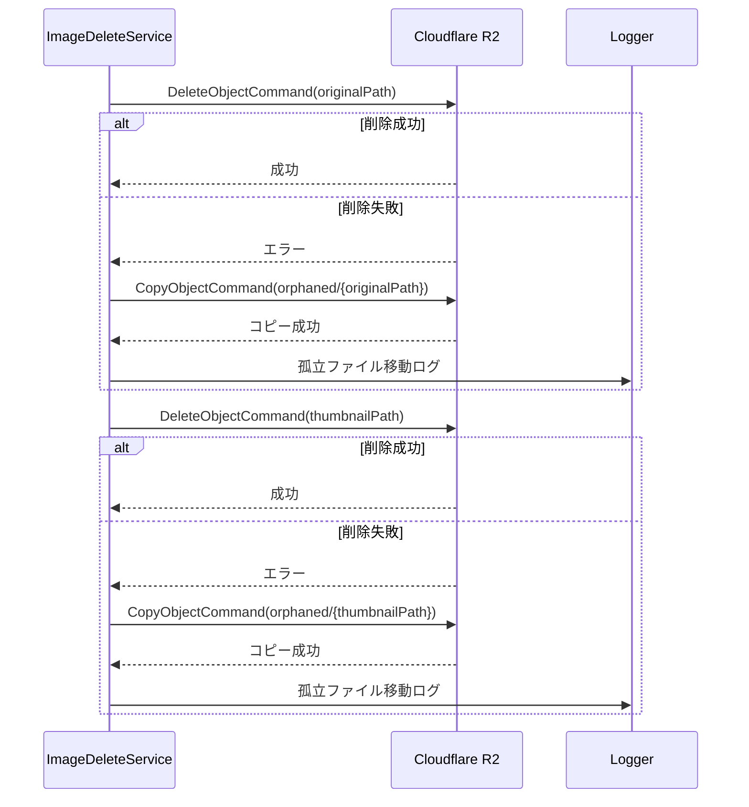

**孤立ファイル移動の実装**:
```typescript
// backend/src/services/image-delete.service.ts
import { S3Client, DeleteObjectCommand, CopyObjectCommand } from '@aws-sdk/client-s3';

async function deleteFromR2(objectKey: string): Promise<void> {
  try {
    await s3Client.send(new DeleteObjectCommand({
      Bucket: process.env.R2_BUCKET_NAME,
      Key: objectKey,
    }));
  } catch (error) {
    // 削除失敗時は orphaned/ プレフィックスに移動
    await this.moveToOrphaned(objectKey);
    logger.warn({
      action: 'r2_delete_failed',
      objectKey,
      orphanedKey: `orphaned/${objectKey}`,
      error: error.message,
    });
  }
}

async function moveToOrphaned(objectKey: string): Promise<string> {
  const orphanedKey = `orphaned/${objectKey}`;

  await s3Client.send(new CopyObjectCommand({
    Bucket: process.env.R2_BUCKET_NAME,
    CopySource: `${process.env.R2_BUCKET_NAME}/${objectKey}`,
    Key: orphanedKey,
  }));

  return orphanedKey;
}
```

**R2 Object Lifecycle Rule設定**:
Cloudflare R2ダッシュボードまたはAPIで設定:
```json
{
  "rules": [
    {
      "id": "orphaned-cleanup",
      "enabled": true,
      "filter": {
        "prefix": "orphaned/"
      },
      "action": {
        "type": "Delete"
      },
      "condition": {
        "age": 7
      }
    }
  ]
}
```

**メリット**:
- クリーンアップジョブが不要（R2のLifecycle Ruleで自動削除）
- 7日間の猶予期間により、誤削除時のリカバリが可能
- 運用負荷の軽減

##### API Contract

| Method | Endpoint | Request | Response | Errors |
|--------|----------|---------|----------|--------|
| DELETE | /api/site-surveys/images/:imageId | - | 204 No Content | 404 |

**Note**: このエンドポイントは既に実装済み（survey-images.routes.ts）

**Implementation Notes**
- Integration: PostgreSQLトランザクション内でメタデータと注釈を削除後、R2ファイルを削除
- Validation: 画像存在確認、権限チェック
- Risks: R2移動も失敗した場合は孤立ファイルとしてログに記録（Sentryアラート）

#### ImageMetadataService（要件10対応）

| Field | Detail |
|-------|--------|
| Intent | 画像のコメント、報告書出力フラグ、表示順序を管理 |
| Requirements | 10.1, 10.2, 10.3, 10.4, 10.5, 10.6, 10.7, 10.8, 10.9 |

**Responsibilities & Constraints**
- 画像単位でのコメント保存・取得
- 報告書出力フラグ（includeInReport）の管理
- **表示順序（displayOrder）の管理**（要件10.9対応: 保存時に順序変更も一括保存）
- 複数画像の一括更新サポート（メタデータ+順序）
- 既存のSurveyImageServiceと連携（画像自体の操作はSurveyImageServiceに委譲）

**Dependencies**
- Inbound: SurveyRoutes — HTTPリクエスト処理 (P0)
- Outbound: PrismaClient — データ永続化 (P0)

**Contracts**: Service [x] / API [x] / Event [ ] / Batch [ ] / State [ ]

##### Service Interface

```typescript
interface UpdateImageMetadataInput {
  comment?: string | null;
  includeInReport?: boolean;
}

interface BatchUpdateImageMetadataInput {
  imageId: string;
  comment?: string | null;
  includeInReport?: boolean;
  displayOrder?: number;  // 要件10.9対応: 順序変更も一括保存
}

interface IImageMetadataService {
  updateMetadata(
    imageId: string,
    input: UpdateImageMetadataInput
  ): Promise<SurveyImageInfo>;

  /** 要件10.9対応: 複数画像のメタデータ+順序を一括更新 */
  batchUpdateMetadata(
    inputs: BatchUpdateImageMetadataInput[]
  ): Promise<SurveyImageInfo[]>;

  // 報告書出力対象の画像のみを取得
  findForReport(surveyId: string): Promise<SurveyImageInfo[]>;
}
```

- Preconditions: imageIdが有効な画像を参照すること
- Postconditions: 更新後にデータベースに永続化されること
- Invariants: コメントは最大2000文字

##### API Contract

| Method | Endpoint | Request | Response | Errors |
|--------|----------|---------|----------|--------|
| PATCH | /api/site-surveys/images/:imageId | UpdateImageMetadataInput | SurveyImageInfo | 400, 404 |
| PATCH | /api/site-surveys/images/batch | BatchUpdateImageMetadataInput[] | SurveyImageInfo[] | 400, 404 |

**Request Schema**:
```typescript
// Zodスキーマ
const updateImageMetadataSchema = z.object({
  comment: z.string().max(2000).nullable().optional(),
  includeInReport: z.boolean().optional(),
});

// 要件10.9対応: displayOrderをオプショナルで追加
const batchUpdateImageMetadataSchema = z.array(z.object({
  imageId: z.string().uuid(),
  comment: z.string().max(2000).nullable().optional(),
  includeInReport: z.boolean().optional(),
  displayOrder: z.number().int().positive().optional(),
}));
```

**Implementation Notes**
- Integration: 既存のsurvey-images.routes.tsにエンドポイントを追加
- Validation: コメント最大長2000文字、displayOrderは正の整数
- Risks: 大量の同時更新時のデータベース負荷
- **順序変更の一括保存**: batchUpdateMetadataはdisplayOrderが指定された場合、メタデータと順序を単一トランザクションで更新
- **displayOrder重複対策**: サーバーサイドで順序を再計算して連番（1, 2, 3, ...）を保証。フロントエンドから送られたdisplayOrderは相対順序として扱い、重複や欠番があっても正規化する
- **大量リクエスト回避**: 順序変更APIは個別呼び出しではなくバッチAPIを使用。ループ処理での個別API呼び出しは禁止

#### AnnotationService

| Field | Detail |
|-------|--------|
| Intent | 注釈データ（寸法線、マーキング、コメント）の永続化と復元を管理 |
| Requirements | 6.1-6.7, 7.1-7.10, 8.1-8.7, 9.1-9.6, 18.1, 18.3, 18.4, 18.8 |

**Responsibilities & Constraints**
- Fabric.js JSON形式の注釈データを保存・復元
- 画像単位での注釈バージョン管理
- 注釈JSONのエクスポート機能
- 楽観的排他制御による同時編集検出

**Dependencies**
- Inbound: SurveyRoutes — 注釈CRUD処理 (P0)
- Outbound: PrismaClient — データ永続化 (P0)

**Contracts**: Service [x] / API [ ] / Event [ ] / Batch [ ] / State [ ]

##### Service Interface

```typescript
interface AnnotationData {
  version: string;
  objects: FabricObject[];
  background?: string;
}

interface SaveAnnotationInput {
  imageId: string;
  data: AnnotationData;
  expectedUpdatedAt?: Date;
}

interface AnnotationInfo {
  id: string;
  imageId: string;
  data: AnnotationData;
  createdAt: Date;
  updatedAt: Date;
}

interface IAnnotationService {
  save(input: SaveAnnotationInput): Promise<AnnotationInfo>;
  findByImageId(imageId: string): Promise<AnnotationInfo | null>;
  exportAsJson(imageId: string): Promise<string>;
  delete(imageId: string): Promise<void>;

  /**
   * 複数画像の注釈データを一括取得する（要件18対応）
   *
   * 指定された画像IDリストに対応する注釈データをまとめて返却する。
   * 注釈データが存在しない画像IDに対しては、空の注釈データ（data: null）を返却する（18.4）。
   * レスポンス形式は個別取得APIと互換性を維持する（18.8）。
   *
   * @param imageIds - 画像IDの配列
   * @param surveyId - 現場調査ID（権限検証用）
   * @returns 画像IDをキーとする注釈データのRecord
   */
  findByImageIds(
    imageIds: string[],
    surveyId: string
  ): Promise<Record<string, AnnotationInfo | null>>;
}
```

- Preconditions: imageIdが有効な画像を参照すること
- Postconditions: 保存後にupdatedAtが更新されること
- Invariants: 注釈データのスキーマバージョンを維持

**Implementation Notes**
- Integration: Fabric.jsのserialize/deserializeフォーマットに準拠
- Validation: 注釈オブジェクトの型安全性を検証
- Risks: 大量の注釈オブジェクトによるJSONサイズ肥大化

##### バッチ注釈取得API（要件18対応）

**バッチ注釈取得エンドポイント**:

| Method | Endpoint | Request | Response | Errors |
|--------|----------|---------|----------|--------|
| POST | /api/site-surveys/annotations/batch | BatchAnnotationRequest | BatchAnnotationResponse | 400, 403 |

**Request Schema**:
```typescript
// Zodスキーマ
const batchAnnotationRequestSchema = z.object({
  surveyId: z.string().uuid(),
  imageIds: z.array(z.string().uuid()).min(1).max(100),
});

interface BatchAnnotationRequest {
  surveyId: string;    // 現場調査ID（権限検証用、18.6対応）
  imageIds: string[];  // 取得対象の画像ID配列
}
```

**Response Schema**:
```typescript
/**
 * バッチ注釈取得レスポンス
 * 各画像IDに対応する注釈データを返却する。
 * 注釈データが存在しない画像IDに対しては null を返却する（18.4対応）。
 * 個別取得API（GET /.../annotations）のレスポンスと互換性を維持する（18.8対応）。
 */
interface BatchAnnotationResponse {
  annotations: Record<string, AnnotationInfo | null>;
}
```

**権限検証（18.6対応）**:
- `surveyId`から現場調査を取得し、紐付くプロジェクトのアクセス権限を検証
- `imageIds`が当該現場調査に属することを検証（不正なimageIdは400エラー）
- 既存の`site_survey:read`権限を使用

**エラーハンドリング（18.7対応）**:
- 400: imageIdsが空配列、100件超過、またはimageIdが当該surveyに属さない場合
- 403: 現場調査へのアクセス権限がない場合

**データ取得戦略**:
```typescript
// Prisma WHERE IN クエリで一括取得
async findByImageIds(
  imageIds: string[],
  surveyId: string
): Promise<Record<string, AnnotationInfo | null>> {
  // 1. 画像IDが当該surveyに属することを検証
  const images = await this.prisma.surveyImage.findMany({
    where: {
      id: { in: imageIds },
      surveyId: surveyId,
      survey: { deletedAt: null },
    },
    select: { id: true },
  });

  const validImageIds = new Set(images.map(img => img.id));

  // 不正なimageIdが含まれている場合はエラー
  const invalidIds = imageIds.filter(id => !validImageIds.has(id));
  if (invalidIds.length > 0) {
    throw new AnnotationImageNotFoundError(invalidIds[0]);
  }

  // 2. WHERE IN で注釈データを一括取得
  const annotations = await this.prisma.imageAnnotation.findMany({
    where: {
      imageId: { in: imageIds },
    },
  });

  // 3. 結果をRecord形式に変換（注釈なしの画像にはnullを設定: 18.4対応）
  const result: Record<string, AnnotationInfo | null> = {};
  const annotationMap = new Map(
    annotations.map(a => [a.imageId, this.toAnnotationInfo(a)])
  );

  for (const imageId of imageIds) {
    result[imageId] = annotationMap.get(imageId) ?? null;
  }

  return result;
}
```

**パフォーマンス改善効果（18.5対応）**:
- 従来: 画像N枚 → N回のGETリクエスト（個別注釈取得）+ 1回のGETリクエスト（画像一覧）= N+1回
- 改善後: 1回のPOSTリクエスト（バッチ注釈取得）+ 1回のGETリクエスト（画像一覧）= 2回
- 画像20枚の場合: 21回 → 2回（約90%削減）

#### ExportService (Frontend)

| Field | Detail |
|-------|--------|
| Intent | 注釈付き画像およびPDF報告書のエクスポート処理を担当（クライアントサイド実行） |
| Requirements | 11.1-11.8, 12.1-12.5 |

**Responsibilities & Constraints**
- Fabric.js Canvas → 画像変換（toDataURL）
- JPEG/PNG形式での画像エクスポート
- PDF報告書の生成（jsPDF、クライアントサイド完結）
- Noto Sans JP フォント埋め込みによる日本語対応
- **1ページ3組レイアウトでの画像+コメント配置（要件11.5対応）**
- **報告書出力フラグに基づく選択的出力（要件11.2対応）**

**Dependencies**
- Inbound: SiteSurveyDetailPage — PDF報告書エクスポートトリガー (P0)
- Inbound: **AnnotationEditor** — 個別画像エクスポートトリガー (P0)（タスク 115.83 で実態へ是正。旧記述は未結線の `ImageViewer` を指していた）
- Outbound: jsPDF — PDF生成 (P0)
- Outbound: Fabric.js — Canvas→画像変換 (P0)
- Outbound: AnnotationRendererService — 注釈付き画像レンダリング (P0)

**Contracts**: Service [ ] / API [ ] / Event [ ] / Batch [ ] / State [x]

##### Service Interface

```typescript
interface ExportImageOptions {
  format: 'jpeg' | 'png';
  quality: 'low' | 'medium' | 'high'; // 0.5, 0.75, 0.95
  includeAnnotations: boolean;
}

// 実体は `PdfReportOptions`（`frontend/src/services/export/PdfReportService.ts`）。
// 4項目とも任意。既定値は生成関数ごとに異なり、`generateReport` は4項目とも true、
// `generateSurveyReport` は表紙が基本情報を兼ねるため includeInfoSection のみ false とする。
interface ExportPdfOptions {
  includeCoverPage?: boolean;   // 表紙ページを含める
  includeInfoSection?: boolean; // 基本情報セクションを含める（要件11.4）
  includeImages?: boolean;      // 写真セクションを含める（要件11.5）
  includePageNumbers?: boolean; // ページ番号を含める
}

// PDF報告書レイアウト設定（要件11.5対応）
interface PdfReportLayoutConfig {
  imagesPerPage: 3;  // 1ページあたり3組
  imageMaxWidthRatio: 0.45;  // ページ幅に対する比率
  imageMaxHeightRatio: 0.28; // ページ高さに対する比率
  commentMaxLines: 3;        // コメント最大行数
}

// 注釈付き画像（コメント含む）
interface AnnotatedImageWithComment {
  imageInfo: SurveyImageInfo;
  dataUrl: string;  // 注釈付き画像のdataURL
  comment: string | null;
}

interface IExportService {
  // 単一画像エクスポート（Fabric.js toDataURL使用）
  exportImage(imageInfo: SurveyImageInfo, options: ExportImageOptions): Promise<string>; // data URL

  // PDF報告書生成（クライアントサイドjsPDF使用、要件11対応）
  exportPdf(
    survey: SurveyDetail,
    images: AnnotatedImageWithComment[],
    options: ExportPdfOptions
  ): Promise<Blob>;

  // 注釈データJSONエクスポート
  exportAnnotationsJson(canvas: FabricCanvas): string;

  // ダウンロードトリガー
  downloadFile(data: string | Blob, filename: string): void;
}
```

- Preconditions: 画像情報が有効であること
- Postconditions: ブラウザのダウンロードが開始されること
- Invariants: 日本語テキストが正しくレンダリングされること（Noto Sans JP埋め込み）

**Implementation Notes**
- Integration: 既存のPdfReportService/PdfExportServiceを拡張
- Validation: 画像数が多い場合は処理中表示（20枚以上で数秒かかる）
- Risks: フォントファイルサイズ（サブセット化で軽減、約500KB）
- **PDFファイル名規則（要件11.9）**: `generateDefaultFilename()`は固定プレフィックス「現場調査報告書」と調査日（YYYYMMDD）を組み合わせたファイル名を生成する。呼び出し元（SiteSurveyDetailInfo.tsx）では`generateDefaultFilename()`を使用し、独自のファイル名生成を行わない。

##### PDF 1ページ3組レイアウト詳細（要件11.5対応）

**レイアウト構成**:
```
┌─────────────────────────────────────────────────┐
│                    ヘッダー                       │
├─────────────────────────────────────────────────┤
│  ┌──────────────┐   ┌────────────────────────┐  │
│  │              │   │ コメント1               │  │
│  │   画像1      │   │ テキストテキスト...     │  │
│  │              │   │                        │  │
│  └──────────────┘   └────────────────────────┘  │
├─────────────────────────────────────────────────┤
│  ┌──────────────┐   ┌────────────────────────┐  │
│  │              │   │ コメント2               │  │
│  │   画像2      │   │ テキストテキスト...     │  │
│  │              │   │                        │  │
│  └──────────────┘   └────────────────────────┘  │
├─────────────────────────────────────────────────┤
│  ┌──────────────┐   ┌────────────────────────┐  │
│  │              │   │ コメント3               │  │
│  │   画像3      │   │ テキストテキスト...     │  │
│  │              │   │                        │  │
│  └──────────────┘   └────────────────────────┘  │
├─────────────────────────────────────────────────┤
│                   ページ番号                     │
└─────────────────────────────────────────────────┘
```

**レイアウトパラメータ**:
```typescript
const PDF_REPORT_LAYOUT_V2 = {
  // ページ設定
  PAGE_MARGIN: 15, // mm
  HEADER_HEIGHT: 20, // mm
  FOOTER_HEIGHT: 15, // mm

  // 画像+コメント組の設定
  IMAGES_PER_PAGE: 3,
  ROW_HEIGHT: 85, // mm（1組あたりの高さ）
  ROW_GAP: 5, // mm（行間）

  // 画像設定
  IMAGE_WIDTH_RATIO: 0.45, // ページ幅に対する比率
  IMAGE_MAX_HEIGHT: 75, // mm

  // コメント設定
  COMMENT_WIDTH_RATIO: 0.45, // ページ幅に対する比率
  COMMENT_FONT_SIZE: 10, // pt
  COMMENT_LINE_HEIGHT: 1.4,
  COMMENT_MAX_LINES: 5,

  // フォント
  FONT_FAMILY: 'NotoSansJP',
} as const;
```

**レンダリング実装**:
```typescript
// frontend/src/services/export/PdfReportService.ts (拡張)

/**
 * 3組レイアウトで画像セクションを描画
 * @requirement 11.5
 */
renderImagesSection3PerPage(
  doc: jsPDF,
  images: AnnotatedImageWithComment[],
  startY: number
): number {
  const pageWidth = doc.internal.pageSize.getWidth();
  const pageHeight = doc.internal.pageSize.getHeight();
  const contentWidth = pageWidth - PDF_REPORT_LAYOUT_V2.PAGE_MARGIN * 2;

  let currentY = startY;

  for (let i = 0; i < images.length; i++) {
    // 3組ごとに新しいページ
    if (i > 0 && i % PDF_REPORT_LAYOUT_V2.IMAGES_PER_PAGE === 0) {
      doc.addPage();
      currentY = PDF_REPORT_LAYOUT_V2.PAGE_MARGIN + PDF_REPORT_LAYOUT_V2.HEADER_HEIGHT;
    }

    const image = images[i];
    const imageX = PDF_REPORT_LAYOUT_V2.PAGE_MARGIN;
    const imageWidth = contentWidth * PDF_REPORT_LAYOUT_V2.IMAGE_WIDTH_RATIO;
    const { width, height } = this.calculateImageDimensions(
      image.imageInfo.width,
      image.imageInfo.height,
      imageWidth,
      PDF_REPORT_LAYOUT_V2.IMAGE_MAX_HEIGHT
    );

    // 画像描画
    doc.addImage(image.dataUrl, 'JPEG', imageX, currentY, width, height);

    // コメント描画
    const commentX = imageX + imageWidth + 10;
    const commentWidth = contentWidth * PDF_REPORT_LAYOUT_V2.COMMENT_WIDTH_RATIO;
    this.renderComment(doc, image.comment, commentX, currentY, commentWidth);

    currentY += PDF_REPORT_LAYOUT_V2.ROW_HEIGHT + PDF_REPORT_LAYOUT_V2.ROW_GAP;
  }

  return currentY;
}
```

##### 日本語フォント埋め込み詳細

**フォント選定**: Noto Sans JP（Google Fonts、OFL-1.1ライセンス）

**サブセット化プロセス**:
1. [fonttools](https://github.com/fonttools/fonttools) を使用してサブセット化
2. 対象文字: JIS第1水準漢字 + ひらがな + カタカナ + 英数字記号（約3,000文字）
3. 目標サイズ: 500KB以下（フル版約16MB → サブセット版約500KB）

**バンドル方法**:
```typescript
// frontend/src/services/export/fonts/noto-sans-jp-base64.ts
// ビルド時にBase64エンコードされたフォントデータを生成
export const NotoSansJPBase64 = '/* Base64 encoded font data */';

// frontend/src/services/export/PdfFontService.ts
import { jsPDF } from 'jspdf';
import { NotoSansJPBase64 } from './fonts/noto-sans-jp-base64';

export function initializePdfFonts(doc: jsPDF): void {
  doc.addFileToVFS('NotoSansJP-Regular.ttf', NotoSansJPBase64);
  doc.addFont('NotoSansJP-Regular.ttf', 'NotoSansJP', 'normal');
}
```

**非同期ローディング**: 初回PDF生成時にフォントを遅延読み込みし、以降はメモリキャッシュを使用

#### AnnotationRendererService 拡張（要件18対応）

| Field | Detail |
|-------|--------|
| Intent | PDF報告書生成時の注釈付き画像レンダリングにバッチ注釈取得を適用 |
| Requirements | 18.2, 18.5, 18.7 |

**変更概要**:
- `renderImagesForReport`メソッドを変更し、個別`getAnnotation()`呼び出しからバッチ`getBatchAnnotations()`呼び出しに切り替える
- 注釈データを事前に一括取得し、各画像のレンダリング時にはメモリ内のMapから取得する

**変更箇所**:

1. **`renderImagesForReport`メソッド**: 画像リストから全imageIdを抽出し、`getBatchAnnotations()`で一括取得後、各画像のレンダリングに使用

2. **`renderImageForReport`メソッド（内部）**: 注釈データを引数で受け取るオーバーロードを追加（バッチ取得済みデータを使用）

**拡張インターフェース**:
```typescript
// AnnotationRendererService 拡張（要件18対応）

/**
 * 報告書用に複数の画像に注釈をレンダリングする（バッチ注釈取得対応）
 *
 * 変更前: 各画像ごとに getAnnotation() を個別呼び出し（N回のHTTPリクエスト）
 * 変更後: getBatchAnnotations() で全画像の注釈を一括取得（1回のHTTPリクエスト）
 *
 * @requirement 18.2, 18.5
 */
async renderImagesForReport(
  images: SurveyImageInfo[],
  options?: RenderOptions
): Promise<RenderedImage[]> {
  // 1. 日本語フォントを事前にロード（1回のみ）
  await loadJapaneseFont();

  // 2. 全画像の注釈データを一括取得（要件18.2対応）
  const imageIds = images.map(img => img.id);
  const surveyId = images[0]?.surveyId;
  let annotationsMap: Record<string, AnnotationInfo | null> = {};

  if (surveyId && imageIds.length > 0) {
    try {
      annotationsMap = await getBatchAnnotations(surveyId, imageIds);
    } catch (error) {
      // バッチ取得失敗時は個別取得にフォールバック（18.7対応）
      console.warn('Batch annotation fetch failed, falling back to individual fetch:', error);
      annotationsMap = {};
    }
  }

  // 3. 各画像を順次レンダリング（注釈データはMapから取得）
  const results: RenderedImage[] = [];
  for (const imageInfo of images) {
    const annotationData = annotationsMap[imageInfo.id];
    const result = await this.renderImageWithAnnotation(
      imageInfo,
      annotationData,
      options
    );
    if (result) {
      results.push(result);
    }
  }

  return results;
}

/**
 * 事前取得済みの注釈データを使用して画像をレンダリングする
 * annotationDataがundefined（Mapにキーなし）の場合のみ個別取得にフォールバック
 */
private async renderImageWithAnnotation(
  imageInfo: SurveyImageInfo,
  annotationData: AnnotationInfo | null | undefined,
  options?: RenderOptions
): Promise<RenderedImage | null>;
```

**フォールバック戦略（18.7対応）**:
- バッチAPI呼び出しが失敗した場合、従来の個別`getAnnotation()`にフォールバック
- フォールバック時はconsole.warnでログ出力（Sentryにも送信）
- ユーザーにはエラーを表示せず、パフォーマンスが低下するのみ

#### survey-annotations APIクライアント拡張（要件18対応）

| Field | Detail |
|-------|--------|
| Intent | バッチ注釈取得のAPIクライアント関数を提供 |
| Requirements | 18.1, 18.2, 18.7 |

**追加関数**:
```typescript
// frontend/src/api/survey-annotations.ts に追加

/**
 * 複数画像の注釈データを一括取得する
 *
 * PDF報告書出力時に使用し、個別取得（N回リクエスト）の代わりに
 * バッチAPI（1回リクエスト）で全画像の注釈データを取得する。
 *
 * @param surveyId - 現場調査ID（権限検証用）
 * @param imageIds - 取得対象の画像IDリスト
 * @returns 画像IDをキーとする注釈データのRecord（注釈なしの画像はnull）
 * @throws ApiError
 *   - 400: imageIdsが空配列または不正
 *   - 403: 権限不足
 *
 * @requirement 18.1, 18.2
 */
export async function getBatchAnnotations(
  surveyId: string,
  imageIds: string[]
): Promise<Record<string, AnnotationInfo | null>> {
  const response = await apiClient.post<BatchAnnotationResponse>(
    '/api/site-surveys/annotations/batch',
    { surveyId, imageIds }
  );
  return response.annotations;
}

interface BatchAnnotationResponse {
  annotations: Record<string, AnnotationInfo | null>;
}
```

### Backend / Routes Layer

#### SurveyRoutes

| Field | Detail |
|-------|--------|
| Intent | 現場調査関連のHTTPエンドポイントを定義 |
| Requirements | 1-16, 18 |

**Contracts**: Service [ ] / API [x] / Event [ ] / Batch [ ] / State [ ]

##### API Contract

| Method | Endpoint | Request | Response | Errors |
|--------|----------|---------|----------|--------|
| POST | /api/projects/:projectId/site-surveys | CreateSurveyRequest | SurveyInfo | 400, 404, 409 |
| GET | /api/projects/:projectId/site-surveys | QueryParams | PaginatedSurveys | 400, 404 |
| **GET** | **/api/projects/:projectId/site-surveys/latest** | **?limit=2** | **ProjectSurveySummary** | **400, 404** |
| GET | /api/site-surveys/:id | - | SurveyDetail | 404 |
| PUT | /api/site-surveys/:id | UpdateSurveyRequest | SurveyInfo | 400, 404, 409 |
| DELETE | /api/site-surveys/:id | - | 204 No Content | 404 |
| POST | /api/site-surveys/:id/images | multipart/form-data | SurveyImageInfo | 400, 413, 415 |
| GET | /api/site-surveys/:id/images | - | SurveyImageInfo[] | 404 |
| PUT | /api/site-surveys/:id/images/order | ImageOrderRequest | 204 No Content | 400, 404 |
| DELETE | /api/site-surveys/images/:imageId | - | 204 No Content | 404 |
| **PATCH** | **/api/site-surveys/images/:imageId** | **UpdateImageMetadataInput** | **SurveyImageInfo** | **400, 404** |
| **PATCH** | **/api/site-surveys/images/batch** | **BatchUpdateImageMetadataInput[]** | **SurveyImageInfo[]** | **400, 404** |
| GET | /api/site-surveys/images/:imageId/annotations | - | AnnotationInfo | 404 |
| PUT | /api/site-surveys/images/:imageId/annotations | AnnotationData | AnnotationInfo | 400, 404, 409 |
| **POST** | **/api/site-surveys/annotations/batch** | **BatchAnnotationRequest** | **BatchAnnotationResponse** | **400, 403** |

**Note**: 画像エクスポートおよびPDF生成はクライアントサイドで実行（Fabric.js toDataURL + jsPDF）

### Frontend / Component Layer

#### SiteSurveySectionCard（要件2.1対応）

| Field | Detail |
|-------|--------|
| Intent | プロジェクト詳細画面に表示する現場調査セクションを提供 |
| Requirements | 2.1 |

**Responsibilities & Constraints**
- 直近2件の現場調査への参照リンクを表示
- 現場調査の総数を表示
- 「すべて表示」リンクによる一覧ページへの遷移

**Dependencies**
- Inbound: ProjectDetailPage — 親コンポーネント (P0)
- Outbound: SurveyAPI — 直近N件取得 (P0)
- Outbound: React Router — ページ遷移 (P0)

**Contracts**: Service [ ] / API [ ] / Event [ ] / Batch [ ] / State [x]

##### State Management

```typescript
interface SiteSurveySectionCardProps {
  projectId: string;
}

interface SiteSurveySectionCardState {
  isLoading: boolean;
  error: string | null;
  totalCount: number;
  latestSurveys: SurveyInfo[];
}
```

##### UI仕様

```
┌─────────────────────────────────────────────────────────────────┐
│ 現場調査                                        すべて表示 (N件) │
├─────────────────────────────────────────────────────────────────┤
│ ┌─────────────────────────────────────────────────────────────┐ │
│ │ 📷 調査名1                                    2025-01-15    │ │
│ │    画像数: 5枚                                               │ │
│ └─────────────────────────────────────────────────────────────┘ │
│ ┌─────────────────────────────────────────────────────────────┐ │
│ │ 📷 調査名2                                    2025-01-10    │ │
│ │    画像数: 3枚                                               │ │
│ └─────────────────────────────────────────────────────────────┘ │
│                                                                 │
│ 現場調査がない場合:                                              │
│ ┌─────────────────────────────────────────────────────────────┐ │
│ │ 現場調査がありません。[新規作成]                               │ │
│ └─────────────────────────────────────────────────────────────┘ │
└─────────────────────────────────────────────────────────────────┘
```

**Implementation Notes**
- Integration: ProjectDetailPageの既存レイアウトに統合
- Validation: 現場調査が0件の場合は新規作成リンクを表示
- Risks: APIレスポンス遅延時のUX（ローディングスケルトン表示）

#### SiteSurveyDetailPage（要件4.10-4.13、10対応）

| Field | Detail |
|-------|--------|
| Intent | 現場調査詳細画面の状態管理と順序変更・保存処理を担当 |
| Requirements | 4.10, 4.11, 4.12, 4.13, 10.5, 10.6, 10.7, 10.8, 10.9 |

**Responsibilities & Constraints**
- 画像一覧の表示状態管理
- **pendingOrderRefによる未保存順序変更の追跡**
- **handleOrderChange**: ローカル状態のみを更新（サーバー保存しない）
- **handleSaveMetadata**: メタデータと順序変更を一括保存
- useUnsavedChangesフックとの統合

**Dependencies**
- Inbound: Router — ページ遷移 (P0)
- Outbound: PhotoManagementPanel — 子コンポーネント (P0)
- Outbound: ImageMetadataAPI — 一括保存 (P0)
- Outbound: useUnsavedChanges — 未保存変更検出 (P0)

**Contracts**: Service [ ] / API [ ] / Event [ ] / Batch [ ] / State [x]

##### State Management

```typescript
interface SiteSurveyDetailPageState {
  survey: SurveyDetail | null;
  images: SurveyImageInfo[];
  isLoading: boolean;
  isSaving: boolean;
  error: string | null;
}

/**
 * 未保存の順序変更を追跡するRef
 * @requirement 4.11, 4.12, 4.13, 10.5, 10.6, 10.7
 */
interface PendingOrderRef {
  current: ImageOrderItem[] | null;  // { id, order } の配列。順序保存APIへそのまま渡す
}

/**
 * 順序変更ハンドラー（ローカル状態のみ更新、即時保存しない）
 * @requirement 4.11, 4.12, 4.13, 10.5, 10.6, 10.7
 */
const handleOrderChange = (newOrders: ImageOrderItem[]): void => {
  // 1. ローカル状態のdisplayOrderを更新（UI反映用）
  const orderMap = new Map(newOrders.map((o) => [o.id, o.order]));
  setSurvey((prev) =>
    prev
      ? {
          ...prev,
          images: prev.images.map((img) => ({
            ...img,
            displayOrder: orderMap.get(img.id) ?? img.displayOrder,
          })),
        }
      : prev
  );

  // 2. 未保存の順序変更をpendingOrderRefへ配列のまま記録する
  pendingOrderRef.current = newOrders;

  // 3. 未保存フラグを立てる
  markAsChanged();
};

/**
 * 保存ハンドラー（メタデータ+順序変更を一括保存）
 * @requirement 10.9
 */
const handleSaveMetadata = async (
  changes: Map<string, UpdateImageMetadataInput>
): Promise<void> => {
  const batchInput: BatchUpdateImageMetadataInput[] = [];

  // 1. メタデータ変更を収集
  changes.forEach((change, imageId) => {
    const input: BatchUpdateImageMetadataInput = {
      imageId,
      ...change,
    };
    batchInput.push(input);
  });

  // 2. メタデータの一括保存API呼び出し
  await batchUpdateMetadata(batchInput);

  // 3. 順序変更がある場合は、保持している配列をそのまま順序保存APIへ渡す
  //    （順序はメタデータ一括更新とは別のエンドポイントで保存する）
  if (pendingOrderRef.current) {
    await updateSurveyImageOrder(surveyId, pendingOrderRef.current);
  }

  // 4. 保存成功時にpendingOrderRefをクリア
  pendingOrderRef.current = null;
  markAsSaved();
};
```

**Implementation Notes**
- Integration: PhotoManagementPanelの親コンポーネントとして機能
- Validation: 保存前にpendingOrderRefをチェックし、順序変更があれば保持している配列を順序保存APIへ送る
- Risks: 大量の画像+順序変更時のAPIペイロードサイズ
- **順序変更の即時保存廃止**: ドラッグ&ドロップ、上へ/下へボタンは即時サーバー保存せず、保存ボタンクリック時に一括保存
- **handleImageDelete（画像削除コールバック）**: 削除確認ダイアログで削除確定後、以下の処理を実行:
  1. DELETE APIを呼び出し画像を削除
  2. 削除成功時にpendingOrderRef.currentから該当imageIdを削除
  3. 削除成功時にpendingChangesRefから該当imageIdを削除
  4. ローカルのimages stateから該当画像を除去

#### PhotoManagementPanel（要件4.10-4.13、10対応）

| Field | Detail |
|-------|--------|
| Intent | 現場調査詳細画面の写真一覧管理UIを提供（フルサイズ写真表示、コメント入力、報告書出力フラグ、削除ボタン、並び替え機能） |
| Requirements | 4.10, 4.11, 4.12, 4.13, 10.1, 10.2, 10.3, 10.4, 10.5, 10.6, 10.7, 10.8, 10.9, 10.10, 10.11, 10.12 |

**Responsibilities & Constraints**
- **フルサイズの写真を直接表示**（サムネイル一覧タブは表示しない、要件10.1準拠）
- 写真ごとのコメント入力テキストエリア
- 報告書出力フラグ（チェックボックス）の管理
- **削除ボタンと確認ダイアログ**
- **並び替え機能（3種類）**（要件4.11-4.13、10.5-10.7）:
  - ドラッグ&ドロップによる順序変更（ローカル状態のみ更新、即時保存しない）
  - 「上へ移動」ボタン（当該画像を1つ上の位置に移動、ローカル状態のみ更新）
  - 「下へ移動」ボタン（当該画像を1つ下の位置に移動、ローカル状態のみ更新）
- **手動保存方式**: コメント、報告書出力フラグ、**表示順序**を一括保存（保存ボタンクリック）
- **未保存変更検出**: useUnsavedChangesフックとの統合
- 現場調査詳細画面のメイン表示コンポーネントとして機能

**Dependencies**
- Inbound: SiteSurveyDetailPage — 親コンポーネント (P0)
- Outbound: ImageMetadataAPI — コメント・フラグ更新 (P0)
- Outbound: ImageOrderAPI — 順序変更 (P0)
- Outbound: ImageDeleteAPI — 画像削除 (P0)
- Outbound: useUnsavedChanges — 未保存変更検出 (P0)

**Contracts**: Service [ ] / API [ ] / Event [ ] / Batch [ ] / State [x]

##### State Management

```typescript
interface PhotoManagementState {
  images: SurveyImageInfo[];
  isLoading: boolean;
  isSaving: boolean;
  errors: Record<string, string | null>; // imageId -> error message
  draggedImageId: string | null;
  pendingChanges: Map<string, UpdateImageMetadataInput>; // 未保存のメタデータ変更
  pendingOrderChanges: boolean; // 未保存の順序変更があるかどうか
  deleteDialogImageId: string | null; // 削除確認ダイアログの対象
}

interface PhotoManagementPanelProps {
  surveyId: string;
  images: SurveyImageInfo[];
  onImagesChange: (images: SurveyImageInfo[]) => void;
  onImageClick: (imageId: string) => void; // 画像クリック時にビューア/エディタを開く
  readOnly?: boolean;
  isDirty: boolean;
  onDirtyChange: (isDirty: boolean) => void;
}

/** 順序変更ハンドラー（ローカル状態のみ更新、即時保存しない） */
interface OrderChangeHandlers {
  /** ドラッグ&ドロップによる順序変更 @requirement 4.11, 10.5 */
  handleDragReorder: (sourceIndex: number, destinationIndex: number) => void;
  /** 「上へ移動」ボタンクリック @requirement 4.12, 10.6 */
  handleMoveUp: (imageId: string) => void;
  /** 「下へ移動」ボタンクリック @requirement 4.13, 10.7 */
  handleMoveDown: (imageId: string) => void;
}
```

**Implementation Notes**
- Integration: 現場調査詳細画面のメインコンテンツとして統合（サムネイル一覧タブとの切り替えなし）
- Validation: コメント最大2000文字
- Risks: 大量画像時のレンダリングパフォーマンス（遅延読み込み、仮想スクロール検討）
- **UI設計の注意点**: サムネイル一覧は別タブとして用意せず、フルサイズ写真のみを表示する単一ビュー構成
- **ナビゲーション削除**: 「プロジェクトに戻る」「現場調査一覧に戻る」ボタンは表示しない（ブレッドクラムのみ）
- **順序変更の動作**: ドラッグ&ドロップ、「上へ移動」「下へ移動」ボタンはローカル状態のみを更新し、即時サーバー保存しない。保存ボタンクリック時にメタデータと順序変更を一括保存する（要件4.11-4.13、10.5-10.7、10.9）

##### UI仕様

現場調査詳細画面では、サムネイル一覧タブを設けず、フルサイズの写真を直接表示する。

```
┌─────────────────────────────────────────────────────────────────┐
│ 現場調査詳細: [調査名]                      [保存] [PDF出力]    │
│ 調査日: YYYY-MM-DD  |  画像数: N枚                              │
│ ※ 未保存の変更があります（isDirty=trueの場合）                  │
├─────────────────────────────────────────────────────────────────┤
│ 写真一覧（フルサイズ表示、ドラッグ並び替え、上/下移動ボタン）      │
├─────────────────────────────────────────────────────────────────┤
│ ┌───┐ ┌──────────────────────────────────────────────────────┐ │
│ │ ☐ │ │ ┌─────────────────────┐  ┌────────────────────────┐ │ │
│ │   │ │ │                     │  │ コメント                │ │ │
│ │   │ │ │  [フルサイズ写真]   │  │ ┌────────────────────┐ │ │ │
│ │   │ │ │  (クリックで        │  │ │                    │ │ │ │
│ │   │ │ │   ビューア/エディタ) │  │ │                    │ │ │ │
│ │   │ │ │                     │  │ └────────────────────┘ │ │ │
│ │   │ │ └─────────────────────┘  └────────────────────────┘ │ │
│ │   │ │   [△上へ] [▽下へ]                          [🗑削除] │ │
│ └───┘ └──────────────────────────────────────────────────────┘ │
│   ↑                                                             │
│ 報告書出力フラグ                                                 │
├─────────────────────────────────────────────────────────────────┤
│ ┌───┐ ┌──────────────────────────────────────────────────────┐ │
│ │ ☐ │ │ ┌─────────────────────┐  ┌────────────────────────┐ │ │
│ │   │ │ │                     │  │ コメント                │ │ │
│ │   │ │ │  [フルサイズ写真]   │  │ ┌────────────────────┐ │ │ │
│ │   │ │ │                     │  │ │                    │ │ │ │
│ │   │ │ │                     │  │ │                    │ │ │ │
│ │   │ │ └─────────────────────┘  └────────────────────────┘ │ │
│ │   │ │   [△上へ] [▽下へ]                          [🗑削除] │ │
│ └───┘ └──────────────────────────────────────────────────────┘ │
│   ↑                                                             │
│ 報告書出力フラグ                                                 │
├─────────────────────────────────────────────────────────────────┤
│ （繰り返し...）                                                   │
└─────────────────────────────────────────────────────────────────┘

※ サムネイル一覧タブは表示しない（要件10.1準拠）
※ フルサイズ写真をクリックすると画像ビューア/注釈エディタが開く
※ 「プロジェクトに戻る」「現場調査一覧に戻る」ボタンは表示しない
※ 並び替え操作（ドラッグ、上へ/下へボタン）はローカル状態のみ更新（要件4.11-4.13、10.5-10.7）
※ 保存ボタンでコメント、報告書出力フラグ、表示順序を一括保存（要件10.9）
```

##### 削除確認ダイアログ

```
┌───────────────────────────────────────────┐
│ 画像の削除                          [×]   │
├───────────────────────────────────────────┤
│                                           │
│ この画像を削除しますか？                   │
│                                           │
│ この操作は取り消せません。                 │
│ 画像に関連する注釈データも削除されます。   │
│                                           │
├───────────────────────────────────────────┤
│            [キャンセル] [削除]            │
└───────────────────────────────────────────┘
```

#### useUnsavedChanges（既存フック活用）

| Field | Detail |
|-------|--------|
| Intent | 未保存変更の検出とページ離脱時の確認ダイアログを提供 |
| Requirements | 9.1, 9.3, 10.8, 10.9 |

**Responsibilities & Constraints**
- isDirtyフラグの管理
- beforeunloadイベントによるページ離脱時の確認ダイアログ
- 既存実装（frontend/src/hooks/useUnsavedChanges.ts）を活用

**既存実装の活用**:
```typescript
// frontend/src/hooks/useUnsavedChanges.ts（既存実装）
interface UseUnsavedChangesResult {
  isDirty: boolean;
  setDirty: (dirty: boolean) => void;
  markAsChanged: () => void;
  markAsSaved: () => void;
  reset: () => void;
  confirmNavigation: () => boolean;
}
```

**Implementation Notes**
- Integration: SiteSurveyDetailPage、PhotoManagementPanel、AnnotationEditorで共有
- Validation: isDirty=trueの場合のみbeforeunloadイベントをリッスン
- Risks: React Routerとの連携（ルート遷移時の確認ダイアログ）

#### ImageExportDialog（要件12対応）

| Field | Detail |
|-------|--------|
| Intent | 個別画像エクスポートのオプション選択UI |
| Requirements | 12.1, 12.2, 12.3, 12.4, 12.5 |

**Responsibilities & Constraints**
- エクスポート形式の選択（JPEG/PNG）
- 画質/解像度の選択（低/中/高）
- 注釈あり/なしの選択
- エクスポート実行とダウンロードトリガー

**Dependencies**
- Inbound: **AnnotationEditor** — ダイアログ表示トリガー (P0)（タスク 115.83 で実態へ是正。旧記述は未結線の `ImageViewer` を指していた）
- Outbound: AnnotationRendererService — 注釈付き画像レンダリング (P0)
- Outbound: ExportService — ダウンロード (P0)

**Contracts**: Service [ ] / API [ ] / Event [ ] / Batch [ ] / State [x]

##### State Management

```typescript
interface ImageExportDialogState {
  isOpen: boolean;
  format: 'jpeg' | 'png';
  quality: 'low' | 'medium' | 'high';
  includeAnnotations: boolean;
  isExporting: boolean;
  error: string | null;
}

interface ImageExportDialogProps {
  imageInfo: SurveyImageInfo;
  isOpen: boolean;
  onClose: () => void;
}
```

**Implementation Notes**
- Integration: **`AnnotationEditor` が描画し、注釈ツールバーのエクスポート操作から開く**（タスク 115.83 で実態へ是正）
- Validation: 形式に応じた品質オプションの動的制御
- Risks: 大きい画像のエクスポート時のメモリ使用量

##### UI仕様

```
┌───────────────────────────────────────────┐
│ 画像エクスポート                    [×]  │
├───────────────────────────────────────────┤
│                                           │
│ 形式:                                     │
│   ◉ JPEG    ○ PNG                         │
│                                           │
│ 品質:                                     │
│   ○ 低（ファイルサイズ小）                │
│   ◉ 中（標準）                            │
│   ○ 高（最高品質）                        │
│                                           │
│ オプション:                               │
│   ☑ 注釈を含める                          │
│                                           │
├───────────────────────────────────────────┤
│            [キャンセル] [エクスポート]    │
└───────────────────────────────────────────┘
```

#### AnnotationEditor

| Field | Detail |
|-------|--------|
| Intent | 画像上での注釈編集インターフェースを提供 |
| Requirements | 6.1-6.7, 7.1-7.10, 8.1-8.7, 9.1-9.6, 13.1-13.5, 17.1-17.6, 22.1-22.8 |

**Responsibilities & Constraints**
- Fabric.jsキャンバスの初期化と管理
- 各種ツール（寸法線、図形、テキスト）の切り替え
- オブジェクト選択・編集・削除の操作
- Undo/Redo操作の管理
- **手動保存方式**: 保存ボタンクリックでサーバーに保存
- **未保存変更検出**: useUnsavedChangesフックとの統合
- **背景画像の90度単位回転（要件22対応）**: 描画済み注釈は回転に追従しない

**Dependencies**
- Inbound: SiteSurveyDetailPage — 親コンポーネント (P0)
- Outbound: Fabric.js — Canvas操作 (P0)
- Outbound: UndoManager — 操作履歴 (P0)
- Outbound: AnnotationAPI — データ永続化 (P0)
- Outbound: localStorage — 一時保存 (P1)
- Outbound: useUnsavedChanges — 未保存変更検出 (P0)

**Contracts**: Service [ ] / API [ ] / Event [ ] / Batch [ ] / State [x]

##### State Management

```typescript
interface AnnotationEditorState {
  activeTool: ToolType;
  selectedObjects: FabricObject[];
  isDirty: boolean;
  isSaving: boolean;
  canUndo: boolean;
  canRedo: boolean;
  toolOptions: ToolOptions;
  /** 背景画像の累積回転角度（要件22.8対応） */
  imageRotation: 0 | 90 | 180 | 270;
}

type ToolType =
  | 'select'
  | 'dimension'
  | 'arrow'
  | 'circle'
  | 'rectangle'
  | 'polygon'
  | 'polyline'
  | 'freehand'
  | 'text';

interface ToolOptions {
  strokeColor: string;
  strokeWidth: number;
  fillColor: string;
  fontSize: number;
  fontColor: string;
}
```

**Implementation Notes**
- Integration: useRefでFabric.js canvasインスタンスを管理
- Validation: ツール切り替え時に未保存変更を確認
- Risks: 大量オブジェクト時のパフォーマンス低下
- **保存方式変更**: オートセーブから手動保存に変更、isDirtyフラグで変更検出
- **画像回転（要件22対応）**: 回転操作は背景画像のみに適用し、描画済み注釈オブジェクトの位置・サイズは維持する。回転角度は注釈データのメタデータとして永続化する。

##### 描画ツール使用中のオブジェクト選択防止（要件17）

**問題**: 現行実装では、描画ツール使用中にmouse:downハンドラ内で`containsPoint()`による既存オブジェクトのヒットテストを実行し、既存オブジェクト上でクリックすると`return`して描画操作を中止している。同様にmouse:upハンドラでも既存オブジェクト上でのマウスアップ時に図形作成を中止している。これにより、既存オブジェクトが存在する領域に新規描画ができない。

**設計方針**: 描画ツール使用中は既存オブジェクトの`containsPoint()`チェックを完全にスキップし、描画操作のみを受け付ける。選択ツールでのみオブジェクト選択を許可する。

**変更箇所**:

1. **`mouse:down`ハンドラ**: 描画ツール使用中の`containsPoint()`ループを削除。`handleToolChange`で既に`evented: false`と`selectable: false`を設定しているため、Fabric.jsレベルでの選択は無効化済み。手動ヒットテストも不要。
   - `activeObject`チェックも描画ツール時はスキップ（描画ツール切り替え時に`discardActiveObject()`で選択解除済み）

2. **`mouse:up`ハンドラ**: 描画ツール使用中の`containsPoint()`ループを削除。既存オブジェクト上でマウスアップした場合でも、描画した図形を正常に作成・確定する。

3. **`handleToolChange`**: 変更不要。現行実装で`evented: false`、`selectable: false`、`canvas.selection = false`、`discardActiveObject()`を適切に設定済み。

**設計の整合性**:
- `handleToolChange`で`evented: false`を設定 → Fabric.jsの選択イベントは発生しない
- `handleToolChange`で`discardActiveObject()` → ツール切り替え時に選択をクリア
- `containsPoint()`チェック削除 → 手動ヒットテストによる描画阻止を排除
- 選択ツールでは`evented: true`、`selectable: true` → 従来通りオブジェクト選択可能

#### ImageViewer

**本部品はタスク 115.146 で撤去した。** 本番から一度も参照されておらず（`SiteSurveyImageViewerPage` は当初から `AnnotationEditor` を用いている）、要件5 の担当はタスク 115.83 で出荷経路へ付け替え済みだった。以下は撤去前の設計記述であり、`ImageViewerState` / `ImageViewerProps` は**実装に実体を持たない抽象契約**として扱う（上の「実装に実体を持たない契約名」表を参照）。

**記録（撤去が残した「存在しないファイルへの導線」。後続タスク 115.169 で解消する）**: 撤去により、**本番コード（`frontend/src` / `backend/src` の `.ts` / `.tsx` からテストコードを除いたもの）の注釈が、存在しない `frontend/src/components/site-surveys/ImageViewer.tsx` ないし部品 `ImageViewer` を現存物として指したまま**残った。これらは 115.146 の境界（本番未参照の画像ビューア部品）の外にある他部品の注釈であるため、115.146 では**書き換えず記録のみ**とし、後続タスク **`115.169`「撤去済み部品を現存物として指す本番コードの参照を解消する」**（`tasks.md`）へ引き渡す。実測値は次のとおり（`grep -rn "ImageViewer" --include=*.ts --include=*.tsx frontend/src backend/src` の結果から、テストコードと実在する `ConstructionPhotoImageViewer` / `ConstructionPhotoImageViewerPage` / `SiteSurveyImageViewerPage` の各行を除いたもの）。

| ファイル | 件数 |
|---|---|
| `frontend/src/components/construction-photos/ConstructionPhotoImageViewer.tsx` | 4 |
| `frontend/src/components/site-surveys/gestures/canvasViewportController.ts` | 2 |
| `frontend/src/components/site-surveys/gestures/touchGestureManager.ts` | 1 |
| `frontend/src/components/site-surveys/gestures/gesture-thresholds.ts` | 1 |
| `frontend/src/components/site-surveys/AnnotationEditor.tsx` | 1 |
| `frontend/src/utils/imageFitScale.ts` | 1 |

**合計10箇所（6ファイル）。** うち `frontend/src/utils/imageFitScale.ts`（現行のフィット算術の出所を「AnnotationEditor / ImageViewer」と記す）は 115.146 のレビュー時の指摘（9箇所）には含まれておらず、本記録を書くための再測で見つかった1件である。**したがって 115.169 の対象は9箇所ではなく10箇所とする。** **本記録は件数だけを残し、行番号は記録しない**（行番号は測定時点の値であり以降の編集でずれるうえ、本書から本番コードを行番号で指す形は上の規約が禁じている）。115.169 は名前（`ImageViewer`）で再測すること。

なお本設計書の歴史記録（本節、「未結線部品の扱い」の追記、`### Component Summary` の取り消し線行、`##### ImageViewer (touch ext)`）が `ImageViewer` を指すのは**書き換えずに残すと明示的に判断した保存**であり、上の10箇所とは別物である。

**記録（撤去に伴う型の孤児化とその処置）**: 撤去前、`frontend/src/components/site-surveys/image-viewer.constants.ts` が公開する `ImageViewerViewState` / `ImageViewerRef` の利用者は `ImageViewer.tsx` と `ImageViewer.test.tsx` だけであった。撤去後は利用者0（互いを参照し合うだけの閉じた孤児）となる一方、同ファイル自体は `canvasViewportController` / `gesture-thresholds` / `useCanvasViewport` / `ConstructionPhotoImageViewer` 経由で本番から到達するため、**`check:req-coverage` のモジュール単位の到達判定ではこの孤児を検出できない**。「死蔵の整理」を掲げたタスクが検出不能な死蔵を残すことになるため、**115.146 の是正で当該2型を撤去した**（`git grep -n "ImageViewerViewState\|ImageViewerRef"` で宣言ファイル自身の4行以外に一致0件であることを再確認したうえで撤去）。同ファイルの `ZOOM_CONSTANTS` / `ROTATION_CONSTANTS` / `RotationAngle` / `PAN_CONSTANTS` / `TOUCH_CONSTANTS` は本番に利用者があるため残す。型のみの撤去であり、撤去前後で `vite build` の生成物はバイト同一である。

| Field | Detail |
|-------|--------|
| Intent | 画像のズーム、パン、回転操作を提供 |
| Requirements | 5.1, 5.2, 5.3, 5.4, 5.5, 5.6 |

**Responsibilities & Constraints**
- 画像の拡大/縮小（ピンチ/ホイール対応）
- パン操作（ドラッグ移動）
- 90度単位の回転
- タッチデバイス対応

**Dependencies**
- Inbound: SiteSurveyDetailPage — 親コンポーネント (P0)
- Outbound: Fabric.js — Canvas操作 (P0)

**Contracts**: Service [ ] / API [ ] / Event [ ] / Batch [ ] / State [x]

##### State Management

```typescript
interface ImageViewerState {
  zoom: number;
  rotation: 0 | 90 | 180 | 270;
  panX: number;
  panY: number;
  isAnnotationMode: boolean;
}

interface ImageViewerProps {
  imageUrl: string;
  onStateChange: (state: ImageViewerState) => void;
  annotationEditor?: React.RefObject<AnnotationEditorRef>;
}
```

**Implementation Notes**
- Integration: AnnotationEditorと表示状態を共有
- Validation: ズーム範囲制限（0.1x - 10x）
- Risks: 高解像度画像でのメモリ使用量

#### UndoManager

| Field | Detail |
|-------|--------|
| Intent | 注釈編集操作のUndo/Redo履歴を管理 |
| Requirements | 13.1, 13.2, 13.3, 13.4, 13.5 |

**Responsibilities & Constraints**
- コマンドパターンによる操作履歴管理
- 最大50件の履歴保持、超過時は最古の履歴から削除（FIFO）
- 保存時の履歴クリア
- キーボードショートカット対応

**Contracts**: Service [ ] / API [ ] / Event [ ] / Batch [ ] / State [x]

##### State Management

```typescript
interface UndoCommand {
  type: string;
  execute: () => void;
  undo: () => void;
}

interface UndoManagerState {
  undoStack: UndoCommand[];
  redoStack: UndoCommand[];
  maxHistorySize: number; // default: 50
}

// 履歴オーバーフロー時の動作
// undoStackが50件を超えた場合、最古のコマンドを削除（FIFO）
// 例: undoStack.length === 50 の状態で新規コマンド追加
//     → undoStack.shift() で最古を削除してから push

interface IUndoManager {
  execute(command: UndoCommand): void;
  undo(): void;
  redo(): void;
  canUndo(): boolean;
  canRedo(): boolean;
  clear(): void;
}
```

**Implementation Notes**
- Integration: Fabric.jsのobject:added/modified/removedイベントと連携
- Validation: 履歴サイズ制限の自動適用
- Risks: 複雑な操作のundo実装が困難な場合あり

#### AutoSaveManager

| Field | Detail |
|-------|--------|
| Intent | 注釈編集の自動保存（localStorage）とローカル状態の復元を管理 |
| Requirements | 15.4, 15.5, 15.6 |

**Responsibilities & Constraints**
- localStorageによる編集状態の一時保存（注釈編集中は30秒間隔。要件15.4）
- ページリロード時の未保存データ復元
- ネットワーク接続状態の監視と警告表示
- 保存操作のブロック（オフライン時）

**Dependencies**
- Inbound: AnnotationEditor — 自動保存要求 (P0)
- Outbound: localStorage — データ永続化 (P0)
- Outbound: navigator.onLine — 接続状態監視 (P0)

**Contracts**: Service [ ] / API [ ] / Event [ ] / Batch [ ] / State [x]

##### State Management

```typescript
interface AutoSaveState {
  isOnline: boolean;
  hasUnsavedChanges: boolean;
  lastAutoSavedAt: Date | null;
  autoSaveStatus: 'idle' | 'saving' | 'saved' | 'error';
}

interface LocalStorageData {
  imageId: string;
  surveyId: string;
  annotationData: AnnotationData;
  savedAt: Date;
  serverUpdatedAt: Date | null; // 最後にサーバーから取得した時点のupdatedAt
}

interface IAutoSaveManager {
  saveToLocal(imageId: string, data: AnnotationData): void;
  loadFromLocal(imageId: string): LocalStorageData | null;
  clearLocal(imageId: string): void;
  hasUnsavedData(imageId: string): boolean;
  isOnline(): boolean;
  onNetworkChange(callback: (isOnline: boolean) => void): void;
}
```

**Implementation Notes**
- Integration: navigator.onLineイベントで接続状態を監視
- Validation: localStorageのデータサイズ制限（5MB）に注意
- Risks: localStorageはブラウザごとに独立、デバイス間での共有不可

##### localStorage容量管理（要件15.7-15.10対応）

**想定データサイズ**:
- 注釈データ（Fabric.js JSON）: 50KB〜200KB/画像（注釈量による）
- 現場調査1件あたり想定画像数: 10〜30枚
- 同時編集保持: 現在編集中の1画像のみ（過去のキャッシュは保持）

**容量管理戦略**:
```typescript
const STORAGE_KEY_PREFIX = 'architrack_annotation_';
const MAX_CACHE_SIZE_BYTES = 4 * 1024 * 1024; // 4MB（5MB制限に対してバッファ確保）
const MAX_CACHED_IMAGES = 10; // 最大キャッシュ画像数

interface CacheEntry {
  imageId: string;
  surveyId: string;
  data: string;
  savedAt: number;
  size: number;
}

/**
 * QuotaExceededErrorを検出する（クロスブラウザ対応）
 * @requirement 15.10
 */
function isQuotaExceededError(error: unknown): boolean {
  if (!(error instanceof DOMException)) {
    return false;
  }

  // Chrome, Safari, Edge (Chromium)
  if (error.code === 22) {
    return true;
  }

  // Firefox
  if (error.code === 1014) {
    return true;
  }

  // Chrome, Safari (name-based detection)
  if (error.name === 'QuotaExceededError') {
    return true;
  }

  // Firefox legacy
  if (error.name === 'NS_ERROR_DOM_QUOTA_REACHED') {
    return true;
  }

  return false;
}

/**
 * プライベートブラウジングモードを検出する
 * @requirement 15.9
 */
function isPrivateBrowsingMode(): boolean {
  try {
    const testKey = '__architrack_private_test__';
    localStorage.setItem(testKey, 'test');
    localStorage.removeItem(testKey);
    return false;
  } catch (e) {
    // SecurityError: プライベートブラウジングでのlocalStorage制限
    if (e instanceof DOMException &&
        (e.name === 'SecurityError' || e.code === 18)) {
      return true;
    }
    // Safari Private Mode: QuotaExceededError with 0 quota
    if (isQuotaExceededError(e)) {
      return true;
    }
    return false;
  }
}

/**
 * LRU戦略でlocalStorageに保存（QuotaExceededError対応）
 * @requirement 15.7, 15.8
 */
function saveWithQuotaManagement(
  key: string,
  data: string,
  onQuotaWarning?: () => void,
  onSaveFailure?: () => void
): boolean {
  const size = new Blob([data]).size;

  // 1. サイズチェック（単一エントリが1MBを超える場合は警告）
  if (size > 1024 * 1024) {
    console.warn('Annotation data exceeds 1MB, consider reducing annotations');
  }

  // 2. 容量確保（LRU方式で古いキャッシュを削除）
  ensureStorageSpace(size);

  // 3. 保存試行
  try {
    localStorage.setItem(key, JSON.stringify({ data, savedAt: Date.now(), size }));
    return true;
  } catch (e) {
    if (isQuotaExceededError(e)) {
      // LRU戦略: 古いキャッシュを削除してリトライ（15.7）
      console.info('QuotaExceededError detected, applying LRU cleanup strategy');
      clearOldestEntries(3);

      try {
        localStorage.setItem(key, JSON.stringify({ data, savedAt: Date.now(), size }));
        return true;
      } catch (retryError) {
        if (isQuotaExceededError(retryError)) {
          // リトライ後も失敗: ユーザーに警告表示（15.8）
          console.warn('localStorage save failed after LRU cleanup');
          onQuotaWarning?.();
          onSaveFailure?.();
          return false;
        }
        throw retryError;
      }
    }
    throw e;
  }
}

function ensureStorageSpace(requiredSize: number): void {
  const entries = getAllCacheEntries().sort((a, b) => a.savedAt - b.savedAt);
  let totalSize = entries.reduce((sum, e) => sum + e.size, 0);

  // LRU (Least Recently Used): 最も古いエントリから削除
  while (totalSize + requiredSize > MAX_CACHE_SIZE_BYTES && entries.length > 0) {
    const oldest = entries.shift()!;
    localStorage.removeItem(STORAGE_KEY_PREFIX + oldest.imageId);
    totalSize -= oldest.size;
  }
}

function clearOldestEntries(count: number): void {
  const entries = getAllCacheEntries().sort((a, b) => a.savedAt - b.savedAt);
  for (let i = 0; i < Math.min(count, entries.length); i++) {
    localStorage.removeItem(STORAGE_KEY_PREFIX + entries[i].imageId);
  }
}
```

##### AutoSaveManager拡張インターフェース（要件15.7-15.10対応）

```typescript
interface IAutoSaveManager {
  // 既存メソッド
  saveToLocal(imageId: string, data: AnnotationData): void;
  loadFromLocal(imageId: string): LocalStorageData | null;
  clearLocal(imageId: string): void;
  hasUnsavedData(imageId: string): boolean;
  isOnline(): boolean;
  onNetworkChange(callback: (isOnline: boolean) => void): void;

  // 新規メソッド（15.7-15.10対応）
  /**
   * プライベートブラウジングモードかどうかを判定
   * @requirement 15.9
   */
  isPrivateBrowsingMode(): boolean;

  /**
   * 自動保存が利用可能かどうかを判定
   * - プライベートブラウジングモードでは false
   * @requirement 15.9
   */
  isAutoSaveAvailable(): boolean;

  /**
   * QuotaExceededError発生時のコールバックを設定
   * @requirement 15.8
   */
  onQuotaExceeded(callback: () => void): void;
}

interface AutoSaveConfig {
  // 既存設定
  autoSaveIntervalMs: number; // default: 30000 (30秒)
  maxCacheSize: number;       // default: 4MB
  maxCachedImages: number;    // default: 10

  // 新規設定（15.7-15.10対応）
  /**
   * プライベートブラウジングモードでの動作
   * @requirement 15.9
   */
  privateBrowsingMode: {
    disableAutoSave: true;     // 自動保存を無効化
    showWarning: true;         // 初回アクセス時に警告表示
    manualSaveOnly: true;      // 手動保存のみで動作
  };
}
```

##### プライベートブラウジングモード対応UI（要件15.9）

```
┌─────────────────────────────────────────────────────────────────────────┐
│ ⚠️ プライベートブラウジングモードでは自動保存が無効です                    │
│                                                                         │
│ 編集内容は定期的に「保存」ボタンをクリックして保存してください。            │
│ ブラウザを閉じると未保存の変更は失われます。                               │
│                                                                         │
│                                             [了解] [今後表示しない]       │
└─────────────────────────────────────────────────────────────────────────┘
```

##### QuotaExceededError時のUI（要件15.8）

```
┌─────────────────────────────────────────────────────────────────────────┐
│ ⚠️ 自動保存に失敗しました                                                │
│                                                                         │
│ ブラウザのストレージ容量が不足しています。                                 │
│ 「今すぐ保存」をクリックして、サーバーに編集内容を保存してください。         │
│                                                                         │
│                                                    [今すぐ保存] [後で]   │
└─────────────────────────────────────────────────────────────────────────┘
```

**フォールバック動作**:
1. **保存成功**: 通常動作
2. **容量警告（3MB超過）**: ステータスバーに「キャッシュ容量が少なくなっています」表示
3. **QuotaExceededError発生（15.7）**: LRU戦略で古いキャッシュを削除してリトライ
4. **リトライ後も失敗（15.8）**: ユーザーに警告表示、「今すぐ保存」を促進
5. **プライベートブラウジング検出（15.9）**: 自動保存を無効化、手動保存のみで動作
6. **クロスブラウザ対応（15.10）**: code===22, code===1014, QuotaExceededError, NS_ERROR_DOM_QUOTA_REACHEDを検出

## Data Models

### Domain Model

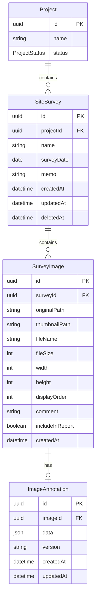

**Aggregates**:
- SiteSurvey: 現場調査の集約ルート（SurveyImage, ImageAnnotationを含む）

**Business Rules**:
- プロジェクト削除時、配下の現場調査もカスケード論理削除
- 現場調査削除時、関連画像・注釈も削除
- 画像表示順序は1から始まる連番
- **画像のコメントは最大2000文字**
- **報告書出力フラグのデフォルトはfalse**
- **画像削除時は関連する注釈データも連動削除**

### Physical Data Model

**For PostgreSQL (Prisma Schema)**:

```prisma
// Site Survey Models
model SiteSurvey {
  id          String    @id @default(uuid())
  projectId   String
  name        String    // 現場調査名（必須、最大200文字）
  surveyDate  DateTime  @db.Date // 調査日
  memo        String?   // メモ（最大2000文字）
  createdAt   DateTime  @default(now())
  updatedAt   DateTime  @updatedAt
  deletedAt   DateTime? // 論理削除

  project Project      @relation(fields: [projectId], references: [id], onDelete: Cascade)
  images  SurveyImage[]

  @@index([projectId])
  @@index([surveyDate])
  @@index([deletedAt])
  @@index([name])
  @@map("site_surveys")
}

model SurveyImage {
  id              String   @id @default(uuid())
  surveyId        String
  originalPath    String   // R2オブジェクトパス
  thumbnailPath   String   // サムネイルパス
  fileName        String   // 元ファイル名
  fileSize        Int      // ファイルサイズ（バイト）
  width           Int      // 画像幅
  height          Int      // 画像高さ
  displayOrder    Int      // 表示順序
  comment         String?  // 写真コメント（最大2000文字）【要件10対応】
  includeInReport Boolean  @default(false) // 報告書出力フラグ【要件10対応】デフォルトは報告書出力無し
  createdAt       DateTime @default(now())

  survey     SiteSurvey       @relation(fields: [surveyId], references: [id], onDelete: Cascade)
  annotation ImageAnnotation?

  @@index([surveyId])
  @@index([displayOrder])
  @@map("survey_images")
}

model ImageAnnotation {
  id        String   @id @default(uuid())
  imageId   String   @unique
  data      Json     // Fabric.js JSON形式
  version   String   @default("1.0") // スキーマバージョン
  createdAt DateTime @default(now())
  updatedAt DateTime @updatedAt

  image SurveyImage @relation(fields: [imageId], references: [id], onDelete: Cascade)

  @@map("image_annotations")
}
```

**Indexes**:
- site_surveys: projectId, surveyDate, deletedAt, name
- survey_images: surveyId, displayOrder
- image_annotations: imageId (unique)

### Data Contracts & Integration

**Annotation JSON Schema**:

```typescript
interface AnnotationDataV1 {
  version: "1.0";
  objects: FabricSerializedObject[];
  background?: string;
  viewportTransform?: number[];
  /** 背景画像の回転角度（要件22.4, 22.5対応） */
  imageRotation?: 0 | 90 | 180 | 270;
}

interface FabricSerializedObject {
  type: string;
  version: string;
  originX: string;
  originY: string;
  left: number;
  top: number;
  width: number;
  height: number;
  scaleX: number;
  scaleY: number;
  angle: number;
  // ... Fabric.js標準プロパティ
  customData?: {
    dimensionValue?: string;
    dimensionUnit?: string;
    comment?: string;
  };
}
```

**Cross-Service Data Management**:
- 画像ファイルはCloudflare R2に保存、メタデータはPostgreSQLに保存
- 削除時はPostgreSQLトランザクション内でメタデータを削除し、その後R2ファイルを削除
- **R2削除失敗時の処理（要件4.8対応）**:
  - 削除失敗したファイルを`orphaned/`プレフィックスに移動
  - R2 Object Lifecycle Ruleにより7日後に自動削除
  - クリーンアップジョブは不要（Lifecycle Ruleで対応）
  - 7日間の猶予期間で誤削除からのリカバリが可能

## Error Handling

### Error Strategy

| Error Category | HTTP Status | Response Format | Recovery Action |
|----------------|-------------|-----------------|-----------------|
| Validation Error | 400 | `{ error: string, details: FieldError[] }` | フィールド修正を促す |
| Not Found | 404 | `{ error: string }` | 一覧への誘導 |
| Conflict | 409 | `{ error: string, serverData: object }` | 再読み込みを促す |
| File Too Large | 413 | `{ error: string, maxSize: number }` | 圧縮または分割を促す |
| Unsupported Media | 415 | `{ error: string, allowedTypes: string[] }` | 対応形式への変換を促す |
| Server Error | 500 | `{ error: string, requestId: string }` | Sentryにログ、リトライを促す |

### Error Categories and Responses

**User Errors (4xx)**:
- 400: 入力バリデーション失敗 → フィールド単位のエラー表示
- 404: リソース未発見 → 一覧ページへの遷移ガイド
- 409: 楽観的排他制御競合 → 再読み込み確認ダイアログ
- 413: ファイルサイズ超過 → 自動圧縮または手動圧縮のガイド
- 415: 非対応ファイル形式 → JPEG/PNG/WEBP形式への変換ガイド

**System Errors (5xx)**:
- R2接続失敗 → リトライ機構、エラーメッセージ表示
- 画像処理失敗 → Sentry報告、元画像保持でリトライ
- PDF生成失敗 → Sentry報告、個別画像エクスポートへのフォールバック

**Business Logic Errors (422)**:
- プロジェクト未存在での現場調査作成 → プロジェクト選択画面へ誘導
- 削除済みリソースへの操作 → 削除済みステータス表示

### Monitoring

- Sentryによるエラートラッキング（既存統合を活用）
- Pinoロガーによる構造化ログ出力
- ヘルスチェックエンドポイントでR2接続状態を含める

## Testing Strategy

### Unit Tests

- **SiteSurveyService**: CRUD操作、楽観的排他制御、論理削除、プロジェクト連携、**直近N件取得**
- **SurveyImageService**: 画像圧縮、サムネイル生成、ファイル形式検証、バッチアップロード、**マジックバイトのみによる形式判定（detectMimeTypeByMagicBytes: JPEG/PNG/WEBP各形式の正常判定、未サポート形式の拒否）（21.1-21.8）**、**拡張子不一致ファイルの許可（拡張子.pngで中身JPEG等）（21.2-21.5）**、**Content-Typeのマジックバイト準拠設定（21.7）**
- **ImageMetadataService**: コメント更新、報告書フラグ更新、**順序更新**、バリデーション、**一括更新（メタデータ+順序）**
- **ImageDeleteService**: 画像削除、注釈連動削除、R2連携、**孤立ファイルorphaned/移動（4.8）**
- **AnnotationService**: JSON保存・復元、バージョン管理、エクスポート、**バッチ注釈取得（findByImageIds: 正常系、注釈なし画像、不正imageId、空配列）（18.1, 18.3, 18.4, 18.8）**
- **PdfReportService**: 3組レイアウト、コメント表示、ページ分割
- **UndoManager**: コマンド実行、履歴制限、クリア処理
- **AutoSaveManager**: ローカル保存、データ復元、ネットワーク状態監視、**QuotaExceededError LRUリトライ（15.7）、プライベートブラウジング検出（15.9）、クロスブラウザエラー検出（15.10）**
- **useUnsavedChanges**: isDirty管理、beforeunload、confirmNavigation
- **AnnotationEditor（回転機能）**: **handleRotate（90度回転、キャンバスサイズ調整、注釈非追従）（22.1, 22.2, 22.3）**、**回転状態の保存・復元（imageRotationフィールド）（22.4, 22.5）**、**回転操作のUndo/Redo（22.6）**、**累積回転角度管理（22.8）**
- **SiteSurveyDetailPage**: **handleOrderChange（ローカル状態更新）**、**handleSaveMetadata（メタデータ+順序一括保存）**、**pendingOrderRefパターン**

- **AnnotationRendererService**: **バッチ注釈取得統合（renderImagesForReport: バッチAPI使用、フォールバック）（18.2, 18.5, 18.7）**
- **survey-annotations API**: **getBatchAnnotations関数（正常系、エラーハンドリング）（18.1, 18.7）**
- **siteSurveyBreadcrumb**: **各関数が更新されたラベル（プロジェクト一覧、現場調査一覧）を生成すること、buildSiteSurveyImageBreadcrumb関数の追加（2.5-2.10）**
- **AnnotatedThumbnailService**: **SVG生成、Sharp合成、R2保存、DB更新、異常系処理（20.4）**

### Integration Tests

- **画像アップロードフロー**: Multer → Sharp → R2 → PostgreSQL
- **画像メタデータ・順序更新フロー**: PATCH API → PostgreSQL（メタデータ+displayOrder一括更新） → レスポンス
- **画像削除フロー**: DELETE API → PostgreSQL → R2 → レスポンス
- **注釈保存・復元**: Frontend ↔ Backend ↔ PostgreSQL
- **PDFエクスポート**: 画像取得 → 注釈合成 → 3組レイアウト → PDF生成
- **認証・認可**: プロジェクト権限による現場調査アクセス制御
- **自動保存・復元**: localStorage保存 → ページリロード → データ復元
- **R2孤立ファイル処理**: 削除失敗時のorphaned/移動、Object Lifecycle Ruleテスト（4.8）
- **localStorage QuotaExceededError処理**: LRUリトライ、警告表示、プライベートブラウジング検出（15.7-15.10）
- **直近N件取得**: プロジェクト詳細画面での現場調査セクション表示
- **バッチ注釈取得フロー**: POST /api/site-surveys/annotations/batch → PostgreSQL WHERE IN → レスポンス（18.1, 18.3, 18.4, 18.6）

### E2E Tests

- 現場調査作成・編集・削除フロー
- **プロジェクト詳細画面の現場調査セクション表示**
- 画像アップロード・削除
- **画像順序変更（ドラッグ&ドロップ、上へ/下へボタン）がローカル状態のみ更新されること（4.11-4.13、10.5-10.7）**
- **写真コメント入力・報告書フラグ切り替え・順序変更後の一括保存（10.9）**
- **画像削除（確認ダイアログ）**
- **ページ離脱時の未保存変更確認ダイアログ**
- 注釈編集（各ツール）とUndo/Redo
- **PDF報告書エクスポート（3組レイアウト確認）**
- **個別画像エクスポート（形式・品質・注釈オプション）**
- レスポンシブUIの動作確認
- **localStorage容量不足時のユーザー警告表示（15.8）**
- **プライベートブラウジングモードでの自動保存無効化警告（15.9）**
- **PDF報告書出力時のバッチ注釈取得（DevToolsでリクエスト数がN→1に削減されること）（18.2, 18.5）**
- **ブレッドクラムナビゲーションが全画面で正しい階層構造を表示すること（2.5-2.10）**
- **一覧画面タイトルが「現場調査一覧」であること（2.11）**
- **画像プレビュー画面に「← 現場調査に戻る」リンクが表示されないこと（2.12）**
- **注釈保存後にプレビュー画面で注釈が表示されること（20.1）**
- **注釈保存後に詳細画面サムネイルに注釈が反映されること（20.2）**
- **注釈保存後に一覧画面の代表画像サムネイルに注釈が反映されること（20.3）**
- **拡張子と中身が不一致のファイル（.pngだがJPEG等）のアップロードが成功すること（21.1-21.5）**
- **マジックバイトがサポート対象外のファイルのアップロードが拒否されること（21.6）**
- **注釈エディタで回転ボタンクリックにより画像が90度回転すること（22.1）**
- **回転後に描画済み注釈の位置・サイズが変わらないこと（22.2）**
- **回転状態が保存・復元されること（22.4, 22.5）**
- **回転操作がUndo/Redoで取り消し・再実行できること（22.6）**

### Performance Tests

- 大量画像（50枚）のバッチアップロード
- 大量注釈オブジェクト（100件）の描画パフォーマンス
- PDF生成（20枚画像）の処理時間
- 同時接続（100ユーザー）でのAPI応答時間

## Security Considerations

### Authentication & Authorization

- 既存のJWT認証（EdDSA）を使用
- プロジェクト単位でのアクセス制御（RBACと連携）
- 新規権限の追加:
  - `site_survey:create` - 現場調査作成
  - `site_survey:read` - 現場調査閲覧
  - `site_survey:update` - 現場調査編集
  - `site_survey:delete` - 現場調査削除

### Data Protection

- 画像ファイルはR2の署名付きURL経由でアクセス
- 署名付きURLは15分で期限切れ
- **画像URLアクセス時の権限検証**（14.4対応）:
  - 署名付きURLの有効期限を検証
  - リクエストユーザーのプロジェクトアクセス権限を検証
  - 権限がない場合は403 Forbiddenを返却
- 注釈データに機密情報を含める場合の警告表示

### File Upload Security

- **ファイル形式の検証はマジックバイトのみで実施（要件21対応）**: 拡張子・ブラウザ提供MIMEタイプは判定に使用しない。マジックバイトがJPEG/PNG/WEBPのいずれかに一致する場合のみアップロードを許可する。
- ファイルサイズ制限（単一ファイル50MB、バッチ合計100MB）
- ファイル名のサニタイズ（パストラバーサル防止）
- アップロード時のウイルススキャン（将来の拡張）

## Performance & Scalability

### Target Metrics

| Metric | Target | Measurement |
|--------|--------|-------------|
| 画像一覧初期表示 | 2秒以内 | Lighthouse / Playwright |
| 注釈操作レスポンス | 60fps | Chrome DevTools |
| 画像アップロード（300KB以下） | 5秒以内 | E2Eテスト |
| PDF生成（10枚） | 10秒以内 | Backend計測 |
| 同時接続 | 100ユーザー | 負荷テスト |
| 月間可用性 | 99.9% | Railway/Cloudflare監視（計画メンテナンス除外）|

### Optimization Techniques

**画像最適化**:
- WebP形式への変換対応
- 遅延読み込み（IntersectionObserver）
- サムネイル優先表示

**Canvas最適化**:
- オブジェクトのキャッシング
- 不要な再描画の抑制
- Web Workerでの重い処理

**API最適化**:
- 注釈データの差分更新（将来）
- 画像URLのプリサイン付きキャッシュ
- **バッチ注釈取得（要件18対応）**: PDF報告書出力時の注釈データ取得をN回の個別リクエストから1回のバッチリクエストに削減

## Migration Strategy

### Phase 1: データベーススキーマ

1. Prismaスキーマに新フィールド（comment, includeInReport）を追加
2. マイグレーション作成・適用
3. 既存データのデフォルト値設定（includeInReport: false）※既存データは無い想定

### Phase 2: バックエンド実装

1. ImageMetadataServiceの実装
2. PATCH /api/site-surveys/images/:imageId エンドポイントの追加
3. PATCH /api/site-surveys/images/batch エンドポイントの追加（**displayOrderを含む一括更新対応**）
4. GET /api/projects/:projectId/site-surveys/latest エンドポイントの追加
5. 画像一覧APIのレスポンスに新フィールドを追加
6. **ImageDeleteServiceにorphaned/移動ロジックを追加（4.8）**
7. **AnnotationServiceにfindByImageIdsメソッドを追加（18.1, 18.3, 18.4）**
8. **POST /api/site-surveys/annotations/batch エンドポイントの追加（18.1, 18.6）**
9. 単体テスト・統合テストの追加

### Phase 2.5: R2インフラ設定（要件4.8対応）

1. Cloudflare R2ダッシュボードでObject Lifecycle Ruleを設定
   - prefix: `orphaned/`
   - action: Delete
   - age: 7日
2. Lifecycle Rule動作確認テスト

### Phase 3: フロントエンド実装

1. SiteSurveySectionCardコンポーネントの実装
2. PhotoManagementPanelコンポーネントの拡張（削除ボタン、手動保存、**「上へ移動」「下へ移動」ボタン**）
3. useUnsavedChangesフックとの統合
4. **SiteSurveyDetailPageの変更**:
   - 手動保存、ナビゲーション削除
   - **pendingOrderRefパターンの実装（未保存順序変更の追跡）**
   - **handleOrderChange（ローカル状態のみ更新）**
   - **handleSaveMetadata（メタデータ+順序一括保存）**
5. PdfReportServiceの3組レイアウト対応
6. ImageExportDialogコンポーネントの実装
7. ProjectDetailPageへのSiteSurveySectionCard統合
8. **AutoSaveManagerにQuotaExceededError対応を追加（15.7-15.10）**
   - LRU戦略でのリトライ実装
   - プライベートブラウジングモード検出
   - クロスブラウザエラー検出ユーティリティ
   - 警告UIコンポーネントの実装
9. **survey-annotations APIにgetBatchAnnotations関数を追加（18.1, 18.2）**
10. **AnnotationRendererServiceのrenderImagesForReportをバッチ取得方式に変更（18.2, 18.5, 18.7）**
    - getBatchAnnotationsによる一括注釈取得
    - フォールバック（個別取得）の実装
11. 単体テスト・E2Eテストの追加

### Phase 4: ブレッドクラム・タイトル・戻るリンク更新（要件2 AC5-12対応）

1. `siteSurveyBreadcrumb.ts`の全関数でラベルを更新（「プロジェクト」→「プロジェクト一覧」、「現場調査」→「現場調査一覧」）
2. `buildSiteSurveyImageBreadcrumb`関数を新設
3. `SiteSurveyImageViewerPage`のローカルブレッドクラム関数を置換
4. `SiteSurveyListPage`の画面タイトルを「現場調査一覧」に変更
5. `SiteSurveyImageViewerPage`から「← 現場調査に戻る」リンクと`handleBackClick`を削除
6. 単体テスト・E2Eテストの更新

### Phase 5: 注釈付きサムネイル表示（要件20対応）

1. Prismaスキーマに`annotatedThumbnailPath`フィールドを追加、マイグレーション適用
2. `AnnotatedThumbnailService`の実装（SVG生成、Sharp合成、R2保存）
3. `AnnotationService.save()`に注釈付きサムネイル生成フックを追加
4. 画像一覧APIレスポンスに`annotatedThumbnailUrl`、`hasAnnotations`を追加
5. 一覧APIレスポンスに`annotatedThumbnailUrl`を追加（代表画像の識別子は既存の`thumbnailImageId`を用いる）
6. フロントエンド各画面でAnnotatedImageThumbnailコンポーネントの利用を統合
7. 単体テスト・E2Eテストの追加

### Phase 6: 画像アップロード拡張子不一致許容（要件21対応）

1. `SurveyImageService`に`detectMimeTypeByMagicBytes`メソッドを追加
2. `validateFile`メソッドを変更: MIMEタイプチェック廃止、マジックバイトのみで形式判定
3. Content-Type設定をマジックバイト判定結果に基づくよう変更
4. 拡張子ベースバリデーション(`ALLOWED_EXTENSIONS`)の参照を廃止
5. 単体テスト・統合テストの追加・更新

### Phase 7: 注釈エディタ画像回転機能（要件22対応）

1. `AnnotationEditor`に回転ボタンと`handleRotate`ロジックを追加
2. 回転状態（`imageRotation`）をAnnotationEditorStateに追加
3. 注釈データ（`AnnotationDataV1`）に`imageRotation`フィールドを追加
4. 保存時に`imageRotation`を注釈データに含めて永続化
5. 復元時に`imageRotation`を読み込んで背景画像を回転表示
6. 回転操作のUndo/Redoコマンドを実装
7. ツールバーに回転ボタンUIを追加
8. 単体テスト・E2Eテストの追加

### Rollback Triggers

- マイグレーション失敗時: Prisma rollback
- R2接続失敗時: 画像アップロード機能の一時無効化
- R2 Lifecycle Rule設定失敗時: 孤立ファイル手動クリーンアップに切り替え
- 重大なバグ発見時: フィーチャーフラグによる機能無効化
- 注釈付きサムネイル生成失敗時: クライアントサイドAnnotatedImageThumbnailでフォールバック（機能全体は停止しない）

---

## Requirement 19: 画像アップロードバリデーション修正とエラー通知改善

### 概要

JPEGマジックバイト検証のホワイトリスト方式が不十分で、ICCプロファイル付きJPEG等の正規ファイルがアップロード拒否される問題の修正と、バッチアップロードエラーがユーザーに通知されない問題の修正。

### 変更1: JPEGマジックバイト検証の3バイトプレフィックス化

**対象ファイル**: `backend/src/services/survey-image.service.ts`

**現状の問題**:
```typescript
// 4バイト目のマーカーを5種類だけホワイトリスト
signatures: [
  [0xff, 0xd8, 0xff, 0xe0], // JFIF
  [0xff, 0xd8, 0xff, 0xe1], // EXIF
  [0xff, 0xd8, 0xff, 0xe8], // SPIFF
  [0xff, 0xd8, 0xff, 0xdb], // DQT
  [0xff, 0xd8, 0xff, 0xee], // Adobe
]
```

JPEG仕様（ITU-T T.81）ではSOI（FF D8）の後に必ず0xFFで始まるマーカーが続く。4バイト目は多数のバリエーション（0xE0-0xEF, 0xC0-0xCF, 0xDA, 0xDB, 0xFE等）があり、ホワイトリスト方式では網羅不可能。

**修正方針**:
- `MAGIC_BYTES.jpeg` の定義を3バイトプレフィックス `[0xff, 0xd8, 0xff]` に変更
- `validateJpegMagicBytes` メソッドの比較ロジックを3バイト比較に変更
- `minLength` を3に変更
- PNG・WEBP検証には一切手を加えない

**修正後**:
```typescript
jpeg: {
  prefix: [0xff, 0xd8, 0xff],
  minLength: 3,
},
```

```typescript
private validateJpegMagicBytes(buffer: Buffer): void {
  const { prefix, minLength } = MAGIC_BYTES.jpeg;
  if (buffer.length < minLength) {
    throw new InvalidMagicBytesError('image/jpeg');
  }
  const isValid = prefix.every((byte, index) => buffer[index] === byte);
  if (!isValid) {
    throw new InvalidMagicBytesError('image/jpeg');
  }
}
```

### 変更2: バッチアップロードエラーの伝搬

**対象ファイル**:
- `frontend/src/api/survey-images.ts` — 戻り値型変更
- `frontend/src/types/site-survey.types.ts` — BatchUploadResult型追加
- `frontend/src/pages/SiteSurveyDetailPage.tsx` — エラー表示追加

**現状の問題**:
1. `uploadSurveyImages` の戻り値が `SurveyImageInfo[]`（成功分のみ）で、内部の `errors` 配列が外部に公開されない
2. `SiteSurveyDetailPage.handleImageUpload` が戻り値をチェックしない

**修正方針**:

1. **BatchUploadResult型の新設** (`site-survey.types.ts`):
```typescript
export interface BatchUploadResult {
  results: SurveyImageInfo[];
  errors: BatchUploadError[];
}
```

2. **uploadSurveyImages戻り値変更** (`survey-images.ts`):
- 戻り値型を `Promise<SurveyImageInfo[]>` → `Promise<BatchUploadResult>` に変更
- `return results` → `return { results, errors }` に変更

3. **handleImageUploadでのエラー表示** (`SiteSurveyDetailPage.tsx`):
- `uploadSurveyImages` の戻り値から `errors` を検査
- エラーカテゴリ判定: 「サポートされていないファイル形式」「MIMEタイプと一致しません」を含む → file_type、それ以外 → server
- 部分成功時: 「{成功件数}件のアップロードに成功しました。{エラー件数}件のアップロードに失敗しました。{各ファイルのエラー詳細}」
- 全件失敗時: 「全{件数}件のアップロードに失敗しました。{各ファイルのエラー詳細}」
- 全件成功時: エラーメッセージ表示なし（既存動作維持）
- 既存の `error` ステート（`string | null`）の `setError` を使用

### テスト戦略

**バックエンド単体テスト** (`survey-image.service.test.ts`):
- 3バイトFF D8 FFに各種4バイト目（0xE0, 0xE1, 0xE2, 0xDA, 0xDB, 0xC0, 0xC4等）を組み合わせたバッファで検証成功
- FF D8 FFでないバッファでInvalidMagicBytesErrorスロー
- PNG・WEBP既存テストの通過確認

**フロントエンド単体テスト**:
- `uploadSurveyImages` がBatchUploadResult型を返すことを検証
- `handleImageUpload` がエラー時に適切なメッセージを生成・表示することを検証

---

## Requirement 2 AC 5-12: ブレッドクラムナビゲーション更新・画面タイトル変更・戻るリンク削除

### 概要

現場調査関連画面のブレッドクラムナビゲーションを「ダッシュボード > プロジェクト一覧 > プロジェクト > 現場調査一覧 > 現場調査 > 画像」の階層構造に統一し、一覧画面のタイトルを「現場調査一覧」に変更し、画像プレビュー画面から「← 現場調査に戻る」リンクを削除する。

### 変更1: ブレッドクラムユーティリティの更新

**対象ファイル**: `frontend/src/utils/siteSurveyBreadcrumb.ts`

**現状**:
```typescript
// buildSiteSurveyListBreadcrumb
{ label: 'プロジェクト', path: '/projects' },
{ label: projectName, path: `/projects/${projectId}` },
{ label: '現場調査' },

// buildSiteSurveyDetailBreadcrumb
{ label: 'プロジェクト', path: '/projects' },
{ label: projectName, path: `/projects/${projectId}` },
{ label: '現場調査', path: `/projects/${projectId}/site-surveys` },
{ label: surveyName },
```

**修正後（2.6, 2.7, 2.8, 2.9対応）**:
```typescript
// buildSiteSurveyListBreadcrumb
// 階層: ダッシュボード > プロジェクト一覧 > プロジェクト > 現場調査一覧
{ label: 'ダッシュボード', path: '/' },
{ label: 'プロジェクト一覧', path: '/projects' },
{ label: projectName, path: `/projects/${projectId}` },
{ label: '現場調査一覧' },

// buildSiteSurveyDetailBreadcrumb
// 階層: ダッシュボード > プロジェクト一覧 > プロジェクト > 現場調査一覧 > 現場調査
{ label: 'ダッシュボード', path: '/' },
{ label: 'プロジェクト一覧', path: '/projects' },
{ label: projectName, path: `/projects/${projectId}` },
{ label: '現場調査一覧', path: `/projects/${projectId}/site-surveys` },
{ label: surveyName },

// buildSiteSurveyCreateBreadcrumb
// 階層: ダッシュボード > プロジェクト一覧 > プロジェクト > 現場調査一覧 > 新規作成
{ label: 'ダッシュボード', path: '/' },
{ label: 'プロジェクト一覧', path: '/projects' },
{ label: projectName, path: `/projects/${projectId}` },
{ label: '現場調査一覧', path: `/projects/${projectId}/site-surveys` },
{ label: '新規作成' },

// buildSiteSurveyEditBreadcrumb
// 階層: ダッシュボード > プロジェクト一覧 > プロジェクト > 現場調査一覧 > 現場調査 > 編集
{ label: 'ダッシュボード', path: '/' },
{ label: 'プロジェクト一覧', path: '/projects' },
{ label: projectName, path: `/projects/${projectId}` },
{ label: '現場調査一覧', path: `/projects/${projectId}/site-surveys` },
{ label: surveyName, path: `/site-surveys/${surveyId}` },
{ label: '編集' },
```

**画像プレビュー用ブレッドクラム新設（2.8, 2.9対応）**:

`siteSurveyBreadcrumb.ts`に新たなブレッドクラム生成関数を追加する。

```typescript
/**
 * 画像プレビュー画面用のパンくずを生成
 *
 * 階層: ダッシュボード > プロジェクト一覧 > プロジェクト > 現場調査一覧 > 現場調査 > 画像
 * 閲覧モード・編集モード共通（2.8, 2.9）
 *
 * @param projectId - プロジェクトID
 * @param projectName - プロジェクト名
 * @param surveyId - 現場調査ID
 * @param surveyName - 現場調査名
 * @param imageName - 画像ファイル名
 * @returns パンくず項目の配列
 */
export function buildSiteSurveyImageBreadcrumb(
  projectId: string,
  projectName: string,
  surveyId: string,
  surveyName: string,
  imageName: string
): BreadcrumbItem[] {
  return [
    { label: 'ダッシュボード', path: '/' },
    { label: 'プロジェクト一覧', path: '/projects' },
    { label: projectName, path: `/projects/${projectId}` },
    { label: '現場調査一覧', path: `/projects/${projectId}/site-surveys` },
    { label: surveyName, path: `/site-surveys/${surveyId}` },
    { label: imageName },
  ];
}
```

**SiteSurveyImageViewerPageの変更**: ページ内のローカル`buildImageViewerBreadcrumb`関数を削除し、ユーティリティの`buildSiteSurveyImageBreadcrumb`を使用する。

### 変更2: 一覧画面タイトル変更

**対象ファイル**: `frontend/src/pages/SiteSurveyListPage.tsx`

**修正内容（2.11対応）**:
- `<h1>` タグ内のテキストを「現場調査」から「現場調査一覧」に変更

```typescript
// 変更前
<h1 style={STYLES.title}>現場調査</h1>

// 変更後
<h1 style={STYLES.title}>現場調査一覧</h1>
```

### 変更3: 「← 現場調査に戻る」リンクの削除

**対象ファイル**: `frontend/src/pages/SiteSurveyImageViewerPage.tsx`

**修正内容（2.12対応）**:
- 画像プレビュー画面（閲覧モード・編集モード共通）から「← 現場調査に戻る」リンク要素を削除
- ブレッドクラムナビゲーションが代替ナビゲーションとして機能するため、戻るリンクは不要
- `ResourceNotFound`コンポーネントの`returnLabel`も「プロジェクトに戻る」等の適切なラベルに変更（またはブレッドクラムに委ねる）

```typescript
// 削除対象: 以下のLink要素を削除
<Link to={`/site-surveys/${id}`} style={styles.backLink} onClick={handleBackClick}>
  &larr; 現場調査に戻る
</Link>
```

**`handleBackClick`関数**: 戻るリンク削除に伴い、`handleBackClick`コールバック関数も不要となるため削除する。

### テスト戦略

**フロントエンド単体テスト** (`siteSurveyBreadcrumb.test.ts`):
- 各ブレッドクラム生成関数が更新されたラベル（「プロジェクト一覧」「現場調査一覧」）を生成することを検証
- `buildSiteSurveyImageBreadcrumb`が正しい階層構造を生成することを検証
- 各階層のパスが正しい画面に対応することを検証

**フロントエンド単体テスト** (`SiteSurveyListPage.test.tsx`):
- 画面タイトルが「現場調査一覧」であることを検証

**フロントエンド単体テスト** (`SiteSurveyImageViewerPage.test.tsx`):
- 「← 現場調査に戻る」リンクが表示されないことを検証
- ブレッドクラムが正しい階層構造（...> 現場調査 > 画像）で表示されることを検証

**E2Eテスト**:
- 現場調査一覧画面のブレッドクラムに「ダッシュボード > プロジェクト一覧 > プロジェクト > 現場調査一覧」が表示されること
- 現場調査詳細画面のブレッドクラムに「ダッシュボード > プロジェクト一覧 > プロジェクト > 現場調査一覧 > 現場調査」が表示されること
- 画像プレビュー画面のブレッドクラムに「ダッシュボード > プロジェクト一覧 > プロジェクト > 現場調査一覧 > 現場調査 > 画像」が表示されること
- ブレッドクラムの各項目クリックで対応する画面に遷移すること
- 一覧画面のタイトルが「現場調査一覧」であること
- 画像プレビュー画面に「← 現場調査に戻る」リンクが表示されないこと

---

## Requirement 20: 注釈のサムネイル・プレビュー表示

### 概要

編集モードで追加・保存した注釈がプレビュー画面（閲覧モード）、現場調査詳細画面のサムネイル、現場調査一覧画面の代表画像サムネイルに反映されるようにする。

### アーキテクチャ方針

注釈付きサムネイル表示には2つのアプローチが考えられる:

1. **クライアントサイドレンダリング（既存AnnotatedImageThumbnail方式）**: 画像と注釈データを取得し、Fabric.jsでクライアントサイドでレンダリング
2. **サーバーサイドサムネイル生成（AnnotatedThumbnailService方式）**: 注釈保存時にサーバーサイドで注釈付きサムネイルを生成・保存

~~**採用方針**: 要件20.4に基づき、注釈保存時にサーバーサイドで注釈付きサムネイル画像を生成・更新するサーバーサイド方式を主軸とする。~~ **（改訂。下記の改訂後方針を参照）** これにより、一覧画面や詳細画面での表示パフォーマンスが向上し、クライアント側のFabric.jsレンダリング負荷を回避できる。クライアントサイドの`AnnotatedImageThumbnail`コンポーネントは、サーバーサイド生成サムネイルが存在しない場合のフォールバックとして活用する。

> **改訂後の採用方針（Requirement 38 の検証過程で確定）**: 表示時のリクエスト数を1枚あたり1件に抑えるという目的は、**合成済み画像を保存して配信すること**によって達成される。合成の実行主体がサーバーかクライアントかは、リクエスト数を左右しない。したがって本節は「**合成の実行主体は画像編集画面（クライアント）、正となる保存先は注釈付きサムネイルの項目**」へ改訂する。通常サムネイルはアップロード時の素の画像として不変とし、注釈は焼き込まない。
>
> **この改訂の根拠（調査で判明した実装事実）**: 上記の当初方針にあるサーバーサイド生成は、注釈保存の経路へ結線されておらず一度も実行されていない。さらに実行しても要件を満たせないことが判明した。(1) サーバー側の描画器が対応する図形の型は基本図形のみで、実際に保存される矢印・寸法線・多角形・折れ線・フリーハンド・テキスト注釈はいずれも該当せず、すべて描画されずに捨てられる。(2) 注釈座標は編集画面の表示解像度で保存されるが、サーバー側にその換算が無く位置がずれる。(3) 直角方向の回転を伴う場合、合成対象の寸法が超過して必ず失敗する（実測で確認）。(4) 注釈が0件で回転のみの変更では合成を行わず既存を削除するため、回転が反映されない。したがって当初方針のまま有効化すると「注釈が写っていないサムネイル」を量産し、要件23.1/23.2/23.3 を破る。
>
> **改訂後方針の利点**: 画像編集画面の実描画結果をそのまま保存するため、白縁取り（Requirements 24.8 / 25.9）を含む全注釈タイプと回転が定義上一致する。表示側の選択規則（Requirement 38.5）は変更不要で、初めて実効化する。
>
> **改訂後方針の弱点（明示）**: 合成解像度が編集画面の表示解像度に律速される。縮小表示用途では十分だが原寸品質ではない。将来、報告書出力や拡大表示で合成済み画像を用いる要求が生じた場合は再検討を要する。
>
### Requirements 20 / 22 / 23 の Boundary Commitments（115.x で確定）

#### This Spec Owns
- 合成済みサムネイルの更新と取り消しの受け口（`backend/src/routes/survey-images.routes.ts` の注釈付きサムネイル向けの2経路）。保存先の区画・置換の順序・失敗時の表示元の維持を所有する
- 画像編集画面の保存フローにおける、合成済みサムネイルの更新完了の待ち合わせと失敗時の提示（`frontend/src/components/site-surveys/AnnotationEditor.tsx`）
- 保存済み回転の復元時の検証と正規化（同上）
- 描画された注釈の有無を示す派生列の維持・導出・供給（`backend/src/services/annotation.service.ts`、`image-list.service.ts`、`site-survey.service.ts`、`quantity-table.service.ts`）
- 参照されなくなった実体の回収の共有手段（`backend/src/utils/orphaned-object.ts`）。既存の孤立ファイル回収と同一の扱いに揃える
- 既存データの是正手段2種（注釈が焼き込まれた通常サムネイルを素へ戻す手段、描画された注釈の有無の埋め戻し）
- サーバー側の注釈描画による生成手段とそのバックフィルが**起動できない状態であること**の維持

#### Out of Boundary
- 数量表画面そのものの要件（quantity-table-generation の所管）。本節が触れるのは注釈の目印の判定源のみで、判定の結果を表示する仕組みには関与しない
- 工事写真の要件（construction-photo の所管）。本節が触れるのは取り込み時の複製元の選択と候補の表示元のみ
- 画像の表示順序の採番と取得順序（Requirement 4.10 の所管）

#### 越境の記録（相手スペックへの申し送り）
- **数量表側**: 注釈の目印の判定源を描画された注釈の有無へ差し替えた。判定源の変更は本節の所管だが、表示の仕組みは quantity-table-generation の Requirement 49 が持つ
- **工事写真側**: 取り込み時の複製元と候補の表示元を、合成済みサムネイルを優先する規則へ揃えた。両者は対であり、一方を変更する場合は他方も同時に改める
- **数量表側（115.29〜115.46 の実行）**: 本スペックのタスク一覧から、quantity-table-generation の要件（6.2/6.4/6.5・7.3〜7.6・11・13.1〜13.3・22.5・42・45）に属するコードを直接改めた。同スペックの検証を正直化した結果、未実装の本番コードに対して失敗が顕在化し、本ブランチの送出の前提を満たせなくなったための措置である。**所有権は quantity-table-generation にあり、本スペックは実行のみを担った**。相手スペックのタスク一覧へ転記済み。以後の変更は相手スペック側で追跡すること
- **数量表側（未実行の申し送り）**: 115.30（数量項目の入力上限の検証位置の不一致。作成の経路が保存の経路と同じ上限を課しておらず、保存できない項目を作成できてしまう）は本スペックでは実装せずブロックのまま残した。相手スペックでの実装が必要

#### Revalidation Triggers
- 描画された注釈の有無の導出規則を、site-survey と quantity-table-generation のいずれかが変更した場合 → 両者の意味の一致が崩れるため再検証する
- 115.29〜115.46 が触れた数量表側のコード（補完候補・変換中の状態管理・保存経路の入力検証・編集画面の見出しと一括操作の操作面）を quantity-table-generation が変更した場合 → 本スペックのタスクが導入した防護と検証が失われうるため、両スペックで再検証する
- 合成の実行主体を画像編集画面から変更する場合 → 保存先・完了保証・失敗時の提示・回転の反映のすべてを再検証する
- 通常サムネイルを書き換える経路が新設された場合 → 「素の画像として不変」という前提が崩れるため、退避表示の二重描画と工事写真への複製を再検証する

#### 既定値の非対称（意図した設計）
描画された注釈の有無が未算出のとき、供給側は**注釈ありとして扱い**、応答から項目自体が欠落した場合に表示側は**注釈なしとして扱う**。前者は埋め戻し前の既存データで目印が消える退行を防ぐため、後者は項目の欠落という異常時に目印を誤って出さないためである。失敗の方向が異なることは意図している。

> **サーバー側描画器の位置づけ**: 現行の描画器は上記の欠陥により本番データを生成してはならない。バックフィル手段も同様に、注釈が欠落した画像を生成しないことが保証されない限り実行してはならない。
>
> **工事写真への取り込み時の見た目（承認済みの差分）**: 取り込み時の複製元は、合成済みサムネイルがあればそれを、無ければ通常サムネイルを用いる。**合成済みサムネイルを持たない注釈付き画像では、取り込み後の見た目に注釈が写らない。** 現場調査側は表示時のクライアント合成で注釈を描くため、見た目が一致しない期間が生じる。これは「取り込み後の見た目が取り込み前と一致する」という受入条件に対する既知の差分であり、**承認のうえで受容する**。
>
> 受容の理由: 合成済みサムネイルが埋まるのは画像編集画面での再保存時のみであり、既存の注釈付き画像は現状すべて未生成である。ここで取り込みを失敗させると、実質すべての既存の注釈付き画像が取り込めなくなり、利用者に再保存の手間を強いる機能後退となる。サーバー側で合成し直す道は上記の封鎖により取れない。当該画像を一度でも画像編集画面で保存すれば以降は見た目が一致する。
>
> **取り込み候補の表示も同じ規則に従う**。工事写真の画像選択（`frontend/src/components/construction-photos/SurveyImagePicker.tsx`）は候補の表示元に「合成済みサムネイルがあればそれ、無ければ素のサムネイル」を用い、取り込み側（`backend/src/services/construction-photo-image.service.ts`）の複製元の選択と一致させる。選ぶときと取り込んだ後の見た目を揃えるための対であり、**一方の規則を変更する場合は他方も同時に改める**。
>
> なお候補の表示に共有の表示部品を用いてはならない。当該部品は合成済みが未生成の注釈付き画像でクライアント側の合成を行うため、候補だけに注釈が描かれ、取り込み結果（素）との食い違いを本来解消したい箇所へ再導入する。
>
> **既存の複製分は是正しない**。取り込み済みの複製は独立した実体であり、115.1 以前に取り込まれた分には注釈が焼き込まれた通常サムネイルが複製されているため、求める見た目そのものになっている。115.5 の是正手段は現場調査の画像のみを対象とし工事写真側に及ばないため、既存の複製の見た目は保たれる。**この前提は 115.1 と 115.8 が同一の公開単位で出荷されることに依存する。** 115.1 のみが先に公開されると、その期間に取り込まれた分は注釈が欠けたまま残る。

### 変更1: SurveyImageInfoの拡張

**対象型**: `SurveyImageInfo`（frontend/backend共通）

```typescript
interface SurveyImageInfo {
  // 既存フィールド
  id: string;
  surveyId: string;
  originalUrl: string;
  thumbnailUrl: string;
  // ...

  // 新規フィールド（20.4対応）
  annotatedThumbnailUrl: string | null;  // 注釈付きサムネイルURL（署名付き）
  annotatedThumbnailPath: string | null; // 注釈付きサムネイルのR2パス
  hasAnnotations: boolean;               // 注釈データが存在するか
}
```

### 変更2: データモデル拡張

**Prismaスキーマ変更** (`survey_images`テーブル):

```prisma
model SurveyImage {
  // 既存フィールド
  id              String   @id @default(uuid())
  surveyId        String
  originalPath    String
  thumbnailPath   String
  // ...

  // 新規フィールド（20.4対応）
  annotatedThumbnailPath  String?  // 注釈付きサムネイルのR2パス
}
```

### 変更3: AnnotatedThumbnailService（バックエンド）

> **本節の内容は封鎖済み（115.6）。以下は当初設計の記録であり、現行の実体ではない。** サーバー側の注釈描画には確認済みの欠陥が4点あり（対応する図形の型が実際に保存される注釈と一致せずすべて捨てられる、座標の換算が無い、直角方向の回転で必ず失敗する、注釈0件の回転のみでは反映されない）、有効化すると注釈が写っていないサムネイルを量産する。したがって当該サービスは構築時と各メソッドの双方で明示的に失敗し、合成と永続化の実装本体は撤去されている。バックフィル手段も同様に、集計のみの指定を含めて起動できない。
>
> 現行の合成は画像編集画面が行い、その結果を注釈付きサムネイルの項目へ保存する（「改訂後の採用方針」を参照）。本節を再び有効化する場合は、上記4欠陥の解消と、実際に保存される注釈の型に対応する描画器の作り直しが前提となる。

#### AnnotatedThumbnailService

| Field | Detail |
|-------|--------|
| Intent | 注釈保存時に注釈付きサムネイル画像を生成・更新する |
| Requirements | 20.4 |

**Responsibilities & Constraints**
- 注釈データとオリジナル画像からサーバーサイドで注釈付きサムネイルを生成
- 生成したサムネイルをCloudflare R2に保存
- SurveyImage.annotatedThumbnailPathを更新
- 注釈が存在しない場合はannotatedThumbnailPathをnullに設定

**Dependencies**
- Inbound: AnnotationService — 注釈保存後のフック (P0)
- Outbound: Sharp — 画像処理（リサイズ・合成） (P0)
- Outbound: @aws-sdk/client-s3 — R2保存 (P0)
- Outbound: PrismaClient — メタデータ更新 (P0)

**Contracts**: Service [x] / API [ ] / Event [ ] / Batch [ ] / State [ ]

##### Service Interface

```typescript
interface IAnnotatedThumbnailService {
  /**
   * 注釈付きサムネイルを生成・更新する
   *
   * 注釈保存（AnnotationService.save）成功後に呼び出される。
   * オリジナル画像に注釈データをレンダリングし、サムネイルサイズにリサイズして
   * R2に保存する。
   *
   * @param imageId - 画像ID
   * @param annotationData - 注釈データ（Fabric.js JSON形式）
   * @returns 生成されたサムネイルのR2パス
   * @requirement 20.4
   */
  generateAnnotatedThumbnail(
    imageId: string,
    annotationData: AnnotationData
  ): Promise<string>;

  /**
   * 注釈付きサムネイルを削除する
   *
   * 注釈が全て削除された場合にannotatedThumbnailPathをnullに更新し、
   * R2からサムネイルファイルを削除する。
   *
   * @param imageId - 画像ID
   */
  removeAnnotatedThumbnail(imageId: string): Promise<void>;
}
```

- Preconditions: imageIdが有効な画像を参照し、annotationDataが有効なFabric.js JSONであること
- Postconditions: R2にサムネイルが保存され、SurveyImage.annotatedThumbnailPathが更新されること
- Invariants: サムネイルサイズは400x300px（既存サムネイルよりやや大きめ、注釈の視認性確保）

##### サムネイル生成フロー

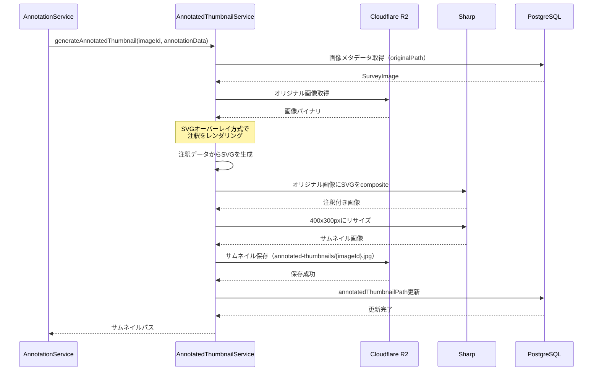

##### 注釈レンダリング方式

**サーバーサイドでの注釈レンダリング**:

Fabric.jsはブラウザ環境依存が強く、サーバーサイドでの直接利用は困難。代替として、以下のアプローチを採用する:

1. **SVGオーバーレイ方式**: Fabric.js JSONの注釈データからSVGを生成し、Sharpの`composite`機能でオリジナル画像に重ねる
2. **対応する注釈タイプ**: 基本的な図形（矢印、円、四角形、線）、寸法線のラベル、テキストコメント
3. **レンダリング精度**: ブラウザ側のFabric.jsレンダリングと完全一致する必要はない。サムネイルレベルの近似表示で十分

```typescript
/**
 * Fabric.js JSON注釈データからSVGを生成する
 *
 * サーバーサイドで注釈をレンダリングするためにFabric.js JSONからSVGに変換する。
 * 完全な互換性は求めず、サムネイル表示レベルの近似表示を実現する。
 *
 * @param annotationData - Fabric.js JSON形式の注釈データ
 * @param imageWidth - オリジナル画像の幅
 * @param imageHeight - オリジナル画像の高さ
 * @returns SVG文字列
 */
function generateSvgFromAnnotation(
  annotationData: AnnotationData,
  imageWidth: number,
  imageHeight: number
): string;
```

**Implementation Notes**:
- SVG生成はFabric.jsオブジェクトタイプに応じたテンプレートベースで実装
- テキストには日本語フォント（Noto Sans JP）のフォールバックが必要
- Sharpのcomposite機能はSVGオーバーレイをサポート（`input: Buffer.from(svgString)`）
- サムネイル生成はAnnotationService.save()の後処理として非同期実行（注釈保存のレスポンス遅延を回避）
- サムネイル生成失敗時はannotatedThumbnailPathをnullのまま維持（クライアントサイドフォールバックに依存）

### 変更4: AnnotationService.save()の拡張

> **撤去済み（115.107）。以下は当初設計の記録であり、現行の実体ではない。** `AnnotationService.save` はサムネイル生成サービスを保持せず、注釈データの確定のみを行う。要件20.4 の生成契機は画像編集画面（クライアント）の合成と `PATCH` / `DELETE /api/site-surveys/images/:imageId/annotated-thumbnail` である。詳細は「Requirement 23」節の冒頭の改訂注記を参照。

**対象ファイル**: `backend/src/services/annotation.service.ts`

注釈保存成功後にAnnotatedThumbnailServiceを呼び出す:

```typescript
async save(input: SaveAnnotationInput): Promise<AnnotationInfo> {
  // 既存の注釈保存処理
  const result = await this.saveAnnotation(input);

  // 注釈付きサムネイル生成（非同期、失敗しても注釈保存は成功）
  this.annotatedThumbnailService
    .generateAnnotatedThumbnail(input.imageId, input.data)
    .catch((error) => {
      logger.warn({
        action: 'annotated_thumbnail_generation_failed',
        imageId: input.imageId,
        error: error.message,
      });
    });

  return result;
}
```

### 変更5: 画像一覧APIレスポンスの拡張

**対象ファイル**: `backend/src/routes/survey-images.routes.ts`

画像一覧取得時に`annotatedThumbnailUrl`を署名付きURLとして含める:

```typescript
// GET /api/site-surveys/:id/images レスポンスに追加
interface SurveyImageInfo {
  // ...既存フィールド
  annotatedThumbnailUrl: string | null; // 注釈付きサムネイルの署名付きURL
  hasAnnotations: boolean;              // 注釈データが存在するか
}
```

### 変更6: フロントエンドの表示更新

#### 20.1: 画像プレビュー画面（閲覧モード）での注釈表示

**対象ファイル**: `frontend/src/pages/SiteSurveyImageViewerPage.tsx`

**設計方針**: 閲覧モードでは既存の`AnnotationEditor`コンポーネントを読み取り専用（`readOnly`プロップ）で使用する。エディタは注釈データをFabric.jsでレンダリングし、編集操作を無効化する。この方式は既に実装済みで、`isEditMode`フラグによってツールバーや操作を非表示にする。

**変更内容**: 閲覧モード時に注釈データを自動的に読み込んで表示する。現在は閲覧モードでも注釈は表示されているが、要件20.1を明示的に満たすために動作を確認・保証する。

#### 20.2: 詳細画面サムネイルでの注釈表示

**対象ファイル**: `frontend/src/components/site-surveys/PhotoManagementPanel.tsx`

**設計方針**: PhotoManagementPanelで表示するフルサイズ写真について、`annotatedThumbnailUrl`が存在する場合はそのURLを画像表示に使用する。注釈なしの場合は従来通り`mediumUrl`または`originalUrl`を使用する。

```typescript
// PhotoManagementPanel内の画像表示ロジック
function getDisplayImageUrl(image: SurveyImageInfo): string {
  // 注釈付きサムネイルが存在する場合はそれを使用
  if (image.annotatedThumbnailUrl) {
    return image.annotatedThumbnailUrl;
  }
  // フォールバック: 中解像度画像またはオリジナル
  return image.mediumUrl || image.originalUrl;
}
```

**注意**: 詳細画面はフルサイズ写真を表示するため、注釈付きサムネイル（400x300px）では解像度が不足する。代替として:
- **オプション A（推奨）**: 既存のAnnotatedImageThumbnailコンポーネントをPhotoManagementPanel内で使用し、クライアントサイドで注釈をレンダリング
- **オプション B**: サーバーサイドで中解像度の注釈付き画像（800x600px程度）も生成する

**採用**: オプションAを採用。PhotoManagementPanelの画像表示部分にAnnotatedImageThumbnailコンポーネントを統合し、Fabric.jsでクライアントサイドレンダリングを行う。

#### 20.3: 一覧画面代表画像サムネイルでの注釈表示

**対象ファイル**:
- `frontend/src/components/site-surveys/SiteSurveyListTable.tsx`
- `frontend/src/components/site-surveys/SiteSurveyListCard.tsx`
- `frontend/src/components/site-surveys/SiteSurveyResponsiveView.tsx`（グリッド表示の代表画像。115.67 で追加）
- `frontend/src/components/projects/SiteSurveySectionCard.tsx`
- `backend/src/routes/site-surveys.routes.ts`（一覧取得の応答への表示元URLの供給。115.67 で追加）

**設計方針**: 一覧画面のサムネイル表示にAnnotatedImageThumbnailコンポーネントを使用する。代表画像の`annotatedThumbnailUrl`が存在する場合はサーバーサイド生成済みサムネイルを表示し、存在しない場合はAnnotatedImageThumbnailでクライアントサイドレンダリングにフォールバックする。

**SurveyInfoの拡張**（一覧API向け）:
```typescript
interface SurveyInfo {
  // 既存フィールド
  id: string;
  thumbnailUrl: string | null;  // 代表画像の素のサムネイル
  // ...

  // 既存フィールド（代表画像のID。AnnotatedImageThumbnailフォールバック用）
  thumbnailImageId: string | null;

  // 新規フィールド（20.3対応）
  annotatedThumbnailUrl: string | null;  // 代表画像の注釈付きサムネイル
}
```

**一覧APIレスポンスの拡張**:

SiteSurveyService.findByProjectIdおよびfindLatestByProjectIdのレスポンスに、代表画像の`annotatedThumbnailUrl`を含める。代表画像はdisplayOrder=1の画像とする。**代表画像の識別子は既存の`thumbnailImageId`一本で供給する**（AnnotatedImageThumbnailへのフォールバックで表示側が読む項目もこれである）。

> **経緯（115.88）**: 本節はかつて代表画像の識別子を`representativeImageId`という別名で新設すると記していたが、表示側（`SiteSurveyListTable` / `SiteSurveyListCard` / `SiteSurveyResponsiveView` / `SiteSurveySectionCard`）が読むのは`thumbnailImageId`であり、供給側は同じ値（先頭画像のID）を二つの名前で返していた。同一の値に二つの契約名が付いた状態は、どちらが正かを読み手が判別できない点で呼称規約が禁じる乖離と同型である。115.88 で供給側の`representativeImageId`（`SiteSurveyInfo` の項目宣言と、`toSiteSurveyInfo` / `findByProjectId` / `findLatestByProjectId` の3箇所の代入、およびフロントエンドの受け皿型）を撤去し、記述を実態の`thumbnailImageId`へ改めた。撤去前に`backend` / `frontend` / `e2e` / `scripts` の全域を`grep`し、現場調査側の当該名を読む利用側が0件であることを確認している（同名の項目は工事写真のアルバムサマリーにも存在するが、別の仕様の別の応答であり本件の対象外である）。なお本撤去は上記2ファイルから各2行を削り、本書が当該2ファイルを指す `パス:行` のうち削除位置より下流の 11 件と相対参照 4 件を失効させた。「契約名の実在対照表」の照合規則に従い、撤去後に全件を測り直して是正済みである。

```typescript
// SiteSurveyService 拡張
async findByProjectId(...): Promise<PaginatedSurveys> {
  // 代表画像（displayOrder最小）のannotatedThumbnailPathを取得
  // 署名付きURLを生成してレスポンスに含める
}
```

### テスト戦略

**バックエンド単体テスト**:
- `AnnotatedThumbnailService.generateAnnotatedThumbnail`: 正常系（SVG生成、Sharp合成、R2保存、DB更新）
- `AnnotatedThumbnailService.generateAnnotatedThumbnail`: 異常系（R2保存失敗時にnullを返す）
- `AnnotatedThumbnailService.removeAnnotatedThumbnail`: 正常系（R2削除、DB更新）
- `AnnotationService.save`: 注釈保存後にサムネイル生成が呼ばれることを検証
- `generateSvgFromAnnotation`: 各注釈タイプ（矢印、円、四角形、テキスト、寸法線）のSVG変換
- SiteSurveyService一覧APIレスポンスに`annotatedThumbnailUrl`が含まれることを検証

**フロントエンド単体テスト**:
- `PhotoManagementPanel`: AnnotatedImageThumbnailコンポーネントを使用して注釈付き画像を表示すること
- `SiteSurveyListTable`: 代表画像サムネイルに注釈付きサムネイルが表示されること
- `SiteSurveyListCard`: 代表画像サムネイルに注釈付きサムネイルが表示されること
- `SiteSurveySectionCard`: 代表画像サムネイルに注釈付きサムネイルが表示されること
- `SiteSurveyImageViewerPage`: 閲覧モードで注釈がレンダリングされた状態で表示されること

**E2Eテスト**:
- 注釈を編集モードで保存後、プレビュー画面で注釈が表示されること
- 注釈保存後、詳細画面のサムネイルに注釈が反映されること
- 注釈保存後、一覧画面の代表画像サムネイルに注釈が反映されること
- 注釈が存在しない画像は素のサムネイルが表示されること

---

## Requirement 21: 画像アップロード時の拡張子不一致許容

### 概要

ファイル拡張子と実際の画像形式（マジックバイト判定結果）が一致しなくてもアップロードを許可する。マジックバイトによる画像形式判定のみでアップロード可否を決定し、拡張子チェックおよびブラウザ提供MIMEタイプに基づくバリデーションを廃止する。

### 設計方針

現在の`validateFile`メソッドは以下の二重検証を行っている:
1. `validateMimeType(file.mimetype)` — ブラウザ提供のMIMEタイプをチェック
2. `validateMagicBytes(file.buffer, file.mimetype)` — MIMEタイプに対応するマジックバイトをチェック

この方式では、ブラウザがファイル拡張子に基づいてMIMEタイプを設定するため、拡張子が`.png`だが中身がJPEGの場合、`file.mimetype`が`image/png`となり、マジックバイト検証（PNGのシグネチャを期待）で失敗する。

**修正方針**: MIMEタイプチェックを廃止し、マジックバイトのみでファイル形式を自動判定する。判定結果がサポート対象形式（JPEG/PNG/WEBP）であればアップロードを許可し、検出された実際のMIMEタイプをContent-Typeとして設定する。

### 変更1: detectMimeTypeByMagicBytesメソッドの新設

**対象ファイル**: `backend/src/services/survey-image.service.ts`

```typescript
/**
 * マジックバイトからMIMEタイプを自動検出する
 *
 * ファイルの先頭バイトを解析し、サポート対象の画像形式を判定する。
 * 拡張子やブラウザ提供のMIMEタイプに依存せず、実際のバイナリ内容のみで判定する。
 *
 * @param buffer - ファイルのバッファ
 * @returns 検出されたMIMEタイプ（サポート対象形式の場合）
 * @throws {UnsupportedImageFormatError} サポート対象形式に該当しない場合
 *
 * @requirement 21.1, 21.2, 21.3, 21.4, 21.5, 21.6, 21.8
 */
detectMimeTypeByMagicBytes(buffer: Buffer): string {
  if (buffer.length === 0) {
    throw new UnsupportedImageFormatError();
  }

  // JPEG判定: FF D8 FF（3バイトプレフィックス）
  if (buffer.length >= 3 &&
      buffer[0] === 0xff &&
      buffer[1] === 0xd8 &&
      buffer[2] === 0xff) {
    return 'image/jpeg';
  }

  // PNG判定: 89 50 4E 47 0D 0A 1A 0A（8バイト）
  if (buffer.length >= 8 &&
      buffer[0] === 0x89 &&
      buffer[1] === 0x50 &&
      buffer[2] === 0x4e &&
      buffer[3] === 0x47 &&
      buffer[4] === 0x0d &&
      buffer[5] === 0x0a &&
      buffer[6] === 0x1a &&
      buffer[7] === 0x0a) {
    return 'image/png';
  }

  // WEBP判定: RIFF + 4バイト + WEBP（12バイト）
  if (buffer.length >= 12 &&
      buffer[0] === 0x52 &&
      buffer[1] === 0x49 &&
      buffer[2] === 0x46 &&
      buffer[3] === 0x46 &&
      buffer[8] === 0x57 &&
      buffer[9] === 0x45 &&
      buffer[10] === 0x42 &&
      buffer[11] === 0x50) {
    return 'image/webp';
  }

  throw new UnsupportedImageFormatError();
}
```

### 変更2: UnsupportedImageFormatErrorの新設

**対象ファイル**: `backend/src/services/survey-image.service.ts`

```typescript
/**
 * サポート対象外の画像形式エラー
 *
 * マジックバイト判定でJPEG/PNG/WEBPのいずれにも該当しない場合にスローされる。
 *
 * @requirement 21.6
 */
export class UnsupportedImageFormatError extends Error {
  readonly code = 'UNSUPPORTED_IMAGE_FORMAT';

  constructor() {
    super(
      'サポートされていない画像形式です。JPEG、PNG、WEBP形式のファイルをアップロードしてください。'
    );
    this.name = 'UnsupportedImageFormatError';
  }
}
```

### 変更3: validateFileメソッドの変更

**対象ファイル**: `backend/src/services/survey-image.service.ts`

**現行**:
```typescript
validateFile(file: UploadFile): void {
  // Step 1: MIMEタイプの検証
  this.validateMimeType(file.mimetype);

  // Step 2: マジックバイトの検証
  this.validateMagicBytes(file.buffer, file.mimetype);
}
```

**修正後**:
```typescript
/**
 * ファイルの総合バリデーション
 *
 * マジックバイトのみでファイル形式を判定する。
 * 拡張子・ブラウザ提供MIMEタイプは判定に使用しない。
 *
 * @param file - 検証するファイル
 * @returns 検出された実際のMIMEタイプ
 * @throws {UnsupportedImageFormatError} サポート対象外の画像形式の場合
 *
 * @requirement 21.1, 21.7, 21.8
 */
validateFile(file: UploadFile): string {
  // マジックバイトのみで画像形式を判定
  const detectedMimeType = this.detectMimeTypeByMagicBytes(file.buffer);
  return detectedMimeType;
}
```

**戻り値の変更**: `void` → `string`（検出されたMIMEタイプを返却）

### 変更4: アップロード処理でのContent-Type設定

**対象ファイル**: アップロード処理を行う呼び出し元（`batch-upload.service.ts`等）

`validateFile`が返す検出済みMIMEタイプを使用して、R2へのアップロード時のContent-Typeを設定する:

```typescript
// 変更前: ブラウザ提供のMIMEタイプを使用
surveyImageService.validateFile(file);
// Content-Type は file.mimetype を使用

// 変更後: マジックバイト判定結果のMIMEタイプを使用
const detectedMimeType = surveyImageService.validateFile(file);
// Content-Type は detectedMimeType を使用（要件21.7対応）
```

### 変更5: validateMimeTypeとALLOWED_EXTENSIONSの非推奨化

**設計方針**:
- `validateMimeType`メソッド: `validateFile`からの呼び出しを削除。他の箇所で使用されていなければ削除候補。後方互換性のため残す場合は`@deprecated`アノテーションを付与。
- `ALLOWED_EXTENSIONS`: 拡張子ベースのバリデーションは行わないため、参照を廃止。サニタイズ処理での拡張子操作は維持（ファイル名保存のため）。
- `validateMagicBytes`メソッド: `detectMimeTypeByMagicBytes`に置き換え。既存テストで使用されている場合は、テストを`detectMimeTypeByMagicBytes`に移行。

### テスト戦略

**バックエンド単体テスト** (`survey-image.service.test.ts`):
- `detectMimeTypeByMagicBytes`: FF D8 FF + 各種4バイト目でJPEGとして検出
- `detectMimeTypeByMagicBytes`: PNGシグネチャで `image/png` として検出
- `detectMimeTypeByMagicBytes`: RIFFヘッダー+WEBPで `image/webp` として検出
- `detectMimeTypeByMagicBytes`: 空バッファで`UnsupportedImageFormatError`スロー
- `detectMimeTypeByMagicBytes`: 非画像バイナリ（0x00 0x00 0x00等）で`UnsupportedImageFormatError`スロー
- `validateFile`: 拡張子`.png`だが中身がJPEGのファイルで `image/jpeg` を返却
- `validateFile`: 拡張子`.jpg`だが中身がPNGのファイルで `image/png` を返却
- `validateFile`: 拡張子`.txt`だが中身がJPEGのファイルで `image/jpeg` を返却
- `validateFile`: MIMEタイプ`text/plain`だが中身がWEBPのファイルで `image/webp` を返却
- `validateFile`: 中身がサポート対象外のファイルで`UnsupportedImageFormatError`スロー

**フロントエンド単体テスト**:
- `handleImageUpload`: 拡張子不一致ファイルのアップロードが成功すること
- `handleImageUpload`: バリデーションエラー時にエラーメッセージが表示されること

---

## Requirement 22: 注釈エディタでの画像回転機能

### 概要

注釈エディタ（編集モード）で背景画像を90度単位で回転する機能を追加する。描画済みの注釈オブジェクトは回転に追従せず、現在の位置・サイズを維持する。回転状態は注釈データのメタデータとして永続化し、再表示時に復元する。

### アーキテクチャ方針

**背景画像の回転方式**:

Fabric.jsでは背景画像（`canvas.backgroundImage`）にもFabricImageのtransformプロパティ（`angle`等）を適用可能。回転時は以下の手順で処理する:

1. 背景画像の`angle`プロパティを更新（90度ずつ累積）
2. 回転により画像の幅と高さが入れ替わる場合（90度/270度）、キャンバスサイズを調整
3. 背景画像の`left`/`top`を調整して回転後の画像がキャンバス内に正しく配置されるようにする
4. 描画済み注釈オブジェクトには一切変更を加えない

**注釈非追従の理由**: 要件22.2で明示的に「描画済みの注釈オブジェクトを回転に追従させず、現在の位置・サイズを維持する」と定義されている。これはユーザーが画像の向きを補正するユースケース（撮影時の向き違い）を想定しており、注釈は補正後の正しい向きに対して追加するものと位置付けられる。

### 変更1: 回転状態の管理

**対象ファイル**: `frontend/src/components/site-surveys/AnnotationEditor.tsx`

```typescript
/** 背景画像の累積回転角度を管理するRef */
const imageRotationRef = useRef<0 | 90 | 180 | 270>(0);
```

### 変更2: handleRotateハンドラの実装

**対象ファイル**: `frontend/src/components/site-surveys/AnnotationEditor.tsx`

```typescript
/**
 * 背景画像を90度時計回りに回転する
 *
 * - 背景画像のangleを90度加算（累積回転）
 * - 90度/270度の場合はキャンバスの幅と高さを入れ替え
 * - 描画済み注釈オブジェクトの位置・サイズは維持（追従しない）
 * - Undo/Redo履歴に回転操作を記録
 *
 * @requirement 22.1, 22.2, 22.3, 22.6, 22.8
 */
const handleRotate = useCallback(() => {
  const canvas = fabricCanvasRef.current;
  const bgImage = backgroundImageRef.current;
  if (!canvas || !bgImage) return;

  // 1. 回転前の状態を保存（Undo用）
  const prevRotation = imageRotationRef.current;
  const prevWidth = canvas.getWidth();
  const prevHeight = canvas.getHeight();

  // 2. 新しい回転角度を計算（0 → 90 → 180 → 270 → 0）
  const newRotation = ((prevRotation + 90) % 360) as 0 | 90 | 180 | 270;
  imageRotationRef.current = newRotation;

  // 3. 背景画像の回転を適用
  applyImageRotation(canvas, bgImage, newRotation);

  // 4. Undo/Redo履歴に記録
  undoManager.execute({
    type: 'rotate',
    execute: () => {
      imageRotationRef.current = newRotation;
      applyImageRotation(canvas, bgImage, newRotation);
    },
    undo: () => {
      imageRotationRef.current = prevRotation;
      applyImageRotation(canvas, bgImage, prevRotation);
    },
  });

  // 5. 未保存フラグを立てる
  markAsChanged();

  // 6. 状態を更新
  setState((prev) => ({ ...prev, imageRotation: newRotation }));
}, [undoManager, markAsChanged]);

/**
 * 背景画像に回転を適用し、キャンバスサイズを調整する
 *
 * @param canvas - Fabric.jsキャンバス
 * @param bgImage - 背景画像
 * @param rotation - 適用する回転角度
 *
 * @requirement 22.3
 */
function applyImageRotation(
  canvas: FabricCanvas,
  bgImage: FabricImage,
  rotation: 0 | 90 | 180 | 270
): void {
  // 元画像の自然サイズ（スケール前）
  const naturalWidth = bgImage.width ?? 0;
  const naturalHeight = bgImage.height ?? 0;
  const scale = bgImage.scaleX ?? 1;

  // 90度/270度の場合は幅と高さが入れ替わる
  const isSwapped = rotation === 90 || rotation === 270;
  const canvasWidth = isSwapped
    ? naturalHeight * scale
    : naturalWidth * scale;
  const canvasHeight = isSwapped
    ? naturalWidth * scale
    : naturalHeight * scale;

  // キャンバスサイズを調整
  canvas.setDimensions({ width: canvasWidth, height: canvasHeight });

  // 背景画像の回転を設定
  bgImage.set({
    angle: rotation,
    originX: 'center',
    originY: 'center',
    left: canvasWidth / 2,
    top: canvasHeight / 2,
  });

  canvas.renderAll();
}
```

### 変更3: 回転状態の保存

**対象ファイル**: `frontend/src/components/site-surveys/AnnotationEditor.tsx`（handleSave内）

```typescript
// 注釈データを構築（回転状態を含める - 要件22.4対応）
const annotationData = {
  version: '1.0',
  objects: objects.map((obj) => obj.toObject()),
  canvasWidth: canvas.getWidth(),
  canvasHeight: canvas.getHeight(),
  imageRotation: imageRotationRef.current, // 回転角度を含める
};
```

### 変更4: 回転状態の復元

**対象ファイル**: `frontend/src/components/site-surveys/AnnotationEditor.tsx`（注釈データ復元処理内）

```typescript
// 注釈データ復元時に回転状態も復元（要件22.5対応）
if (annotationData && annotationData.data) {
  // 回転状態の復元
  const savedRotation = (annotationData.data.imageRotation ?? 0) as 0 | 90 | 180 | 270;
  if (savedRotation !== 0 && backgroundImageRef.current) {
    imageRotationRef.current = savedRotation;
    applyImageRotation(canvas, backgroundImageRef.current, savedRotation);
    setState((prev) => ({ ...prev, imageRotation: savedRotation }));
  }

  // 注釈オブジェクトの復元（既存処理）
  if (annotationData.data.objects && annotationData.data.objects.length > 0) {
    const enlivenedObjects = await util.enlivenObjects(annotationData.data.objects);
    // ... 既存の復元処理
  }
}
```

### 変更5: ツールバーに回転ボタンを追加

**対象ファイル**: `frontend/src/components/site-surveys/AnnotationEditor.tsx`（ツールバー部分）

```typescript
// ツールバーに回転ボタンを追加（要件22.7対応）
// 既存のツールボタン群（select, dimension, arrow, circle, ...）の後ろに配置
<button
  type="button"
  onClick={handleRotate}
  style={toolbarButtonStyle}
  title="画像を90度回転"
  disabled={state.isSaving}
>
  回転
</button>
```

**UI配置**: 回転ボタンは注釈ツール群とは別のグループ（画像操作グループ）としてツールバーに配置する。Undo/Redoボタンの近くに配置し、画像操作と注釈操作を視覚的に分離する。

```
┌─────────────────────────────────────────────────────────────────────────┐
│ [選択][寸法線][矢印][円][四角][多角形][折れ線][フリーハンド][テキスト]    │
│ ──── 区切り ────                                                         │
│ [回転] │ [Undo][Redo] │ [保存]                                           │
└─────────────────────────────────────────────────────────────────────────┘
```

### 変更6: 閲覧モードでの回転表示

**対象ファイル**: `frontend/src/pages/SiteSurveyImageViewerPage.tsx`

閲覧モード（読み取り専用AnnotationEditor）でも、保存された`imageRotation`を読み込んで背景画像を回転表示する。変更4の復元処理がAnnotationEditor内で実行されるため、追加の変更は不要（AnnotationEditorが閲覧モードでも回転状態を復元する）。

### 変更7: サムネイル・PDF出力への回転反映

**サムネイル生成（AnnotatedThumbnailService）**:
- 注釈データに含まれる`imageRotation`フィールドを読み取り、オリジナル画像をSharpで回転してからSVGオーバーレイを合成する
- `sharp.rotate(rotation)`でサーバーサイドの回転を適用

**PDF報告書出力（AnnotationRendererService）**:
- `renderImagesForReport`で各画像の注釈データから`imageRotation`を読み取り、Fabric.jsキャンバスの背景画像に回転を適用してからレンダリング

```typescript
// AnnotatedThumbnailService: サーバーサイドでの回転適用
const rotation = annotationData.imageRotation ?? 0;
let pipeline = sharp(imageBuffer);
if (rotation !== 0) {
  pipeline = pipeline.rotate(rotation);
}
// ... SVGオーバーレイ合成処理
```

### テスト戦略

**フロントエンド単体テスト** (`AnnotationEditor.test.tsx`):
- `handleRotate`: 0度 → 90度 → 180度 → 270度 → 0度の循環的な回転
- `handleRotate`: 回転後にキャンバスサイズが正しく調整されること（90度で幅と高さが入れ替わる）
- `handleRotate`: 回転後に描画済み注釈オブジェクトの位置・サイズが変わらないこと
- `handleRotate`: 回転操作がUndoManagerに記録されること
- `handleRotate`: Undo実行で前の回転角度に戻ること
- `handleSave`: 保存データに`imageRotation`フィールドが含まれること
- 注釈データ復元: `imageRotation`が復元されて背景画像が回転表示されること
- 注釈データ復元: `imageRotation`が未定義の場合は0度（回転なし）で表示されること

**バックエンド単体テスト**:
- `AnnotatedThumbnailService`: `imageRotation`が90度の場合にSharp.rotateが呼ばれること
- `AnnotatedThumbnailService`: `imageRotation`が0度（または未定義）の場合にSharp.rotateが呼ばれないこと

**E2Eテスト**:
- 注釈エディタで回転ボタンクリックにより画像が90度回転すること
- 回転後に既存の注釈が同じ位置に表示されること
- 回転 → 保存 → 再表示で回転状態が復元されること
- 回転 → Undo → 元の回転角度に戻ること
- 4回回転で元に戻ること（360度 = 0度）

---

## Requirement 23: 画像編集画面での変更に伴うサムネイル再生成の確実化

> **改訂（タスク 115.107）: サーバー側での同期再生成は撤去した。以下の「概要」「現状の問題分析（根本原因）」「Boundary Commitments」の一部・変更1 / 変更2 / 変更4 / 変更5・「サムネイル同期再生成フロー」は、いずれも本節を書いた時点の記録であって現存の主張ではない。**
>
> **撤去した対象**（いずれも本番から到達不能だった）:
> - `AnnotationServiceDependencies.annotatedThumbnailService`（任意依存）と、その型 `IAnnotatedThumbnailService`
> - `AnnotationService.save` の中でサムネイル再生成を同期実行していた分岐
> - `AnnotationInfo.annotatedThumbnailPath`（当該分岐でのみ設定されていた項目）
> - `ThumbnailRegenerationError` / `THUMBNAIL_REGENERATION_FAILED`（`backend/src/services/errors.ts` ごと）
> - `annotation.routes.ts` の 500 応答（`THUMBNAIL_REGENERATION_FAILED`）と、保存応答へ `annotatedThumbnailUrl` を付ける処理
> - `AnnotationInfo.annotatedThumbnailUrl`（フロントエンドの型）と `AnnotationEditor` の当該 500 応答を前提とした扱い
>
> **撤去した理由**: 任意依存は本番の結線（`annotation.routes.ts` の `new AnnotationService({ prisma })`）で一度も注入されておらず、分岐も失敗応答もフロントエンド側の扱いも到達しなかった。加えて唯一の実装 `AnnotatedThumbnailService` はタスク 115.6 で構築時に失敗する形へ封鎖されており、注入すれば注釈保存が必ず 500 になる。すなわち「渡して到達可能にする」道は、封鎖の根拠である4つの欠陥（`SERVER_SIDE_ANNOTATED_THUMBNAIL_DISABLED_REASON`）を解消しない限り選べない。要件23 の各受入基準は、下記の**クライアント合成の経路**で既に満たされている。
>
> **現行の実体（要件23 を満たす経路）**:
> - 合成は画像編集画面（`AnnotationEditor`）がキャンバスから行う。注釈または回転がある場合は `PATCH /api/site-surveys/images/:imageId/annotated-thumbnail`（`updateAnnotatedThumbnail`）へ、いずれも無い場合は `DELETE` 同パス（`deleteAnnotatedThumbnail`）へ送る
> - **23.4**: 上記の更新（または取り消し）が成功するまで保存完了（`saveSuccess`）としない。注釈保存の応答だけでは保存完了としない
> - **23.6**: 更新が失敗した場合はエラー Toast を出し、`onAnnotationSaved` へ `annotatedThumbnailUrl: null` を渡し、`onRequestRefresh` で画像一覧を再取得して旧状態の残留を防ぐ
> - **23.8**: 冪等性は `PATCH` 経路（タイムスタンプ付き新キーへ保存 → DB 切替 → 旧キーの best-effort 削除）と、既に空でも成功する `DELETE` 経路が担う。いずれも `backend/src/routes/survey-images.routes.ts`
> - 再導入を機械的に検知する仕掛け: `backend/src/__tests__/unit/routes/annotation.routes.server-thumbnail-wiring.test.ts`

### 概要

画像編集画面（注釈エディタ / 編集モード）で行った変更（注釈の追加・編集・削除、および画像回転）を保存した際に、`annotatedThumbnailPath` が変更後の最終状態で **確実に** 再生成されるようにする。**［以下1文は本節を書いた時点の状態の記録であって現存の主張ではない］** 現状、注釈保存レスポンスとサムネイル再生成は非同期の fire-and-forget パターンで分離されており、以下の不具合が発生している。**［現行: 合成の実行主体は画像編集画面（クライアント）であり、`AnnotationService.save` はサムネイル再生成に一切関与しない。上記の改訂注記を参照］**

### 現状の問題分析（根本原因）

> **本小節は本節を書いた時点の記録であって現存の主張ではない（115.107）。** 以下に「現行実装（抜粋）」として示すコードは `backend/src/services/annotation.service.ts` に**もう存在しない**。当該の fire-and-forget は先にタスク 60.3 で同期化され、その同期化された分岐ごとタスク 115.107 で撤去された。列挙する4つの不具合は、いずれもサーバー側再生成を前提とした当時の分析である。

**対象ファイル**: `backend/src/services/annotation.service.ts`

本節を書いた時点の実装（抜粋。**現存しない**）:
```typescript
// 注釈付きサムネイル生成（非同期、失敗しても注釈保存は成功）
if (this.annotatedThumbnailService) {
  this.annotatedThumbnailService
    .generateAnnotatedThumbnail(input.imageId, dataWithVersion)
    .catch(() => {
      // サムネイル生成失敗はログのみ
    });
}
return result; // ← サムネイル生成完了を待たずにレスポンス返却
```

この fire-and-forget パターンにより以下の問題が生じている:

1. **レース条件**: 注釈保存レスポンス受信直後にクライアントが画像一覧を再取得しても、バックエンドのサムネイル再生成がまだ完了しておらず、旧 `annotatedThumbnailPath`（もしくは null）が返却される
2. **失敗の隠蔽**: サムネイル生成失敗時にクライアントへ通知されず、旧サムネイルが残存したまま保存成功として扱われる（AC6 違反）
3. **回転単独保存の未対応**: Req 22 で追加された `imageRotation` フィールドのみを変更した場合でも、注釈データ全体の一部として `annotationData` が更新されるため同フローを通るが、fire-and-forget の問題は同様に発生する
4. **エラー時の旧状態残留**: 再生成失敗時に既存の `annotatedThumbnailPath` が旧状態のまま残り、詳細画面・一覧画面に古いサムネイルが表示され続ける

### Boundary Commitments

**This spec owns**（**先頭3項目はタスク 115.107 で担い手が変わった。括弧内が現行**）:
- ~~`AnnotationService.save` 実行パスにおけるサムネイル再生成のタイミング同期化~~ → 画像編集画面（`AnnotationEditor`）が合成済みサムネイルの更新完了まで保存完了としないこと（23.4）
- ~~`AnnotatedThumbnailService.generateAnnotatedThumbnail` の冪等性・エラーハンドリング~~ → `PATCH` / `DELETE /api/site-surveys/images/:imageId/annotated-thumbnail`（`backend/src/routes/survey-images.routes.ts`）の冪等性・エラーハンドリング（23.8）
- ~~再生成失敗時のクライアントへのエラー伝播経路~~ → 合成済みサムネイル更新の失敗を画像編集画面が自ら扱う経路（Toast・再取得要求。23.6）
- フロントエンド側で保存完了後に最新サムネイル URL を取得する導線

**This spec does NOT own**:
- サムネイル生成ロジック自体の描画精度（Req 20 の責務）
- R2 ストレージの SLA やネットワーク信頼性
- サムネイル生成アルゴリズム（SVG 合成 + Sharp、Req 20 既存設計を流用）

### 変更1: AnnotationService.save の同期化

> **撤去済み（115.107）。以下は当初設計の記録であり、現行の実体ではない。** `AnnotationService.save` は注釈データの確定のみを行い、サムネイル再生成には一切関与しない。

**対象ファイル**: `backend/src/services/annotation.service.ts`

fire-and-forget を廃し、サムネイル再生成を `await` して注釈保存のトランザクション的な後処理として扱う。失敗時は `AnnotationService.save` がエラーを投げ、ルーティング層でクライアントへ 5xx エラーを返却する。

```typescript
async save(input: SaveAnnotationInput): Promise<AnnotationInfo> {
  // 既存の注釈保存処理（DB 更新）
  const result = await this.saveAnnotation(input);

  // 注釈付きサムネイル生成（同期・待機）
  if (this.annotatedThumbnailService) {
    try {
      const thumbnailPath = await this.annotatedThumbnailService
        .generateAnnotatedThumbnail(input.imageId, dataWithVersion);
      // 再生成完了後の最新 annotatedThumbnailPath を返却データに反映
      result.annotatedThumbnailPath = thumbnailPath;
    } catch (error) {
      // ログ出力後、ThumbnailRegenerationError を throw してクライアントへ伝播
      logger.error({
        action: 'annotated_thumbnail_regeneration_failed',
        imageId: input.imageId,
        error: (error as Error).message,
      });
      throw new ThumbnailRegenerationError(
        '注釈の保存には成功しましたが、サムネイルの再生成に失敗しました。画面を再読み込みしてください。',
        { cause: error }
      );
    }
  }

  return result;
}
```

**設計上の決定**:
- **同期化の採用理由（AC4）**: 保存完了＝サムネイル再生成完了、という不変条件をクライアントが前提にできるようにする。レスポンス時間が数百ms伸びても、現場調査のユースケース（注釈編集後の画面遷移頻度は低め）では許容範囲
- **注釈保存は成功扱い**: DB への注釈データ保存自体は既にコミット済みのため、サムネイル再生成失敗時にロールバックは行わない。代わりに `ThumbnailRegenerationError` で「注釈は保存されたがサムネイル再生成に失敗した」旨を明示する
- **エラーコード**: HTTP 500 ではなく HTTP 207 (Multi-Status) 相当で扱うことも検討したが、運用シンプルさを優先し HTTP 500 + 明示的エラーメッセージで統一

### 変更2: ThumbnailRegenerationError クラス追加

> **撤去済み（115.107）。以下は当初設計の記録であり、現行の実体ではない。** `backend/src/services/errors.ts` は当該クラスのみを持つファイルだったため、ファイルごと撤去した。**このパスはもう実在しない。**

**対象ファイル**: `backend/src/services/errors.ts`（新規または既存エラー定義ファイル。**現在は実在しない**）

```typescript
/**
 * 注釈保存は成功したがサムネイル再生成に失敗した場合のエラー。
 * クライアントは注釈データの再保存は不要だが、サムネイル表示が旧状態のままであることをユーザーに通知する必要がある。
 */
export class ThumbnailRegenerationError extends Error {
  readonly code = 'THUMBNAIL_REGENERATION_FAILED';
  constructor(message: string, options?: { cause?: unknown }) {
    super(message, options);
    this.name = 'ThumbnailRegenerationError';
  }
}
```

### 変更3: AnnotatedThumbnailService の冪等性保証

> **封鎖済み（115.6）。以下は当初設計の記録であり、現行の実体ではない。** サーバー側描画は封鎖され、合成と永続化の実装本体は撤去されている。ここに記したアトミック置き換えの方針（タイムスタンプ付き新キー → DB 切替 → 旧キーの best-effort 削除）は、**クライアント合成の受け口である `PATCH /api/site-surveys/images/:imageId/annotated-thumbnail`（`backend/src/routes/survey-images.routes.ts`）が引き継いでいる**。要件23.8 はそちらで満たされる。

**対象ファイル**: `backend/src/services/annotated-thumbnail.service.ts`

`generateAnnotatedThumbnail` を冪等化する。既存のサムネイルが存在する場合でも、新しいサムネイルを生成してから既存を置き換えるアトミックな流れにする（AC8）。

**アトミック置き換えの方針**:
1. 新サムネイルを別キー（例: `annotated-thumbnails/{imageId}.{timestamp}.jpg`）で R2 に PUT
2. DB の `annotatedThumbnailPath` を新キーに更新
3. 旧キーを R2 から DELETE（失敗しても DB 更新は成功扱い・孤立ファイル処理に委譲）

この方針により、R2 PUT 失敗時は旧サムネイルが残り、DB 更新失敗時も旧 path を参照し続けるため、「旧状態のまま残る」ケースを排除しつつ「破損したサムネイル」が表示されない不変条件を保証する（AC6・AC8）。

```typescript
async generateAnnotatedThumbnail(
  imageId: string,
  annotationData: AnnotationData
): Promise<string | null> {
  const image = await this.prisma.surveyImage.findUnique({ where: { id: imageId } });
  if (!image) return null;

  // 1. 原画像取得
  const imageBuffer = await this.r2.getObject(image.originalPath);

  // 2. 回転適用 → SVG オーバーレイ合成
  const rotation = annotationData.imageRotation ?? 0;
  const thumbnailBuffer = await this.composeAnnotatedThumbnail(
    imageBuffer,
    annotationData,
    rotation
  );

  // 3. タイムスタンプ付き新キーで R2 に PUT（アトミック置き換え）
  const newPath = `annotated-thumbnails/${imageId}.${Date.now()}.jpg`;
  await this.r2.putObject(newPath, thumbnailBuffer, 'image/jpeg');

  // 4. DB 更新（旧 path 退避）
  const oldPath = image.annotatedThumbnailPath;
  await this.prisma.surveyImage.update({
    where: { id: imageId },
    data: { annotatedThumbnailPath: newPath },
  });

  // 5. 旧キーの削除（失敗時は孤立ファイル処理に委譲、本処理の成否には影響させない）
  if (oldPath) {
    this.r2.deleteObject(oldPath).catch((err) => {
      logger.warn({
        action: 'stale_annotated_thumbnail_delete_failed',
        imageId,
        oldPath,
        error: err.message,
      });
    });
  }

  return newPath;
}
```

### 変更4: SaveAnnotation レスポンスに annotatedThumbnailUrl を含める

> **撤去済み（115.107）。以下は当初設計の記録であり、現行の実体ではない。** 注釈保存の応答は `AnnotationInfo` をそのまま返し、`annotatedThumbnailUrl` を持たない。表示元URLを返すのは合成済みサムネイルの更新経路（`PATCH` / `DELETE /api/site-surveys/images/:imageId/annotated-thumbnail`）だけである。

**対象ファイル**: `backend/src/routes/annotation.routes.ts`

注釈保存レスポンスに最新の `annotatedThumbnailPath` から生成した署名付き URL を含める。フロントエンドはこの URL を受け取ることで、追加の API 呼び出しなしに最新サムネイルを表示できる（AC5）。

```typescript
// 応答は平坦である。AnnotationInfo の各項目を展開し、同じ階層へ annotatedThumbnailUrl を
// 加えて返す（`annotation` という入れ子のフィールドは持たない）。
type SaveAnnotationResponse = AnnotationInfo & {
  annotatedThumbnailUrl: string | null; // 再生成後の最新署名付き URL
};
```

### 変更5: フロントエンドのサムネイル反映

> **撤去済み（115.107）。以下は当初設計の記録であり、現行の実体ではない。** 保存ハンドラは `frontend/src/components/site-surveys/AnnotationEditor.tsx` にあり、`isThumbnailRegenerationError` 相当の判定も `THUMBNAIL_REGENERATION_FAILED` の受信処理も持たない。合成済みサムネイル更新の失敗（クライアント合成の経路）に対して Toast 表示と再取得要求を行う。

**対象ファイル**: `frontend/src/pages/SiteSurveyImageViewerPage.tsx`（または該当する保存ハンドラ）

```typescript
async function handleSave() {
  try {
    const response = await saveAnnotation(payload);
    // 再生成後の annotatedThumbnailUrl を画像一覧キャッシュに反映
    queryClient.setQueryData(['surveyImages', surveyId], (prev) =>
      prev?.map((img) =>
        img.id === imageId
          ? { ...img, annotatedThumbnailUrl: response.annotatedThumbnailUrl }
          : img
      )
    );
    // もしくは queryClient.invalidateQueries で再取得
    toast.success('保存しました');
  } catch (error) {
    if (isThumbnailRegenerationError(error)) {
      toast.error(error.message);
      // 画像一覧を再取得して最新状態に同期
      queryClient.invalidateQueries({ queryKey: ['surveyImages', surveyId] });
    } else {
      toast.error('保存に失敗しました');
    }
  }
}
```

**AC5/AC7 対応**: 現場調査詳細画面・一覧画面のサムネイル表示は TanStack Query のキャッシュ無効化で最新状態に同期する。再オープン時は API 経由で最新 `annotatedThumbnailPath` を取得するため、保存時点で DB が更新されていれば自動的に一致が保証される。

### サムネイル同期再生成フロー

> **撤去済み（115.107）。以下は当初設計の記録であり、現行の実体ではない。** 現行では `AnnotationService` から `AnnotatedThumbnailService` への呼び出しは存在せず、注釈保存の応答も `annotatedThumbnailUrl` を含まない。合成済みサムネイルの更新は、注釈保存とは別の要求（`PATCH` / `DELETE /api/site-surveys/images/:imageId/annotated-thumbnail`）としてクライアントから送られる。

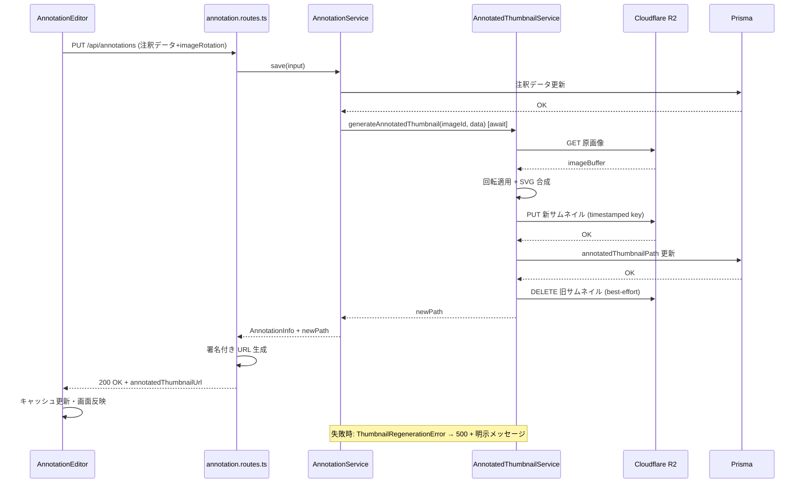

### テスト戦略

> **改訂（115.107）**: サーバー側での同期再生成を撤去したため、下記のうち当初計画していた
> `annotation.service.test.ts` の再生成関連5件と `annotated-thumbnail.service.test.ts` の冪等性4件、
> およびフロントエンドの `ThumbnailRegenerationError` 受信1件は成立しない。現行の検証対象を示す。

**バックエンド単体テスト** (`annotation.routes.server-thumbnail-wiring.test.ts`):
- 本番の結線が `AnnotationService` へ渡す依存が永続化のみであること（サーバー側再生成の再導入の検知）
- `annotation.service.ts` がサムネイル生成の依存も分岐も持たないこと
- `annotation.routes.ts` がサムネイル再生成の失敗応答（`THUMBNAIL_REGENERATION_FAILED`）を持たないこと

**バックエンド単体テスト** (`annotation.routes.test.ts`):
- 注釈保存の応答が `annotatedThumbnailUrl` を含まず、署名付きURLの生成も行わないこと

**バックエンド単体テスト** (`survey-images.annotated-thumbnail.routes.test.ts`):
- `PATCH`: 旧い合成済みサムネイルのキーは新キー保存と DB 更新の完了後に削除すること (23.1)
- `PATCH`: 新キーの保存に失敗した場合は DB を更新せず旧い表示元を残すこと (23.1)
- `PATCH`: 同一内容の保存を繰り返しても表示元は常に有効な実体を指すこと（冪等性） (23.8)
- `DELETE`: 既に合成済みサムネイルが無い場合も成功し何も変更しないこと（冪等性） (23.8)
- 更新と取り消しを往復しても表示元が有効なまま保たれること (23.8)

**フロントエンド単体テスト** (`AnnotationEditor.test.tsx`):
- 合成済みサムネイル更新の応答が返す表示元で `onAnnotationSaved` を呼ぶこと (23.5)
- 合成済みサムネイル更新が失敗した場合に保存完了とみなさないこと (23.4)
- 同失敗時にエラー Toast を表示し、`onRequestRefresh` で画像一覧の再取得を要求すること (23.6)
- 注釈も回転も無い保存では合成済みサムネイルを残さないこと (23.8)

**E2E テスト**:
- 注釈追加 → 保存 → 詳細画面で新サムネイルが表示されること (23.1, 23.5)
- 画像回転のみ → 保存 → 詳細画面で回転後サムネイルが表示されること (23.2, 23.5)
- 回転 + 注釈追加 → 保存 → 詳細画面で両方を反映したサムネイルが表示されること (23.3, 23.5)
- 保存 → 画面再読み込み → 表示サムネイルが保存直後のものと一致すること (23.7)
- 注釈編集画面を閉じて再オープン → 表示サムネイルが最新状態であること (23.7)

### File Structure Plan

以下の表の「ファイル」列は**リポジトリルートからの相対パス**（呼称規約1）である。「種別」列（`新規` / `変更`。`変更 または 新規` は `変更` と `新規` のいずれかになる旨の注記）は**本節を書いた時点の計画であり、現況ではない**。実装が進んだ後も区分値は書き換えない（`新規` の行も現在は実在する）。現況の権威は区分値ではなく**パスの実在**であり、**パスそのものは実装の実配置と一致していなければならない**。

| ファイル | 種別 | 責務 |
|---------|------|------|
| `backend/src/services/annotation.service.ts` | 変更 | 注釈データの確定のみ（115.107 でサムネイル再生成の分岐を撤去） |
| `backend/src/services/annotated-thumbnail.service.ts` | 変更 | サーバー側描画は封鎖済み（115.6）。冪等化の方針は `survey-images.routes.ts` が引き継ぐ |
| `backend/src/routes/survey-images.routes.ts` | 変更 | `PATCH` / `DELETE /:imageId/annotated-thumbnail`（クライアント合成の受け口。冪等な置き換えと取り消し） |
| `backend/src/routes/annotation.routes.ts` | 変更 | 注釈保存の応答は `AnnotationInfo` のみ（115.107 で `annotatedThumbnailUrl` と 500 応答を撤去） |
| `frontend/src/components/site-surveys/AnnotationEditor.tsx` | 変更 | 保存後の合成・更新（または取り消し）、失敗時の Toast と再取得要求 |
| `backend/src/__tests__/unit/routes/annotation.routes.server-thumbnail-wiring.test.ts` | 新規 | サーバー側再生成が再導入されないことの機械的な検知 |
| `backend/src/__tests__/unit/routes/survey-images.annotated-thumbnail.routes.test.ts` | 新規 | 冪等な置き換え・取り消しのテストケース |
| `e2e/specs/site-survey-thumbnail-regeneration.spec.ts` | 新規 | Req 23 の E2E シナリオ |

> **タスク 115.107 による撤去**: 当初計画にあった `backend/src/services/errors.ts`（`ThumbnailRegenerationError` のみを持つファイル）は**撤去し、パスも実在しない**。当初計画が保存ハンドラの所在としていた `frontend/src/pages/SiteSurveyImageViewerPage.tsx`（実在する）は、注釈の保存処理そのものは持たず `onAnnotationSaved` の受け手にとどまるため、上表の行を実際の保存ハンドラである `AnnotationEditor.tsx` へ改めた。

---

## Requirements 24-30: 画像注釈の視認性向上・モバイル操作性強化

### Overview

**Purpose**: 画像注釈の視認性（矢印・テキストの白縁取り）と、スマートフォン現場運用時の描画操作性（タッチジェスチャー、モバイルツールバー、視覚フィードバック、マルチタッチ安全性）を強化する。

**Users**: 現場で片手または手袋着用のまま注釈を追加・編集する現場調査担当者。デスクトップでマウス操作する担当者にも後方互換で提供される。

**Impact**: 既存の Fabric.js ベースの注釈スタック（`AnnotationEditor.tsx` / `tools/*.ts` / `AnnotationToolbar.tsx` / `ImageViewer.tsx`）を Fabric 7.3.1 標準APIとカスタムジェスチャー層で拡張する。既存 Requirement 1〜23 の責務境界は維持する。

#### Goals
- 任意の背景（屋外写真・暗所写真・柄付き図面）で矢印・テキスト注釈を視認可能にする
- スマホ単独で注釈の配置・編集・削除・複製が完結する操作性を実現する
- デフォルトスタイルを一元管理し、既定値で十分な視認性を担保する
- 既存注釈データ（白縁取り属性を持たないもの）を破壊せず後方互換表示する

#### Non-Goals
- 番号付きマーカー、ハイライター、ぼかし/モザイク、切り抜き/トリミング、注釈のコピー&ペースト（ペーストボード経由）、曲線（カーブ）矢印（`discovery-addendum-2026-04-24.md` で Out of Scope 確定）
- TailwindCSS への全面移行（プロジェクトレベル別スコープ）
- リアルタイム共同編集

### Boundary Commitments

#### This Spec Owns
- `Arrow` カスタムクラスの内部構造（単一 Path → Group 化）と `outline` 属性の定義/永続化
- `TextAnnotation` カスタムクラスの `stroke`/`paintFirst` 設定と `textOutline` 属性の定義/永続化
- 新規 `touchGestureManager`（canvas-level `custom:dbltap`/`custom:longpress` emitter と N-finger state machine）の実装と所有
- `AnnotationContextMenu` React コンポーネントと提供するアクション集合（編集・複製・削除）
- `annotation-style-tokens.ts` によるツール横断デフォルトスタイルの一元管理
- 白縁取り/白アウトラインの toDataURL レンダリングでの再現性
- 既存 Requirement 17（描画ツール中のオブジェクト選択防止）と新規タッチジェスチャーの調停ルール

#### Out of Boundary
- 番号付きマーカー・ハイライター・ぼかし・トリミング・コピー&ペースト・曲線矢印のような新ツール種別
- 注釈以外の UI 領域（プロジェクト管理画面、PDF レポートのレイアウト等）
- `ImageViewer.tsx` のズーム・パン・90度回転ロジックの変更（Req 5, 22 の範囲は維持）
- サムネイル生成・PDF 生成のパイプライン本体（Req 11, 20, 23 の範囲）。ただし新属性を正しく通すための最小限の互換確認は本Specが担保
- バックエンドのデータスキーマ変更（注釈JSONは `version` フィールド内の `objects[].type` と任意属性のみで拡張）

#### Allowed Dependencies
- Fabric.js 7.3.1 標準API（`Group`, `Path`, `IText`, `classRegistry`, `Canvas` イベント、`cornerSize`/`touchCornerSize`、`defaultCursor`/`hoverCursor`/`freeDrawingCursor`、`paintFirst: 'stroke'`、`strokeUniform: true`）
- 既存 `UndoManager` / `useFabricUndoIntegration`（object:modified ベースで差分記録）
- 既存 `AnnotationRendererService`（toDataURL 出力パイプラインをそのまま使用）
- React 19 標準 API（`useRef`, `useEffect`, `useCallback`）およびプロジェクト既存の `useUnsavedChanges` フック
- ブラウザ標準 `matchMedia('(pointer: coarse)')` / `PointerEvent` API

#### Revalidation Triggers
- 注釈データJSONスキーマに必須属性を追加する場合（今回は任意属性のみなので該当しない、将来該当した場合は再確認）
- Fabric.js のメジャーバージョン変更（`paintFirst` や `cornerSize`/`touchCornerSize` のAPI変更時）
- 既存 Requirement 5（画像ビューア）、17（選択防止）、22（画像回転）の挙動変更
- `AnnotationRendererService` のレンダリング戦略変更（toDataURL → server-side rendering への移行等）
- 長押し・ダブルタップの判定閾値を変更する場合（UX 整合性の影響範囲）

### Architecture

#### Existing Architecture Analysis

- Frontend 単独で完結する拡張。バックエンドは既存 `annotation.routes.ts` の JSON 保存フローをそのまま利用し、Prisma スキーマも無変更
- Canvas コアは `AnnotationEditor.tsx`、ビューアは `ImageViewer.tsx` に分離。タッチイベントは `ImageViewer.tsx` が一次レシーバ
- ツール実装は `tools/*.ts` に `extends Path | IText | Ellipse | Rect | ...` で配置、`registerCustomShapes.ts` で `classRegistry.setClass('arrow', Arrow)` 等により登録
- Undo/Redo は `UndoManager` + `useFabricUndoIntegration` による `object:modified` 差分スナップショット方式が既に整備済み

#### Architecture Pattern & Boundary Map

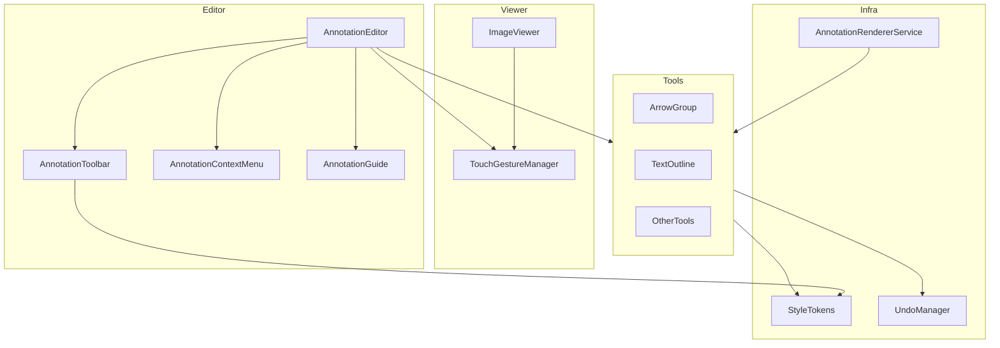

**Architecture Integration**:
- Pattern: 既存 Clean Architecture 層（Component → Tool → Fabric）に、横断責務を持つ `frontend/src/components/site-surveys/gestures/` と `frontend/src/components/site-surveys/annotation-style-tokens.ts`（スタイルトークンはディレクトリではなく単一ファイルである）の薄い横串レイヤを追加
- Domain boundary: ジェスチャー判定を `ImageViewer`/`AnnotationEditor` からユーティリティへ抽出し、視覚表現（白縁取り/アウトライン）はツール本体の属性拡張で吸収
- Dependency direction: `Infra (StyleTokens, UndoManager) → Tools → Editor/Viewer Components`。`AnnotationContextMenu` は `AnnotationEditor` から呼ばれるプレゼンテーション層、逆向き依存は禁止
- Steering compliance: TypeScript strict mode、ESLint、Prettier、既存の `hooks/use*.ts` / `services/*Service.ts` パターン

#### Technology Stack

| Layer | Choice / Version | Role in Feature | Notes |
|-------|------------------|-----------------|-------|
| Canvas Library | Fabric.js 7.3.1 | 注釈描画・シリアライズ | `tech.md` 記載の "6.x" は実態とズレ。本拡張で7.3.1前提の挙動に寄せる |
| Frontend Framework | React 19.2.0 + TypeScript 5.9.3 | UI実装（コンテキストメニュー、簡易ガイド、ツールバー拡張） | 既存スタック |
| Gesture Detection | ブラウザ標準 TouchEvent / PointerEvent | ダブルタップ・長押し・N本指判定 | 追加ライブラリなし |
| Responsive Layout | inline style + CSS media query（`@media (pointer: coarse)`） | モバイルツールバーとハンドルサイズ分岐 | TailwindCSS 全面移行は別スコープ |

新規外部依存は**追加しない**。

### File Structure Plan

#### Directory Structure

以下のツリーは**各ブロック見出しがリポジトリルートからの相対パス**（呼称規約1）であり、配下の行はその直下の実配置を表す。各行の区分（`新規` / `変更`。`変更（軽微）` / `変更（検証中心）` は `変更` に注記を添えたもの）は**本節を書いた時点の計画であり、現況ではない**。実装が進んだ後も区分値は書き換えない（`新規` の行も現在は実在する）。現況の権威は区分値ではなく**パスの実在**であり、**配置そのものは実装の実配置と一致していなければならない**。続く「Modified Files（主要変更点サマリー）」小節は行に区分の列を持たず、小見出し自体が `変更` の区分を担う。この区分も同じく本節を書いた時点の計画である。

```
frontend/src/components/site-surveys/
├── AnnotationEditor.tsx               # 変更: gestureManager 組込み、context menu マウント
├── AnnotationToolbar.tsx              # 変更: flexWrap、StylePanel トグル、白縁取りトグルUI
├── AnnotationContextMenu.tsx          # 新規: 長押し/右クリックで表示されるメニュー
├── AnnotationGuide.tsx                # 新規: ツール選択後の簡易ガイドオーバーレイ
├── ImageViewer.tsx                    # 変更: 3本指以上の抑止、touchGestureManager との橋渡し
├── annotation-style-tokens.ts         # 新規: ツール横断の既定値トークン（旧 annotation-toolbar.constants.ts から移植）
├── annotation-toolbar.constants.ts    # 変更: トークン参照に置換、重複定義撤去
├── gestures/
│   ├── touchGestureManager.ts         # 新規: custom:dbltap / custom:longpress emitter + N-finger state machine
│   └── gesture-thresholds.ts          # 新規: 300ms/500ms/150ms 等の閾値定数
└── tools/
    ├── ArrowTool.ts                   # 変更: Arrow extends Path → extends Group（白縁取りダブルストローク）
    ├── TextTool.ts                    # 変更: paintFirst: 'stroke'、textOutline 属性
    ├── CircleTool.ts                  # 変更（軽微）: StyleTokens 参照に置換
    ├── RectangleTool.ts               # 変更（軽微）: StyleTokens 参照に置換
    ├── PolygonTool.ts                 # 変更（軽微）: StyleTokens 参照に置換
    ├── PolylineTool.ts                # 変更（軽微）: StyleTokens 参照に置換
    ├── FreehandTool.ts                # 変更（軽微）: StyleTokens 参照に置換
    ├── DimensionTool.ts               # 変更（軽微）: StyleTokens 参照に置換
    └── registerCustomShapes.ts        # 変更: Arrow Group 版を再登録（type='arrow' を維持）

frontend/src/services/export/
└── AnnotationRendererService.ts       # 変更（検証中心）: Group版Arrow / paintFirst テキストの再描画確認、テスト追加

frontend/src/__tests__/components/site-surveys/
├── tools/
│   ├── ArrowTool.outline.test.ts      # 新規: 白縁取りのシリアライズ/復元/後方互換
│   └── TextTool.outline.test.ts       # 新規: textOutline のシリアライズ/復元/後方互換
├── gestures/
│   └── touchGestureManager.test.ts    # 新規: dbltap/longpress/N-finger 判定ロジック
├── AnnotationContextMenu.test.tsx     # 新規: メニュー表示・選択・閉じるの挙動
└── annotation-style-tokens.test.ts    # 新規: 既定値の妥当性

e2e/specs/site-surveys/
└── site-survey-annotation-mobile.spec.ts  # 新規: モバイルViewportでの長押し・ダブルタップ・白縁取り保存E2E
```

#### Modified Files（主要変更点サマリー）

以下の箇条書きのパスは**リポジトリルートからの相対パス**（呼称規約1）であり、上のツリーと基準は同じである。**パスそのものは実装の実配置と一致していなければならない**。

- `frontend/src/components/site-surveys/tools/ArrowTool.ts` — `Arrow` を `Group` ベースに再設計。内部に `outlinePath`（白・太）と `bodyPath`（本体色・細）の2枚を持つ。`toObject`/`fromObject` に `outline?: { enabled, color, width }` を追加。既存 `generateArrowPath()` はそのまま流用
- `frontend/src/components/site-surveys/tools/TextTool.ts` — `IText` 初期化時に `paintFirst: 'stroke'`、`stroke: '#ffffff'`、`strokeWidth`（フォントサイズの10-20%）、`strokeUniform: true` を設定。`textOutline?: { enabled, widthRatio }` 属性を追加
- `frontend/src/components/site-surveys/AnnotationEditor.tsx` — 初期化時に `touchGestureManager.attach(canvas)` を呼び、`custom:dbltap`/`custom:longpress` を listen。`AnnotationContextMenu` をマウント、座標管理
- `frontend/src/components/site-surveys/ImageViewer.tsx` — `handleTouchStart`/`handleTouchMove` に 3本指以上の早期リターン（= 描画コミット抑止）と cooldown タイマを追加
- `frontend/src/components/site-surveys/AnnotationToolbar.tsx` — ツールバーに `flexWrap: 'wrap'` とスクロール両対応、`StylePanel` の開閉トグル、白縁取りON/OFF UIを追加
- `frontend/src/components/site-surveys/annotation-toolbar.constants.ts` — `DEFAULT_STYLE_OPTIONS` / ツール別 `DEFAULT_*_OPTIONS` を `annotation-style-tokens.ts` から参照する形に置換
- `frontend/src/components/site-surveys/tools/registerCustomShapes.ts` — `classRegistry.setClass('arrow', Arrow)` を Group 版 Arrow で再登録（type ID は `'arrow'` を維持）
- `frontend/src/services/export/AnnotationRendererService.ts` — Group 版 Arrow / `paintFirst` テキストが `toDataURL` で正しく出ることをテストで検証。**実装上の注意点（実読確認済み）**: `renderImage` / `renderImageForReport` / `renderImagesForReport` はいずれも `await util.enlivenObjects(...)` を正しく使用しており、Group 化 Arrow の非同期 `fromObject` との互換性は確保される。Fabric Group は子 Path に親の `scaleX/scaleY` を伝搬するため、集合体の描画結果は集合体自身の倍率反映だけで正しく拡縮される
  - **訂正（タスク 115.110）**: 本項はかつて「`strokeWidth` スケーリング分岐は、Group 化 Arrow では Group 本体に `strokeWidth` が存在しないためスキップされる」と記していたが、**これは事実に反する**。七形状（`Arrow` / `DimensionLine` / `CircleShape` / `RectangleShape` / `PolygonShape` / `PolylineShape` / `FreehandPath`）の構築処理はいずれも本体線幅を集合体自身へ複写しており（`super([outline*, body*, ...], { ..., strokeWidth: mergedOptions.strokeWidth })`。`setStrokeWidth` も同じく `this.set('strokeWidth', width)` で複写を更新する）、集合体本体にも `strokeWidth` は存在する。したがって当該分岐は集合体でも**適用される**。スキップされるのは、複写を持たないレガシー構造の保存データを復元した場合だけである。七形状すべてが複写を持つことは次の 2 コマンドで再現でき、出力はいずれも `7` である（前者は構築時の複写、後者は線幅変更時の複写更新を数える）
    - `awk '/super\(\[/{s=1} s && /strokeWidth: mergedOptions\.strokeWidth,/{print FILENAME; s=0}' frontend/src/components/site-surveys/tools/*Tool.ts | wc -l`
    - `grep -lE "^    this\.set\('strokeWidth', width\);$" frontend/src/components/site-surveys/tools/*Tool.ts | wc -l`
  - **是正（タスク 115.110）**: 誤った前提が当該分岐を検証から免除していたため、書き出し経路は「集合体へ複写された線幅へ表示倍率を掛ける」というタスク 115.73 と**同形の欠陥**を保持していた。書き出しは復元後に複写値を読み直さず `toObject` も呼ばないため永続化はされない（`fabricCanvas.dispose()` で破棄される）が、複写元（実描画の本体線）と複写先（集合体）で座標系が食い違う点は同じである。適用先を復元処理と同じ方式（複写された線幅を実描画から導出し直す。`frontend/src/components/site-surveys/annotation-restore-scale.ts` の `resolveRestoredStrokeWidth`）へ揃えた。適用先は `frontend/src` 全域を走査した結果**6 箇所**であり、内訳は復元処理 1 箇所（`frontend/src/components/site-surveys/AnnotationEditor.tsx` の共有ヘルパー `addRestoredAnnotationObjects`。サーバー保存済みの復元と下書きの復元の両方がこれを通る）と、書き出し・合成 5 箇所（`AnnotationRendererService.ts` の `renderImage` / `renderImageForReport` / `renderImagesForReport`、`AnnotatedImageThumbnail.tsx` のクライアント合成、`frontend/src/pages/QuantityTableEditPage.tsx` の `renderAnnotatedImageToDataUrl`＝数量表PDF出力）である。数量表PDF出力は要件 32.8 が「サムネイル・プレビュー・PDF・個別エクスポート・一括エクスポート」を同列に扱う対象で、現場調査の注釈データを `getAnnotation` で取得し `util.enlivenObjects` で復元して `toDataURL` する同形の経路であるため、書き出し経路に含まれる。この数は特定ファイル内の出現数ではなく、次の走査（いずれも実行して出力を確認済み）に基づく
    - 適用先の悉皆: `grep -rn "resolveRestoredStrokeWidth" frontend/src --include=*.ts --include=*.tsx | grep -v __tests__`（宣言・import・コメント行を除いた呼び出しが 6 件）
    - 同形の残存確認: `grep -rnE "strokeWidth[^;]*\*[^;]*(scaleX|scaleY|avgScale|averageScale|displayScale|zoom|Zoom|multiplier|Multiplier)" frontend/src --include=*.ts --include=*.tsx | grep -v __tests__` の出力は**空**
    - 「変数へ倍率を代入してから掛ける」「`scaleX`/`scaleY` を個別に掛ける」等の取りこぼし確認: `grep -rnE "\*\s*\(?\s*(avgScale|averageScale|scaleX|scaleY|displayScale|zoom|ratio|widthRatio|factor|multiplier)\b" frontend/src --include=*.ts --include=*.tsx | grep -v __tests__` の出力を全件突き合わせ、注釈復元に関わるのは `left` / `top` / `scaleX` / `scaleY`（倍率を掛けるのが正しい適用先）と `annotation-restore-scale.ts` の集合体でない注釈向けフォールバックだけであることを確認した。`canvasViewportController.ts` の `zoom` はビューポート変換、各ツールの `fontSize * widthRatio` は白アウトライン幅の定義であり、いずれも保存済み線幅への表示倍率適用ではない
    - 復元経路の悉皆: `grep -rn "enlivenObjects(" frontend/src --include=*.ts --include=*.tsx | grep -v __tests__` が挙げる本番の復元 7 箇所（`AnnotationEditor.tsx` 2 / `AnnotatedImageThumbnail.tsx` 1 / `AnnotationRendererService.ts` 3 / `QuantityTableEditPage.tsx` 1）を全件突き合わせた。`AnnotationEditor.tsx` の 2 箇所は共有ヘルパーへ集約されるため、適用先は 7 ではなく 6 になる
    - サーバー側: `grep -rnE "strokeWidth" backend/src --include=*.ts | grep -v "\.test\.ts"` が挙げる `backend/src/services/annotated-thumbnail.service.ts` は保存値の `strokeWidth` をそのまま SVG へ出力し表示倍率を掛けないため同形の欠陥はない。ただし複写された線幅の**読み手**であり、複写値が実描画と食い違えば出力が狂う（複写値を実描画と同じ座標系に保つ必要がある根拠のひとつ）
    - 上記は走査した範囲での結論であり、「他に無いことの証明」ではない。新たな書き出し経路を足す際は `resolveRestoredStrokeWidth` を経由させ、上の残存確認の出力が空のままであることを確認すること

### System Flows

#### タッチジェスチャー判定フロー（Req 27, 30）

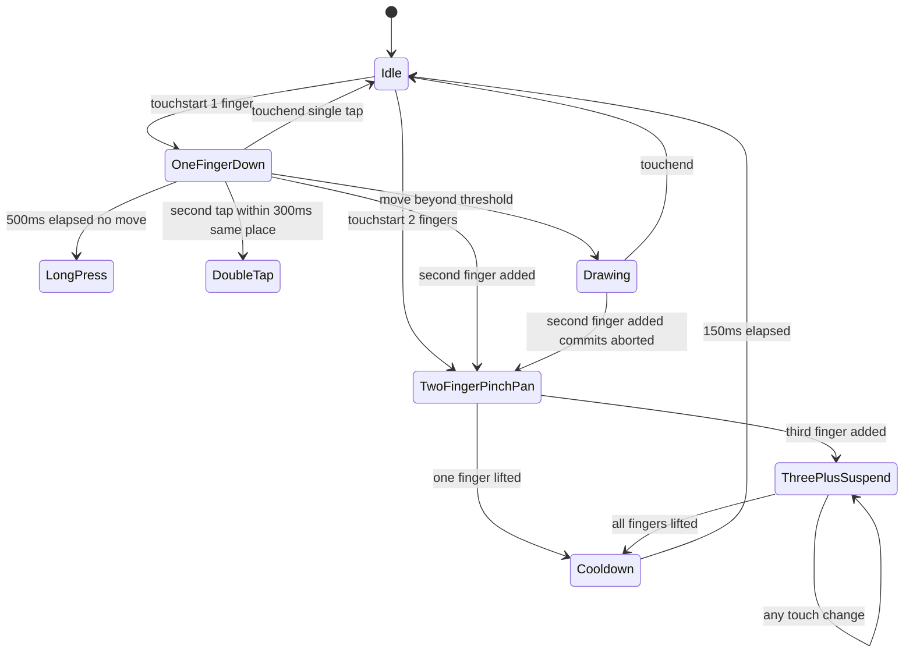

**Key decisions**:
- 描画の commit 条件は **single finger drag 継続** のみ。2本指以上が一時でも入ったら進行中の描画を中止
- `Cooldown`（150ms）により、ピンチ解除直後の誤描画を抑止
- `ThreePlusSuspend` では新規描画を一切受け付けず、全指が離れるまでサスペンド
- `LongPress` および `DoubleTap` は `canvas.fire('custom:longpress' | 'custom:dbltap', opt)` で発火し、各ツールは `mousedblclick` と並列に受信

#### 矢印の白縁取りレンダリングフロー（Req 24）

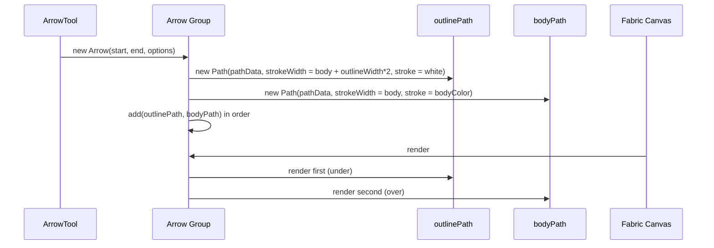

Body が Outline より上に描画されることで、矢じり端部も含めて本体色の周囲に均一な白縁取りが現れる。`setStroke`/`setStrokeWidth`/`setOutline` は両 Path を同期更新する。

### Requirements Traceability

| Requirement | Summary | Components | Interfaces | Flows |
|-------------|---------|------------|------------|-------|
| 24.1-24.10 | 矢印の白縁取り表示・属性永続化・後方互換・Undo連携 | ArrowTool (Group refactor), StyleTokens, AnnotationRendererService, AnnotationToolbar（要件24.5 の切替UI。同名の未結線 `StylePanel.tsx` ではなく、本部品が内包する関数コンポーネントが出荷経路）, AnnotationEditor（要件24.10 の取り消し記録）, registerCustomShapes | `Arrow.setOutline`, `Arrow.toObject/fromObject` 拡張 | 矢印レンダリング |
| 25.1-25.12 | テキストの白アウトライン・背景色との独立・マルチバイト対応・後方互換 | TextTool (paintFirst), StyleTokens, AnnotationToolbar（要件25.2 の切替UI）, AnnotationEditor（要件25.11 の取り消し記録）, AnnotationRendererService | `TextAnnotation.setOutline`, `TextAnnotation.toObject/fromObject` 拡張 | - |
| 26.1-26.6 | ツール横断デフォルトスタイルの一元化、セッション内継承、白縁取り初期ON | annotation-style-tokens, AnnotationEditor styleOptionsRef, style-panel.constants, annotation-toolbar.constants, StylePanel, ArrowTool, CircleTool, DimensionTool, FreehandTool, PolygonTool, PolylineTool, RectangleTool, TextTool | `AnnotationToolDefaults` interface | - |
| 27.1-27.10 | ダブルタップ編集、長押しメニュー、Req8/Req17連携 | touchGestureManager, AnnotationContextMenu, AnnotationEditor, gesture-thresholds | `GestureEvent`, `ContextMenuAction` | ジェスチャー判定フロー |
| 28.1-28.8 | モバイルツールバー、折返し・スクロール、属性パネル開閉、44px タップ領域 | AnnotationToolbar, StylePanel, AnnotationContextMenu | toolbar layout contract | - |
| 29.1-29.8 | ツールハイライト、カーソル、プレビュー、指向けハンドル、ツールヒント、簡易ガイド | AnnotationToolbar, AnnotationGuide, Fabric defaults, AnnotationEditor, StylePanel, annotation-visual-feedback | `CursorStrategy`, `HandleSizeStrategy` | - |
| 30.1-30.8 | マルチタッチ安全性、3本指抑止、cooldown、Req5/Req17 維持 | touchGestureManager, ImageViewer, AnnotationEditor | `TouchState` enum, state transitions | ジェスチャー判定フロー |

### Components and Interfaces

#### Component Summary

| Component | Domain/Layer | Intent | Req Coverage | Key Dependencies (P0/P1) | Contracts |
|-----------|--------------|--------|--------------|--------------------------|-----------|
| Arrow (Group) | Tools | 白縁取り付き矢印を Group で表現 | 24.1-24.10 | Fabric Group/Path (P0), StyleTokens (P1) | State, Serialization |
| TextAnnotation (outline) | Tools | 白アウトライン付きテキスト | 25.1-25.12 | Fabric IText (P0), StyleTokens (P1) | State, Serialization |
| AnnotationStyleTokens | Infra | ツール横断既定値一元管理 | 26.1-26.6 | - | Config module |
| touchGestureManager | Gestures | dbltap/longpress/N-finger state machine | 27.1-27.10, 30.1-30.8 | Fabric Canvas (P0), ImageViewer (P0) | Service, State |
| AnnotationContextMenu | UI | 長押し/右クリックで出るメニュー | 27.2-27.5, 27.7, 27.10 | AnnotationEditor (P0), UndoManager (P1) | UI props |
| AnnotationGuide | UI | ツール選択後の簡易ガイドオーバーレイ | 29.7-29.8 | AnnotationEditor (P1) | UI props |
| AnnotationToolbar (ext) | UI | モバイルレイアウト・白縁取りトグル | 26.3, 28.1-28.8, 29.1, 29.6 | StyleTokens (P0) | UI props |
| ImageViewer (touch ext) | Viewer | 3本指以上抑止、gestureManager連携 | 30.1-30.8 | touchGestureManager (P0) | Internal |
| AnnotationEditor (ext) | Editor | gestureManager attach、context menu mount | 24-30 cross-cutting | touchGestureManager (P0), ContextMenu (P1) | Internal |

#### Tools Layer

##### Arrow (Group)

| Field | Detail |
|-------|--------|
| Intent | 矢印を Group（outlinePath + bodyPath の2枚）で表現し、後方互換を保ちつつ白縁取りを提供 |
| Requirements | 24.1, 24.2, 24.3, 24.4, 24.5, 24.6, 24.7, 24.8, 24.9, 24.10 |

**Responsibilities & Constraints**
- 既存 `generateArrowPath(start, end, arrowheadSize)` を流用し、同一 path data を持つ2つの `Path` を Group 内に配置
- `outlinePath.strokeWidth = bodyStrokeWidth + outlineWidth * 2`、`outlinePath.stroke = '#ffffff'`、`strokeLineCap: 'round'`、`strokeLineJoin: 'round'`
- `bodyPath.strokeWidth = bodyStrokeWidth`、`bodyPath.stroke = bodyColor`
- `outline: { enabled: boolean; color: string; width: number }` 属性を保持。`enabled=false` のときは `outlinePath` の `opacity=0` か Group から `remove` のどちらかで非表示化（design-phase で `opacity=0` 方式を採用し、復元時の構造安定性を優先）
- `type: 'arrow'` は維持（classRegistry 後方互換）

**Dependencies**
- Inbound: AnnotationEditor (P0) — ツール選択→新規矢印作成
- Outbound: Fabric Group/Path (P0), StyleTokens (P1) — 既定 outline 幅
- External: Fabric.js 7.3.1 (P0)

**Contracts**: Service [ ] / API [ ] / Event [ ] / Batch [ ] / State [x]

##### Service Interface (Arrow)

```typescript
interface ArrowOutlineAttribute {
  enabled: boolean;
  color: string;   // '#ffffff' 固定（将来拡張のためプロパティとして保持）
  width: number;   // 白縁取りの片側幅。本体 strokeWidth * 0.75 を推奨既定
}

interface ArrowJSON {
  type: 'arrow';
  startPoint: Point;
  endPoint: Point;
  stroke: string;
  strokeWidth: number;
  arrowheadSize: number;
  outline?: ArrowOutlineAttribute;  // 未設定は白縁取り無しの従来表現（Req 24.9）
}

class Arrow extends Group {
  setOutline(next: Partial<ArrowOutlineAttribute>): void;
  getOutline(): ArrowOutlineAttribute | undefined;
  override toObject(propertiesToInclude?: string[]): ArrowJSON;
  static override fromObject(object: ArrowJSON): Promise<Arrow>;
}
```

- Preconditions: `startPoint`/`endPoint` は有限値、`arrowheadSize > 0`
- Postconditions: Group は 2 つの Path を子に持つ。`toObject` は `outline` 未設定なら当該フィールドを省略
- Invariants: `outlinePath.strokeWidth > bodyPath.strokeWidth`（白縁取り有効時）、`type === 'arrow'`

**Implementation Notes**
- Integration: `registerCustomShapes.ts` での再登録。既存 `DimensionTool` の矢じり参照は本 Arrow を直接参照していないため影響は無し（別途 path を持つ）
- Validation: 旧データ（Path 単体シリアライズ）は `type: 'arrow'` を持つため `fromObject` が復元を受け持つ。`outline` 未定義は白縁取り無しとして表示
- Risks: Group 化による `objectCaching` 挙動差異（research.md R1）。当初は Arrow Group に `objectCaching: false`、子 Path に `objectCaching: true` を指定し、高頻度描画時の FPS を計測する
- Migration 安全性: git 履歴（`d7f3cf3`, `dfd3b7b`）確認により、`ArrowTool.ts` は初出時からカスタム `toObject` を持っており、Fabric 標準シリアライズで保存された矢印データはプロダクションに存在しない。ただし防御的フォールバックとして `fromObject` 実装では `startPoint` / `endPoint` / `stroke` / `strokeWidth` / `arrowheadSize` 必須フィールドの型検証を行い、不正なら安全な既定値（座標 (0,0)、stroke 黒、strokeWidth 2、arrowheadSize 10）で復元し warning ログを送出する

##### TextAnnotation (outline)

| Field | Detail |
|-------|--------|
| Intent | IText に `paintFirst: 'stroke'` + 白ストロークを付加し、視認性を向上 |
| Requirements | 25.1, 25.2, 25.3, 25.4, 25.5, 25.6, 25.7, 25.8, 25.9, 25.10, 25.11, 25.12 |

**Responsibilities & Constraints**
- `paintFirst: 'stroke'`、`stroke: '#ffffff'`、`strokeWidth = fontSize * widthRatio`（既定 `widthRatio = 0.12`）、`strokeUniform: true`
- `textOutline: { enabled: boolean; widthRatio: number }` 属性を保持。`enabled=false` のときは `stroke` を `''` にして無効化
- `backgroundColor` は既存通り独立制御（Req 25.3）
- `splitByGrapheme: true` 既存設定を維持（Req 25.12）

**Dependencies**
- Inbound: AnnotationEditor — テキストツール選択→テキスト配置
- Outbound: Fabric IText (P0), StyleTokens (P1)
- External: Fabric.js 7.3.1 (P0)

**Contracts**: State [x], Serialization [x]

##### Service Interface (TextAnnotation)

```typescript
interface TextOutlineAttribute {
  enabled: boolean;
  widthRatio: number;  // fontSize に対する比率 (0.10〜0.20)
}

interface TextAnnotationJSON {
  type: 'text';
  text: string;
  left: number;
  top: number;
  fontSize: number;
  fontFamily: string;
  fill: string;
  backgroundColor?: string;
  textOutline?: TextOutlineAttribute;  // 未設定は従来表現（Req 25.10）
}

class TextAnnotation extends IText {
  setTextOutline(next: Partial<TextOutlineAttribute>): void;
  getTextOutline(): TextOutlineAttribute | undefined;
  override toObject(propertiesToInclude?: string[]): TextAnnotationJSON;
  static override fromObject(object: TextAnnotationJSON): Promise<TextAnnotation>;
}
```

- Preconditions: `fontSize > 0`、`widthRatio ∈ [0, 1]`
- Postconditions: `paintFirst === 'stroke'`（enabled 時）、`stroke` は `ANNOTATION_DEFAULTS.outlineColor`（既定 `'#ffffff'`）または `''`
- Invariants: `textOutline.widthRatio` 変更時 `strokeWidth = fontSize * widthRatio` を即時反映

**Implementation Notes**
- Integration: 既存 `TextTool.ts` の IText 初期化ブロックに設定追記
- Validation: `textOutline` 未定義の既存データは `paintFirst: 'fill'`（Fabric 既定）で復元される → 従来表現のまま（Req 25.10）
- Risks: `strokeUniform: true` は Fabric 7 の標準。フォントサイズを頻繁に変更するシナリオで stroke 再計算が必要なため `object:modified` にフック

#### Infra Layer

##### AnnotationStyleTokens

| Field | Detail |
|-------|--------|
| Intent | ツール横断の既定色・線幅・フォントサイズ・白縁取り既定を一元管理 |
| Requirements | 26.1, 26.2, 26.3, 26.4, 26.5, 26.6 |

**Service Interface**

```typescript
interface AnnotationToolDefaults {
  stroke: string;            // 既定本体色（赤系または橙系、design で確定）
  strokeWidth: number;       // 既定線幅（3px 以上）
  fontSize: number;          // 既定フォントサイズ
  fill: string;              // 既定塗りつぶし（通常 '' 透明）
  outlineColor: string;      // 白縁取り/白アウトラインの色（タスク 115.150 で追加。全部位共通の白）
  arrowOutline: ArrowOutlineAttribute;   // 矢印の既定白縁取り（enabled: true）
  textOutline: TextOutlineAttribute;     // テキストの既定白アウトライン（enabled: true）
  dimensionLabel: DimensionLabelStyle;   // 寸法値ラベルの既定スタイル（タスク 115.98 で移設）
}

export const ANNOTATION_DEFAULTS: AnnotationToolDefaults;
export function getToolDefaults(tool: ToolKind): AnnotationToolDefaults;
```

**Implementation Notes**
- Integration: 各 tool は import し、既存ハードコード（例 `ArrowTool.ts`）を置換
- Validation: 単体テストで `ANNOTATION_DEFAULTS` の各値が視認性要件（Req 26.1-26.2）を満たすことを確認（例: `strokeWidth >= 3`、`arrowOutline.enabled === true`）
- Risks: セッション内継承（Req 26.4）は既存 `AnnotationEditor.styleOptionsRef` の仕組みをそのまま流用、本トークンは初期値のみ供給
- 既定線幅（`strokeWidth`）から導かれる白縁取りの既定の見た目は、要件32 節の「既定線幅から導かれる白縁取りの既定値（要件24.2 / 32.2 / 26.5）」に表として記録している。**既定線幅を変更する場合は同表の 2 つの算出（六形状と矢印）を個別に検算すること**

##### 寸法値ラベルの既定スタイルを一元管理へ含める判断（要件26.5）

タスク 115.98 で、`frontend/src/components/site-surveys/tools/DimensionTool.ts` の `DEFAULT_LABEL_STYLE`（寸法値ラベルの既定フォントサイズ・文字色・背景色）を**一元管理の資材へ寄せる**と決めた。実体は `frontend/src/components/site-surveys/annotation-style-tokens.ts` の `ANNOTATION_DEFAULTS.dimensionLabel`（型は同ファイルの `DimensionLabelStyle`）であり、`DEFAULT_LABEL_STYLE` は資材から供給された値の別名として残る。

**「本体色とは別の概念だから一元管理の外へ置く」という従来の理由を採らなかった理由**:

1. その理由が正当化するのは**値を本体色と同じにしないこと**であって、**資材の外に置くこと**ではない。一元管理（要件26.5）が求めるのは値の同一化ではなく供給元の単一化である。同じ判断は既に前例がある。タスク 115.70 は `style-panel.constants.ts` の `DEFAULT_STYLE_OPTIONS.fillColor` を、透明の表現が資材側の `''` とパネル側の `'transparent'` で異なるまま資材へ寄せた。表現や値が本体色と違うことは、資材の外に置く理由にならない。
2. **同じラベルの属性が既に資材の内側にある**。要件32.12 由来の `ANNOTATION_DEFAULTS.dimensionLabelOutline` は資材にあり、ラベルの白アウトライン線幅は `fontSize × widthRatio` で決まる。移設前はこの一つの算出式が、`fontSize` を `DimensionTool` 側の literal から、`widthRatio` を資材から引いており、**一つの計算が二つの供給元をまたいでいた**。同一の描画対象の既定属性を二箇所に分ける状態は単一情報源の趣旨で正当化できない。
3. 要件26.5 の文言は「各ツールの既定色」であって「各ツールの既定**本体**色」ではない。寸法線ツールが新規に描く注釈は線部と寸法値ラベルの複合であり、ラベルの既定文字色は**新規注釈の既定色**にあたる。

**既定値そのものは変更していない**（`fontSize: 12` / `fontColor: '#000000'` / `backgroundColor: '#ffffff'`）。移設は供給元の変更のみで、挙動は変わらない。とくに次の 2 点は意図的に本体側と揃えていない。

- `fontColor`（`#000000`）を本体色 `#e53935` へ揃えない。要件26.2 が赤系/橙系を求める対象は「新規矢印・テキスト注釈の初期本体色」であり、寸法値ラベルの文字色はその対象ではない。ラベルは `dimensionLabelOutline` による白アウトラインを伴って描画されるため、黒文字＋白縁で暗/明どちらの背景でも読める。
- `fontSize`（12）をツール横断の `ANNOTATION_DEFAULTS.fontSize`（16）へ揃えない。寸法値ラベルは寸法線の中央に重ねて描く従属表示であり、テキスト注釈と同じ大きさにすると線を覆う。値の統一は既定の見た目を変える別の判断であり、本タスクでは行わない。

**検証**: 既定値は `annotation-style-tokens.test.ts` と `DimensionTool.label-outline.test.ts` が具体値（12 / `#000000` / `#ffffff`、およびラベル白アウトライン線幅 1.44）で固定する。単一情報源であることは、資材側の値を変えると新規寸法線の `labelText` の `fontSize` / `fill` を主張するテストが落ちることで確認した。

##### 白アウトラインの色を一元管理へ含める判断（要件26.5）

タスク 115.150 で、白縁取り／白アウトラインの色を**要件26.5 の一元管理の対象に含める**と決めた。実体は `frontend/src/components/site-surveys/annotation-style-tokens.ts` の `ANNOTATION_DEFAULTS.outlineColor`（値は `#ffffff`）であり、矢印と六形状の既定白縁取り（`arrowOutline.color` および各 `{shape}Outline.color`）も同じ供給元から作る。

**含めると判断した理由**:

1. 要件26.5 が列挙するのは「既定色・既定線幅・既定白縁取り**有無**」であり、縁取りの色そのものは字面に無い。しかしタスク 115.98 が確立したとおり、一元管理が求めるのは値の同一化ではなく**供給元の単一化**であって、「本体色とは別の概念だから資材の外に置く」という形の理由は成り立たない。白縁取りの色は、新規注釈を描くときにツールが与える既定の色の一つである。
2. **同じ算出式の中で色だけが取り残されていた**。テキストと寸法値ラベルの白アウトライン線幅は `fontSize × widthRatio` で決まり、タスク 115.98 の後は両因子とも資材から供給されていたのに、同じ描画属性を設定する呼び出しが渡す `stroke` だけが literal だった。これは 115.98 が「一つの計算が二つの供給元をまたいでいた」として是正した状態と同型である。
3. **同じ白でも矢印は資材、テキストと寸法値ラベルは literal という非対称**があった。`ShapeOutlineAttribute` は `color` を持ち `ANNOTATION_DEFAULTS` から供給されるのに、`TextOutlineAttribute` には色の項目そのものが無い。同一の白を二系統から供給する状態は単一情報源の趣旨で正当化できない。

**注釈ごとの属性の形は変えていない**。`TextOutlineAttribute` に `color` を足していない。要件24.3 と要件25.4 が「本体色を変更しても縁取り部分の色は常に白のまま維持する」と定めており、色は**部位ごと・注釈ごとに違える余地の無い固定値**である。永続化の対象として要件24.6 と要件25.7 が挙げるのも「有効／無効・幅」であって色ではない。したがって色はツール横断の既定値として資材に一箇所置き、注釈ごとの属性には広げない。

**`ShapeOutlineAttribute.color` は残す**。根拠は要件の字面ではなく**実装の JSON 形式**である。要件24.6 と要件32.6 が永続化対象として挙げるのは「有効/無効・縁取り幅」であり、要件24.7 と要件32.7 が復元対象として挙げるのも「保存された白縁取り属性」であって、どちらも色を列挙していない。しかし実装の `toObject` は `ShapeOutlineAttribute` を丸ごと出力し、`fromObject` はそれを丸ごと `setOutline` へ渡すため、保存済みデータには色が含まれ、復元経路がそれを読む。この項目の撤去は永続化形式の変更であって本タスクの境界外である。現在は**その既定値も `ANNOTATION_DEFAULTS.outlineColor` から作られる**ため、供給元は一つに揃っている。

**既定値そのものは変更していない**（`#ffffff`）。変更は供給元のみであり、描画結果は変わらない。

**適用範囲（タスク 115.150 時点の実測）**: 本節が主張する範囲は三層に分かれる。全称否定（「白アウトラインの色を渡す literal はもう存在しない」）は主張しない。

**(A) 機械保証**: 供給元が一つであることは試験が保証する。資材の `outlineColor` を別の色へ変異させると、テキストと寸法値ラベルの `stroke`、および旧データ復元時の `outline.color` を主張する試験が落ちる（下の「検証」を参照）。保証が及ぶのはこれらの試験が触れる経路に限られ、literal が新たに書き加えられた経路までは覆わない。

**(B) 人手走査（その1）**: 再現コマンドは `grep -rn "#ffffff" frontend/src/components/site-surveys/tools/` であり、実測の出力は 9 件である。改修前に白アウトラインの色を本番で渡していた経路は十箇所あった。内訳は `tools/TextTool.ts` のコンストラクタと `_applyOutlineToIText`、`tools/DimensionTool.ts` のコンストラクタと `_applyLabelOutlineToText`、および旧データ復元時に白縁取りを無効化する `fromObject` 内の `setOutline` 呼び出しであり、後者は `ArrowTool.ts` と `RectangleTool.ts` と `CircleTool.ts` と `PolygonTool.ts` と `PolylineTool.ts` と `FreehandTool.ts` に一つずつある。全件を `ANNOTATION_DEFAULTS.outlineColor` の参照へ改めた。改修後に残る 9 件は次の二区分で全件を覆う。

- **本番の値が 4 件**。`tools/TextTool.ts` の `DEFAULT_BALLOON_OPTIONS.backgroundColor` が 1 件——要件8.6 の吹き出し背景色の既定であり、Fabric の `backgroundColor` を埋める値であって `stroke` ではないため、白アウトラインの色ではない。`tools/DimensionValueInput.tsx` が 3 件——React のインラインスタイルの `backgroundColor` が 2 件と `color` が 1 件で、寸法値を打ち込む DOM オーバーレイの見た目を決める値である。Fabric の描画属性ではなく、`setOutline` にも `stroke` にも渡らないため、白アウトラインの色ではない。
- **資材を指すことを述べた JSDoc 注釈が 5 件**。`tools/TextTool.ts` に 2 件、`tools/DimensionTool.ts` に 3 件あり、いずれも `ANNOTATION_DEFAULTS.outlineColor` の既定値を説明する文である。実行される値ではない。

**(B) 人手走査（その2）**: 第二の再現コマンドは `grep -rniE "#fff([^f]|$)|#FFFFFF|white" frontend/src/components/site-surveys/` であり、実測の出力は 105 件である。次の九区分は相互排他で、合計は 105 件となり出力全体を覆う。

- 非色の CSS プロパティ `whiteSpace` / `white-space`（`nowrap`・`pre-wrap` 等）が 9 件。色ですらない。
- Tailwind のクラス名（`bg-white` / `text-white` の類）が 10 件。`SiteSurveyResponsiveView.tsx` と `SiteSurveyListTable.tsx` と `SiteSurveyListCard.tsx` にある画面の地色と文字色である。
- 白ではない値が 2 件。`PendingUploadPanel.tsx` の `#fffbeb` と `StylePanel.stories.tsx` の `#fff3e0` で、正規表現の `#fff` に前方一致しただけである。
- WCAG のコントラスト比を述べた注釈が 12 件。
- 資材を指すことを述べた JSDoc 注釈が 5 件。その1で数えた 5 件と同一である。
- `annotation-style-tokens.ts` の資材定義が 2 件。本タスクの単一供給元である `OUTLINE_COLOR` と、寸法値ラベル背景の `DIMENSION_LABEL_BACKGROUND_COLOR` である。
- Fabric の非アウトライン描画属性が 1 件。その1で数えた `DEFAULT_BALLOON_OPTIONS.backgroundColor` と同一である。
- テキスト背景の代替値と塗りつぶし色ピッカーの初期表示と色パレットの白見本が 4 件。`AnnotationToolbar.tsx` の `TEXT_BACKGROUND_FALLBACK_COLOR` と `fillColor` の既定表示、`StylePanel.tsx` の白見本と色ピッカーの初期表示である。
- 残る 60 件は画面 DOM の背景色と文字色。React のインラインスタイル、`SiteSurveyForm.tsx` の `STYLES.colors` に置いた白トークンの定義と参照、および `2px solid white` の枠線である。

この 105 件のいずれも白アウトラインの色を渡す経路ではない。すなわち当該経路は `tools/` の外に無かった。白縁取りの有効/無効を切り替える `AnnotationEditor` の呼び出しも `setOutline({ enabled })` の形であり、色を渡さない。

**(C) 未走査の残余**: 上の二つのコマンドは `#ffffff` と `#fff` と `white` の**字面**しか見ない。したがって次は走査していない。第一に、白の別表記である。`rgba` 形式で白を書いた行が `AnnotationEditor.tsx` に 1 件あるが（DOM オーバーレイの背景であって描画属性ではない）、第二のコマンドの 105 件には含まれない。`hsl` 形式は実測で無かった。第二に、実行時に組み立てられる色文字列や、props・API 応答から流れ込む値である。字面が無いため grep では原理的に捕まえられない。第三に、`frontend/src/components/site-surveys/` の外である。**保証はここに書いた (A) と (B) の範囲までであり、(C) は保証しない。**

**検証**: 供給元が一つであることは、試験中に資材の `outlineColor` を別の色へ変異させ、テキストと寸法値ラベルの `stroke`、および旧データ復元時の `outline.color` が追随することで実測した（`TextTool.outline.test.ts`、`DimensionTool.label-outline.test.ts`、各ツールの `*.serialization.test.ts`）。**値の一致だけを主張する検証は literal のままでも通るため採らない。** 既定値が従来と同じ `#ffffff` であること、および無効時に `stroke` が空文字になる既存挙動は、`annotation-style-tokens.test.ts` と各ツールの試験が具体値で固定する。

#### Gestures Layer

##### touchGestureManager

| Field | Detail |
|-------|--------|
| Intent | Fabric canvas にアタッチし、ダブルタップ・長押し・N本指状態をイベント化する |
| Requirements | 27.1, 27.2, 27.6, 27.7, 27.9, 27.10, 30.1-30.8 |

**Responsibilities & Constraints**
- `attach(canvas: Canvas): DetachFn` / `detach(): void` パターン
- Fabric canvas の `mouse:down` / `mouse:move` / `mouse:up` を listen し、追加で canvas element の `pointerdown`/`pointermove`/`pointerup`/`pointercancel` を listen（`enablePointerEvents: true` 併用）
- 内部 state machine（System Flows セクションの図）を保持
- 判定結果を `canvas.fire('custom:dbltap', opt)` または `canvas.fire('custom:longpress', opt)` で発火
- 閾値は `gesture-thresholds.ts` に集約（`DOUBLE_TAP_MS = 300`、`LONG_PRESS_MS = 500`、`COOLDOWN_MS = 150`、`DRAG_THRESHOLD_PX = 8`）
- Req 17 連携: カスタムイベント発火時にオプションで `currentTool` を含め、subscriber 側で選択ツール判定が可能

**Dependencies**
- Inbound: AnnotationEditor, ImageViewer
- Outbound: Fabric Canvas (P0)
- External: ブラウザ TouchEvent / PointerEvent API

**Contracts**: Service [x], Event [x], State [x]

##### Service Interface

```typescript
// GesturePayload は操作対象（target）を持たない。ジェスチャー検出は「どこで起きたか」
// までを責務とし、「どの注釈オブジェクトか」は受け手が clientX/clientY から
// Fabric の実ヒットテスト（findTarget）で解決する。
interface GesturePayload {
  pointerType: 'touch' | 'mouse' | 'pen';
  clientX: number;
  clientY: number;
  currentTool: ToolKind;
}

interface TouchGestureManager {
  attach(canvas: Canvas, getCurrentTool: () => ToolKind): () => void;  // returns detach
  getTouchState(): TouchState;
}

type TouchState =
  | 'idle'
  | 'one-finger-down'
  | 'drawing'
  | 'two-finger-pinch-pan'
  | 'three-plus-suspend'
  | 'cooldown';
```

**Implementation Notes**
- Integration: `AnnotationEditor.tsx` 初期化時に `const detach = touchGestureManager.attach(canvas, () => activeToolRef.current)` し、unmount 時に `detach()` を呼ぶ
- Validation: 単体テストで各 state 遷移と閾値（300ms/500ms/150ms）を検証。Jest の `jest.useFakeTimers()` を使用
- Risks / Decisions: **`enablePointerEvents: true` を初手から採用する**。根拠は (a) Fabric の `mouse:down` は TouchEvent 由来のとき touch identifier を安定供給せず、3本指以降の厳密判定（Req 30.2）が困難、(b) PointerEvent は touch/mouse/pen を一本化でき `pointerType` 判定で touch 専用分岐が明確化できる。`ImageViewer.tsx` の既存 TouchEvent 処理との重複発火は、`touchGestureManager` 側が `pointer*` のみを listen し、`ImageViewer.tsx` の既存 `onTouchStart/Move/End` には手を入れない方針で分離する。Safari 13.1+ の PointerEvents 対応は ArchiTrack の対応ブラウザ要件内（steering/tech.md 準拠）

#### UI Layer

##### AnnotationContextMenu

| Field | Detail |
|-------|--------|
| Intent | 長押しまたは右クリック時に選択オブジェクトのアクションを提示 |
| Requirements | 27.2, 27.3, 27.4, 27.5, 27.7, 27.10 |

**Responsibilities & Constraints**
- `AnnotationEditor` から `{ visible, position, targetObject, onAction, onClose }` プロパティを受ける
- アクション: 編集（テキストのみ）/ 複製 / 削除
- 複製は対象 `clone()` + `set({ left: left+20, top: top+20 })` 後に canvas.add
- メニュー外タップで `onClose()`、背景描画はコンテキストメニュー visible 中は `AnnotationEditor` 側で `canvas.skipTargetFind = true` 等で抑止

**Shared Props Base**

```typescript
interface BaseAnnotationOverlayProps {
  visible: boolean;
  position: { x: number; y: number } | null;
  onClose(): void;
}

interface AnnotationContextMenuProps extends BaseAnnotationOverlayProps {
  targetObject: FabricObject | null;
  onAction(action: ContextMenuAction, target: FabricObject): void;
}

type ContextMenuAction = 'edit' | 'duplicate' | 'delete';
```

**Implementation Notes**
- Integration: `AnnotationEditor.tsx` の return 直下にポータル配置。位置はジェスチャーイベントの `clientX/Y` から計算
- Validation: テストで edit → IText.enterEditing、duplicate → canvas.add、delete → canvas.remove の各経路を確認。Undo履歴への記録は各アクション実行後に `useFabricUndoIntegration` が `object:added`/`object:removed` を捕捉し自然に乗る
- Risks: メニュー表示中のタッチ抑止が不十分な場合、背後キャンバスに描画イベントが漏れる。`pointerEvents: auto`（メニュー）と `skipTargetFind`（キャンバス）の組合せで防御
- Risks / Decisions: **メニュー外タップ（Req 27.5）の判定は「重ね置きの透明レイヤー自身が押下を受けたクリック」に限定する**。長押し（Req 27.2）は指が接地したままメニューを開くため、押下を受けているのは背後のキャンバスであり、当該レイヤーはその時点でまだ存在しない。指を離すとブラウザは接触点の最前面要素＝当該レイヤーへ互換のクリックを配送するので、クリックだけを見て閉じる素朴な判定にすると**指を離した瞬間に必ず閉じ、項目をタップする Req 27.3 が到達不能になる**（長押しと外側タップという二つの要件が潰し合う）。互換のマウスイベントからポインタイベントは生成されない（Pointer Events 仕様）ため、押下を受けたかどうかで長押しの解放と本物のタップを確実に区別でき、メニューが開いた直後の本物のタップも従来どおり閉じる。次の代替案は採らない: (a) 一定時間クリックを抑制する案は固定時間待機に等しく、Req 27.6 の閾値は長押しの**保持**時間であって解放後の抑制時間を根拠づけないため、置くべき数値の裏付けが無い、(b) クリックではなく押下の時点で閉じる案は、レイヤーがイベント列の途中で消えて後続の mouseup/click が背後のキャンバスへ抜け、Req 27.4 を弱める。**この判定を書き換える際は、マウス操作のみの単体テストでは本欠陥を検出できない**（マウスのクリックには常に押下が先行するため、素朴な判定でも成立してしまう）ことに留意し、実機相当のタッチ入力で Req 27.3 と Req 27.5 が同時に成立することを確かめること

##### AnnotationGuide

| Field | Detail |
|-------|--------|
| Intent | ツール選択後、一定時間描画が無い場合に操作ヒントを非侵襲的に表示 |
| Requirements | 29.7, 29.8 |

シンプルな presentational component（StylePanel 付近の Implementation Note レベル）。`visible`、`toolKind`、`onDismiss` を受ける。表示閾値は `gesture-thresholds.GUIDE_IDLE_MS = 3000`。

##### AnnotationToolbar (ext)

| Field | Detail |
|-------|--------|
| Intent | モバイル向けレイアウトおよび白縁取りトグルUIを追加 |
| Requirements | 24.5, 24.10, 25.2, 25.11, 26.3, 28.1-28.8, 29.1, 29.6, 32.5, 32.10 |

**Implementation Notes**
- `STYLES.toolbar` に `flexWrap: 'wrap'` を追加、同時に `overflowX: 'auto'` を維持（狭小幅で両対応）
- `button.base.minWidth/minHeight: 44px` に統一（現状 48px だが 44x44 を明示的に設定、Req 28.3）
- **要件28.3 の適用範囲（タスク 115.170 で決着。上の `button.base` の記述は当時の設計であり、
  対象を道具のボタンに限る意図ではない）**: 条文は「モバイル幅ツールバーの**各項目**」を
  44x44 の対象としている。決着時点の実測では 44 を持つ定義は `button.base` だけで、色の選択
  32x24・線幅の入力 60x24・吹き出しの選択 高さ24・アクションボタン 高さ32（実測）・切替 32x24
  （タスク 115.148 で 18x18 から拡大）はいずれも 44 未満だった。**利用者の判断により
  「実装を要件へ追随させる」を採り、要件文は変更していない**。
  - 対象（＝「項目」）は、ツールバー内の `button` / `input` / `select`。区切り線・見出しの
    `label`・各種コンテナは**操作の対象ではない**ため含めない
    - 見出しのうち押下が操作要素へ転送されるのは `htmlFor` を持つ **3 つだけ**
      （白縁取り／白アウトライン・背景・吹き出し）。残る **6 つ**（色・線幅・塗りつぶし・
      文字色・サイズ・背景色）は `htmlFor` も包含も持たない**不活性な文字**であり、押下しても
      何も起きない
    - 除外が正しい根拠: 不活性な 6 つはタップ領域を持たない。転送される 3 つは、既に 44x44 を
      満たす操作要素の当たり判定を**広げる側にしか働かない**。いずれの見出しも、属する項目
      コンテナ（`styleItem`）はモバイル幅で 44x44 以上である
  - 実装は `STYLES.mobileTapTarget`（`minWidth` / `minHeight` を `TAP_TARGET_MIN_PX = 44`）を
    モバイル幅（`useMediaQuery(MEDIA_QUERIES.isMobile)`）でのみ各項目へ重ねる。デスクトップ幅は
    据え置く（条文が対象を「モバイル幅ツールバー」と限っているため）
  - **タップ領域は見た目の寸法そのもので確保する**（擬似要素や重ね合わせで当たり判定だけを
    広げない）。対象の多くが置換要素（`input[type=color|number|checkbox]` / `select`）であり
    `::before` / `::after` が描かれないこと、負のマージンで重ねると隣の項目と当たり判定が
    重なり要件28.7（誤選択しにくい間隔）を損なうこと、見た目＝当たり判定なら検証が測る矩形が
    そのまま指の当たる領域になることが理由
  - **要件36.5 との衝突は `STYLES.styleItemMobile` で回避する**。見出しを操作要素の上に積んだ
    ままだと 1 項目の高さが「見出し + 間隔 + 44」となり、単段ツールバーの高さが道具のボタン
    1 行分を超える。モバイル幅では見出しを横へ置き、項目の高さを 44 に収める。増えるのは横幅
    だけであり、単段の横スクロール（Req 28.2）が吸収する
  - **実測（375x667）**: ツールバーの高さは属性パネルを開いても 71px のまま変わらず（道具の
    ボタンの実高 55px + 上下 padding 16px が律速）、画像作業領域は 311x400（短辺 311 ≧
    画面短辺 375 の 50%）、編集ビュー高 447px に対する作業領域の縦高の比は 0.895。
    `styleItemMobile` を外す変異では 71 → 85 へ増え、E2E が赤になることを確認した
- StylePanel は開閉ボタンを設け、初期状態はモバイル幅では閉、デスクトップ幅では開（CSS media query か `matchMedia` で判定）
- 描画ツールの StylePanel に「白縁取り」「白アウトライン」のON/OFFトグルを追加（Req 24.5, 25.2, 32.5）。
  対象は矢印・テキストだけでなく、要件32.5 が挙げる 6 形状（寸法線・円・四角形・多角形・折れ線・
  フリーハンド）を含む描画ツール全体である。当初の記述は矢印とテキストしか挙げておらず、
  要件32.5 の切替が設計から抜けていた（タスク 115.96 で是正）。
  切替の状態は `annotation-toolbar.constants.ts` の `StyleOptions.outlineEnabled`（ツール別の真偽値）に持ち、
  既定値は `annotation-style-tokens.ts` の `createDefaultOutlineEnabled` が `ANNOTATION_DEFAULTS` から供給する（Req 26.5, 32.13）
- 切替は「以降に描かれる注釈へ適用する描画設定」である（Req 26.4 が白縁取り有無をツールのスタイルとして扱う）。
  既存の注釈は変更しない。既存注釈へ波及させると、白縁取り属性を持たずに保存された注釈の
  従来表現（Req 24.9 / 25.10 / 32.9 の後方互換）を切替の導入で壊すため
- 切替操作は `AnnotationEditor.handleStyleChange` が `UndoManager.pushWithoutExecute` で
  取り消し単位として積む（Req 24.10, 25.11, 32.10）。色・線幅・文字サイズの変更は
  要件が履歴記録を求めていないため積まない
- タップ領域の妥当性は、当初の設計では視覚回帰テスト（Playwright screenshot）で担保するとして
  いたが、視覚回帰テストは導入されていない。**実際の担保は実ブラウザの実測**である:
  `e2e/specs/site-surveys/site-survey-annotation-mobile.spec.ts` の (d)（375x667 で
  ツールバー内の全項目の矩形を測る）と `site-survey-outline-toggle.spec.ts` の (f)
  （属性パネルの全操作要素をモバイル幅へ切替えて測る）。単体検証
  （`AnnotationToolbar.mobile-tap-target.test.tsx`）は JSDOM に実レイアウトが無いため
  下限の宣言（`min-width` / `min-height`）までを主張する

##### ImageViewer (touch ext)

| Field | Detail |
|-------|--------|
| Intent | 3本指以上の抑止、cooldown、touchGestureManager との橋渡し |
| Requirements | 30.1-30.8 |

**Implementation Notes**
- `handleTouchStart` 冒頭で `touches.length >= 3` を検出し、`touchGestureManager` に `'three-plus-suspend'` 状態遷移を通知、既存ズーム/パン処理を中止
- `handleTouchEnd` で `touches.length === 0` かつ前状態が `three-plus-suspend` なら `cooldown` へ遷移（`setTimeout(150ms)` で `idle` 復帰）
- 既存 1本指パン / 2本指ピンチズーム ロジックは Req 5 維持のため変更しない
- Req 17 の「描画ツール中のオブジェクト選択防止」は Fabric 側 `canvas.selection = false` 等で既に実装されており、本拡張では触らない

##### AnnotationEditor (ext)

| Field | Detail |
|-------|--------|
| Intent | gestureManager の attach/detach、context menu のマウント、保存時に outline 属性を含める |
| Requirements | Cross-cutting 24-30 |

**Implementation Notes**
- `useEffect` 内で `const detach = touchGestureManager.attach(canvas, () => activeToolRef.current)` を実行し、cleanup で `detach()`
- `canvas.on('custom:dbltap', handleDoubleTap)` / `canvas.on('custom:longpress', handleLongPress)` を配線
  - 通知は操作対象を持たないため、両ハンドラは通知の clientX/clientY から `canvas.findTarget` で対象を解決する（解決処理は 1 箇所を共用）
  - `handleDoubleTap`: 解決した対象が `TextAnnotation` なら `target.enterEditing()`
  - `handleLongPress`: 選択ツールかつ対象が解決できたら ContextMenu を開く、描画ツールなら Req 17 により無視
- ContextMenu の visible/position/target state を useState で保持
- カーソル制御: `activeTool` 変更の useEffect で `canvas.defaultCursor = toolCursorMap[activeTool]` を設定

### Data Models

本拡張はバックエンド DB スキーマを変更しない。**注釈JSONの拡張のみ**で完結する。

#### 注釈JSON スキーマ拡張（後方互換）

```typescript
// 既存
interface AnnotationSaveDataV1 {
  version: '1.0';
  objects: FabricObjectJSON[];
  canvasWidth: number;
  canvasHeight: number;
  imageRotation: number;
}

// 変更なし（objects 内の各要素が拡張される）

// 矢印（拡張後）
interface ArrowJSON {
  type: 'arrow';
  startPoint: Point;
  endPoint: Point;
  stroke: string;
  strokeWidth: number;
  arrowheadSize: number;
  outline?: { enabled: boolean; color: string; width: number };  // optional: 未設定は従来表現
}

// テキスト（拡張後）
interface TextAnnotationJSON {
  type: 'text';
  text: string;
  left: number;
  top: number;
  fontSize: number;
  fontFamily: string;
  fill: string;
  backgroundColor?: string;
  textOutline?: { enabled: boolean; widthRatio: number };  // optional
}
```

**後方互換ルール**:
- 任意フィールド未設定のデータは従来表現で復元（Req 24.9, 25.10）
- 新規保存時は必ず `outline` / `textOutline` を含める（enabled=false の場合も）
- バックエンド API（`annotation.routes.ts`）は JSON をそのまま受け流すため変更不要

### Error Handling

#### エラー戦略

- **ジェスチャー誤検出**: `touchGestureManager` が誤って `custom:longpress` を発火した場合、`AnnotationContextMenu` は `targetObject == null || skipTargetFind` のときメニュー非表示でフェイルセーフ
- **描画誤発火**: マルチタッチ中に新規オブジェクトが誤って `canvas.add` された場合、`useFabricUndoIntegration` が `object:added` を Undo 履歴に記録するので Ctrl+Z で即座に復旧（Req 30.4）
- **白縁取りレンダリング失敗**: `paintFirst: 'stroke'` 設定時に Fabric が例外を投げた場合、Sentry にログ送出 + `enabled=false` にフォールバック。ユーザーには Toast で通知
- **シリアライズ/復元失敗**: `fromObject` で `outline` が不正値なら警告ログ + 属性を drop して従来表現にフォールバック（Req 24.9, 25.10 と同じ挙動）
- **Context menu外タップ不検知**: ポータル背景に透明オーバーレイ `<div>` を配置し `onClick={onClose}` で確実に閉じる

### Testing Strategy

#### Unit Tests（各 3-5 項目）

- **Arrow (Group)**
  - 白縁取り有効時に Group の子が 2 つ（outlinePath, bodyPath）になる
  - `setOutline({ enabled: false })` で `outlinePath.opacity === 0` になる
  - `toObject` → `fromObject` ラウンドトリップで `outline` 属性が保持される
  - `outline` 未定義の旧データ `fromObject` で白縁取り無しとして復元される（Req 24.9）
- **TextAnnotation (outline)**
  - `setTextOutline({ enabled: true, widthRatio: 0.15 })` で `paintFirst === 'stroke'` かつ `strokeWidth === fontSize * 0.15`
  - `fontSize` 変更で `strokeWidth` が自動更新される（Req 25.5）
  - `backgroundColor` と `textOutline` が独立に変更可能（Req 25.3）
  - `textOutline` 未定義の旧データで従来表現（Req 25.10）
- **touchGestureManager**
  - 300ms 以内の 2 連続 mouse:down で `custom:dbltap` 発火
  - 500ms 無動作で `custom:longpress` 発火
  - 2本指で state が `two-finger-pinch-pan` に遷移
  - 3本指で state が `three-plus-suspend` に遷移、新規描画抑止
  - 全指離れ後 150ms で `idle` 復帰
- **AnnotationStyleTokens**
  - `ANNOTATION_DEFAULTS.strokeWidth >= 3`
  - `arrowOutline.enabled === true` かつ `textOutline.enabled === true`（Req 26.3）

#### Integration Tests

- **ContextMenu + Undo 統合**: 長押し → Delete アクション → Undo で元に戻る
- **Arrow Group + AnnotationRendererService**: Group 矢印を `toDataURL` で書き出し、dataURL 内に白縁取り相当のピクセルが含まれる（色サンプリング検証）。**追加**: 保存時キャンバスと描画時キャンバスのサイズが異なる（スケール非等倍）条件で書き出し、矢印太さ・白縁取り太さが期待通りに拡縮されることを検証する。あわせて**集合体へ複写された線幅が実描画（子の本体線）と同じ座標系に保たれること**を、書き出しの 3 つの入口すべてで観測する（上記 §File Structure Plan の訂正・是正を参照）。この観測は `frontend/src/__tests__/integration/annotation-scale-and-multitouch.test.ts` が担う。残る 2 箇所の適用先も同形で観測する: `AnnotatedImageThumbnail.tsx` のクライアント合成は `frontend/src/__tests__/components/site-surveys/AnnotatedImageThumbnail.test.tsx`、`QuantityTableEditPage.tsx` の数量表PDF出力（`renderAnnotatedImageToDataUrl`）は `frontend/src/__tests__/pages/QuantityTableEditPage.pdfPhoto.test.tsx` が担い、いずれも子 `[outline, body]` を持つ集合体を `util.enlivenObjects` に返させ、子の本体線幅を `toBe` で入力値へ厳密に固定したうえで集合体の複写値がそれと一致することを主張する。同ファイルはタスク 115.110 以前、誤った前提を注釈として記録したうえで真をそのまま主張する空の検証（`expect(true).toBe(true)`）3 件で構成されており何も観測していなかったため、観測へ改めた（マルチタッチ誤発火の Undo 復旧＝要件30.4 については同ファイルは何も観測していない旨を明記して主張を撤去した。**要件 30.4 が定める Undo 1 ステップ復旧は、Task 115.110 時点でどこでも観測されていない**。`frontend/src/__tests__/components/site-surveys/gestures/touchGestureManager.test.ts` はダブルタップ・長押し判定と `idle → one-finger-down → drawing | two-finger-pinch-pan | three-plus-suspend → cooldown` の状態遷移およびタイマ解除だけを観測しており、`undo` の語を 1 件も含まない〔`grep -ci "undo"` の出力は `0`〕ため、当該契約の観測を担っていない。観測できないものに判定を置かず、何が確かめられていないかをここに明記する）
- **TextOutline + Save/Load**: textOutline 設定後に保存 → 再取得 → 同一アウトラインが復元される
- **Multi-touch + Drawing commit**: 1本指描画中に 2 本目を追加 → 進行中描画が破棄される、Undo 履歴に commit 残らない（Req 30.2, 30.4）。**Task 115.110 時点でこの項目に対応する観測は存在しない**（Undo 1 ステップ復旧を確かめている検証はどこにもない）

#### E2E Tests（Playwright、モバイル Viewport）

- 白縁取り付き矢印を配置 → 保存 → ページリロード → 矢印の白縁取りが復元されている
- テキスト注釈を配置 → 白アウトライン有効化 → 保存 → リロードで復元
- 長押しでコンテキストメニュー表示 → 「削除」タップで注釈が消える
- ダブルタップで既存テキスト注釈が編集モードに入る
- モバイル Viewport (375x667) でツールバーの全ツールに到達可能（折返し・スクロール挙動）

#### Performance / Compat

- Group 化 Arrow の描画 FPS（要件: 60fps、Req 16.2 維持）を 100 オブジェクト配置時に計測（research.md R1）
- `toDataURL` 出力時の高解像度（multiplier=2）で `paintFirst: 'stroke'` テキストが破綻しないかの視覚回帰テスト

### Migration Strategy

バックエンド DB マイグレーションは**不要**。注釈JSONの拡張のみで後方互換が成立する。

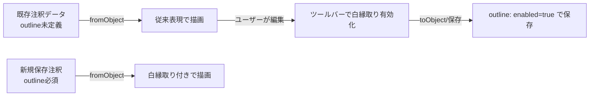

**Phase breakdown**:
- **Phase 1**（リリース直後）: 新規注釈は白縁取り有効で保存。既存注釈は従来表現のまま、ユーザー編集時のみ新属性が乗る
- **Phase 2**（任意・別Spec）: 一括マイグレーションで既存矢印・テキストに白縁取りを付与する場合、バッチを別途実装

**Rollback triggers**:
- Group 化 Arrow の描画パフォーマンスが 60fps を切る（research.md R1 が失敗）
- `paintFirst: 'stroke'` で既存マルチバイトテキストの表示崩れが発生（research.md R3 が失敗）

上記いずれかが発覚した場合、`outline`/`textOutline` の `enabled=false` を既定にし、UIトグルで opt-in 方式にする。

---

## Requirements 31-32: 画像一括ZIPエクスポート・白縁取り対象の全形状拡張

### Overview

**Purpose**: 現場調査画像の一括 ZIP エクスポート（Req 31）と、白縁取り対象を矢印・テキスト以外の 6 形状（寸法線・円・四角形・多角形・折れ線・フリーハンド）へ拡張する（Req 32）。両者は独立したスコープだが、Req 31 の「注釈含む」設定時のレンダリングが Req 32 の対象 6 形状に依存するため、同一スペック内で整合させる。

**Users**: 数十枚規模の現場写真を 1 件ずつでなくまとめて配布したい現場調査担当者と、屋外現場写真の任意背景で全形状の注釈を確実に視認したい現場調査担当者。

**Impact**: 既存の個別画像エクスポート基盤（`ImageExportDialog`, `ExportService`, `AnnotationRendererService.renderImages()`）と、Requirements 24-30 で確立された Group ベース白縁取りパターン（Arrow）を踏襲して拡張する。バックエンド DB スキーマと API は無変更。フロントエンドに `jszip` を新規依存として追加する。

#### Goals
- 現場調査配下の全画像または選択画像を、Req 12 と同一の設定（形式・解像度・注釈含む/含まない・元画像そのまま）でまとめて単一 ZIP としてダウンロードできる
- 進捗可視化とキャンセル可能なフロー、部分失敗時のユーザー選択肢を提供する
- 寸法線・円・四角形・多角形・折れ線・フリーハンドの 6 形状に Arrow と同等仕様の白縁取りを適用する
- 白縁取りなし既存データの後方互換を維持する
- 既存 Requirement 12（個別エクスポート）と Requirement 24/25 の責務境界・コードは破壊しない

#### Non-Goals
- 一括エクスポートにおける PDF 単一ファイル出力（Req 11 のスコープ）
- バック側 ZIP ジョブ化・非同期化・中断レジューム
- 形状別の白縁取りカスタマイズパラメータ（縁取り幅倍率の形状別調整等）
- 番号付きマーカー・ハイライター・トリミング等の新ツール種別（既存 Out of Scope 継承）

### Boundary Commitments

#### This Spec Owns
- `bulkExportService` の実装と所有（複数画像のレンダリング→ZIP 化→ダウンロード制御、進捗 callback、`AbortController` 対応）
- `BulkExportDialog`・`BulkExportProgressDialog`・`ExportSettingsForm`（個別/一括で共有する設定フォーム部）の実装と所有
- 詳細画面が描画する画像一覧部品 `PhotoManagementPanel` への複数選択 UI（チェックボックス）と選択 state の追加（要件10.1 のとおり詳細画面はサムネイル一覧を持たず、画像一覧は本部品が担う）
- 現場調査詳細画面ツールバー上の「全件一括エクスポート」「選択画像エクスポート」エントリポイント
- 6 形状（Rectangle/Circle/Polygon/Polyline/Freehand/Dimension）のカスタムクラスを Group 化し、`outline: ShapeOutlineAttribute` 属性をシリアライズ可能にする
- `annotation-style-tokens.ts` への `ShapeOutlineAttribute` 共通型と 6 形状向け既定値の追加
- Dimension の寸法値ラベルに対する `paintFirst: 'stroke'` 白アウトライン（Req 25 の TextTool パターンを Dimension 内部 `FabricText` に適用）。線部の `outline` とラベル部の `labelOutline` は独立した 2 属性として保持し、UI は当面 1 トグルで両者を同期する設計
- ZIP 内ファイル命名規則ユーティリティ（個別エクスポートと整合）

#### Out of Boundary
- バックエンド DB スキーマ・API の変更（注釈 JSON の任意属性追加で完結）
- `ImageExportDialog`（Req 12）本体の挙動変更（共有フォーム抽出のみで個別エクスポート挙動は不変）
- Requirements 11 の PDF 報告書出力経路（バッチ注釈取得・PDF レイアウト）
- Requirements 22 の画像回転、Req 23 のサムネイル再生成パイプライン本体（新属性が透過的に流れることのみ確認）
- 白縁取りの全画像一括マイグレーション（既存データへの遡及付与）
- `SurveyImageGrid`（Task 115.55 で撤去済み）。同部品にも同等の選択欄が実装されていたが、どの画面からも描画されておらず（参照は barrel export・自身の単体テスト・Storybook のみ）、本要件の観測可能な経路には関与していなかった。要件10.1 が詳細画面について「サムネイル一覧は表示しない」と定めている以上、サムネイルグリッドである同部品には結線先が存在しない。画像一覧の責務は `PhotoManagementPanel` が単独で担う（表示順ソート・ドラッグでの順序変更・選択欄・報告書出力フラグをすべて備える上位互換）。要件31.2・31.3 の検証は `PhotoManagementPanel` の単体検証と E2E が担保する

#### Allowed Dependencies
- 新規外部依存: `jszip`（最新メジャー、MIT、actively maintained）。フロント `package.json` に追加
- 既存内部依存: `AnnotationRendererService.renderImages()`、`ExportService.downloadFile()` / `exportImage()` / `downloadOriginal()`、`useFabricUndoIntegration`、`UndoManager`、`annotation-style-tokens.ts`（Req 24-30 で確立）
- Fabric.js 7.3.1 標準 API（`Group`, `Path`, `Polygon`, `Polyline`, `Ellipse`, `Rect`, `classRegistry`、`paintFirst: 'stroke'`、`strokeUniform: true`）
- ブラウザ標準 `AbortController`, `Blob`, `URL.createObjectURL`

#### Revalidation Triggers
- `AnnotationRendererService` のレンダリング契約（入出力型、非同期挙動）変更
- 注釈 JSON スキーマに必須属性を追加する場合（任意属性のみのため通常該当しない）
- 個別エクスポートの設定構造（`ExportSettings` 型）変更
- Fabric.js のメジャーバージョン更新（Group 子要素の `toObject`/`fromObject` 互換性）
- 6 形状の `classRegistry` type ID（`'rectangle'`, `'circle'`, `'polygon'`, `'polyline'`, `'freehand'`, `'dimension'`）の変更

### Architecture

#### Existing Architecture Analysis

- フロント完結スコープ。バックエンドは既存 `survey-images.routes.ts`（署名付き URL 発行）と `annotation.routes.ts`（注釈 JSON 読取）をそのまま利用。Prisma スキーマ無変更
- 個別エクスポートの 3 層（ダイアログ UI / `ExportService` / `AnnotationRendererService`）が確立済み。一括化は最下層 `renderImages()` を呼ぶ薄い coordinator を追加する形で吸収可能
- 6 形状の現行ツールは `extends Rect | Ellipse | Polygon | Polyline | Path` の単一クラス。白縁取りには Arrow が確立した Group 化パターン（`outlineShape + bodyShape`）を踏襲する
- `annotation-style-tokens.ts` には既に `ArrowOutlineAttribute` / `TextOutlineAttribute` と `ANNOTATION_DEFAULTS` の枠組みが整備済み（Req 26 の成果）

#### Architecture Pattern & Boundary Map

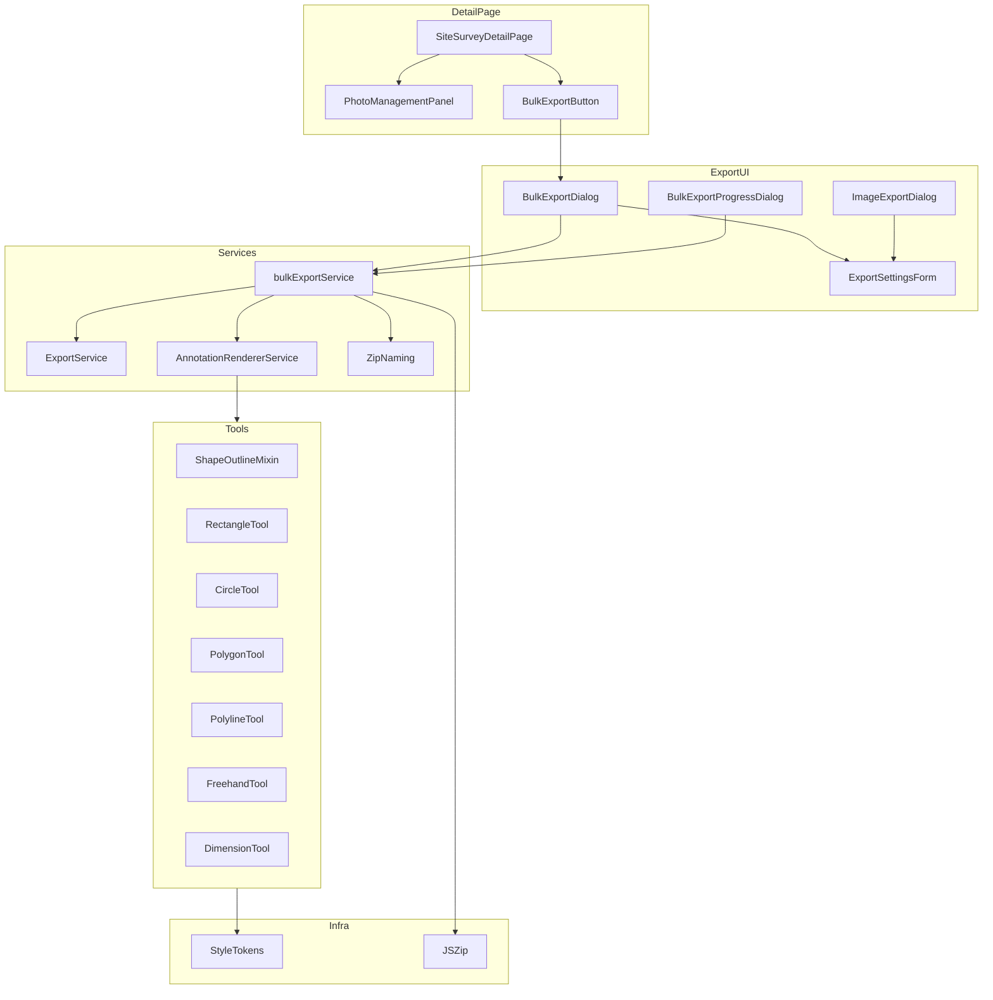

**Architecture Integration**:
- Pattern: 既存 3 層エクスポート構造（Dialog → Service → Renderer）に、coordinator `bulkExportService` と進捗 UI を追加。`ExportSettingsForm` を個別/一括で共有することで設定 UI の二重実装を回避
- 6 形状の白縁取りは Tool 層のみで吸収。Renderer / Editor は無変更（既存 `enlivenObjects` 経路で属性が自動復元）
- Dependency direction: `Infra (StyleTokens, JSZip) → Tools → Services → ExportUI → DetailPage`。下位レイヤから上位への依存は禁止
- Steering compliance: TypeScript strict、ESLint、既存 `services/*Service.ts` パターン、React 19 標準 API、テスト構成

#### Technology Stack

| Layer | Choice / Version | Role in Feature | Notes |
|-------|------------------|-----------------|-------|
| ZIP Library | `jszip` ^3 系（最新） | クライアントサイド ZIP 生成（Blob 出力、`generateAsync` のストリーム書き込み） | フロント `package.json` 新規追加。`tech.md` 更新対象 |
| Canvas Library | Fabric.js 7.3.1 | 6 形状の Group 化、`paintFirst: 'stroke'`（Dimension ラベル） | 既存。新規 API 利用なし |
| Frontend Framework | React 19.2.0 + TypeScript 5.9.3 | BulkExportDialog / ProgressDialog / PhotoManagementPanel 拡張 | 既存スタック |
| Cancellation | ブラウザ標準 `AbortController` | 一括処理中断 | 追加依存なし |

選定理由概要は本表で十分。詳細トレードオフ（jszip 採用根拠、メモリ上限の推定、archiver との比較）は `research.md` の R6/R7 を参照。

### File Structure Plan

#### Directory Structure

以下のツリーは**各ブロック見出しがリポジトリルートからの相対パス**（呼称規約1）であり、配下の行はその直下の実配置を表す。各行の区分（`新規` / `変更`。`新規（同上）` は直前行と同趣旨の `新規`、`変更（検証中心）` は `変更` に注記を添えたもの）は**本節を書いた時点の計画であり、現況ではない**。実装が進んだ後も区分値は書き換えない（`新規` の行も現在は実在する）。現況の権威は区分値ではなく**パスの実在**であり、**配置そのものは実装の実配置と一致していなければならない**。続く「Modified Files（主要変更点サマリー）」小節は行に区分の列を持たず、小見出し自体が `変更` の区分を担う。この区分も同じく本節を書いた時点の計画である。

```
frontend/src/services/
└── ExportService.ts                      # 変更: 個別エクスポート共有ユーティリティを bulk からも参照（`export/` 配下ではない）

frontend/src/services/export/
├── bulkExportService.ts                  # 新規: 複数画像レンダ → JSZip → ダウンロード coordinator
├── zip-naming.ts                         # 新規: ZIP 内ファイル名規則ユーティリティ
└── AnnotationRendererService.ts          # 変更（検証中心）: 6形状 Group 版が toDataURL で正しく出るかテスト追加

frontend/src/components/site-surveys/
├── BulkExportDialog.tsx                  # 新規: 全件/選択の起動 + ExportSettingsForm + 開始ボタン
├── BulkExportProgressDialog.tsx          # 新規: 件数/割合プログレス + キャンセルボタン + 部分失敗時の選択肢
├── ExportSettingsForm.tsx                # 新規: 形式/解像度/注釈含む/原本出力 のフォーム本体（個別/一括で共有）
├── ImageExportDialog.tsx                 # 変更: 設定フォーム部を ExportSettingsForm に置換、ロジックは維持
├── PhotoManagementPanel.tsx              # 変更: 各写真へチェックボックス追加、選択 state 連携
├── annotation-style-tokens.ts            # 変更: ShapeOutlineAttribute 共通型と 6 形状向け既定値追加（rectangleOutline 等）
└── tools/
    ├── registerCustomShapes.ts           # 変更: 6 形状の Group 版を再登録（type ID は維持）
    ├── RectangleTool.ts                  # 変更: Rectangle extends Group（outlineRect + bodyRect）
    ├── CircleTool.ts                     # 変更: Circle extends Group（outlineEllipse + bodyEllipse）
    ├── PolygonTool.ts                    # 変更: Polygon extends Group（outlinePolygon + bodyPolygon）
    ├── PolylineTool.ts                   # 変更: Polyline extends Group（outlinePolyline + bodyPolyline）
    ├── FreehandTool.ts                   # 変更: Freehand extends Group（outlinePath + bodyPath）
    └── DimensionTool.ts                  # 変更: Dimension extends Group（outlineLine + bodyLine + labelText with paintFirst）

frontend/src/pages/
└── SiteSurveyDetailPage.tsx              # 変更: 「全件一括エクスポート」「選択画像エクスポート」ボタンを追加（後者は選択 1 件以上時のみ活性）、選択集合を PhotoManagementPanel と同期

frontend/src/__tests__/services/export/
├── bulkExportService.test.ts             # 新規: 順次レンダ・ZIP 構築・進捗 callback・キャンセル・部分失敗の各経路
└── zip-naming.test.ts                    # 新規: 命名規則の決定論性、重複時のサフィックス

frontend/src/__tests__/components/site-surveys/
├── BulkExportDialog.test.tsx             # 新規: 起動・設定確定・対象 0 件の非活性表示
├── BulkExportProgressDialog.test.tsx     # 新規: 進捗表示・キャンセル・部分失敗ユーザー選択
├── ExportSettingsForm.test.tsx           # 新規: フォーム単体の挙動・既定値
└── tools/
    ├── RectangleTool.outline.test.ts     # 新規: Group化・toObject/fromObject・後方互換
    ├── CircleTool.outline.test.ts        # 新規（同上）
    ├── PolygonTool.outline.test.ts       # 新規（同上）
    ├── PolylineTool.outline.test.ts      # 新規（同上）
    ├── FreehandTool.outline.test.ts      # 新規（同上）
    └── DimensionTool.outline.test.ts     # 新規: 寸法線 Group化 + ラベル paintFirst・寸法値変更時の追従

e2e/specs/site-surveys/
├── site-survey-bulk-export.spec.ts       # 新規: 全件/選択 ZIP、設定反映、進捗、キャンセル、部分失敗
└── site-survey-all-shape-outline.spec.ts # 新規: 6 形状すべて白縁取り保存→リロード→復元
```

#### Modified Files（主要変更点サマリー）

以下の箇条書きのパスは**リポジトリルートからの相対パス**（呼称規約1）であり、上のツリーと基準は同じである。**パスそのものは実装の実配置と一致していなければならない**。

- `frontend/src/services/export/AnnotationRendererService.ts` — 既存 `renderImages()` を `bulkExportService` から呼ぶため、`onProgress(index, total)` callback と `signal: AbortSignal` 引数を追加する後方互換拡張（既存呼び出し箇所は引数省略で従来挙動）。Group 化 6 形状の `enlivenObjects` 復元・`toDataURL` 出力をテストで検証
- `frontend/src/services/ExportService.ts` — `getExportSettings()` 型を `ExportSettings` インターフェースとして export し、個別/一括双方が同型を受領できるよう公開
- `frontend/src/components/site-surveys/ImageExportDialog.tsx` — `ExportSettingsForm` を埋め込む形にリファクタ。ロジックは維持
- `frontend/src/components/site-surveys/PhotoManagementPanel.tsx` — 各写真にチェックボックスを追加。`selectedImageIds: Set<string>` を親（SiteSurveyDetailPage）から受け、`onSelectionChange` で同期。両 props 未指定時は選択欄を表示しない（既存呼び出し箇所への後方互換）
- `frontend/src/pages/SiteSurveyDetailPage.tsx` — 詳細画面アクション領域に「全件一括エクスポート」「選択画像エクスポート（N 件）」ボタンを追加。後者は選択 0 件で disabled
- `frontend/src/components/site-surveys/annotation-style-tokens.ts` — `ShapeOutlineAttribute = { enabled, color, width }` を export。`ArrowOutlineAttribute` は同型を維持（型エイリアス化で重複排除可）。`ANNOTATION_DEFAULTS` に `rectangleOutline`/`circleOutline`/`polygonOutline`/`polylineOutline`/`freehandOutline`/`dimensionOutline` を追加、いずれも `enabled: true` 既定
- `frontend/src/components/site-surveys/tools/registerCustomShapes.ts` — `classRegistry.setClass('rectangle', Rectangle)` 等を Group 版で再登録（type ID 不変）
- `frontend/src/components/site-surveys/tools/RectangleTool.ts` / `frontend/src/components/site-surveys/tools/CircleTool.ts` / `frontend/src/components/site-surveys/tools/PolygonTool.ts` / `frontend/src/components/site-surveys/tools/PolylineTool.ts` / `frontend/src/components/site-surveys/tools/FreehandTool.ts` — 各クラスを `extends Group` にリファクタ。内部に `outlineShape + bodyShape` の 2 オブジェクトを保持し、Arrow と同形の `setOutline/getOutline/toObject/fromObject` を実装
- `frontend/src/components/site-surveys/tools/DimensionTool.ts` — 寸法線部を Group 化（`outlineLine + bodyLine`）、寸法値ラベルの `FabricText` に `paintFirst: 'stroke'` + `stroke: '#ffffff'` + `strokeWidth = fontSize * 0.12` + `strokeUniform: true` を適用（Req 32 #12）
- `frontend/package.json` — `dependencies` に `jszip` を追加

### System Flows

#### 一括エクスポートフロー（Req 31）

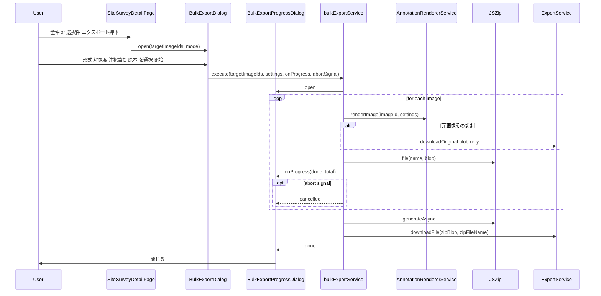

**Key decisions**:
- `bulkExportService.execute()` が `AbortSignal` を受領し、ループ中で `signal.aborted` を毎回確認して即時中断（Req 31 #11-12）
- 各画像の処理失敗は配列にエラー集約し、最後にユーザーに「成功分のみで ZIP を取得 / 中止」のいずれかを選ばせる（Req 31 #14）
- 「元画像そのまま出力」（Req 31 #18）は `renderImage()` を経由せず `ExportService.downloadOriginal()` 相当の R2 fetch を行い、注釈・回転・サムネイル再生成を反映しない
- 対象 0 件時（Req 31 #15）は `execute()` 開始前に `BulkExportDialog` 側でガード

#### 6 形状の白縁取りレンダリング構造（Req 32）

```mermaid
graph TB
    subgraph RectangleGroup
        OutlineRect[outlineRect<br/>stroke=white<br/>strokeWidth=body*1.5<br/>fill=transparent]
        BodyRect[bodyRect<br/>stroke=bodyColor<br/>strokeWidth=body<br/>fill=bodyFill]
    end

    subgraph DimensionGroup
        OutlineLine[outlineLine<br/>stroke=white wider]
        BodyLine[bodyLine<br/>stroke=bodyColor]
        LabelText[labelText IText<br/>paintFirst=stroke<br/>stroke=white]
    end

    OutlineRect -.below.-> BodyRect
    OutlineLine -.below.-> BodyLine
    BodyLine -.> LabelText
```

**Key decisions**:
- Group 内の描画順序は `outline → body` の順。Arrow と同一規約
- 塗りつぶしあり 3 形状（Rectangle/Circle/Polygon）の `outlineShape` は `fill: 'transparent'`、本体側で `fill` を担当（塗りの二重描画を回避）
- 開放形状 2 種（Polyline/Freehand）の `outlineShape` は同一頂点列の Polyline/Path コピー、`strokeLineCap: 'round'` で線端を揃える
- Dimension の `labelText` は `TextOutlineAttribute` を共有せず、Dimension 全体の `outline.enabled` に連動する（実装簡素化、Req 32 #12 は満たす）

### Requirements Traceability

| Requirement | Summary | Components | Interfaces | Flows |
|-------------|---------|------------|------------|-------|
| 31.1, 31.2, 31.3 | 全件/選択の起動、0 件時非活性 | SiteSurveyDetailPage, PhotoManagementPanel, BulkExportDialog | `BulkExportDialogProps` | 一括エクスポートフロー |
| 31.4, 31.5, 31.6 | 設定 UI 共有・設定一括適用・レンダリング仕様継承 | ExportSettingsForm, bulkExportService, AnnotationRendererService, BulkExportDialog | `ExportSettings`, `BulkExportInput` | 一括エクスポートフロー |
| 31.7, 31.8, 31.9 | ZIP 単一ファイル化・命名規則・ZIP ファイル名 | bulkExportService, zip-naming | `ZipNamingStrategy` | 一括エクスポートフロー |
| 31.10, 31.11, 31.12 | 進捗可視化・キャンセル可能・中断時 ZIP 非生成 | BulkExportProgressDialog, bulkExportService | `BulkExportProgress`, AbortSignal | 一括エクスポートフロー |
| 31.13, 31.14 | 部分失敗エラー集約・ユーザー選択 | bulkExportService, BulkExportProgressDialog | `BulkExportFailure`, `PartialFailureChoice` | 一括エクスポートフロー |
| 31.15 | 対象 0 件時の通知 | BulkExportDialog | dialog precondition | - |
| 31.16 | アクセス制御適用 | bulkExportService（既存 API 経由）, SiteSurveyDetailPage | 既存 Req 14 経路 | - |
| 31.17 | 注釈含む時の白縁取り適用 | AnnotationRendererService（既存 enlivenObjects 経路） | - | - |
| 31.18 | 原本出力時の注釈・回転・サムネイル非反映 | bulkExportService, ExportService.downloadOriginal | original branch | 一括エクスポートフロー |
| 31.19 | 中間生成物の非残存 | bulkExportService finalize | finalize hook | - |
| 32.1-32.7, 32.9-32.10 | 6 形状の白縁取り共通仕様（描画・変形・属性永続化・Undo・後方互換） | Rectangle/Circle/Polygon/Polyline/Freehand/Dimension Tools, StyleTokens, AnnotationToolbar（要件32.5 の切替UI）, AnnotationEditor（要件32.10 の取り消し記録）, registerCustomShapes | `ShapeOutlineAttribute`, 各 Tool の `setOutline/toObject/fromObject` | 6 形状レンダリング構造 |
| 32.8 | 出力経路（サムネイル/PDF/個別/一括）の整合 | AnnotationRendererService, PdfReportService, bulkExportService | 既存 enlivenObjects 経路 | - |
| 32.11, 32.13 | 既定値・既定スタイル一元管理 | annotation-style-tokens, AnnotationToolbar, FreehandTool | `ANNOTATION_DEFAULTS` 拡張 | - |
| 32.12 | 寸法値ラベルの白アウトライン（Req 25 同形の `TextOutlineAttribute` を独立属性で保持） | DimensionTool（labelText paintFirst, labelOutline 属性） | `TextOutlineAttribute`, `Dimension.setLabelOutline/getLabelOutline` | 6 形状レンダリング構造 |
| 32.14 | サムネイル再生成連動 | 既存 Req 23 パイプライン（変更不要） | - | - |

### Components and Interfaces

#### Component Summary

| Component | Domain/Layer | Intent | Req Coverage | Key Dependencies (P0/P1) | Contracts |
|-----------|--------------|--------|--------------|--------------------------|-----------|
| bulkExportService | Services | 複数画像レンダ→ZIP→DL の coordinator、進捗・キャンセル・部分失敗 | 31.4-31.19 | AnnotationRendererService (P0), ExportService (P0), JSZip (P0) | Service, State |
| zip-naming | Services | ZIP 内ファイル名規則 | 31.8, 31.9 | - | Pure utility |
| ExportSettingsForm | UI | 形式・解像度・注釈含む・原本のフォーム本体 | 31.4 | StyleTokens (P1) | UI props |
| BulkExportDialog | UI | 起動 + 設定確定 | 31.1-31.5, 31.15 | ExportSettingsForm (P0), bulkExportService (P0) | UI props |
| BulkExportProgressDialog | UI | 進捗・キャンセル・部分失敗時の選択肢 | 31.10-31.14 | bulkExportService (P0) | UI props |
| PhotoManagementPanel (ext) | UI | チェックボックス・選択 state 連携 | 31.2, 31.3 | SiteSurveyDetailPage (P0) | UI props |
| Rectangle (Group) | Tools | 白縁取り付き矩形 | 32.* (Rect分) | Fabric Group/Rect (P0), StyleTokens (P1) | State, Serialization |
| Circle (Group) | Tools | 白縁取り付き円/楕円 | 32.* (Ellipse分) | Fabric Group/Ellipse (P0), StyleTokens (P1) | State, Serialization |
| Polygon (Group) | Tools | 白縁取り付き多角形 | 32.* (Polygon分) | Fabric Group/Polygon (P0), StyleTokens (P1) | State, Serialization |
| Polyline (Group) | Tools | 白縁取り付き折れ線 | 32.* (Polyline分) | Fabric Group/Polyline (P0), StyleTokens (P1) | State, Serialization |
| Freehand (Group) | Tools | 白縁取り付きフリーハンド | 32.* (Path分) | Fabric Group/Path (P0), StyleTokens (P1) | State, Serialization |
| Dimension (Group) | Tools | 線部に `outline`、ラベル部に `labelOutline` の独立2属性。UI は 1 トグルで同期 | 32.* + 32.12 | Fabric Group/Path/IText (P0), StyleTokens (P1) | State, Serialization |
| AnnotationStyleTokens (ext) | Infra | `ShapeOutlineAttribute` 共通型と 6 形状向け既定値（Dimension は label 用 `TextOutlineAttribute` も追加） | 32.11, 32.13 | - | Config module |

#### Services Layer

##### bulkExportService

| Field | Detail |
|-------|--------|
| Intent | 複数画像を Req 12 と同一の単一画像レンダリングを順次適用して JSZip に格納、進捗 callback とキャンセルを提供する coordinator |
| Requirements | 31.4, 31.5, 31.6, 31.7, 31.10, 31.11, 31.12, 31.13, 31.14, 31.16, 31.17, 31.18, 31.19 |

**Responsibilities & Constraints**
- 入力: `images: SurveyImageMetadata[]`、`settings: ExportSettings`、`onProgress: (done, total, failedSoFar) => void`、`signal: AbortSignal`
- 出力: `Promise<BulkExportResult>` = `{ status: 'success' | 'partial' | 'cancelled', zipBlob?: Blob, failures: BulkExportFailure[] }`
- 各画像で `AnnotationRendererService.renderImage(image, settings)` を呼び、戻り Blob を `zip.file(name, blob)` に追加
- 「元画像そのまま」時は `ExportService.downloadOriginal(image)` 相当の R2 fetch のみ実行（注釈・回転・サムネイル非反映）
- `signal.aborted` を各反復で確認、true なら ZIP 生成せず `status: 'cancelled'` で resolve
- 失敗画像は `failures` 配列に集約し、ループ継続。最終的に `BulkExportProgressDialog` 側でユーザー選択（成功分のみ ZIP 生成 / 中止）に委ねる
- 完了またはキャンセル時、内部で保持した一時 Blob / Promise を解放（Req 31 #19）
- アクセス制御は既存の画像取得 API 経路が担保（Req 14、Req 31 #16）

**Dependencies**
- Inbound: BulkExportDialog（execute 呼出）、BulkExportProgressDialog（進捗購読・キャンセル）
- Outbound: AnnotationRendererService.renderImage (P0)、ExportService.downloadOriginal/downloadFile (P0)
- External: JSZip (P0)

**Contracts**: Service [x], State [x]

##### Service Interface

```typescript
type ExportFormat = 'jpeg' | 'png';
type ExportResolution = 'low' | 'medium' | 'high';
type AnnotationMode = 'include' | 'exclude' | 'original-only';

interface ExportSettings {
  format: ExportFormat;
  resolution: ExportResolution;
  annotationMode: AnnotationMode;
}

interface BulkExportInput {
  surveyId: string;
  surveyName: string;
  images: SurveyImageMetadata[];
  settings: ExportSettings;
}

interface BulkExportProgress {
  done: number;
  total: number;
  failedSoFar: number;
}

interface BulkExportFailure {
  imageId: string;
  imageName: string;
  reason: 'render' | 'fetch' | 'unknown';
  message: string;
}

interface BulkExportResult {
  status: 'success' | 'partial' | 'cancelled';
  zipBlob?: Blob;
  zipFileName?: string;
  failures: BulkExportFailure[];
}

interface BulkExportService {
  execute(
    input: BulkExportInput,
    onProgress: (progress: BulkExportProgress) => void,
    signal: AbortSignal
  ): Promise<BulkExportResult>;
}
```

- Preconditions: `images.length >= 1`、`signal` は abort 前
- Postconditions: `status === 'success'` のとき `zipBlob` および `zipFileName` 必須。`status === 'cancelled'` のとき `zipBlob` 未設定
- Invariants: 進捗 callback の `done <= total` を常時満たす

**Implementation Notes**
- Integration: `BulkExportDialog` が `AbortController` を作成し `signal` を渡す。キャンセルボタン押下で `controller.abort()`
- Validation: ZIP 内ファイル名重複時のサフィックス付与は `zip-naming` ユーティリティに委ねる。`settings.annotationMode === 'original-only'` のときは `renderImage` をスキップして `downloadOriginal` で blob 取得
- Risks: クライアントメモリ上限（research.md R6）。Phase 1 では 100 枚を超える対象を `BulkExportDialog` 側で警告するだけのソフトガード。100 枚超で OOM が観測されれば Phase 2 でバック側 ZIP 化を別 Spec として検討（Out of Boundary）

##### zip-naming

| Field | Detail |
|-------|--------|
| Intent | ZIP 内ファイル名規則および ZIP ファイル名の決定論的生成 |
| Requirements | 31.8, 31.9 |

**Service Interface**

```typescript
interface ZipNamingInput {
  surveyName: string;
  exportedAt: Date;
  image: SurveyImageMetadata;
  index: number;
  format: ExportFormat;
}

interface ZipNamingStrategy {
  buildEntryName(input: ZipNamingInput, existingNames: Set<string>): string;
  buildZipFileName(surveyName: string, exportedAt: Date): string;
}
```

**Implementation Notes**
- ZIP 内エントリ名: `{index 3桁ゼロパディング}_{画像表示名サニタイズ}.{拡張子}`。既存個別エクスポート命名（`ExportService.exportImage()` の名前生成）と整合
- 重複検出時は `_2`, `_3` のようなサフィックスを付与
- ZIP ファイル名: `{現場調査名サニタイズ}_{YYYYMMDD_HHmmss}.zip`
- サニタイズ規則: パス区切り文字とコロンを `_` に置換、長さ 80 文字制限

#### UI Layer

##### ExportSettingsForm

| Field | Detail |
|-------|--------|
| Intent | 形式・解像度・注釈含む/含まない・原本出力の選択フォーム本体（個別/一括で共有） |
| Requirements | 31.4 |

**Shared Props Base**

```typescript
interface ExportSettingsFormProps {
  value: ExportSettings;
  onChange(next: ExportSettings): void;
  disabled?: boolean;
}
```

**Implementation Notes**
- 既存 `ImageExportDialog.tsx` 内の選択 UI ロジックを抽出
- 「注釈含む」と「元画像そのまま」は択一として `annotationMode: 'include' | 'exclude' | 'original-only'` で表現（research.md R8 を反映）
- 個別エクスポートは `annotationMode === 'exclude'` 時に「注釈なし」、`'original-only'` 時に「元画像そのまま」と同等

##### BulkExportDialog

| Field | Detail |
|-------|--------|
| Intent | 「全件」「選択」起動を受け、ExportSettingsForm で設定を確定して bulkExportService を起動 |
| Requirements | 31.1, 31.2, 31.3, 31.4, 31.5, 31.15 |

**Shared Props Base**

```typescript
interface BulkExportDialogProps {
  open: boolean;
  mode: 'all' | 'selected';
  targetImageIds: string[];
  surveyId: string;
  surveyName: string;
  onClose(): void;
  onStart(controller: AbortController): void;  // ProgressDialog へ移譲
}
```

**Implementation Notes**
- 対象 0 件時は dialog を閉じてユーザーに通知（Req 31 #15）
- 「開始」押下時に `AbortController` を作成、`bulkExportService.execute(...)` を呼び、`BulkExportProgressDialog` に処理を引き継ぐ

##### BulkExportProgressDialog

| Field | Detail |
|-------|--------|
| Intent | 進捗の可視化、キャンセル、部分失敗時のユーザー選択 |
| Requirements | 31.10, 31.11, 31.12, 31.13, 31.14 |

**Shared Props Base**

```typescript
interface BulkExportProgressDialogProps {
  open: boolean;
  promise: Promise<BulkExportResult>;
  controller: AbortController;
  onClose(result: BulkExportResult | null): void;
}

type PartialFailureChoice = 'download-partial' | 'cancel';
```

**Implementation Notes**
- `promise` の進捗購読は `bulkExportService` 内で外部にイベントを発する設計とし、本ダイアログは `useEffect` で subscribe
- 部分失敗発生時は「N 件失敗。成功分（M 件）のみダウンロードしますか？」のサブダイアログで `PartialFailureChoice` を取得
- 部分失敗サブダイアログは件数の案内に加えて `BulkExportResult.failures` を 1 件ずつ列挙する（要件31.13）。各行は `imageName` と、`reason`（`render` / `fetch` / `unknown`）を利用者向け日本語へ写した文言を示し、`message` があれば補足として添える。写し替えは本ダイアログ内の `failureReasonLabel` が担う。件数だけでは「どの画像がどの理由で失敗したか」を知る手段が画面に無く、要件31.13 を満たさないため（タスク 115.103）
- キャンセル時は確認サブダイアログを挟まず即時中断（誤操作影響は小、再実行容易）

##### PhotoManagementPanel (ext)

| Field | Detail |
|-------|--------|
| Intent | 詳細画面が描画する画像一覧（要件10.1）の各写真にチェックボックスと選択 state を提供 |
| Requirements | 31.2, 31.3 |

**Implementation Notes**
- `selectedImageIds: Set<string>` を親（SiteSurveyDetailPage）から受領、変更は `onSelectionChange` で親に通知
- 既存のドラッグ順序変更・メタデータ入力・削除操作は無変更
- チェックボックスは `selectedImageIds` と `onSelectionChange` の両方が渡されたときのみ表示（両 props は任意で、未指定の既存呼び出し箇所は選択欄なしのまま動作する）

#### Tools Layer

##### Rectangle / Circle / Polygon / Polyline / Freehand（Group 化、共通仕様）

| Field | Detail |
|-------|--------|
| Intent | 各形状を `outlineShape + bodyShape` の Group で表現し、白縁取りを提供 |
| Requirements | 32.1, 32.2, 32.3, 32.4, 32.5, 32.6, 32.7, 32.9, 32.10, 32.11 |

**Responsibilities & Constraints（5 ツール共通）**
- 基底クラスを各形状の Fabric 標準クラス → `Group` へ変更
- Group 子: `outlineShape`（白・幅広）+ `bodyShape`（本体色・本体幅）
- `outlineShape.strokeWidth = bodyStrokeWidth + outlineWidth * 2`、`outlineShape.stroke = '#ffffff'`、`strokeLineCap: 'round'`、`strokeLineJoin: 'round'`
- 塗りつぶしあり 3 形状（Rectangle/Circle/Polygon）の `outlineShape.fill = 'transparent'`、`bodyShape.fill = bodyFill`
- 開放形状 2 種（Polyline/Freehand）は両 path とも `fill` 未使用
- `outline: ShapeOutlineAttribute` を保持。`enabled=false` のときは `outlineShape.opacity = 0`（Arrow と同方式）
- `type` ID（`'rectangle'` / `'circle'` / `'polygon'` / `'polyline'` / `'freehand'`）は維持（classRegistry 後方互換）
- 形状変形（端点移動・頂点追加/削除等）時、両 path を同期更新するヘルパーを各 Tool 内に実装

**Dependencies**（5 ツール共通）
- Inbound: AnnotationEditor — ツール選択→新規形状作成、選択ツールでの編集
- Outbound: Fabric Group + 各基底（Rect/Ellipse/Polygon/Polyline/Path）(P0)、StyleTokens (P1)
- External: Fabric.js 7.3.1 (P0)

**Contracts**: State [x], Serialization [x]

##### Service Interface（5 ツール共通形）

```typescript
interface ShapeOutlineAttribute {
  enabled: boolean;
  color: string;   // '#ffffff' 固定（将来拡張のためプロパティ保持）
  width: number;   // 片側幅。本体 strokeWidth * 0.75 を推奨既定
}

interface ShapeOutlineMethods<TJSON> {
  setOutline(next: Partial<ShapeOutlineAttribute>): void;
  getOutline(): ShapeOutlineAttribute | undefined;
  toObject(propertiesToInclude?: string[]): TJSON;
}

// 例: Rectangle
interface RectangleJSON {
  type: 'rectangle';
  left: number;
  top: number;
  width: number;
  height: number;
  stroke: string;
  strokeWidth: number;
  fill: string;
  outline?: ShapeOutlineAttribute;  // 未設定は従来表現（Req 32.9）
}

class Rectangle extends Group implements ShapeOutlineMethods<RectangleJSON> {
  setOutline(next: Partial<ShapeOutlineAttribute>): void;
  getOutline(): ShapeOutlineAttribute | undefined;
  override toObject(propertiesToInclude?: string[]): RectangleJSON;
  static override fromObject(object: RectangleJSON): Promise<Rectangle>;
}
// Circle / Polygon / Polyline / Freehand も同型パターン（基底プロパティのみ差替）
```

- Preconditions: 各形状のジオメトリパラメータが有効、`outline.width > 0`（enabled 時）
- Postconditions: `toObject` は `outline` 未設定なら当該フィールドを省略
- Invariants: `outlineShape.strokeWidth > bodyShape.strokeWidth`（enabled 時）、`type` 保持

**Implementation Notes**
- Integration: `registerCustomShapes.ts` での再登録。type ID 不変のため復元経路に影響なし
- Validation: 旧データ（標準クラスシリアライズ）は `type: 'rectangle'` 等を持ち、新 `fromObject` で復元される。`outline` 未定義は白縁取り無し（Req 32.9）
- Risks: Group 化による `objectCaching` のパフォーマンス（research.md R10）。Arrow と同方針で Group `objectCaching: false`、子 path `objectCaching: true` を初期値とし、100 オブジェクト配置時の FPS を計測。特に Freehand は path segment 数が多いため早期検証
- Migration 安全性: 各ツールの既存実装は標準 Fabric クラスへの直接 extends で、保存 JSON は Fabric 標準シリアライズ。`type` ID 不変のため `classRegistry` 経由で新 Group 版が透過的に復元する。`fromObject` 内で必須フィールドの型検証を行い、不正なら標準クラスへフォールバック + warning ログ

##### Dimension（Group + ラベル paintFirst、独立 2 属性）

| Field | Detail |
|-------|--------|
| Intent | 寸法線部に `ShapeOutlineAttribute`、寸法値ラベルに Req 25 と同等の `TextOutlineAttribute` を**独立して保持**する。UI は当面 1 トグルで両者を同期するが、データモデル上は分離する |
| Requirements | 32.1-32.7, 32.9-32.11, 32.12, 32.13 |

**Responsibilities & Constraints**
- Group 子: `outlineLine`（白・幅広）+ `bodyLine`（本体色）+ `labelText`（FabricText with paintFirst）
- 線の白縁取り: 5 ツール共通仕様と同形。`outline: ShapeOutlineAttribute` を保持し、`outlineLine.strokeWidth = bodyStrokeWidth + outline.width * 2`、`outlineLine.stroke = outline.color`（既定 `'#ffffff'`）
- ラベルの白アウトライン: `labelOutline: TextOutlineAttribute` を**独立属性として保持**（Req 25 と同形）。`labelText.paintFirst = 'stroke'`、`labelText.stroke = ANNOTATION_DEFAULTS.outlineColor`（既定 `'#ffffff'`。タスク 115.150 で literal から資材へ移した）、`labelText.strokeWidth = labelText.fontSize * labelOutline.widthRatio`、`labelText.strokeUniform = true`
- `outline.enabled = false` のとき: `outlineLine.opacity = 0`。`labelText` には影響しない
- `labelOutline.enabled = false` のとき: `labelText.stroke = ''`。`outlineLine` には影響しない
- 寸法値変更時 `labelText` の `set('text', newValue)` 後、`strokeWidth = fontSize * labelOutline.widthRatio` を再計算

**Dependencies**
- Inbound: AnnotationEditor — 寸法線ツール選択→2 点クリックで作成
- Outbound: Fabric Group/Path/IText (P0)、StyleTokens (P1)
- External: Fabric.js 7.3.1 (P0)

**Contracts**: State [x], Serialization [x]

##### Service Interface (Dimension)

```typescript
interface DimensionJSON {
  type: 'dimension';
  startPoint: Point;
  endPoint: Point;
  value: string;
  unit?: string;
  fontSize: number;
  stroke: string;
  strokeWidth: number;
  outline?: ShapeOutlineAttribute;       // 寸法線部の白縁取り（未設定は従来表現、Req 32.9）
  labelOutline?: TextOutlineAttribute;   // 寸法値ラベルの白アウトライン（未設定は従来表現、Req 32.12 を Req 25 と同形で実現）
}

class Dimension extends Group {
  setOutline(next: Partial<ShapeOutlineAttribute>): void;
  getOutline(): ShapeOutlineAttribute | undefined;
  setLabelOutline(next: Partial<TextOutlineAttribute>): void;
  getLabelOutline(): TextOutlineAttribute | undefined;
  setValue(value: string, unit?: string): void;
  override toObject(propertiesToInclude?: string[]): DimensionJSON;
  static override fromObject(object: DimensionJSON): Promise<Dimension>;
}
```

- Preconditions: `startPoint`/`endPoint` 有限値、`fontSize > 0`、`labelOutline.widthRatio ∈ [0, 1]`（enabled 時）
- Postconditions: `outline` と `labelOutline` は互いに独立に状態遷移する。`toObject` は未設定の任意属性をフィールドごと省略
- Invariants: `outlineLine.strokeWidth > bodyLine.strokeWidth`（outline 有効時）、`labelText.paintFirst === 'stroke'`（labelOutline 有効時）

**Implementation Notes**
- Integration: 既存 DimensionTool の Path + FabricText 生成箇所を Group 内構築に変更
- UI 同期方針: AnnotationToolbar の Dimension スタイルパネルでは**当面 1 つのトグル**で `setOutline({ enabled })` と `setLabelOutline({ enabled })` を同時に呼び、両者を一括 ON/OFF する。データモデルは独立だが UX は単純（将来「ラベルだけ ON」のニーズが出た場合は UI に 2 つ目のトグルを追加するのみで、スキーマ migration 不要）
- Validation: 旧データ復元時、`outline`/`labelOutline` いずれも未定義なら従来表現（白縁取り無し・ラベル paintFirst なし）。後方互換成立（Req 32.9）
- Risks: 独立 2 属性化により Dimension 内部 state の保持が増えるが、Arrow の `outline` + Text の `textOutline` という既存 2 系統と整合する形であり、認知負荷の増加は最小

#### Infra Layer

##### AnnotationStyleTokens (ext)

| Field | Detail |
|-------|--------|
| Intent | `ShapeOutlineAttribute` 共通型と 6 形状向け既定値を追加 |
| Requirements | 32.11, 32.13 |

**Service Interface**

```typescript
// 既存 ArrowOutlineAttribute / TextOutlineAttribute と並列
export interface ShapeOutlineAttribute {
  enabled: boolean;
  color: string;
  width: number;
}

// 型エイリアス整理（任意、実装で判断）
// export type ArrowOutlineAttribute = ShapeOutlineAttribute;

// ANNOTATION_DEFAULTS への追加
interface AnnotationToolDefaultsExt extends AnnotationToolDefaults {
  rectangleOutline: ShapeOutlineAttribute;        // enabled: true
  circleOutline: ShapeOutlineAttribute;           // enabled: true
  polygonOutline: ShapeOutlineAttribute;          // enabled: true
  polylineOutline: ShapeOutlineAttribute;         // enabled: true
  freehandOutline: ShapeOutlineAttribute;         // enabled: true
  dimensionOutline: ShapeOutlineAttribute;        // enabled: true（寸法線部）
  dimensionLabelOutline: TextOutlineAttribute;    // enabled: true, widthRatio: 0.12（寸法値ラベル、Req 25 と同形）
}
```

**Implementation Notes**
- Integration: 6 ツールが `ANNOTATION_DEFAULTS.{shape}Outline` を初期値として参照
- Validation: 単体テストで全 6 既定値が `enabled === true` かつ `width >= bodyStrokeWidth * 0.75` を確認（Req 32.2 / 32.11）
- Risks: 既存 Arrow の `ArrowOutlineAttribute` と共通型の重複。型エイリアス化は破壊変更なしで実施可能だが、本 Spec ではエイリアス化を任意とし実装判断に委ねる

##### 既定線幅から導かれる白縁取りの既定値（要件24.2 / 32.2 / 26.5）

要件26.1 の是正で既定線幅が 2 から 3 になった結果（タスク 115.60）、**六形状の白縁取りの既定の見た目が変わり、矢印は変わらなかった**。同じ既定値の変更が部位ごとに異なる結果を生むため、既定の見た目そのものを設計上の記録として固定する。値の出所は `frontend/src/components/site-surveys/annotation-style-tokens.ts` の `ANNOTATION_DEFAULTS` であり、片側幅の算出は同ファイルの `resolveShapeOutlineWidth`（六形状）と `resolveArrowOutlineWidth`（矢印）に分かれている。比率 `0.75` は両者が共有する単一の定数 `OUTLINE_WIDTH_RATIO` である。

| 部位 | 片側幅の算出 | 既定線幅 3 での片側幅 | 描画される縁取り線幅 | 本体線幅に対する比 | 既定線幅 2 のときの片側幅 |
|---|---|---|---|---|---|
| 六形状（四角形・円・多角形・折れ線・フリーハンド・寸法線の線部） | `max(2, ceil(本体線幅 × 0.75))` | **3** | 3 + 3×2 = **9** | 3.0 倍 | 2（変化あり: 2 → 3） |
| 矢印 | `max(1, round(本体線幅 × 0.75))` | **2** | 3 + 2×2 = **7** | 約 2.33 倍 | 2（変化なし） |

**なぜ結果が分かれるか**: 既定線幅 3 に比率を掛けた素の値はどちらも 2.25 で同一である。ここから六形状は**切り上げ**で 3、矢印は**四捨五入**で 2 になる。下限も六形状が 2、矢印が 1 で異なる（既定線幅 3 では下限は効かない）。既定線幅が 2 だった時期は素の値が 1.5 で、切り上げ 2 と下限 2 が一致し、四捨五入も 2 だったため両者が偶然同値だった。**この一致は偶然であり、既定線幅が変わると解消する。** 丸め方を統一しなかった理由はタスク 115.59 の判断（矢印の既定の見た目を変えないため）にある。

**既定線幅を再び変更する場合は、上表の 2 つの算出それぞれで片側幅と描画幅を検算し、本表を更新すること。**一方の算出だけで「縁取りは不変」と結論してはならない。

**要件との関係**: 描画される縁取り線幅が本体線幅の 1.5 倍以上であることを要件24.2（矢印）と要件32.2（六形状）が求める。既定線幅 3 では六形状 3.0 倍・矢印 約2.33 倍でいずれも満たす。選択可能な全線幅（1〜20）での比率充足は別途 `resolveShapeOutlineWidth` / `resolveArrowOutlineWidth` の単体検証が全件で主張しており、本表は既定値の見た目の記録に限る。

**影響を受けない算出**: 要件25 のテキスト白アウトラインと要件32.12 の寸法値ラベル白アウトラインは、片側幅ではなく `fontSize × widthRatio` で算出する。テキストは `ANNOTATION_DEFAULTS.fontSize`（16）× 0.12 = 1.92、寸法値ラベルは `frontend/src/components/site-surveys/annotation-style-tokens.ts` の `ANNOTATION_DEFAULTS.dimensionLabel.fontSize`（12）× 0.12 = 1.44 である（タスク 115.98 で `DimensionTool.ts` の `DEFAULT_LABEL_STYLE` から供給元を移した。上の「寸法値ラベルの既定スタイルを一元管理へ含める判断（要件26.5）」を参照）。**いずれも本体線幅を参照しないため、既定線幅の変更では変化しない。**

### Data Models

本拡張はバックエンド DB スキーマを変更しない。注釈 JSON の任意属性追加と、ZIP 内ファイル構造（永続化されない一時データ）のみ。

#### 注釈 JSON スキーマ拡張（後方互換）

```typescript
// 6 形状（拡張後）共通パターン
interface ShapeJSONExt {
  type: 'rectangle' | 'circle' | 'polygon' | 'polyline' | 'freehand';
  // ... 既存の形状固有フィールド
  outline?: ShapeOutlineAttribute;  // optional: 未設定は従来表現（Req 32.9）
}

interface DimensionJSON {
  type: 'dimension';
  startPoint: Point;
  endPoint: Point;
  value: string;
  unit?: string;
  fontSize: number;
  stroke: string;
  strokeWidth: number;
  outline?: ShapeOutlineAttribute;       // 寸法線部の白縁取り
  labelOutline?: TextOutlineAttribute;   // 寸法値ラベルの白アウトライン（独立属性、UI は当面 outline と同期）
}
```

**後方互換ルール**:
- 任意フィールド未設定のデータは従来表現で復元（Req 32.9、Req 24/25 と同方針）
- 新規保存時は `enabled` 明示（false でも保存）
- バックエンド `annotation.routes.ts` は JSON をそのまま受け流すため変更不要
- Dimension の独立 2 属性は UI 上 1 トグルで同期するが、将来 UI に 2 つ目のトグルを追加してもスキーマ migration 不要（独立属性化の効用）

#### ZIP 内構造（参考、永続化なし）

```
{現場調査名}_{YYYYMMDD_HHmmss}.zip
├── 001_{画像名1}.{ext}
├── 002_{画像名2}.{ext}
└── ...
```

### Error Handling

#### エラー戦略

- **画像レンダリング失敗（Req 31.13）**: `bulkExportService` が個別画像の Promise reject を捕捉、`failures` 配列へ集約。ループは継続
- **取得失敗（R2 fetch 失敗）**: 同上の集約経路。`reason: 'fetch'` で区別
- **部分失敗時のユーザー選択（Req 31.14）**: 全件完了後 `failures.length > 0` なら `BulkExportProgressDialog` でサブダイアログを開き、`download-partial` / `cancel` を取得
- **キャンセル（Req 31.11-12）**: `AbortSignal.aborted` を各反復で確認、true なら ZIP 生成せず `status: 'cancelled'` で resolve。中間生成物は finalize で破棄（Req 31.19）
- **対象 0 件（Req 31.15）**: `BulkExportDialog` が `execute()` 呼出前にガード、ユーザーへ通知
- **権限エラー（Req 31.16）**: 既存画像 API が 401/403 を返した場合、`failures.reason: 'fetch'` として集約後にダイアログで通知
- **ZIP 生成例外**: `JSZip.generateAsync` の reject 時、`status: 'partial'` または `'cancelled'` で resolve せず reject せず、フォールバックメッセージで通知して `failures` に system エラーとして 1 件追加
- **白縁取りレンダリング失敗（Req 32）**: Fabric Group の `add`/`remove` が例外を投げた場合、Sentry にログ送出 + `outline.enabled = false` でフォールバック
- **シリアライズ/復元失敗（Req 32）**: `fromObject` で `outline` が不正値なら警告ログ + 属性を drop して従来表現へフォールバック（Arrow/Text と同挙動）

### Testing Strategy

#### Unit Tests

- **bulkExportService**
  - 全件成功時に `status: 'success'` で ZIP が返る
  - 一部失敗時に `failures` が集約され、最終的に `download-partial` の選択を待つ
  - `signal.abort()` で即時中断、ZIP 未生成、`status: 'cancelled'`
  - 進捗 callback の `done` が単調増加
  - `annotationMode: 'original-only'` 時に `renderImage` ではなく `downloadOriginal` 系の経路が呼ばれる
- **zip-naming**
  - 重複ファイル名で `_2`, `_3` サフィックス付与
  - ZIP ファイル名がサニタイズ規則に従う
- **6 形状の Tool（各 3-5 項目）**
  - 白縁取り有効時に Group の子が 2 つ（outline + body）
  - `setOutline({ enabled: false })` で `outline.opacity === 0`
  - `toObject` → `fromObject` ラウンドトリップで `outline` が保持される
  - `outline` 未定義の旧データ復元で従来表現（Req 32.9）
- **DimensionTool（追加項目）**
  - `setOutline({ enabled: false })` で `outlineLine.opacity === 0` になるが、`labelText.stroke` は影響を受けない（独立属性の検証）
  - `setLabelOutline({ enabled: false })` で `labelText.stroke === ''` になるが、`outlineLine.opacity` は影響を受けない（独立属性の検証）
  - `setLabelOutline({ enabled: true, widthRatio: 0.15 })` で `labelText.strokeWidth === fontSize * 0.15`
  - `setValue()` 後に `labelText.strokeWidth === fontSize * labelOutline.widthRatio` 再計算
  - `toObject` → `fromObject` ラウンドトリップで `outline` と `labelOutline` がそれぞれ独立に保持される
  - 旧データ（`outline`/`labelOutline` ともに未定義）の復元で従来表現（Req 32.9）

#### Integration Tests

- **bulkExportService + AnnotationRendererService**: 5 画像 × 「注釈含む」設定でレンダリング → ZIP に 5 ファイル含まれる → 各ファイル名が重複なく命名規則どおり
- **bulkExportService + ExportService.downloadOriginal**: 「元画像そのまま」設定で R2 fetch のみ走り、注釈なし原本が ZIP に含まれる
- **6 形状 + AnnotationRendererService**: Group 版各形状を `toDataURL` で書き出し、dataURL 内に白縁取り相当のピクセル（白）が含まれる（色サンプリング検証）
- **6 形状 + Save/Load**: `outline` 設定後 → 保存 → 再取得 → 復元
- **Dimension + ラベル paintFirst**: 寸法値ラベルが `paintFirst='stroke'` で描画される

#### E2E Tests（Playwright、スマホ + デスクトップ Viewport 両方）

- 現場調査詳細で「全件一括エクスポート」→ 設定 → 開始 → 進捗表示 → ZIP がダウンロード
- 画像 3 件をチェックボックス選択 →「選択画像エクスポート」→ ZIP 内に 3 件のみ
- 進捗中にキャンセル → ZIP がダウンロードされない
- 6 形状を 1 つずつ描画 → 保存 → リロード → 全形状に白縁取りが復元
- 寸法線を描画 → 寸法値入力 → ラベルに白アウトラインが乗る
- 既存 Req 12 個別エクスポート（ExportSettingsForm リファクタ後）の挙動が従来通り

#### Performance / Compat

- Group 化 6 形状で 100 オブジェクト配置時の FPS（要件: 60fps、Req 16.2 維持）を計測（research.md R10）。特に Freehand 重点
- 一括エクスポート: 30 枚 × 高解像度の処理時間とブラウザメモリピーク値計測（research.md R6）
- `toDataURL` 高解像度（multiplier=2）で Group 化 6 形状が破綻しないかの視覚回帰テスト

### Migration Strategy

バックエンド DB マイグレーションは**不要**。注釈 JSON の任意属性のみで後方互換が成立する。

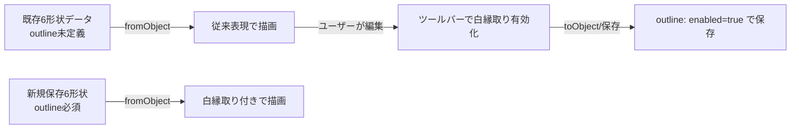

**Phase breakdown**:
- **Phase 1**（リリース直後）: 新規 6 形状注釈は白縁取り有効で保存。既存注釈は従来表現のまま、ユーザー編集時のみ新属性が乗る。一括エクスポートは初期から GA
- **Phase 2**（任意・別 Spec）: 100 枚超の一括エクスポートでメモリ問題が観測されればバック側 ZIP ジョブ化を別 Spec として検討

**Rollback triggers**:
- 6 形状 Group 化の描画パフォーマンスが 60fps を切る（research.md R10 が失敗）
- 一括エクスポートが想定運用枚数（数十枚規模）でブラウザクラッシュを起こす（research.md R6 が失敗）

上記が発覚した場合、Req 32 は形状別に `outline.enabled = false` 既定へ切替（Arrow/Text と同方針）、Req 31 は一括対象枚数の上限をハードガード（例: 20 枚）に下げる。

## Requirements 29.4, 33-34: スマホ注釈編集UXの業界標準準拠（編集モードのズーム/パン・ジェスチャー調停・ズームUI）

### Overview

**Purpose**: 注釈編集モード（`AnnotationEditor.tsx`）に、描画アプリのデファクト標準である「1本指=描画／2本指=ピンチズーム&パン」を実装し、編集中の拡大描画・注釈の選択/移動・ズーム操作手段を業界標準（Apple HIG / Material Design / WCAG 2.5.5）に準拠させる。

**Users**: スマートフォンで現場写真に細部注釈を入れる現場調査担当者。マウス/デスクトップ利用者には後方互換で提供。

**Impact（最重要・既存設計の前提是正）**: 既存 Requirements 24-30 の設計は「ピンチズーム/パンは `ImageViewer.tsx` が担う」前提で、`ImageViewer.tsx` のズーム/パンを Out of Boundary としていた。しかし `research.md`（§7-§11）の実装調査により、**実際の編集画面は `AnnotationEditor.tsx` でありズーム/パンが完全欠落**（`initialZoom`/`initialPan` は props 宣言のみ未使用）、優れた実装を持つ `ImageViewer.tsx` は編集ページから未参照（実質デッドコード）であることが判明した。本節はこの前提を是正し、**ビューポート制御を共通化して編集モードに一級機能として導入**する。これは Requirements 24-30 節の Revalidation Trigger「既存 Requirement 5（画像ビューア）の挙動変更」に該当する境界更新である。

#### Goals
- 編集モードで画像を拡大したまま1本指で正確に描画でき、2本指でズーム/パンへ直感的に切り替えられる
- ピンチは2本指中点を基準に拡大/縮小する（直接操作の原則）
- 編集モードにズームイン/アウト・全体表示（フィット）・現在倍率表示を提供する
- 注釈の選択/移動ハンドルを標準タッチターゲット（44px）に準拠させる
- 閲覧モードと編集モードでズーム/パンのジェスチャー体系を一貫させ、二重実装を解消する

#### Non-Goals
- 注釈の自由角度回転（90度単位画像回転=Req 22 を維持）、無限キャンバス化、キャンバス自由回転、スタイラス筆圧
- 編集モードのビュー状態のサーバー永続化（Req 5.6 のクライアント内共有を維持）
- 保存データ座標系の変更（ズームは表示専用、保存JSONは不変）

### Boundary Commitments

#### This Spec Owns
- 新規 `gestures/canvasViewportController.ts`（Fabric Canvas のビューポート制御＝zoom/pan/zoomToPoint/fit/clamp の単一実装）の定義と所有
- 既存 `gestures/touchGestureManager.ts` の `two-finger-pinch-pan` 状態における**ズーム/パン駆動と描画中断の調停**への拡張（現状は検出のみ）
- 新規 `useCanvasViewport` フック（コントローラと React 状態＝現在倍率の橋渡し）
- 新規 `ZoomControls.tsx`（ズームイン/アウト/フィット＋倍率バッジ、下部配置）
- `annotation-visual-feedback.ts` の選択ハンドルサイズの 44px 準拠化（Req 29.4）
- 編集モードのダブルタップ（空き領域）→ズームトグルと、既存ダブルタップ（テキスト注釈上）→編集 の用途調停

#### Out of Boundary
- バックエンド・Prisma スキーマ（注釈JSON・ビュー状態いずれも DB 変更なし）
- 注釈ツール本体の描画ロジック（Req 6-8, 24-32 の範囲）。本節はビューポート（表示変換）のみ扱う
- 90度画像回転（Req 22）のアルゴリズム自体（ビュー状態としての共有は扱うが回転仕様は不変）
- PDF/サムネイル/エクスポートのレンダリング（ズームは表示専用のため影響しない）

#### Allowed Dependencies
- Fabric.js 7.3.1 標準API（`zoomToPoint(point, zoom)`, `setViewportTransform`, `getZoom`, `getScenePoint`/`getPointer`, `isDrawingMode`, `discardActiveObject`）
- 既存 `image-viewer.constants.ts`（`ZOOM_CONSTANTS`/`PAN_CONSTANTS`/`TOUCH_CONSTANTS`）と `gesture-thresholds.ts`
- `ImageViewer.tsx` で実証済みのズーム/パン算術（`applyPinchZoom` の中点計算・`clampZoom`・`isPanEnabled`）を**コントローラへ抽出して再利用**
- ブラウザ標準 `PointerEvent` / CSS `touch-action: none`
- 新規外部依存は**追加しない**

#### Revalidation Triggers
- 保存注釈JSONの座標系を viewportTransform に連動させる設計へ変更する場合（現設計は表示専用で不連動）
- Fabric.js メジャーバージョン変更（`zoomToPoint`/`viewportTransform` API変更時）
- Req 5（画像ビューア）/Req 22（回転）/Req 30（マルチタッチ）の挙動変更
- `ImageViewer.tsx` を共通コントローラへ移行する範囲を変更する場合

### 設計合成（Design Decisions）

- **Build vs Adopt**: ズーム/パン/中点ズーム算術は `ImageViewer.tsx` に実証実装が既にあるため**新規構築せず抽出・採用**する。中点ズームは Fabric 標準 `zoomToPoint` を採用。新規ライブラリは導入しない（`tech.md` の「追加外部依存なし」方針に整合）。
- **Generalization**: 「ビューポート制御」は閲覧/編集の双方が必要とする同一能力。`canvasViewportController` を単一の汎用実装とし、編集（`AnnotationEditor`）が採用、`ImageViewer` も同コントローラへ移行して**二重実装を解消**（Req 33.10 を構造的に担保）。
- **Simplification**: 状態機械は既存 `touchGestureManager` の FSM を**そのまま流用**し、`two-finger-pinch-pan` 状態に振る舞いを足すだけにする（新規 FSM を作らない）。倍率/ズームUIの React 状態は `useCanvasViewport` 1フックに集約し、余分な抽象層を作らない。
- **座標系の分離（重要決定）**: ズームは `viewportTransform`（表示変換）のみで実現し、注釈オブジェクトの保存座標は不変とする。保存/復元は既存どおり canvas サイズ基準の `enlivenObjects` スケールを用い、viewport ズームは保存に影響しない。これにより既存 Req 9（保存・復元）と後方互換を維持。
- **ダブルタップ用途調停**: ヒットテスト（`findTarget`）で対象がテキスト注釈なら従来の編集（Req 27.1）、対象なし（空き領域）ならズームトグル（Req 33.8）。両者は対象の有無で排他になり競合しない。

### Architecture

#### Architecture Integration

```mermaid
graph TB
    subgraph Editor
        AnnotationEditor
        ZoomControls
        AnnotationToolbar
    end
    subgraph GestureLayer
        TouchGestureManager
        useCanvasViewport
        CanvasViewportController
    end
    subgraph Viewer
        ImageViewer
    end
    AnnotationEditor --> useCanvasViewport
    AnnotationEditor --> ZoomControls
    AnnotationEditor --> TouchGestureManager
    ZoomControls --> useCanvasViewport
    useCanvasViewport --> CanvasViewportController
    TouchGestureManager --> CanvasViewportController
    ImageViewer -. 移行（二重実装解消） .-> CanvasViewportController
```

**Integration**:
- Dependency direction: `CanvasViewportController（Infra/算術）→ TouchGestureManager / useCanvasViewport（調停・橋渡し）→ AnnotationEditor / ZoomControls（プレゼンテーション）`。逆向き依存は禁止。
- `CanvasViewportController` は `FabricCanvasLike` 最小サーフェスのみに依存し React 非依存（単体テスト容易）。
- Steering compliance: TypeScript strict（`any` 禁止）、`hooks/use*.ts` / `gestures/*.ts` の既存配置規約に従う。

#### Technology Stack（新規依存なし）

| Layer | Choice | Role |
|-------|--------|------|
| Viewport制御 | Fabric.js 7.3.1 `zoomToPoint`/`setViewportTransform` | 中点ズーム・パン・倍率取得 |
| ジェスチャー検出 | 既存 `touchGestureManager`（PointerEvent FSM） | 1本指/2本指/3本指以上の判定（流用） |
| 定数 | `image-viewer.constants.ts` / `gesture-thresholds.ts` | ズーム範囲・ピンチ閾値・クールダウン |
| ズームUI | React 19 + inline style + `@media (pointer: coarse)` | ボタン44px・倍率バッジ・下部配置 |

### File Structure Plan

以下のツリーは**各ブロック見出しがリポジトリルートからの相対パス**（呼称規約1）であり、配下の行はその直下の実配置を表す。各行の区分（`新規` / `変更` / `上記再掲`。`変更（軽微）` / `変更（任意/フェーズ4）` は `変更` に注記を添えたもの。`上記再掲` は同一ファイルの再掲を示すだけで作業の計画ではない）は**本節を書いた時点の計画であり、現況ではない**。実装が進んだ後も区分値は書き換えない（`新規` の行も現在は実在する）。現況の権威は区分値ではなく**パスの実在**であり、**配置そのものは実装の実配置と一致していなければならない**。

```
frontend/src/components/site-surveys/
├── AnnotationEditor.tsx                # 変更: useCanvasViewport 配線、initialZoom/Pan 適用、ZoomControls マウント、
│                                       #        2本指検出時の描画中断（isDrawingMode 退避/復帰）、dbltap 用途調停
├── ZoomControls.tsx                    # 新規: ズームイン/アウト/フィット + 現在倍率バッジ（下部・44px）
├── annotation-visual-feedback.ts       # 変更: タッチ時の選択ハンドル touchCornerSize を 40→44px 以上へ（Req 29.4。
│                                       #        touchCornerSize=ヒット領域=標準タッチターゲット。cornerSize=描画サイズは現状維持可）
├── ImageViewer.tsx                     # 変更（任意/フェーズ4）: canvasViewportController へ移行し二重実装解消
├── gestures/
│   ├── canvasViewportController.ts     # 新規: zoom/pan/zoomToPoint/fit/clamp の単一実装（ImageViewer算術を抽出）
│   ├── touchGestureManager.ts          # 変更: two-finger-pinch-pan 状態でコントローラ駆動、描画中断コールバック追加
│   └── gesture-thresholds.ts           # 変更（軽微）: ピンチ/ズーム関連閾値の参照集約
└── annotation-visual-feedback.ts       # （上記再掲）

frontend/src/hooks/                     # 既存フック配置規約（useFabricUndoIntegration.ts と同階層）
└── useCanvasViewport.ts                # 新規: コントローラと React 状態（現在倍率）の橋渡し、ズームUIハンドラ提供

frontend/src/__tests__/site-surveys/
└── gestures/
    ├── canvasViewportController.test.ts  # 新規: clampZoom/zoomToPoint中点/pan clamp/fit 算術
    └── touchGestureManager.viewport.test.ts # 新規: 2本指→zoom/pan駆動、2本目追加で描画中断、復帰でビュー維持

frontend/src/__tests__/hooks/
└── useCanvasViewport.test.ts             # 新規: 倍率状態更新・fit リセット

frontend/src/__tests__/components/site-surveys/
└── ZoomControls.test.tsx                 # 新規: 44px・倍率表示更新・fit 挙動・描画誤発火しない

e2e/specs/site-surveys/
└── site-survey-annotation-mobile.spec.ts # 変更: 編集モードのピンチズーム後の正確描画/2本指パン/
                                          #        ダブルタップズーム/ズームUI/拡大中の選択移動 を追加
```

### System Flows

#### 描画⇔ズーム/パン調停フロー（Req 33.1-33.7, 30 整合）

```mermaid
stateDiagram-v2
    [*] --> Idle
    Idle --> OneFingerDown: pointerdown 1
    OneFingerDown --> Drawing: move>threshold（描画ツール時）
    OneFingerDown --> ObjectMove: move（選択ツール・対象上, Req 33.12）
    Drawing --> TwoFingerPinchPan: 2本目追加→描画中断/破棄（Req 33.5）
    OneFingerDown --> TwoFingerPinchPan: 2本目追加
    Idle --> TwoFingerPinchPan: pointerdown 2
    TwoFingerPinchPan --> TwoFingerPinchPan: move→zoomToPoint(中点)/pan
    TwoFingerPinchPan --> Cooldown: 1本離脱
    TwoFingerPinchPan --> ThreePlusSuspend: 3本目追加
    ThreePlusSuspend --> Cooldown: 全指離脱
    Cooldown --> Idle: 150ms（ビュー状態は維持, Req 33.7）
```

**Key decisions**:
- `two-finger-pinch-pan` 突入時、`touchGestureManager` は `onGestureStart` を発火し `AnnotationEditor` が `isDrawingMode=false` 化＋進行中ブラシパスを破棄（Req 33.5、RN1 解消）。`Cooldown→Idle` で元ツールの `isDrawingMode` を復帰。
- ピンチ: 2本指距離比から目標 zoom を算出し `controller.zoomToPoint(midpoint, clamp(zoom))`（中点基準, Req 33.3）。
- パン: 中点移動量を `controller.pan(dx,dy)`。`isPanEnabled()`（`getZoom() >= MIN_PAN_ZOOM`）で等倍時は抑止（Req 34.7）。
- 拡大中の描画座標は Fabric v7 のイベント `options.scenePoint`（既存 `AnnotationEditor.tsx` の描画経路で使用中）が `viewportTransform` を考慮するため、追加変換なしで正しい位置に落ちる（Req 33.6、RN3）。コントローラはビュー状態（zoom/pan）を保持し、描画再開後も維持（Req 33.7）。
- canvas ラッパに `touch-action: none` を付与しブラウザ既定ジェスチャーを抑止（RN1）。

#### 1本指ジェスチャーの責務分岐表（Req 33.1/33.11/33.12 の一意化・Critical Issue 2 対応）

編集モードでは **パンを2本指専用**とし（1本指パンは採用しない）、1本指の意味をツール種別で一意化する。これにより Fabric の `object:moving` と `touchGestureManager` FSM の競合・二重発火を排除する。

| ツール状態 | 入力 | 対象（ヒットテスト） | 振る舞い | 担当 | 根拠 |
|---|---|---|---|---|---|
| 描画ツール選択中 | 1本ドラッグ | 任意（背景/既存注釈問わず） | 新規描画。既存注釈の選択/移動は発火させない | FSM=drawing / Fabric selection 抑止 | 33.1, 33.13, 17 |
| 選択ツール選択中 | 1本タップ | 既存注釈 | 当該注釈を選択 | Fabric selection | 33.11 |
| 選択ツール選択中 | 1本ドラッグ | 選択中注釈/ハンドル上 | 移動・リサイズ（拡大中も追従） | Fabric `object:moving` | 33.12 |
| 選択ツール選択中 | 1本ドラッグ | 空き領域（対象なし） | 選択解除のみ（パンしない） | - | 33.4方針 |
| 任意 | 2本ピンチ/ドラッグ | — | ズーム（中点）/パン。進行中の描画・移動は中断 | FSM=two-finger → controller | 33.2-33.5 |
| 任意 | 1本ダブルタップ | テキスト注釈上 | テキスト編集 | AnnotationEditor（findTarget） | 27.1 |
| 任意 | 1本ダブルタップ | 空き領域 | ズーム/全体表示トグル | controller.toggleZoom | 33.8 |
| 任意 | 3本指以上 | — | サスペンド（全指離脱までコミット抑止）→cooldown | FSM=three-plus-suspend | 30.2, 30.3 |

**Key decisions**:
- `touchGestureManager` は `getCurrentTool()` を参照し、**選択ツール時は `drawing` 状態へ遷移せず**、1本指の選択/移動を Fabric（`selection`/`object:moving`）へ委譲する（FSM は描画コミットを行わない）。描画ツール時は既存どおり `selectable=false`（`AnnotationEditor.tsx`）で誤選択を防止（Req 17）。
- **既存 `ImageViewer`（閲覧モード）との差異**: ImageViewer は拡大時に1本指パンを許可していたが、編集モードでは1本指を描画/移動に充てるため**1本指パンを採らない**（2本指パンで代替）。これは描画アプリのデファクト標準（1本指=描画）に整合する意図的な差異であり、`canvasViewportController` 共通化後も入力割当はモード（編集/閲覧）側で決定する。

#### 中点ズームフロー（Req 33.3, 34）

```mermaid
sequenceDiagram
    participant TGM as touchGestureManager
    participant Ctl as canvasViewportController
    participant Cv as Fabric Canvas
    participant Hook as useCanvasViewport
    participant UI as ZoomControls
    TGM->>Ctl: zoomToPoint(midpoint, clampZoom(z))
    Ctl->>Cv: canvas.zoomToPoint(point, z)
    Ctl->>Cv: clampPan()（範囲外パン補正）
    Ctl-->>Hook: onZoomChange(z)
    Hook-->>UI: 倍率バッジ更新（Req 34.2/34.3）
    UI->>Ctl: zoomIn/zoomOut/fit（ボタン, Req 34.1/34.4）
```

### Requirements Traceability

| Requirement | Summary | Components | Interfaces | Flows |
|-------------|---------|------------|------------|-------|
| 29.4 | 選択ハンドル44px準拠 | annotation-visual-feedback, AnnotationEditor | configureHandleSizes | - |
| 33.1, 33.13 | 1本指=描画/誤選択防止 | touchGestureManager, AnnotationEditor | - | 調停フロー |
| 33.2, 33.3 | 2本指ピンチ・中点ズーム | touchGestureManager, canvasViewportController | zoomToPoint | 中点ズームフロー |
| 33.4, 34.7 | 2本指パン/等倍時抑止 | canvasViewportController, touchGestureManager | pan/isPanEnabled | 調停フロー |
| 33.5 | 2本目で描画中断 | touchGestureManager, AnnotationEditor | onGestureStart | 調停フロー |
| 33.6 | 拡大中の正確描画 | AnnotationEditor (Fabric options.scenePoint) | - | 調停フロー |
| 33.7 | 再開時ビュー維持 | canvasViewportController | getState | 調停フロー |
| 33.8 | ダブルタップズームトグル | AnnotationEditor, canvasViewportController | findTarget/toggleZoom | - |
| 33.9 | ズーム範囲一貫 | canvasViewportController, ZOOM_CONSTANTS | clampZoom | - |
| 33.10 | 閲覧/編集の一貫性 | canvasViewportController（共通化） | - | - |
| 33.11, 33.12 | タッチ選択/移動（拡大中追従） | AnnotationEditor | Fabric selection/object:moving | - |
| 34.1, 34.4 | ズームイン/アウト/フィット | ZoomControls, useCanvasViewport, canvasViewportController | zoomIn/zoomOut/fit | 中点ズームフロー |
| 34.2, 34.3 | 倍率表示・更新 | ZoomControls, useCanvasViewport | onZoomChange | 中点ズームフロー |
| 34.5 | ズームUI 44px | ZoomControls | - | - |
| 34.6 | 下部・片手到達配置 | ZoomControls | - | - |
| 34.8 | ズームUI操作の描画誤発火防止 | ZoomControls, AnnotationEditor | - | - |

### Testing Strategy

#### Unit Tests
- `canvasViewportController`: `clampZoom` 上下限（`ZOOM_CONSTANTS`）、`zoomToPoint` の中点基準変換、`pan` の範囲クランプ、`fit` の収まり倍率＋パン初期化、`getState` のズーム/パン保持
- `touchGestureManager`（拡張）: 2本指 move で `zoomToPoint`/`pan` が呼ばれる、Drawing 中の2本目追加で `onGestureStart`（描画中断）発火、Cooldown 経由でビュー状態が維持される（Req 33.5/33.7）
- `useCanvasViewport`: `onZoomChange` で倍率状態が更新、`fit` でリセット

#### Component Tests
- `ZoomControls`: 各ボタンのタップ領域が44px以上（Req 34.5）、倍率バッジがズーム変化で更新（34.2/34.3）、フィットで等倍復帰（34.4）、ボタン操作が canvas 描画イベントを誘発しない（34.8）
- `AnnotationEditor`: タッチ環境で選択ハンドルが44px（Req 29.4）、`initialZoom`/`initialPan` 適用

#### E2E Tests（`site-survey-annotation-mobile.spec.ts`・モバイルViewport）
要件はE2Eで動作確認するまで完了としない方針に従い、以下を必須カバレッジとする:
- 編集モードで2本指ピンチ→拡大→1本指描画が**拡大後の正しい位置**に落ちる（Req 33.2/33.6）
- 2本指ドラッグでパン、等倍時はパンしない（Req 33.4/34.7）
- 空き領域ダブルタップで拡大/全体トグル、テキスト注釈上ダブルタップは編集（Req 33.8 と 27.1 の調停）
- ズームUIのイン/アウト/フィットと倍率バッジ更新（Req 34.1-34.4）
- 拡大中に既存注釈をタップ選択→ドラッグ移動が指に追従（Req 33.11/33.12）
- axe-playwright でズームUIのa11y（44pxタッチターゲット）検証（Req 29.4/34.5）

> テスト構成は前提条件でテストを自動無効化しない（満たさない場合は失敗させる）。Playwright のタッチ/ピンチ模擬手法は research.md RN4 に従い設計フェーズで確定。

### Migration Strategy

- DBマイグレーション**不要**（ビュー状態・注釈座標ともに保存形式不変）。
- 段階導入（research.md Option C）:
  - **フェーズ1**: `canvasViewportController` 抽出 + `touchGestureManager` 拡張 + `AnnotationEditor` 配線で「拡大して描ける」を成立（Req 33 中核）
  - **フェーズ2**: 選択ハンドル44px（Req 29.4）+ 拡大中の選択/移動確実化（Req 33.11/33.12）
  - **フェーズ3**: `ZoomControls`（Req 34）+ ダブルタップズーム（Req 33.8）
  - **フェーズ4**: `ImageViewer` を共通コントローラへ移行し二重実装解消（Req 33.10 最終担保）。**タスク 97 で実施済み**（`ImageViewer.tsx` は `createCanvasViewportController` を採用し、ズーム/パン/等倍時抑止/範囲補正を委譲している）。なお `ImageViewer` 自体は本番から未参照であり、要件5 の担当は「画像ビューアの担当付け替えと閲覧時の表示操作の結線（タスク 115.83）」で出荷経路へ付け替えた

**Rollback triggers**:
- 拡大中の描画座標ずれが解消できない（RN3 が失敗）→ フェーズ1を「ズーム/パンのみ・描画はフィット時限定」へ縮退
- `ImageViewer` 移行で閲覧モードに回帰が出る → フェーズ4を保留し編集モード単独適用に留める（二重実装は一時許容）

## Requirements 35-36: スマートフォン表示崩れ是正（現場調査詳細のレスポンシブ・画像編集の表示領域最適化）

### Overview

**Purpose**: スマートフォン実機（狭幅ビューポート）で発生している「現場調査詳細画面（写真＋コメント）の水平はみ出し」と「画像編集（注釈エディタ）の作業領域が過小になる問題」を、既存のレスポンシブ基盤と実証済みフィット算術を活用して是正する。実ブラウザ（iPhone SE 相当 375×667）で `scrollWidth=565`（横190pxはみ出し）・編集 canvas 実寸 `100×100` を確認済み（`research.md` ギャップ分析）。

**Users**: スマートフォンで現場調査の写真整理・コメント入力・注釈編集を行う現場担当者。デスクトップ利用者には現行挙動を維持。

**Impact（既存前提の是正）**: 既存 Requirement 15（レスポンシブ）は「各画面サイズに対応」と規定するが、`PhotoManagementPanel.tsx`（写真列 320px 固定・`useMediaQuery` 未使用）と画像編集のフィット計算（`Math.min(..., 1)` 拡大頭打ち・`ResizeObserver` 不在・`svh` 未使用）が未達だった。本節はこのギャップを、既存 Requirement 10（写真一覧管理）・Requirement 33-34（編集モードのズーム/パン・`fit`）の挙動を維持したまま解消する。

#### Goals
- モバイル幅で現場調査詳細画面を縦積み化し、ページ水平スクロール（はみ出し）を発生させない
- コメント入力欄等の入力系フォントを 16px 以上とし、フォーカス時の自動ズームを抑止する
- 画像編集/閲覧の初期表示を利用可能領域にフィットさせ、小画像も原寸で頭打ちにせず拡大する
- 画像作業領域の短辺を画面短辺の概ね 50% 以上確保し、ツールバーの縦占有を抑制する
- 表示領域の高さを動的ビューポート（`svh`）基準とし、アドレスバー伸縮に追従する

#### Non-Goals
- デスクトップ幅レイアウトの変更（現行維持）
- 注釈エディタのズーム/パン操作体系そのもの（Requirement 33-34 の `canvasViewportController` を維持・流用）
- 新規タッチジェスチャーの追加、PDF報告書の出力レイアウト（Req 11）、カメラ直接撮影（Req 15.3）
- 保存データ座標系の変更（フィット/ズームは表示専用、保存JSONは不変）

### Boundary Commitments

#### This Spec Owns
- `PhotoManagementPanel.tsx` / `SiteSurveyDetailPage.tsx` のモバイル幅レイアウト分岐（縦積み・写真幅可変・`metadataSection` の `minWidth:0`・入力欄 16px・操作要素 44px）
- **画像→コンテナのフィット＝キャンバス寸法計算**（`AnnotationEditor.tsx` / `ImageViewer.tsx` の `Math.min(..., 1)` → `setDimensions`）の一元化（新規 `imageFitScale.ts`）とモバイルでの拡大許容。これは `controller.fit()`（ズーム/パンのリセット）とは**別物**
- 新規 `useElementSize`（`ResizeObserver` ラッパ）による、コンテナ実寸変化時の再フィット・トリガ
- `SiteSurveyImageViewerPage.tsx` の表示領域高さの `svh` 基準化（`vh` フォールバック付き）
- `AnnotationToolbar.tsx` のモバイル幅での縦占有抑制レイアウト（単段横スクロール等）
- 画像編集画面のヘッダー/パンくずと作業領域の重なり解消

#### Out of Boundary
- バックエンド・Prisma スキーマ（DB変更なし）
- 注釈ツール本体の描画ロジック（Req 6-8, 24-32）とズーム/パンの入力調停・座標変換（Req 33-34 の `touchGestureManager`/`canvasViewportController` が所有）
- **ビューポートのズーム/パン適用**（`canvasViewportController` の `zoomToPoint`/`pan`/`fit`。`fit()`＝viewportを恒等変換 `[1,0,0,1,0,0]` に戻すズーム/パンのリセット, `canvasViewportController.ts`）は Req 33-34 が所有。本節は呼ぶのみで内部実装を変更しない。本節が所有するのは「フィット倍率の算出（`imageFitScale`）＝キャンバス寸法」「再フィットの発火（`useElementSize`）」「コンテナ高さ（`svh`）」
- PDF/サムネイル/エクスポートのレンダリング（表示専用のため不変）

#### Allowed Dependencies
- 既存 `hooks/useMediaQuery.ts` と `utils/responsive.ts`（`MEDIA_QUERIES.isMobile = (max-width:767px)`）を流用
- ブラウザ標準 `ResizeObserver`、CSS 動的ビューポート単位 `svh`（`vh` フォールバック）
- 既存フィット算術（`AnnotationEditor.tsx` / `ImageViewer.tsx`）を `imageFitScale.ts` へ抽出して再利用
- Req 33-34 の `canvasViewportController.fit()` / `useCanvasViewport`（存在時はそこへ再フィットを委譲）
- 新規外部依存は**追加しない**（`tech.md`「追加外部依存なし」に整合）

#### Revalidation Triggers
- Requirement 10（写真一覧管理）/Requirement 15（レスポンシブ）/Requirement 33-34（ズーム/パン・fit）の挙動変更
- `MEDIA_QUERIES.isMobile` のブレークポイント定義変更
- フィットを表示専用から保存座標連動へ変更する場合（現設計は表示専用で不連動）
- `svh` を廃し JS の `visualViewport` 計測へ切替える場合

### 設計合成（Design Decisions）

- **Generalization**: 「コンテナ実寸に追従した再フィット」と「フィット倍率算出」は編集(`AnnotationEditor`)・閲覧(`ImageViewer`)双方が必要とする同一能力。フィット算術を単一の `imageFitScale.ts`、寸法購読を単一の `useElementSize` に汎化し、両者が採用する（`research.md`: ResizeObserver 不在・同一 `Math.min(...,1)` の二重実装を解消）。
- **Build vs Adopt**: レスポンシブ判定は既存 `useMediaQuery`/`MEDIA_QUERIES.isMobile` を**採用**（新規構築しない）。全画面高はプラットフォーム標準の CSS `svh` を**採用**（JS計測を作らない）。再フィット検知はブラウザ標準 `ResizeObserver` を薄くラップするのみ。
- **Simplification**: 詳細画面はモバイル専用コンポーネントを新設せず（写真パネルの並替/保存/未保存管理の二重実装を避ける）、既存の spread 合成パターン（`{...styles.panelItem, ...(isMobile ? styles.panelItemMobile : {})}`）でインラインスタイルに分岐を足すだけにする。
- **フィット上限の是正（重要決定）**: 現行 `Math.min(maxW/imgW, maxH/imgH, 1)` の `1`（原寸頭打ち）を、`imageFitScale.ts` の `allowUpscale`/`maxUpscale` 引数で制御する。モバイルでは `allowUpscale=true` としフィット倍率まで拡大（小画像も過小表示にしない, Req 36.2）。デスクトップ既定は現行（`allowUpscale=false`）を維持し回帰させない。
- **fitの二重性の分離（重要・Issue 1 対応）**: 「画像→コンテナのフィット」＝**キャンバス寸法計算**（`imageFitScale`→`canvas.setDimensions`。`AnnotationEditor.tsx`/`ImageViewer.tsx` を改修, 本節所有）と、`controller.fit()`＝**viewportを恒等変換に戻すズーム/パンのリセット**（`canvasViewportController.ts`, Req 33-34 所有）は別物。実装は両者を混同せず、再フィット時はまず `setDimensions` でキャンバス寸法を更新し、**等倍/初期化時のみ** `controller.fit()` を呼ぶ。
- **座標系の分離**: フィット/再フィットは表示（canvas 寸法・`viewportTransform`）のみに作用し、注釈の保存座標は不変（Req 9 後方互換）。再フィット時は Req 33-34 の現在ズーム/パン状態を保持する（等倍時のみ再適用し、ユーザーがズーム中は表示を壊さない）。ズーム中か否かは `controller.getState()`/`getZoom()`（`canvasViewportController.ts`）で判定する。

### Architecture

#### Architecture Integration

```mermaid
graph TB
    subgraph Pages
        DetailPage
        ImageViewerPage
    end
    subgraph SiteSurveyComponents
        PhotoManagementPanel
        AnnotationEditor
        ImageViewer
        AnnotationToolbar
    end
    subgraph SharedResponsive
        useMediaQuery
        useElementSize
        imageFitScale
    end
    subgraph ViewportReq33
        canvasViewportController
    end
    DetailPage --> PhotoManagementPanel
    PhotoManagementPanel --> useMediaQuery
    ImageViewerPage --> AnnotationEditor
    AnnotationEditor --> useElementSize
    AnnotationEditor --> imageFitScale
    AnnotationEditor --> canvasViewportController
    ImageViewer --> useElementSize
    ImageViewer --> imageFitScale
    AnnotationEditor --> AnnotationToolbar
    AnnotationToolbar --> useMediaQuery
```

**Integration**:
- Dependency direction: `utils/hooks（imageFitScale, useElementSize, useMediaQuery）→ components（PhotoManagementPanel, AnnotationEditor, ImageViewer, AnnotationToolbar）→ pages（DetailPage, ImageViewerPage）`。逆向き依存は禁止。
- `imageFitScale` は純関数（React 非依存・単体テスト容易）。`useElementSize` は `ResizeObserver` を購読し実寸を返すのみで、フィット適用は呼び出し側（コンポーネント／`canvasViewportController.fit`）が行う。
- Steering compliance: TypeScript strict（`any` 禁止）、`hooks/use*.ts` / `utils/*.ts` の既存配置規約に従う。

#### Technology Stack（新規依存なし）

| Layer | Choice | Role |
|-------|--------|------|
| レスポンシブ判定 | 既存 `useMediaQuery` + `MEDIA_QUERIES.isMobile` | 幅768px未満の分岐 |
| 実寸監視 | ブラウザ標準 `ResizeObserver`（`useElementSize` でラップ） | コンテナ寸法変化→再フィット |
| フィット算術 | 新規 `imageFitScale.ts`（純関数） | フィット倍率算出・モバイル拡大許容 |
| 全画面高 | CSS `svh`（`vh` フォールバック） | アドレスバー伸縮追従 |
| レイアウト | React 19 + inline style spread 分岐 / flexbox | 縦積み・単段ツールバー・16px・44px |

### File Structure Plan

以下のツリーは**各ブロック見出しがリポジトリルートからの相対パス**（呼称規約1）であり、配下の行はその直下の実配置を表す。各行の区分（`新規` / `変更` / `参照のみ`。`参照のみ` は括弧内に理由を添え、本節では当該ファイルを変更しない旨の注記であって作業の計画ではない）は**本節を書いた時点の計画であり、現況ではない**。実装が進んだ後も区分値は書き換えない（`新規` の行も現在は実在する）。現況の権威は区分値ではなく**パスの実在**であり、**配置そのものは実装の実配置と一致していなければならない**。

```
frontend/src/utils/
├── imageFitScale.ts                   # 新規: computeFitScale(純関数)。フィット倍率算出＋allowUpscale/maxUpscale
└── responsive.ts                      # 参照のみ（MEDIA_QUERIES.isMobile を流用、変更なし）

frontend/src/hooks/
├── useElementSize.ts                  # 新規: ResizeObserver で要素実寸{width,height}を購読
└── useMediaQuery.ts                   # 参照のみ（変更なし）

frontend/src/components/site-surveys/
├── PhotoManagementPanel.tsx           # 変更: useMediaQuery導入、panelItem→縦積み(column)、imageSection width100%、
│                                       #        metadataSection minWidth:0、textarea等 fontSize16px、操作要素44px
├── AnnotationEditor.tsx               # 変更: fit計算を imageFitScale へ置換(モバイルallowUpscale=true)、
│                                       #        useElementSizeで再フィット、現在ズーム保持(等倍時のみfit再適用)
├── ImageViewer.tsx                    # 変更: 同上(fit計算 imageFitScale化・再フィット)
└── AnnotationToolbar.tsx              # 変更: モバイル幅で flexWrap:nowrap+overflowX:auto の単段化(縦占有抑制)

frontend/src/pages/
├── SiteSurveyDetailPage.tsx           # 変更: モバイル幅のpadding/幅調整(内側320px固定の支配を解消)
└── SiteSurveyImageViewerPage.tsx      # 変更: editorContainer高さを Tailwind supports-[height:100svh]: バリアント
                                       #        (h-[calc(100vh-Xpx)]+svhフォールバック。インラインstyleの単一heightは不可)へ、
                                       #        minHeight のモバイル調整、breadcrumb重なり(sticky/z-index)解消

frontend/src/__tests__/
├── utils/imageFitScale.test.ts        # 新規: フィット倍率・allowUpscale・maxUpscale・padding
├── hooks/useElementSize.test.ts       # 新規: ResizeObserver購読で寸法更新
└── site-surveys/PhotoManagementPanel.mobile.test.tsx # 新規: モバイルで縦積み・16px・44px

e2e/specs/site-surveys/
├── site-survey-responsive.spec.ts     # 変更: 詳細画面(375)で横はみ出し無し・入力16px・操作44px を追加
└── site-survey-annotation-mobile.spec.ts # 変更: 編集で作業領域短辺≥画面短辺50%・横はみ出し無し・
                                          #        ヘッダー非重畳・svh追従 を追加
```

### System Flows

#### 再フィットフロー（Req 36.1-36.4）

```mermaid
sequenceDiagram
    participant Page as ImageViewerPage
    participant Cmp as AnnotationEditor
    participant Sz as useElementSize
    participant Fit as imageFitScale
    participant Ctl as canvasViewportController
    Page->>Cmp: svh基準のコンテナ高さを付与
    Sz-->>Cmp: コンテナ実寸{w,h}（初期・resize時）
    Cmp->>Fit: computeFitScale(imgW,imgH,w,h,padding,allowUpscale=isMobile)
    Fit-->>Cmp: fitScale
    Cmp->>Cmp: canvas.setDimensions で fitScale 基準にキャンバス寸法を更新
    alt 等倍表示中 または 初期化
        Cmp->>Ctl: controller.fit で viewport を恒等へリセット
    else ユーザーがズーム中
        Cmp->>Cmp: 現在ズーム/パンを保持（再フィットしない, Req 33.7整合）
    end
```

**Key decisions**:
- **2種の「fit」を分離**（Issue 1）: (1) `imageFitScale`→`canvas.setDimensions` によるキャンバス寸法フィット（本節所有）を毎回実行、(2) `controller.fit()`（ズーム/パンの恒等リセット, Req 33-34 所有）は等倍/初期化時のみ呼ぶ。
- `useElementSize` はコンテナ（`svh` で高さが変わる要素）の実寸を購読し、アドレスバー伸縮・回転・レイアウト変化で発火。現状の「画像ロード/回転時のみ再計算」（`research.md`: resize は `calcOffset` のみ）を解消。
- 再フィットは**等倍表示中または初期化時のみ** `controller.fit()` を適用し、ユーザーがズーム/パン中は表示状態を保持する（`controller.getState()` で判定, Req 33-34 との非干渉）。
- `svh` は**インラインstyleではなく Tailwind の `supports-[height:100svh]:` バリアント（または CSSクラスの二段宣言 `height: calc(100vh - Xpx); height: calc(100svh - Xpx);`）**で提供し、非対応ブラウザは `vh` にフォールバックする（インラインJSオブジェクトは同一プロパティ二重指定＝フォールバックを表現できないため, Issue 2）。

#### 詳細画面レイアウト分岐（Req 35.1-35.5）

```mermaid
graph LR
    Panel[PhotoManagementPanel] --> Q{isMobile}
    Q -->|Yes| M[縦積み column: 写真100%幅 → コメント minWidth0 → 操作44px, 入力16px]
    Q -->|No| D[現行 横並び row: 写真320px固定]
```

**Key decisions**:
- 既存の条件スタイル合成パターン（`AnnotationEditor`/`PhotoManagementPanel` の spread 合成）に `isMobile` 分岐を足すのみ。`imageSection` は `flexShrink:0, width:320px` を `width:100%` へ、`metadataSection` に `minWidth:0` を付与して水平はみ出し（Req 35.2）を解消。
- `textarea` 他入力系は `fontSize` を 14→16px 以上（Req 35.4）。チェックボックス/並替/削除ボタンのタップ領域を 44px 以上（Req 35.5）。

### Requirements Traceability

| Requirement | Summary | Components | Interfaces | Flows |
|-------------|---------|------------|------------|-------|
| 35.1, 35.3 | モバイル縦積み・写真幅可変 | PhotoManagementPanel | useMediaQuery | 詳細レイアウト分岐 |
| 35.2 | 詳細画面 水平はみ出し不発生 | PhotoManagementPanel, SiteSurveyDetailPage | - | 詳細レイアウト分岐 |
| 35.4 | 入力欄16px以上 | PhotoManagementPanel | - | - |
| 35.5 | 操作要素44px | PhotoManagementPanel | - | - |
| 35.6, 35.7 | 既存挙動・DT幅維持 | PhotoManagementPanel | - | - |
| 36.1 | 初期フィット表示 | AnnotationEditor, ImageViewer, imageFitScale | computeFitScale | 再フィットフロー |
| 36.2 | 小画像も拡大 | imageFitScale | computeFitScale allowUpscale | 再フィットフロー |
| 36.3 | 作業領域短辺≥画面短辺50% | AnnotationToolbar, SiteSurveyImageViewerPage | - | - |
| 36.4 | 高さ動的VP追従 | SiteSurveyImageViewerPage, useElementSize | ResizeObserver | 再フィットフロー |
| 36.5 | ツールバー占有抑制 | AnnotationToolbar | useMediaQuery | - |
| 36.6 | 編集 水平はみ出し不発生 | AnnotationEditor, SiteSurveyImageViewerPage | - | - |
| 36.7 | ヘッダー/パンくず非重畳 | SiteSurveyImageViewerPage | - | - |
| 36.8 | Req 33-34 挙動維持 | AnnotationEditor, canvasViewportController | fit/getState | 再フィットフロー |

### Testing Strategy

#### Unit Tests
- `imageFitScale`: フィット倍率（幅/高さ律速の切替）、`allowUpscale=false` で原寸頭打ち（デスクトップ現行維持）、`allowUpscale=true` でフィット倍率まで拡大、`padding`/`maxUpscale` 反映（Req 36.1/36.2）
- `useElementSize`: `ResizeObserver` 発火で `{width,height}` が更新される（Req 36.4）

#### Component Tests
- `PhotoManagementPanel`（モバイル）: `panelItem` が縦積み（column）、`imageSection` が可変幅、入力欄 `fontSize>=16px`、操作要素の実寸 `>=44px`（Req 35.1/35.3/35.4/35.5）
- `AnnotationToolbar`（モバイル）: 単段（`flexWrap:nowrap`）で高さが多段化しない（Req 36.5）

#### E2E Tests（モバイルViewport・`site-survey-responsive.spec.ts` / `site-survey-annotation-mobile.spec.ts`）
要件はE2Eで動作確認するまで完了としない方針に従い、以下を必須カバレッジとする:
- 現場調査詳細（375幅）で `document.documentElement.scrollWidth <= window.innerWidth`（横はみ出し無し, Req 35.2）
- コメント入力欄の computed `font-size >= 16px`（Req 35.4）、操作要素の boundingBox が 44px 以上（Req 35.5）
- 画像編集（375幅）で作業領域の短辺が画面短辺の概ね50%以上（Req 36.3）、初期表示が過小でない（Req 36.1/36.2）
- 画像編集（375幅）で**ツールバー除外後の画像作業領域の高さ**が編集ビュー高の一定割合以上であること（Issue 3 補強・Req 36.3/36.5 の実効確認。短辺基準だけでは縦圧迫を見逃すため、縦方向の可視作業高も測定する）
- 画像編集でページ水平はみ出し無し（Req 36.6）、ヘッダー/パンくずが作業領域と重ならない（Req 36.7）
- ズーム/パン・ダブルタップ等 Req 33-34 の既存E2Eが引き続き成功（Req 36.8 回帰確認）

> テスト構成は前提条件でテストを自動無効化しない（満たさない場合は失敗させる）。Playwright に mobile プロジェクトは未定義のため、既存慣習（`newContext({viewport})` / `setViewportSize`）を踏襲する（`research.md` RN-d）。

### Migration Strategy

- DBマイグレーション**不要**（保存形式・座標系ともに不変）。
- 段階導入（`research.md` 35=Option A / 36=Option C）:
  - **フェーズ1（Req 35, 低リスク）**: `PhotoManagementPanel`/`SiteSurveyDetailPage` のモバイル分岐＋入力16px＋44px。E2Eで横はみ出し解消を担保。
  - **フェーズ2（Req 36 基盤）**: `imageFitScale.ts`/`useElementSize.ts` 抽出、`AnnotationEditor`/`ImageViewer` を移行（デスクトップは `allowUpscale=false` で現行維持）。
  - **フェーズ3（Req 36 モバイル最適化）**: モバイル `allowUpscale=true`、`svh` 高さ、`AnnotationToolbar` 単段化、ヘッダー重なり解消。作業領域短辺≥50%をE2Eで検証。

**Rollback triggers**:
- 再フィットが Req 33-34 のズーム/パンに回帰を生む → 再フィットを「初期化時のみ」に縮退（resize追従を一時停止）。
- `svh` 採用でレイアウト不整合 → 当該コンテナを `vh` フォールバックのみへ戻す。
- モバイル `allowUpscale` で画質/ぼやけが問題化 → `maxUpscale` 上限を厳格化、または等倍上限へ一時復帰。

## Requirement 37: アップロード失敗時の撮影画像の保持と再送

### Overview

**Purpose**: 画像アップロードの失敗時に撮影・選択した画像を画面へ保持し、その場で再送できるようにする。あわせて multipart 送信経路を共通APIクライアントへ統一し、認証期限切れ・一時的な通信障害に起因する失敗そのものを減らす。

**Users**: 現場でスマートフォンから撮影・登録を行う現場調査担当者。撮り直しの発生が直接の作業損失となる。

**Impact（既存前提の是正）**: 撮影画像は `ImageUploader.tsx` のクロージャローカル変数にのみ存在し、`catch` はメッセージだけを state 化して `File` 参照を捨てている。加えて multipart 送信は `survey-images.ts` / `construction-photo-images.ts` の素の `fetch` 1回で、`client.ts` が持つ401リフレッシュ・指数バックオフ再試行・セッション切れ通知・タイムアウトのいずれも適用されていない。本節はこの2点を、Requirement 19（失敗通知）と Requirement 4（アップロード・圧縮）の挙動を維持したまま解消する。

#### Goals
- 失敗した画像を `File` 実体のまま保持し、サムネイル・ファイル名・失敗理由とともに提示する
- 保持中の画像を再圧縮せずに再送し、成功分のみを保持リストから取り除く
- 再送しても解消しない失敗（受入条件違反）を区別し、再送対象から除外する
- multipart 送信を `apiClient` へ統一し、401リフレッシュ・再試行・セッション切れ通知・送信タイムアウトを適用する
- アップロードの再試行を非冪等性に配慮した条件に限定し、同一画像の重複登録を防ぐ

#### Non-Goals
- 端末ローカルへの永続化（IndexedDB 等）とリロード・アプリ再起動をまたぐ復旧
- オフライン中の自動キュー送信
- サーバー受入上限（10MB／10件）およびフロント側 `MAX_FILE_SIZE_MB` の変更
- 失敗通知の文言体系（Requirement 19 が所管）

### Boundary Commitments

#### This Spec Owns
- `api/client.ts` の multipart 送信経路: FormData ボディの受理、アップロード時の再試行方針、送信タイムアウト、公開メソッド `sendFormData`
- `api/survey-images.ts` / `api/construction-photo-images.ts` の送信手段を `apiClient` へ統一すること、および失敗時に `File` 実体を呼び出し元へ返すこと
- 未送信画像の保持・重複排除・プレビューURLの生存管理（新規 `hooks/usePendingUploads.ts`）
- 失敗理由の恒久／一時の分類（新規 `utils/upload-failure.ts`）
- 未送信画像の提示と再送・破棄の操作面（新規 `components/site-surveys/PendingUploadPanel.tsx`、および `ImageUploader` からの結線）

#### Out of Boundary
- 端末ローカルへの永続化とリロード跨ぎの復旧、オフラインキュー
- バックエンドの受入上限（`backend/src/routes/survey-images.routes.ts` の 10MB／10件）の変更
- フロント側 `image-uploader.constants.ts` の `MAX_FILE_SIZE_MB` 是正（サーバー値との乖離解消は別要件として切り出す）
- 失敗の通知文言体系（Requirement 19 が所管する `SiteSurveyDetailPage` のメッセージ生成）。本設計は形式エラーの**判定述語**のみを `isUnsupportedFormatMessage` として共有し、表示文言そのものは変更しない
- セッション切れモーダルの表示制御（`ProtectedLayout.tsx` と `AuthContext` が所管）
- トークンリフレッシュの実装そのもの（`services/TokenRefreshManager.ts` が所管）

#### Allowed Dependencies
- 依存方向: `types` → `utils` → `api` → `hooks` → `components` → `pages`。左方向のみ import 可、上位への import は不可
- `hooks/usePendingUploads.ts` → `types/upload.types.ts`, `utils/upload-failure.ts`, React のみ。**api 層に依存しない**
- `components/site-surveys/PendingUploadPanel.tsx` → `types/upload.types.ts` のみ。純表示コンポーネントとし api / hooks に依存しない
- `components/site-surveys/ImageUploader.tsx` → `usePendingUploads`, `PendingUploadPanel`, `utils/image-compression`
- `api/survey-images.ts` / `api/construction-photo-images.ts` → `api/client.ts` のみ。**アップロード経路の fetch 直叩きを禁止する**。ただし画像を Blob として取得する経路（印字画像・非合成原本）は、共通クライアントが JSON/text しか解釈せず Blob を返せないため対象外とし、素の fetch を維持する
- 新規の外部ライブラリ依存を追加しない

#### Revalidation Triggers
- バックエンドの受入上限、または部分失敗レスポンス（207 の `{successful, failed}`）の形式が変わる → `utils/upload-failure.ts` の分類と `survey-images.ts` の 207 変換を再検証
- バックエンドが per-file 失敗（`image-upload.service.ts`）にエラーコードを付与するようになる → `isUnsupportedFormatMessage` の文字列判定をコード判定へ移行し、文言変更への脆さを解消する
- `image-upload.service.ts` の失敗メッセージ文言が変わる → `isUnsupportedFormatMessage` の判定と Requirement 19.14 の分岐を同時に再検証
- `apiClient` の再試行方針・401 リフレッシュ手順が変わる → 37.11〜37.14 を再検証
- 永続化（IndexedDB 等）を導入する → `usePendingUploads` の保持先が変わるため本節の境界を再設計
- `ImageUploader` の利用画面が現調・工事写真以外へ広がる → `onUpload` 戻り値契約の適合性を再検証

### 設計合成（Design Decisions）

- **Generalization**: 現調 Requirement 37.1〜37.10 と工事写真 Requirement 20.1〜20.10 は同一の問題である。両画面が共用する `ImageUploader` を一般化点とし、1コンポーネントの改修で両スペックを充足させる。同様に 37.11〜37.15 は送信経路一般の関心であるため、画像固有の実装を作らず `client.ts` に集約する。
- **Build vs Adopt（Adopt）**: 401リフレッシュ再送・指数バックオフ・セッション切れ発火（いずれも `frontend/src/api/client.ts`）は既存資産をそのまま採用する。`received-quotations.ts` のように各APIモジュールで `triggerSessionExpired()` を個別に呼ぶ方式は、リフレッシュによる**継続**（37.11）を満たせないため採用しない。
- **Build vs Adopt（Adopt）**: プレビューURLは `URL.createObjectURL` と `FileInlinePreview.tsx` の useEffect クリーンアップ作法を採用。新規ライブラリを追加しない。
- **Build vs Adopt（Adopt）**: 破棄確認は `window.confirm` を採用する。汎用 `ConfirmDialog` はコードベースに存在せず、破棄1操作のために新規共通ダイアログを起こすのは過剰である。既存実績は `useUnsavedChanges.ts`。E2E では `page.on('dialog')` で扱う。
- **Simplification**: `RequestOptions` に再試行条件の注入口を設けない。`body` が `FormData` である事実からアップロード用の再試行方針を導出する。本コードベースにおいて FormData ボディは multipart アップロードのみを意味するため、単一利用の拡張点を公開APIへ露出させる必要がない。
- **Simplification**: 保持リストの操作を `record(attempted, failed)` の1メソッドに集約する。初回アップロードと再送を同一経路で扱え、「試行したが失敗しなかったものを除去し、失敗したものを追加・更新する」という不変条件を1箇所で保証できる。
- **Rejected**: IndexedDB / Service Worker による永続化は Requirement 37 の Out of scope（Non-Goals）に該当するため採用しない。

### Architecture

```mermaid
graph TB
    subgraph Pages
        SurveyPage[SiteSurveyDetailPage]
        PhotoPage[ConstructionPhotoDetailPage]
    end
    subgraph Components
        Uploader[ImageUploader]
        Panel[PendingUploadPanel]
        PhotoUploader[PhotoUploader]
    end
    subgraph Hooks
        Pending[usePendingUploads]
    end
    subgraph Api
        SurveyApi[survey-images]
        PhotoApi[construction-photo-images]
        Client[apiClient]
    end
    subgraph Utils
        Classify[upload-failure]
        Compress[image-compression]
    end
    subgraph Types
        UploadTypes[upload types]
    end

    SurveyPage --> Uploader
    PhotoPage --> PhotoUploader
    PhotoUploader --> Uploader
    Uploader --> Pending
    Uploader --> Panel
    Uploader --> Compress
    Uploader --> Classify
    PhotoUploader --> Classify
    PhotoUploader --> Client
    Pending --> Classify
    Pending --> UploadTypes
    Panel --> UploadTypes
    SurveyPage --> SurveyApi
    PhotoUploader --> PhotoApi
    SurveyApi --> Client
    PhotoApi --> Client
    SurveyApi --> Classify
    PhotoApi --> Classify
```

**Key Decisions**:
- `PendingUploadPanel` は状態を持たない純表示コンポーネントとし、保持ロジックは `usePendingUploads` に閉じる。これにより両者を独立して単体テストでき、カバレッジ80%（tech.md:1273）を満たしやすくする。
- `usePendingUploads` は api 層へ依存しない。再送の実行主体は `ImageUploader` の `onUpload` プロパティであり、フックは「何を保持しているか」のみを所有する。
- 送信経路の統一により、`survey-images.ts` と `construction-photo-images.ts` から重複した `requestWithFormData` 実装が消える。

#### Technology Stack

| レイヤ | 技術 | 役割 | 備考 |
|---|---|---|---|
| Frontend | React 19 / TypeScript | 保持state・再送UI | 新規依存なし |
| Frontend | Web API `URL.createObjectURL` | 未送信画像のサムネイル | 解放は useEffect クリーンアップで保証 |
| Frontend | Web API `AbortController` | 送信タイムアウト | `client.ts` の既存機構を multipart にも適用 |
| Test | Vitest / React Testing Library | 単体テスト | `globalThis.fetch` 差し替え（tech.md:406） |
| Test | Playwright | E2E | `page.route` + `route.fulfill` / `route.abort` |

### File Structure Plan

以下 2 表の「パス」列は**リポジトリルートからの相対パス**（呼称規約1）である。区分（`新規` / `変更`）は行に列を持たず、二つの小見出し（`Created Files` = `新規` / `Modified Files` = `変更`）が担う。この区分は**本節を書いた時点の計画であり、現況ではない**。実装が進んだ後も区分値は書き換えない（`新規` の行も現在は実在する）。現況の権威は区分値ではなく**パスの実在**であり、**パスそのものは実装の実配置と一致していなければならない**。

#### Created Files

| パス | 責務 |
|---|---|
| `frontend/src/types/upload.types.ts` | `UploadFailureKind` / `FailedUpload` / `UploadOutcome` / `PendingUpload` の型定義 |
| `frontend/src/utils/upload-failure.ts` | 失敗の恒久／一時分類（`classifyUploadFailure`）と `FailedUpload` 生成 |
| `frontend/src/hooks/usePendingUploads.ts` | 未送信画像の保持・重複排除・プレビューURLの生存管理 |
| `frontend/src/components/site-surveys/PendingUploadPanel.tsx` | 未送信画像一覧の表示と再送・破棄の操作面（純表示） |
| `frontend/src/__tests__/utils/upload-failure.test.ts` | 分類ロジックの単体テスト |
| `frontend/src/__tests__/hooks/usePendingUploads.test.ts` | 保持・重複排除・URL解放の単体テスト |
| `frontend/src/__tests__/components/site-surveys/PendingUploadPanel.test.tsx` | 表示・操作可否・a11y の単体テスト |
| `e2e/specs/site-surveys/site-survey-upload-retry-e2e.spec.ts` | 失敗→保持→再送成功の E2E |

#### Modified Files

| パス | 変更内容 |
|---|---|
| `frontend/src/api/client.ts` | `request` が FormData ボディを受理（Content-Type を自動設定に委譲）、FormData 時はアップロード用の再試行方針と送信タイムアウトを適用、タイムアウト分岐で再試行を抑止、進行中のトークン更新を `refreshInFlight` として共有、公開メソッド `sendFormData` を追加 |
| `frontend/src/api/survey-images.ts` | ローカル `requestWithFormData` を削除し `apiClient.sendFormData` へ委譲。207 の per-file 失敗を `ApiError(207, ...)` として返す（415 への一律変換を廃止）。`BatchUploadError` に `file` を格納 |
| `frontend/src/api/construction-photo-images.ts` | 同上。`uploadConstructionPhotos` は結果に加え失敗 `File` を解決可能にする |
| `frontend/src/types/site-survey.types.ts` | `BatchUploadError` に `file: File` を追加 |
| `frontend/src/components/site-surveys/ImageUploader.tsx` | `onUpload` の戻り値契約を拡張、`usePendingUploads` の利用、`PendingUploadPanel` の描画、再送ハンドラ（再圧縮しない） |
| `frontend/src/components/construction-photos/PhotoUploader.tsx` | `uploadFilesInWaves` が失敗 `File` を返す、`handleUpload` が `UploadOutcome` を返す |
| `frontend/src/pages/SiteSurveyDetailPage.tsx` | `handleImageUpload` が `UploadOutcome` を返す。Requirement 19 の通知文言体系は維持し、`handleImageUpload` 内の形式エラー判定のみ `isUnsupportedFormatMessage` へ置換して判定の二重定義を解消する |
| `frontend/src/__tests__/components/site-surveys/ImageUploader.test.tsx` | 失敗時の保持・再送・破棄のテストを追加 |
| `frontend/src/components/construction-photos/PhotoUploader.test.tsx` | 失敗 `File` 返却のテストを追加 |
| `frontend/src/__tests__/api/client.test.ts` | FormData 送信時の Content-Type 非設定・再試行方針・401リフレッシュのテストを追加 |

### Components and Interfaces

| Component | Domain | Intent | Requirements | 主要依存 |
|---|---|---|---|---|
| `apiClient.sendFormData` | Api | multipart 送信を共通経路へ統一する | 37.11, 37.12, 37.13, 37.14, 37.15 | `client.ts` 内部 |
| `classifyUploadFailure` | Utils | 失敗を恒久／一時に分類する | 37.16 | `ApiError` |
| `usePendingUploads` | Hooks | 未送信画像を保持し、プレビューURLの生存を管理する | 37.1, 37.5, 37.6, 37.9 | `upload.types`, `upload-failure` |
| `PendingUploadPanel` | Components | 未送信画像を提示し再送・破棄を受け付ける | 37.2, 37.3, 37.7, 37.17, 37.18 | `upload.types` |
| `ImageUploader`（改修） | Components | 保持・再送を結線し、再送時は再圧縮しない | 37.4, 37.8, 37.10 | 上記3点 |

#### Api: `apiClient`（拡張）

**Contracts**: Service

```ts
type FormDataMethod = 'POST' | 'PUT';

interface SendFormDataOptions {
  /** HTTPメソッド（既定: POST） */
  readonly method?: FormDataMethod;
  /** 送信タイムアウト（ミリ秒、既定: UPLOAD_TIMEOUT_MS） */
  readonly timeout?: number;
}

/**
 * multipart リクエストを共通クライアント経由で送信する。
 * 401 リフレッシュ・セッション切れ通知・再試行・タイムアウトは request() の既存機構を共有する。
 */
sendFormData<T>(path: string, formData: FormData, options?: SendFormDataOptions): Promise<T>;
```

- **再試行方針（37.13, 37.14）**: `body` が `FormData` の場合、既定の再試行判定（ネットワークエラー・タイムアウト・5xx）を、`statusCode` が `0`・`502`・`503`・`504` のいずれかである場合に限定する。`500` はサーバー処理中の失敗であり、永続化の完了後に失敗した場合に再送が重複登録を生むため対象外とする。
- **タイムアウトは再試行しない（37.19, 37.20）**: `AbortError` 分岐（`request` 内のタイムアウト検出）では、FormData ボディの場合に再試行せず即座に失敗させる。ネットワークエラーとタイムアウトはいずれも `statusCode === 0` になるため、ステータスコードではなく**発生分岐**で区別する。これにより1件あたりの最悪待ち時間を `UPLOAD_TIMEOUT_MS` 1回分に抑え、ユーザーが手動再送を開始できるまでの遅延を延伸させない。
- **並行リクエストの 401（37.11, 37.12）**: 現行実装は 401 検出時に `tokenRefreshCallback` を `null` にして再帰を防ぐが、**並行リクエストは `null` を見て `sessionExpiredCallback` を発火させたうえで 401 のまま失敗する**（`client.ts`）。アップロードは常に並列（現調5件バッチ・工事写真5並列）であるため、この経路は必ず踏まれる。`ApiClient` に進行中のトークン更新を表す単一 Promise（`refreshInFlight: Promise<string> | null`）を持たせ、更新中に発生した 401 はその完了を待って同一リクエストを再送する。セッション切れ通知は、共有した更新が**失敗した場合にのみ**発火させる。
- **タイムアウト（37.15）**: `UPLOAD_TIMEOUT_MS = 120000`。JSON 既定の 30 秒を上書きする。
- **エラー包絡**: 既存の `ApiError(statusCode, message, response)` を踏襲し、RFC 7807 の `detail` → `error` → `statusText` の順でメッセージを解決する。
- **Implementation Notes**:
  - *Integration*: `Content-Type` は FormData 時に設定しない（boundary をブラウザに委ねる）。JSON 経路の `Content-Type: application/json` は不変。
  - *Validation*: 既存 `__tests__/api/client.test.ts` の 401 リフレッシュ・再試行回数のテストが JSON 経路の回帰を検出する。
  - *Risk*: `client.ts` は全 JSON リクエストの共通経路であり、ヘッダ分岐の誤りが全機能へ波及する。FormData 判定は `body instanceof FormData` の単一条件に限定する。
  - *Risk (Research Needed 解消)*: 再試行時は同一 `FormData` インスタンスを再送する。`fetch` は Blob を消費しないため再送は安全である。仕様上の裏付けが取れない環境が判明した場合は、再試行前に `FormData` を再構築する方式へ切り替える。

#### Utils: `upload-failure`

**Contracts**: Service

```ts
import type { UploadFailureKind, FailedUpload } from '../types/upload.types';

/**
 * サーバーの受入条件違反による確定的な拒否を 'permanent'、
 * それ以外を 'retriable' として分類する。
 */
export function classifyUploadFailure(error: unknown): UploadFailureKind;

/** File と発生した例外から保持用の失敗情報を組み立てる */
export function toFailedUpload(file: File, error: unknown): FailedUpload;

/**
 * 画像形式の非対応を示すサーバーメッセージかどうかを判定する。
 * Requirement 19.14 の文言分岐と本分類の唯一の情報源とする。
 */
export function isUnsupportedFormatMessage(message: string): boolean;
```

- **分類規則（37.16）**: リクエスト単位の `ApiError.statusCode` が `400`（件数・入力検証）または `413`（サイズ上限超過）であれば `'permanent'`。それ以外（`0`, `401`, `403`, `404`, `5xx`、および非 `ApiError`）は `'retriable'`。
- **207（部分失敗）を 415 へ潰す既存変換を是正する**: `survey-images.ts` は現在、207 の `failed[0]` を理由に関わらず `ApiError(415, ...)` へ変換している。しかしバックエンドの `failed[]` は `image-upload.service.ts` が `upload()` の**あらゆる例外**（ストレージ障害・画像処理失敗・DBエラー・枚数上限）を捕捉して詰めたものであり、形式エラーとは限らない。この変換を維持したまま 415 を `'permanent'` に写像すると、一時的なストレージ障害で失敗した写真が「再送しても解消しない」と表示され、破棄しか選べなくなる。
- **是正後の扱い**: 207 の per-file 失敗は `ApiError(207, failedItem.error, result)` として返し、`classifyUploadFailure` は**メッセージ内容**で判定する。`isUnsupportedFormatMessage` が真であれば `'permanent'`、それ以外（枚数上限・ストレージ障害・画像処理失敗）は `'retriable'`。
- **文言判定の一元化**: `SiteSurveyDetailPage.tsx` が Requirement 19.14 のために持つ同等の文字列判定を `isUnsupportedFormatMessage` へ統合し、判定の二重定義を作らない。
- **既知の脆さ**: メッセージ文字列への依存はサーバー側の文言変更に弱い。バックエンドが per-file 失敗にエラーコードを付与できるようになった時点で、コード判定へ移行する（Revalidation Triggers 参照）。

#### Types: `upload.types`

```ts
/** 再送で解消しうるか否か */
export type UploadFailureKind = 'retriable' | 'permanent';

/** アップロードに失敗した1件 */
export interface FailedUpload {
  readonly file: File;
  readonly error: string;
  readonly kind: UploadFailureKind;
}

/** onUpload の戻り値。void を返した場合は全件成功とみなす */
export interface UploadOutcome {
  readonly failed: readonly FailedUpload[];
}

/** 保持中の未送信画像 */
export interface PendingUpload extends FailedUpload {
  /** 重複排除と React key に用いる安定キー */
  readonly id: string;
  /** プレビュー用 ObjectURL。解放は usePendingUploads が保証する */
  readonly previewUrl: string;
}
```

#### Hooks: `usePendingUploads`

**Contracts**: State

```ts
export interface UsePendingUploadsResult {
  /** 保持中の未送信画像。追加順を維持する */
  readonly pending: readonly PendingUpload[];
  /** 再送可能な File のみ。空配列なら再送不可 */
  readonly retriableFiles: readonly File[];
  /**
   * 1回の送信試行の結果を反映する。
   * attempted のうち failed に含まれないものを保持から取り除き、
   * failed を追加または既存エントリの更新として反映する。
   */
  record: (attempted: readonly File[], failed: readonly FailedUpload[]) => void;
  /** 保持中の全画像を解放する */
  discardAll: () => void;
}

export function usePendingUploads(): UsePendingUploadsResult;
```

- **安定キー**: `id = ${file.name}:${file.size}:${file.lastModified}`。同一画像の再送が繰り返し失敗しても保持件数が増えない（37.5, 37.9）。
- **ObjectURL ライフサイクル**: `id` 単位で生成し、保持から外れた時点と アンマウント時に `revokeObjectURL` する。`FileInlinePreview.tsx` の作法に準拠。
- **Implementation Notes**:
  - *Integration*: 再送は本フックの責務外。`ImageUploader` が `retriableFiles` を `onUpload` へ渡し、結果を `record` で反映する。
  - *Validation*: `record` の不変条件（試行して成功したものは残らない／失敗したものは重複しない）を単体テストで直接検証する。
  - *Risk*: 保持件数の上限を設けない。1回の選択は現調で5件ずつ・工事写真で最大5並列に分割されるため、実運用で保持件数が発散しない。上限を設けると「保持しきれず消える」という本要件の趣旨に反する。

#### Components: `PendingUploadPanel`

**Contracts**: State（純表示）

```ts
export interface PendingUploadPanelProps {
  readonly pending: readonly PendingUpload[];
  /** 再送可能な画像が存在しない場合は false */
  readonly canRetry: boolean;
  /** 再送中またはアップロード中は true。操作を受け付けない */
  readonly isBusy: boolean;
  readonly onRetry: () => void;
  readonly onDiscardAll: () => void;
}
```

- 未送信件数、各画像のサムネイル・ファイル名・失敗理由を表示する（37.2）。
- `kind === 'permanent'` の項目は「再送しても解消しない」旨と理由を併記し、再送対象から除外されていることを示す（37.16, 37.17）。
- `canRetry === false` のとき再送ボタンを `disabled` で提示する（37.18）。
- **Implementation Note**: 操作ボタンは 44×44px 以上（tech.md:136）。コンテナは `role="alert"` ではなく `role="status"` とし、Requirement 19 のエラー表示（`role="alert"`）と読み上げ役割を競合させない。スタイルはインライン style オブジェクト（tech.md:137）、モバイル分岐が必要な場合は `MEDIA_QUERIES.isMobile`（tech.md:134）を用いる。

#### Components: `ImageUploader`（改修）

```ts
export interface ImageUploaderProps {
  /** 戻り値が void の場合は全件成功とみなす（既存呼び出しとの後方互換） */
  onUpload: (files: File[]) => Promise<UploadOutcome | void>;
  // 既存 props は不変
}
```

- 初回送信は `compressImagesForUpload` を通す。**再送は圧縮を通さない**（37.4）。保持しているのは圧縮済み `File` であり、再圧縮は画質の二重劣化を生む。
- 破棄は `window.confirm` で確認し、承諾時のみ `discardAll()` を呼ぶ（37.8）。
- `isUploading` または再送中は再送・破棄の操作を受け付けない（37.10）。
- 新規選択時に保持中の画像を消さない（37.9）。`record` は今回の試行分のみを対象とするため、既存の保持は自然に温存される。

### System Flows

```mermaid
sequenceDiagram
    participant User
    participant Uploader as ImageUploader
    participant Hook as usePendingUploads
    participant Page as SiteSurveyDetailPage
    participant Api as survey-images
    participant Client as apiClient

    User->>Uploader: カメラ撮影
    Uploader->>Uploader: 圧縮
    Uploader->>Page: onUpload
    Page->>Api: uploadSurveyImages
    Api->>Client: sendFormData
    Client-->>Api: 失敗
    Api-->>Page: errors に File を含めて返却
    Page-->>Uploader: UploadOutcome
    Uploader->>Hook: record 試行分と失敗分
    Hook-->>Uploader: pending と retriableFiles
    Uploader->>User: 未送信件数とサムネイルを提示

    User->>Uploader: 再送
    Uploader->>Page: onUpload 圧縮なし
    Page->>Api: uploadSurveyImages
    Api->>Client: sendFormData
    Client-->>Api: 成功
    Api-->>Page: results
    Page-->>Uploader: UploadOutcome 失敗なし
    Uploader->>Hook: record
    Hook-->>Uploader: pending 空
    Uploader->>User: 未送信表示を解消
```

`apiClient` 内部の失敗分岐（37.11〜37.14）:

```mermaid
graph TB
    Send[sendFormData] --> Resp{応答}
    Resp -->|401 更新なし| Refresh[トークン更新を開始]
    Resp -->|401 更新中| Wait[進行中の更新を待つ]
    Refresh -->|成功| Retry[同一リクエストを再送]
    Wait -->|成功| Retry
    Refresh -->|失敗| Expired[セッション切れを通知]
    Wait -->|失敗| Expired
    Resp -->|ネットワークエラー or 502 or 503 or 504| Backoff[待機して再試行 最大3回]
    Resp -->|送信の時間切れ| NoRetry[再試行せず失敗]
    Resp -->|500| NoRetry
    Resp -->|400 or 413| Permanent[恒久失敗として返却]
    Resp -->|207 部分失敗| Classify{メッセージ判定}
    Classify -->|形式非対応| Permanent
    Classify -->|それ以外| Transient[一時失敗として返却]
    Resp -->|2xx| Done[成功]
    Backoff --> Send
    Retry --> Done
```

### Requirements Traceability

| Requirement | Summary | Components | Interfaces | Flows |
|---|---|---|---|---|
| 37.1 | 失敗画像を未送信として保持 | `usePendingUploads`, `ImageUploader` | `record` | 保持シーケンス |
| 37.2 | 件数・サムネイル・ファイル名・理由の表示 | `PendingUploadPanel` | `PendingUploadPanelProps` | — |
| 37.3 | 再送可能な画像の一括再送手段 | `PendingUploadPanel`, `ImageUploader` | `onRetry`, `retriableFiles` | 再送シーケンス |
| 37.4 | 再送は同一データ・再圧縮しない | `ImageUploader` | `onUpload` | 再送シーケンス |
| 37.5 | 部分成功時は成功分のみ除去 | `usePendingUploads` | `record` | 再送シーケンス |
| 37.6 | 全件成功で表示解消 | `usePendingUploads`, `PendingUploadPanel`, `ImageUploader` | `pending` | 再送シーケンス |
| 37.7 | 破棄の操作手段 | `PendingUploadPanel` | `onDiscardAll` | — |
| 37.8 | 破棄は確認のうえ解放 | `ImageUploader` | `window.confirm`, `discardAll` | — |
| 37.9 | 新規選択時も既存保持を維持 | `usePendingUploads`, `ImageUploader` | `record`, `id` による重複排除 | — |
| 37.10 | 処理中は再送を受け付けない | `ImageUploader`, `PendingUploadPanel` | `isBusy` | — |
| 37.11 | 認証更新して継続 | `apiClient` | `refreshInFlight` の共有と待ち合わせ | apiClient 分岐 |
| 37.12 | セッション切れ通知 | `apiClient` | `sessionExpiredCallback`（共有更新の失敗時のみ） | apiClient 分岐 |
| 37.13 | 段階的な自動再試行 | `apiClient.sendFormData` | 再試行方針 | apiClient 分岐 |
| 37.14 | 処理中失敗は再試行しない | `apiClient.sendFormData` | 再試行方針 | apiClient 分岐 |
| 37.15 | 1件120秒の送信猶予 | `apiClient.sendFormData` | `UPLOAD_TIMEOUT_MS` | — |
| 37.16 | 恒久失敗の区別と理由提示 | `classifyUploadFailure`, `PendingUploadPanel` | `UploadFailureKind`, `isUnsupportedFormatMessage` | apiClient 分岐 |
| 37.17 | 恒久失敗は再送対象外・破棄のみ | `usePendingUploads`, `PendingUploadPanel` | `retriableFiles` | — |
| 37.18 | 全件恒久失敗なら再送を実行不可表示 | `PendingUploadPanel` | `canRetry` | — |
| 37.19 | 時間切れは再試行せず保持 | `apiClient.sendFormData`, `usePendingUploads` | `AbortError` 分岐の再試行抑止 | apiClient 分岐 |
| 37.20 | 再送開始までの待ち時間を延伸させない | `apiClient.sendFormData` | `UPLOAD_TIMEOUT_MS` 1回分の上限 | apiClient 分岐 |
| 37.21 | ストレージ・画像処理失敗は再送可能として保持 | `classifyUploadFailure`, `survey-images.ts` | 207 の `'retriable'` 分類 | apiClient 分岐 |

### Error Handling

- **Error Strategy**: 失敗は `ApiError` に統一し、UI 側は `UploadFailureKind` の2値へ縮約する。ステータスコードを UI コンポーネントへ持ち込まない。
- **Error Categories**:
  - 一時的（`0`, `5xx`）: `apiClient` が自動再試行、なお失敗すれば `'retriable'` として保持
  - 認証（`401`）: `apiClient` が更新して継続、更新失敗時はセッション切れ通知のうえ `'retriable'` として保持
  - 受入条件違反（`400`, `413`, `415`）: 再試行せず `'permanent'` として保持し、破棄のみ提示
- **既存挙動の維持**: Requirement 19 の部分成功・全件失敗メッセージ（`SiteSurveyDetailPage.tsx`）は変更しない。保持パネルは通知を置き換えるのではなく併存する。

### Testing Strategy

#### Unit
- `classifyUploadFailure`: `400` / `413` が `'permanent'`、`0` / `401` / `403` / `404` / `500` / `503` および非 `ApiError` が `'retriable'` に分類されること。**207 は理由メッセージで分岐し**、形式非対応のみ `'permanent'`、枚数上限・ストレージ障害・画像処理失敗は `'retriable'` になること（37.16）
- `isUnsupportedFormatMessage`: `image-upload.service.ts` が返す形式エラー文言に真、枚数上限文言（`画像数の上限`）およびストレージ障害文言に偽を返すこと
- `usePendingUploads`: 失敗の保持（37.1）、試行して成功した画像が保持から消えること（37.5）、同一画像の再失敗で件数が増えないこと（37.9）、`discardAll` と アンマウントで `revokeObjectURL` が呼ばれること
- `PendingUploadPanel`: 件数・サムネイル・ファイル名・理由の表示（37.2）、`permanent` 項目の理由併記（37.16）、`canRetry === false` で再送ボタンが `disabled`（37.18）、`isBusy` で操作不可（37.10）
- `ImageUploader`: `onUpload` が失敗を返したとき保持パネルが現れること（37.1）、再送時に `compressImagesForUpload` が呼ばれないこと（37.4）、破棄が `window.confirm` の承諾時のみ実行されること（37.8）、新規選択で既存保持が消えないこと（37.9）
- `apiClient`: FormData 送信で `Content-Type` を設定しないこと、`503` で再試行し `500` で再試行しないこと（37.13, 37.14）、`401` でリフレッシュして再送すること（37.11）、リフレッシュ失敗で `sessionExpiredCallback` が発火すること（37.12）、タイムアウトが 120 秒であること（37.15）、**タイムアウトで再試行せず1回で失敗すること**（37.19, 37.20）
- `apiClient`（並行 401）: 5件を同時に送信し全てが `401` を返す状況で、トークン更新が**1回だけ**実行され、更新成功時は**5件とも再送されて成功**し、`sessionExpiredCallback` が**一度も発火しない**こと。更新失敗時は5件とも失敗し `sessionExpiredCallback` が発火すること（37.11, 37.12）
- `PhotoUploader`: `uploadFilesInWaves` が失敗した `File` を返すこと

#### E2E（`e2e/specs/site-surveys/site-survey-upload-retry-e2e.spec.ts`）
既存 `site-survey-upload-validation-e2e.spec.ts:657-711` の `page.route` + `route.fulfill` + `page.unroute` を踏襲する。`page.waitForTimeout()` は使用しない（tech.md:516）。

1. **失敗→保持**: アップロード POST を `route.fulfill({status: 500})` で失敗させ、未送信件数とサムネイルが表示されること（37.1, 37.2）
2. **再送成功**: `page.unroute` で介入を解除し再送ボタンを押下、画像が一覧へ追加され未送信表示が解消すること（37.3, 37.6）
3. **恒久失敗の区別**: `route.fulfill({status: 413})` で失敗させ、再送ボタンが `disabled` になり理由が表示されること（37.16, 37.18）
4. **破棄**: `page.on('dialog')` で確認を承諾し、未送信表示が消えること（37.7, 37.8）
5. **通信断からの復帰**: `route.abort('failed')` で失敗させたのち解除し再送成功すること（37.13）。`context.setOffline` は localhost で機能しないため用いない

工事写真側（construction-photo Requirement 20）の E2E は当該スペックで定義する。共用コンポーネントの改修であるため、現調側の検証が実装の主たる担保となる。

### Migration Strategy

DBマイグレーション不要。フロントエンドのみの変更であり、後方互換の段階導入とする。

- **フェーズ1（通信層、M / Medium）**: `client.ts` の FormData 対応、`refreshInFlight` によるトークン更新の共有、タイムアウト再試行の抑止、`sendFormData` 追加、両APIモジュールの委譲、`survey-images.ts` の 207 変換是正。UI 変更を伴わずに 37.11〜37.15, 37.19, 37.20 を満たす。既存の失敗通知（Requirement 19）に影響しないため単独リリース可能。`refreshInFlight` は JSON 経路にも効くため、既存の並行リクエストにおける偽のセッション切れも同時に解消する。
- **フェーズ2（保持層、M / Medium）**: `upload.types` / `upload-failure` / `usePendingUploads` / `PendingUploadPanel` の新設。この時点では `ImageUploader` から未接続。
- **フェーズ3（結線、S / Low）**: `onUpload` 戻り値契約の拡張と、`SiteSurveyDetailPage` / `PhotoUploader` からの失敗 `File` 返却。37.1〜37.10, 37.16〜37.18 が有効化される。

**Rollback triggers**:
- FormData 経由の統一が JSON 経路へ回帰を生む → `sendFormData` の利用箇所のみ旧 `requestWithFormData` へ戻す（両APIモジュールに局所化されている）
- 再試行方針の変更で重複登録が観測される → FormData 時の再試行を `statusCode === 0` のみへ縮退
- 保持中の `File` によるメモリ逼迫が実機で確認される → 保持件数に上限を設け、超過分は古い順に破棄する方針へ変更（要件再検証が必要）

## Requirement 38: 写真枚数によらない画面表示の応答性

### Overview

**Purpose**: 現場調査の一覧・詳細画面で発生するサーバーリクエストの件数と通信量を、登録写真の枚数から切り離す。Requirement 16.1（画像一覧の初期表示2秒以内）は達成手段を定めていないため、枚数に比例する処理が実装へ混入しても要件違反として検出されない。本節はその構造的な制約を設計として固定する。

**Users**: 写真が多数登録された現場調査を扱う現場調査担当者と、サーバー負荷を管理するシステム運用者。

**Impact（既存前提の是正）**: 本要件が対象とする経路には、写真枚数に比例する処理が3系統存在した。

1. `image-list.service.ts` の `findBySurveyIdWithUrls` が画像1枚あたり約5件の逐次データベース問い合わせを発行していた（`generateBatchSignedUrls` 内のループでプロジェクト・ロール照会を繰り返し、さらにサムネイル用に再照会）。**是正済み**。権限検証を現場調査単位の1回へ集約し、ストレージキーは `findBySurveyId` の結果を再利用する。
2. `AnnotatedImageThumbnail` が注釈のある画像ごとに注釈取得APIを呼び、Fabric.js でクライアント合成していた。サーバー側は Requirement 20.4 に基づき合成済みサムネイルを生成・返却しているにもかかわらず、表示側がそれを参照していなかった。**表示側は是正済み**（`preferThumbnail` 指定時は `annotatedThumbnailUrl` を最優先で採用する）。ただし**供給側は未了**である。合成済みサムネイルの表示元URLを応答へ含めているのは画像一覧取得の経路のみで、現場調査詳細の取得経路は画像一覧サービスの返り値から原本URLと通常サムネイルURLだけを詰め替えており、当該URLを落としている。表示側は当該URLのみを参照するため、**詳細画面では合成済みサムネイルが構造的に採用され得ない**。この供給側の欠落を本節で是正する（38.5 の詳細画面分）。
3. 表示領域外の画像も画面表示時に取得していた。`` は付与されているが先読み範囲はブラウザ判断であり、クライアント合成経路は `new Image()` で即時取得するため `loading` 属性が効かない。**本節で是正する**。

残る差分は、詳細取得の応答への合成済みサムネイルURLの供給（38.5 の詳細画面分）、表示領域外の取得抑止（38.8）、一覧系フォールバック経路の原本使用（38.7）である。表示領域外の取得抑止は、画像本体だけでなくクライアント合成のための注釈取得にも及ぶため、38.2 / 38.3 の充足機構でもある。

> **経緯**: 上記2の供給側の欠落は、当初「是正済み」と記載していた。タスク113.2のE2E検証で、詳細画面が合成済みサムネイルを一度も採用しないことが観測され、実レスポンスのキー比較（詳細取得には `annotatedThumbnailUrl` が無く、画像一覧取得には有る）で確定した。System Flows は当初から詳細応答に当該URLが含まれる前提で記述されており、実装が設計に追随していなかった。

> **経緯（115.67）**: 同じ形の欠落が現場調査一覧の取得経路にも残っていた。一覧の応答は代表画像の `annotatedThumbnailPath`（保存位置）を返す一方で署名付きURLを生成しておらず、表示側は当該URLのみを参照するため、一覧の代表画像は常にクライアント側の合成へ落ちていた。要件20.3 は代替手段によって満たされるため機能欠陥としては現れないが、要件38 が定める「表示リクエストを写真数に比例させない」方針とは非対称である。115.67 で `/` と `/latest` の双方へ供給し、併せてグリッド表示の代表画像（`SiteSurveyResponsiveView` の `GridItemThumbnail`）が当該URLを採用していなかった欠落も是正した。

#### Goals
- 画面表示で発生する画像関連リクエストを、画像一覧取得1回と、表示領域に入った画像に対する取得のみに限定する
- 表示領域に入るまで画像本体もクライアント合成も開始しない
- 縮小表示に原本画像を用いる経路を排除する
- 画像一覧取得のデータベース問い合わせ回数を写真枚数から独立させる（是正済みの状態を回帰テストで固定する）

#### Non-Goals
- 写真一覧のページング・仮想スクロール導入（表示件数の変更は Requirement 20 の表示前提に波及するため本要件では扱わない）
- 注釈をレンダリングしたサムネイル画像の生成契機の変更（Requirement 20.4 / 23.1-23.4 が所管）
- 画像の圧縮率・保存形式の変更（Requirement 4 が所管）
- アクセス権限の判定基準の変更（Requirement 14 が所管）
- PDF報告書出力時のリクエスト最適化（Requirement 18 が所管）

### Boundary Commitments

#### This Spec Owns
- `backend/src/services/image-list.service.ts` の `findBySurveyIdWithUrls`: 署名付きURL生成に要する問い合わせ回数と権限検証の実行単位
- `backend/src/services/signed-url.service.ts` の現場調査単位の権限検証入口（`validateSurveyAccess`）
- `backend/src/routes/site-surveys.routes.ts` の現場調査詳細取得における画像の表示元URLの詰め替え: `ImageListService.findBySurveyIdWithUrls` が返す表示元URLのうち、応答へ引き渡す項目の範囲。System Flows が要求する合成済みサムネイルURLの供給点であり、38.5 の詳細画面分および 38.2 の充足に必要
- `backend/src/routes/site-surveys.routes.ts` の現場調査一覧取得（`GET /api/projects/:projectId/site-surveys` と `GET /api/projects/:projectId/site-surveys/latest`）における代表画像の表示元URLの詰め替え: `SiteSurveyService.findByProjectId` / `findLatestByProjectId` が返す `annotatedThumbnailPath` から署名付きURLを生成し応答へ含める範囲。詳細取得と同じ供給点であり、38.5 の一覧画面分および 38.2 の充足に必要（115.67）
- `frontend/src/components/site-surveys/AnnotatedImageThumbnail.tsx` の取得タイミングと表示元URLの選択規則
- 表示領域到達の観測（新規 `frontend/src/hooks/useInViewport.ts`）
- 一覧系4コンポーネントがフォールバック経路で `AnnotatedImageThumbnail` へ渡す画像URLと `loading` の指定
- ~~合成済みサムネイルを持たない既存注釈の解消手段の提供（新規 `backend/scripts/backfill-annotated-thumbnails.ts`）。要件充足の条件ではなくデータ品質改善として所有する~~ → **115.6 で封鎖済み**。当該手段は起動できない状態にあり、所有の内容は「封鎖された状態を維持すること」に変質した

#### Out of Boundary

> **注記（本節の宣言は Requirement 38 の観点である）**: 下記2項目は Requirement 38 の作業としては対象外のままだが、**Requirement 20.4 / 23 の権限のもとで実際に改変された**（サーバー側描画器の封鎖＝115.6、注釈保存時の派生列の維持＝115.13）。当該の所有は下記「Requirements 20 / 22 / 23 の Boundary Commitments」に記録する。

- `AnnotatedThumbnailService.generateAnnotatedThumbnail` の生成ロジックそのもの（Requirement 20.4 / 23 が所管）。本節はこれを**呼び出す**のみで、生成結果の内容には関与しない
- 合成済みサムネイルの更新経路（`PATCH` / `DELETE /api/site-surveys/images/:imageId/annotated-thumbnail`）とその失敗の扱い（Requirement 23 が所管）。注釈の保存とサムネイルの更新は別々の要求であるため、注釈のみが永続化されサムネイルが更新されない状態は起こり得る。本節ではこれを是正せず、その状態が起こり得る前提で設計する（**タスク 115.107 改訂**: 当初は `AnnotationService.save` の同期生成フローと `ThumbnailRegenerationError` を挙げていたが、いずれも撤去済み）
- `hasAnnotations` の導出規則。`image-list.service.ts` と `quantity-table.service.ts` の双方が「注釈レコードの存在」で一致しており、本節では変更しない
- `SignedUrlService.validateSignedUrlAccess` の判定基準（プロジェクト関係者・admin ロール）。本節は実行単位のみを変更し、判定基準は変更しない
- サムネイル・注釈付きサムネイルが原本画像と異なり権限検証を経ずに生成される既存の非対称性。本節はこれを**維持**する。是正するか否かは Requirement 14 の所管であり、本節では判断しない
- `frontend/src/hooks/useLazyLoadGroups.ts`（数量表のグループ単位ページング。対象・粒度が異なり、quantity-table-generation スペックの所管）
- 数量表画面の写真表示（quantity-table-generation の Requirement 49 が所管）。`AnnotatedImageThumbnail` は共用だが、呼び出し側の結線は当該スペックが持つ

#### Allowed Dependencies
- 依存方向: `types` → `hooks` → `components` → `pages`。左方向のみ import 可
- `hooks/useInViewport.ts` → React のみ。ドメイン型・api 層に依存しない汎用フックとする
- `components/site-surveys/AnnotatedImageThumbnail.tsx` → `hooks/useInViewport`, `api/survey-annotations`, `fabric`
- 一覧系コンポーネント → `AnnotatedImageThumbnail` のみ。注釈取得APIを直接呼ばない
- バックエンド: `ImageListService` → `SignedUrlService`, `storage`。`SignedUrlService` の内部実装（Prisma モデル構造）へ依存しない
- 新規の外部ライブラリ依存を追加しない

#### Revalidation Triggers
- `SurveyImage` に新たな画像バリアント（中解像度など）が追加された場合 → 表示元URLの選択順序を再検証
- ~~`AnnotatedImageThumbnail` の呼び出し側が実寸を持たない画像情報を渡すようになった場合 → 観測が無効化され 38.8 が満たされなくなるため再検証~~ / ~~一覧系コンポーネントが合成する画像情報へ実寸（正の値）を持たせるようになった場合 → 観測が有効化されるため、表示領域の確保が成立するかを再検証~~ → **タスク 115.106 で失効**。実寸の有無を観測の要否に用いる判定そのものを撤去したため、この2つの引き金は起こり得ない。下記「表示領域の観測の要否から実寸を外す（タスク 115.106）」を参照
- `AnnotatedImageThumbnail` の呼び出し側が、実寸も CSS の寸法も与えずに縮小表示を行うようになった場合 → 未読込の要素が潰れて全件が同時に交差判定され、取得の上限が表示領域で決まらなくなるため再検証
- Requirement 14 がサムネイルへの権限検証を要求するようになった場合 → `findBySurveyIdWithUrls` のURL生成分岐を再検証
- 写真一覧にページングを導入する場合 → 38.3 の「一覧取得1回」の前提が変わるため本節を再設計
- `hasAnnotations` の導出規則をいずれかの producer が変更した場合 → 現場調査APIと数量表APIの意味の一致が崩れるため両者を再検証

### 設計合成（Design Decisions）

- **Generalization**: `AnnotatedImageThumbnail` は現場調査詳細・現場調査一覧・プロジェクト詳細・数量表の4系統から使われる単一の表示点である。表示元URLの選択と取得タイミングをこのコンポーネントへ集約すれば、呼び出し側を変更せずに全画面へ効果が及ぶ。取得タイミングの制御に新規 props を追加せず、既存の `loading` prop（`'lazy' | 'eager'`）を観測の有無の切り替えに用いる。拡大表示は `loading="eager"` を指定済みであり、意味づけが一致する。
- **Build vs Adopt（Adopt）**: 表示領域観測は `LazyImage.tsx` の `IntersectionObserver` 実装を `hooks/useInViewport.ts` へ抽出して採用する。新規ライブラリを追加しない。
- **Build vs Adopt（Rejected）**: `hooks/useLazyLoadGroups.ts` は観測対象が「追加読み込みのトリガー要素」であり、要素単位の表示判定には使えない。かつ import 実績がない。採用しない。
- **Build vs Adopt（Rejected）**: フォールバック経路を `getBatchAnnotations`（Requirement 18 で新設）へ寄せる案。1画面1リクエストへ収まるが、38.3 の「画像一覧の取得1回と表示対象の画像そのものの取得のみ」に文字通り反する。またレガシー注釈にサムネイルが無いという根本原因を残し、`AnnotatedImageThumbnail` が親から注釈データを受け取る新たな結線を全呼び出し側へ強いる。採用しない。
- **38.2 / 38.3 の充足機構は表示領域による限定である（設計レビューでの是正）**。当初は「合成済みサムネイルの欠落はレガシーデータに限られる」という不変条件に依拠し、バックフィルで解消する設計としていた。しかし注釈の保存（`PUT /api/site-surveys/images/:imageId/annotations`）と合成済みサムネイルの更新（`PATCH` / `DELETE /api/site-surveys/images/:imageId/annotated-thumbnail`）は**別々の要求**であり、前者が成功した後に後者が失敗し得る。**注釈のみが永続化されサムネイルが無い状態が正常系の障害で新規に発生し得る**ため、この不変条件は成立しない。（**タスク 115.107 改訂**: 当初は `annotation.service.ts` の `$transaction` 直後のサーバー側再生成と `ThumbnailRegenerationError` を根拠に挙げていた。当該経路は撤去したが、二要求に分かれる現行の経路でも同じ状態が生じるため、結論は変わらない。）したがって 38.2 / 38.3 は「フォールバックを起こさせないこと」ではなく「フォールバックを含む一切の画像関連取得が表示領域に入った画像に限られること」（38.8 の機構）によって満たす。登録写真の枚数ではなく同時に表示される画像数が上限となり、データ状態に依存しない。
- **Simplification（設計レビューでの撤回）**: `hasAnnotations` の導出を「注釈オブジェクトが1件以上」へ変更する案は採用しない。上記のとおり 38.2 / 38.3 は表示領域による限定で満たされるため、空注釈レコードによる余分な取得も表示領域内の数件に収まり、変更の必要がない。加えて `quantity-table.service.ts` は同じ `hasAnnotations` を `annotation: { select: { id: true } }` から導出しており、重い `data` を意図的に取得していない。導出規則を「オブジェクト数」へ集約するとこの最適化を壊すか、スキーマへ派生列を追加する必要が生じる。**両 producer とも「注釈レコードの存在」で一致させたまま据え置く**ことで、producer 間の意味の分岐も発生しない。
- **バックフィルの位置づけ（115.6 で改訂）**: 上記により、バックフィルは 38.2 / 38.3 の充足条件ではなくなる。当初はデータ品質改善として任意実施で残す方針だったが、当該バックフィルが用いるサーバー側描画器に注釈が一切描かれない欠陥が判明したため、**実行できない状態に封鎖した**。集計のみの指定を含めて起動を拒否し、理由を実行時に伝える。合成済みサムネイルの欠落は、表示領域による取得の限定（38.8）によって枚数非依存に保たれるため、封鎖しても 38.2 / 38.3 は満たされる。
- **Simplification**: 未使用の `LazyImage.tsx`（当時 303 行のファイル）と付随する stories を削除する。**本節を書いた時点**では `frontend/src/components/site-surveys/index.ts` からバレル再エクスポートされていたが、利用側の import は0件であった（**このバレルはタスク 115.85 で撤去済み**。上の「参照されないまとめ出力と検証専用の判定の撤去（タスク 115.85）」を参照。ここに書いたファイル名は**執筆時点の状態の記録**であって現存の主張ではなく、呼称規約5 が禁じる「実在しないファイル名を実ファイル名として書くこと」には当たらない）。観測ロジックを `useInViewport` へ移設したうえで残置すると、遅延読み込みの実装が2つ並存し必ず片方が陳腐化する。削除に伴いバレルの再エクスポートも除去した。
- **Rejected**: ページング・仮想スクロールの導入。写真の一括操作（並び替え・一括メタデータ更新・一括エクスポート）が全件表示を前提としており、表示件数の変更は Requirement 20 および Requirement 31 の前提に波及する。Non-Goals とする。

#### 表示領域の観測の要否から実寸を外す（タスク 115.106）

**経緯**: 一覧系4コンポーネント（`SiteSurveyListTable` / `SiteSurveyListCard` / `SiteSurveyResponsiveView` の `GridItemThumbnail` / `SiteSurveySectionCard`）は、`AnnotatedImageThumbnail` へ渡す `SurveyImageInfo` を手で合成しており、実寸には `width: 0, height: 0` を置いていた。当初の設計は実寸が正の値でないことを「表示領域を確保できない」の代理指標として用い、その場合は観測を行わず即時取得へ縮退させていた。結果として**一覧では 38.6 / 38.8 が一度も成立していなかった**。受入レベルで実測したところ、16件の一覧の初期表示でサムネイル本体16件・注釈取得16件、すなわち件数へ完全に比例していた。

**採らなかった選択肢（呼び出し側へ実寸を渡す）**: 是正の形としては「一覧系が正しい実寸を渡す」も考えられるが採らない。

- 一覧の取得API（`GET /api/projects/:projectId/site-surveys` および `/latest`）は**代表画像の実寸を返していない**。渡せるのは表示上の寸法であって実寸ではなく、実寸を供給するにはバックエンド応答の変更を要する。これは本節が所有する範囲の外である
- `GridItemThumbnail` の箱は `h-32 sm:h-36 md:h-40` の応答型であり、画面幅で 128 / 144 / 160px と変わる。**渡すべき単一のピクセル値が存在しない**
- 仮に表示寸法を実寸として渡すと、`AnnotatedImageInput.width` / `height` の意味（画像の実寸）が呼び出し側ごとに割れる

**採った規則**: 観測の要否は `loading` のみで決める。`loading === 'eager'` のときだけ観測せず、それ以外は常に観測する。実寸は領域確保の手段のひとつという位置づけに戻し、判定からは外す。新規 props は追加しないため、上の **Generalization** の方針（既存の `loading` prop を観測の有無の切り替えに用いる）とも整合する。

**縮退が従来と等価であること**: 実寸も CSS 寸法も無く要素が潰れる場合、観測を続けても全要素が高さ0で同じ位置に積まれて**同時に交差判定される**。すなわち到達が一斉に成立し、結果は従来の「観測せず即時取得」と等価である。したがって実寸判定は防御として働いておらず、撤去しても失われる保護はない。逆に、CSS で箱を確保している呼び出し側では観測が正しく働くようになる。

**`GridItemThumbnail` のラッパー新設**: 上記の等価性は「潰れても悪化しない」ことしか言わないため、グリッド表示で 38.6 / 38.8 を**成立させる**には箱の確保が要る。当該分岐だけが高さを持つ親を欠いていたため、「取得タイミングの規則」の「ラッパー要素を新設しない」から意図的に逸脱し、他の分岐と同じ `w-full h-32 sm:h-36 md:h-40` の枠を1つ新設した。逸脱の記録は当該箇条の直下に置く。

**検証**: 受入レベルは `e2e/specs/site-surveys/site-survey-list-image-request-scaling.spec.ts` が担う。同じ表示領域（1280×720）で一覧の件数だけを 8 件と 16 件に変えて初期表示の取得件数を比べ、件数に追随しないことを直接確かめる（実測: 8件→4件 / 16件→4件、全件を表示領域へ入れると16件へ到達）。グリッド経路の箱の確保は `SiteSurveyResponsiveView.test.tsx` が単体で固定する。

### Architecture

```mermaid
graph TB
    subgraph Frontend
        ListViews[一覧系4コンポーネント]
        PhotoPanel[PhotoManagementPanel]
        Thumb[AnnotatedImageThumbnail]
        Viewport[useInViewport]
        AnnotApi[api survey-annotations]
    end
    subgraph Backend
        ImageList[ImageListService]
        SignedUrl[SignedUrlService]
        Storage[StorageProvider]
        Backfill[backfill-annotated-thumbnails]
        AnnotThumb[AnnotatedThumbnailService]
    end

    ListViews --> Thumb
    PhotoPanel --> Thumb
    Thumb --> Viewport
    Thumb -.フォールバックのみ.-> AnnotApi
    PhotoPanel --> ImageList
    ImageList --> SignedUrl
    ImageList --> Storage
    Backfill --> AnnotThumb
    AnnotThumb --> Storage
```

**Key Decisions**

- `AnnotatedImageThumbnail` から注釈取得APIへの線は破線である。合成済みサムネイルが存在する画像では到達しない。到達する場合も表示領域に入った画像に限られ、登録写真の枚数には比例しない。
- `ImageListService` から `SignedUrlService` への呼び出しは画像枚数によらず1回（権限検証）に固定される。URL生成はストレージプロバイダへ直接行い、画像IDからの再照会を挟まない。
- バックフィルは表示経路から独立している。**ただし当該バックフィルは 115.6 で封鎖済みであり実行できない。** 表示経路は封鎖の影響を受けない。

### File Structure Plan

以下の表の「ファイル」列は**リポジトリルートからの相対パス**（呼称規約1）である。「区分」列（`新規` / `変更` / `削除`。`新規（任意）` は `新規` に注記を添えたもの、`変更なし（実装済み）` は本節では当該ファイルを変更しない旨の注記であって作業の計画ではない）は**本節を書いた時点の計画であり、現況ではない**。実装が進んだ後も区分値は書き換えない（`新規` の行も現在は実在する）。現況の権威は区分値ではなく**パスの実在**であり、**区分が `削除` の行を除き、パスは実装の実配置と一致していなければならない**（`削除` の行は当該パスが実在しないことが正しい状態である）。

| ファイル | 区分 | 責務 |
|---|---|---|
| `frontend/src/hooks/useInViewport.ts` | 新規 | 単一要素が表示領域（+先読み余白）に到達したかを一度だけ判定する |
| `frontend/src/components/site-surveys/AnnotatedImageThumbnail.tsx` | 変更 | 表示元URLの選択（実装済み）に加え、`loading="lazy"` 時の取得抑止を追加 |
| `frontend/src/components/site-surveys/LazyImage.tsx` | 削除 | 未使用。観測ロジックは `useInViewport` へ移設 |
| `frontend/src/components/site-surveys/LazyImage.stories.tsx` | 削除 | 上記に付随 |
| `frontend/src/__tests__/components/site-surveys/LazyImage.test.tsx` | 削除 | 上記に付随。利用側の import が無いコンポーネントに対する単体テストであり、削除対象と同時に除去する |
| `frontend/src/components/site-surveys/index.ts` | 変更 | `LazyImage` / `LazyImageProps` のバレル再エクスポートを除去する。**本節を書いた後、タスク 115.85 で当該ファイル自体を撤去した**（本番から一度も参照されないまとめ出力であったため）。上の基準宣言が求める実在照合の例外は、**本表の中ではこの1行だけ**である（本表の外では、撤去済みのまとめ出力3ファイルを「執筆時点の状態の記録」または「撤去の記録」として明記したうえで参照する行が design.md 内に7行ある。いずれも実在の主張ではないため基準宣言の対象外である）。区分列は計画時点の記録として書き換えない |
| `frontend/src/components/site-surveys/SiteSurveyListTable.tsx` | 変更 | フォールバック経路へ `thumbnailUrl` と `preferThumbnail` を渡す。`loading="lazy"` は維持する（実装時の是正、下記注記を参照） |
| `frontend/src/components/site-surveys/SiteSurveyListCard.tsx` | 変更 | 同上 |
| `frontend/src/components/site-surveys/SiteSurveyResponsiveView.tsx` | 変更 | 同上 |
| `frontend/src/components/projects/SiteSurveySectionCard.tsx` | 変更 | 同上 |
| `frontend/src/test-support/intersection-observer.ts` | 新規 | テスト用 `IntersectionObserver` スタブ。観測登録・解除の記録と交差状態の発火をテストへ提供する |
| `frontend/vitest.setup.ts` | 変更 | 上記スタブを全テストへインストールし、テスト間で観測状態を初期化する |
| `backend/src/services/image-list.service.ts` | 変更なし（実装済み） | 署名付きURL生成の定数化は是正済み。本節では回帰テストによる固定のみ |
| `backend/src/services/signed-url.service.ts` | 変更なし（実装済み） | `validateSurveyAccess` の提供は是正済み |
| `backend/src/routes/site-surveys.routes.ts` | 変更 | 現場調査詳細取得の応答で、画像一覧サービスが返す合成済みサムネイルの表示元URLを落とさず引き渡す（38.5 の詳細画面分・38.2）。併せて現場調査一覧取得（`/` と `/latest`）の応答で、代表画像の `annotatedThumbnailPath` から署名付きURLを生成し `annotatedThumbnailUrl` として引き渡す（38.5 の一覧画面分・38.2・20.3、115.67） |
| `backend/scripts/backfill-annotated-thumbnails.ts` | 新規（任意） | 注釈ありでサムネイル未生成の画像を再生成する冪等スクリプト。要件充足の条件ではなくデータ品質改善 |
| `backend/performance/survey-image-list.perf.ts` | 新規 | 38.4 の検証（写真枚数を変えた画像一覧取得のレイテンシ測定） |

### Components and Interfaces

| Component | Domain | Intent | Requirements | Dependencies | Contracts |
|---|---|---|---|---|---|
| `useInViewport` | Frontend/Hook | 要素の表示領域到達を一度だけ通知する | 38.8 | React（P0） | Service |
| `AnnotatedImageThumbnail` | Frontend/Component | 表示元URLの選択と取得タイミングの制御 | 38.2, 38.5, 38.6, 38.7, 38.8 | `useInViewport`（P0）, `api/survey-annotations`（P1）, `fabric`（P1） | Service |
| 一覧系4コンポーネント | Frontend/Component | 縮小表示へサムネイルを供給する | 38.7 | `AnnotatedImageThumbnail`（P0） | — |
| `ImageListService.findBySurveyIdWithUrls` | Backend/Service | 画像一覧と表示用URLを枚数非依存の問い合わせ回数で返す | 38.1, 38.4, 38.9 | `SignedUrlService`（P0）, `StorageProvider`（P0） | Service |
| 現場調査詳細取得の応答組み立て | Backend/Route | 画像一覧サービスの表示元URLを欠落なく応答へ引き渡す | 38.2, 38.5 | `ImageListService`（P0） | API |
| 現場調査一覧取得の応答組み立て | Backend/Route | 代表画像の合成済みサムネイルの表示元URLを応答へ引き渡す | 20.3, 38.2, 38.5, 38.7 | `SiteSurveyService`（P0）, `StorageProvider`（P0） | API |
| `SignedUrlService.validateSurveyAccess` | Backend/Service | 現場調査単位のアクセス可否判定 | 38.9 | Prisma（P0） | Service |
| `backfillAnnotatedThumbnails` | Backend/Batch | 合成済みサムネイルの欠落を解消する（データ品質改善・任意） | — | `AnnotatedThumbnailService`（P0） | Batch |

#### `useInViewport`

```typescript
export interface UseInViewportOptions {
  /** 先読み余白。既定は '50px'（LazyImage の既定値を踏襲） */
  rootMargin?: string;
  /** false のとき観測を行わず、常に表示領域内として扱う */
  enabled?: boolean;
}

export interface UseInViewportResult<T extends Element> {
  /** 観測対象へ付与する ref */
  ref: React.RefObject<T | null>;
  /** 一度でも表示領域へ入ったか。true になった後は false へ戻らない */
  isInViewport: boolean;
}

export function useInViewport<T extends Element>(
  options?: UseInViewportOptions
): UseInViewportResult<T>;
```

**契約**

- 単調性: `isInViewport` は一度 `true` になった後 `false` へ戻らない。到達後は `observer.disconnect()` を呼び、再取得のちらつきを避ける
- 既定値: `enabled` 未指定時は `true`（観測する）
- 縮退: `typeof IntersectionObserver === 'undefined'` の実行環境では初期値 `true` を返し、観測を行わない。取得抑止は失われるが表示は成立する
- 副作用: アンマウント時に `disconnect()` する

#### `AnnotatedImageThumbnail`（差分）

公開 props は追加しない。`AnnotatedImageInput` に画像の実寸を追加する。

```typescript
export interface AnnotatedImageInput {
  // 既存フィールドは変更しない
  /** 画像の実寸（ピクセル）。指定時は img の width/height 属性へ反映し、未読込時も領域を確保する */
  width?: number;
  height?: number;
}
```

**取得タイミングの規則**

| 条件 | 観測 | 根拠 |
|---|---|---|
| `loading === 'eager'` | 行わない | 拡大表示・単一画像表示。即時取得が意図 |
| 上記以外（`loading === 'lazy'`） | 行う | 38.8 |

> **改訂（タスク 115.106）**: 本表は当初、上の2行の間に「`image.width` または `image.height` が正の値でない（未指定・0・負値）｜行わない｜未読込時に領域を確保できず、全要素が高さ0で同時に交差判定されるため観測が無意味になる」という行を持っていた。この行は**削除した**。観測の要否は `loading` のみで決まる2値の規則である。理由は上の「設計合成（Design Decisions）」配下の「表示領域の観測の要否から実寸を外す（タスク 115.106）」に記す。

- ~~判定条件を「未指定」ではなく「正の値であること」とする。一覧系4コンポーネントは合成した `SurveyImageInfo` へ `width: 0, height: 0` を渡しており、「未指定」を条件にすると観測が有効化されて破綻する（設計レビューでの是正）~~ → **タスク 115.106 で失効**。実寸を観測の要否に用いる判定そのものを撤去したため、判定条件の書き分けは存在しない。一覧系4コンポーネントが `width: 0, height: 0` を渡している事実は変わらないが、それは観測の可否に影響しない
- **一覧系の `loading` は `lazy` のまま維持する（実装時の是正）**。当初は実寸0による破綻を避けるため `loading="eager"` を明示する方針としたが、~~観測の抑止は上記の実寸判定が既に担っている~~（→ **タスク 115.106 で失効**。実寸判定は撤去され、一覧系でも観測そのものが取得を抑止する）。`eager` を明示すると `` に対するブラウザ標準の遅延読み込みまで無効化され、現場調査一覧の全行のサムネイルが即時取得される。これは Requirement 38.8 の趣旨に反するため採らない
- 観測対象は描画される `` 要素そのものとする。ラッパー要素を新設しない（既存の DOM 構造・スタイル・テストの参照経路を変えない）
  - **逸脱（タスク 115.106）**: `SiteSurveyResponsiveView` の `GridItemThumbnail` のフォールバック分岐についてのみ、この指定から外れてラッパー要素を1つ新設した。当該分岐は `AnnotatedImageThumbnail` へ `width: '100%', height: '100%'` を渡す一方で、高さを持つ親を欠いていたため、`src` 未設定の間は箱が高さ0へ潰れ、グリッド表示では 38.6 / 38.8 が成立しなかった。同関数の他の分岐（合成済みサムネイル・通常サムネイル）が用いる `w-full h-32 sm:h-36 md:h-40` と同じ寸法の枠で包んで整合させた。観測対象が `` 要素そのものである点は変えていない
- `isInViewport === false` の間は `src` を設定しない。領域の確保は、実寸が正の値である呼び出し側では `width`/`height` 属性が担い、実寸を持たない一覧系では呼び出し側が `style` で与える CSS の固定寸法が担う。実寸が正の値でないときは `width`/`height` 属性を**与えない**（`reservationSize`）。零を属性に書くと「大きさが零である」という指定が CSS 寸法と食い違って要素へ残るためである（タスク 115.106）
- クライアント合成（`new Image()` および Fabric.js による描画）も `isInViewport === true` になるまで開始しない。これが `loading="lazy"` では抑止できなかった経路である

#### `ImageListService.findBySurveyIdWithUrls`（差分）

`hasAnnotations` の意味は変更しない。現行どおり「注釈レコードが存在するか」を表す（設計レビューにより意味変更を撤回。`quantity-table.service.ts` と同一の導出規則を保つ）。

> **追補（115.13）**: 描画された注釈の有無を表す項目を応答へ**追加**した。`hasAnnotations` は上記の意味のまま据え置き、注釈取得の要否の判定に用い続ける。新設の項目は注釈の目印の表示に用いる。画像編集画面は注釈が0件でも保存を行い回転の角度を同じレコードに載せるため、レコードの存在だけでは「描画された注釈がある」ことを表せないためである。新設の項目は既存データに対して未算出（値なし）として追加され、未算出は従来の挙動と一致するよう「注釈あり」として扱う。埋め戻しの完了後は未算出が消える。導出は注釈の本体データを取得せずに行い、既存の最適化を保つ。

**問い合わせ回数の契約（38.4, 38.9）**

| 対象 | 回数 | 備考 |
|---|---|---|
| 画像一覧 | 1 | `findBySurveyId` |
| 注釈の有無 | 1 | `imageAnnotation.findMany`（`in` 句） |
| 権限検証 | 最大3 | `validateSurveyAccess`（現場調査→プロジェクト→ロール）。画像枚数に依存しない |
| 署名付きURL生成 | 0 | ストレージキーは画像一覧の取得結果を用いる。データベースへ問い合わせない |

- 原本画像URLのみ `validateSurveyAccess` の結果で出し分ける。サムネイル・注釈付きサムネイルは検証を経ずに生成する現行の非対称性を維持する（38.9: 判定結果を変更しない）
- 本メソッドはすでに上表の回数へ是正済みである。本節での追加変更はなく、回帰テストによる固定のみを行う

#### `backfillAnnotatedThumbnails`

```typescript
export interface BackfillResult {
  /** 対象となった画像数 */
  targeted: number;
  /** サムネイルを生成できた画像数 */
  regenerated: number;
  /** 注釈が空でサムネイル生成対象外だった画像数 */
  skippedEmpty: number;
  /** 生成に失敗した画像のID と理由 */
  failures: Array<{ imageId: string; reason: string }>;
}

export function backfillAnnotatedThumbnails(options?: {
  /** 一度に処理する件数。既定 50 */
  batchSize?: number;
  /** true のとき対象件数の集計のみ行い、生成を実行しない */
  dryRun?: boolean;
}): Promise<BackfillResult>;
```

**契約**

- 対象: `ImageAnnotation` が存在し、かつ `SurveyImage.annotatedThumbnailPath` が `null` の画像
- 冪等性: 生成に成功した画像は次回実行の対象から外れる。中断後の再実行で重複生成しない
- 部分失敗: 個別画像の失敗は `failures` へ集約し、残りの処理を継続する。全体を中断しない
- 逐次処理: `batchSize` 単位で処理し、画像処理の同時実行数を抑える

### System Flows

```mermaid
sequenceDiagram
    participant User
    participant Panel as PhotoManagementPanel
    participant Thumb as AnnotatedImageThumbnail
    participant Obs as useInViewport
    participant API as Site Survey API
    participant Storage

    User->>Panel: 現場調査詳細画面を開く
    Panel->>API: GET /api/site-surveys/:id
    API->>Storage: 署名付きURL生成（枚数分・DB問い合わせなし）
    API-->>Panel: 画像一覧 + thumbnailUrl + annotatedThumbnailUrl + hasAnnotations
    Note over Panel,API: リクエストはここまでで1回（38.1, 38.3）

    Panel->>Thumb: 全画像を描画
    Thumb->>Obs: 観測開始（loading=lazy）
    Note over Thumb: src 未設定。実寸があれば width/height 属性、無ければ呼び出し側の CSS 寸法で領域確保

    User->>Panel: スクロール
    Obs-->>Thumb: isInViewport = true
    alt annotatedThumbnailUrl あり
        Thumb->>Storage: 合成済みサムネイル取得
        Note over Thumb: 注釈取得APIを呼ばない（38.2, 38.5）
    else hasAnnotations = false
        Thumb->>Storage: 通常サムネイル取得
    else 合成済みサムネイルなし かつ 注釈あり
        Thumb->>API: GET 注釈データ（安全網・38.6）
        Thumb->>Storage: 通常サムネイル取得
        Note over Thumb: クライアント合成。表示領域に入った画像に限られる
    end
```

**Key Decisions（フロー上の要点）**

- 分岐3（クライアント合成）は 38.6 の安全網として恒久的に残る。合成済みサムネイルの欠落は `AnnotationService.save` のトランザクション外での生成失敗により新規にも発生し得るため、発生しない前提を置かない
- 分岐3を含むすべての取得が `isInViewport = true` の後段にある。これが 38.2 / 38.3 を登録写真の枚数から切り離す唯一の機構である

### Requirements Traceability

| Requirement | Summary | Components | Interfaces | Flows |
|---|---|---|---|---|
| 38.1 | 画像一覧を1リクエストで取得 | `ImageListService.findBySurveyIdWithUrls` | 画像一覧レスポンス（URL同梱） | 詳細画面表示 |
| 38.2 | 注釈のための追加リクエストを枚数に比例させない | `AnnotatedImageThumbnail`, `useInViewport` | `annotatedThumbnailUrl`, `hasAnnotations`, `UseInViewportResult` | 詳細画面表示（分岐1・スクロール） |
| 38.3 | リクエストを一覧1回＋表示領域に入った画像に限定 | `AnnotatedImageThumbnail`, `useInViewport` | 同上 | 詳細画面表示 |
| 38.4 | 枚数増加時も Requirement 16.1 の時間内 | `ImageListService.findBySurveyIdWithUrls`, `SignedUrlService.validateSurveyAccess` | 問い合わせ回数の契約 | — |
| 38.5 | 合成済みサムネイルを優先 | `AnnotatedImageThumbnail`, 現場調査詳細取得の応答組み立て | `preferThumbnail`, `annotatedThumbnailUrl` | 詳細画面表示（分岐1） |
| 38.6 | 利用不可時に表示結果を維持（取得は表示領域内に限る） | `AnnotatedImageThumbnail`, `useInViewport` | クライアント合成フォールバック | 詳細画面表示（分岐3） |
| 38.7 | 縮小表示はサムネイル／原本は必要時のみ | 一覧系4コンポーネント, `AnnotatedImageThumbnail` | `thumbnailUrl`, `preferThumbnail` | — |
| 38.8 | 表示領域外は取得しない | `useInViewport`, `AnnotatedImageThumbnail` | `UseInViewportResult` | 詳細画面表示（スクロール） |
| 38.9 | アクセス可否の判定結果を変えない | `SignedUrlService.validateSurveyAccess`, `ImageListService` | 原本URLのみ検証結果で出し分け | — |

### Error Handling

| 失敗 | 挙動 | 根拠 |
|---|---|---|
| `IntersectionObserver` が実行環境に存在しない | 観測を行わず全画像を取得する。表示は成立し、取得抑止のみ失われる | 38.8 の縮退。表示破綻より劣化を選ぶ |
| 合成済みサムネイルの署名付きURL生成に失敗 | 当該URLを `null` とし、クライアント合成へフォールバックする | 38.6 |
| 注釈保存後の合成済みサムネイル更新に失敗（`PATCH` / `DELETE /:imageId/annotated-thumbnail`） | 注釈は永続化済み・サムネイルは旧状態または欠落のまま残る。当該画像は以後クライアント合成で表示される | Requirement 23 の所管。本節はこの状態が恒常的に起こり得る前提で 38.2 / 38.3 を設計する（**タスク 115.107 改訂**: 当初の `ThumbnailRegenerationError` は撤去済み） |
| ~~バックフィル中の個別画像の失敗~~（115.6 で封鎖。当該バックフィルは起動できない） | ~~`failures` へ記録し処理を継続~~ | 38.6 |
| 画像一覧取得時の権限検証が false | 原本画像URLのみ `null`。サムネイルは現行どおり返す | 38.9（判定結果を変更しない） |

### Testing Strategy

**単体（フロントエンド）**

- `useInViewport`: 交差前は `false`、交差後 `true`、再度離脱しても `true` のまま（単調性）、アンマウントで `disconnect` が呼ばれること、`enabled: false` で観測しないこと、`IntersectionObserver` 不在時に `true` を返すこと
- `AnnotatedImageThumbnail`: 交差前は `src` を設定せず注釈取得APIも呼ばないこと（38.8, 38.6）／`loading="eager"` では観測せず即時取得すること／`width`/`height` が0のとき観測しないこと（一覧系の合成オブジェクト対策）／`annotatedThumbnailUrl` があるとき注釈取得APIを呼ばないこと（38.2, 38.5、実装済み・回帰固定）／`hasAnnotations=false` で注釈取得APIを呼ばないこと（実装済み）
- 一覧系4コンポーネント: フォールバック経路で原本URLではなくサムネイルURLが `` に現れること（38.7）

**単体（バックエンド）**

- `findBySurveyIdWithUrls`: 画像10枚で `validateSurveyAccess` が1回のみ呼ばれ、画像IDからのURL再生成経路（`generateSignedUrl` / `generateBatchSignedUrls`）が呼ばれないこと（38.4、実装済み・回帰固定）／権限なしで原本URLのみ `null` になること（38.9、実装済み・回帰固定）
- ~~`backfillAnnotatedThumbnails`: 対象抽出・冪等性・個別失敗の継続・`dryRun`~~ → **115.6 で封鎖したため検証内容を差し替え**。通常の実行と集計のみの指定の双方が拒否されること／対象の抽出も注釈の読み込みも生成も一切行われないこと／判別可能な種別と理由が伝わること
- 現場調査詳細取得の応答組み立て: 合成済みサムネイルを持つ画像で、応答の画像要素に当該表示元URLが含まれること／画像一覧サービスが当該URLを返さない画像では欠落ではなく空値として現れること（38.2, 38.5）

**E2E**

- 写真多数の現場調査の詳細画面を開き、初期表示時点で発生した画像関連リクエスト（画像本体および `/api/site-surveys/images/*/annotations`）の合計が、登録写真の総数より少ないこと（38.2, 38.3, 38.8）。観測はパス基準で行い、オリジン依存の判定をしない
- 上記の前提状態の確認は、画像一覧取得の経路ではなく**詳細画面が実際に用いる取得経路の応答**に対して行うこと。経路を取り違えると供給側の欠落を見落とし、偽の安心を与える
- 合成済みサムネイルを持つ画像では、表示領域へ入れても `/api/site-surveys/images/*/annotations` へのリクエストが発生しないこと（38.2, 38.5）
- スクロール後に追加の画像リクエストが発生すること（38.8 の裏側。取得が「遅延」であって「欠落」でないことを示す）

**性能（38.4）**

- `backend/performance/survey-image-list.perf.ts` を既存の autocannon 方式（`project-crud.perf.ts` と同形式）で追加する
- 測定対象はサーバー処理時間（`GET /api/site-surveys/:id/images` の P97.5）とする。ブラウザ描画時間は含めない。
  当初は P95 としていたが、計測に用いる autocannon の既定パーセンタイルに 95 が無く追加もできないため P97.5 を用いる。
  P97.5 は常に P95 以上の値となるため、判定は要件より厳しくなる方向であり緩和ではない
- 判定基準: 写真5枚と50枚の P97.5 を測定し、**50枚の P97.5 が5枚の P97.5 の3倍以内**であること、かつ絶対値が Requirement 16.1 の 2000ms を下回ること。枚数比10倍に対して3倍以内を「比例させない」の判定線とする
- 枚数は1現場調査あたりの画像数上限（`ImageUploadService.MAX_IMAGES_PER_SURVEY = 50`）に収める。当初は10枚と100枚としていたが、100枚の現場調査は作成できないため実装時に是正した。判定線の根拠である枚数比10倍は維持している

### Migration Strategy

**順序制約なし**: 表示側の変更（`useInViewport` 導入、一覧系のURL差し替え）は単独で 38.1〜38.9 を満たす。バックフィルは前提条件ではない。

**バックフィル（任意・データ品質改善）**

> **115.6 で封鎖済み。以下の手順は実行できない。** サーバー側描画器の欠陥により注釈が写らないサムネイルを量産するため、集計のみの指定を含めて起動を拒否する。合成済みサムネイルの欠落による影響は、表示領域による取得の限定で枚数非依存に保たれる。

1. ~~`backfillAnnotatedThumbnails` を `dryRun: true` で実行し、対象件数を把握する。**0件であれば以降の手順は不要**~~
2. 本実行し、`failures` を確認する。失敗が残る画像はフォールバック経路で従来どおり表示されるため、リリースの阻害要因とはしない

実施すると、合成済みサムネイルを持たない画像で発生していた表示領域内のクライアント合成が減り、体感表示速度が改善する。実施しなくても要件は満たされる。

**ロールバック**: バックフィルは `annotatedThumbnailPath` を欠落状態から充足状態へ一方向に進めるのみで、既存の値を破壊しない。表示側の変更は独立してリバート可能である。

**注釈が焼き込まれた通常サムネイルの是正（公開時に実施の要否を決める）**

保存先の統一より前は、画像編集画面が合成した画像で通常サムネイル自体を上書きしていた。既存データの通常サムネイルには注釈が焼き込まれたまま残っており、合成済みサムネイルが得られない画像で退避表示が起きると注釈が二重に描かれる。これは本要件の作業以前からの状態であり退行ではない。

1. 集計のみの指定で実行し、対象件数を把握する。0件であれば以降の手順は不要
2. 本実行する
3. 残件が0であることと失敗の記録を確認する。原本が失われている画像は是正できず失敗として残り、旧い表示元を保持する

**工事写真側への波及**: 取り込み済みの複製は独立した実体であり本手段の対象外である。取り込み時の複製元の是正と同一の公開単位で出荷される限り、既存の複製の見た目は保たれる。

**実施しない選択も可能**である。実施しない場合、退避表示が発生する画像で注釈が二重に描かれる状態が続く。埋め戻しと異なり要件の充足条件ではないため、公開の可否は実施の有無に依存しない。

**描画された注釈の有無の埋め戻し（公開前に必須）**

上記のバックフィルとは異なり、**こちらは任意ではない**。描画された注釈の有無を示す項目は、既存データに対して未算出のまま追加される。未算出は「注釈あり」として扱われるため、埋め戻しを実行するまで「回転のみ・注釈0件」の既存写真に注釈の目印が出続け、Requirement 20.2 は未充足のままとなる。新規に保存される分は即時に正しくなる。

1. 集計のみの指定で実行し、対象件数を把握する。0件であれば以降の手順は不要
2. 本実行する
3. **残件が0であること**と失敗の記録が空であることを確認する。区切り実行の前進条件の誤りにより、失敗0で完了したように見えたまま未算出が残る事故が実際に起きているため、件数の確認を省略しないこと

**ロールバック**: 当該項目は未算出から算出済みへ一方向に進むのみで、既存の値を破壊しない。列そのものは省略可能な項目として追加されるため、追加前のコードとも共存できる。

**観測**: ~~バックフィルの `BackfillResult` をログへ出力する~~（115.6 で封鎖）。欠落は新規にも発生し得るため対象件数は0へ恒久収束せず、この前提のもとで 38.2 / 38.3 は表示領域による取得の限定によって満たす。
