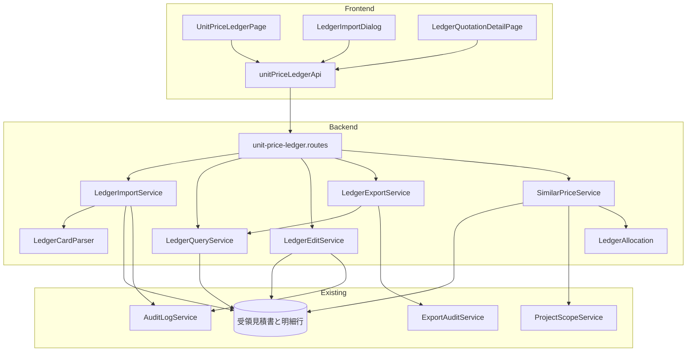
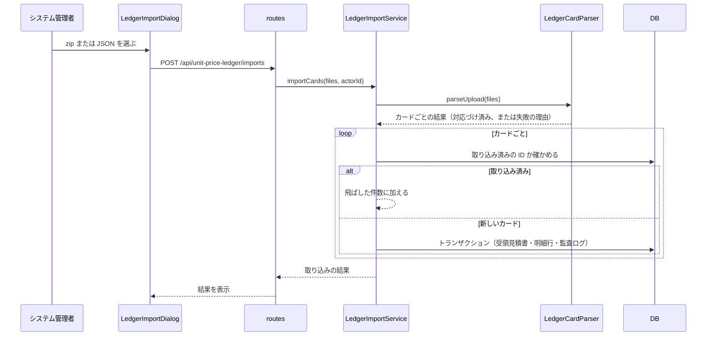
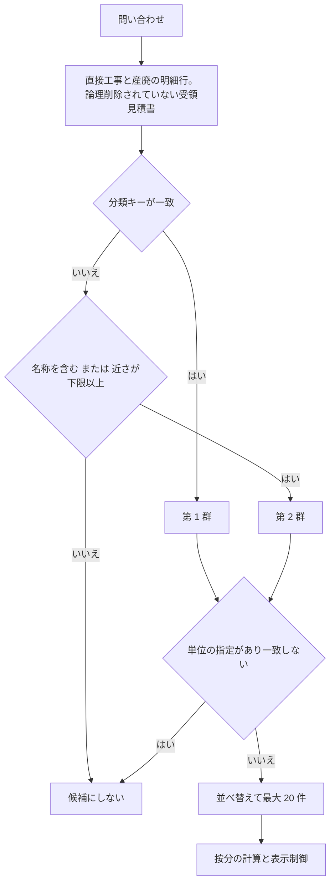

# Design Document

## Overview

**Purpose**: 単価台帳は、協力会社から受け取った見積（受領見積書）を、案件をまたいで過去の単価として引けるようにする。受領見積書そのものを台帳の見積として扱い、Google ドライブの台帳の見積カードを一括で取り込む。

**Users**:
- 見積担当者：見積の明細から、似た過去の単価の候補と、諸経費と値引きを按分した単価を得る（見積作成の画面と claude-connector が同じ API を使う）
- システム管理者：台帳全体を一覧・検索・修正し、要確認の見積を絞り込み、Excel に書き出す

**Impact**:
- 受領見積書の表に、台帳の 3 つの欄（カードの ID・原本のパス・案件名）を足す
- DB に pg_trgm を有効にし、明細行の名称に 3 文字組の索引を置く
- 権限に台帳の管理（`unit_price_ledger:manage`）を足す
- 出力の記録に、案件の無い種類（台帳の Excel）を足す

### Goals
- 受領見積書を登録すれば、そのまま台帳に載る（二重登録が無い）
- 過去の見積カードを、管理者の画面からすべて取り込める
- 似た単価の候補を、分類キーの一致を優先して返し、按分の内訳を添える
- 閲覧範囲の外の案件の名前と原本の場所を、候補から隠す

### Non-Goals
- 見積作成の画面での候補の表示と、実行金額への反映（estimate-creation の拡張）
- claude-connector の操作
- 原本の PDF の移行と保管
- 時期による単価の補正、意味の近さによる検索

## Boundary Commitments

### This Spec Owns
- 台帳の画面（一覧・検索・絞り込み・詳細・修正・削除・取り込み・書き出し）と、その API
- 案件の無い受領見積書の登録・修正・論理削除（estimate-request の画面と API は扱わない。estimate-request Requirement 43.14）
- 受領見積書の台帳の欄：カードの ID（ledgerCardId）・原本のパス（ledgerSourcePath）・案件名（ledgerProjectName）
- 案件の受領見積書の、台帳の画面からの限られた更新（読取の確認・明細行の参考の印と理由・明細行の分類キー）
- 似た単価の検索と按分の計算の API（`POST /api/unit-price-ledger/similar-prices`）と、その応答の形
- 権限 `unit_price_ledger:manage` と、出力の記録の種類 `unit_price_ledger_xlsx`
- pg_trgm の有効化と、明細行の名称の 3 文字組の索引

### Out of Boundary
- 受領見積書と明細行のモデルの、台帳の 3 つの欄以外の欄（estimate-request が持つ）
- 案件の受領見積書の登録・編集・削除の画面と API（estimate-request）
- 似た単価の候補の画面での表示と、実行金額への反映（estimate-creation の拡張）
- claude-connector の操作
- 権限・閲覧範囲・出力の記録の仕組みそのもの（user-authentication）

### Allowed Dependencies
- estimate-request：受領見積書と明細行のモデル、検証の定義（`backend/src/schemas/received-quotation.schema.ts` の `lineItemSchema`・`receivedQuotationLedgerFieldsShape`）、監査ログの種類（`RECEIVED_QUOTATION_*`）、画面の部品（`LineItemEditor`・`LedgerInfoSection`）
- user-authentication：`requirePermission`、`ProjectScopeService.buildProjectScopeWhere`、`ExportAuditService.record`、`usePermission`
- trading-partner-management：協力業者の取引先（照合だけ。取引先を作らない）
- 依存の向き：types → schemas → services → routes → frontend の API → 画面。台帳の部品は estimate-request の部品を呼ばない（モデルと定義だけを使う）

### Revalidation Triggers
- 受領見積書・明細行のモデルの欄の追加・削除・上限の変更（取り込みの対応づけと検証が変わる）
- 明細行の区分の種類の変更（按分の計算が変わる）
- 似た単価の応答の形の変更（estimate-creation の拡張・claude-connector・ArchiBench の past-prices の写しが変わる）
- 閲覧範囲の決まりの変更（Requirement 9 の表示制御が変わる）
- estimate-creation Requirement 22 の丸めの変更

## Architecture

### Existing Architecture Analysis
- 経路は `backend/src/app.ts` で `app.use` によりつなぐ。業務の機能は `/api/...`（v1 なし）を使う
- 権限は `requirePermission('resource:action')` で守る。拒否は 403 で、監査ログに残る
- 受領見積書の登録・更新・削除は、1 つのトランザクションの中で監査ログを書く。楽観的排他制御は更新の日時で判定する
- 閲覧範囲は `ProjectScopeService.buildProjectScopeWhere(userId)` が、閲覧できる案件の条件（全案件閲覧なら null）を返す
- サーバーの Excel は `backend/src/services/order-export.service.ts` の `exportToExcel` と同じく SheetJS で作る

### Architecture Pattern & Boundary Map



- Selected pattern：既存の層の作り（routes → services → Prisma）を踏襲する
- 新しい部品の理由：取り込み（カードの読み取りと登録）・一覧・修正・書き出し・似た単価の検索は、入力と失敗の扱いが互いに違うため部品を分ける。按分の計算は DB に依らない純粋な計算として分ける

### Technology Stack

| Layer | Choice / Version | Role in Feature | Notes |
|-------|------------------|-----------------|-------|
| Frontend | React 19、既存の画面の部品 | 台帳の画面・取り込みの画面・詳細と修正 | 明細行と台帳の情報の部品は estimate-request のものを使う |
| Backend | Express 5、zod、fflate 0.8.3（新しい直接の依存） | API、カードの検証、zip の読み取り | fflate は既に間接の依存として入っている |
| Backend | SheetJS xlsx 0.20.3 | 台帳の Excel | 既存の依存 |
| Data | PostgreSQL 15、pg_trgm、Prisma 7（`$queryRaw`） | 名称の近さの検索 | 拡張は migration の SQL で有効にし、索引はスキーマに書く |

## File Structure Plan

### Directory Structure
```
backend/
├── prisma/migrations/20261116000000_unit_price_ledger/migration.sql
│       # pg_trgm の有効化、台帳の 3 つの欄、カードの ID の一意の索引（論理削除を除く）、
│       # 名称の 3 文字組の索引、権限 unit_price_ledger:manage の追加
├── src/services/unit-price-ledger/
│   ├── ledger-card-parser.ts       # zip と JSON の読み取り、カードの検査、受領見積書への対応づけ、参考の理由
│   ├── ledger-import.service.ts    # カードごとのトランザクションでの登録、取引先の照合、取り込み済みの飛ばし、結果
│   ├── ledger-query.service.ts     # 一覧・絞り込み・総件数・詳細
│   ├── ledger-edit.service.ts      # 案件の無い受領見積書の修正と削除、案件の受領見積書の印の更新、監査ログ
│   ├── ledger-export.service.ts    # 3 つのシートの Excel
│   ├── similar-price.service.ts    # 似た単価の検索、並べ方、閲覧範囲による表示制御
│   └── ledger-allocation.ts        # 按分の計算（純粋な関数）
├── src/schemas/unit-price-ledger.schema.ts   # 要求の検証（一覧の絞り込み・修正・印の更新・似た単価の問い合わせ）
├── src/routes/unit-price-ledger.routes.ts    # /api/unit-price-ledger の経路と権限
└── src/errors/unitPriceLedgerError.ts        # 台帳の誤り（取り込みの上限超過・案件の受領見積書の削除の拒否）
frontend/
├── src/api/unit-price-ledger.ts               # unitPriceLedgerApi
├── src/pages/UnitPriceLedgerPage.tsx          # 一覧・絞り込み・書き出し・取り込みの入口
├── src/pages/LedgerQuotationDetailPage.tsx    # 詳細と修正
└── src/components/unit-price-ledger/
    ├── LedgerSearchFilter.tsx       # 絞り込みの欄
    ├── LedgerQuotationTable.tsx     # 一覧の表
    └── LedgerImportDialog.tsx       # 取り込みの画面と結果
e2e/specs/unit-price-ledger/         # 取り込み・一覧・修正・書き出し・権限・似た単価の E2E
```

### Modified Files
- `backend/prisma/schema.prisma` — 受領見積書に台帳の 3 つの欄、明細行の名称に GIN の 3 文字組の索引
- `backend/src/app.ts` — `/api/unit-price-ledger` の経路をつなぐ
- `backend/src/utils/seed-helpers.ts` — 権限 `unit_price_ledger:manage` を足す（user ロールには与えない）
- `e2e/fixtures/seed-helpers.ts` — 同じ権限を E2E の初期データに足す
- `backend/src/services/export-audit.service.ts` — `EXPORT_KINDS` と `PROJECTLESS_EXPORT_KINDS` に `unit_price_ledger_xlsx` を足す
- `backend/src/types/audit-log.types.ts` — 取り込みの監査の目印（metadata の source）の型を足す
- `backend/package.json` — fflate を直接の依存にする
- `frontend/src/routes.tsx` — 台帳の画面の経路を足す
- `frontend/src/components/Navigation/AppHeader.tsx` — 権限を持つ利用者だけに台帳への導線を出す
- `frontend/src/api/export-audit.ts` — `ExportKind` に `unit_price_ledger_xlsx` を足す

## System Flows

### 取り込み



- 1 枚のカードの登録は 1 つのトランザクションで行い、失敗したカードは残さない（2.14）。失敗しても次のカードへ進む（2.3）
- 取り込み済みの判定は、論理削除されていない受領見積書のカードの ID で行う。同時の取り込みは、一意の索引の違反を「取り込み済み」として扱う

### 似た単価の検索



## Requirements Traceability

| Requirement | Summary | Components | Interfaces | Flows |
|-------------|---------|------------|------------|-------|
| 1.1, 1.2, 1.3, 1.4 | 論理削除されていない受領見積書を台帳の見積とする | LedgerQueryService, SimilarPriceService, LedgerExportService | GET /api/unit-price-ledger/quotations | - |
| 2.1, 2.2, 2.3, 2.4, 2.5, 2.6, 2.7, 2.8, 2.9 | カードの読み取り・検査・対応づけ | LedgerCardParser, LedgerImportService | POST /api/unit-price-ledger/imports | 取り込み |
| 2.10, 2.11, 2.12, 2.13, 2.14, 2.15, 2.16 | 取引先の照合・読取の確認・取り込み済みの飛ばし・結果・まとめての登録 | LedgerImportService, LedgerImportDialog | POST /api/unit-price-ledger/imports | 取り込み |
| 3.1, 3.2, 3.3, 3.4, 3.5, 3.6 | 取り込みの参考の印と理由 | LedgerCardParser | `parseUpload` | 取り込み |
| 4.1, 4.2, 4.3, 4.4, 4.5, 4.6, 4.7 | 一覧・絞り込み・詳細 | LedgerQueryService, UnitPriceLedgerPage, LedgerSearchFilter, LedgerQuotationTable, LedgerQuotationDetailPage | GET /api/unit-price-ledger/quotations, GET /api/unit-price-ledger/quotations/:id | - |
| 5.1, 5.2, 5.3, 5.4, 5.5, 5.6, 5.7 | 修正・削除・排他・監査 | LedgerEditService, LedgerQuotationDetailPage | PUT /api/unit-price-ledger/quotations/:id, PATCH /api/unit-price-ledger/quotations/:id/marks, DELETE /api/unit-price-ledger/quotations/:id | - |
| 6.1, 6.2, 6.3, 6.4, 6.5 | Excel の書き出しと出力の記録 | LedgerExportService, UnitPriceLedgerPage | POST /api/unit-price-ledger/exports | - |
| 7.1, 7.2, 7.3, 7.4, 7.5, 7.6, 7.7, 7.8, 7.9, 7.10, 7.11 | 似た単価の検索と並べ方 | SimilarPriceService | POST /api/unit-price-ledger/similar-prices | 似た単価の検索 |
| 8.1, 8.2, 8.3, 8.4, 8.5, 8.6, 8.7 | 按分の計算 | LedgerAllocation, SimilarPriceService | `computeAllocation` | 似た単価の検索 |
| 9.1, 9.2, 9.3, 9.4 | 閲覧範囲による表示制御 | SimilarPriceService | POST /api/unit-price-ledger/similar-prices | 似た単価の検索 |
| 10.1, 10.2, 10.3, 10.4, 10.5 | 権限と導線 | unit-price-ledger.routes, UnitPriceLedgerPermissionMigration, AppHeader, UnitPriceLedgerPage | `requirePermission` | - |

## Components and Interfaces

### Summary Table

| Component | Domain/Layer | Intent | Req Coverage | Key Dependencies | Contracts |
|-----------|--------------|--------|--------------|------------------|-----------|
| LedgerCardParser | Backend/Service | カードの読み取り・検査・対応づけ・参考の理由 | 2.1-2.9, 3.1-3.6 | fflate, received-quotation.schema (P0) | Service |
| LedgerImportService | Backend/Service | カードごとの登録と取り込みの結果 | 2.1-2.16 | LedgerCardParser (P0), AuditLogService (P0) | Service |
| LedgerQueryService | Backend/Service | 一覧・絞り込み・詳細 | 1.1-1.4, 4.1-4.7 | Prisma (P0) | Service |
| LedgerEditService | Backend/Service | 修正・削除・印の更新・監査 | 5.1-5.7 | AuditLogService (P0) | Service |
| LedgerExportService | Backend/Service | 3 つのシートの Excel | 1.1-1.4, 6.1-6.5 | LedgerQueryService (P0), ExportAuditService (P0) | Service |
| SimilarPriceService | Backend/Service | 似た単価の検索・並べ方・表示制御 | 1.1-1.4, 7.1-7.11, 8.1-8.7, 9.1-9.4 | ProjectScopeService (P0), LedgerAllocation (P0) | Service, API |
| LedgerAllocation | Backend/Domain | 按分の計算 | 8.1-8.7 | decimal.js (P0) | Service |
| unit-price-ledger.routes | Backend/Route | 経路・権限・検証 | 10.1-10.5 | requirePermission (P0) | API |
| UnitPriceLedgerPermissionMigration | Backend/Migration | 権限・欄・索引・拡張 | 10.1-10.5 | PostgreSQL (P0) | Batch |
| UnitPriceLedgerPage | Frontend/Page | 一覧・絞り込み・書き出し・取り込みの入口 | 4.1-4.7, 6.1-6.5, 10.1-10.5 | unitPriceLedgerApi (P0) | State |
| LedgerSearchFilter | Frontend/Component | 絞り込みの欄 | 4.1-4.7 | - | State |
| LedgerQuotationTable | Frontend/Component | 一覧の表 | 4.1-4.7 | - | - |
| LedgerImportDialog | Frontend/Component | 取り込みと結果 | 2.1-2.16 | unitPriceLedgerApi (P0) | State |
| LedgerQuotationDetailPage | Frontend/Page | 詳細と修正 | 4.1-4.7, 5.1-5.7 | LineItemEditor, LedgerInfoSection (P0) | State |
| AppHeader | Frontend/Component | 台帳への導線の出し分け | 10.1-10.5 | usePermission (P0) | - |

### Backend Layer

#### LedgerCardParser

| Field | Detail |
|-------|--------|
| Intent | アップロードされたファイルから見積カードを読み、検査し、受領見積書の形へ対応づける |
| Requirements | 2.1, 2.2, 2.3, 2.4, 2.5, 2.6, 2.7, 2.8, 2.9, 3.1, 3.2, 3.3, 3.4, 3.5, 3.6 |

**Responsibilities & Constraints**
- zip は fflate の `unzipSync` で読み、`.json` の項目だけを選ぶ。上限は、zip の大きさ 50 MB、項目の数 2000、1 項目の展開後 1 MB、展開後の合計 200 MB とし、超えたらその要求を 413 で拒む
- JSON のファイルは 1 要求あたり 2000 個まで、1 個 1 MB まで受ける
- 検査は、JSON として読めることと、必須の項目（id・業者・見積日・行と、各行の名称・数量・単位・金額）に限る（2.2）。失敗はそのカードだけの理由として返す（2.3）
- 対応づけ（2.4〜2.8）
  - id → ledgerCardId、原本.パス → ledgerSourcePath、案件.名称 → ledgerProjectName
  - 業者 → vendorName、見積日 → submittedAt、見積番号 → quoteNumber、条件 → overallConditions
  - 案件.場所 → siteLocation、案件.区分（改修／新営）→ constructionKind、案件.用途 → useType、案件.工事価格 → constructionPrice、案件.作業条件（一覧は「、」でつなぐ）→ workConditions、案件.片道km → distanceKm
  - 採否 → adoption（採用・不採用・不明）、確定金額 → confirmedAmount
  - 行：名称・規格・数量・単位・単価・金額・条件・備考・区分（本体 → 直接工事）・換算 → 明細行の同名の欄
  - 行の細目は、備考の末尾に「細目：<値>」と足す（2.7）
  - 発注者・延床・工事価格の根拠・工種の一覧・読取の方法とメモ・種別（単価見積）は、見積全体の条件の末尾に「<見出し>：<値>」の行として足す（2.8）
  - 受領見積書の名前は「<業者>_<見積日>」とする
- 上限を超える値は上限で切り詰め、切り詰めた欄の名前を返す（2.9）。上限の値は `lineItemSchema` と `receivedQuotationLedgerFieldsShape` の上限を使う
- 参考の理由（3.1〜3.5）
  - カードの参考.理由に、数量×単価と金額の 1 円を超える違い（単価のある行だけ）・合計の不一致・切り詰めを加える
  - 合計の不一致は、別途を除く行の金額の合計と合計.税抜、区分ごとの行の合計と合計.値引き・諸経費・交通費・産廃を比べる（カードに無い合計は比べない）
  - 理由が 1 つ以上あれば、すべての行の参考の印を有にし、理由を「、」でつなぐ。200 文字を超えたら切り詰め、全文を見積全体の条件の末尾に「参考の理由：」で足す
- 不正な値（数ではない数量、存在しない区分など）は、必須の項目なら失敗、任意の項目なら空にして切り詰めと同じく参考の理由「読めない値を空にした」を加える

**Contracts**: Service [x]

##### Service Interface
```typescript
type LedgerCardParseOutcome =
  | { kind: 'parsed'; fileName: string; cardId: string; input: LedgerQuotationInput; truncatedFields: string[]; referenceReasons: string[] }
  | { kind: 'failed'; fileName: string; reason: string };

interface LedgerCardParser {
  parseUpload(files: ReadonlyArray<{ originalName: string; buffer: Buffer; mimeType: string }>): LedgerCardParseOutcome[];
}

interface LedgerQuotationInput {
  ledgerCardId: string;
  ledgerSourcePath: string | null;
  ledgerProjectName: string | null;
  vendorName: string;
  name: string;
  submittedAt: Date;
  ledgerFields: ReceivedQuotationLedgerFields; // estimate-request の台帳の情報の欄
  readingConfirmed: { confirmed: boolean; readAt: Date | null };
  lineItems: LedgerLineItemInput[];
}
```
- Preconditions：files は multer の memoryStorage で受けた内容
- Postconditions：入力の順に、ファイル（zip の中は項目）ごとに 1 つの結果を返す。例外を投げるのは上限超過だけである

#### LedgerImportService

| Field | Detail |
|-------|--------|
| Intent | 読み取ったカードを、1 枚ずつ案件の無い受領見積書として登録し、取り込みの結果を返す |
| Requirements | 2.1, 2.3, 2.10, 2.11, 2.12, 2.13, 2.14, 2.15, 2.16, 3.6 |

**Responsibilities & Constraints**
- 1 枚のカードごとに 1 つのトランザクションで、受領見積書・明細行・監査ログ（`RECEIVED_QUOTATION_CREATED`、metadata の source は `ledger_import`）を書く（2.16）
- 取引先の照合は、論理削除されていない協力業者の取引先の名前の完全一致が 1 件のときだけ紐づける（2.10・2.11）
- 読取の確認が「済」なら、確認済み・確認者は実行者・日時は読取の日時か取り込みの日時（2.12・2.13）
- 取り込み済みのカードの ID は飛ばす（2.14）。一意の索引の違反（P2002）も飛ばした件数に数える
- 参考の印は取り込みを止めない（3.6）

**Contracts**: Service [x]

##### Service Interface
```typescript
interface LedgerImportResult {
  importedCount: number;
  skipped: Array<{ cardId: string }>;
  failed: Array<{ fileName: string; reason: string }>;
  truncated: Array<{ cardId: string; fields: string[] }>;
  referenceMarkedCount: number;
}

interface LedgerImportService {
  importCards(files: ReadonlyArray<{ originalName: string; buffer: Buffer; mimeType: string }>, actorId: string): Promise<LedgerImportResult>;
}
```

#### LedgerQueryService

| Field | Detail |
|-------|--------|
| Intent | 台帳の一覧・絞り込み・総件数・詳細を返す |
| Requirements | 1.1, 1.2, 1.3, 1.4, 4.1, 4.2, 4.3, 4.4, 4.5, 4.6, 4.7 |

**Responsibilities & Constraints**
- 対象は論理削除されていない受領見積書のすべて（見積依頼・案件の有無を問わない。1.1・1.3）。見積依頼に紐づく受領見積書は、見積依頼が論理削除されていないものに限る
- 案件名は、案件があれば案件の名前、無ければ ledgerProjectName を返す
- 絞り込み（4.2〜4.4）：文字（業者名・案件名・明細行の名称の部分一致）、見積日の期間、案件の有無、採否、読取の確認、改修／新営、要確認（参考の印のある行を持つ）、分類キーの無い行がある（直接工事・産廃で分類キーが空）
- 並びは見積日の新しい順、同じ日は登録の新しい順。1 ページ 50 件（4.5）

**Contracts**: Service [x] / API [x]

##### API Contract
| Method | Endpoint | Request | Response | Errors |
|--------|----------|---------|----------|--------|
| GET | /api/unit-price-ledger/quotations | LedgerListQuery | `{ data: LedgerQuotationSummary[]; pagination }` | 400, 403 |
| GET | /api/unit-price-ledger/quotations/:id | - | LedgerQuotationDetail | 403, 404 |

#### LedgerEditService

| Field | Detail |
|-------|--------|
| Intent | 台帳の画面からの修正・削除・印の更新を、受領見積書の監査ログの決まりで記録する |
| Requirements | 5.1, 5.2, 5.3, 5.4, 5.5, 5.6, 5.7 |

**Responsibilities & Constraints**
- 案件の無い受領見積書は、業者名・見積日・台帳の情報の欄・案件名・原本のパス・明細行の全体を修正できる（5.1）。明細行の検証は `lineItemSchema` を使う。明細行を変えたときは、estimate-request Requirement 46.8 と同じく読取の確認を未確認に戻す
- 案件の受領見積書は、印の更新（読取の確認・明細行の参考の印と理由・明細行の分類キー）だけを受ける（5.2）。印の更新は 46.8 の「明細行の変更」に当たらず、読取の確認を戻さない
- 分類キーは 50 文字まで、体系の登録の有無を検査しない（5.3）
- 確認済みにしたときは確認者と日時を記録する（5.4）
- 削除は案件の無い受領見積書だけを論理削除する。案件の受領見積書の削除の要求は 409 で拒む（5.5）
- 楽観的排他制御は更新の日時の一致で判定し、不一致は 409 `LEDGER_CONFLICT` と「ほかの利用者が更新しました。最新の内容を読み込み直してください」（5.6）
- 監査ログは `RECEIVED_QUOTATION_UPDATED` / `RECEIVED_QUOTATION_DELETED` を同じトランザクションで書き、metadata の source は `unit_price_ledger`。工事価格と確定金額は変わったかどうかだけを記録する（5.7）

**Contracts**: Service [x] / API [x]

##### API Contract
| Method | Endpoint | Request | Response | Errors |
|--------|----------|---------|----------|--------|
| PUT | /api/unit-price-ledger/quotations/:id | LedgerQuotationUpdate（expectedUpdatedAt を含む） | LedgerQuotationDetail | 400, 403, 404, 409 |
| PATCH | /api/unit-price-ledger/quotations/:id/marks | LedgerMarksUpdate（expectedUpdatedAt を含む） | LedgerQuotationDetail | 400, 403, 404, 409 |
| DELETE | /api/unit-price-ledger/quotations/:id | `?updatedAt=` | 204 | 403, 404, 409 |

- PUT は案件の受領見積書に対して 409 `LEDGER_PROJECT_QUOTATION_READ_ONLY` を返す

#### LedgerExportService

| Field | Detail |
|-------|--------|
| Intent | 絞り込みの結果を 3 つのシートの Excel にし、作る前に出力を記録する |
| Requirements | 1.1, 1.2, 1.3, 1.4, 6.1, 6.2, 6.3, 6.4, 6.5 |

**Responsibilities & Constraints**
- シートは「見積」「明細行」「要確認」（6.1）。明細行のシートの列は 6.2 のとおり
- 作る前に `ExportAuditService.record`（kind `unit_price_ledger_xlsx`、projectId null、件数は見積の数）を呼ぶ。記録に失敗したら 500 `EXPORT_RECORD_FAILED` と「書き出しを記録できなかったため、出力を中止しました」を返し、ファイルを作らない（6.3・6.4）
- 結果が 0 件の要求は 400 で拒む。画面は 0 件のとき書き出しの操作を無効にする（6.5）

**Contracts**: Service [x] / API [x]

##### API Contract
| Method | Endpoint | Request | Response | Errors |
|--------|----------|---------|----------|--------|
| POST | /api/unit-price-ledger/exports | LedgerListQuery（ページを除く） | xlsx のファイル | 400, 403, 500 |

#### SimilarPriceService

| Field | Detail |
|-------|--------|
| Intent | 似た過去の単価の候補を、分類キーの一致を優先して並べ、按分の内訳と表示制御を添えて返す |
| Requirements | 1.1, 1.2, 1.3, 1.4, 7.1, 7.2, 7.3, 7.4, 7.5, 7.6, 7.7, 7.8, 7.9, 7.10, 7.11, 8.1, 8.2, 8.3, 8.4, 8.5, 8.6, 8.7, 9.1, 9.2, 9.3, 9.4 |

**Responsibilities & Constraints**
- 対象は、論理削除されていない受領見積書の、区分が直接工事か産廃の明細行（7.1）
- 第 1 群：問い合わせに分類キーがあり、明細行の分類キーと一致する（7.2）
- 第 2 群：第 1 群でなく、次のどちらかを満たす（7.3・7.4）
  - 名称が問い合わせの名称を含む（大文字と小文字を区別しない。`%`・`_`・`\` は文字として扱う）
  - 近さが 0.3 以上。近さ＝ GREATEST(similarity(名称と規格, 問い合わせの名称と規格), word_similarity(問い合わせの名称と規格, 名称と規格))
- 単位の指定があれば、単位（換算のある行は換算の単位）が一致するものだけ（7.5）
- 並べ方（7.6）：群 → 工種・改修／新営・場所の一致の数（多い順）→ 近さ（高い順）→ 見積日（新しい順）→ 明細行の ID。最大 20 件
  - 工種の一致は明細行の工種、改修／新営は受領見積書の改修／新営、場所は受領見積書の場所の部分一致で判定する
- 採否と読取の確認は並べ方に使わない（7.8）。時期で補正しない（7.10）
- 表示制御（9.1〜9.4）：`buildProjectScopeWhere(userId)` で閲覧できる案件の ID を求め、範囲外の案件の候補は案件名を「他案件」とし、案件の ID・受領見積書の ID・見積依頼・原本のファイルを返さない。案件の無い受領見積書は案件名と原本のパスを返す
- 検索は `$queryRaw` に値を結び付けて行う（文字を組み立てない）

**Contracts**: Service [x] / API [x]

##### API Contract
| Method | Endpoint | Request | Response | Errors |
|--------|----------|---------|----------|--------|
| POST | /api/unit-price-ledger/similar-prices | SimilarPriceQuery | `{ candidates: SimilarPriceCandidate[] }` | 400, 403 |

```typescript
interface SimilarPriceQuery {
  name: string;                 // 1〜200 文字
  specification?: string;       // 200 文字まで
  unit?: string;                // 50 文字まで
  classificationKey?: string;   // 50 文字まで
  workType?: string;            // 500 文字まで
  constructionKind?: 'RENOVATION' | 'NEW_CONSTRUCTION';
  siteLocation?: string;        // 100 文字まで
}

interface SimilarPriceCandidate {
  lineItemId: string;
  vendorName: string;
  submittedAt: string;              // YYYY-MM-DD
  projectName: string | null;       // 範囲外は「他案件」
  projectId: string | null;         // 範囲外は null
  receivedQuotationId: string | null; // 範囲外は null
  ledgerSourcePath: string | null;  // 案件の無い受領見積書だけ
  name: string;
  specification: string | null;
  unit: string;
  quantity: string;
  category: 'DIRECT' | 'WASTE';
  classificationKeyMatched: boolean;
  adoption: 'ADOPTED' | 'REJECTED' | 'UNKNOWN';
  readingStatus: 'UNCONFIRMED' | 'CONFIRMED';
  isReference: boolean;
  referenceReason: string | null;
  allocation: AllocationBreakdown;
}
```

#### LedgerAllocation

| Field | Detail |
|-------|--------|
| Intent | 候補の行の単価と、その見積の区分ごとの合計から按分の内訳を求める |
| Requirements | 8.1, 8.2, 8.3, 8.4, 8.5, 8.6, 8.7 |

**Responsibilities & Constraints**
- 単価は、換算の単価 → 単価 → 金額÷数量 の順に決める（8.1）
- 基準＝直接工事と産廃の金額の合計（8.2）。諸経費の率＝（諸経費＋交通費＋法定福利費）÷基準、値引きの率＝値引き÷基準。別途は使わない（8.3）
- 単価・諸経費の按分・値引きの按分・反映する単価を、decimal.js の `ROUND_HALF_UP` で整数に丸める（8.4・8.5。estimate-creation の `roundMoney` と同じ丸め）。反映する単価は丸める前の値の和を丸める
- 基準が 0 以下なら、按分は 0、`allocatable: false`（8.6）。反映する単価が 0 より小さければ `applicable: false`（8.7）

**Contracts**: Service [x]

##### Service Interface
```typescript
interface AllocationBreakdown {
  unitPrice: string;
  overheadAllocation: string;
  discountAllocation: string;
  appliedUnitPrice: string;
  allocatable: boolean;
  applicable: boolean;
}

function computeAllocation(line: AllocationLine, totals: CategoryTotals): AllocationBreakdown;
```

#### unit-price-ledger.routes

| Field | Detail |
|-------|--------|
| Intent | 台帳の経路を権限と検証で守る |
| Requirements | 10.1, 10.2, 10.4 |

**Responsibilities & Constraints**
- 似た単価の問い合わせは `requirePermission('estimate:update')`、それ以外は `requirePermission('unit_price_ledger:manage')`（10.1・10.2）。拒否は 403 で内容を返さない（10.4）
- 取り込みは multer の memoryStorage（1 ファイル 50 MB、2000 ファイル）で受ける

**Contracts**: API [x]

#### UnitPriceLedgerPermissionMigration

| Field | Detail |
|-------|--------|
| Intent | pg_trgm・台帳の欄・索引・権限を、動いている環境へ入れる |
| Requirements | 10.3 |

**Responsibilities & Constraints**
- `CREATE EXTENSION IF NOT EXISTS pg_trgm` を索引の作成より前に置く
- 受領見積書に ledger_card_id（200 文字）・ledger_source_path（1000 文字）・ledger_project_name（255 文字）を足す
- ledger_card_id の一意の索引（論理削除されていない行だけ。部分索引は SQL で作る。既存の先例は itemized_statements の名前の一意の索引）
- 明細行の名称の GIN の 3 文字組の索引（スキーマにも書く）
- 権限 `unit_price_ledger:manage` を足す。admin は `*:*` を持つため行を足さない。user ロールには与えない（10.3）

**Contracts**: Batch [x]

##### Batch / Job Contract
- Trigger：起動時の migration（MIGRATE_ON_DEPLOY）
- Idempotency & recovery：`IF NOT EXISTS` と `ON CONFLICT DO NOTHING` で、やり直せる

### Frontend Layer

#### UnitPriceLedgerPage

| Field | Detail |
|-------|--------|
| Intent | 台帳の一覧・絞り込み・書き出し・取り込みの入口 |
| Requirements | 4.1, 4.2, 4.3, 4.5, 4.7, 6.1, 6.5, 10.1, 10.5 |

**Responsibilities & Constraints**
- 経路は `/unit-price-ledger`（認証済みの経路）。画面の中で `hasPermission('unit_price_ledger:manage')` を確かめ、無ければ内容を出さない
- 絞り込みとページは URL の検索の値に持つ（取引先の一覧の作りと同じ）
- 0 件のとき「条件に合う見積はありません」を出し、書き出しを無効にする

**Contracts**: State [x]

#### LedgerImportDialog

| Field | Detail |
|-------|--------|
| Intent | zip または JSON を選んで取り込み、結果を表示する |
| Requirements | 2.1, 2.15 |

**Contracts**: State [x]

#### LedgerQuotationDetailPage

| Field | Detail |
|-------|--------|
| Intent | 見積の詳細を表示し、案件の有無に応じた範囲で修正・削除する |
| Requirements | 4.6, 5.1, 5.2, 5.3, 5.4, 5.5, 5.6 |

**Responsibilities & Constraints**
- 案件の無い受領見積書は `LineItemEditor` と `LedgerInfoSection` で全体を修正できる
- 案件の受領見積書は、読取の確認・参考の印と理由・分類キーだけを編集でき、ほかの欄は受領見積書の画面への導線を出す

**Contracts**: State [x]

#### AppHeader

| Field | Detail |
|-------|--------|
| Intent | 台帳の管理の権限を持つ利用者だけに、台帳への導線を出す |
| Requirements | 10.5 |

## Data Models

### Logical Data Model
- 受領見積書（ReceivedQuotation）に台帳の 3 つの欄を足す。どれも任意（案件の受領見積書では空）
  - ledgerCardId：カードの ID。論理削除されていない行の中で一意
  - ledgerSourcePath：原本のパス（Drive の 01_案件 からの相対）
  - ledgerProjectName：案件名（案件の無い受領見積書の案件名）
- 明細行（ReceivedQuotationLineItem）の名称に 3 文字組の索引を置く

### Physical Data Model

```prisma
model ReceivedQuotation {
  // 既存の欄は estimate-request が持つ
  ledgerCardId      String? @map("ledger_card_id") @db.VarChar(200)
  ledgerSourcePath  String? @map("ledger_source_path") @db.VarChar(1000)
  ledgerProjectName String? @map("ledger_project_name") @db.VarChar(255)
}

model ReceivedQuotationLineItem {
  // 既存の欄は estimate-request が持つ
  @@index([name(ops: raw("gin_trgm_ops"))], type: Gin)
}
```

- ledger_card_id の一意の部分索引は migration の SQL だけで作る（Prisma のスキーマで書けない）

## Error Handling

### Error Categories and Responses
- 400：検証の失敗（問い合わせの名称が空、上限の超過、書き出しの結果が 0 件）
- 403：権限が無い
- 404：見積が無い、または論理削除済み
- 409：排他の不一致（`LEDGER_CONFLICT`）、案件の受領見積書の全体の修正・削除（`LEDGER_PROJECT_QUOTATION_READ_ONLY`）
- 413：取り込みの上限の超過（`LEDGER_IMPORT_TOO_LARGE`）
- 500：出力の記録の失敗（`EXPORT_RECORD_FAILED`）
- カードごとの失敗は 200 の結果の failed に入れ、要求全体を失敗にしない

### Monitoring
- 取り込みの結果の件数（登録・飛ばし・失敗）をログに残す。カードの中身はログに出さない

## Testing Strategy

- **Unit Tests**
  - LedgerCardParser：必須の項目の欠け、読めない JSON、切り詰め、細目と 6 項目の足し方、参考の理由（1 円の違い・合計の不一致・200 文字の切り詰め）
  - LedgerAllocation：諸経費・値引きの按分、基準が 0、反映する単価が負、換算の単価、金額÷数量、負の値の丸め
  - SimilarPriceService の並べ方と表示制御（範囲外の「他案件」と ID の秘匿）
- **Integration Tests**
  - 取り込み：zip とJSON、取り込み済みの飛ばし、同時の取り込み、取引先の照合、読取の確認、1 枚のカードの失敗が残らないこと、監査ログ
  - 似た単価：実 DB の pg_trgm で、分類キーの一致の優先、2 文字以下の名称、単位の一致、論理削除の除外、最大 20 件
  - 修正と削除：排他の不一致、案件の受領見積書の制限、監査ログの工事価格と確定金額の扱い
  - 書き出し：出力の記録の後に作ること、記録の失敗で作らないこと
  - 権限：user ロールでの 403
- **E2E Tests**
  - 管理者がカードの zip を取り込み、結果を見て、一覧の「要確認」で絞り込む
  - 案件の無い見積を修正し、分類キーを付け、読取の確認を確認済みにする
  - 台帳の Excel を書き出す
  - 一般ユーザーには導線が無く、画面の内容も出ない
  - 似た単価の API の候補が、分類キーの一致を先に並べ、範囲外の案件を「他案件」とする

## Security Considerations
- 台帳全体はシステム管理者だけが扱う（既定のロール）。書き出しは出力の記録に残す
- 似た単価は見積の編集者が引けるが、範囲外の案件の名前・ID・原本は返さない
- 取り込みの zip は展開の前に大きさで項目を選び、ディスクへ書かない。`..` や絶対パスの名前、`.json` でない名前は読まない
- 検索の SQL は値を結び付け、利用者の文字で SQL を組み立てない

## Migration Strategy
- 着手の前に、staging と本番の DB で次を確かめる
  - `SELECT datctype FROM pg_database WHERE datname = current_database();` が C でないこと
  - `SELECT * FROM pg_available_extensions WHERE name = 'pg_trgm';` が 1 行あること
- C だった場合は、名称の近さを使わず部分一致だけになるため、利用者に進め方を確かめる
- migration は起動時に入る。拡張・欄・索引・権限の追加だけで、既存の行は変えない
