# 技術設計書

## Overview

この機能は、ArchiTrackプロジェクトに招待制のユーザー認証システムを追加します。JWT（JSON Web Token）ベースの認証方式を採用し、管理者が承認したユーザーのみがシステムへアクセスできるセキュアな認証基盤を構築します。

**目的**: 管理者が承認したユーザーのみが安全にシステムへアクセスし、個人のアーキテクチャ決定記録（ADR）を管理できるようにします。拡張可能なロールベースアクセス制御（RBAC）により、組織の職務構造に応じた柔軟な権限管理を実現します。

**ユーザー**:
- **システム管理者**: ユーザー招待、ロール管理、権限管理、監査ログ確認
- **一般ユーザー**: アカウント作成（招待経由）、ログイン、二要素認証設定、プロフィール管理、自分のADR管理

**影響**: 既存のExpress + Prisma + PostgreSQL + Redisアーキテクチャに認証・認可機能を追加します。既存のミドルウェアパターン（errorHandler, validate, logger）を活用し、新規ミドルウェア（authenticate, authorize）を統合します。

**改訂（2026-10-16）**: 要件32〜45（IPA注意喚起 2026-10-09 に基づくセキュリティ是正）の設計を末尾の章「Requirements 32-45: セキュリティ是正（IPA注意喚起 2026-10-09）」に置いた。同章の判断は本書の前半の記述に優先する。置き換わる前半の節は同章の「既存設計との関係」に挙げる（トークンの保存場所、2FA のログインと無効化、監査ログの保存先と外部キーなど）。

### Goals

- 招待制ユーザー登録システムの実装（管理者による招待→ユーザー登録）
- JWT認証の実装（EdDSA署名、アクセストークン15分、リフレッシュトークン7日間）
- 拡張可能なRBACシステムの実装（ロール、権限、ユーザー・ロール紐付け、ロール・権限紐付け）
- 二要素認証（2FA/TOTP）の実装（RFC 6238準拠、バックアップコード対応）
- マルチデバイスセッション管理の実装（デバイスごとの独立したセッション）
- セキュアなパスワード管理（Argon2idハッシュ、強度ポリシー強化、リセットフロー）
- トークンリフレッシュの自動化（Race Condition対策、マルチタブ同期）
- 監査ログとコンプライアンス対応（1年PostgreSQL保持、7年アーカイブ）

### Non-Goals

- OAuth/SAML等の外部プロバイダー連携（将来的な拡張として検討）
- SSO（Single Sign-On）の実装（将来的な拡張として検討）
- パスワード強度ポリシーの動的変更（現在は固定ポリシー）
- 生体認証（指紋認証、顔認証）の実装（将来的な拡張として検討）

## Architecture

### 既存アーキテクチャ分析

ArchiTrackは以下の技術スタックを採用しています：

- **Backend**: Express 5.1.0 + TypeScript 5.9.3
- **ORM**: Prisma 6.18.0
- **Database**: PostgreSQL 15
- **Cache**: Redis 7
- **既存ミドルウェア**: httpLogger, errorHandler, validate, httpsRedirect, rateLimit
- **既存エラークラス**: ApiError（UnauthorizedError, ForbiddenError等を提供）

既存のドメイン境界とパターン：
- ミドルウェアベースのリクエスト処理パイプライン
- Prisma ORMによる型安全なデータアクセス
- Redis Clientによるlazy initialization
- Pinoロガーによる構造化ログ
- Zodによるリクエストバリデーション

### High-Level Architecture

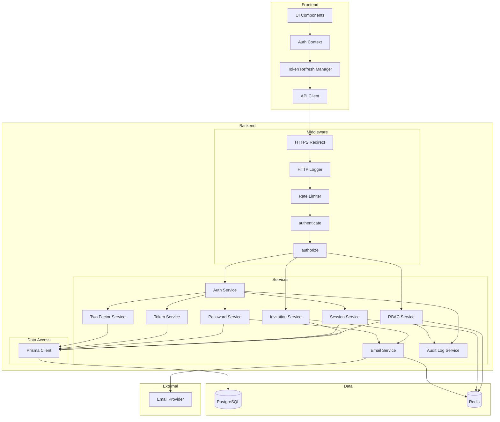

**アーキテクチャ統合**:
- **既存パターン保持**: Expressミドルウェアパイプライン、Prisma ORM、Pino Logger、Zodバリデーション
- **新規コンポーネント**:
  - AuthService: 認証ロジック（ログイン、トークン発行、検証）
  - InvitationService: 招待管理（招待作成、検証、無効化）
  - RBACService: 権限チェック（ロール・権限の評価）
  - SessionService: セッション管理（マルチデバイス対応）
  - PasswordService: パスワード管理（Argon2idハッシュ、検証、リセット）
  - TokenService: トークン管理（JWT生成、検証、リフレッシュ）
  - TwoFactorService: 二要素認証（TOTP生成・検証、バックアップコード管理）
  - EmailService: メール送信（招待、パスワードリセット、2FA設定完了通知）
  - AuditLogService: 監査ログ（権限変更の追跡）
- **技術整合性**: Express 5.1.0、TypeScript 5.9.3、Prisma 6.18.0との完全な互換性
- **ステアリング準拠**:
  - structure.md: 階層化アーキテクチャ、単一責任の原則、Lazy Initialization
  - tech.md: 既存技術スタック（Express, Prisma, Redis）の活用
  - product.md: スペック駆動開発のワークフロー、段階的な実装

### Technology Alignment

本機能は既存のArchiTrack技術スタックを基盤として構築されます。

**既存技術スタックとの整合性**:
- **Express 5.1.0**: 既存のミドルウェアパイプラインに認証ミドルウェア（authenticate, authorize）を追加
- **Prisma 6.18.0**: 既存のPrismaスキーマを拡張（User, Invitation, RefreshToken, Role, Permission, UserRole, RolePermission, PasswordHistory, TwoFactorBackupCode, AuditLog）
- **PostgreSQL 15**: 既存のデータベース接続を活用、新規テーブルを追加
- **Redis 7**: セッション管理、権限キャッシュ、メールキューに活用
- **TypeScript 5.9.3**: 完全な型安全性を維持（`any`型の排除）
- **Pino Logger**: 既存のロガーミドルウェアを活用、認証イベントのログ記録
- **Zodバリデーション**: 既存のvalidateミドルウェアを活用、認証APIのリクエストバリデーション

**新規依存関係**:

**Backend**:
- **jose (^5.9.6)**: JWT生成・検証（EdDSA署名、IETF JOSE標準準拠）
- **@node-rs/argon2 (^2.0.0)**: パスワードハッシュ・検証（Argon2id、ネイティブバインディング、bcrypt比2-3倍高速）
- **nodemailer (^6.9.7)**: メール送信（招待、パスワードリセット）
- **@types/nodemailer (^6.4.14)**: nodemailer型定義
- **bull (^4.16.3)**: Redisキュー（非同期メール送信）
- **@types/bull (^4.10.0)**: bull型定義
- **handlebars (^4.7.8)**: メールテンプレート（HTML/テキスト生成）
- **@types/handlebars (^4.1.0)**: handlebars型定義
- **dataloader (^2.2.3)**: バッチング + キャッシング（N+1問題対策）
- **bloom-filters (^3.0.2)**: Bloom Filter（禁止パスワードリストの効率的な照合、偽陽性率0.001）
- **otplib (^12.0.1)**: TOTP生成・検証（RFC 6238準拠、二要素認証用）
- **qrcode (^1.5.3)**: QRコード生成（TOTP秘密鍵のモバイルアプリ登録用）
- **@types/qrcode (^1.5.5)**: qrcode型定義

**Frontend**:
- **zxcvbn (^4.4.2)**: パスワード強度評価（科学的な強度スコア、辞書攻撃耐性）
- **@types/zxcvbn (^4.4.5)**: zxcvbn型定義

**パターン統合**:
- ミドルウェアベースの認証・認可チェック
- Serviceレイヤーによるビジネスロジックの分離
- Prisma Clientによる型安全なデータアクセス
- Redis Clientによるキャッシング戦略

### Key Design Decisions

#### 決定1: JWT署名アルゴリズムとパスワードハッシュアルゴリズムの選択

**決定**: EdDSA (Ed25519) 署名アルゴリズム（jose v5）とArgon2id パスワードハッシュアルゴリズム（@node-rs/argon2）を採用

**コンテキスト**: ステートレスなAPI認証が必要であり、将来的なマイクロサービス化やモバイルアプリ対応、最新のセキュリティ標準（NIST FIPS 186-5、OWASP推奨）への準拠が求められる。

**代替案**:
1. **HS256 + bcrypt**: 対称鍵暗号、bcryptはOWASP推奨だがArgon2idより低速
2. **RS256 + bcrypt**: RSA署名、鍵サイズが大きい（2048-4096ビット）、署名・検証が遅い
3. **EdDSA (Ed25519) + Argon2id**: 楕円曲線署名、メモリハード関数、NIST/OWASP最新推奨

**選択したアプローチ**: EdDSA (Ed25519) + jose v5 + Argon2id

**実装方式**:

**JWT署名アルゴリズム**: EdDSA (Ed25519)
- **選択理由**:
  - **最新のセキュリティ標準**: NIST FIPS 186-5推奨（2025年以降）
  - **高速**: RS256比で署名10倍、検証15倍高速
  - **鍵サイズ**: 32バイト（RS256: 256-512バイト、HS256: 32バイト）
  - **公開鍵暗号**: マイクロサービス化時に公開鍵で検証可能（秘密鍵の共有不要）
  - **署名安全性**: 楕円曲線暗号（Curve25519）、量子コンピュータ耐性（NIST PQC候補）
- **鍵管理**:
  - 秘密鍵: 環境変数`JWT_PRIVATE_KEY`（Base64エンコード）
  - 公開鍵: 環境変数`JWT_PUBLIC_KEY`（Base64エンコード）または JWKSエンドポイント（`/.well-known/jwks.json`）で配布

**パスワードハッシュアルゴリズム**: Argon2id
- **選択理由**:
  - **OWASP最新推奨**: OWASP Password Storage Cheat Sheet（2025年）で第一推奨
  - **メモリハード関数**: GPU攻撃耐性、ASIC攻撃耐性
  - **ハイブリッド方式**: Argon2d（データ依存）+ Argon2i（サイドチャネル攻撃耐性）の利点を統合
  - **設定**: メモリコスト64MB、時間コスト3、並列度4（OWASP推奨値）
  - **パフォーマンス**: @node-rs/argon2（Rustネイティブバインディング）によりbcrypt比2-3倍高速

**トークン戦略**:
- **アクセストークン**: 短期間有効（環境変数`ACCESS_TOKEN_EXPIRY`、デフォルト15分）、API認証に使用、ペイロードにユーザー情報とロール情報を含む
- **リフレッシュトークン**: 長期間有効（環境変数`REFRESH_TOKEN_EXPIRY`、デフォルト7日間）、アクセストークンのリフレッシュに使用、データベースに保存して無効化可能

**根拠**:
- **セキュリティ**: 最新のNIST/OWASP推奨アルゴリズム、公開鍵暗号による安全性、メモリハード関数によるGPU攻撃耐性
- **パフォーマンス**: RS256比でJWT署名10倍・検証15倍高速、bcrypt比でパスワードハッシュ2-3倍高速
- **将来性**: マイクロサービス化時に公開鍵で検証可能、JWKSエンドポイントでキーローテーション容易
- **標準準拠**: IETF JOSE Working Group標準、OWASP/NISTベストプラクティス

**トレードオフ**:
- **利点**: セキュリティ、パフォーマンス、将来性、標準準拠
- **欠点**: 鍵ペア管理の複雑性（環境変数2つ必要）、HS256/bcryptと比較して初期セットアップがやや複雑

**EdDSA鍵ペア管理と運用戦略**:

**鍵生成スクリプト実装**:

```typescript
// scripts/generate-eddsa-keys.ts
import * as jose from 'jose';
import * as fs from 'fs';

async function generateEdDSAKeys() {
  console.log('Generating EdDSA (Ed25519) key pair...');

  // EdDSA鍵ペア生成
  const { publicKey, privateKey } = await jose.generateKeyPair('EdDSA');

  // JWK形式でエクスポート
  const publicJWK = await jose.exportJWK(publicKey);
  const privateJWK = await jose.exportJWK(privateKey);

  // Key ID (kid) 生成（タイムスタンプベース）
  const kid = `eddsa-${Date.now()}`;
  publicJWK.kid = kid;
  privateJWK.kid = kid;

  // Base64エンコード（環境変数用）
  const publicKeyBase64 = Buffer.from(JSON.stringify(publicJWK)).toString('base64');
  const privateKeyBase64 = Buffer.from(JSON.stringify(privateJWK)).toString('base64');

  // .envファイル生成
  const envContent = `
# EdDSA (Ed25519) Key Pair
# Generated: ${new Date().toISOString()}
# Key ID: ${kid}
JWT_PUBLIC_KEY=${publicKeyBase64}
JWT_PRIVATE_KEY=${privateKeyBase64}
`;

  fs.writeFileSync('.env.keys', envContent);

  console.log('✅ EdDSA key pair generated successfully!');
  console.log('📝 Keys saved to .env.keys');
  console.log('🔑 Key ID:', kid);
  console.log('\n⚠️  IMPORTANT: Add these to your environment variables and keep JWT_PRIVATE_KEY secure!');
  console.log('\nFor Railway deployment:');
  console.log('1. Go to Railway dashboard > Variables');
  console.log('2. Add JWT_PUBLIC_KEY and JWT_PRIVATE_KEY');
  console.log('3. Redeploy the service\n');
}

generateEdDSAKeys().catch(console.error);
```

**実行方法と初期セットアップフロー（Critical Issue 2対応）**:

**開発環境セットアップ**:

```bash
# Step 1: 鍵生成スクリプト実行
npx tsx scripts/generate-eddsa-keys.ts

# Step 2: .env.keysの内容を確認
cat .env.keys

# Step 3: .env.keysの内容を.envにコピー
cat .env.keys >> backend/.env

# Step 4: .env.keysを削除（セキュリティ上の理由）
rm .env.keys

# Step 5: 環境変数が正しく設定されたか確認
grep JWT_ backend/.env

# Step 6: Dockerコンテナを再起動（環境変数を読み込み）
docker-compose restart backend
```

**本番環境セットアップ（Railway）**:

```bash
# Step 1: 鍵生成スクリプトをローカルで実行
npx tsx scripts/generate-eddsa-keys.ts

# Step 2: .env.keysの内容をクリップボードにコピー
cat .env.keys

# Step 3: Railway Dashboardでプロジェクトを開く
# https://railway.app/project/{project-id}

# Step 4: Variables タブを開く

# Step 5: 環境変数を追加
# - Variable name: JWT_PUBLIC_KEY
# - Value: （.env.keysのJWT_PUBLIC_KEYの値をペースト）
# - Variable name: JWT_PRIVATE_KEY
# - Value: （.env.keysのJWT_PRIVATE_KEYの値をペースト）

# Step 6: Deploy ボタンをクリックしてサービスを再デプロイ

# Step 7: .env.keysを削除（セキュリティ上の理由）
rm .env.keys

# Step 8: デプロイ成功を確認
# https://your-backend.railway.app/.well-known/jwks.json
```

**セキュリティ注意事項**:
- ⚠️ `.env.keys`ファイルは決してGitにコミットしないこと（`.gitignore`に追加済み）
- ⚠️ `JWT_PRIVATE_KEY`は安全に保管し、第三者に共有しないこと
- ⚠️ 本番環境では、Railway環境変数のみを使用し、ローカルファイルは削除すること

**鍵ローテーション戦略（90日周期）**:

**ローテーション周期**: 90日ごと（NIST推奨）

**鍵ローテーション詳細運用手順（Critical Issue 2対応）**:

**フェーズ1: 準備（T-7日目）**

```bash
# Step 1: 現在の鍵のKey IDを確認
# Railway Dashboard > Variables > JWT_PUBLIC_KEY の値をデコード
echo $JWT_PUBLIC_KEY | base64 -d | jq .kid

# Step 2: カレンダーにリマインダーを設定
# T日目（鍵ローテーション開始日）とT+30日目（旧鍵削除日）
```

**フェーズ2: 新しい鍵ペア生成（T日目）**

```bash
# Step 1: 新しい鍵ペア生成
npx tsx scripts/generate-eddsa-keys.ts

# Step 2: .env.keysの内容を確認（新しいKey IDをメモ）
cat .env.keys | grep kid

# Step 3: Railway Dashboardで環境変数を更新
# - JWT_PUBLIC_KEY_OLD = 現在のJWT_PUBLIC_KEY の値（コピー）
# - JWT_PUBLIC_KEY = .env.keysの新しいJWT_PUBLIC_KEY の値（上書き）
# - JWT_PRIVATE_KEY = .env.keysの新しいJWT_PRIVATE_KEY の値（上書き）

# Step 4: Deployボタンをクリックして再デプロイ

# Step 5: .env.keysを削除
rm .env.keys
```

**フェーズ3: 猶予期間開始（T日目 - T+30日目）**

この期間中、以下の動作となります：

```
新規トークン発行: 新しいJWT_PRIVATE_KEYで署名（新しいkidを含む）
既存トークン検証: JWT_PUBLIC_KEY（新）またはJWT_PUBLIC_KEY_OLD（旧）で検証
JWKS エンドポイント: 両方の公開鍵を配信
```

**検証方法**:

```bash
# JWKS エンドポイントで両方の鍵が配信されているか確認
curl https://your-backend.railway.app/.well-known/jwks.json | jq .

# 期待される出力:
# {
#   "keys": [
#     { "kid": "eddsa-1730000000000", ... }, // 新しい鍵
#     { "kid": "eddsa-1720000000000", ... }  // 旧い鍵
#   ]
# }
```

**フェーズ4: 旧鍵削除（T+30日目）**

猶予期間終了後、旧公開鍵を削除します：

```bash
# Step 1: Railway Dashboardで環境変数を削除
# - JWT_PUBLIC_KEY_OLD を削除

# Step 2: Deployボタンをクリックして再デプロイ

# Step 3: JWKS エンドポイントで旧鍵が削除されたか確認
curl https://your-backend.railway.app/.well-known/jwks.json | jq .keys[].kid

# 期待される出力: 新しいKey IDのみ
# "eddsa-1730000000000"
```

**ローテーション完了チェックリスト**:
- ✅ T-7日目: カレンダーリマインダー設定
- ✅ T日目: 新しい鍵ペア生成、Railway環境変数更新、再デプロイ
- ✅ T日目: JWKS エンドポイントで両方の鍵が配信されていることを確認
- ✅ T+1日目〜T+29日目: 特別な操作不要（自動的に新旧両方の鍵で検証）
- ✅ T+30日目: `JWT_PUBLIC_KEY_OLD`削除、再デプロイ
- ✅ T+30日目: JWKS エンドポイントで旧鍵が削除されたことを確認
- ✅ T+90日目: 次回ローテーションのリマインダー設定

**JWKS（JSON Web Key Set）エンドポイント実装**:

複数の公開鍵を配布し、鍵ローテーション時の猶予期間をサポートします。

```typescript
// backend/src/routes/jwks.routes.ts
import { Router } from 'express';
import * as jose from 'jose';

const router = Router();

/**
 * JWKS (JSON Web Key Set) エンドポイント
 * 公開鍵をJWKS形式で配布（RFC 7517準拠）
 */
router.get('/.well-known/jwks.json', async (req, res) => {
  try {
    const keys: jose.JWK[] = [];

    // 現在の公開鍵（環境変数から取得）
    const currentPublicKeyBase64 = process.env.JWT_PUBLIC_KEY;
    if (currentPublicKeyBase64) {
      const currentJWK = JSON.parse(
        Buffer.from(currentPublicKeyBase64, 'base64').toString('utf-8')
      );
      keys.push(currentJWK);
    }

    // 旧公開鍵（猶予期間中のみ、環境変数JWT_PUBLIC_KEY_OLDから取得）
    const oldPublicKeyBase64 = process.env.JWT_PUBLIC_KEY_OLD;
    if (oldPublicKeyBase64) {
      const oldJWK = JSON.parse(
        Buffer.from(oldPublicKeyBase64, 'base64').toString('utf-8')
      );
      keys.push(oldJWK);
    }

    // JWKS形式でレスポンス
    res.json({ keys });
  } catch (error) {
    logger.error('JWKS endpoint error', { error });
    res.status(500).json({ error: 'Internal server error' });
  }
});

export default router;
```

**水平スケーリング時の鍵共有戦略（Critical Issue 2対応）**:

Railway環境では、複数のコンテナインスタンスが水平スケーリングにより起動される場合があります。EdDSA鍵ペアの共有戦略を以下のように実装します：

**戦略: Railway環境変数による自動同期**

Railway環境変数はすべてのコンテナインスタンスに自動的に同期されます。そのため、以下のアプローチで一貫性を保証します：

```
1. 鍵ペアはRailway環境変数に保存（JWT_PUBLIC_KEY, JWT_PRIVATE_KEY, JWT_PUBLIC_KEY_OLD）
2. すべてのコンテナインスタンスは起動時に環境変数から鍵をロード
3. 鍵ローテーション時は、Railway Dashboardで環境変数を更新 → 再デプロイ
4. 再デプロイにより、すべてのインスタンスが新しい鍵を使用
```

**実装パターン**:

```typescript
// backend/src/services/token.service.ts
import * as jose from 'jose';

class TokenService {
  // 鍵をメモリにキャッシュ（起動時に1回だけロード）
  private static currentPrivateKey: jose.KeyLike | null = null;
  private static currentPublicKey: jose.KeyLike | null = null;
  private static oldPublicKey: jose.KeyLike | null = null;

  /**
   * 環境変数から鍵をロード（lazy initialization）
   */
  private static async loadKeys() {
    if (this.currentPrivateKey && this.currentPublicKey) {
      return; // 既にロード済み
    }

    // JWT_PRIVATE_KEY をロード
    const privateKeyJWK = JSON.parse(
      Buffer.from(process.env.JWT_PRIVATE_KEY!, 'base64').toString('utf-8')
    );
    this.currentPrivateKey = await jose.importJWK(privateKeyJWK, 'EdDSA');

    // JWT_PUBLIC_KEY をロード
    const publicKeyJWK = JSON.parse(
      Buffer.from(process.env.JWT_PUBLIC_KEY!, 'base64').toString('utf-8')
    );
    this.currentPublicKey = await jose.importJWK(publicKeyJWK, 'EdDSA');

    // JWT_PUBLIC_KEY_OLD をロード（猶予期間中のみ存在）
    if (process.env.JWT_PUBLIC_KEY_OLD) {
      const oldPublicKeyJWK = JSON.parse(
        Buffer.from(process.env.JWT_PUBLIC_KEY_OLD, 'base64').toString('utf-8')
      );
      this.oldPublicKey = await jose.importJWK(oldPublicKeyJWK, 'EdDSA');
    }
  }

  async generateAccessToken(payload: TokenPayload): Promise<string> {
    await TokenService.loadKeys();
    // 新しい秘密鍵で署名
    return await new jose.SignJWT(payload)
      .setProtectedHeader({ alg: 'EdDSA' })
      .setExpirationTime('15m')
      .sign(TokenService.currentPrivateKey!);
  }

  async verifyToken(token: string): Promise<TokenPayload> {
    await TokenService.loadKeys();
    const { kid } = jose.decodeProtectedHeader(token);

    // kidに応じて公開鍵を選択
    let publicKey: jose.KeyLike;
    if (kid === this.getCurrentKeyId()) {
      publicKey = TokenService.currentPublicKey!;
    } else if (TokenService.oldPublicKey && kid === this.getOldKeyId()) {
      publicKey = TokenService.oldPublicKey;
    } else {
      throw new Error('Invalid key ID');
    }

    const { payload } = await jose.jwtVerify(token, publicKey);
    return payload as TokenPayload;
  }
}
```

**一貫性の保証**:
- ✅ すべてのインスタンスが同じRailway環境変数を参照
- ✅ 起動時に環境変数から鍵をロード（メモリキャッシュ）
- ✅ 鍵ローテーション時は再デプロイにより全インスタンスが新鍵を使用
- ✅ ダウンタイムなし（Rolling Deploymentにより1インスタンスずつ更新）

**トークン検証時の複数鍵サポート**:

```typescript
// backend/src/services/token.service.ts
import * as jose from 'jose';

async function verifyToken(token: string): Promise<Result<TokenPayload, TokenError>> {
  try {
    // JWTヘッダーからkidを取得
    const { kid } = jose.decodeProtectedHeader(token);

    // kidに対応する公開鍵を選択
    let publicKeyBase64: string | undefined;

    const currentPublicKey = JSON.parse(
      Buffer.from(process.env.JWT_PUBLIC_KEY!, 'base64').toString('utf-8')
    );

    if (currentPublicKey.kid === kid) {
      publicKeyBase64 = process.env.JWT_PUBLIC_KEY;
    } else if (process.env.JWT_PUBLIC_KEY_OLD) {
      const oldPublicKey = JSON.parse(
        Buffer.from(process.env.JWT_PUBLIC_KEY_OLD, 'base64').toString('utf-8')
      );
      if (oldPublicKey.kid === kid) {
        publicKeyBase64 = process.env.JWT_PUBLIC_KEY_OLD;
      }
    }

    if (!publicKeyBase64) {
      return Err({ type: 'TOKEN_INVALID' });
    }

    // 公開鍵で検証
    const publicJWK = JSON.parse(
      Buffer.from(publicKeyBase64, 'base64').toString('utf-8')
    );
    const publicKey = await jose.importJWK(publicJWK, 'EdDSA');
    const { payload } = await jose.jwtVerify(token, publicKey);

    return Ok(payload as TokenPayload);
  } catch (error) {
    if (error instanceof jose.errors.JWTExpired) {
      return Err({ type: 'TOKEN_EXPIRED' });
    }
    return Err({ type: 'TOKEN_INVALID' });
  }
}
```

**Railway環境でのシークレット管理**:

1. **Railway Dashboard > Variables**に移動
2. 以下の環境変数を追加:
   - `JWT_PUBLIC_KEY`: 現在の公開鍵（Base64エンコード）
   - `JWT_PRIVATE_KEY`: 現在の秘密鍵（Base64エンコード）
   - `JWT_PUBLIC_KEY_OLD`: 旧公開鍵（猶予期間のみ、Base64エンコード）
3. サービスを再デプロイ

**鍵ローテーション時の手順**:

```bash
# 1. 新しい鍵ペア生成
npx tsx scripts/generate-eddsa-keys.ts

# 2. Railway Dashboardで環境変数更新
# - JWT_PUBLIC_KEY_OLD = 現在のJWT_PUBLIC_KEY
# - JWT_PUBLIC_KEY = 新しい公開鍵
# - JWT_PRIVATE_KEY = 新しい秘密鍵

# 3. サービス再デプロイ（猶予期間開始）

# 4. 30日後、JWT_PUBLIC_KEY_OLDを削除
# - Railway Dashboard > Variables > JWT_PUBLIC_KEY_OLD を削除
# - サービス再デプロイ
```

**水平スケーリング時の鍵共有**:

- **Railway環境**: 環境変数として鍵を共有、全インスタンスで同じ鍵を使用
- **複数インスタンス**: 環境変数の一貫性が自動的に保証される
- **鍵の同期**: Railwayの環境変数は全インスタンスに即座に反映

**セキュリティ考慮事項**:

- **秘密鍵の保護**: `JWT_PRIVATE_KEY`は絶対にコミットしない（.gitignoreに追加）
- **鍵の定期ローテーション**: 90日ごとに実施（セキュリティベストプラクティス）
- **猶予期間の設定**: 30日間（既存トークンの有効期限[15分アクセス + 7日リフレッシュ]を考慮）
- **kid管理**: タイムスタンプベースのKey IDで鍵バージョンを追跡

#### 決定2: トークンリフレッシュの自動化とRace Condition対策

**決定**: フロントエンドで自動トークンリフレッシュ機能を実装し、Race Condition対策として単一Promiseパターンとマルチタブ同期（Broadcast Channel API）を採用

**コンテキスト**: SPAでは複数のAPIリクエストが同時に発生する可能性があり、アクセストークン有効期限切れ時に複数のリフレッシュリクエストが並行実行されるRace Conditionが発生するリスクがある。また、マルチタブ環境では各タブが独立してトークンを管理するため、タブ間でトークン更新を同期する必要がある。

**代替案**:
1. **手動リフレッシュ**: ユーザーが明示的にリフレッシュボタンをクリック、UX低下
2. **401エラー後のリフレッシュのみ**: レスポンス遅延、複数リクエストでRace Condition発生
3. **自動リフレッシュ + Race Condition対策 + マルチタブ同期**: 最適なUX、同時実行制御、タブ間同期

**選択したアプローチ**: TokenRefreshManager class（単一Promiseパターン + Broadcast Channel API）

**実装方式**:

```typescript
class TokenRefreshManager {
  private refreshPromise: Promise<string> | null = null;
  private broadcastChannel: BroadcastChannel;

  constructor() {
    // マルチタブ同期用のBroadcast Channel初期化
    this.broadcastChannel = new BroadcastChannel('token-refresh-channel');

    // 他のタブからのトークン更新通知を受信
    this.broadcastChannel.onmessage = (event) => {
      if (event.data.type === 'TOKEN_REFRESHED') {
        // 他のタブでトークンが更新された場合、localStorageから取得
        const newAccessToken = localStorage.getItem('accessToken');
        if (newAccessToken) {
          // APIクライアントのトークンを更新
          apiClient.setAccessToken(newAccessToken);
        }
      }
    };
  }

  async refreshAccessToken(): Promise<string> {
    // Race Condition対策: 既存のリフレッシュPromiseがある場合は再利用
    if (this.refreshPromise) {
      return this.refreshPromise;
    }

    // 新しいリフレッシュPromiseを作成
    this.refreshPromise = (async () => {
      try {
        // リフレッシュトークンを使用して新しいアクセストークンを取得
        const response = await fetch('/api/v1/auth/refresh', {
          method: 'POST',
          credentials: 'include', // HttpOnly Cookieを含める
        });

        if (!response.ok) {
          throw new Error('Token refresh failed');
        }

        const { accessToken } = await response.json();

        // localStorageに保存
        localStorage.setItem('accessToken', accessToken);

        // APIクライアントのトークンを更新
        apiClient.setAccessToken(accessToken);

        // マルチタブ同期: 他のタブに更新を通知
        this.broadcastChannel.postMessage({ type: 'TOKEN_REFRESHED' });

        return accessToken;
      } finally {
        // リフレッシュ完了後、Promiseをクリア
        this.refreshPromise = null;
      }
    })();

    return this.refreshPromise;
  }

  // 有効期限切れ5分前に自動リフレッシュ
  scheduleAutoRefresh(expiresIn: number) {
    const refreshThreshold = 5 * 60 * 1000; // 5分
    const timeUntilRefresh = expiresIn - refreshThreshold;

    if (timeUntilRefresh > 0) {
      setTimeout(() => {
        this.refreshAccessToken();
      }, timeUntilRefresh);
    }
  }
}
```

**根拠**:
- **Race Condition防止**: 単一Promiseパターンにより、複数のリクエストが同時にリフレッシュを試みても、実際のリフレッシュ処理は1回のみ実行
- **マルチタブ同期**: Broadcast Channel APIにより、あるタブでトークンがリフレッシュされると、他のタブにも自動的に反映
- **UX向上**: 有効期限切れ5分前に自動リフレッシュすることで、ユーザーはシームレスにAPIを利用可能
- **シンプルな実装**: Promiseベースの制御により、複雑なロック機構やセマフォが不要

**トレードオフ**:
- **利点**: Race Condition防止、マルチタブ同期、シームレスなUX、実装のシンプルさ
- **欠点**: Broadcast Channel APIのブラウザ互換性（IE11非対応、2025年時点では問題なし）

#### 決定3: パスワード強度ポリシーの強化とBloom Filter実装

**決定**: NIST SP 800-63B準拠のパスワード強度ポリシー（12文字最小、Argon2id、zxcvbn統合）とBloom Filterによる禁止パスワードチェック（HIBP Pwned Passwords、偽陽性率0.001）を採用

**コンテキスト**: 従来の8文字パスワードは辞書攻撃やブルートフォース攻撃に脆弱であり、最新のNIST/OWASP推奨に準拠した強固なパスワードポリシーが必要。また、漏洩パスワードデータベース（HIBP Pwned Passwords、7億件以上）との照合を効率的に行うため、Bloom Filterを活用する。

**代替案**:
1. **従来のポリシー（8文字、複雑性要件のみ）**: NIST/OWASP非推奨、辞書攻撃に脆弱
2. **APIベースの禁止パスワードチェック**: HIBP APIを呼び出し、k-Anonymityで照合、ネットワーク遅延とプライバシー懸念
3. **Bloom Filter + zxcvbn統合**: ローカルで高速照合、科学的な強度評価、NIST/OWASP準拠

**選択したアプローチ**: NIST SP 800-63B準拠 + Bloom Filter + zxcvbn統合

**実装方式**:

**パスワード強度要件**:
- **最小文字数**: 12文字以上（NIST SP 800-63B推奨、従来の8文字から変更）
- **複雑性要件**: 英大文字、英小文字、数字、特殊文字のうち3種類以上含む
- **禁止パスワード**: HIBP Pwned Passwords（7億件以上）との照合、Bloom Filter実装（偽陽性率0.001）
- **zxcvbn統合**: 科学的なパスワード強度評価（スコア3以上必須、5段階評価）
- **パスワード履歴**: 過去3回のパスワード再利用を禁止（Argon2idハッシュ比較）
- **ユーザー情報の使用禁止**: メールアドレス、表示名の一部をパスワードに含めることを禁止

**Bloom Filter実装**:

```typescript
import { BloomFilter } from 'bloom-filters';
import * as fs from 'fs';

// Bloom Filter初期化（起動時に1回のみ）
const bloomFilter = BloomFilter.create(
  10_000_000, // 1000万件（HIBP Pwned Passwordsのサブセット）
  0.001       // 偽陽性率0.1%
);

// 禁止パスワードリストをBloom Filterにロード
function loadCommonPasswordList() {
  const passwords = fs.readFileSync('data/common-passwords.txt', 'utf-8').split('\n');
  for (const password of passwords) {
    bloomFilter.add(password.toLowerCase());
  }
  console.log(`Loaded ${passwords.length} common passwords into Bloom Filter`);
}

// パスワードが禁止リストに含まれるかチェック
function isCommonPassword(password: string): boolean {
  return bloomFilter.has(password.toLowerCase());
}
```

**根拠**:
- **NIST/OWASP準拠**: NIST SP 800-63B（2025年最新版）、OWASP Password Storage Cheat Sheetに準拠
- **高速照合**: Bloom Filterによりメモリ効率的に禁止パスワードを照合（O(k)、k=ハッシュ関数数）
- **科学的評価**: zxcvbnによる辞書攻撃耐性の科学的評価（Dropbox開発、学術論文に基づく）
- **プライバシー保護**: Bloom FilterによりローカルでHIBP照合、外部APIへのパスワード送信不要

**トレードオフ**:
- **利点**: NIST/OWASP準拠、高速照合、科学的評価、プライバシー保護
- **欠点**: Bloom Filter初期化のメモリコスト（約12MB、偽陽性率0.001）、12文字要件によるユーザー負担増加

## System Flows

### ユーザー招待フロー

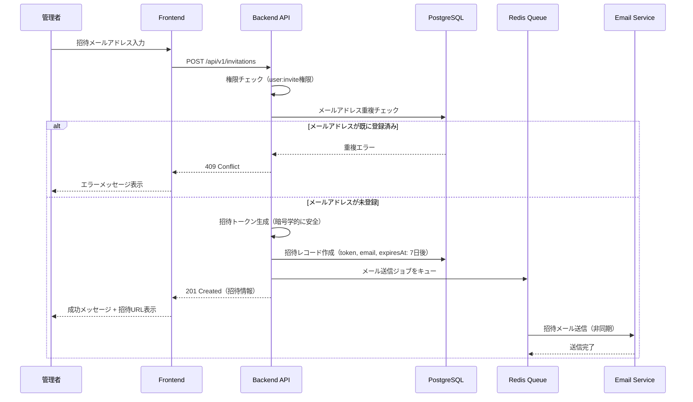

### ユーザー登録フロー（招待経由）

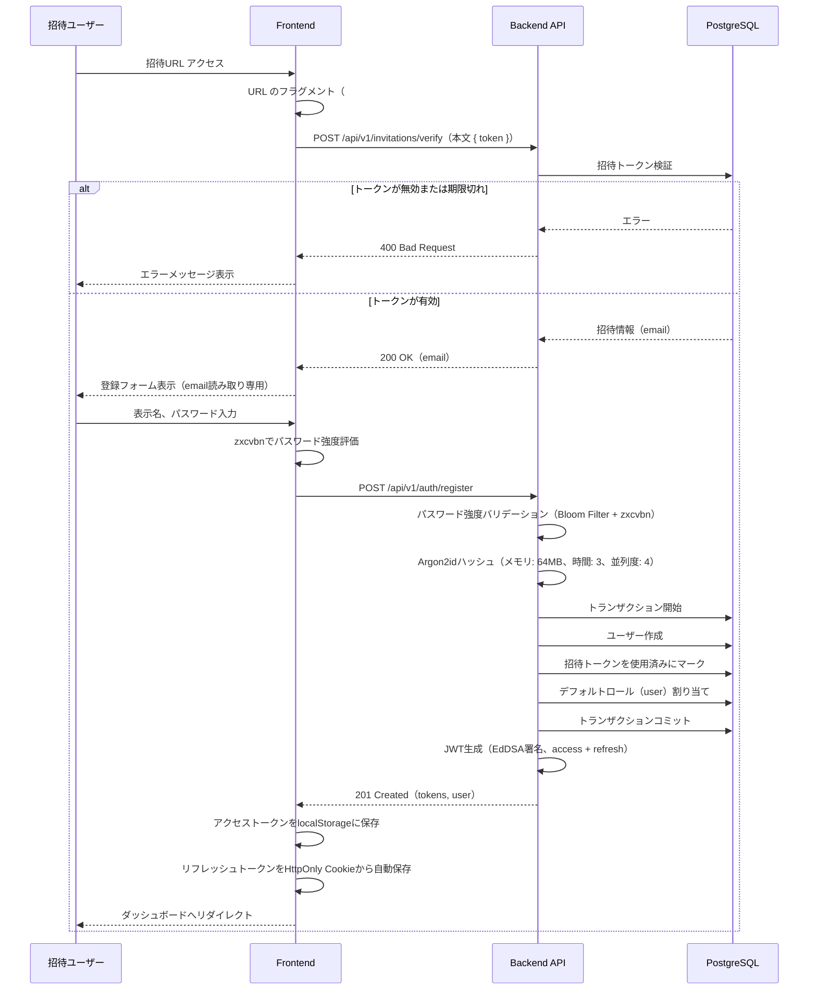

### ログインフロー

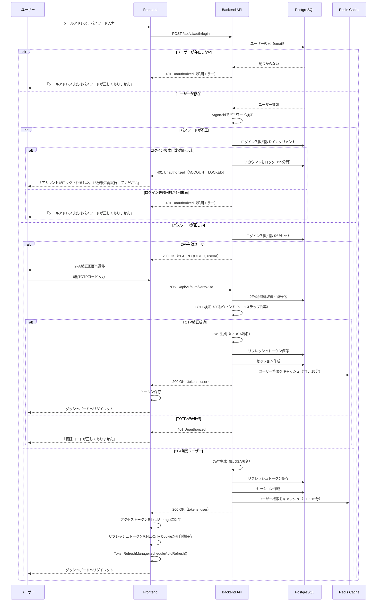

### トークンリフレッシュフロー（自動リフレッシュ + Race Condition対策）

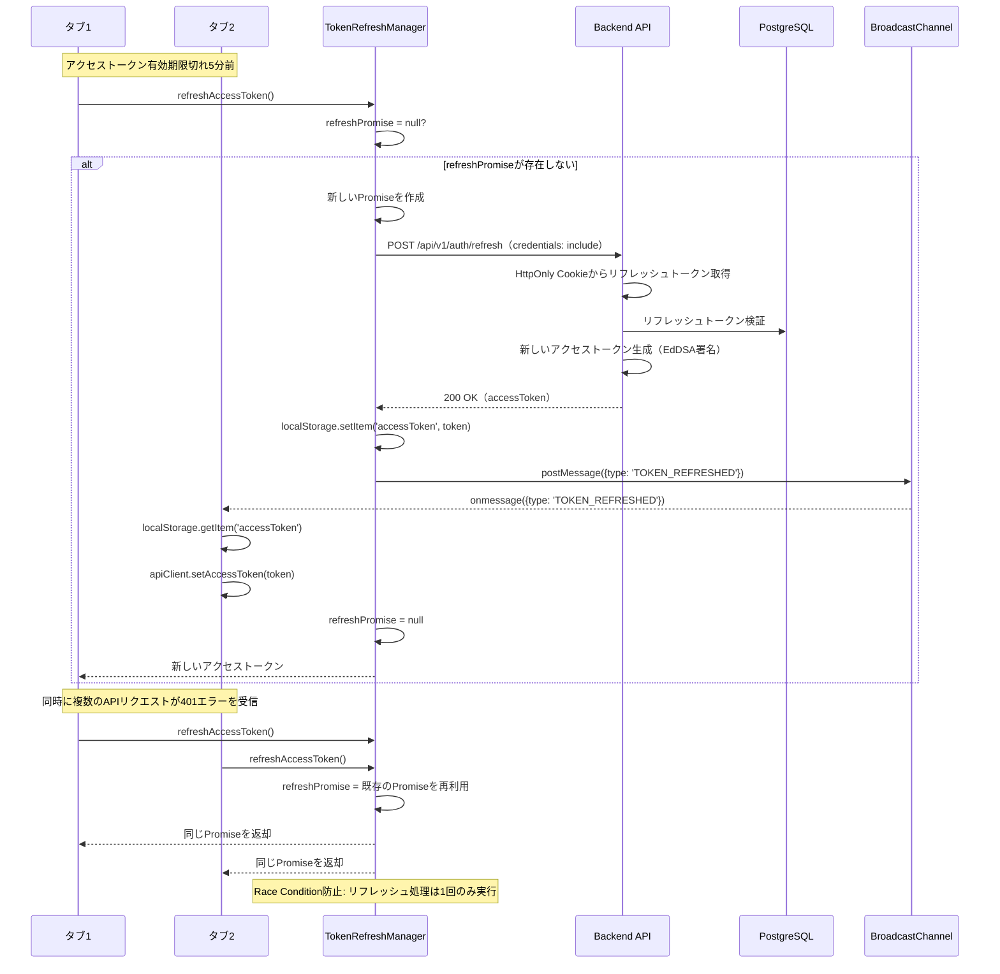

### 二要素認証（2FA）設定フロー

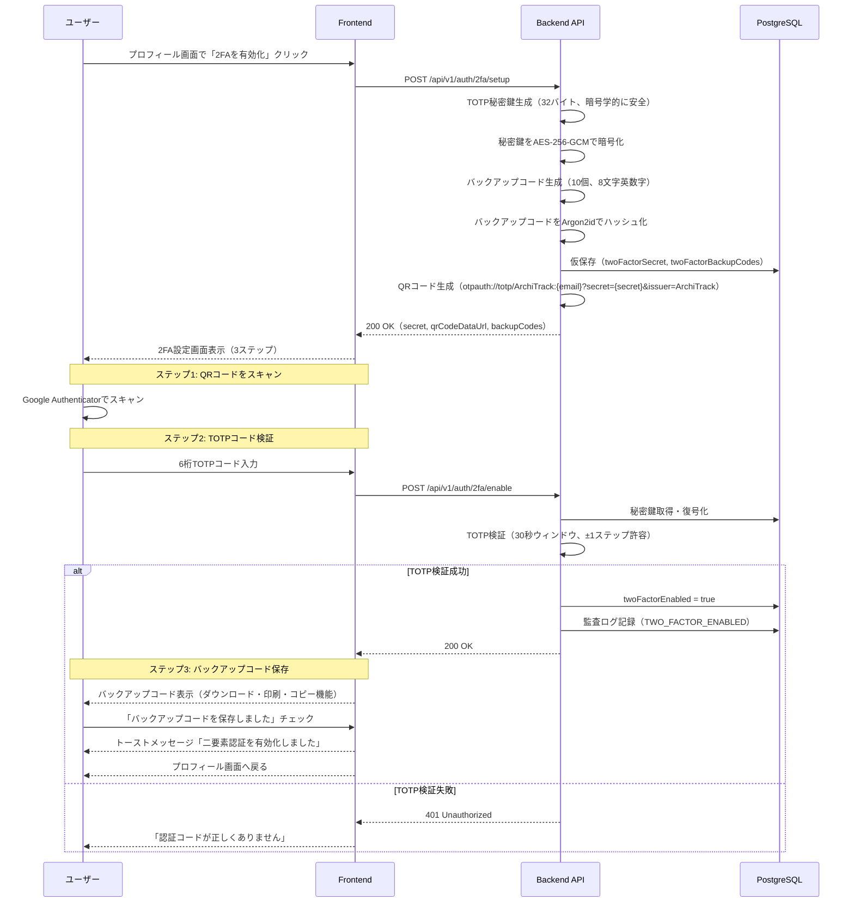

## Requirements Traceability

本セクションでは、requirements.mdで定義された各要件が、どのコンポーネント、インターフェース、フローで実現されるかをマッピングします。

| 要件 | 要件概要 | コンポーネント | インターフェース | フロー |
|------|---------|--------------|----------------|--------|
| 1 | 管理者によるユーザー招待 | InvitationService, EmailService | POST /api/v1/invitations | ユーザー招待フロー |
| 2 | 招待を受けたユーザーのアカウント作成 | AuthService, PasswordService | POST /api/v1/auth/register, POST /api/v1/invitations/verify | ユーザー登録フロー |
| 3 | 初期管理者アカウントのセットアップ | AuthService | データベースシーディング | - |
| 4 | ログイン | AuthService, PasswordService, SessionService | POST /api/v1/auth/login | ログインフロー |
| 5 | トークン管理 | TokenService, SessionService | POST /api/v1/auth/refresh, authenticate middleware | トークンリフレッシュフロー |
| 6 | 拡張可能なRBAC | RBACService | authorize middleware, POST /api/v1/roles, POST /api/v1/roles/:id/permissions | - |
| 7 | パスワード管理 | PasswordService, EmailService | POST /api/v1/auth/password/reset-request, POST /api/v1/auth/password/reset | - |
| 8 | セッション管理 | SessionService | POST /api/v1/auth/logout, POST /api/v1/auth/logout-all | - |
| 9 | ユーザー情報取得・管理 | AuthService | GET /api/v1/users/me, PATCH /api/v1/users/me | - |
| 10 | セキュリティとエラーハンドリング | errorHandler middleware, ApiError | 全APIエンドポイント | - |
| 11-15 | UI/UX要件（ログイン、登録、招待、プロフィール、共通ガイドライン） | LoginForm, RegisterForm, InvitationManagementPage, ProfilePage | AuthContext, apiClient | ログイン・登録フロー |
| 16 | セッション有効期限切れ時の自動リダイレクト（16A: UIチラつき防止含む） | TokenRefreshManager, AuthContext, ProtectedRoute | apiClient interceptor, isLoading状態管理 | トークンリフレッシュフロー、Frontend Architecture |
| 17-22 | 動的ロール管理、権限管理、ユーザー・ロール割り当て、権限チェック、監査ログ | RBACService, AuditLogService | POST /api/v1/roles, POST /api/v1/permissions, POST /api/v1/users/:id/roles, GET /api/v1/audit-logs | - |
| 23-26 | 非機能要件（パフォーマンス、フォールトトレランス、データ整合性、セキュリティ） | Redis Cache, Prisma Transaction, ApiError | 全コンポーネント | - |
| 27系列 | 二要素認証（2FA）設定・ログイン・管理・セキュリティ・UI/UX・アクセシビリティ | TwoFactorService | POST /api/v1/auth/2fa/setup, POST /api/v1/auth/2fa/enable, POST /api/v1/auth/verify-2fa | 2FA設定フロー、ログインフロー |
| 28 | 画面遷移とナビゲーション | Router, ProtectedRoute, Navigation | React Router, History API | 全フロー |
| 29 | パスワードリセット画面のUI/UX | PasswordResetRequestPage, PasswordResetPage | POST /api/v1/auth/password/reset-request, POST /api/v1/auth/password/verify-reset, POST /api/v1/auth/password/reset | パスワードリセットフロー |
| 32-45 | セキュリティ是正（2026-10-16 追加） | 末尾の章の Component Summary を参照 | 末尾の章の各部品を参照 | 末尾の章の System Flows を参照 |

## Type Definitions

### Result型（型安全なエラーハンドリング）

本プロジェクトでは、サービス層のエラーハンドリングにResult型パターンを採用します。これにより、成功・失敗を型安全に扱い、既存のApiErrorクラスとシームレスに統合します。

**Result型の定義**:

```typescript
/**
 * Result型: 成功（Ok）または失敗（Err）を表現
 * @template T 成功時の値の型
 * @template E 失敗時のエラーの型
 */
type Result<T, E> =
  | { ok: true; value: T }
  | { ok: false; error: E };

/**
 * 成功結果を生成
 */
function Ok<T>(value: T): Result<T, never> {
  return { ok: true, value };
}

/**
 * 失敗結果を生成
 */
function Err<E>(error: E): Result<never, E> {
  return { ok: false, error };
}
```

**使用例（サービス層）**:

```typescript
// AuthService: Result型を返す
async login(email: string, password: string): Promise<Result<LoginResponse, AuthError>> {
  // ユーザー検索
  const user = await prisma.user.findUnique({ where: { email } });
  if (!user) {
    return Err({ type: 'INVALID_CREDENTIALS' });
  }

  // パスワード検証
  const isValid = await this.passwordService.verifyPassword(password, user.passwordHash);
  if (!isValid) {
    return Err({ type: 'INVALID_CREDENTIALS' });
  }

  // アカウントロックチェック
  if (user.isLocked && user.lockedUntil && user.lockedUntil > new Date()) {
    return Err({ type: 'ACCOUNT_LOCKED', unlockAt: user.lockedUntil });
  }

  // 2FA有効ユーザー
  if (user.twoFactorEnabled) {
    return Ok({ type: '2FA_REQUIRED', userId: user.id });
  }

  // トークン生成
  const accessToken = await this.tokenService.generateAccessToken({
    userId: user.id,
    email: user.email,
    roles: user.userRoles.map(ur => ur.role.name),
  });

  return Ok({ type: 'SUCCESS', accessToken, user });
}
```

**エラーマッピング戦略（Result → ApiError → HTTPレスポンス）**:

サービス層のResult型エラーを、コントローラー層で既存のApiErrorクラスに変換します。

**エラーマッピング表**:

| AuthError.type | ApiError Class | HTTP Status | Response Message |
|----------------|----------------|-------------|------------------|
| INVALID_CREDENTIALS | UnauthorizedError | 401 | "Invalid credentials" |
| ACCOUNT_LOCKED | UnauthorizedError | 401 | "Account locked until {unlockAt}" |
| INVITATION_INVALID | BadRequestError | 400 | "Invalid invitation token" |
| INVITATION_EXPIRED | BadRequestError | 400 | "Invitation token expired" |
| WEAK_PASSWORD | BadRequestError | 400 | "Password does not meet requirements" |
| USER_NOT_FOUND | NotFoundError | 404 | "User not found" |
| INSUFFICIENT_PERMISSIONS | ForbiddenError | 403 | "Insufficient permissions" |

**コントローラー層での使用例**:

```typescript
// AuthController: Result → HTTPレスポンス変換
async loginHandler(req: Request, res: Response, next: NextFunction) {
  try {
    const { email, password } = req.body;

    // サービス呼び出し（Result型を返す）
    const result = await authService.login(email, password);

    // エラーハンドリング（Result → ApiError変換）
    if (!result.ok) {
      switch (result.error.type) {
        case 'INVALID_CREDENTIALS':
          throw new UnauthorizedError('Invalid credentials');
        case 'ACCOUNT_LOCKED':
          throw new UnauthorizedError(
            `Account locked until ${result.error.unlockAt.toISOString()}`
          );
        case 'WEAK_PASSWORD':
          throw new BadRequestError('Password does not meet requirements', {
            violations: result.error.violations,
          });
        default:
          throw new InternalServerError('Login failed');
      }
    }

    // 成功レスポンス
    const { type, accessToken, userId, user } = result.value;

    if (type === '2FA_REQUIRED') {
      return res.status(200).json({ type: '2FA_REQUIRED', userId });
    }

    return res.status(200).json({ accessToken, user });
  } catch (error) {
    next(error); // 既存のerrorHandlerミドルウェアで処理
  }
}
```

**既存ApiErrorクラスとの統合**:

既存のApiErrorクラス（`backend/src/errors/apiError.ts`）を活用し、エラーハンドリングの一貫性を保ちます。

```typescript
// 既存のApiErrorクラス
export class ApiError extends Error {
  constructor(
    public statusCode: number,
    public message: string,
    public details?: unknown
  ) {
    super(message);
    this.name = this.constructor.name;
  }
}

export class UnauthorizedError extends ApiError {
  constructor(message = 'Unauthorized', details?: unknown) {
    super(401, message, details);
  }
}

export class ForbiddenError extends ApiError {
  constructor(message = 'Forbidden', details?: unknown) {
    super(403, message, details);
  }
}

export class BadRequestError extends ApiError {
  constructor(message = 'Bad Request', details?: unknown) {
    super(400, message, details);
  }
}

export class NotFoundError extends ApiError {
  constructor(message = 'Not Found', details?: unknown) {
    super(404, message, details);
  }
}
```

**Result型のメリット**:
- **型安全性**: 成功・失敗のケースを型レベルで強制、エラーハンドリング漏れを防止
- **明示的なエラー伝播**: サービス層のエラーがコントローラー層で明確に処理される
- **既存パターンとの統合**: ApiErrorクラスと併用し、既存のerrorHandlerミドルウェアを活用
- **テスト容易性**: Result型により、エラーケースのテストが簡潔に記述可能

### Result型統合パターンの実装詳細（Critical Issue 1対応）

**ユーティリティ関数: `mapResultToApiError`**

エラーマッピングロジックを一箇所に集約し、コントローラー層のコード重複を削減します。

```typescript
// backend/src/utils/result-mapper.ts
import { Result } from '../types/result';
import {
  ApiError,
  UnauthorizedError,
  ForbiddenError,
  BadRequestError,
  NotFoundError,
  InternalServerError,
} from '../errors/ApiError';

/**
 * サービス層のエラー型定義
 */
export type AuthError =
  | { type: 'INVALID_CREDENTIALS' }
  | { type: 'ACCOUNT_LOCKED'; unlockAt: Date }
  | { type: 'INVITATION_INVALID' }
  | { type: 'INVITATION_EXPIRED' }
  | { type: 'WEAK_PASSWORD'; violations: string[] }
  | { type: 'USER_NOT_FOUND' }
  | { type: 'INSUFFICIENT_PERMISSIONS'; required: string };

export type InvitationError =
  | { type: 'INVITATION_INVALID' }
  | { type: 'INVITATION_EXPIRED' }
  | { type: 'INVITATION_ALREADY_USED' }
  | { type: 'EMAIL_ALREADY_EXISTS' };

export type PasswordError =
  | { type: 'WEAK_PASSWORD'; violations: string[] }
  | { type: 'PASSWORD_REUSED'; count: number }
  | { type: 'PWNED_PASSWORD'; pwnedCount: number };

export type RBACError =
  | { type: 'ROLE_NOT_FOUND'; roleId: string }
  | { type: 'PERMISSION_NOT_FOUND'; permissionId: string }
  | { type: 'INSUFFICIENT_PERMISSIONS'; required: string };

/**
 * Result型エラーをApiErrorに変換するユーティリティ
 */
export function mapResultToApiError(
  error: AuthError | InvitationError | PasswordError | RBACError
): ApiError {
  // 型ガードでエラー種別を判定
  if ('type' in error) {
    switch (error.type) {
      // 認証エラー
      case 'INVALID_CREDENTIALS':
        return new UnauthorizedError('Invalid credentials');
      case 'ACCOUNT_LOCKED':
        return new UnauthorizedError(
          `Account locked until ${error.unlockAt.toISOString()}`
        );
      case 'USER_NOT_FOUND':
        return new NotFoundError('User not found');

      // 招待エラー
      case 'INVITATION_INVALID':
        return new BadRequestError('Invalid invitation token');
      case 'INVITATION_EXPIRED':
        return new BadRequestError('Invitation token expired');
      case 'INVITATION_ALREADY_USED':
        return new BadRequestError('Invitation already used');
      case 'EMAIL_ALREADY_EXISTS':
        return new BadRequestError('Email already exists');

      // パスワードエラー
      case 'WEAK_PASSWORD':
        return new BadRequestError('Password does not meet requirements', {
          violations: error.violations,
        });
      case 'PASSWORD_REUSED':
        return new BadRequestError(
          `Password was used in the last ${error.count} passwords`
        );
      case 'PWNED_PASSWORD':
        return new BadRequestError(
          `This password has been pwned ${error.pwnedCount} times`
        );

      // RBAC エラー
      case 'ROLE_NOT_FOUND':
        return new NotFoundError(`Role not found: ${error.roleId}`);
      case 'PERMISSION_NOT_FOUND':
        return new NotFoundError(`Permission not found: ${error.permissionId}`);
      case 'INSUFFICIENT_PERMISSIONS':
        return new ForbiddenError(`Insufficient permissions: ${error.required}`);

      default:
        return new InternalServerError('Unknown error');
    }
  }

  return new InternalServerError('Unknown error');
}
```

**ヘルパー関数: `handleServiceResult`**

コントローラー層での標準的なResult型処理パターンを提供します。

```typescript
// backend/src/utils/controller-helpers.ts
import { Request, Response, NextFunction } from 'express';
import { Result } from '../types/result';
import { mapResultToApiError } from './result-mapper';

/**
 * サービス層のResult型を処理し、HTTPレスポンスまたはエラーをスローする
 */
export async function handleServiceResult<T, E>(
  result: Result<T, E>,
  res: Response,
  next: NextFunction,
  options?: {
    successStatus?: number;
    transform?: (value: T) => unknown;
  }
): Promise<void> {
  const { successStatus = 200, transform } = options || {};

  if (!result.ok) {
    // エラーをApiErrorに変換してスロー
    const apiError = mapResultToApiError(result.error as any);
    return next(apiError);
  }

  // 成功レスポンス
  const responseData = transform ? transform(result.value) : result.value;
  res.status(successStatus).json(responseData);
}
```

**コントローラー層での使用例（改善版）**

```typescript
// backend/src/controllers/auth.controller.ts
import { handleServiceResult } from '../utils/controller-helpers';

async function loginHandler(req: Request, res: Response, next: NextFunction) {
  try {
    const { email, password } = req.body;
    const result = await authService.login(email, password);

    // ヘルパー関数でResult型を処理（エラーマッピングを自動化）
    await handleServiceResult(result, res, next, {
      successStatus: 200,
      transform: (value) => {
        if (value.type === '2FA_REQUIRED') {
          return { type: '2FA_REQUIRED', userId: value.userId };
        }
        return { accessToken: value.accessToken, user: value.user };
      },
    });
  } catch (error) {
    next(error);
  }
}

async function registerHandler(req: Request, res: Response, next: NextFunction) {
  try {
    const { invitationToken, email, password, displayName } = req.body;
    const result = await authService.register({
      invitationToken,
      email,
      password,
      displayName,
    });

    // シンプルな成功レスポンス
    await handleServiceResult(result, res, next, { successStatus: 201 });
  } catch (error) {
    next(error);
  }
}
```

**実装のメリット**:
- **コード重複削減**: `mapResultToApiError`により、エラーマッピングロジックが1箇所に集約。**この「1箇所に集約」は再実測でも真である**——`mapResultToApiError` の定義は `backend/src/utils/result-mapper.ts` の 1 箇所だけである（タスク 115.234。コミット `6b84be3`。2026-09-02 にリポジトリルートで実測。`site-survey` の design.md「実測値の書き方（タスク 115.212）」の (a) に従う併記である） **再現コマンドは `git grep -c 'export function mapResultToApiError' -- 'backend/src/**/*.ts' | wc -l` であり、出力は `1` である**（コミット `5c276b30`。2026-09-04 にリポジトリルートで再実測。タスク 115.274 が規約 (a) の求める逐語のコマンドを添えた）。
- **保守性向上**: 新規エラー種別の追加時、`mapResultToApiError`のみ修正すればよい
- **型安全性強化**: サービス層のエラー型（`AuthError`, `InvitationError`等）が統一的に定義される
- **テスト容易性**: `mapResultToApiError`, `handleServiceResult`を単独でテスト可能

## Components and Interfaces

### Backend Services

#### AuthService

**責任と境界**:
- **主要責任**: 認証フロー（登録、ログイン、ログアウト）の統合
- **ドメイン境界**: 認証ドメイン
- **データ所有権**: なし（他のサービスを統合）
- **トランザクション境界**: ユーザー登録時のトランザクション管理

**依存関係**:
- **インバウンド**: AuthController
- **アウトバウンド**: InvitationService, PasswordService, TokenService, SessionService, RBACService, TwoFactorService, AuditLogService
- **外部**: なし

**契約定義**:

```typescript
interface AuthService {
  // ユーザー登録（招待経由）
  register(invitationToken: string, data: RegisterData): Promise<Result<AuthResponse, AuthError>>;

  // ログイン
  login(email: string, password: string): Promise<Result<LoginResponse, AuthError>>;

  // 2FA検証（ログイン時）
  verify2FA(userId: string, totpCode: string): Promise<Result<AuthResponse, AuthError>>;

  // ログアウト
  logout(userId: string, refreshToken: string): Promise<Result<void, AuthError>>;

  // 全デバイスログアウト
  logoutAll(userId: string): Promise<Result<void, AuthError>>;

  // 現在のユーザー情報取得
  getCurrentUser(userId: string): Promise<Result<UserProfile, AuthError>>;
}

interface RegisterData {
  displayName: string;
  password: string;
}

interface AuthResponse {
  accessToken: string;
  user: UserProfile;
}

interface LoginResponse {
  type: 'SUCCESS' | '2FA_REQUIRED';
  accessToken?: string;
  userId?: string;
  user?: UserProfile;
}

type AuthError =
  | { type: 'INVITATION_INVALID' }
  | { type: 'INVITATION_EXPIRED' }
  | { type: 'INVITATION_ALREADY_USED' }
  | { type: 'WEAK_PASSWORD'; violations: PasswordViolation[] }
  | { type: 'INVALID_CREDENTIALS' }
  | { type: 'ACCOUNT_LOCKED'; unlockAt: Date }
  | { type: '2FA_REQUIRED'; userId: string }
  | { type: 'INVALID_2FA_CODE' }
  | { type: 'USER_NOT_FOUND' };
```

#### InvitationService

**責任と境界**:
- **主要責任**: 招待管理（作成、検証、取り消し、再送信）
- **ドメイン境界**: 招待ドメイン
- **データ所有権**: Invitation
- **トランザクション境界**: 招待作成時のトランザクション管理

**依存関係**:
- **インバウンド**: AuthService, InvitationController
- **アウトバウンド**: EmailService
- **外部**: Prisma Client

**契約定義**:

```typescript
interface InvitationService {
  // 招待作成
  createInvitation(inviterId: string, email: string): Promise<Result<Invitation, InvitationError>>;

  // 招待検証
  verifyInvitation(token: string): Promise<Result<InvitationInfo, InvitationError>>;

  // 招待取り消し
  revokeInvitation(invitationId: string, actorId: string): Promise<Result<void, InvitationError>>;

  // 招待再送信
  resendInvitation(invitationId: string, actorId: string): Promise<Result<Invitation, InvitationError>>;

  // 招待一覧取得
  listInvitations(filter: InvitationFilter): Promise<Invitation[]>;
}

interface InvitationInfo {
  email: string;
  inviterId: string;
}

interface InvitationFilter {
  status?: 'pending' | 'used' | 'expired' | 'revoked';
  email?: string;
}

type InvitationError =
  | { type: 'INVITATION_NOT_FOUND' }
  | { type: 'INVITATION_INVALID' }
  | { type: 'INVITATION_EXPIRED' }
  | { type: 'INVITATION_ALREADY_USED' }
  | { type: 'EMAIL_ALREADY_REGISTERED' };
```

**招待メールの結線とメール送信からの切り離し（要件1.3・24.8）**（2026-09-26 タスク35.4 で追記）:
- **結線の決定**: 要件1.3「招待トークンが生成される THEN 招待メールを対象メールアドレスに送信しなければならない」と、上記「ユーザー招待フロー」の `Backend->>Queue: メール送信ジョブをキュー` に従い、`createInvitation` は招待レコードの作成後に `EmailService.sendInvitationEmail` を呼ぶ。タスク35.4 着手前の実装はこれを呼んでおらず、`sendInvitationEmail` の本番からの呼び出しは 0 件だった。管理者画面の招待URLコピー（要件13.3・13.5）はメールと併存する
- **切り離しの決定**: 要件24.8「外部サービス（メール送信）が利用不可である THEN ユーザー登録・招待処理を非同期キューで処理」を、**メール送信（キューへの投入を含む）の成否が招待の作成・登録の成否を左右しない**ことと読む。`createInvitation` は投入の完了を待たずに `Ok` を返し、投入の失敗（Redis の障害など）は `logger.warn`（`'Failed to queue invitation email; invitation was created'`、`invitationId` と障害を添える。障害は pino の標準シリアライザが効く `err` キーに載せ、message と stack を残す）に残す。待たないのは、Redis が応答しないとき投入の `await` が接続の再試行の間だけ招待のレスポンスを止めるためである。SMTP の障害はキューの処理側（要件24.3 の再送）で扱われ、招待の作成には届かない
- **登録**: `AuthService.register` はメールを送らない（EmailService を呼ばない）ため、登録の成否はもともとメール送信に依存しない。統合検証で、投入が失敗した招待を使った登録が成立することを確かめる
- **送信口の注入**: `InvitationService` のコンストラクタは第2引数に送信口（`InvitationEmailSender` = `Pick<EmailService, 'sendInvitationEmail'>`）を任意で取る。招待APIの `createInvitationRoutes` は既定で `EmailService` を渡す。送信口の無い構成（招待の検証だけに使う `AuthService` 内部のインスタンス）で招待を作成した場合は、未送信を警告ログに残す
- **範囲外**: パスワードリセット要求（`PasswordService.requestPasswordReset`）は投入を `await` し、失敗すると `RESET_TOKEN_INVALID` を返す。条文24.8 は「ユーザー登録・招待処理」に限るため本決定の対象としない（リセットのトークン生成・メール・ログの組み方は要件25.6、タスク35.5 で決める）
- **実装と検証**: `backend/src/services/invitation.service.ts`（`queueInvitationEmail`）、`backend/src/routes/invitation.routes.ts`、`backend/src/__tests__/unit/services/invitation.service.test.ts`、`backend/src/__tests__/unit/routes/invitation.routes.test.ts`、`backend/src/__tests__/integration/invitation-email-decoupling.integration.test.ts`

#### RBACService

**責任と境界**:
- **主要責任**: 権限チェック、ロール管理、権限管理
- **ドメイン境界**: 認可ドメイン
- **データ所有権**: Role, Permission, UserRole, RolePermission
- **トランザクション境界**: ロール・権限変更時のトランザクション管理

**依存関係**:
- **インバウンド**: authorize middleware, AuthService
- **アウトバウンド**: AuditLogService
- **外部**: Prisma Client, Redis Client

**契約定義**:

```typescript
interface RBACService {
  // 権限チェック
  hasPermission(userId: string, permission: string): Promise<boolean>;

  // ユーザーの全権限取得
  getUserPermissions(userId: string): Promise<Permission[]>;

  // ロール作成
  createRole(data: CreateRoleData): Promise<Result<Role, RBACError>>;

  // ロール更新
  updateRole(roleId: string, data: UpdateRoleData): Promise<Result<Role, RBACError>>;

  // ロール削除
  deleteRole(roleId: string): Promise<Result<void, RBACError>>;

  // ロール一覧取得
  listRoles(): Promise<Role[]>;

  // ロールに権限追加
  assignPermissions(roleId: string, permissionIds: string[]): Promise<Result<void, RBACError>>;

  // ロールから権限削除
  revokePermission(roleId: string, permissionId: string): Promise<Result<void, RBACError>>;

  // ユーザーにロール追加
  assignRoles(userId: string, roleIds: string[]): Promise<Result<void, RBACError>>;

  // ユーザーからロール削除
  revokeRole(userId: string, roleId: string): Promise<Result<void, RBACError>>;
}

interface CreateRoleData {
  name: string;
  description: string;
  priority?: number;
}

interface UpdateRoleData {
  name?: string;
  description?: string;
  priority?: number;
}

type RBACError =
  | { type: 'ROLE_NOT_FOUND' }
  | { type: 'ROLE_NAME_CONFLICT' }
  | { type: 'ROLE_IN_USE'; userCount: number }
  | { type: 'CANNOT_DELETE_SYSTEM_ROLE' }
  | { type: 'CANNOT_REVOKE_LAST_ADMIN' }
  | { type: 'PERMISSION_NOT_FOUND' }
  | { type: 'INSUFFICIENT_PERMISSIONS' };
```

**パフォーマンス最適化**:

**Redisキャッシング戦略（Cache-Asideパターン + Graceful Degradation）**:

```typescript
async function getUserPermissions(userId: string): Promise<Permission[]> {
  const cacheKey = `user:${userId}:permissions`;

  // 1. キャッシュ確認（Graceful Degradation）
  try {
    const cached = await redis.get(cacheKey);
    if (cached) {
      logger.debug('Cache hit', { userId, cacheKey });
      return JSON.parse(cached);
    }
  } catch (err) {
    // Redisエラーをログに記録し、処理継続（フォールバック）
    logger.warn('Redis cache read failed, falling back to DB', {
      userId,
      error: err instanceof Error ? err.message : String(err),
    });
  }

  // 2. DB から取得（N+1問題対策済み）
  const permissions = await fetchPermissionsFromDB(userId);

  // 3. キャッシュに保存（非同期、失敗しても処理継続）
  try {
    await redis.set(cacheKey, JSON.stringify(permissions), 'EX', 900);
    logger.debug('Permissions cached successfully', { userId, cacheKey });
  } catch (err) {
    logger.warn('Redis cache write failed', {
      userId,
      error: err instanceof Error ? err.message : String(err),
    });
  }

  return permissions;
}
```

**N+1問題対策（Prisma includeによるJOINクエリ）**:

```typescript
// ✅ 解決策: Prisma include（1クエリで全データ取得）
const user = await prisma.user.findUnique({
  where: { id: userId },
  include: {
    userRoles: {
      include: {
        role: {
          include: {
            rolePermissions: {
              include: {
                permission: true,
              },
            },
          },
        },
      },
    },
  },
});

// 権限を平坦化
const permissions = user.userRoles.flatMap((ur) =>
  ur.role.rolePermissions.map((rp) => rp.permission)
);
```

**認証系の書き込みの原子性（要件25.1・25.2・25.3・25.5・25.6・25.7）**（2026-09-27 タスク35.5 で追記）:
- **登録（25.1・25.2）**: `AuthService.register` は既にユーザー作成・招待の使用済み化・既定ロール（user）の割り当てを一つの `$transaction` で行っており、実装は変えていない。実 DB のトリガーで既定ロールの割り当てを失敗させ、ユーザー行が残らず招待が pending のまま（usedAt・userId も空）であることを統合検証で主張する
- **監査ログとトランザクション（25.5）**: `AuditLogService.createLog` は任意の第2引数に呼び出し元のトランザクションのクライアントを取る（省略時は従来どおり単独で書き込む）。`UserRoleService` と `RolePermissionService` は紐付けの書き込みと同じトランザクションのクライアントを渡して記録する。これにより監査ログの保存に失敗すれば元の変更もロールバックされ、逆に後続の書き込みが失敗すれば先に記録した監査ログも残らない
- **一括操作（25.3）**: `addRolesToUser`・`removeRolesFromUser`・`addPermissionsToRole`・`removePermissionsFromRole` は全件を一つのトランザクションで処理し、途中の失敗（ユーザー・ロール・権限の不在などの業務エラーを含む）で全件をロールバックして最初のエラーを返す。着手前は1件ずつ別々に書き込み、`DATABASE_ERROR` は読み捨てて続行していた。1件の操作（`addRoleToUser` など）も要素1件の同じ経路を通る。本番の入口であるユーザーへのロール追加API（POST /api/v1/users/:id/roles）とロールへの権限追加API（POST /api/v1/roles/:id/permissions）は、1件ずつ呼ぶループをやめて一括メソッドを1回呼ぶ
- **紐付け変更の整合性（25.7）**: 「変更前後の整合性を検証」を、変更前の検証（ロール・権限・ユーザーの存在、重複、紐付けの存在、システム管理者ロールの `*:*` 保護、最後の管理者の保護）と書き込み・監査ログを同じトランザクションで行い、1件でも失敗すればロールの権限（ユーザーのロール）が変更前の状態のまま残る——中間の状態がコミットされない——ことと読む。変更後に不変条件を読み直す検証は加えていない（変更前の検証で排除済みの状態であり、失敗注入でも到達できない分岐になるため）。並行する変更の間の分離は、最後の管理者の保護の直列化をタスク35.6（下記「認証系の書き込みの ACID 特性」）で、楽観的ロックをタスク35.7 で扱う
- **コミット後に行うもの**: 権限キャッシュの無効化と、システム管理者ロールの変更アラート（メール・Sentry）はコミットの後に行う。ロールバックされうる変更について外部へ通知しないためである
- **権限削除の監査**: ロールからの権限削除API（DELETE /api/v1/roles/:id/permissions/:permissionId）は実行者を渡しておらず、権限削除の監査ログ（要件22.2）が記録されていなかった。実行者を渡すよう改め、削除と監査ログを同じトランザクションで記録する。ユーザーからのロール削除（`removeRoleFromUser`）には監査ログの記録そのものが無い（要件22.3。本項の範囲外として残す）。**2026-09-28 タスク36.4 で記録するよう改めた**（下の「ロールの作成・更新・削除と割り当ての削除の監査ログ」）
- **パスワードリセット（25.6）**: 利用者の裁定（2026-09-27）は「(A) コミット後に投入」。`PasswordService.requestPasswordReset` は、リセットトークンの作成と監査ログ `PASSWORD_RESET_REQUESTED`（実行者・対象とも本人、targetType は user）の記録を一つの `$transaction` で行い、コミットの後にリセットメールをキューへ投入する。条文の「ログ記録」は、この同じトランザクションで書く監査ログと読む
  - **条文からの逸脱**: 条文は「メール送信」も「トランザクション内で」処理するよう求めるが、メールのキュー（Redis）は DB のトランザクションに参加できない。そこで DB 側の整合性（トークンと監査ログは両方残るか両方残らない）を保証し、メールはコミットの後に高々1回投入する。コミットに失敗した（ロールバックされた）トークンのメールは送られない。代わりに、投入が失敗するとトークンは残るがメールは届かない（利用者は再度リセットを要求できる）
  - **失敗時の応答**: 投入の失敗は `logger.warn`（`'Failed to queue password reset email; reset token was created'`、障害を `err` キー、`userId` を添える）に残し、`Ok` を返す。着手前は投入の失敗で `RESET_TOKEN_INVALID` を返していた（タスク35.4 からの申し送り）。DB のトランザクションが失敗した場合は従来どおり `RESET_TOKEN_INVALID` を返し、メールは投入しない
  - **ユーザー列挙の防止**: 未登録のメールアドレスには、トークンも監査ログも作らず、投入もせずに同じ成功（`Ok`）を返す従来の挙動を保つ。ルートは結果にかかわらず同じ 200 応答を返す
  - **注入**: `PasswordService` のコンストラクタは第3引数に監査ログサービスを任意で取る（省略時は同じ Prisma クライアントで `AuditLogService` を生成する）
- **検証**: 統合検証（auth-write-atomicity の統合テスト）は PostgreSQL のトリガーで各フローの途中の書き込み（監査ログを含む）を失敗させ、全変更がロールバックされることを主張する。パスワードリセットではコミットの時点で失敗する遅延制約トリガーも使い、ロールバックされたときにメールが投入されないことを主張する。トランザクションを外す変異・監査ログにトランザクションを渡さない変異・投入をコミット前へ移す変異・監査ログを外す変異のいずれでも赤くなることを実測した

**ロールの作成・更新・削除と割り当ての削除の監査ログ（要件22.1・22.3・25.5）**（2026-09-28 タスク36.4 で追記）:
- **着手前**: ユーザーからのロールの削除は監査ログを記録せず、`USER_ROLE_REVOKED` は型にあるだけだった。ロールの監査ログはロールのルートがロールの作成の後に単独で書く `ROLE_CREATED` だけで、書き込みのトランザクションの外にあり、監査ログの保存に失敗してもロールは作成されたまま 500 を返していた。`ROLE_UPDATED` / `ROLE_DELETED` を記録する本番コードは無かった
- **記録の場所**: 35.5 と同じ作法で、サービスが書き込みと同じ `$transaction` のクライアントを `AuditLogService.createLog` の第2引数に渡して記録する。ルートは実行者（`req.user.userId`）をサービスへ渡すだけとし、ルートでの `ROLE_CREATED` の記録は取り除いた
  - `RoleService` はコンストラクタの第2引数に監査ログサービスを任意で取り、`createRole(input, actorId?)`・`updateRole(roleId, input, actorId?)`・`deleteRole(roleId, actorId?)` は監査ログサービスと実行者の両方があるときに記録する（`UserRoleService` の `actorId` と同じ規則）
  - `UserRoleService.removeRoleFromUser(userId, roleId, actorId?, performedBy?)` と `removeRolesFromUser(userId, roleIds, actorId?, performedBy?)` は、`addRoleToUser` と同じ引数の並びに揃えた（実行者の後にアラート用の実行者情報）。1件・一括とも同じ `removeRoleInTransaction` を通り、ロールごとに紐付けの削除の直後に記録する。DELETE /api/v1/users/:id/roles/:roleId は実行者を渡す。アラート用の実行者情報は着手前と同じく渡さない（要件22.9 のアラートの経路は本タスクで変えない）
- **記録の内容**: いずれも実行者（actorId）・対象（ロールは targetType `role`・targetId にロールID、割り当ては targetType `user-role`・targetId にユーザーID）・変更前後の値を持つ。ロールの値は `{ id, name, description, priority }`。`ROLE_CREATED` は before が null、`ROLE_DELETED` は after が null。`USER_ROLE_REVOKED` は before に `USER_ROLE_ASSIGNED` の after と同じ形（`{ userId, userEmail, roleId, roleName }`）を置き、after は null とする。metadata は既存の紐付けの監査ログと同じく null
- **トランザクション**: ロールの作成・版なしの更新・削除は、着手前はトランザクションを持たない単独の書き込みだったため、書き込みと監査ログを一つの `$transaction` にした。版つきの更新は既存の `$transaction`（条件付きの更新）の中で記録する。新しい 3 か所にも上の「対話型トランザクションの開始の待ち」（タスク35.12）と同じ `connectBudgetTransactionOptions()` を渡し、既存の版つきの更新と割り当ての削除の `maxWait` は変えない
- **変更前の値の読み出し**: 版なしの更新は、同じトランザクションで対象の行を `SELECT ... FOR NO KEY UPDATE`（UPDATE 自身が取るのと同じロック。外部キーの検査が取る `FOR KEY SHARE` と衝突せず、ロールの割り当てを待たせない）で読んでから更新し、読み出しから更新までの間に並行する更新が割り込まないようにする。版つきの更新は条件付きの更新の前に同じトランザクションで行を読む。条件付きの更新が 1 件に当たったなら版（updatedAt）は読み出しから変わっていないため、読んだ行が更新の直前の値である（並行する更新があれば updatedAt が進み、条件付きの更新は 0 件になって記録しない）。削除は `delete` が返す削除した行を変更前の値とする
- **記録しない場合**: 業務エラー（ロールの不在・名前の重複・版の競合・システムロールの保護・使用中・紐付けの不在・最後の管理者の保護）では書き込みも記録も行わない
- **権限キャッシュの無効化**: 割り当ての削除の無効化はこれまでどおりコミットの後に行う（タスク36.2）。ロールの作成・更新・削除は既存のキャッシュの内容を変えないため無効化しない（「キャッシング戦略」のタスク36.2 の項のとおり）
- **検証**: 統合検証（role-audit-log-atomicity の統合テスト、19件）は実データベースで、各操作が監査ログを実行者・対象・変更前後の値とともに記録すること（要件22.1・22.3）、PostgreSQL のトリガーで監査ログの保存を失敗させると書き込みごとロールバックされること、書き込みをコミットの時点で失敗させる遅延制約トリガーで取り消された書き込みの監査ログが残らないこと（要件25.5）を主張する。監査ログは各経路の最後の書き込みのため、監査ログをトランザクションの外で記録しても監査ログの失敗では書き込みが巻き戻る。トランザクションの外での記録を検出するのはコミットの時点の失敗の検証である。`USER_ROLE_REVOKED` の記録を外す変異、ロールの監査ログを更新・削除で記録しない変異、ロールの監査ログ・`USER_ROLE_REVOKED` に tx を渡さない変異のいずれでも赤くなることを実測した。監査ログの E2E は要件22.1 の検証にロールの更新・削除、要件22.3 の検証にユーザーからのロールの削除の監査ログを加えた
- **削除の使用中の確認の直列化（要件17.5・21.8・22.3）**（2026-09-29 タスク37.1 で追記）: 36.4 の時点の `RoleService.deleteRole` は、使用中の確認（`userRole.count`）をトランザクションの外で行い、その後の `$transaction` で削除していた。`UserRole.role` は `onDelete: Cascade` のため、確認から削除までの間に割り当てがコミットされると、割り当てのあるロールが削除され、その割り当てはカスケードで黙って消えていた（`USER_ROLE_REVOKED` の監査ログも権限キャッシュの無効化も伴わない）。そこで次のとおり改めた
  - **方式**: ロールの存在・システムロールの確認、使用中の確認、削除、監査ログの記録をすべて一つの `$transaction`（`connectBudgetTransactionOptions()` はそのまま）で行い、使用中の件数を数える前に `roles` の行を `SELECT id FROM roles WHERE id = $1 FOR UPDATE` でロックする。割り当て（`user_roles` への INSERT）は外部キーの検査で同じ行に `FOR KEY SHARE` を取るため、`FOR UPDATE` と衝突する。ロックの前から未コミットの割り当てがあれば削除はそのコミット（またはロールバック）まで待ち、READ COMMITTED では待ちが明けた後の件数の数え直しが新しいスナップショットで読むため、コミットされた割り当てを数えて `ROLE_IN_USE` を返す。ロックの後に始まった割り当ては削除のコミットまで待つ。ロックの行が無い（確認とロックの間に他の要求が削除した）ときは `ROLE_NOT_FOUND` とする。システムロールの判定はロックの前に行う（`isSystem` は API から変えられず、システムロールの行を `FOR UPDATE` でロックして admin ロールの割り当てを待たせないため）。業務上の拒否（不在・システムロール・使用中）は `UserRoleService` の `UserRoleRollback` と同じ作法の合図の例外でトランザクションを打ち切り、`$transaction` の外で `Err` へ戻す。接続のタイムアウトは従来どおり `rethrowIfDatabaseConnectionTimeout` で 503 へ届ける（35.11〜35.13）
  - **割り当ての側が負けたときの応答**: `UserRoleService` の割り当て（1件・一括の共通処理 `assignRoleInTransaction`）は、ロールの存在の確認の前に同じ行を `SELECT id FROM roles WHERE id = $1 FOR KEY SHARE` でロックする。削除が先にロックを取っていれば、割り当てはここで削除のコミットまで待ち、続く存在の確認（新しいスナップショット）が削除を反映して `ROLE_NOT_FOUND`（404）を返し、割り当ても `USER_ROLE_ASSIGNED` の監査ログもロールバックされる。このロックを取らないと、割り当ては存在の確認を通った後の INSERT の外部キーの検査で同じ待ちに入り、削除のコミットの後に外部キー違反（P2003）となって `DATABASE_ERROR`（500）になる（変異で実測）。`FOR KEY SHARE` は外部キーの検査が取るのと同じロックのため、割り当て同士・最後の管理者の判定（`FOR NO KEY UPDATE`）・ロールの更新（`FOR NO KEY UPDATE`）とは衝突せず、待つのはロールの削除とだけである。削除のトランザクションはロールの行を1行しかロックしないため、一括の割り当てとの間にロックの循環は生じない
  - **外部キーを `Restrict` に改める案を採らない理由**: 並行する割り当てのあるロールの削除は外部キー違反として失敗するようになるが、マイグレーションを要し、競合の結果が `ROLE_IN_USE` ではなく汎用の DB 例外となるため、削除の側で例外を読み分ける分岐が別に要る。割り当てが未コミットの間の待ちは同じく生じる。行ロックの方式は既存の最後の管理者の判定（35.6）と同じ作法で、スキーマを変えずに `ROLE_IN_USE` をそのまま返せる
  - **権限キャッシュ**: 割り当てのあるロールの削除は常に拒否されるため、「キャッシング戦略」のタスク36.2 の項の「ロールの削除は無効化が要らない」の前提が並行する割り当てに対しても成り立つ
  - **検証**: 統合検証（role-delete-in-use-race の統合テスト、2件、`@requirement user-authentication/REQ-17.5`）は実データベースで、(i) 削除のサービスへ渡す PrismaClient の `userRole.count` を包み、使用中の件数（0 件）が返った直後・削除の前に割り当てを始め、割り当てが終わるかロック待ちに入る（pg_stat_activity で観測）まで削除を進めない競合を再現し、削除が成功し、割り当てが `ROLE_NOT_FOUND` で失敗し、割り当ても `USER_ROLE_ASSIGNED` も残らないこと、(ii) 割り当てのトランザクションを監査ログの記録の後で止めて未コミットのまま削除を始め、削除がロック待ちに入ってから割り当てをコミットさせると、削除が `ROLE_IN_USE`（件数 1）で拒否され、割り当てと監査ログが残ることを主張する。使用中の確認をトランザクションの外へ戻す変異・`FOR UPDATE` のロックを外す変異では 2 件とも（削除も割り当ても成功し、割り当てがカスケードで消える）、割り当ての側の `FOR KEY SHARE` を外す変異では (i) が `DATABASE_ERROR` となって赤くなることを実測した

**認証系の書き込みの ACID 特性（要件25.4）**（2026-09-27 タスク35.6 で追記）:
- **方針**: 条文の「ACID特性を保証」を、PostgreSQL が提供する ACID の上で、アプリケーションが各特性を弱めずに使うことと読む。分離レベルの引き上げ（SERIALIZABLE など）は条文が求めておらず、行わない。取り下げた除外の description にあった「READ COMMITTED 以上」は条文には無い
- **原子性（A）**: 複数の書き込みから成るフロー（登録、ロール・権限の紐付けの変更と監査ログ、パスワードリセット、2FA の有効化・無効化など）は一つの `$transaction` で行う（要件25.1〜25.3・25.5〜25.7、タスク35.5）。単一の書き込みは PostgreSQL の暗黙のトランザクションで原子的である
- **一貫性（C）**: データベースの制約（主キー・外部キー・一意制約。例: `user_roles` の (userId, roleId)、`role_permissions` の (roleId, permissionId)）と、書き込みと同じトランザクション内での事前の検証で保つ。並行する書き込みの間の重複は、事前の確認ではなく一意制約が防ぐ（READ COMMITTED ではコミット前の他の書き込みが見えず、並行する同じ割り当ては事前の確認をどちらも通り抜けるため）。後から来た書き込みは先の書き込みのコミットを待って一意制約違反で失敗し、そのトランザクション（監査ログを含む）はロールバックされる
- **分離性（I）**: PostgreSQL の既定の READ COMMITTED に依拠する。アプリケーションは `$transaction` にも Prisma クライアントの `transactionOptions` にも分離レベルを指定しない。保証されるのはダーティリードが無いこと（コミット前の書き込みは他のトランザクションから見えない）と、同じ行への書き込みが行ロックで直列化されることである
  - **最後の管理者の保護の直列化**（利用者の裁定 2026-09-27「35.6 の中で直す」）: 複数の行にまたがる不変条件を事前の検証だけで守る箇所は、READ COMMITTED では並行する書き込みの間で守られない。最後の管理者の保護（admin ロールの割り当て件数を数えてから削除する）がこれに当たり、異なる2人の管理者から admin ロールを同時に外すと、双方が件数 2 を読んで双方が削除し、管理者が 0 人になっていた（write skew。統合検証で実測）。そこで、件数を数えるトランザクションの中で、紐付けの確認より前に admin ロールの `roles` の行を `SELECT ... FOR NO KEY UPDATE` でロックする。同じ判定を行う並行トランザクションは先行のコミット（またはロールバック）まで待ち、READ COMMITTED では待ちが明けた後の文が新しいスナップショットで読むため、数え直した件数は先行の削除を反映する
    - **`roles` の行を選んだ理由**: `user_roles` の admin の行を `FOR UPDATE` でロックする方式は、ロックする行の集合が読んだ時点の割り当てに依存し、待ちが明けた後に先行が削除した行は読み飛ばされるなど、判定の直列化が行の集合の変化に左右される。admin ロールの行は判定ごとに必ず1行で、同じ判定を行うすべてのトランザクションが同じ1行を取り合うため、判定を漏れなく直列化できる。`FOR NO KEY UPDATE` は外部キーの検査が取る `FOR KEY SHARE` と衝突しないため、admin ロールの割り当て（`user_roles` への INSERT）は待たせない（割り当ては管理者を減らさない）
    - **適用する経路**: ユーザーからの admin ロールの削除（`UserRoleService` の1件の削除と一括の削除。両者は同じ `removeRoleInTransaction` を通る）と、ユーザーの削除（DELETE /api/v1/users/:id）。ユーザーの削除はルートがトランザクションの外で件数を数えてから別のトランザクションで削除しており、同じ競合があった。`UserRoleService.deleteUser` へ移し、admin ロールの行をロックしてから、対象の割り当ての確認・件数の確認・招待の後始末・ユーザーの削除を一つのトランザクションで行う
    - **ロックの順序**: 一括の削除は、admin ロールを含むなら、どの紐付けを削除するよりも先に admin ロールの行をロックする。ループの中だけでロックすると、先に他のロールの紐付けを削除（行ロック）してから admin ロールの行を待つことになり、admin ロールの行を先に取ってから同じユーザーの紐付けをカスケード削除する `deleteUser` と取得の順序が逆になって、デッドロックしうるためである。すべての経路で admin ロールの行を最初に取る
    - **ユーザー削除の応答**: `deleteUser` は業務上の結果（`USER_NOT_FOUND`・`LAST_ADMIN_PROTECTED`）だけを `Err` で返し、データベースの例外は捕まえずに投げる。ルートは前者を従来どおり 404 `USER_NOT_FOUND` / 400 `LAST_ADMIN_PROTECTED` で返し、後者は従来どおり `next(error)` でエラーハンドラーへ渡す。これにより Prisma の例外の分類（P2025→404、P2028→500 Transaction Timeout、その他の既知のエラー→400、初期化エラー・パニック→503）は変更前と同じである。自分自身の削除の 400 `CANNOT_DELETE_SELF` はルートに残した
    - **適用しない経路**: ロールの削除（`RoleService.deleteRole`）は admin ロールがシステムロール（`isSystem`）のため削除できず、該当しない。admin ロールからの `*:*` 権限の削除（`RolePermissionService`）は件数を数えずに常に拒否する規則で、並行による抜け道が無い
    - 分離レベルは上げていない（認証系の書き込みはすべて READ COMMITTED のまま）
- **永続性（D）**: PostgreSQL の既定（`fsync` と `synchronous_commit` が on）に依拠し、アプリケーションは接続の設定（接続文字列やプールの `options`）で緩めない。コミットが成功を返した書き込みは WAL が永続化された後である。本番のデータベース（マネージドの PostgreSQL）の設定はリポジトリの外にあり、ここでは検証しない。E2E・統合用のデータベースは tmpfs 上にあり物理的な永続性は無いが、設定値は既定のままである
- **検証**: 統合検証（auth-write-acid の統合テスト）は実データベースで次を主張する。(1) アプリケーションの Prisma クライアントで開いたトランザクションの `transaction_isolation` が read committed、`synchronous_commit` と `fsync` が on。(2) 登録・ロールの一括割り当てと一括削除・権限の一括追加と一括削除・パスワードリセット要求が書き込んだ各表（users・invitations・user_roles・role_permissions・password_reset_tokens・audit_logs）の文を、PostgreSQL のトリガーがそのトランザクションの中で観測し、分離レベルがすべて read committed であること。(3) コミット前の割り当ては他の接続から見えず、並行する同じ割り当ての後続は一意制約の待ちに入った後に失敗し、重複も後続の監査ログも残らないこと（待ちに入ったことを `pg_stat_activity` で観測してから先行をコミットするため、順序は時間に依らず決まる）。(4) 管理者が2人のとき、X からの admin の削除をコミット前に止めた（削除の文を PostgreSQL のトリガーでアドバイザリロックの解放まで待たせた）まま、Y からの admin の一括削除、または Y のユーザーの削除を行うと、後続は行ロックの待ちに入り、先行のコミット後に `LAST_ADMIN_PROTECTED` で失敗して管理者が1人残ること。ロックの導入前はこの検証で後続が成功し、管理者が 0 人になった。ロールの割り当てとパスワードリセットのトランザクションへ分離レベルを指定する変異、Prisma クライアントの `transactionOptions` に SERIALIZABLE を与える変異、接続プールに `synchronous_commit=off` を与える変異、`user_roles` の一意索引を外す変異、admin ロールの行のロックを外す変異のいずれでも赤くなることを実測した

**楽観的ロックの競合（要件25.8）**（2026-09-27 タスク35.7 で追記）:
- **裁定**: 利用者の裁定（2026-09-27）は「任意・バックエンドのみ」。版（`expectedUpdatedAt`）は任意とし、送らない既存のクライアントの振る舞いを変えない。フロントエンドの版の送信・409 の表示・E2E はタスク35.10 へ送る
- **対象**: 認証領域で既存の行を上書きする更新 API の2つ。ロールの更新（PATCH /api/v1/roles/:id、名前・説明・優先順位）とプロフィールの更新（PATCH /api/v1/auth/me、表示名）。ユーザーのロールとロールの権限の紐付けは追加・削除だけで上書きが無く、版の列（updatedAt）も持たないため対象外とする（並行する重複は一意制約が、最後の管理者の保護は上記の直列化が防ぐ）。招待・セッション・権限には更新 API が無い
- **契約**:
  - 要求の本文は任意の `expectedUpdatedAt`（ISO 8601 の日時。オフセット付きも可）を取る。日時でなければ 400 の検証エラー
  - 送られないときは従来どおり版を比べずに更新する（応答・エラーも従来どおり）
  - 送られ、対象の updatedAt と一致すれば更新し、200 で更新後の内容（新しい updatedAt を含む）を返す
  - 送られ、一致しなければ更新せず、409 Conflict を Problem Details（RFC 7807）で返す。`code` はロールが `ROLE_CONFLICT`、プロフィールが `PROFILE_CONFLICT`、`details` に `expectedUpdatedAt` と `actualUpdatedAt`（いずれも ISO 8601）を載せる。既存の 409 `ROLE_NAME_CONFLICT`（ロール名の重複）とは `code` で区別する
  - 送られ、対象が無ければ 409 ではなく 404 を返す（ロールは従来の `ROLE_NOT_FOUND`、プロフィールは Problem Details の `USER_NOT_FOUND`）
  - 条文の「リトライまたはエラーレスポンス」のうち、エラーレスポンス（409）を採る。版はクライアントが取得した時点の内容を表すため、サーバーが自動で再試行すると他者の変更を黙って上書きすることになり、楽観的ロックの目的に反する。再試行（最新を取得し直して再送）はクライアントの判断とする
  - 版の取得: ロールは既存の一覧・更新の応答の updatedAt。プロフィールは GET /api/v1/auth/me と PATCH /api/v1/auth/me の応答に updatedAt を加えた（既存のフィールドは変えない追加のみ）
- **検出の方式（条件付きの更新）**: 版を与えられたときは、updatedAt を WHERE に含めた更新（`updateMany({ where: { id, updatedAt: 版 } })`）を行い、更新件数が 0 なら読み直して、行が無ければ不在、あれば競合とする。ロールは更新後の行を同じトランザクションの中で読み（自身の行ロックを保持している間に読むため、返すのは自身が書いた版）、応答に使う
  - **読んでから比べる方式を採らない理由**: 取引先管理の先例は、トランザクションの中で行を読んで updatedAt を比べてから更新する。READ COMMITTED では、同じ版から並行する2件がどちらも先行のコミット前に読むと、どちらも比較を通り、後続は先行の行ロックを待った後に id だけを条件に上書きする（失われた更新）。条件を UPDATE の WHERE に置けば、後続は先行の行ロックを待ち、待ちが明けた後に PostgreSQL が条件を最新の行で評価し直すため、先行が updatedAt を進めた行は条件に合わず 0 件になる。分離レベルは上げない（上記の分離性の方針のまま）
  - **プロフィールの版の粒度**: users の updatedAt は表示名の変更だけでなく、ログインの失敗回数のリセット・2FA・パスワードの変更など同じ行への書き込みでも進む。そのため、取得後にそれらが起きると表示名が変わっていなくても 409 になる（安全側の誤検出）。列ごとの版は設けない
- **検証**: 統合検証（role-profile-optimistic-lock の統合テスト）は実データベースで、ロールとプロフィールのそれぞれについて次を主張する。(1) 同じ版からの2件を順に行うと、後の1件が競合になり、先の1件の内容が残ること。(2) 同じ版からの2件が本当に並行するとき（先行の UPDATE を PostgreSQL の BEFORE UPDATE のトリガーでアドバイザリロックの解放まで止め、その間に後続を送る）、後続は行ロックの待ちに入り（`pg_stat_activity` で観測）、先行のコミット後に競合になって先行の内容が残ること。(3) HTTP で、GET /api/v1/auth/me の updatedAt を送り返す更新は 200、同じ古い版での更新は 409 の Problem Details、版なしの更新は従来どおり 200 であること。条件付きの更新を「読んでから比べる」方式へ置き換える変異は、(1) を通るが (2) で後続が成功して後続の内容が残り、赤くなることを実測した。WHERE から updatedAt を外す変異、ルートの対応づけ（409・版の受け渡し）を外す変異、プロフィールの応答から updatedAt を外す変異でも赤くなることを実測した

#### TokenService

**責任と境界**:
- **主要責任**: JWT生成、検証、リフレッシュ（EdDSA署名）
- **ドメイン境界**: トークンドメイン
- **データ所有権**: なし
- **トランザクション境界**: なし（ステートレス）

**依存関係**:
- **インバウンド**: AuthService, authenticate middleware
- **アウトバウンド**: SessionService
- **外部**: jose v5

**外部依存関係調査（jose v5）**:
- **公式ドキュメント**: https://github.com/panva/jose
- **バージョン**: v5.9.6（2025年安定版）
- **主要機能**:
  - EdDSA (Ed25519) 完全サポート
  - TypeScript型定義ネイティブサポート
  - 軽量（jsonwebtoken比で50%軽量）
  - Web標準（IETF JOSE Working Group）準拠
- **API**:
  - 鍵生成: `generateKeyPair('EdDSA')`
  - トークン署名: `new SignJWT(payload).setProtectedHeader({ alg: 'EdDSA' }).setExpirationTime('15m').sign(privateKey)`
  - トークン検証: `jwtVerify(token, publicKey)`
  - JWKSエクスポート: `exportJWK(publicKey)`

**契約定義**:

```typescript
import * as jose from 'jose';

interface TokenService {
  // アクセストークン生成（EdDSA署名）
  generateAccessToken(payload: TokenPayload): Promise<string>;

  // リフレッシュトークン生成（EdDSA署名）
  generateRefreshToken(payload: TokenPayload): Promise<string>;

  // トークン検証（EdDSA検証）
  verifyToken(token: string, type: 'access' | 'refresh'): Promise<Result<TokenPayload, TokenError>>;

  // トークンデコード（検証なし）
  decodeToken(token: string): TokenPayload | null;

  // JWKSエクスポート（公開鍵配布用）
  exportPublicJWKS(): Promise<jose.JWK>;
}

interface TokenPayload {
  userId: string;
  email: string;
  roles: string[];
  permissions?: string[];
}

type TokenError =
  | { type: 'TOKEN_EXPIRED' }
  | { type: 'TOKEN_INVALID' }
  | { type: 'TOKEN_MALFORMED' };
```

#### PasswordService

**責任と境界**:
- **主要責任**: パスワードハッシュ、検証、リセット、強度評価
- **ドメイン境界**: パスワードドメイン
- **データ所有権**: なし（Userテーブルのパスワードフィールド）
- **トランザクション境界**: なし

**依存関係**:
- **インバウンド**: AuthService
- **アウトバウンド**: EmailService
- **外部**: @node-rs/argon2, bloom-filters, zxcvbn

**外部依存関係調査**:

**@node-rs/argon2**:
- **公式ドキュメント**: https://www.npmjs.com/package/@node-rs/argon2
- **API**: `argon2.hash(password, { memoryCost: 65536, timeCost: 3, parallelism: 4 })`, `argon2.verify(hash, password)`
- **推奨設定**: メモリコスト64MB（65536 KiB）、時間コスト3、並列度4（OWASP推奨）
- **パフォーマンス**: Rustネイティブバインディングによりbcrypt比2-3倍高速
- **セキュリティ**: Argon2id（Argon2d + Argon2i）、メモリハード関数、GPU攻撃耐性

**bloom-filters**:
- **公式ドキュメント**: https://www.npmjs.com/package/bloom-filters
- **API**: `BloomFilter.create(size, falsePositiveRate)`, `bloomFilter.add(item)`, `bloomFilter.has(item)`
- **設定**: サイズ1000万件、偽陽性率0.001（0.1%）
- **用途**: HIBP Pwned Passwordsの効率的な照合

**zxcvbn**:
- **公式ドキュメント**: https://www.npmjs.com/package/zxcvbn
- **API**: `zxcvbn(password, userInputs)` → `{ score: 0-4, feedback: { suggestions, warning } }`
- **用途**: 科学的なパスワード強度評価、辞書攻撃耐性

**契約定義**:

```typescript
interface PasswordService {
  // パスワードハッシュ化（Argon2id）
  hashPassword(password: string): Promise<string>;

  // パスワード検証（Argon2id）
  verifyPassword(password: string, hash: string): Promise<boolean>;

  // パスワード強度検証（Bloom Filter + zxcvbn）
  validatePasswordStrength(password: string, userInputs: string[]): Promise<Result<void, PasswordError>>;

  // パスワードリセット要求
  requestPasswordReset(email: string): Promise<Result<void, PasswordError>>;

  // パスワードリセット実行
  resetPassword(resetToken: string, newPassword: string): Promise<Result<void, PasswordError>>;

  // パスワード履歴チェック
  checkPasswordHistory(userId: string, newPassword: string): Promise<boolean>;
}

type PasswordError =
  | { type: 'WEAK_PASSWORD'; violations: PasswordViolation[] }
  | { type: 'RESET_TOKEN_INVALID' }
  | { type: 'RESET_TOKEN_EXPIRED' }
  | { type: 'PASSWORD_REUSED' };

enum PasswordViolation {
  TOO_SHORT = 'TOO_SHORT',
  NO_UPPERCASE = 'NO_UPPERCASE',
  NO_LOWERCASE = 'NO_LOWERCASE',
  NO_DIGIT = 'NO_DIGIT',
  NO_SPECIAL_CHAR = 'NO_SPECIAL_CHAR',
  WEAK_SCORE = 'WEAK_SCORE',
  COMMON_PASSWORD = 'COMMON_PASSWORD',
  REUSED_PASSWORD = 'REUSED_PASSWORD',
  CONTAINS_USER_INFO = 'CONTAINS_USER_INFO',
}
```

#### TwoFactorService

**責任と境界**:
- **主要責任**: TOTP生成・検証、バックアップコード管理、QRコード生成
- **ドメイン境界**: 二要素認証ドメイン
- **データ所有権**: User.twoFactorSecret, TwoFactorBackupCode
- **トランザクション境界**: 2FA有効化・無効化時のトランザクション管理

**依存関係**:
- **インバウンド**: AuthService
- **アウトバウンド**: AuditLogService
- **外部**: otplib, qrcode, crypto (AES-256-GCM暗号化)

**外部依存関係調査**:

**otplib**:
- **公式ドキュメント**: https://www.npmjs.com/package/otplib
- **API**: `authenticator.generateSecret()`, `authenticator.generate(secret)`, `authenticator.verify({ token, secret })`
- **設定**: SHA-1アルゴリズム（Google Authenticator互換）、6桁、30秒ウィンドウ、±1ステップ許容（90秒）
- **準拠**: RFC 6238（TOTP）

**qrcode**:
- **公式ドキュメント**: https://www.npmjs.com/package/qrcode
- **API**: `qrcode.toDataURL(text)` → Base64 Data URL
- **形式**: `otpauth://totp/ArchiTrack:{email}?secret={secret}&issuer=ArchiTrack`

**契約定義**:

```typescript
interface TwoFactorService {
  // 2FA設定開始（秘密鍵生成、QRコード生成、バックアップコード生成）
  setupTwoFactor(userId: string): Promise<Result<TwoFactorSetupData, TwoFactorError>>;

  // 2FA有効化（TOTP検証後）
  enableTwoFactor(userId: string, totpCode: string): Promise<Result<TwoFactorEnabledData, TwoFactorError>>;

  // TOTP検証
  verifyTOTP(userId: string, totpCode: string): Promise<Result<boolean, TwoFactorError>>;

  // バックアップコード検証
  verifyBackupCode(userId: string, backupCode: string): Promise<Result<boolean, TwoFactorError>>;

  // バックアップコード再生成
  regenerateBackupCodes(userId: string): Promise<Result<string[], TwoFactorError>>;

  // 2FA無効化（パスワード確認後）
  disableTwoFactor(userId: string, password: string): Promise<Result<void, TwoFactorError>>;
}

interface TwoFactorSetupData {
  secret: string; // Base32エンコード済み（平文、ユーザー表示用）
  qrCodeDataUrl: string; // QRコード（Data URL形式）
  backupCodes: string[]; // 平文バックアップコード（10個、1回のみ表示）
}

interface TwoFactorEnabledData {
  backupCodes: string[]; // 平文バックアップコード（最後の表示機会）
}

type TwoFactorError =
  | { type: 'USER_NOT_FOUND' }
  | { type: 'TWO_FACTOR_ALREADY_ENABLED' }
  | { type: 'TWO_FACTOR_NOT_ENABLED' }
  | { type: 'INVALID_TOTP_CODE' }
  | { type: 'INVALID_BACKUP_CODE' }
  | { type: 'INVALID_PASSWORD' }
  | { type: 'ENCRYPTION_FAILED' }
  | { type: 'DECRYPTION_FAILED' };
```

**セキュリティ考慮事項**:
- **秘密鍵暗号化**: AES-256-GCM（環境変数`TWO_FACTOR_ENCRYPTION_KEY`、256ビット鍵）
- **バックアップコードハッシュ化**: Argon2id（メモリコスト: 64MB、時間コスト: 3、並列度: 4）
- **TOTP設定**: SHA-1（Google Authenticator互換）、6桁、30秒ウィンドウ、±1ステップ許容
- **バックアップコード**: 10個、8文字英数字、1回限り使用。消費は取引の中で `usedAt: null` を条件にした更新で行い、更新した件数が 1 のときだけ成功とする（並行の検証が同じコードを使った場合は無効。27A.6、27A.7）。2FA の失敗回数は `{ increment: 1 }` で原子的に加算し、加算した後の値でロックを決める（27A.4）
- **無効化時のパスワード確認**: アカウント乗っ取り防止
- **トランザクション**: 2FA無効化時に秘密鍵とバックアップコードを同時削除、全リフレッシュトークン無効化

#### SessionService

**責任と境界**:
- **主要責任**: セッション管理（作成、削除、検証）
- **ドメイン境界**: セッションドメイン
- **データ所有権**: RefreshToken
- **トランザクション境界**: なし

**依存関係**:
- **インバウンド**: AuthService
- **アウトバウンド**: なし
- **外部**: Prisma Client, Redis Client

**契約定義**:

```typescript
interface SessionService {
  // セッション作成
  createSession(userId: string, refreshToken: string, deviceInfo?: string): Promise<void>;

  // セッション削除（単一デバイス）
  deleteSession(refreshToken: string): Promise<void>;

  // 全セッション削除（全デバイス）
  deleteAllSessions(userId: string): Promise<void>;

  // セッション検証
  verifySession(refreshToken: string): Promise<Result<SessionInfo, SessionError>>;
}

interface SessionInfo {
  userId: string;
  expiresAt: Date;
  deviceInfo?: string;
}

type SessionError =
  | { type: 'SESSION_NOT_FOUND' }
  | { type: 'SESSION_EXPIRED' };
```

#### EmailService

**責任と境界**:
- **主要責任**: メール送信（招待、パスワードリセット、2FA設定完了通知）
- **ドメイン境界**: メールドメイン
- **データ所有権**: なし
- **トランザクション境界**: なし

**依存関係**:
- **インバウンド**: InvitationService, PasswordService, TwoFactorService
- **アウトバウンド**: なし
- **外部**: nodemailer, bull, handlebars

**契約定義**:

```typescript
interface EmailService {
  // 招待メール送信
  sendInvitationEmail(to: string, invitationToken: string): Promise<void>;

  // パスワードリセットメール送信
  sendPasswordResetEmail(to: string, resetToken: string): Promise<void>;

  // 2FA設定完了メール送信
  send2FAEnabledEmail(to: string): Promise<void>;
}
```

**再送（要件24.3）**（2026-09-26 タスク35.1 で追記）:
- **回数の決定**: 条文「最大5回までリトライ（1分、5分、15分、1時間、6時間後）」は間隔を 5 つ挙げるため、**初回の送信に続くリトライを 5 回**と読む。Bull の `attempts` は初回を含む試行回数なので `attempts: 6`（初回 1 + リトライ 5）とする。`attempts: 5` では 5 つ目の間隔（6時間）が使われない
- **間隔の与え方**: Bull 4 の組み込み `exponential` は `(2^n − 1) × delay` で、`delay` = 1分では 1分・3分・7分・15分となり条文と一致しない（タスク35.1 着手前の実装はこれだった）。そこでキュー生成時に `settings.backoffStrategies` へカスタム戦略 `email-retry-schedule` を登録し、n 回目の失敗の後に `RETRY_DELAYS[n − 1]`（60000 / 300000 / 900000 / 3600000 / 21600000 ms）を返す。招待・パスワードリセット・2FA有効化・管理者ロール変更アラートの 4 種のジョブすべてを `attempts: 6, backoff: { type: 'email-retry-schedule' }` で投入する
- **実装と検証**: `backend/src/services/email.service.ts`（`emailRetryBackoff` / `retryJobOptions`）、`backend/src/__tests__/unit/services/email.service.test.ts`

#### AuditLogService

**責任と境界**:
- **主要責任**: 監査ログ記録、取得、エクスポート
- **ドメイン境界**: 監査ドメイン
- **データ所有権**: AuditLog
- **トランザクション境界**: なし

**依存関係**:
- **インバウンド**: AuthService, RBACService, TwoFactorService
- **アウトバウンド**: なし
- **外部**: Prisma Client

**契約定義**:

```typescript
interface AuditLogService {
  // 監査ログ記録
  logAction(data: AuditLogData): Promise<void>;

  // 監査ログ取得
  getAuditLogs(filter: AuditLogFilter): Promise<AuditLog[]>;

  // 監査ログエクスポート
  exportAuditLogs(filter: AuditLogFilter): Promise<string>;
}

interface AuditLogData {
  action: string;
  actorId: string;
  targetType: string;
  targetId: string;
  metadata?: Record<string, unknown>;
}

interface AuditLogFilter {
  actorId?: string;
  targetType?: string;
  targetId?: string;
  dateFrom?: Date;
  dateTo?: Date;
  action?: string;
}
```

### Backend Middlewares

#### authenticate

**責任と境界**:
- **主要責任**: JWTトークン検証、リクエストへのユーザー情報追加
- **ドメイン境界**: 認証ドメイン
- **データ所有権**: なし
- **トランザクション境界**: なし

**依存関係**:
- **インバウンド**: Protected API Routes
- **アウトバウンド**: TokenService
- **外部**: jose

**契約定義**:

```typescript
function authenticate(req: Request, res: Response, next: NextFunction): void;

// Express Request拡張
declare global {
  namespace Express {
    interface Request {
      user?: {
        userId: string;
        email: string;
        roles: string[];
      };
    }
  }
}
```

**実装フロー**:
1. `Authorization: Bearer {token}` ヘッダーからトークン抽出
2. TokenService.verifyToken() でトークン検証
3. 検証成功時、`req.user` にユーザー情報を設定
4. 検証失敗時、`UnauthorizedError` をスロー

**エラーハンドリング**:
- `MISSING_TOKEN`: トークンが提供されていない（401）
- `INVALID_TOKEN`: トークンが無効（401）
- `TOKEN_EXPIRED`: トークンが期限切れ（401、レスポンスに `TOKEN_EXPIRED` コード）

#### authorize

**責任と境界**:
- **主要責任**: 権限チェック（resource:action）
- **ドメイン境界**: 認可ドメイン
- **データ所有権**: なし
- **トランザクション境界**: なし

**依存関係**:
- **インバウンド**: Protected API Routes
- **アウトバウンド**: RBACService
- **外部**: なし

**契約定義**:

```typescript
function authorize(permission: string): (req: Request, res: Response, next: NextFunction) => Promise<void>;

// 使用例
app.get('/api/v1/users', authenticate, authorize('user:read'), listUsers);
app.post('/api/v1/roles', authenticate, authorize('role:create'), createRole);
app.delete('/api/v1/users/:id', authenticate, authorize('user:delete'), deleteUser);
```

**実装フロー**:
1. `req.user.userId` からユーザーIDを取得
2. RBACService.hasPermission() で権限チェック
3. 権限あり: 次のミドルウェアへ
4. 権限なし: `ForbiddenError` をスロー

### Backend API Endpoints

**API Contract（OpenAPI 3.0形式、APIバージョニング `/api/v1/...` 採用）**:

| Method | Endpoint | Description | Request | Response | Middleware |
|--------|----------|-------------|---------|----------|------------|
| POST | /api/v1/auth/register | ユーザー登録（招待経由） | RegisterRequest | AuthResponse | validate |
| POST | /api/v1/auth/login | ログイン | LoginRequest | LoginResponse | validate |
| POST | /api/v1/auth/verify-2fa | 2FA検証（ログイン時） | Verify2FARequest | AuthResponse | validate |
| POST | /api/v1/auth/logout | ログアウト | - | void | authenticate |
| POST | /api/v1/auth/logout-all | 全デバイスログアウト | - | void | authenticate |
| POST | /api/v1/auth/refresh | トークンリフレッシュ | RefreshRequest | AuthResponse | validate |
| GET | /api/v1/users/me | 現在のユーザー情報取得 | - | UserProfile | authenticate |
| PATCH | /api/v1/users/me | ユーザー情報更新 | UpdateProfileRequest | UserProfile | authenticate, validate |
| POST | /api/v1/auth/2fa/setup | 2FA設定開始 | - | TwoFactorSetupData | authenticate |
| POST | /api/v1/auth/2fa/enable | 2FA有効化 | EnableTwoFactorRequest | TwoFactorEnabledData | authenticate, validate |
| POST | /api/v1/auth/2fa/disable | 2FA無効化（要件34.6 により自己の無効化は 403 `TWO_FACTOR_DISABLE_NOT_ALLOWED` で拒否する） | - | 403 | authenticate |
| POST | /api/v1/auth/2fa/backup-codes/regenerate | バックアップコード再生成 | - | BackupCodesData | authenticate |
| POST | /api/v1/invitations | 招待作成 | CreateInvitationRequest | Invitation | authenticate, authorize('user:invite') |
| GET | /api/v1/invitations | 招待一覧取得 | InvitationFilter | Invitation[] | authenticate, authorize('user:invite') |
| POST | /api/v1/invitations/:id/revoke | 招待取り消し | - | void | authenticate, authorize('user:invite') |
| POST | /api/v1/invitations/:id/resend | 招待再送信 | - | Invitation | authenticate, authorize('user:invite') |
| POST | /api/v1/invitations/verify | 招待検証 | `{ token }`（本文） | InvitationInfo | validate |
| POST | /api/v1/auth/password/reset-request | パスワードリセット要求 | PasswordResetRequest | void | validate |
| POST | /api/v1/auth/password/verify-reset | リセットトークン検証 | `{ token }`（本文） | `{ valid: true }` | - |
| POST | /api/v1/auth/password/reset | パスワードリセット実行 | ResetPasswordRequest | void | validate |
| GET | /api/v1/roles | ロール一覧取得 | - | Role[] | authenticate, authorize('role:read') |
| POST | /api/v1/roles | ロール作成 | CreateRoleRequest | Role | authenticate, authorize('role:create') |
| PATCH | /api/v1/roles/:id | ロール更新 | UpdateRoleRequest | Role | authenticate, authorize('role:update') |
| DELETE | /api/v1/roles/:id | ロール削除 | - | void | authenticate, authorize('role:delete') |
| POST | /api/v1/roles/:id/permissions | ロールに権限追加 | AssignPermissionsRequest | void | authenticate, authorize('role:update') |
| DELETE | /api/v1/roles/:id/permissions/:permissionId | ロールから権限削除 | - | void | authenticate, authorize('role:update') |
| GET | /api/v1/permissions | 権限一覧取得 | - | Permission[] | authenticate, authorize('permission:read') |
| POST | /api/v1/users/:id/roles | ユーザーにロール追加 | AssignRolesRequest | void | authenticate, authorize('user:update') |
| DELETE | /api/v1/users/:id/roles/:roleId | ユーザーからロール削除 | - | void | authenticate, authorize('user:update') |
| GET | /api/v1/audit-logs | 監査ログ取得 | AuditLogFilter | AuditLog[] | authenticate, authorize('audit:read') |
| GET | /.well-known/jwks.json | JWKS公開鍵エンドポイント | - | JWKS | - |

### Frontend Architecture

本セクションでは、フロントエンドの認証アーキテクチャと、要件16A（認証状態初期化時のUIチラつき防止）の実装詳細を定義します。

#### 認証状態管理パターン

**アーキテクチャパターン**: React Context API + Custom Hooks

**主要コンポーネント**:
- **AuthContext**: 認証状態の管理（ユーザー情報、isLoading、トークン管理）
- **useAuth Hook**: AuthContextへのアクセスを提供
- **TokenRefreshManager**: トークンリフレッシュの自動化、Race Condition対策、マルチタブ同期
- **ProtectedRoute**: 認証保護されたルートコンポーネント
- **apiClient**: HTTPクライアント（トークンリフレッシュインターセプター統合）

#### 要件16A実装: 認証状態初期化時のUIチラつき防止

**目的**: 業界標準パターン（Auth0、Firebase、NextAuth.js）に準拠し、認証状態確認中にログイン画面が一瞬表示される「チラつき」を防止します。

**実装戦略**:

1. **isLoading状態変数の管理**

AuthContextで認証状態を管理し、初期値を`true`に設定します：

```typescript
// frontend/src/contexts/AuthContext.tsx
export function AuthProvider({ children }: AuthProviderProps): ReactElement {
  const [user, setUser] = useState<User | null>(null);
  const [isLoading, setIsLoading] = useState<boolean>(true); // ✅ 初期値: true（認証状態不明）
  const [tokenRefreshManager, setTokenRefreshManager] = useState<TokenRefreshManager | null>(null);

  // ... その他の実装
}
```

**状態遷移**:
- **初期状態** (`isLoading=true`): 認証状態が不明な期間、ProtectedRouteはローディングインジケーターを表示
- **セッション復元中** (`isLoading=true`): リフレッシュトークンで認証状態を確認中
- **初期化完了** (`isLoading=false`): 認証状態が確定、ProtectedRouteは適切な画面を表示

2. **localStorageからのリフレッシュトークン取得**

ページロード時にlocalStorageからリフレッシュトークンを取得し、セッション復元を試みます：

```typescript
// frontend/src/contexts/AuthContext.tsx
useEffect(() => {
  // ページロード時にlocalStorageからリフレッシュトークンを取得し、セッションを復元
  const storedRefreshToken = localStorage.getItem('refreshToken');

  if (storedRefreshToken) {
    // トークンリフレッシュを実行してセッションを復元
    refreshToken()
      .then(async () => {
        // リフレッシュ成功後、ユーザー情報を取得
        const response = await apiClient.get<{ user: User }>('/api/v1/auth/me');
        setUser(response.user);
      })
      .catch(() => {
        // リフレッシュ失敗時はlocalStorageをクリア
        localStorage.removeItem('refreshToken');
      })
      .finally(() => {
        // ローディング状態を解除
        setIsLoading(false);
      });
  } else {
    // リフレッシュトークンが存在しない場合も初期化完了
    setIsLoading(false);
  }
}, []); // 初回マウント時のみ実行
```

**セッション復元フロー**:
```
ページロード → isLoading=true → localStorageチェック
  ├─ トークンあり → APIリフレッシュ → ユーザー情報取得 → isLoading=false → 画面表示
  └─ トークンなし → isLoading=false → ログイン画面へ
```

3. **ProtectedRouteによる認証保護**

ProtectedRouteコンポーネントで、isLoading中はローディングインジケーターを表示し、認証状態確定後に適切な画面へ遷移します：

```typescript
// frontend/src/components/ProtectedRoute.tsx
export function ProtectedRoute({
  children,
  redirectTo = '/login',
  requireAuth = true,
}: ProtectedRouteProps): ReactElement {
  const { isAuthenticated, isLoading } = useAuth();
  const location = useLocation();

  if (requireAuth) {
    // ✅ 認証状態の読み込み中はローディングインジケーターを表示（チラつき防止）
    if (isLoading) {
      return (
        <div className="flex items-center justify-center min-h-screen">
          <div
            className="text-center"
            role="status"
            aria-label="認証状態を確認中"
            aria-live="polite"
          >
            <div className="animate-spin rounded-full h-12 w-12 border-b-2 border-gray-900 mx-auto" />
            <p className="mt-4 text-gray-600">認証状態を確認中...</p>
          </div>
        </div>
      );
    }

    // isLoading=false後に認証判定
    if (!isAuthenticated) {
      // 未認証の場合、現在のパスをstateに保存してリダイレクト
      return (
        <Navigate to={redirectTo} state={{ from: location.pathname + location.search }} replace />
      );
    }

    // 認証済みの場合、保護されたコンテンツを表示
    return children;
  }

  // requireAuth=false: 認証済みユーザーをリダイレクトするルート（例: ログインページ）
  if (isAuthenticated) {
    const from = (location.state as { from?: string })?.from || redirectTo;
    return <Navigate to={from} replace />;
  }

  return children;
}
```

**ローディングインジケーター表示時間**:
- 平均表示時間: 200-500ms（セッション復元API呼び出し: `/api/v1/auth/refresh` + `/api/v1/auth/me`）
- 最小表示時間の設定（オプション）: 200ms未満で完了する場合、チラつき防止のため最小200ms表示してもよい

4. **200ms最小表示時間の実装判断**

**実装するか？**: オプション（推奨: 実装しない）

**理由**:
- セッション復元API呼び出しは平均200-500msかかるため、人為的な遅延は不要
- 高速ネットワーク環境（50-100ms）では、最小表示時間により体感速度が低下する可能性
- シンプルな実装を優先し、パフォーマンス測定後に必要に応じて追加を検討

**実装する場合の例**:
```typescript
useEffect(() => {
  const startTime = Date.now();
  const minDisplayTime = 200; // 200ms最小表示

  const storedRefreshToken = localStorage.getItem('refreshToken');

  if (storedRefreshToken) {
    refreshToken()
      .then(async () => {
        const response = await apiClient.get('/api/v1/auth/me');
        setUser(response.user);
      })
      .catch(() => {
        localStorage.removeItem('refreshToken');
      })
      .finally(async () => {
        // 最小表示時間を確保
        const elapsed = Date.now() - startTime;
        if (elapsed < minDisplayTime) {
          await new Promise(resolve => setTimeout(resolve, minDisplayTime - elapsed));
        }
        setIsLoading(false);
      });
  } else {
    setIsLoading(false);
  }
}, []);
```

#### 業界標準パターンとの整合性

| ライブラリ | 初期値 | パターン |
|-----------|-------|---------|
| **Auth0** | `isLoading=true` | SDK初期化中は `true`、完了後に `false` |
| **Firebase** | `loading=true` | `onAuthStateChanged` 完了後に `false` |
| **NextAuth.js** | `status="loading"` | セッション確認後に `"authenticated"` または `"unauthenticated"` |
| **ArchiTrack** | `isLoading=true` | セッション復元完了後に `false`（✅ 本設計で準拠） |

#### マルチタブ同期（Broadcast Channel API）

TokenRefreshManagerは、マルチタブ環境でトークン更新を他のタブに通知します：

```typescript
// frontend/src/services/TokenRefreshManager.ts
class TokenRefreshManager {
  private broadcastChannel: BroadcastChannel;

  constructor(refreshCallback: () => Promise<string>) {
    // マルチタブ同期用のBroadcast Channel初期化
    this.broadcastChannel = new BroadcastChannel('token-refresh-channel');

    // 他のタブからのトークン更新通知を受信
    this.broadcastChannel.onmessage = (event) => {
      if (event.data.type === 'TOKEN_REFRESHED') {
        // 他のタブでトークンが更新された場合、localStorageから取得
        const newAccessToken = localStorage.getItem('accessToken');
        if (newAccessToken) {
          apiClient.setAccessToken(newAccessToken);
        }
      }
    };
  }

  async refreshToken(): Promise<string> {
    // ... リフレッシュ処理 ...

    // マルチタブ同期: 他のタブに更新を通知
    this.broadcastChannel.postMessage({ type: 'TOKEN_REFRESHED' });

    return accessToken;
  }
}
```

#### トークンストレージ戦略

- **アクセストークン**: localStorage（クライアントサイドJavaScriptからアクセス可能）
- **リフレッシュトークン**: localStorageまたはHttpOnly Cookie（CSRF対策必要）

**セキュリティ考慮事項**:
- XSS攻撃対策: Content-Security-Policy (CSP) ヘッダー設定
- CSRF攻撃対策: リフレッシュトークンをHttpOnly Cookieに保存する場合、SameSite=Strict属性設定

### Frontend Components

#### AuthContext

**責任と境界**:
- **主要責任**: 認証状態管理、トークン管理、自動リフレッシュ
- **ドメイン境界**: 認証ドメイン
- **データ所有権**: トークン（localStorage）、ユーザー情報（state）
- **状態管理**: React Context API

**依存関係**:
- **インバウンド**: App, PrivateRoute, PublicRoute
- **アウトバウンド**: TokenRefreshManager, apiClient
- **外部**: React Context API

**契約定義**:

```typescript
interface AuthContextValue {
  user: UserProfile | null;
  isAuthenticated: boolean;
  isLoading: boolean;
  login: (email: string, password: string) => Promise<LoginResult>;
  verify2FA: (userId: string, totpCode: string) => Promise<void>;
  register: (invitationToken: string, data: RegisterData) => Promise<void>;
  logout: () => Promise<void>;
  refreshToken: () => Promise<void>;
}

interface LoginResult {
  type: 'SUCCESS' | '2FA_REQUIRED';
  userId?: string;
}

interface RegisterData {
  displayName: string;
  password: string;
}

function useAuth(): AuthContextValue;
```

**実装詳細**:
- **自動トークンリフレッシュ**: TokenRefreshManager.scheduleAutoRefresh()により有効期限切れ5分前に自動リフレッシュ
- **401エラーハンドリング**: apiClientインターセプターで自動リフレッシュ試行（TokenRefreshManager使用）
- **リフレッシュ失敗時**: ログイン画面へリダイレクト、`redirectUrl` クエリパラメータ設定
- **セッション復元ローディング戦略**: 詳細は「Frontend Architecture」セクション参照（要件16A実装）

#### TokenRefreshManager

**責任と境界**:
- **主要責任**: トークンリフレッシュの自動化、Race Condition対策、マルチタブ同期
- **ドメイン境界**: トークンドメイン
- **データ所有権**: refreshPromise（単一Promise）
- **状態管理**: Class instance

**依存関係**:
- **インバウンド**: AuthContext, apiClient
- **アウトバウンド**: apiClient
- **外部**: Broadcast Channel API

**契約定義**:

```typescript
class TokenRefreshManager {
  private refreshPromise: Promise<string> | null;
  private broadcastChannel: BroadcastChannel;

  constructor();

  // トークンリフレッシュ（Race Condition対策済み）
  refreshAccessToken(): Promise<string>;

  // 自動リフレッシュスケジュール
  scheduleAutoRefresh(expiresIn: number): void;

  // Broadcast Channel クリーンアップ
  destroy(): void;
}
```

**実装詳細**:
- **単一Promiseパターン**: 複数のリクエストが同時にリフレッシュを試みても、実際のリフレッシュ処理は1回のみ実行
- **Broadcast Channel API**: マルチタブ環境でトークン更新を他のタブに通知
- **自動リフレッシュ**: 有効期限切れ5分前（環境変数`VITE_TOKEN_REFRESH_THRESHOLD`、デフォルト5分）に自動リフレッシュ

## Performance Optimization: N+1 Problem Mitigation

N+1問題は、ORMを使用する際に発生する一般的なパフォーマンス問題です。1つのクエリで親レコードを取得し、その後、各親レコードに対して子レコードを個別に取得することで、N+1回のクエリが発生します。

本設計では、以下の3つのアプローチを組み合わせてN+1問題を解決します。

### N+1問題対策の基本方針

**使い分けガイドライン**:

| シナリオ | 推奨アプローチ | 理由 |
|---------|--------------|------|
| 単一リソース取得（例: GET /users/me） | Prisma include | 最もシンプル、1クエリで解決 |
| バッチリソース取得（例: GET /audit-logs） | Prisma include | 複雑なネストでも1クエリで解決 |
| 動的な関連データ取得 | DataLoader | 複雑な取得ロジック、キャッシング活用 |
| 権限情報の頻繁な取得 | Redis Cache-Aside | 高速キャッシュ、90%以上のヒット率 |

**関係性による判断基準**:

| 関係性 | 推奨アプローチ | 具体例 |
|-------|--------------|--------|
| **1:N関係**（単純） | Prisma include | User → UserRoles（1ユーザー:Nロール） |
| **N:N関係**（中間テーブル経由） | Prisma include | User → UserRole → Role → RolePermission → Permission |
| **N:N関係**（複雑なクエリ） | DataLoader | 複数のリクエストで同じデータを繰り返し取得する場合 |
| **頻繁なアクセス**（読み取り重視） | Redis Cache-Aside | 権限チェック（毎リクエスト実行） |

**決定フローチャート**:

```
データ取得が必要
    ↓
[Q1] 同じデータを複数リクエストで繰り返し取得するか？
    YES → Redis Cache-Asideパターンを検討
    NO  → [Q2]へ
    ↓
[Q2] 取得するデータの関係性は？
    1:N関係（単純）     → Prisma include（推奨）
    N:N関係（中間テーブル） → [Q3]へ
    ↓
[Q3] Prisma includeで表現可能か？
    YES（3階層以下のネスト） → Prisma include（推奨）
    NO（4階層以上、動的条件） → DataLoader（推奨）
    ↓
[Q4] リクエスト内で同じエンティティを複数回取得するか？
    YES → DataLoader（バッチング効果大）
    NO  → Prisma include（シンプル）
```

**パフォーマンス特性比較**:

| アプローチ | クエリ数 | キャッシング | 実装複雑度 | 適用シーン |
|-----------|---------|------------|-----------|-----------|
| Prisma include | 1クエリ（JOIN） | なし | 低 | 単一リクエストで完結する取得 |
| DataLoader | N+1 → log(N)クエリ | リクエストスコープ | 中 | 複数エンティティのバッチ取得 |
| Redis Cache-Aside | 1クエリ（初回のみ） | 永続的 | 中〜高 | 頻繁なアクセス（読み取り重視） |

**実装優先順位**:

1. **Phase 1（初期実装）**: Prisma includeのみ（シンプル、80%のケースをカバー）
2. **Phase 2（最適化）**: Redis Cache-Asideパターン（権限チェックなど頻繁なアクセス）
3. **Phase 3（拡張）**: DataLoader（パフォーマンス問題が発生した場合）

### アプローチ1: Prisma includeによるJOINクエリ

**原則**: 可能な限りPrisma includeを使用し、1クエリで全データを取得する。

#### RBACService: ユーザー権限取得

```typescript
// ❌ N+1問題が発生する実装（N+1回クエリ）
async function getUserPermissions(userId: string): Promise<Permission[]> {
  // 1. ユーザー取得（1クエリ）
  const user = await prisma.user.findUnique({ where: { id: userId } });

  // 2. ユーザーのロール取得（Nクエリ）
  const userRoles = await prisma.userRole.findMany({ where: { userId } });

  // 3. 各ロールの権限取得（N×Mクエリ）
  const permissions: Permission[] = [];
  for (const userRole of userRoles) {
    const rolePermissions = await prisma.rolePermission.findMany({
      where: { roleId: userRole.roleId },
    });
    for (const rp of rolePermissions) {
      const permission = await prisma.permission.findUnique({
        where: { id: rp.permissionId },
      });
      permissions.push(permission);
    }
  }

  return permissions;
}

// ✅ Prisma includeで解決（1クエリ）
async function getUserPermissions(userId: string): Promise<Permission[]> {
  const user = await prisma.user.findUnique({
    where: { id: userId },
    include: {
      userRoles: {
        include: {
          role: {
            include: {
              rolePermissions: {
                include: {
                  permission: true,
                },
              },
            },
          },
        },
      },
    },
  });

  if (!user) {
    return [];
  }

  // 権限を平坦化（ユニーク化）
  const permissionMap = new Map<string, Permission>();
  for (const userRole of user.userRoles) {
    for (const rolePermission of userRole.role.rolePermissions) {
      permissionMap.set(rolePermission.permission.id, rolePermission.permission);
    }
  }

  return Array.from(permissionMap.values());
}
```

**パフォーマンス改善**:
- Before: 1 + N + N×M クエリ（例: 1ユーザー、3ロール、各ロール5権限 = 1 + 3 + 15 = 19クエリ）
- After: **1クエリ**
- **改善率**: 95% クエリ削減

#### AuditLogService: 監査ログ取得

```typescript
// ❌ N+1問題が発生する実装
async function getAuditLogs(filter: AuditLogFilter): Promise<AuditLog[]> {
  // 1. 監査ログ取得（1クエリ）
  const auditLogs = await prisma.auditLog.findMany({ where: filter });

  // 2. 各ログの実行者・対象ユーザー取得（2×Nクエリ）
  for (const log of auditLogs) {
    log.actor = await prisma.user.findUnique({ where: { id: log.actorId } });
    if (log.targetId) {
      log.target = await prisma.user.findUnique({ where: { id: log.targetId } });
    }
  }

  return auditLogs;
}

// ✅ Prisma includeで解決（1クエリ）
async function getAuditLogs(filter: AuditLogFilter): Promise<AuditLog[]> {
  const auditLogs = await prisma.auditLog.findMany({
    where: filter,
    include: {
      actor: {
        select: {
          id: true,
          email: true,
          displayName: true,
        },
      },
      target: {
        select: {
          id: true,
          email: true,
          displayName: true,
        },
      },
    },
    orderBy: {
      createdAt: 'desc',
    },
  });

  return auditLogs;
}
```

**パフォーマンス改善**:
- Before: 1 + 2×N クエリ（例: 100ログ = 1 + 200 = 201クエリ）
- After: **1クエリ**
- **改善率**: 99.5% クエリ削減

#### InvitationService: 招待一覧取得

```typescript
// ❌ N+1問題が発生する実装
async function listInvitations(filter: InvitationFilter): Promise<Invitation[]> {
  // 1. 招待取得（1クエリ）
  const invitations = await prisma.invitation.findMany({ where: filter });

  // 2. 各招待の招待者取得（Nクエリ）
  for (const invitation of invitations) {
    invitation.inviter = await prisma.user.findUnique({
      where: { id: invitation.inviterId },
    });
  }

  return invitations;
}

// ✅ Prisma includeで解決（1クエリ）
async function listInvitations(filter: InvitationFilter): Promise<Invitation[]> {
  const invitations = await prisma.invitation.findMany({
    where: filter,
    include: {
      inviter: {
        select: {
          id: true,
          email: true,
          displayName: true,
        },
      },
      user: {
        select: {
          id: true,
          email: true,
          displayName: true,
        },
      },
    },
    orderBy: {
      createdAt: 'desc',
    },
  });

  return invitations;
}
```

**パフォーマンス改善**:
- Before: 1 + N クエリ（例: 50招待 = 1 + 50 = 51クエリ）
- After: **1クエリ**
- **改善率**: 98% クエリ削減

### アプローチ2: DataLoader（将来的な拡張）

複雑な取得ロジックや動的な関連データ取得が必要な場合、DataLoaderを導入します。

**DataLoader導入基準**:
- Prisma includeでは表現できない複雑な取得ロジック
- 複数のリクエスト間でバッチングが必要
- キャッシングによる追加のパフォーマンス改善が必要

**実装例（将来的な拡張）**:

#### 基本的なDataLoader実装

```typescript
import DataLoader from 'dataloader';

// ユーザーDataLoader
const userLoader = new DataLoader<string, User>(async (userIds) => {
  const users = await prisma.user.findMany({
    where: { id: { in: [...userIds] } },
  });

  // userIdsと同じ順序で返す（DataLoaderの要件）
  return userIds.map((id) => users.find((user) => user.id === id) || null);
});

// 使用例
const user = await userLoader.load(userId);
```

#### RBACService.getUserPermissions()のDataLoader実装

**ユーザーID → ロール → 権限のバッチング実装**:

```typescript
// backend/src/loaders/rbac-loaders.ts
import DataLoader from 'dataloader';
import { prisma } from '../db/prisma';
import type { User, Role, Permission, UserRole, RolePermission } from '@prisma/client';

/**
 * ユーザーのロール取得用DataLoader
 * ユーザーID配列から各ユーザーのUserRole[]を取得
 */
export const createUserRolesLoader = () =>
  new DataLoader<string, UserRole[]>(async (userIds) => {
    const userRoles = await prisma.userRole.findMany({
      where: { userId: { in: [...userIds] } },
      include: {
        role: true,
      },
    });

    // ユーザーIDごとにグループ化
    const userRolesMap = new Map<string, UserRole[]>();
    for (const userRole of userRoles) {
      const existing = userRolesMap.get(userRole.userId) || [];
      existing.push(userRole);
      userRolesMap.set(userRole.userId, existing);
    }

    // userIdsと同じ順序で返す
    return userIds.map((userId) => userRolesMap.get(userId) || []);
  });

/**
 * ロールの権限取得用DataLoader
 * ロールID配列から各ロールのRolePermission[]を取得
 */
export const createRolePermissionsLoader = () =>
  new DataLoader<string, RolePermission[]>(async (roleIds) => {
    const rolePermissions = await prisma.rolePermission.findMany({
      where: { roleId: { in: [...roleIds] } },
      include: {
        permission: true,
      },
    });

    // ロールIDごとにグループ化
    const rolePermissionsMap = new Map<string, RolePermission[]>();
    for (const rolePermission of rolePermissions) {
      const existing = rolePermissionsMap.get(rolePermission.roleId) || [];
      existing.push(rolePermission);
      rolePermissionsMap.set(rolePermission.roleId, existing);
    }

    // roleIdsと同じ順序で返す
    return roleIds.map((roleId) => rolePermissionsMap.get(roleId) || []);
  });

/**
 * DataLoaderコンテキスト（リクエストスコープで管理）
 */
export interface DataLoaderContext {
  userRolesLoader: DataLoader<string, UserRole[]>;
  rolePermissionsLoader: DataLoader<string, RolePermission[]>;
}

/**
 * DataLoaderコンテキスト作成（リクエストごとに新規作成）
 */
export const createDataLoaderContext = (): DataLoaderContext => ({
  userRolesLoader: createUserRolesLoader(),
  rolePermissionsLoader: createRolePermissionsLoader(),
});
```

**RBACServiceでのDataLoader使用**:

```typescript
// backend/src/services/rbac-service.ts
import type { DataLoaderContext } from '../loaders/rbac-loaders';

export class RBACService {
  /**
   * DataLoaderを使用したユーザー権限取得
   * ユーザーID → ロール → 権限のバッチング
   */
  async getUserPermissionsWithDataLoader(
    userId: string,
    loaders: DataLoaderContext
  ): Promise<Permission[]> {
    // 1. ユーザーのロール取得（DataLoader: バッチング）
    const userRoles = await loaders.userRolesLoader.load(userId);

    if (userRoles.length === 0) {
      return [];
    }

    // 2. 各ロールの権限取得（DataLoader: バッチング）
    const roleIds = userRoles.map((ur) => ur.roleId);
    const rolePermissionsArrays = await Promise.all(
      roleIds.map((roleId) => loaders.rolePermissionsLoader.load(roleId))
    );

    // 3. 権限を平坦化（ユニーク化）
    const permissionMap = new Map<string, Permission>();
    for (const rolePermissions of rolePermissionsArrays) {
      for (const rp of rolePermissions) {
        permissionMap.set(rp.permission.id, rp.permission);
      }
    }

    return Array.from(permissionMap.values());
  }
}
```

**Express middlewareでのDataLoader統合**:

```typescript
// backend/src/middlewares/dataloader-middleware.ts
import type { Request, Response, NextFunction } from 'express';
import { createDataLoaderContext } from '../loaders/rbac-loaders';

/**
 * リクエストスコープDataLoaderをExpressリクエストに注入
 */
export const dataLoaderMiddleware = (
  req: Request,
  res: Response,
  next: NextFunction
) => {
  // リクエストごとに新しいDataLoaderコンテキストを作成
  req.loaders = createDataLoaderContext();
  next();
};

// backend/src/types/express.d.ts
import type { DataLoaderContext } from '../loaders/rbac-loaders';

declare global {
  namespace Express {
    interface Request {
      loaders?: DataLoaderContext;
    }
  }
}
```

**使用例（Controller）**:

```typescript
// backend/src/controllers/auth-controller.ts
export const getUserPermissions = async (
  req: Request,
  res: Response,
  next: NextFunction
) => {
  const userId = req.user!.id;

  // DataLoaderを使用して権限取得（バッチング + キャッシング）
  const permissions = await rbacService.getUserPermissionsWithDataLoader(
    userId,
    req.loaders!
  );

  res.json({ permissions });
};
```

**パフォーマンス改善**:

- **シナリオ**: 1リクエスト内で10ユーザーの権限を確認（例: 監査ログ表示時）
- **Before（N+1問題）**: 1 + 10 + 10×3 = 41クエリ（10ユーザー、各3ロール）
- **After（Prisma include）**: 10クエリ（各ユーザー1クエリ）
- **After（DataLoader）**: 2クエリ（1. 全ユーザーのロール、2. 全ロールの権限）
- **改善率**: 95% クエリ削減

**初期実装方針**:
- **Phase 1-3**: Prisma includeのみで対応（シンプルで十分）
- **Phase 4以降**: パフォーマンス問題が発生した場合にDataLoaderを導入
  - 特に、複数ユーザーの権限を同時に確認する場合に効果的
  - 監査ログ、ユーザー一覧などのバッチ処理で有用

### アプローチ3: Redis Cache-Aside Pattern

頻繁にアクセスされる権限情報は、Redisキャッシュで高速化します。

RBACServiceで既に実装済み（設計書の「RBACService」セクション参照）。

**Graceful Degradation**:
- Redis障害時にDB fallbackを実装
- キャッシュ読み取り/書き込み失敗時も処理継続
- 警告ログを記録

### N+1問題が発生しやすいAPIエンドポイント一覧

以下のAPIエンドポイントでN+1問題対策を適用します：

| APIエンドポイント | 対策アプローチ | 推定クエリ削減 | 実装詳細 |
|----------------|--------------|---------------|---------|
| GET /api/v1/users/me | Prisma include（userRoles.role） | 1 + N → 1 | ユーザー情報とロールを1クエリで取得 |
| GET /api/v1/audit-logs | Prisma include（actor, target） | 1 + 2N → 1 | 監査ログと実行者・対象ユーザーを1クエリで取得 |
| GET /api/v1/invitations | Prisma include（inviter, user） | 1 + N → 1 | 招待と招待者・招待されたユーザーを1クエリで取得 |
| GET /api/v1/roles | Prisma include（rolePermissions.permission） | 1 + N×M → 1 | ロールと権限（中間テーブル経由）を1クエリで取得 |
| GET /api/v1/users/:id | Prisma include（userRoles.role.rolePermissions.permission） | 1 + N + N×M → 1 | ユーザー → ロール → 権限を1クエリで取得（4階層ネスト） |
| GET /api/v1/sessions | Prisma include（user） | 1 + N → 1 | セッション一覧とユーザー情報を1クエリで取得 |
| PUT /api/v1/users/:id/roles | Prisma include（role） | 1 + N → 1 | ロール割り当て後、ユーザーロール + ロール情報を1クエリで取得 |
| GET /api/v1/users | Prisma include（userRoles.role） | 1 + N×M → 1 | ユーザー一覧とロール情報を1クエリで取得（管理画面） |
| GET /api/v1/audit-logs/export | Prisma include（actor, target） | 1 + 2N → 1 | エクスポート時も監査ログと関連ユーザーを1クエリで取得 |

**各エンドポイントの実装詳細**:

#### 1. GET /api/v1/users/me（現在のユーザー情報取得）

```typescript
const user = await prisma.user.findUnique({
  where: { id: userId },
  select: {
    id: true,
    email: true,
    displayName: true,
    twoFactorEnabled: true,
    createdAt: true,
    updatedAt: true,
    userRoles: {
      include: {
        role: {
          select: {
            id: true,
            name: true,
            description: true,
            priority: true,
          },
        },
      },
    },
  },
});
```

**実装時の注意点**:
- `select`句でパスワードハッシュなどセンシティブフィールドを除外
- ロール情報は必要な最小限のフィールドのみ取得
- `orderBy: { priority: 'desc' }`でロールを優先度順に並べる

#### 2. GET /api/v1/audit-logs（監査ログ一覧取得）

```typescript
const auditLogs = await prisma.auditLog.findMany({
  where: filter,
  include: {
    actor: {
      select: {
        id: true,
        email: true,
        displayName: true,
      },
    },
    target: {
      select: {
        id: true,
        email: true,
        displayName: true,
      },
    },
  },
  orderBy: { createdAt: 'desc' },
  take: 100, // ページネーション（デフォルト100件）
  skip: offset,
});
```

**実装時の注意点**:
- `select`句でユーザー情報を最小限に（パスワードハッシュ除外）
- `orderBy: { createdAt: 'desc' }`で最新ログから取得
- ページネーション（`take`、`skip`）で大量データ対策
- `target`はオプショナル（`target?`）なので`null`チェック必要

#### 3. GET /api/v1/invitations（招待一覧取得）

```typescript
const invitations = await prisma.invitation.findMany({
  where: filter,
  include: {
    inviter: {
      select: {
        id: true,
        email: true,
        displayName: true,
      },
    },
    user: {
      select: {
        id: true,
        email: true,
        displayName: true,
      },
    },
  },
  orderBy: { createdAt: 'desc' },
});
```

**実装時の注意点**:
- `inviter`は必須、`user`はオプショナル（招待未使用時は`null`）
- ステータスフィルタリング（`status: 'pending'`など）でパフォーマンス向上
- `expiresAt`でソートする場合もあり（有効期限順）

#### 4. GET /api/v1/roles（ロール一覧取得）

```typescript
const roles = await prisma.role.findMany({
  include: {
    rolePermissions: {
      include: {
        permission: {
          select: {
            id: true,
            resource: true,
            action: true,
            description: true,
          },
        },
      },
    },
  },
  orderBy: { priority: 'desc' },
});
```

**実装時の注意点**:
- 中間テーブル（`rolePermissions`）経由で権限を取得
- N:N関係でも1クエリで解決可能（Prisma includeの利点）
- `orderBy: { priority: 'desc' }`で高優先度ロールから表示

#### 5. GET /api/v1/users/:id（ユーザー詳細取得）

```typescript
const user = await prisma.user.findUnique({
  where: { id: params.id },
  select: {
    id: true,
    email: true,
    displayName: true,
    twoFactorEnabled: true,
    isLocked: true,
    createdAt: true,
    updatedAt: true,
    userRoles: {
      include: {
        role: {
          include: {
            rolePermissions: {
              include: {
                permission: true,
              },
            },
          },
        },
      },
    },
  },
});
```

**実装時の注意点**:
- 4階層ネスト（User → UserRole → Role → RolePermission → Permission）
- 管理画面など詳細情報が必要な場合のみ使用
- 一般ユーザー向けには`GET /api/v1/users/me`を使用（軽量）

**実装ガイドライン**:

1. **select句の活用**: 必要最小限のフィールドのみ取得してネットワーク転送量削減
2. **orderBy句の適用**: クライアント側でのソート処理を削減
3. **ページネーション**: `take`と`skip`で大量データ対策
4. **インデックス活用**: `where`句のフィールドにインデックス設定（Prismaスキーマの`@@index`）
5. **null対策**: オプショナルリレーション（`actor?`、`target?`、`user?`）は`null`チェック必須

### パフォーマンステスト検証

Autocannonパフォーマンステストで以下を検証します：

1. **権限チェックAPI**: 99パーセンタイルで100ms以内（目標）
   - N+1問題対策前: 500-1000ms（予測）
   - N+1問題対策後: 50-100ms（目標）
   - **改善率**: 80-90%

2. **監査ログ取得API**: 95パーセンタイルで500ms以内（目標）
   - N+1問題対策前: 2000-3000ms（100ログ取得時、予測）
   - N+1問題対策後: 200-500ms（目標）
   - **改善率**: 75-90%

3. **招待一覧API**: 95パーセンタイルで300ms以内（目標）
   - N+1問題対策前: 1000-1500ms（50招待取得時、予測）
   - N+1問題対策後: 100-300ms（目標）
   - **改善率**: 67-90%

## Data Models

### Physical Data Model（PostgreSQL）

**Prismaスキーマ定義**:

```prisma
model User {
  id                String    @id @default(uuid())
  email             String    @unique
  displayName       String
  passwordHash      String
  twoFactorEnabled  Boolean   @default(false)
  twoFactorSecret   String?   // AES-256-GCM暗号化済み（Base32エンコードされたTOTP秘密鍵）
  isLocked          Boolean   @default(false)
  lockedUntil       DateTime?
  loginFailures     Int       @default(0)
  createdAt         DateTime  @default(now())
  updatedAt         DateTime  @updatedAt

  userRoles              UserRole[]
  refreshTokens          RefreshToken[]
  invitationsSent        Invitation[]        @relation("InviterToInvitations")
  invitation             Invitation?         @relation("InvitationToUser")
  passwordResetRequests  PasswordResetToken[]
  passwordHistories      PasswordHistory[]
  twoFactorBackupCodes   TwoFactorBackupCode[]
  auditLogsAsActor       AuditLog[]          @relation("ActorAuditLogs")
  auditLogsAsTarget      AuditLog[]          @relation("TargetAuditLogs")

  @@index([email])
  @@index([isLocked])
  @@map("users")
}

model Invitation {
  id         String    @id @default(uuid())
  email      String
  token      String    @unique
  inviterId  String
  status     String    @default("pending") // pending, used, expired, revoked
  expiresAt  DateTime
  createdAt  DateTime  @default(now())
  usedAt     DateTime?
  userId     String?   @unique

  inviter    User      @relation("InviterToInvitations", fields: [inviterId], references: [id])
  user       User?     @relation("InvitationToUser", fields: [userId], references: [id])

  @@index([token])
  @@index([email])
  @@index([status])
  @@index([expiresAt])
  @@map("invitations")
}

model RefreshToken {
  id         String    @id @default(uuid())
  userId     String
  token      String    @unique
  deviceInfo String?   // User-Agent情報（オプション）
  expiresAt  DateTime
  createdAt  DateTime  @default(now())

  user       User      @relation(fields: [userId], references: [id], onDelete: Cascade)

  @@index([token])
  @@index([userId])
  @@index([expiresAt])
  @@map("refresh_tokens")
}

model Role {
  id          String   @id @default(uuid())
  name        String   @unique
  description String
  priority    Int      @default(0) // 高い値が高優先度
  isSystem    Boolean  @default(false) // システムロール（削除不可）
  createdAt   DateTime @default(now())
  updatedAt   DateTime @updatedAt

  userRoles        UserRole[]
  rolePermissions  RolePermission[]

  @@index([name])
  @@index([priority])
  @@map("roles")
}

model Permission {
  id          String   @id @default(uuid())
  resource    String   // adr, user, role, permission, project, report, settings
  action      String   // create, read, update, delete, manage, approve, reject, delegate, export
  description String
  createdAt   DateTime @default(now())

  rolePermissions  RolePermission[]

  @@unique([resource, action])
  @@index([resource])
  @@index([action])
  @@map("permissions")
}

model UserRole {
  id         String   @id @default(uuid())
  userId     String
  roleId     String
  assignedAt DateTime @default(now())

  user       User     @relation(fields: [userId], references: [id], onDelete: Cascade)
  role       Role     @relation(fields: [roleId], references: [id], onDelete: Cascade)

  @@unique([userId, roleId])
  @@index([userId])
  @@index([roleId])
  @@map("user_roles")
}

model RolePermission {
  id           String   @id @default(uuid())
  roleId       String
  permissionId String
  assignedAt   DateTime @default(now())

  role         Role       @relation(fields: [roleId], references: [id], onDelete: Cascade)
  permission   Permission @relation(fields: [permissionId], references: [id], onDelete: Cascade)

  @@unique([roleId, permissionId])
  @@index([roleId])
  @@index([permissionId])
  @@map("role_permissions")
}

model PasswordResetToken {
  id        String    @id @default(uuid())
  userId    String
  token     String    @unique
  expiresAt DateTime
  createdAt DateTime  @default(now())
  usedAt    DateTime?

  user      User      @relation(fields: [userId], references: [id], onDelete: Cascade)

  @@index([token])
  @@index([userId])
  @@index([expiresAt])
  @@map("password_reset_tokens")
}

model PasswordHistory {
  id           String   @id @default(uuid())
  userId       String
  passwordHash String   // Argon2idハッシュ
  createdAt    DateTime @default(now())

  user         User     @relation(fields: [userId], references: [id], onDelete: Cascade)

  @@index([userId])
  @@index([createdAt])
  @@map("password_histories")
}

model TwoFactorBackupCode {
  id        String    @id @default(uuid())
  userId    String
  codeHash  String    // Argon2idハッシュ（8文字の英数字コード）
  usedAt    DateTime? // 使用済み追跡（1回限り使用）
  createdAt DateTime  @default(now())

  user      User      @relation(fields: [userId], references: [id], onDelete: Cascade)

  @@index([userId])
  @@index([usedAt])
  @@map("two_factor_backup_codes")
}

model AuditLog {
  id          String   @id @default(uuid())
  action      String   // ROLE_CREATED, ROLE_UPDATED, ROLE_DELETED, PERMISSION_ASSIGNED, PERMISSION_REVOKED, USER_ROLE_ASSIGNED, USER_ROLE_REVOKED, PERMISSION_CHECK_FAILED, TWO_FACTOR_ENABLED, TWO_FACTOR_DISABLED
  actorId     String
  targetType  String   // User, Role, Permission, UserRole, RolePermission
  targetId    String
  metadata    Json?    // 変更前後の値、IPアドレス、ユーザーエージェント、リクエストID
  createdAt   DateTime @default(now())

  actor       User     @relation("ActorAuditLogs", fields: [actorId], references: [id], onDelete: Cascade)
  target      User?    @relation("TargetAuditLogs", fields: [targetId], references: [id], onDelete: Cascade)

  @@index([actorId])
  @@index([targetId])
  @@index([targetType, targetId])
  @@index([actorId, createdAt])
  @@index([createdAt])
  @@map("audit_logs")
}
```

**データベースインデックス戦略**:
- **users.email**: ログイン時の高速検索
- **invitations.token**: 招待検証時の高速検索
- **refresh_tokens.token**: トークンリフレッシュ時の高速検索
- **audit_logs**: 単体インデックス（targetId, actorId, createdAt）、複合インデックス（targetType+targetId, actorId+createdAt）

### 監査ログの保持期間・ローテーション戦略

**保持期間**:
- **アクティブログ**: 1年間（PostgreSQLに保存）
- **アーカイブログ**: 7年間（S3/GCS等のオブジェクトストレージ）

**ローテーション戦略**:
- **月次バッチジョブ**: 13ヶ月以上前のログをアーカイブ
- **アーカイブ形式**: JSON Lines（.jsonl.gz）、圧縮して保存
- **削除ポリシー**: 8年以上前のアーカイブを自動削除

**コンプライアンス**:
- **GDPR**: 個人データの保持期間（7年間）に準拠
- **SOC 2**: 監査ログの完全性保証（改ざん検知）
- **不変性**: 監査ログは作成後の更新・削除を禁止（アーカイブ以外）
- **暗号化**: S3でAES-256サーバーサイド暗号化

## Error Handling

既存のApiErrorクラスを活用し、認証・認可に特化したエラーハンドリングを実装します。

**認証エラー (401)**:
- `MISSING_TOKEN`: トークンが提供されていない
- `INVALID_TOKEN`: トークンが無効
- `TOKEN_EXPIRED`: トークンが期限切れ
- `INVALID_CREDENTIALS`: 認証情報が正しくない
- `ACCOUNT_LOCKED`: アカウントがロックされている
- `INVITATION_INVALID`: 招待トークンが無効
- `INVITATION_EXPIRED`: 招待トークンが期限切れ
- `INVITATION_ALREADY_USED`: 招待トークンが既に使用済み
- `INVALID_2FA_CODE`: 二要素認証コードが正しくない

**認可エラー (403)**:
- `INSUFFICIENT_PERMISSIONS`: 権限不足
- `ROLE_NOT_FOUND`: ロールが見つからない
- `PERMISSION_NOT_FOUND`: 権限が見つからない
- `CANNOT_DELETE_SYSTEM_ROLE`: システムロールは削除不可
- `CANNOT_REVOKE_LAST_ADMIN`: 最後の管理者ロールは削除不可

**バリデーションエラー (400)**:
- `WEAK_PASSWORD`: パスワード強度不足
- `PASSWORD_MISMATCH`: パスワード不一致
- `INVITATION_EMAIL_ALREADY_REGISTERED`: 招待メールアドレスが既に登録済み
- `PASSWORD_REUSED`: パスワード履歴との重複

**データベース接続タイムアウト時の再試行（要件24.6）**（2026-09-26 タスク35.2 で追記）:
- **範囲の決定**: 条文「WHEN データベース接続がタイムアウトする THEN … 最大3回までリトライ（1回目: 1秒後、2回目: 2秒後、3回目: 4秒後）」の対象は「接続」であり、クエリの失敗一般ではない。そこで**再試行するのは接続の確立（pg のプールからの接続の取得）だけ**とし、クエリ単位の再試行は行わない。接続が得られる前は SQL が一度も送られていないため、書き込み（非冪等な操作）を二重に実行する危険は生じない。クエリ単位の再試行は、送信後にタイムアウトした書き込みを再実行しうるため採らない
- **実装**: Prisma の driver adapter（PrismaPg）へ、pg.Pool を継承した `RetryingPool` を渡す（`disposeExternalPool: true` で切断時にプールも閉じる）。`RetryingPool` は接続の取得を上書きし、タイムアウトを示すエラー（`ETIMEDOUT`、pg-pool の「timeout exceeded when trying to connect」「Connection terminated due to connection timeout」）のときに限り、生成時の再試行回数 `retryCount`（省略時 3）から `backend/src/utils/db-connect-budget.ts` の `dbConnectRetryDelaysMs(retryCount)` で求めた間隔で再試行し（既定の 3 回なら 1000・2000・4000 ms）、使い切った後は最後のエラーを返す。認証失敗など他の接続エラーは再試行しない。pool.query と対話型トランザクションの開始はどちらも接続の取得を経由するため、両方に効く（2026-09-28 タスク36.8 で実装へ揃えた。35.2 の時点の記述は固定の `DB_CONNECT_RETRY_DELAYS_MS` を使うとしていたが、35.9 で再試行回数を環境変数から受けるようになってからは、`RetryingPool` は同関数で間隔を求める。`backend/src/db.ts` の `DB_CONNECT_RETRY_DELAYS_MS` は既定の回数での列として再輸出されるだけで、`RetryingPool` は参照しない）
- **接続タイムアウトの値**: 要件の環境変数表の `DATABASE_CONNECTION_TIMEOUT`（既定 5000ms、正の整数のミリ秒。単位 ms を付けた表記（例: 5000ms）も受け付ける）を pg のプールの connectionTimeoutMillis に与える。pg の既定 0 は無制限で、プールが満杯のときは無期限に待ち、到達しない宛先では OS の ETIMEDOUT（約 127 秒）まで待つため、再試行が実質的に働かない。そこで表の既定値 5000ms をそのまま採る。値の検証（0・負数・小数・非数値を拒否）は環境変数の検証へ置き、DB クライアントの生成時にも同じ解析関数を通す（統合テストなど、環境変数の検証を経ずに生成する経路があるため）
- **実測**（2026-09-26、使い捨てのスクリプト）: タイムアウトを 200ms とし、到達しない宛先（10.255.255.1:5432）へ PrismaClient 経由で問い合わせると、1000 / 2000 / 4000ms の間隔で 3 回再試行した後、約 8000ms で失敗した。Prisma から投げられたのは素の Error（「Connection terminated due to connection timeout」、code なし）だった。実時間で約 8 秒かかるため、単体の検証には入れず、再試行の回数と間隔は偽の時計で検証する
- **再試行回数**: 条文どおり 3 回に固定する。要件の環境変数表の `DATABASE_RETRY_COUNT`（既定 3、0〜10）は本タスクでは実装せず、後続（タスク35.9）へ残す
- **再試行回数の環境変数**（2026-09-27 タスク35.9 で追記、利用者の裁定「0〜10 を受け、間隔を倍々で延ばす」）: 要件の環境変数表の `DATABASE_RETRY_COUNT` を 0〜10 の整数として受け付け、未設定なら条文 24.6 どおり 3 回とする。n 回目（1 始まり）の再試行までの間隔は 1000 × 2^(n−1) ms とし、条文が挙げる 3 回の 1000ms・2000ms・4000ms をそのまま 4 回目以降へ延ばす（5 回なら 1000ms・2000ms・4000ms・8000ms・16000ms、10 回目は 512000 ms）。0 は再試行しない。範囲外（11・-1）・小数・非数値は拒否する。検証は `backend/src/config/env.ts` の `parseDatabaseRetryCount` に置き、環境変数の検証（validateEnv）と DB クライアントの生成（`backend/src/db.ts` の getPrismaClient）の両方が同じ関数を通す。`RetryingPool` は設定の `retryCount`（省略時 3）から間隔列を求める。上限の 10 回では待ち時間の総和が 1000 × (2^10 − 1) = 1023000 ms（1023 秒、約 17 分）になり、これに各試行の接続タイムアウト（既定 5000 ms × 11 試行 = 55 秒）が加わるため、失敗の応答まで約 18 分かかる。大きな値は応答を長く待たせることを踏まえて設定する
- **24.1 との関係**: 24.6 の再試行を使い切った後の失敗が 24.1 の「タイムアウト以内に確立できない」に当たる。上の実測のとおり、そのエラーは素の Error として返り、現在のエラーハンドラの分岐（503 は Prisma の初期化エラー等に限る）では 503 ではなく既定の 500 になる。これを 503 へ対応づけることは 24.1 の範囲とし、後続（タスク35.8）として起票する
- **認証系のエンドポイントでの 503（要件24.1）**（2026-09-27 タスク35.11 で追記）: 接続のタイムアウトは**サービス層で `DATABASE_ERROR` へ飲み込まず投げ直し**、ルートの `next(error)` からエラーハンドラーの 503「Service Unavailable」（Problem Details、`detail: 'Database connection error'`）へ届ける。ルートごとに 503 へ変換する方式は採らない。変換をルートへ置くと、`DATABASE_ERROR` を個別に扱うルート（ログイン・2FA 検証）と扱わずに汎用の 500 を返すルート（現在のユーザーの取得・トークンの更新・登録など）のすべてへ同じ分岐を書き足すことになり、応答の形もエラーハンドラーの 503 と二重に定義されるため
  - **判定の置き場所**: 判定は `backend/src/utils/db-connection-timeout.ts` の `isDatabaseConnectionTimeout`（pg-pool の2つのタイムアウト文言の完全一致・`code === 'ETIMEDOUT'`・P1008 の `PrismaClientKnownRequestError`）ひとつに置き、エラーハンドラーとサービス層が同じ関数を使う。サービス層は同じモジュールの `rethrowIfDatabaseConnectionTimeout(error)` を、DB 例外を `DATABASE_ERROR` へ変える catch の先頭で呼ぶ（auth 8・permission 3・role-permission 3・role 4・session 3・user-role 3 の計 24 か所。2026-10-25 のタスク57.2 の再計数では auth 9・permission 3・role-permission 3・role 4・session 1・user-role 3 の計 23 か所で、auth の 1 か所は `rethrowIfDatabaseConnectionTimeout(updateError)` の形である）
  - **それ以外の DB 例外**: 接続のタイムアウトでない例外（一般の Error、P1001 など）は何も変えず、各サービスの既存のログと `DATABASE_ERROR`、各ルートの既存の状態コードと本文のまま返す
  - **伝播の前提**: 上の 6 サービスを呼ぶルート（auth / roles / permissions / session / user-roles）のハンドラーはすべて `try { … } catch (error) { next(error); }` で投げられた例外をエラーハンドラーへ渡す（Express 5.2）。6 サービスの該当メソッドを呼ぶのはこれらのルートだけである
  - **この方式で 503 になるエンドポイント**: 対話型トランザクションを開始する前に DB へ問い合わせるもの——ログイン、現在のユーザーの取得（GET /api/v1/auth/me）、トークンの更新、ログアウト、全デバイスからのログアウト、登録（招待の検証が最初の問い合わせ）。いずれも統合検証 `backend/src/__tests__/integration/auth-db-connection-timeout-503.integration.test.ts` で、応答しない TCP サーバーへ向けた本物のアプリに対して 503 と Problem Details を確かめる
  - **この方式だけでは 503 にならない経路**: (a) 最初の DB への到達が対話型トランザクションの開始であるもの（ロール・権限の紐付けの変更など）は、Prisma の `maxWait` が先に切れて P2028 となり 500「Transaction Timeout」を返す（タスク35.12 の範囲）。(b) `requirePermission` を通るエンドポイント（roles / permissions / user-roles）は、権限の判定が Redis のキャッシュに無く RBACService が DB を引く場合、その例外を `authorize.middleware.ts` が捕まえて自前の 500（`INTERNAL_ERROR`）を返すため、サービスへ届く前に応答が決まる（本タスクの範囲外。キャッシュに当たった場合はサービスまで届き、上の投げ直しで 503 になる。この経路はタスク35.13 で 503 へ改めた。下の「権限の確認での 503」を参照）
- **対話型トランザクションの開始の待ち（要件24.1）**（2026-09-27 タスク35.12 で追記）: 認証系のサービスの対話型トランザクションには、Prisma の `maxWait` として**接続の再試行の予算に Prisma の既定の 2000ms を足した値**を明示し、DB に到達できないときは接続の取得の失敗（pg-pool の接続タイムアウト）をそのまま上の投げ直しとエラーハンドラーの 503 へ届ける
  - **実測**（2026-09-27、Prisma 7.9.1・@prisma/adapter-pg・`RetryingPool`（再試行 1 回・接続タイムアウト 1000ms、予算 3000ms）を応答しない TCP サーバーへ向けた使い捨てのスクリプト）: `maxWait` を渡さない `$transaction(async (tx) => …)` は約 2.3 秒で P2028 の `PrismaClientKnownRequestError`（message「Transaction API error: Unable to start a transaction in the given time.」、`meta` は空）となる。`maxWait: 5000` を渡すと約 3.0 秒で素の Error（「Connection terminated due to connection timeout」）となり、`isDatabaseConnectionTimeout` が真を返す。配列を渡す `$transaction([...])` は開始の待ちの打ち切りを持たず、素の Error が届く。Prisma の実装（`@prisma/client` の runtime の TransactionManager）は、アダプタのトランザクションの開始と `maxWait` のタイマーを競わせ、タイマーが先なら P2028 を投げる。開始が先に失敗すればその例外をそのまま投げる
  - **予算の式**: 接続の取得が失敗を返すまでの最長は「再試行の間隔の総和 + (再試行回数 + 1) × 接続タイムアウト」である。既定（3 回・5000ms）で 1000 + 2000 + 4000 + 5000 × 4 = 27000ms、`maxWait` は 29000ms になる。上限の 10 回では 1023000 + 5000 × 11 = 1078000ms、`maxWait` は 1080000ms（約 18 分）になる。足す 2000ms は、接続の取得の直後の BEGIN を待つ分として Prisma の既定値をそのまま使う。予算と `maxWait` は `backend/src/utils/db-connect-budget.ts` の `dbConnectBudgetMs` と `connectBudgetTransactionOptions` が、DB クライアントの生成（getPrismaClient）と同じ環境変数（`DATABASE_RETRY_COUNT`・`DATABASE_CONNECTION_TIMEOUT`）と同じ解析関数から呼び出しの時点で求める。再試行の間隔の列（`dbConnectRetryDelaysMs`）も同じモジュールに置き、`backend/src/db.ts` は再輸出する（`db.ts` は多くの単体検証で丸ごとモックされるため、サービスが使う関数は `db.ts` に依存しないモジュールに置く）
  - **大きな `maxWait` の妥当性**: `maxWait` は打ち切りの上限にすぎず、実際の待ちは `RetryingPool` が予算の内に必ず終える（各試行は pg-pool の connectionTimeoutMillis で打ち切られ、これは空きの接続を待つ時間と接続を確立する時間の両方に掛かる）。また Prisma は `maxWait` で打ち切った後も接続の取得を取り消さず、得られた接続でロールバックしてから返すため、`maxWait` を短くしてもプールの接続が早く空くわけではない。`maxWait` を延ばしてもプールの取り合いは増えず、変わるのは呼び出し元が受け取る結果（P2028 か接続タイムアウトか）と、それが届く時点だけである。待ちの長さはトランザクションを使わない問い合わせ（上の「再試行回数の環境変数」の約 18 分の注記）と同じになる。プールが満杯で接続が空かない場合も、pg-pool の「timeout exceeded when trying to connect」を再試行した後に 503 となり、トランザクションを使わない問い合わせと同じ扱いになる
  - **P2028 の判定を区別する案を採らない理由**: P2028 は原因の情報を持たず（`meta` は空、文言はプールの満杯・BEGIN の遅延などと共通）、文言の照合では接続を確立できなかったことを確かめられない。P2028 を 500「Transaction Timeout」相当の応答とすることは estimate-creation の要件42.3 の約束（同スペックの design.md の Transaction limits）であり、エラーハンドラーの P2028 の分岐を変えると他スペックの振る舞いが変わりうる（quantity-table-generation の design.md は、数量表の保存経路ではルートの catch が先に 500 を返し、この分岐に届かないと記録している）。PrismaClient の既定の `transactionOptions` で `maxWait` を与える案も、他スペックのトランザクションの開始の待ちを変えるため採らない
  - **適用する箇所**（7 か所。**2026-09-28 タスク36.4 で**ロールの作成・版なしの更新・削除を監査ログと同じトランザクションにしたため 3 か所を加えて 10 か所）: AuthService.register、RoleService.updateRole（版を与えたとき）、RolePermissionService の権限の追加・削除（1 件・一括の共通処理）、UserRoleService のロールの追加・削除（1 件・一括の共通処理）とユーザーの削除（deleteUser）。`timeout`（トランザクションの本体の上限、既定 5000ms）は変えず、本体が上限を超えた P2028 はこれまでどおり 500「Transaction Timeout」を返す。PasswordService・TwoFactorService のトランザクションは開始の前に DB へ問い合わせ、catch が DB 例外を自前のエラーへ変えるため（上の 6 サービスの外）、本項では変えない。**2026-09-28 タスク36.3 で改めた**: 開始の前の問い合わせの後に接続が失われると開始が新しい接続の確立を待ち、既定の `maxWait` が先に切れて P2028 になることを実測したため、PasswordService・TwoFactorService の対話型トランザクション 6 か所にも同じ `maxWait` を渡す（下の「パスワードと二要素認証の経路での 503」）。estimate-creation の `ESTIMATE_SAVE_TRANSACTION_OPTIONS` など認証系の外のトランザクションは変えない
  - **これで 503 になるエンドポイント**: 最初の DB への到達がトランザクションの開始であるもの——ユーザーへのロールの追加（POST /api/v1/users/:id/roles）、ユーザーからのロールの削除（DELETE /api/v1/users/:id/roles/:roleId）、ユーザーの削除（DELETE /api/v1/users/:id）、ロールへの権限の追加（POST /api/v1/roles/:id/permissions）、ロールからの権限の削除（DELETE /api/v1/roles/:id/permissions/:permissionId）。いずれも `requirePermission` を通り、`requirePermission` は Redis を持たない RBACService を都度生成して必ず DB を引くため、実際の障害では権限の確認の 500（上の (b)、タスク35.13 の範囲）が先に返っていた。タスク35.13 の後は権限の確認の段階で 503 が返る。登録とロールの更新（版つき）はトランザクションの前の問い合わせで 503 になり（35.11）、開始の時点で接続が得られない場合も同じ 503 になる。タスク36.2 の後は `requirePermission` が権限のキャッシュを使うため、キャッシュに当たる間は権限の確認が DB を引かずに通り、最初の DB への到達はトランザクションの開始となって本項の `maxWait` の経路で 503 になる（下の「キャッシング戦略」のタスク36.2 の項）
  - **統合検証**: `backend/src/__tests__/integration/auth-transaction-db-connection-timeout-503.integration.test.ts` は、上の 5 つのエンドポイントについて、本物のルート・`requirePermission`・RBACService・サービス・PrismaClient・`RetryingPool`・エラーハンドラーで 503 と Problem Details、応答が予算（3000ms）の後であることを確かめる。要件24.1 の印を付けた 5 件は RBACService を差し替えないため、応答しない DB では権限の判定が最初の DB への到達となり、503 は下の「権限の確認での 503」の経路で返る。そのためこの 5 件は、トランザクションの開始の `maxWait` が予算を覆わなくても緑のままになる。トランザクションの開始の経路は、同じファイルの別の describe（印を付けず、被覆を名乗らない）が RBACService の `hasPermission` だけを「権限あり」に差し替えて通し、同じ 5 つのエンドポイントが予算（3000ms）の後に 503 を返すことを確かめて守る（deleteUser の `connectBudgetTransactionOptions()` を外す変異で赤くなることを実測）。式の正しさは単体検証 `auth-transaction-connect-budget.test.ts` が守る（2026-09-27 タスク35.13 で改めた）。**2026-09-28 タスク36.2 で改めた**: `hasPermission` の差し替えをやめ、実 Redis に全権限のキャッシュを置いて権限の確認を DB を引かずに通す（実運用でキャッシュが残っている間の経路）。この 5 件にも要件24.1 の印を付け、キャッシュを消した 5 件（権限の判定が最初の DB への到達）と合わせて両方の経路を確かめる。deleteUser の `connectBudgetTransactionOptions()` を外す変異では、キャッシュに当たる側の 1 件が約 2 秒の P2028 による 500 で赤くなることを実測した
- **権限の確認での 503（要件24.1）**（2026-09-27 タスク35.13 で追記）: `backend/src/middleware/authorize.middleware.ts` の `requirePermission` の catch は、権限の判定（RBACService の `hasPermission` → `getUserPermissions` → `prisma.user.findUnique`）が投げた例外のうち、`isDatabaseConnectionTimeout` が真のものを `next(error)` でエラーハンドラーへ渡し、上と同じ 503「Service Unavailable」（Problem Details、`detail: 'Database connection error'`）を返す。これで上の (b) の経路（roles / permissions / user-roles など `requirePermission` を通るエンドポイント）も 503 になる
  - **伝播の前提**: RBACService の `hasPermission` と `getUserPermissions` は DB の例外を捕まえない（catch は Redis の読み書きだけを囲む）。`requirePermission` は Redis を持たない RBACService を都度生成するため権限のキャッシュに当たらず、判定は必ず DB を引き、接続のタイムアウトは包まれずに catch へ届く。**2026-09-28 タスク36.2 で改めた**: `requirePermission` は Redis の権限キャッシュを持つ共有の RBACService を使う。キャッシュに当たらないときは従来どおり判定が DB を引いて本項の 503 になり、当たるときは判定が DB を引かず、ハンドラーのサービス層の DB 到達で 503 になる（下の「キャッシング戦略」のタスク36.2 の項）
  - **それ以外の例外**: 接続のタイムアウトでない例外（一般の Error、P1001 など）は、これまでどおり自前の 500（`{ error: 'INTERNAL_ERROR', message: 'Failed to check permissions' }`）を返し、`next` を呼ばない。本文は変えない
  - **ログ**: 接続のタイムアウトはエラーハンドラーが `err` キーでログと Sentry に残すため、`requirePermission` では記録しない。自前の 500 を返す例外と監査ログの記録の失敗のログは、障害を `err` キーで渡す。logger の設定は `err` キーにだけ pino の `stdSerializers.err` を当てるため、`error` キーで渡すと本番の JSON では `"error":{}` となり message と stack が失われる（2026-09-27 に pino の同じ設定で実測。タスク35.4 と同じ問題）
  - **適用の範囲**: `requirePermission` は認証系の外（projects・estimates など）のルートでも使われるため、それらのエンドポイントも権限の判定の DB 接続タイムアウトで 503 を返す。接続のタイムアウト以外の応答（401・403・500・権限ありの通過）は変わらない
  - **統合検証**: `backend/src/__tests__/integration/authorize-db-connection-timeout-503.integration.test.ts` は、RBACService を差し替えない本物のアプリを応答しない TCP サーバーへ向け（`DATABASE_RETRY_COUNT=0`・`DATABASE_CONNECTION_TIMEOUT=200`）、GET /api/v1/roles、GET /api/v1/roles/:id/permissions、GET /api/v1/permissions、GET /api/v1/users、GET /api/v1/users/:id/roles が 503 と Problem Details を返すことを確かめる。上の 5 つの書き込みも同じく差し替えなしで 503 を確かめる（トランザクションの開始の経路の退行検出は、上の 35.12 の「統合検証」のとおり差し替えた別の describe が担う）
- **パスワードと二要素認証の経路での 503（要件24.1）**（2026-09-28 タスク36.3 で追記）: PasswordService と TwoFactorService も、上の「認証系のエンドポイントでの 503」と同じく、DB 例外を自前のエラーへ変える catch の先頭で `rethrowIfDatabaseConnectionTimeout(error)` を呼び、接続のタイムアウトをルートの `next(error)` からエラーハンドラーの 503「Service Unavailable」（Problem Details、`detail: 'Database connection error'`）へ届ける。35.11 の時点ではこの 2 サービスを対象外とし、DB 障害が利用者には「パスワード／コードが違う」と見えていた（パスワードの変更は「Current password is incorrect」の 400、リセットの確定は「Invalid reset token」の 400、リセットの要求は 200、2FA は 400 / 404）
  - **適用する箇所**: PasswordService の catch 3 か所（リセットの要求・リセットの確定・パスワードの変更）、TwoFactorService の catch 7 か所（設定の開始・TOTP の検証・バックアップコードの検証・有効化・無効化・バックアップコードの状態の取得・再生成）。タスク47.1 で 2FA の自己の無効化を DB に触れず 403 を返す経路に改めたため、2026-10-25 の時点の TwoFactorService の catch は 6 か所である。設定の開始（`setupTwoFactor`）の catch はタスク36.3 の実測の一覧に無かったが、同じく DB 例外を `USER_NOT_FOUND` の 404 へ変えるため含めた
  - **2FA のログインの失敗回数**: `AuthService.verify2FA` と `verify2FABackupCode` は、TwoFactorService の検証が返した失敗を「コードの不一致」として失敗回数（`twoFactorFailures`）を加算する。検証の中の接続のタイムアウトは上の投げ直しで検証の結果にならずに外側の catch（35.11 で投げ直し済み）へ届くため、失敗回数を加算しない。失敗回数の更新自体を囲む内側の catch も、接続のタイムアウトは投げ直す（それ以外の更新の失敗は従来どおりログに残して検証の失敗の 401 を返す）。DB に到達できないときの 401 は利用者に「コードが違う」と誤認させ、失敗回数も記録されないため、503 に揃える
  - **対話型トランザクションの開始の待ち**: この 2 サービスの対話型トランザクション（リセットの要求・リセットの確定・パスワードの変更・2FA の設定の開始・有効化・バックアップコードの再生成の 6 か所）は開始の前に同じ要求の中で DB へ問い合わせるが、その問い合わせの後に接続が失われると、開始は新しい接続の確立を待つ。実測（2026-09-28、Prisma 7.9.1・`RetryingPool`（再試行 1 回・接続タイムアウト 1000ms、予算 3000ms）、実データベースへの中継で先行の問い合わせの後に確立済みの接続を切り無応答にした使い捨ての検証）で、`maxWait` なしでは約 2.0 秒で P2028（catch が自前のエラーへ変える）、`connectBudgetTransactionOptions()` を渡すと約 3.0 秒で pg-pool の接続タイムアウトの素の Error となった。既定の設定（3 回・5000ms、予算 27000ms）でも同じく P2028 が先に来るため、上の「対話型トランザクションの開始の待ち」と同じ `maxWait` を 6 か所に渡す。配列を渡す `$transaction([...])`（バックアップコードの検証・2FA の無効化）は開始の待ちの打ち切りを持たないため変えない。P2028 を接続のタイムアウトとして区別しない方針（上の「P2028 の判定を区別する案を採らない理由」）は変えない
  - **それ以外の DB 例外**: 接続のタイムアウトでない例外（一般の Error、P1001、P2028 など）は、各サービスの既存のログと自前のエラー、各ルートの既存の状態コードと本文のまま返す
  - **リセットの要求の応答の差（列挙の観点）**: DB に最初から到達できないときは、メールアドレスの有無に関わらず 503 となり差は出ない。差が出るのは、ユーザーの検索の成功の直後に接続が失われた場合だけで、存在するアカウントは 503（トークンの保存が届かない）、存在しないアカウントは 200 となる。攻撃者が意図して起こせる状況ではなく、既存の処理量の差（トランザクションの有無）以上の手がかりにならないため、受け入れる（タスク36.3 の独立レビューの指摘）
  - **伝播の前提**: 2 サービスを呼ぶ認証ルート（`/password/*`・`/2fa/*`・`/verify-2fa`・`/verify-2fa/backup`）のハンドラーはすべて投げられた例外を `next(error)` でエラーハンドラーへ渡す。`authenticate` は DB を引かず、`requirePermission` は通らない
  - **統合検証**: `backend/src/__tests__/integration/password-two-factor-db-connection-timeout-503.integration.test.ts`（`DATABASE_RETRY_COUNT=0`・`DATABASE_CONNECTION_TIMEOUT=200`）は、最初から DB に到達できないとき、パスワードの変更・リセットの要求と確定・2FA の設定の開始・有効化・無効化・バックアップコードの再生成と状態の取得・2FA のログインの検証が 503 と Problem Details を返すことを確かめる（タスク47.1 の後は、2FA の自己の無効化は DB に触れず 403 を返すため、同テストの対象から外した）。2FA のログインの検証（TOTP・バックアップコード）は、TwoFactorService の検証メソッドの呼び出しの間だけ DB を無応答にし（メソッドは本物）、503 を返して失敗回数が 0 のままであることを、検証の後の失敗回数の更新だけを無応答にし 503 を返すことと合わせて確かめる。`backend/src/__tests__/integration/password-two-factor-transaction-db-connection-timeout-503.integration.test.ts`（再試行 1 回・1000ms、予算 3000ms）は、トランザクションの直前のメソッド（`hashPassword`・`generateQRCode`・`decryptSecret`）の後に DB を無応答にし、パスワードの変更・リセットの確定・2FA の設定の開始・有効化が予算の後に 503 を返し、書き込みが残らないことを確かめる。接続の転送と無応答の切り替えは、実データベースへの TCP の中継 `backend/src/__tests__/integration/switchable-database-relay.ts` が担う（無応答へ切り替えるときは確立済みの接続も切り、次の問い合わせに新しい接続の確立を強いる）

## Testing Strategy

### Storybook（コンポーネントドキュメント・視覚的テスト）

**目的**: UIコンポーネントの視覚的なバリアント定義、インタラクションテスト、アクセシビリティテスト

**テスト対象コンポーネント（25+ stories）**:

1. **LoginForm** (5 stories): Default, With Email, With Error, Loading, Account Locked
2. **RegisterForm** (5 stories): Default, With Weak Password, With Strong Password, Password Mismatch, Loading
3. **TwoFactorSetupForm** (5 stories): QR Code Step, TOTP Verification Step, Backup Codes Step, Error State, Loading
4. **TwoFactorVerificationForm** (4 stories): Default, With Countdown Timer, Backup Code Mode, Error State
5. **PasswordStrengthIndicator** (4 stories): Weak, Medium, Strong, Very Strong
6. **PasswordRequirementsChecklist** (3 stories): All Failed, Partially Met, All Met

**Storybook Addons**:
- **@storybook/addon-a11y**: アクセシビリティチェック（WCAG 2.1 AA準拠）
- **@storybook/addon-interactions**: インタラクションテスト（play function）
- **@storybook/addon-viewport**: レスポンシブデザインテスト

### 単体テスト（Vitest）

**Backend（目標: 250+ tests, カバレッジ80%以上）**:

**Service Layer Tests**:
- **AuthService** (30 tests): 登録、ログイン、ログアウト、トークンリフレッシュ
- **InvitationService** (20 tests): 招待作成、検証、無効化、再送信
- **RBACService** (30 tests): 権限チェック、ロール管理、権限管理
- **TokenService** (15 tests): JWT生成、検証、デコード
- **PasswordService** (20 tests): Argon2idハッシュ、検証、強度チェック（Bloom Filter + zxcvbn）、リセット
- **SessionService** (15 tests): セッション作成、削除、検証
- **TwoFactorService** (50 tests): TOTP生成・検証、バックアップコード管理、QRコード生成
- **EmailService** (10 tests): メール送信、キュー管理
- **AuditLogService** (10 tests): 監査ログ記録、取得

**Middleware Tests**:
- **authenticate** (15 tests): トークン検証、エラーハンドリング
- **authorize** (15 tests): 権限チェック、ワイルドカード対応

**Frontend（目標: 65+ tests）**:

**Context Tests**:
- **AuthContext** (20 tests): ログイン、2FA検証、ログアウト、トークンリフレッシュ、自動リフレッシュ

**Component Tests**:
- **LoginForm** (10 tests): バリデーション、送信、エラーハンドリング
- **RegisterForm** (10 tests): バリデーション、パスワード強度、送信
- **TwoFactorSetupForm** (10 tests): QRコード表示、TOTP検証、バックアップコード保存
- **TwoFactorVerificationForm** (5 tests): TOTP検証、バックアップコード検証
- **PasswordStrengthIndicator** (5 tests): 強度計算、表示
- **PasswordRequirementsChecklist** (5 tests): 要件チェック、表示

### 統合テスト（Vitest + supertest）

**Backend統合テスト（目標: 50 tests）**:

**認証フロー** (20 tests):
- ユーザー登録フロー（招待経由）
- ログインフロー（成功、失敗、アカウントロック）
- 2FAログインフロー（TOTP検証、バックアップコード使用）
- ログアウトフロー
- トークンリフレッシュフロー
- パスワードリセットフロー

**権限チェックフロー** (10 tests):
- 権限あり: APIアクセス成功
- 権限なし: 403エラー
- トークンなし: 401エラー
- トークン期限切れ: 401エラー
- マルチロール権限統合

**招待フロー** (10 tests):
- 招待作成 → メール送信
- 招待検証 → ユーザー登録
- 招待取り消し
- 招待再送信

**監査ログフロー** (5 tests):
- ロール変更 → 監査ログ記録
- 権限変更 → 監査ログ記録
- ユーザー・ロール変更 → 監査ログ記録
- 2FA有効化・無効化 → 監査ログ記録

### E2Eテスト（Playwright）

**E2Eテストシナリオ（目標: 30 tests）**:

**認証フロー** (15 tests):
- ユーザー招待 → 登録 → ログイン → ダッシュボード
- ログイン → ログアウト
- 2FA設定 → ログアウト → ログイン（TOTP検証）
- 2FAログイン（バックアップコード使用）
- パスワードリセット要求 → メール受信 → パスワード変更
- アカウントロック（5回ログイン失敗）
- セッション有効期限切れ → 自動リダイレクト
- マルチタブトークン同期

**権限チェックフロー** (8 tests):
- 管理者: 全画面アクセス可能
- 一般ユーザー: 管理画面アクセス不可（403エラー）
- ロール変更 → 権限反映確認
- 権限なしユーザー: 特定機能アクセス不可

**招待管理フロー** (5 tests):
- 管理者: 招待作成 → 招待一覧表示
- 招待取り消し → ステータス更新
- 招待再送信 → メール受信確認
- 招待URLコピー → クリップボード確認

**UI/UXフロー** (2 tests):
- レスポンシブデザイン: モバイル、タブレット、デスクトップ
- アクセシビリティ: キーボード操作、スクリーンリーダー

### パフォーマンステスト（Autocannon）

**パフォーマンステスト（目標: 3 tests）**:

**ログインAPI** (1 test):
- 目標: 95パーセンタイルで500ms以内
- 同時接続数: 100
- 実行時間: 30秒

**権限チェックAPI** (1 test):
- 目標: 99パーセンタイルで100ms以内
- 同時接続数: 200
- 実行時間: 30秒

**トークンリフレッシュAPI** (1 test):
- 目標: 95パーセンタイルで300ms以内
- 同時接続数: 100
- 実行時間: 30秒

## Security Considerations

### 脅威モデル（STRIDE分析）

**Spoofing（なりすまし）**:
- 対策: EdDSA JWT署名検証、HTTPS通信、HttpOnly Cookie、Argon2idパスワードハッシュ

**Tampering（改ざん）**:
- 対策: EdDSA JWT署名検証、リフレッシュトークンのDB保存、CSRFトークン

**Repudiation（否認）**:
- 対策: 不変の監査ログ、タイムスタンプ付きログ、1年PostgreSQL保持 + 7年アーカイブ

**Information Disclosure（情報漏洩）**:
- 対策: HTTPS通信、Argon2idハッシュ、2FA秘密鍵のAES-256-GCM暗号化、トークンのローテーション、エラーメッセージの汎用化

**Denial of Service（サービス拒否）**:
- 対策: レート制限、アカウントロック、タイムアウト設定

**Elevation of Privilege（権限昇格）**:
- 対策: 厳格な権限チェック、最小権限の原則、最後の管理者削除防止

### トークンストレージ戦略

**推奨アプローチ（OWASP準拠）**:

**アクセストークン**: localStorage
- **理由**: SPAでのAPI呼び出しに必要、JavaScriptからアクセス可能
- **セキュリティリスク**: XSS攻撃によるトークン窃取の可能性
- **リスク軽減策**:
  - 短期間有効（環境変数`ACCESS_TOKEN_EXPIRY`、デフォルト15分）でリスクを最小化
  - Content-Security-Policy (CSP) ヘッダーで厳格なXSS防止
  - トークンの自動リフレッシュ（有効期限5分前）

**リフレッシュトークン**: HttpOnly Cookie + SameSite=Strict
- **理由**: XSS攻撃からの保護、JavaScriptからアクセス不可
- **セキュリティ利点**:
  - HttpOnly属性: document.cookieでアクセス不可、XSS攻撃による窃取を防止
  - Secure属性: HTTPS通信のみで送信
  - SameSite=Strict: CSRF攻撃を防止、クロスサイトリクエストでのCookie送信を防止
- **長期間有効（環境変数`REFRESH_TOKEN_EXPIRY`、デフォルト7日間）**: HttpOnly保護により安全に長期保存可能

### セキュリティ対策

**EdDSA JWT署名**:
- アルゴリズム: EdDSA (Ed25519)
- 鍵管理: 秘密鍵（環境変数`JWT_PRIVATE_KEY`）、公開鍵（環境変数`JWT_PUBLIC_KEY`、JWKSエンドポイント `/.well-known/jwks.json`）
- トークンローテーション: リフレッシュ時に新しいトークン発行
- セキュリティ: NIST FIPS 186-5推奨、RS256比で署名10倍・検証15倍高速、公開鍵暗号（マイクロサービス化対応）

**Argon2idパスワードハッシュ**:
- アルゴリズム: Argon2id（Argon2d + Argon2i）
- 設定: メモリコスト64MB、時間コスト3、並列度4（OWASP推奨）
- ライブラリ: @node-rs/argon2（Rustネイティブバインディング、bcrypt比2-3倍高速）
- セキュリティ: メモリハード関数、GPU攻撃耐性、ASIC攻撃耐性

**パスワード強度ポリシー（NIST SP 800-63B準拠）**:
- 最小文字数: 12文字
- 複雑性要件: 英大文字、英小文字、数字、特殊文字のうち3種類以上
- 禁止パスワード: Bloom Filter（HIBP Pwned Passwords、偽陽性率0.001）
- zxcvbn統合: 科学的な強度評価（スコア3以上必須）
- パスワード履歴: 過去3回のパスワード再利用を禁止

**二要素認証（2FA/TOTP）**:
- 準拠: RFC 6238（TOTP）
- アルゴリズム: SHA-1（Google Authenticator互換）
- 設定: 6桁、30秒ウィンドウ、±1ステップ許容（90秒）
- 秘密鍵暗号化: AES-256-GCM（環境変数`TWO_FACTOR_ENCRYPTION_KEY`）
- バックアップコード: 10個、8文字英数字、Argon2idハッシュ、1回限り使用

**HTTPS強制**:
- 本番環境でHTTPSへの強制リダイレクト
- HSTSヘッダー設定（max-age: 31536000）
- HttpOnly Cookie（XSS攻撃対策）

**セキュリティヘッダー**:
- helmet ミドルウェア使用
- Content-Security-Policy
- X-Frame-Options: DENY
- X-Content-Type-Options: nosniff
- Strict-Transport-Security

**レート制限**:
- ログインAPI: 10回/分/IP
- トークンリフレッシュAPI: 20回/分/IP
- 招待API: 5回/分/ユーザー

**アカウントロック**:
- 5回連続ログイン失敗でロック
- ロック時間: 15分

**CSRFトークン**:
- 状態変更APIに対するCSRF保護
- SameSite=Strict Cookie

## Performance & Scalability

### パフォーマンス要件

- **ログインAPI**: 95パーセンタイルで500ms以内
- **権限チェックAPI**: 99パーセンタイルで100ms以内
- **トークンリフレッシュAPI**: 95パーセンタイルで300ms以内
- **キャッシュヒット率**: 90%以上

### キャッシング戦略

**Redis キャッシュ**:
- キーパターン: `user:{userId}:permissions`、`user:{userId}:roles`
- TTL: 15分（アクセストークンの有効期限と同期）
- キャッシュ無効化: ロール・権限の変更時、ユーザー・ロール変更時
- Graceful Degradation: Redis障害時にDB fallback

**本番の権限確認の経路での権限キャッシュ（要件21.8 / 21.9 / 24.2 / 24.7）**（2026-09-28 タスク36.2 で追記）:
- **生成の方針**: 共有インスタンスの注入を採る。`backend/src/services/rbac.service.ts` の `getSharedRBACService()` が RBACService をひとつ生成し、`requirePermission`（RBACService の注入が無いとき）と、キャッシュを無効化するルート（`roles.routes.ts` の RolePermissionService、`user-roles.routes.ts` の UserRoleService）が同じインスタンスを使う。権限の確認と無効化が同じ Redis クライアント・同じキーを読み書きすることを、生成の箇所ひとつで保証するためである。要求ごとに Redis を持つ RBACService を生成する方式は、キーの形式がクラスに閉じているため機能はするが、確認側と無効化側で組み立てが分かれ、Redis の渡し忘れ（タスク36.2 の前の状態）を再び招きうるため採らない。db.ts の PrismaClient が作り直されたとき（`disconnectPrisma` の後）は新しいクライアントで作り直す。PrismaClient だけを注入したとき（単体検証用）は、そのクライアントで同じ Redis を解決する RBACService を生成する
- **Redis の解決の時点**: RBACService は Redis クライアントを呼び出しの時点で返す関数も受け、共有インスタンスは `redis.ts` の `getClient()` を呼び出しごとに評価する。`backend/src/index.ts` は `app.js` を静的に読み込んだ後で `initRedis()` を呼ぶため、ルートのモジュールの読み込みの時点では Redis は未初期化（null）である。タスク36.2 より前のルートは読み込みの時点で `getClient()` を評価して Redis を持たない RBACService を作っており、ロール・権限の変更時の無効化も本番では何もしていなかった（ルートを読み込み時の評価へ戻す変異で、ロールの権限を API で取り消した後もキャッシュが残ることを統合検証で実測）。`rateLimit.middleware.ts` の RedisRateLimitStore が関数で受けるのと同じ作法である
- **キーと TTL**: キーは `rbac:permissions:{userId}`、値は権限の配列の JSON、TTL は 15 分。上の「キーパターン」の `user:{userId}:permissions` は当初の設計の表記で、実装のキーはこちらである。`user:{userId}:roles` のキャッシュは実装していない
- **無効化**: いずれもコミットの後に行う。ロールへの権限の追加・削除はそのロールを持つ全ユーザーのキー、ユーザーへのロールの追加・削除はそのユーザーのキー、ユーザーの削除はそのユーザーのキー（タスク36.2 で追加。アクセストークンは削除の後も有効期限まで検証を通るため、残ったキャッシュで権限の確認を通さない）を消す。ロールの削除は割り当てのあるロールを、権限の削除はロールに割り当てのある権限を拒否するため、いずれも既存のキャッシュの内容を変えず無効化は要らない。ロールの削除の拒否は、並行する割り当てに対しても使用中の確認と削除を同じトランザクションで直列化して保つ（2026-09-29 タスク37.1、上の「ロールの作成・更新・削除と割り当ての削除の監査ログ」の「削除の使用中の確認の直列化」）。ロールの更新（名前・説明・優先度）は権限を変えない
- **無効化の限界**: (1) API を通さない DB の直接の変更（シード、運用の SQL、テストのフィクスチャ）はキャッシュを無効化しない。(2) Redis の障害中の無効化は失敗し（警告ログを残して続行する）、復旧の後もキーの残りの TTL の間は古い権限が残りうる。(3) Cache-Aside の既知の競合として、権限の確認が DB から古い権限を読んだ直後に無効化が走り、その後に確認が古い権限を書き込むと残る。いずれも TTL の 15 分（アクセストークンの有効期限と同じ）で上限が付く。**2026-09-29 タスク37.2 で改めた**: (3) は世代の照合で防ぐ（下の「無効化の確かさ」）。(2) の無効化は、接続が `ready` でないときは送らずに警告ログを残す（同）。(1) と (2) は引き続き TTL で上限が付く
- **障害時（要件24.2 / 24.7）**: 権限の読み書きは Redis クライアントの状態が `ready` のときだけ行う。切断中・再接続中のクライアントへコマンドを送ると、ioredis はオフラインキューに積んで再接続の試行（`redis.ts` の `maxRetriesPerRequest: 3`、間隔は最大 2000ms）を待ってから失敗させるため、権限の確認ごとに数秒の遅延が生じうる。`ready` でないとき、または読み出しが失敗したときは、警告ログ（`Failed to get permissions from Redis cache`）を障害を `err` キーに載せて残し、DB から直接取得する。その要求ではキャッシュへ書き込まない。書き込みと無効化の失敗も `err` キーで警告ログを残して続行する。`error` キーでは pino の err シリアライザが効かず、本番の JSON で障害の中身が失われる（Error Handling の「権限の確認での 503」のログの項と同じ）。無効化は状態を確かめずに送る（頻度が低く、オフラインキューが再接続の後に届けうるため）。**2026-09-29 タスク37.2 で改めた**: 無効化も `ready` のときだけ送る（下の「無効化の確かさ」の (ii)）
- **無効化の確かさ（要件21.8 / 24.2 / 24.7）**（2026-09-29 タスク37.2 で追記）:
  - **(i) 無効化の後の古い書き戻しの防止（世代の照合）**: ユーザーごとに世代のキー `rbac:permissions-generation:{userId}` を置く。無効化は、キャッシュのキーの削除と世代のキーの `INCR`（と `EXPIRE`）を一つの Lua スクリプト（`EVAL`）で不可分に行う。ロール単位の無効化（`invalidateUserPermissionsCacheForRole`）は、そのロールを持つ全ユーザーのキャッシュのキーと世代のキーの組を一回の `EVAL` で処理する。権限の確認（`getUserPermissions`）は、キャッシュに無いとき **DB を読む前に** 世代を読み、DB から権限を得た後の書き込みを「世代が読んだときのままなら `SET … EX`」とする Lua スクリプトで行う（世代が進んでいれば書き込まず、その要求は DB から得た権限で判定する）。無効化はコミットの後に世代を進めるため、確認が読んだ世代が書き込みの時点まで変わらなければ、確認の DB の読み出しはその時点までにコミットされた変更を反映している。確認が世代を読んだ後に無効化が走れば、書き込みは行われない。照合と書き込みを同じスクリプトで行うのは、共有の一本の接続では `WATCH` / `MULTI` が他の要求のコマンドと混ざり、接続単位の監視が成り立たないためである。値に世代を埋め込み読み出しで照合する方式は、キャッシュの値の形式（権限の配列の JSON）を変え、既存の検証が置く値と両立しないため採らなかった。世代のキーの TTL はキャッシュと同じ 15 分で、無効化のたびに延びる。読んだ世代がキーの失効で消えた場合は照合が一致せず書き込まない（安全側）。キーが無い状態から、確認の読み出しの間に作られて失効まで戻るには 15 分を要し、確認の読み出しの時間（DB の接続の予算を含めて秒の単位）より十分に長い
  - **(ii) Redis が `ready` でないときの無効化**: 接続の状態が `ready` でなければ、コマンドを送らずに警告ログ（`Failed to invalidate permission cache` / `Failed to invalidate permission cache for role`、障害は `err` キー）を残して続行する。ロール単位の無効化は対象のユーザーの DB の問い合わせも行わない。送れば ioredis のオフラインキューに積まれ、再接続まで（再接続できなければ `maxRetriesPerRequest` を使い切るまで）変更の API の応答を待たせるためである。オフラインキューを使わない呼び出し（`enableOfflineQueue: false` の別接続など）も、`ready` でない接続では直ちに失敗するため結果は同じで、接続を増やす分だけ複雑になるため採らない。送らなかった無効化の分は、障害の前のエントリがキーの残りの TTL（最大 15 分）の間残りうる（「無効化の限界」の (2)）。状態を確かめた後・応答の前に接続が失われた場合の待ちは、読み込み側と同じく ioredis の再試行（`maxRetriesPerRequest: 3`）で上限が付く
  - **(iii) コミット後の処理の順序と失敗**: `UserRoleService` のロールの割り当て・解除のコミット後の処理（`afterCommit`）は、権限キャッシュの無効化を先に行い、その後にシステム管理者ロールの変更のアラート（管理者の一覧の取得・メールの送信・Sentry への通知）を送る。アラートの失敗は警告ログ（`Failed to send admin role change alert`、`err` キー）に留め、コミット済みの変更を `DATABASE_ERROR`（500。接続のタイムアウトなら 503）として返さない。無効化の実装が投げた場合も警告ログ（`Failed to invalidate permission cache after commit`）に留めてアラートへ進む。アラートの送信の失敗や遅延が無効化を妨げないための順序である
  - **検証**: 統合検証 `backend/src/__tests__/integration/rbac-permission-cache-invalidation.integration.test.ts`（実 Redis・実 DB・本物の `requirePermission`）が、(i) 共有の PrismaClient の権限の問い合わせを一度だけ包み、本物の結果を得た後・返す前にロールの割り当ての解除またはロールの権限の取り消しを API で行って、無効化の後に古い権限が書き戻されず次の確認が拒否になること、(ii) 接続は確立したが応答しないサーバーへの ioredis のクライアント（状態は `ready` にならない）へ差し替えたとき、2 つの無効化の経路の変更の API が待たずに応答し、`err` 付きの警告ログを残すこと、(iii) アラートの送信が投げても割り当て・解除が成功として返り、アラートの時点でキャッシュが無効化済みで、次の確認が新しい権限で判定されることを確かめる。アラートは `NODE_ENV=test` で抑制されるため、(iii) はその呼び出しの間だけ `NODE_ENV` を `development` にしてサービスを直接呼ぶ（HTTP を通すと CSRF の検査が `NODE_ENV` で変わるため）
- **DB 接続タイムアウトとの関係（要件24.1）**: キャッシュに当たらないときは権限の判定が DB を引き、接続のタイムアウトは `requirePermission` からエラーハンドラーの 503 へ渡る（Error Handling のタスク35.13 の項）。当たるときは判定が DB を引かずに通り、ルートのハンドラー（サービス層）が最初に DB へ到達する。読み出しはサービス層の投げ直し（タスク35.11）で、対話型トランザクションから始まる書き込みは `maxWait`（タスク35.12）で、いずれも 503 になる。統合検証 `authorize-db-connection-timeout-503.integration.test.ts` と `auth-transaction-db-connection-timeout-503.integration.test.ts` は実 Redis を初期化し、各エンドポイントを当たる場合・当たらない場合の両方で確かめる。当たる場合は、キャッシュが「権限なし」を示すと権限の判定が DB を引かずに 403 になる対照（拒否の監査ログの記録は DB へ届いて失敗するが応答は変わらない）で、判定がキャッシュを読んでいることを確かめる
- **統合検証**: `backend/src/__tests__/integration/rbac-permission-cache.integration.test.ts` が、実 Redis と本物の `requirePermission` の経路で次を確かめる。1 回目の確認が権限を TTL 付きで保存し、2 回目は DB を引かない（1 回目の後に DB の権限を無効化の経路を通さずに消しても許可のまま、キーを消すと拒否になる）。ロールの権限の取り消し・ユーザーのロールの割り当ての解除・ユーザーの消去を API で行った後の確認は拒否になる。Redis の接続を落とすと、キャッシュに置いた「権限なし」ではなく DB の権限で許可し、`err` 付きの警告ログを 1 回残す。Redis に接続できないときは前提の確認で赤くなる

**データベースインデックス**:
- `users.email`: ログイン時の高速検索
- `invitations.token`: 招待検証時の高速検索
- `refresh_tokens.token`: トークンリフレッシュ時の高速検索
- `audit_logs.actorId`, `audit_logs.createdAt`, `audit_logs.(targetType, targetId)`: 監査ログ取得時の高速検索

### スケーリング戦略

**水平スケーリング**:
- ステートレス設計: アクセストークンによる認証
- リフレッシュトークンの共有: PostgreSQL
- Redisキャッシュの共有: Redis Sentinel Cluster（本番環境、3ノード構成）

**データベース最適化**:
- 接続プール: 10-50接続
- クエリ最適化: N+1問題の解消（Prisma include + DataLoader）
- マイグレーション: Prismaマイグレーション

**非同期処理**:
- メール送信: キュー（Redis Bull）
- 監査ログ記録: バックグラウンドジョブ

## Migration Strategy

本機能は既存のExpress + Prismaアーキテクチャへの拡張であり、段階的な実装とデプロイを行います。

### 移行フェーズ

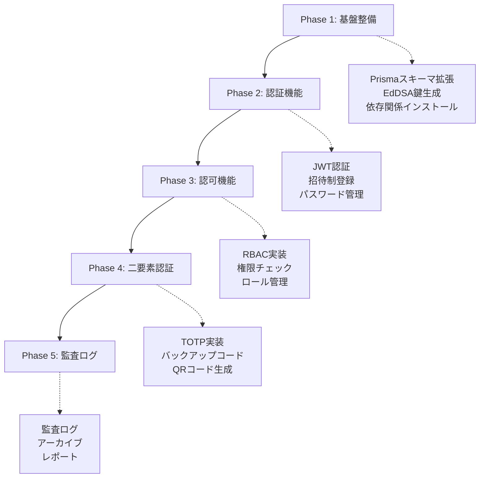

**Phase 1: 基盤整備（1-2日）**:
- Prismaスキーマ拡張（User, Invitation, RefreshToken等）
- EdDSA鍵ペア生成スクリプト実装
- 新規依存関係インストール（jose, @node-rs/argon2, bloom-filters, otplib, qrcode等）
- 環境変数設定

**Phase 2: 認証機能（3-5日）**:
- TokenService実装（EdDSA JWT生成・検証）
- PasswordService実装（Argon2idハッシュ、Bloom Filter、zxcvbn）
- AuthService実装（登録、ログイン、ログアウト）
- InvitationService実装（招待作成、検証）
- EmailService実装（nodemailer、Redis Bull）
- authenticate middleware実装

**Phase 3: 認可機能（3-4日）**:
- RBACService実装（権限チェック、ロール管理）
- authorize middleware実装
- 事前定義ロール・権限のシーディング
- Redis キャッシング戦略実装

**Phase 4: 二要素認証（2-3日）**:
- TwoFactorService実装（TOTP、バックアップコード、QRコード）
- 2FA UI実装（設定画面、ログイン画面）
- AES-256-GCM暗号化実装

**Phase 5: 監査ログ（1-2日）**:
- AuditLogService実装
- 監査ログアーカイブバッチジョブ実装

**ロールバック計画**:
- **Prismaマイグレーション**: `npx prisma migrate resolve --rolled-back {migration_name}` でロールバック
- **Railway環境**: 前バージョンへの切り戻し（Canary deployment 5%→25%→100%）
- **緊急対応フロー**: アプリケーションレベルの機能フラグで新機能を無効化

**検証チェックポイント**:
- Phase 1完了: Prismaマイグレーション成功、EdDSA鍵生成成功
- Phase 2完了: 単体テスト（AuthService、PasswordService）合格、E2Eテスト（ログイン）合格
- Phase 3完了: 単体テスト（RBACService）合格、E2Eテスト（権限チェック）合格
- Phase 4完了: 単体テスト（TwoFactorService）合格、E2Eテスト（2FAログイン）合格
- Phase 5完了: 監査ログ記録確認、アーカイブバッチジョブ実行確認

## 画面遷移とナビゲーション設計（要件28対応）

本セクションでは、フロントエンドの画面遷移とナビゲーション設計を定義します（requirements.md 要件28対応）。

### ルーティング構成

React Routerを使用した画面遷移とナビゲーションを実装します。

```typescript
// frontend/src/routes/index.tsx
import { createBrowserRouter } from 'react-router-dom';

const router = createBrowserRouter([
  // 公開ルート（認証不要）
  {
    path: '/login',
    element: <LoginPage />,
  },
  {
    path: '/register/:invitationToken',
    element: <RegisterPage />,
  },
  {
    path: '/password-reset',
    element: <PasswordResetRequestPage />,
  },
  {
    path: '/password-reset/:resetToken',
    element: <PasswordResetPage />,
  },
  {
    path: '/verify-2fa',
    element: <TwoFactorVerificationPage />,
  },
  {
    path: '/verify-2fa/backup',
    element: <BackupCodeVerificationPage />,
  },

  // 保護ルート（認証必須）
  {
    path: '/',
    element: <ProtectedRoute><AppLayout /></ProtectedRoute>,
    children: [
      {
        index: true,
        element: <DashboardPage />,
      },
      {
        path: 'profile',
        element: <ProfilePage />,
      },
      {
        path: 'profile/2fa',
        element: <TwoFactorSetupPage />,
      },
      {
        path: 'profile/sessions',
        element: <SessionManagementPage />,
      },
      // 管理者専用ルート
      {
        path: 'admin/users',
        element: <ProtectedRoute requiredPermission="user:read"><UserManagementPage /></ProtectedRoute>,
      },
      {
        path: 'admin/invitations',
        element: <ProtectedRoute requiredPermission="user:invite"><InvitationManagementPage /></ProtectedRoute>,
      },
      {
        path: 'admin/roles',
        element: <ProtectedRoute requiredPermission="role:read"><RoleManagementPage /></ProtectedRoute>,
      },
      {
        path: 'admin/permissions',
        element: <ProtectedRoute requiredPermission="permission:read"><PermissionManagementPage /></ProtectedRoute>,
      },
      {
        path: 'admin/audit-logs',
        element: <ProtectedRoute requiredPermission="audit:read"><AuditLogPage /></ProtectedRoute>,
      },
    ],
  },
]);
```

### 画面遷移フロー

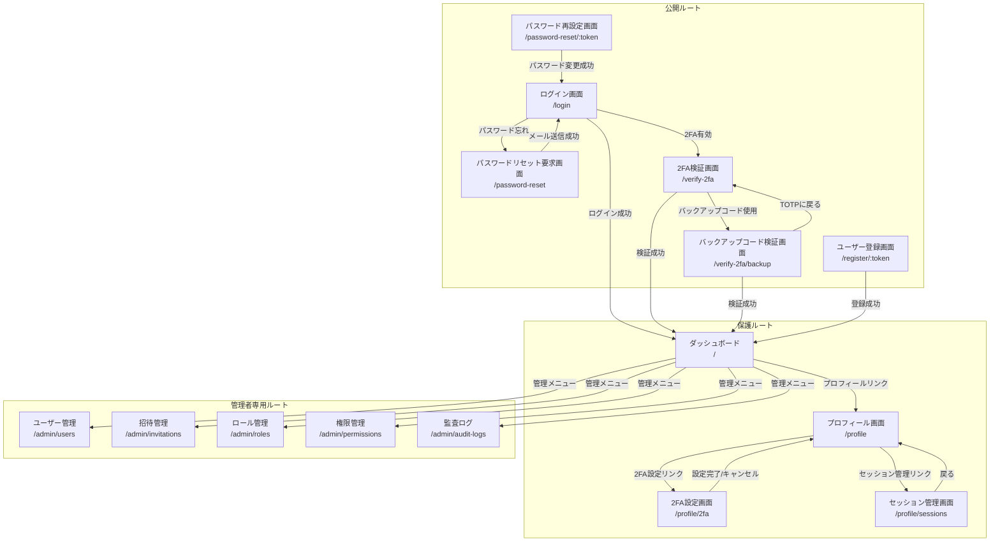

### 共通ヘッダーナビゲーション

> **注記（2026-10-06 タスク41.2 で追記）**: 下のコードは設計の初期の下書きであり、Tailwind のクラス・shadcn の DropdownMenu・ダッシュボードだけのリンクなど、現在の実装と異なる。下書きと実装が異なる点は、実装（`frontend/src/components/Navigation/AppHeader.tsx` と `frontend/src/components/Navigation/AppHeader.css`）を正とする。全画面に効く応答性とアクセシブルネームの決定は、コードの後の「レスポンシブ表示とアクセシブルネーム」に記す。

```typescript
// frontend/src/components/Navigation/AppHeader.tsx

interface AppHeaderProps {
  user: User;
  permissions: string[];
}

export function AppHeader({ user, permissions }: AppHeaderProps): ReactElement {
  const navigate = useNavigate();
  const { logout } = useAuth();
  const isAdmin = permissions.some(p =>
    p === '*:*' || p.startsWith('user:') || p.startsWith('role:')
  );

  return (
    <header className="flex items-center justify-between px-6 py-4 bg-white shadow-sm">
      {/* ロゴ・ダッシュボードリンク */}
      <Link to="/" className="flex items-center space-x-2">
        <span className="text-xl font-bold text-gray-900">ArchiTrack</span>
      </Link>

      {/* ナビゲーションメニュー */}
      <nav className="flex items-center space-x-4">
        <Link to="/" className="text-gray-700 hover:text-gray-900">
          ダッシュボード
        </Link>

        {/* 管理メニュー（管理者のみ表示） */}
        {isAdmin && (
          <DropdownMenu>
            <DropdownMenuTrigger asChild>
              <button className="text-gray-700 hover:text-gray-900">
                管理メニュー
              </button>
            </DropdownMenuTrigger>
            <DropdownMenuContent>
              {permissions.includes('user:read') && (
                <DropdownMenuItem onClick={() => navigate('/admin/users')}>
                  ユーザー管理
                </DropdownMenuItem>
              )}
              {permissions.includes('user:invite') && (
                <DropdownMenuItem onClick={() => navigate('/admin/invitations')}>
                  招待管理
                </DropdownMenuItem>
              )}
              {permissions.includes('role:read') && (
                <DropdownMenuItem onClick={() => navigate('/admin/roles')}>
                  ロール管理
                </DropdownMenuItem>
              )}
              {permissions.includes('permission:read') && (
                <DropdownMenuItem onClick={() => navigate('/admin/permissions')}>
                  権限管理
                </DropdownMenuItem>
              )}
              {permissions.includes('audit:read') && (
                <DropdownMenuItem onClick={() => navigate('/admin/audit-logs')}>
                  監査ログ
                </DropdownMenuItem>
              )}
            </DropdownMenuContent>
          </DropdownMenu>
        )}

        {/* ユーザーメニュー */}
        <DropdownMenu>
          <DropdownMenuTrigger asChild>
            <button className="flex items-center space-x-2 text-gray-700 hover:text-gray-900">
              <span>{user.displayName}</span>
            </button>
          </DropdownMenuTrigger>
          <DropdownMenuContent>
            <DropdownMenuItem onClick={() => navigate('/profile')}>
              プロフィール
            </DropdownMenuItem>
            <DropdownMenuSeparator />
            <DropdownMenuItem onClick={logout}>
              ログアウト
            </DropdownMenuItem>
          </DropdownMenuContent>
        </DropdownMenu>
      </nav>
    </header>
  );
}
```

#### レスポンシブ表示とアクセシブルネーム（要件15.1・15.4・28.21・28.22）

（2026-10-06 タスク41.2 で追記。決定はタスク39.1・40.1・40.2・41.1 による）共通ヘッダーは保護された全画面に出るため、以下の決定は全画面に効く。幅の境界は、768px（下の項で述べる利用者の判断による例外）を除き `frontend/src/utils/responsive.ts` の定数を単一情報源とし（steering の tech.md「ブレークポイントの単一情報源」）、CSS の `@media` は TS の定数を読めないため同じ値を書き写す。

- **アイコンのみの表示（1199px 以下）**: `APP_HEADER_ICON_ONLY_MAX_WIDTH`（1199）以下では、四つのリンク（ダッシュボード・プロジェクト・取引先・自社情報）と管理メニューのボタンをアイコンのみで表示し、1200px 以上で文言を出す（タスク40.1）
  - **境界の根拠**: 文言を出したままでは、769px〜1147px（test 環境の /profile の実測。管理者の長い表示名が最悪）でリンクの文言が縦に折り返し、ナビゲーションがヘッダーの高さ 64px を超えていた。実測の上端にフォントの差の余裕を足して 1200px を境にした。利用者の判断（2026-10-05）の「文言を隠す閾値を上げる」（約 1100px 以下）より広いのは、長い表示名の実測による
- **モバイルの表示（768px 以下）**: ロゴの文字とユーザー名もアイコンのみの表示と同じ指定で隠し、区切りの線を出さず、ヘッダーの高さを 56px にする（769px 以上は 64px）。ナビゲーションが残りの幅を受け取り、リンクの幅を縮めて一行に収める（二段に折り返すと sticky のヘッダーの高さが全画面で変わり、項目を畳むとリンクが見えなくなるため、一行のまま全リンクと両メニューが見えて押せる形を選んだ。タスク39.1）
  - **境界の値**: 768 は `MEDIA_QUERIES.isMobile`（767px 以下）と 1px ずれる。利用者の判断（2026-10-06）で据え置く。既存の E2E が 768 幅をモバイルとして扱うためである。768 幅ちょうどは要件15.1 の区分ではタブレットの下端に当たるが、ヘッダーはモバイルの表示になる
- **狭いモバイルの表示（479px 以下）**: `MEDIA_QUERIES.isSmallMobile` と同じ境界で、ヘッダーの左右の余白（24px → 12px）と項目の間隔（8px → 4px）を詰め、320 幅の管理者（項目が最も多い）でもリンクが押せる大きさを保つ（タスク39.1 で導入し、タスク41.1 で境界を 480 から 479 へ揃えた）
- **ユーザー名の省略表示（769px〜1199px）**: ユーザー名は隠さず、デスクトップ幅と同じ上限幅 120px と省略記号（text-overflow: ellipsis）で出す。長い表示名でもヘッダーが一行に収まり、文書を水平にはみ出させない（タスク40.1）
- **見た目だけ隠す指定とアクセシブルネーム（要件15.4）**: 上の各幅で隠す文言（リンクと管理メニューのボタンの文言、ロゴの文字、ユーザー名）は `display: none` にせず、見た目だけを隠して支援技術には残す指定（position: absolute・1px の箱・margin -1px・overflow hidden・clip・clip-path・nowrap・border 0・padding 0）にする。アイコンの SVG は aria-hidden のため、`display: none` ではリンクとボタンがアクセシブルネームを失う。見えている文言をそのまま名前の出どころに残すため、名前は全幅でデスクトップの文言と同じになり（WCAG 2.5.3 Label in Name）、aria-label で同じ文字列を二重に持たない（タスク40.2）
  - **E2E への影響**: 名前は全幅で同じため、狭い幅でもリンクと管理メニューのボタンを名前で指せる。一方で Playwright は 1×1 の要素を可視と判定するため、隠した文言へ `not.toBeVisible()` を向ける検証は成り立たない。隠れていることは描かれる箱の大きさで判定する
- **検証**: CSS の `@media` の値と `responsive.ts` の定数（`APP_HEADER_ICON_ONLY_MAX_WIDTH`・`MEDIA_QUERIES.isSmallMobile`）の一致と、各ブロックが持つ規則は、単体 `frontend/src/__tests__/components/AppHeader.css.test.ts` が突き合わせる。表示の挙動（モバイル幅・タブレット幅で文書全体を水平にはみ出させず、ヘッダーが一行に収まり、リンクとメニューの項目が画面幅の内側にあって届くこと、アイコンのみの表示でも名前がデスクトップと同じであること）は E2E `e2e/specs/navigation/app-header.spec.ts` が 2 ロール × 複数の表示名 × 複数の幅で主張する
- **フォーカス表示（タスク 43.1、2026-10-08）**: ロゴのリンク・四つのリンク・管理メニューとユーザーメニューの釦は、フォーカス中に 2px の白い実線の outline（offset 2px）を描く。ヘッダーの背景は紫のグラデーション（#667eea〜#764ba2）で、白はその両端に対して 3.66:1・6.37:1 である。全画面共通の青い outline（#2563eb）はこの背景に対して 3:1 に届かないため、ロゴのリンクにも `.app-header-logo:focus-visible` で白い輪を与えた。両メニューの釦の白い輪は、詳細度の高い `.app-header-dropdown > button:focus-visible { outline: none }` に打ち消されてフォーカス中の表示が無かったため、その打ち消しの規則を外した（`frontend/src/components/Navigation/AppHeader.css`）。規則は単体 `frontend/src/__tests__/accessibility/user-authentication-focus-visible.test.tsx` が原本の CSS で、表示は E2E `e2e/specs/auth/auth-forms-focus-visible.spec.ts` が 2FA の設定の画面の Tab の一巡（一般ユーザーと管理者）で主張する。開いたメニューの項目は DOM のフォーカスを移さず `is-focused` の見た目で示す作りのため、この一巡の対象に含めていない

### ProtectedRouteコンポーネント

認証・認可保護されたルートを実装します。

```typescript
// frontend/src/components/ProtectedRoute.tsx

interface ProtectedRouteProps {
  children: ReactElement;
  requiredPermission?: string;
  redirectTo?: string;
}

export function ProtectedRoute({
  children,
  requiredPermission,
  redirectTo = '/login',
}: ProtectedRouteProps): ReactElement {
  const { isAuthenticated, isLoading, user, permissions } = useAuth();
  const location = useLocation();

  // 認証状態読み込み中（要件16A対応: UIチラつき防止）
  if (isLoading) {
    return (
      <div className="flex items-center justify-center min-h-screen">
        <div
          className="text-center"
          role="status"
          aria-label="認証状態を確認中"
          aria-live="polite"
        >
          <div className="animate-spin rounded-full h-12 w-12 border-b-2 border-gray-900 mx-auto" />
          <p className="mt-4 text-gray-600">認証状態を確認中...</p>
        </div>
      </div>
    );
  }

  // 未認証の場合はログイン画面へリダイレクト
  if (!isAuthenticated) {
    return (
      <Navigate
        to={redirectTo}
        state={{ from: location.pathname + location.search }}
        replace
      />
    );
  }

  // 権限チェック（requiredPermissionが指定されている場合）
  if (requiredPermission) {
    const hasPermission = permissions.includes('*:*') ||
      permissions.includes(requiredPermission) ||
      permissions.some(p => {
        const [resource, action] = requiredPermission.split(':');
        return p === `${resource}:*` || p === `*:${action}`;
      });

    if (!hasPermission) {
      return (
        <div className="flex items-center justify-center min-h-screen">
          <div className="text-center">
            <h1 className="text-2xl font-bold text-gray-900">アクセス権限がありません</h1>
            <p className="mt-2 text-gray-600">
              このページにアクセスするには、{requiredPermission}権限が必要です。
            </p>
            <Link to="/" className="mt-4 inline-block text-blue-600 hover:underline">
              ダッシュボードへ戻る
            </Link>
          </div>
        </div>
      );
    }
  }

  return children;
}
```

### redirectUrl保存とリダイレクト処理

```typescript
// frontend/src/hooks/useRedirectAfterLogin.ts

export function useRedirectAfterLogin(): (defaultPath?: string) => void {
  const navigate = useNavigate();
  const location = useLocation();

  return useCallback((defaultPath = '/') => {
    // locationのstateからリダイレクト先を取得
    const from = (location.state as { from?: string })?.from;

    // URLパラメータからredirectUrlを取得（フォールバック）
    const searchParams = new URLSearchParams(location.search);
    const redirectUrl = searchParams.get('redirectUrl');

    // 優先順位: state.from > redirectUrl > defaultPath
    const targetPath = from || redirectUrl || defaultPath;

    navigate(targetPath, { replace: true });
  }, [navigate, location]);
}
```

## パスワードリセット画面設計（要件29対応）

本セクションでは、パスワードリセット機能の画面設計を定義します（requirements.md 要件29対応）。

### パスワードリセット要求画面

```typescript
// frontend/src/pages/PasswordResetRequestPage.tsx

interface PasswordResetRequestFormData {
  email: string;
}

export function PasswordResetRequestPage(): ReactElement {
  const [isSubmitted, setIsSubmitted] = useState(false);
  const {
    register,
    handleSubmit,
    formState: { errors, isSubmitting },
  } = useForm<PasswordResetRequestFormData>();

  const onSubmit = async (data: PasswordResetRequestFormData) => {
    await apiClient.post('/api/v1/auth/password/reset-request', {
      email: data.email,
    });
    // セキュリティ上、成功・失敗を問わず同じメッセージを表示
    setIsSubmitted(true);
  };

  if (isSubmitted) {
    return (
      <div className="min-h-screen flex items-center justify-center bg-gray-50">
        <div className="max-w-md w-full p-8 bg-white rounded-lg shadow-md">
          <h1 className="text-2xl font-bold text-gray-900 mb-4">
            メールを送信しました
          </h1>
          <p className="text-gray-600 mb-6">
            入力されたメールアドレスにパスワードリセットのリンクを送信しました。
            メールをご確認ください。
          </p>
          <Link
            to="/login"
            className="w-full inline-block text-center py-2 px-4 bg-blue-600 text-white rounded-md hover:bg-blue-700"
          >
            ログイン画面へ戻る
          </Link>
        </div>
      </div>
    );
  }

  return (
    <div className="min-h-screen flex items-center justify-center bg-gray-50">
      <div className="max-w-md w-full p-8 bg-white rounded-lg shadow-md">
        <h1 className="text-2xl font-bold text-gray-900 mb-6">
          パスワードリセット
        </h1>
        <p className="text-gray-600 mb-6">
          登録されているメールアドレスを入力してください。
          パスワードリセットのリンクをお送りします。
        </p>
        <form onSubmit={handleSubmit(onSubmit)} className="space-y-4">
          <div>
            <label htmlFor="email" className="block text-sm font-medium text-gray-700">
              メールアドレス
            </label>
            <input
              id="email"
              type="email"
              autoComplete="email"
              autoFocus
              {...register('email', {
                required: 'メールアドレスを入力してください',
                pattern: {
                  value: /^[A-Z0-9._%+-]+@[A-Z0-9.-]+\.[A-Z]{2,}$/i,
                  message: '有効なメールアドレスを入力してください',
                },
              })}
              className="mt-1 block w-full px-3 py-2 border border-gray-300 rounded-md shadow-sm focus:outline-none focus:ring-blue-500 focus:border-blue-500"
              aria-invalid={errors.email ? 'true' : 'false'}
              aria-describedby={errors.email ? 'email-error' : undefined}
            />
            {errors.email && (
              <p
                id="email-error"
                className="mt-1 text-sm text-red-600"
                aria-live="polite"
              >
                {errors.email.message}
              </p>
            )}
          </div>
          <button
            type="submit"
            disabled={isSubmitting}
            className="w-full py-2 px-4 bg-blue-600 text-white rounded-md hover:bg-blue-700 disabled:opacity-50 disabled:cursor-not-allowed flex items-center justify-center"
          >
            {isSubmitting ? (
              <>
                <span className="animate-spin rounded-full h-4 w-4 border-b-2 border-white mr-2" />
                送信中...
              </>
            ) : (
              'リセットメールを送信'
            )}
          </button>
        </form>
        <div className="mt-6 text-center">
          <Link to="/login" className="text-sm text-blue-600 hover:underline">
            ログイン画面へ戻る
          </Link>
        </div>
      </div>
    </div>
  );
}
```

### パスワード再設定画面

```typescript
// frontend/src/pages/PasswordResetPage.tsx

interface PasswordResetFormData {
  newPassword: string;
  confirmPassword: string;
}

export function PasswordResetPage(): ReactElement {
  const { resetToken } = useParams<{ resetToken: string }>();
  const navigate = useNavigate();
  const [isTokenValid, setIsTokenValid] = useState<boolean | null>(null);
  const [isSuccess, setIsSuccess] = useState(false);
  const {
    register,
    handleSubmit,
    watch,
    formState: { errors, isSubmitting },
  } = useForm<PasswordResetFormData>();
  const newPassword = watch('newPassword', '');

  // リセットトークン検証
  useEffect(() => {
    async function verifyToken() {
      try {
        await apiClient.post('/api/v1/auth/password/verify-reset', { token: resetToken });
        setIsTokenValid(true);
      } catch {
        setIsTokenValid(false);
      }
    }
    verifyToken();
  }, [resetToken]);

  const onSubmit = async (data: PasswordResetFormData) => {
    await apiClient.post('/api/v1/auth/password/reset', {
      token: resetToken,
      newPassword: data.newPassword,
    });
    setIsSuccess(true);
    // 3秒後にログイン画面へリダイレクト
    setTimeout(() => navigate('/login'), 3000);
  };

  // トークン検証中
  if (isTokenValid === null) {
    return (
      <div className="min-h-screen flex items-center justify-center bg-gray-50">
        <div className="text-center">
          <div className="animate-spin rounded-full h-12 w-12 border-b-2 border-gray-900 mx-auto" />
          <p className="mt-4 text-gray-600">トークンを検証中...</p>
        </div>
      </div>
    );
  }

  // トークン無効
  if (isTokenValid === false) {
    return (
      <div className="min-h-screen flex items-center justify-center bg-gray-50">
        <div className="max-w-md w-full p-8 bg-white rounded-lg shadow-md text-center">
          <h1 className="text-2xl font-bold text-red-600 mb-4">
            リンクが無効または期限切れです
          </h1>
          <p className="text-gray-600 mb-6">
            パスワードリセットのリンクが無効または期限切れです。
            再度パスワードリセットを申請してください。
          </p>
          <Link
            to="/password-reset"
            className="inline-block py-2 px-4 bg-blue-600 text-white rounded-md hover:bg-blue-700"
          >
            パスワードリセットを再度申請する
          </Link>
        </div>
      </div>
    );
  }

  // パスワード変更成功
  if (isSuccess) {
    return (
      <div className="min-h-screen flex items-center justify-center bg-gray-50">
        <div className="max-w-md w-full p-8 bg-white rounded-lg shadow-md text-center">
          <h1 className="text-2xl font-bold text-green-600 mb-4">
            パスワードを変更しました
          </h1>
          <p className="text-gray-600 mb-6">
            パスワードが正常に変更されました。
            新しいパスワードでログインしてください。
          </p>
          <p className="text-sm text-gray-500">
            3秒後に自動的にログイン画面へリダイレクトします...
          </p>
        </div>
      </div>
    );
  }

  return (
    <div className="min-h-screen flex items-center justify-center bg-gray-50">
      <div className="max-w-md w-full p-8 bg-white rounded-lg shadow-md">
        <h1 className="text-2xl font-bold text-gray-900 mb-6">
          新しいパスワードを設定
        </h1>
        <form onSubmit={handleSubmit(onSubmit)} className="space-y-4">
          <div>
            <label htmlFor="newPassword" className="block text-sm font-medium text-gray-700">
              新しいパスワード
            </label>
            <input
              id="newPassword"
              type="password"
              autoComplete="new-password"
              {...register('newPassword', {
                required: '新しいパスワードを入力してください',
                minLength: {
                  value: 12,
                  message: 'パスワードは12文字以上で入力してください',
                },
              })}
              className="mt-1 block w-full px-3 py-2 border border-gray-300 rounded-md shadow-sm focus:outline-none focus:ring-blue-500 focus:border-blue-500"
              aria-invalid={errors.newPassword ? 'true' : 'false'}
            />
            {/* パスワード強度インジケーター */}
            <PasswordStrengthIndicator password={newPassword} />
            {/* パスワード要件チェックリスト */}
            <PasswordRequirementsChecklist password={newPassword} />
            {errors.newPassword && (
              <p className="mt-1 text-sm text-red-600" aria-live="polite">
                {errors.newPassword.message}
              </p>
            )}
          </div>
          <div>
            <label htmlFor="confirmPassword" className="block text-sm font-medium text-gray-700">
              パスワード確認
            </label>
            <input
              id="confirmPassword"
              type="password"
              autoComplete="new-password"
              {...register('confirmPassword', {
                required: 'パスワード確認を入力してください',
                validate: value =>
                  value === newPassword || 'パスワードが一致しません',
              })}
              className="mt-1 block w-full px-3 py-2 border border-gray-300 rounded-md shadow-sm focus:outline-none focus:ring-blue-500 focus:border-blue-500"
              aria-invalid={errors.confirmPassword ? 'true' : 'false'}
            />
            {errors.confirmPassword && (
              <p className="mt-1 text-sm text-red-600" aria-live="polite">
                {errors.confirmPassword.message}
              </p>
            )}
          </div>
          <button
            type="submit"
            disabled={isSubmitting}
            className="w-full py-2 px-4 bg-blue-600 text-white rounded-md hover:bg-blue-700 disabled:opacity-50 disabled:cursor-not-allowed flex items-center justify-center"
          >
            {isSubmitting ? (
              <>
                <span className="animate-spin rounded-full h-4 w-4 border-b-2 border-white mr-2" />
                変更中...
              </>
            ) : (
              'パスワードを変更'
            )}
          </button>
        </form>
      </div>
    </div>
  );
}
```

**現況（タスク 43.1、2026-10-08）**: 上の二つのコード例は入力欄に `focus:outline-none focus:ring-blue-500` を指定するが、輪の幅（`focus:ring-2` など）を持たないため、この指定どおりではフォーカス中の表示が出ない。コード例は設計の記述としてそのまま残す。実装のパスワードリセットの画面は `frontend/src/pages/PasswordResetPage.tsx` が `frontend/src/components/PasswordResetForm.tsx` を要求と再設定の両方のモードで描く構成で、入力欄はインラインのスタイルで描く。タスク 43.1 がその入力欄のインラインの `outline: 'none'`（3 か所）を外し、フォーカス中の表示を全画面共通の `:focus-visible`（`frontend/src/index.css` の `@layer base`、2px・#2563eb）に一本化した。同じタスクで、ユーザー登録・2FA の設定・2FA の確認のフォーム（`frontend/src/components/RegisterForm.tsx` の 3 か所・`frontend/src/components/TwoFactorSetupForm.tsx` と `frontend/src/components/TwoFactorVerificationForm.tsx` の各 1 か所）の同じ打ち消しも外した。単体 `frontend/src/__tests__/accessibility/user-authentication-focus-visible.test.tsx` が打ち消しの無いことを状態ごとに、E2E `e2e/specs/auth/auth-forms-focus-visible.spec.ts` がログイン・2FA の確認・ユーザー登録・パスワードリセットの要求と再設定・2FA の設定の画面を状態ごとに Tab で一巡し、2px 以上・3:1 以上の表示とフォーカスが離れたら消えることを主張する

### パスワードリセットフロー

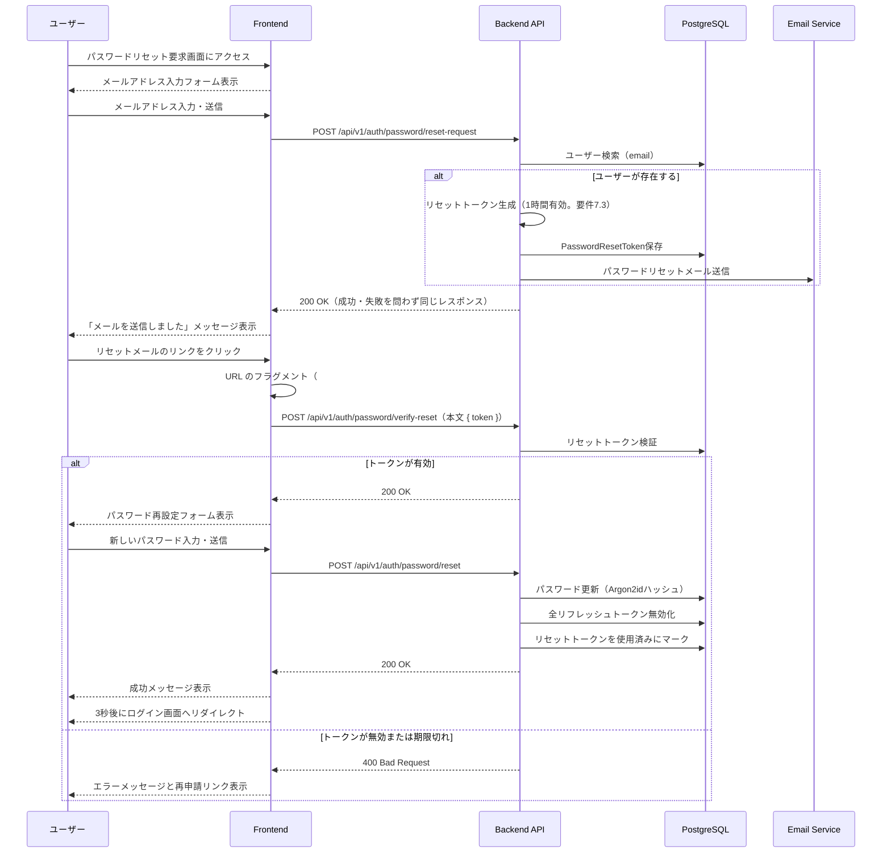

---

## 要件30: セッション切れモーダル再認証設計

_追加日: 2026-02-09_

### 概要

操作中にセッションが切れた場合（アクセストークン期限切れ＋リフレッシュトークン失敗）、ログイン画面へリダイレクトするのではなく、現在のページ上にモーダルダイアログを表示してインプレース再認証を行う機能を追加する。これにより、フォーム入力データの損失を防ぎ、ユーザーは再認証後にシームレスに作業を続行できる。

### 設計方針

#### 既存動作との共存ポリシー

| シナリオ | 挙動 | 方式 |
|---|---|---|
| ページ初期ロード時にセッション切れを検知 | ログイン画面にリダイレクト | 既存（変更なし） |
| 操作中（API呼び出し時）にセッション切れを検知 | セッション切れモーダルを表示 | **新規** |
| ユーザーが明示的にログアウト | ログイン画面にリダイレクト | 既存（変更なし） |

区別の基準: `AuthContext.isInitialized` が `true` の状態（= ユーザーが既に認証済みで操作中）でリフレッシュが失敗した場合にモーダル方式を適用する。

### コンポーネント設計

#### 1. SessionExpiredModal コンポーネント

**ファイルパス:** `frontend/src/components/SessionExpiredModal.tsx`

```typescript
interface SessionExpiredModalProps {
  isOpen: boolean;
  userEmail: string;          // 前回ログインメールアドレス（自動入力用）
  onReauthSuccess: (session: ReauthSession) => void; // 再認証成功時コールバック（ログインまたは 2FA 検証の応答を渡す）
  onNavigateToLogin: () => void; // ログイン画面遷移時コールバック
}
```

**UI構成:**
- オーバーレイ背景（`bg-black/50`、クリック無効）
- 中央配置のモーダルカード
- タイトル: 「セッションの有効期限が切れました」
- メールアドレスフィールド（前回のメールで自動入力、読み取り専用）
- パスワード入力フィールド（自動フォーカス）
- 再ログインボタン
- ローディング状態表示
- エラーメッセージ表示領域
- 3回連続失敗後: 「ログイン画面へ移動」ボタンを追加表示
- 2FA対応: 2FA要求時にTOTPコード入力フィールドを追加表示

**レスポンシブ対応:**
- デスクトップ: `max-w-md mx-auto` 中央配置
- モバイル（< 768px）: `w-full h-full` フルスクリーンに近いレイアウト

**アクセシビリティ:**
- `role="dialog"`, `aria-modal="true"`, `aria-labelledby="session-expired-title"`
- フォーカストラップ実装（Tab/Shift+Tab がモーダル内で循環）
- Escキー無効化（意図しないデータ損失防止）
- セッション切れメッセージ: `aria-live="assertive"`
- 入力フィールド: 適切な `autocomplete` 属性

#### 2. AuthContext の変更

**ファイルパス:** `frontend/src/contexts/AuthContext.tsx`

**新しい状態と区別ロジック:**

```typescript
interface AuthContextValue {
  // 既存
  sessionExpired: boolean;
  // 新規追加
  sessionExpiredDuringOperation: boolean;  // 操作中のセッション切れ（モーダル表示用）
  handleReauthSuccess: (session: ReauthSession) => void; // 再認証成功時のハンドラー（パスワードのみ・2FA の両経路で同じ）
  navigateToLogin: () => void;             // ログイン画面遷移ハンドラー
}
```

**セッション切れの区別:**

```
isInitialized === false の状態でリフレッシュ失敗
  → sessionExpired = true（既存: リダイレクト方式）

isInitialized === true の状態でリフレッシュ失敗
  → sessionExpiredDuringOperation = true（新規: モーダル方式）
```

**再認証の API 呼び出し（モーダル側）:**
- 再認証の API はモーダルが呼ぶ。パスワードのみの再認証（`POST /api/v1/auth/login`）と 2FA の再認証（`POST /api/v1/auth/verify-2fa`）のどちらでも、応答（`ReauthSession`：アクセストークンと有効期限・利用者）を同じ共通処理で `apiClient` へ置き、`handleReauthSuccess(session)` へ渡す。アクセストークンの無い応答は成功として扱わない（要件 30.9）

**handleReauthSuccess の処理:**
1. 応答に利用者があれば、ログイン中の利用者を置き換える（無ければそのまま保つ）
2. アクセストークンを `apiClient` へ置き、TokenRefreshManager を再初期化し、リフレッシュとセッション切れの経路を張り直す（ログイン時と同じ処理）
3. `sessionExpiredDuringOperation = false` に設定する

#### 3. API Client の変更

**ファイルパス:** `frontend/src/api/client.ts`

**新しいコールバック: `onSessionExpired`**

```typescript
class ApiClient {
  // 既存
  private tokenRefreshCallback: TokenRefreshCallback | null = null;
  // 新規追加
  private sessionExpiredCallback: (() => void) | null = null;

  setSessionExpiredCallback(callback: (() => void) | null): void {
    this.sessionExpiredCallback = callback;
  }
}
```

**401レスポンス処理フローの変更:**

```
401レスポンス受信
  ↓
tokenRefreshCallback が存在する？
  ├─ YES → トークンリフレッシュ試行
  │         ├─ 成功 → 元のリクエストをリトライ（既存動作）
  │         └─ 失敗 → sessionExpiredCallback を呼び出し（★新規）
  │                    → ApiError をスロー
  └─ NO → sessionExpiredCallback を呼び出し（★新規）
           → ApiError をスロー
```

**変更箇所（`client.ts` の該当箇所）:**

```typescript
} catch (refreshError) {
  // リフレッシュ失敗時のエラーログ
  logger.debug('Token refresh failed after all retry attempts', { ... });

  // ★新規: セッション切れコールバックを呼び出し
  if (this.sessionExpiredCallback) {
    this.sessionExpiredCallback();
  }

  // 既存: エラーをスロー
  throw new ApiError(response.status, errorMessage, data);
}
```

#### 4. ProtectedRoute の変更

**ファイルパス:** `frontend/src/components/ProtectedRoute.tsx`

**変更内容:** `sessionExpiredDuringOperation === true` の場合、`!isAuthenticated` であってもリダイレクトを抑制し、childrenを表示し続ける。これにより、操作中のセッション切れ時にモーダルが表示されている間、ページ遷移が発生しない。

```typescript
// 既存: !isAuthenticated の場合にリダイレクト
// 変更: sessionExpiredDuringOperation の場合はリダイレクトを抑制
if (!isAuthenticated && !sessionExpiredDuringOperation) {
  // ログイン画面へリダイレクト（既存動作）
  return <Navigate to={redirectPath} state={{ from: currentPath, sessionExpired }} replace />;
}

// sessionExpiredDuringOperation === true の場合はchildrenを返す
// → モーダルがオーバーレイ表示され、フォームデータが保持される
```

**理由:** `sessionExpiredCallback` 呼び出し時に `user` が `null` にリセットされるケース（例: 別タブからのlogoutイベント）で、ProtectedRouteのリダイレクトが発動し、モーダル表示中にページ遷移してしまうリスクを防止するため。

#### 5. SessionExpiredModal の配置

**ファイルパス:** `frontend/src/components/ProtectedLayout.tsx`（当初は `frontend/src/App.tsx` との二択で計画したが、認証済みレイアウトを担う当該コンポーネントへ配置した）

認証済みユーザーのレイアウト内にグローバルに配置する:

```tsx
function AuthenticatedLayout({ children }) {
  const { sessionExpiredDuringOperation, user, handleReauthSuccess, navigateToLogin } = useAuth();

  return (
    <>
      {children}
      <SessionExpiredModal
        isOpen={sessionExpiredDuringOperation}
        userEmail={user?.email ?? ''}
        onReauthSuccess={handleReauthSuccess}
        onNavigateToLogin={navigateToLogin}
      />
    </>
  );
}
```

### 設計判断: 再認証後の手動リトライ方式

再認証成功後、元のAPIリクエストを自動的にリトライする「Promise suspension方式」と、ユーザーに手動で操作を再実行させる「手動リトライ方式」の2つのアプローチが考えられる。

**採用: 手動リトライ方式**

| 方式 | メリット | デメリット |
|---|---|---|
| Promise suspension（自動リトライ） | 完全にシームレス | ApiClientの制御フローが大幅に複雑化、全API呼び出しに影響、リグレッションリスク大 |
| **手動リトライ（採用）** | シンプル、影響範囲が限定的、Auth0/Firebaseの一般的パターンと整合 | ユーザーが再度保存ボタンを押す必要がある |

**根拠:** Promise suspensionは全てのAPI呼び出しの制御フローに影響を与え、テスト・デバッグの複雑性が大幅に増加する。手動リトライ方式でも要件30.10（入力データが保持されていることを保証）は満たされる。フォームデータはDOMに保持されたまま、ユーザーは再度保存ボタンをクリックするだけで操作を完了できる。

### 複数同時APIリクエスト時の動作

ダッシュボード等で複数のAPIリクエストが同時に発行されている場合のセッション切れ処理:

1. **TokenRefreshManagerのPromise共有**: 複数の401レスポンスが同時発生しても、`TokenRefreshManager.refreshToken()` のPromise共有パターンにより、リフレッシュ試行は1回に集約される（既存動作）
2. **sessionExpiredCallback の冪等性**: リフレッシュ失敗時、`sessionExpiredCallback` は `sessionExpiredDuringOperation = true` を設定する。Reactの状態更新バッチングにより、複数回の呼び出しがあっても状態更新とモーダル表示は1回のみ
3. **各APIリクエストのエラー伝播**: `sessionExpiredCallback` 呼び出し後、各APIリクエストは個別に `ApiError` を受け取る。呼び出し元コンポーネントのcatchブロックでエラーハンドリングが必要だが、モーダルが表示されているためUIへのエラー表示は抑制される（モーダル閉じ後に操作を再実行するため）

```
API呼び出しA ─→ 401 ─→ refreshToken() ─┐
API呼び出しB ─→ 401 ─→ refreshToken() ─┤ Promise共有（1回のみ実行）
API呼び出しC ─→ 401 ─→ refreshToken() ─┘
                                          ↓ リフレッシュ失敗
                                    sessionExpiredCallback() ← 冪等（モーダル1回表示）
                                          ↓
                              各リクエストにApiErrorスロー
```

### データフロー

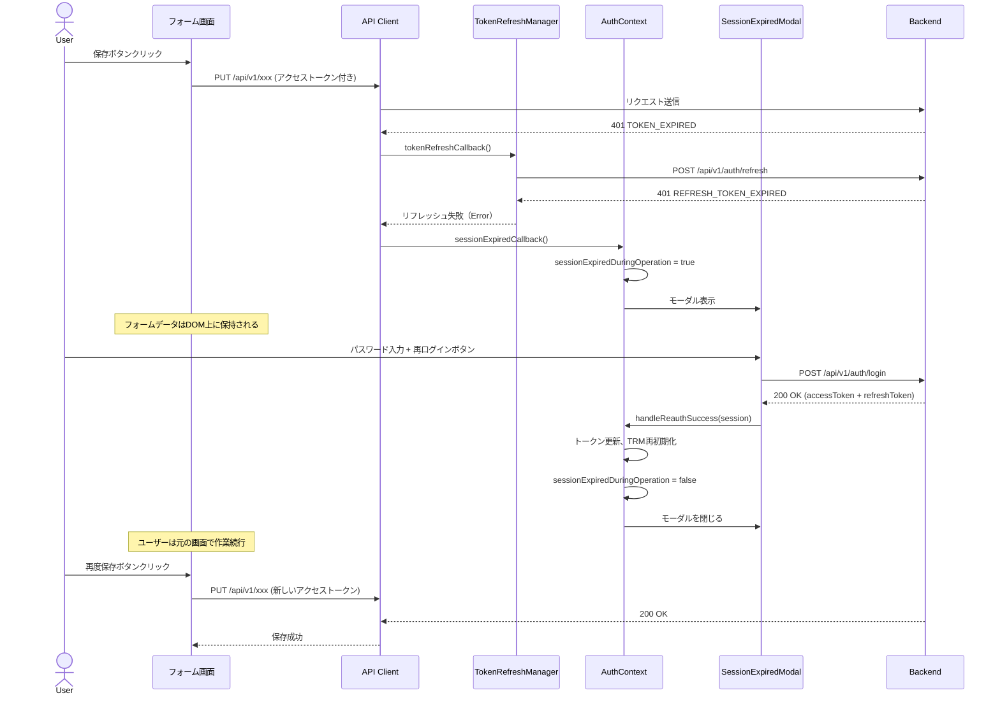

### 2FA対応フロー

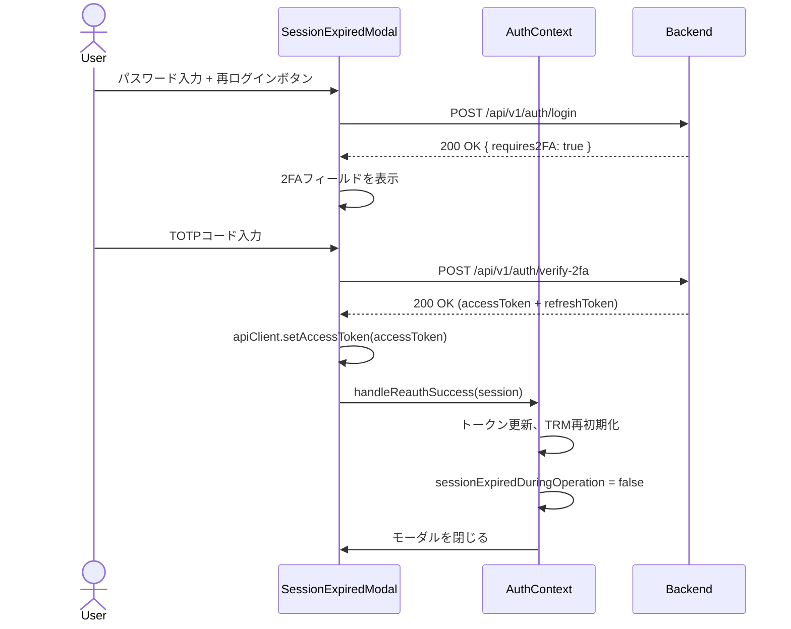

### テスト設計

#### 単体テスト

| テスト対象 | テストファイル | テスト内容 |
|---|---|---|
| SessionExpiredModal | `__tests__/components/SessionExpiredModal.test.tsx` | 表示/非表示、フォーム入力、再認証成功/失敗、2FA対応、3回連続失敗後のフォールバック、アクセシビリティ |
| API Client変更 | `__tests__/api/client.test.ts` | sessionExpiredCallbackの呼び出しタイミング、リフレッシュ失敗時の動作 |
| AuthContext変更 | `__tests__/contexts/AuthContext.test.tsx` | sessionExpiredDuringOperationの状態管理、handleReauthSuccess、初期ロード vs 操作中の区別 |

#### E2Eテスト

| テストシナリオ | テストファイル |
|---|---|
| フォーム入力中にセッション切れ → モーダル表示 → 再認証 → データ保持 | `e2e/specs/auth/session-expired-modal.spec.ts` |
| 再認証3回連続失敗 → ログイン画面遷移 | 同上 |
| 2FAユーザーのモーダル再認証 | 同上 |

### 要件トレーサビリティ

| 要件ID | 設計要素 |
|---|---|
| 30.1-30.3 | API Client `sessionExpiredCallback` + AuthContext `sessionExpiredDuringOperation` |
| 30.4-30.7 | SessionExpiredModal コンポーネント UI構成 |
| 30.8-30.11 | SessionExpiredModal 再認証フロー |
| 30.12 | SessionExpiredModal 2FA対応フロー |
| 30.13-30.15 | API Client + AuthContext コールバック機構設計 |
| 30.16-30.17 | SessionExpiredModal エラーハンドリング |
| 30.18-30.20 | SessionExpiredModal アクセシビリティ設計 |
| 30.21 | SessionExpiredModal レスポンシブ対応 |

---

## Requirements 32-45: セキュリティ是正（IPA注意喚起 2026-10-09）

### 概要

本章は要件32〜45（2026-10-16 追加）の設計である。IPA の注意喚起（2026-10-09）を受けた監査で、認証基盤に次の三類の欠陥が見つかった。調査の記録と判断の詳細は `.kiro/specs/user-authentication/research.md` にある。

1. **状態を持たない検証**: 2FA 検証がパスワード成功の証跡を求めない。トークンが種別・発行者・利用者を持たない。認証ミドルウェアが利用者の状態を見ない。
2. **記録と保管の欠落**: 監査されない操作がある。監査ログが連鎖して消える。トークンが原文で保存・記録される。アーカイブ処理が配線されていない。
3. **境界の開放**: 認証の無い管理用エンドポイントがある。偽装できる送信元識別がある。画面の配信にセキュリティヘッダーが無い。案件の閲覧範囲が無い。

本章の判断は、本書の前半（要件1〜31 の設計）の該当箇所に優先する。前半で置き換わる記述の一覧は本章の「既存設計との関係」に置く。

**利用者**: システム管理者（棚卸し、無効化、2FA の再設定、監査ログの確認と復元）、全ての利用者（2FA 必須のログイン、2FA の再登録）。

**影響**: 全利用者のセッションが移行時に一度切れる（リフレッシュトークンの保存形式の変更）。全利用者が次回ログインで 2FA の登録を求められる（要件34）。

### Goals

- 2FA の検証をパスワード認証の直後の一回限りの資格に結び付け、TOTP の再利用を拒否する
- アクセストークンとリフレッシュトークンを種別・発行者・利用者で区別し、リフレッシュトークンを HttpOnly Cookie とハッシュ保存に限定し、再利用を検知して系列ごと失効させる
- 2FA を全利用者で必須にし、自己の無効化を禁じ、管理者による再設定と利用者による再登録を設ける
- アカウントの無効化・再有効化・90 日の自動無効化と棚卸し画面を設ける
- 案件の閲覧範囲の判定規則と適用の部品を提供する
- 認証・アカウント操作・データ出力を監査し、監査ログを保全・アーカイブする
- 送信元の識別、管理用エンドポイント、ログ・エラー応答、画面配信のヘッダー、メールキューを是正する
- 異常を検知して管理者へ通知する

### Non-Goals

- 各業務機能（現場調査、数量表、内訳書、見積依頼、見積書、契約、工程表、実行予算、工事写真）への閲覧範囲の適用と出力の記録の呼び出し（各 spec が受入基準として持つ）
- 案件そのもの以外の子リソースから案件 ID を引く解決関数（各業務 spec が持つ）
- WebAuthn・パスキーなど TOTP 以外の第二要素
- 外部の SIEM・ログ基盤の導入
- tesseract.js の取得先の自前配信への切り替え
- ~~ロールへの権限追加を実行者の保有する権限の範囲に限る制限（要件38 は全権限 `*:*` に限って定める）~~ 2026-10-26 の要件38.8 の追加（利用者の判断）により本章の範囲へ移した（PrivilegeCeilingPolicy の節）

### Boundary Commitments

#### This Spec Owns

- 2FA 待ちの資格の発行・検証・消費と、TOTP の再利用の拒否
- アクセストークン・リフレッシュトークンの形式、検証、保存、ローテーション、再利用検知、失効、Cookie の属性と CSRF の検査
- 認証済みの要求ごとの利用者の状態（有効・2FA 登録・初回のパスワード変更）の照合と、状態による API の拒否
- 2FA の必須化の画面遷移、自己の無効化の拒否、管理者による再設定、利用者による再登録
- 送信元 IP の識別の規則と、認証系の試行回数の制限
- アカウントの無効化・再有効化・自動無効化、最終ログイン日時の記録、棚卸しの API と画面
- 招待・リセットのトークンの保存形式・提示方法・掃除、招待の取り消しの権限、初期管理者のパスワード検証と初回変更
- ロール割り当て・権限追加の上限と、既定の権限（`user` から `user:read` を外す、`project:read_all` の新設）、担当者候補の API の応答項目
- 案件の閲覧範囲の判定規則（`ProjectScopeService`）と、ID 指定の要求の判定部品（`requireProjectScope`）、範囲外アクセスの記録。案件そのもの（`/api/projects` の一覧・件数・詳細・更新・状態変更）への適用
- 監査ログの記録対象の追加、改変の禁止、実行者の写しの保持、データ出力の記録の API とフロントの記録部品
- 監査ログのアーカイブ・削除・復元と、定期処理の実行基盤
- 管理用エンドポイントの保護、アクセスログ・エラー監視への送信内容、要求識別子、開発用機能の有効化の条件
- 異常の検知と管理者への通知
- 画面配信（nginx）のセキュリティヘッダーと、API の同一オリジンへの中継、アクセスログの形式
- メールキューの接続と、ジョブの後始末

#### Out of Boundary

- 各業務機能の API への `requireProjectScope` の適用と、子リソースから案件 ID を引く解決関数（site-survey、project-management の画面、quantity-table-generation、itemized-statement-generation、estimate-request、estimate-creation、contract-management、construction-schedule、execution-budget-management、construction-photo の各 spec）
- 各業務機能の出力処理からの記録の呼び出し（同上）
- 署名 URL の発行処理（`SignedUrlService`、site-survey の所管）の判定の差し替え。本 spec は判定の関数を提供するだけである
- 案件の画面・業務規則・担当者の変更の操作（project-management の所管）。担当者選択の部品は 36.6 の表示に限って変更する
- 取引先・自社情報の権限と保持（trading-partner-management、company-info の所管）
- 依存・CI・コンテナイメージ・シークレットの設定と運用作業（是正計画の D・O・W の項目）

#### Allowed Dependencies

- 既存の `RBACService.hasPermission`（Redis キャッシュ）による権限の判定
- Prisma（PostgreSQL）、ioredis（`REDIS_URL`）、Bull v4（同じ `REDIS_URL`）、jose（EdDSA）、otplib、argon2、Node の `crypto`
- 既存の `StorageProvider`（本番は R2）へのアーカイブの書き込み（site-survey が所有する抽象への依存。読み書きの API だけを使う）
- 案件のモデルの `salesPersonId`・`constructionPersonId`・`createdById`・`deletedAt`（project-management が所有する列の読み取りだけ）
- 依存の向き: Types → Config → Repository（Prisma）→ Service → Middleware → Routes。フロントは Types → API Client → Context → Components/Pages。逆向きの import は誤りとして扱う

#### Revalidation Triggers

- アクセストークン・リフレッシュトークンのクレームや Cookie の名前・Path の変更（全てのフロント・E2E の補助関数が影響を受ける）
- `ProjectScopeService` の判定規則や `requireProjectScope` の署名の変更（全業務 spec の適用が影響を受ける）
- 監査ログの記録 API（`ExportAuditService.record` と `POST /api/v1/audit-logs/exports`）の入力の変更（全業務 spec の出力の記録が影響を受ける）
- 利用者の状態と許可する経路の表の変更（2FA 未登録・初回変更中に呼べる API が変わる）
- nginx の中継の構成や `TRUST_PROXY_HOPS` の変更（送信元の識別と Cookie の送信が影響を受ける）
- `users`・`audit_logs`・`refresh_tokens`・`invitations`・`password_reset_tokens` の列の変更

### 既存設計との関係

本章は本書の前半の次の記述に優先する。前半の記述は経緯の記録として残す。

| 前半の節 | 置き換える内容 | 根拠の要件 |
|---|---|---|
| `#### トークンストレージ戦略`（Frontend Architecture）と `### トークンストレージ戦略`（Security Considerations） | アクセストークンはメモリだけに保持し、リフレッシュトークンは HttpOnly Cookie だけで扱う。localStorage には置かない | 33.8〜33.11 |
| `#### 要件16A実装: 認証状態初期化時のUIチラつき防止` の localStorage からの復元 | Cookie によるリフレッシュで復元する | 33.11 |
| `#### 決定2: トークンリフレッシュの自動化とRace Condition対策` のタブ間の同期 | Web Locks による直列化と BroadcastChannel による結果の配布 | 33.6、33.10 |
| `### ログインフロー`・`### 二要素認証（2FA）設定フロー` | 2FA 待ちの資格を介した検証と、2FA 未登録時の設定画面への遷移 | 32、34 |
| `#### TwoFactorService` の `disableTwoFactor` と API 表の `POST /api/v1/auth/2fa/disable` | 自己の無効化は拒否する。管理者による再設定と利用者による再登録に置き換える | 34.6、34.7、34.11 |
| `### 監査ログの保持期間・ローテーション戦略` の保存先・暗号化 | アーカイブは `StorageProvider` へ AES-256-GCM で暗号化して保存し、鍵は本番で必須とする | 41 |
| `### Physical Data Model（PostgreSQL）` の `audit_logs.actor_id` の外部キー | 外部キーを外し、実行者の写しを持つ | 40.7 |

### Architecture

#### 既存アーキテクチャとの統合

既存の Express の要求の流れ（`httpLogger` → helmet → CORS → `apiLimiter` → ルーター → `authenticate` → `requirePermission` → `validate` → ハンドラー → `errorHandler`）を保つ。本章は次の点を差し込む。

- `httpLogger` の要求識別子の生成とクエリの伏せ字、利用者 ID の付与
- `authenticate` の後段での利用者の状態の照合
- ID 指定の業務 API での `requireProjectScope`（`requirePermission` の後）
- `errorHandler` と Sentry の送信内容の伏せ字、5xx の計数
- 画面配信の nginx が `/api/` と `/csrf-token` を backend へ中継する

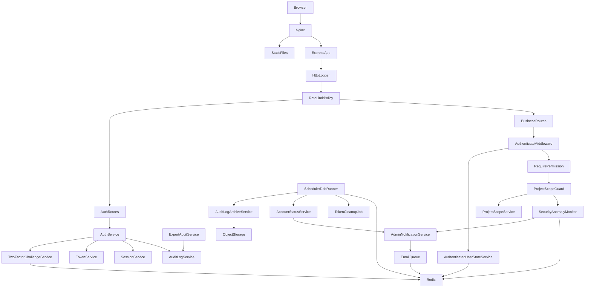

**Key Decisions**:
- 利用者の状態の照合は `authenticate` の中で行い、`requirePermission` より前に拒否する（2FA 未登録・無効化の利用者に権限の判定を走らせない）
- 範囲外の案件への ID 指定のアクセスは、存在しない案件と同じ 404 の本文を返す（`NotFoundError` と同じ Problem Details）
- 画面と API を同一オリジンにし、Cookie を `SameSite=Strict` のまま使う

#### Technology Stack

| Layer | Choice / Version | Role in Feature | Notes |
|-------|------------------|-----------------|-------|
| Backend | Express 5、jose（EdDSA）、otplib、argon2 | トークンの種別・発行者・利用者の検証、TOTP のステップの記録 | 新規の依存なし |
| Backend | express-rate-limit 8.5.2 | 認証系の専用の制限、`req.ip` による識別 | `trust proxy` を段数の数値にする |
| Data | PostgreSQL 15、Prisma | 利用者の状態の列、トークンのハッシュ列、監査ログの改変を禁じるトリガー | トリガーは Prisma の移行に生の SQL で置く |
| Cache / Queue | Redis 7、ioredis 5.10.1、Bull 4.16.5 | 2FA 待ちの資格、利用者の状態のキャッシュ、異常検知の計数、メールキュー、繰り返しジョブ | 全て `REDIS_URL` で接続する |
| Storage | 既存の `StorageProvider`（R2） | 監査ログのアーカイブ | 接頭辞 `audit-archives/` |
| Frontend | React 19、Web Locks API、BroadcastChannel | メモリだけのアクセストークン、タブ間のリフレッシュの直列化 | 新規の依存なし |
| Web server | nginx（`nginx:alpine`） | セキュリティヘッダー、API の中継、アクセスログの形式 | テンプレートの環境変数で CSP の取得先を渡す |

### File Structure Plan

#### 新設するファイル

タスク44〜56 の実装で作ったファイルを実在のパスで記す（2026-10-25、タスク57.2）。計画の段階で一本とした DB の移行は、適用済みの移行を書き換えないため、タスクごとの移行に分けた（次の表の末尾と「移行」の節）。計画の段階で置いた三つの名前は、実装で次のとおりになった: 異常の検知は `backend/src/services/security-anomaly-monitor.service.ts`、保存用の SHA-256 は単独のファイルを設けず各所（`backend/src/services/session.service.ts`、`backend/src/utils/invitation-token.ts`、`backend/src/utils/password-reset-token.ts`、`backend/src/services/two-factor-challenge.service.ts`）に置き、記録してから出力する包み `runRecordedExport` は `frontend/src/api/export-audit.ts` に置いた。

| ファイル | 役割 |
|---|---|
| `backend/src/config/runtime-mode.ts` | 開発用機能の有効化の判定（`NODE_ENV` の明示だけを見る）と本番の前提の検査 |
| `backend/src/config/jwt-claims.ts` | トークンの発行者・想定利用者の既定値 |
| `backend/src/config/security-alert.ts` | 異常の検知の閾値・時間窓・抑止の時間の既定値と環境変数の検証 |
| `backend/src/services/two-factor-challenge.service.ts` | 2FA 待ちの資格の発行・照会・消費（Redis） |
| `backend/src/services/authenticated-user-state.service.ts` | 利用者の状態の取得とキャッシュの無効化 |
| `backend/src/services/authenticated-user-state-cache.ts` | 利用者の状態のキャッシュ（Redis の鍵と世代の照合） |
| `backend/src/services/account-status.service.ts` | 無効化・再有効化・自動無効化、上限を超えるユーザーの無効化・再有効化の拒否（38.13） |
| `backend/src/services/user-inventory.service.ts` | 棚卸しの一覧と絞り込み |
| `backend/src/services/privilege-ceiling.ts` | ロール割り当て・権限追加・他のユーザーの管理の上限の判定 |
| `backend/src/services/project-scope.service.ts` | 案件の閲覧範囲の判定と一覧の絞り込み条件 |
| `backend/src/services/export-audit.service.ts` | データ出力の記録 |
| `backend/src/services/admin-notification.service.ts` | 全システム管理者への通知 |
| `backend/src/services/security-anomaly-monitor.service.ts` | 時間窓の計数と閾値の判定・通知の抑止 |
| `backend/src/jobs/scheduled-job-runner.ts` | Bull の繰り返しジョブの登録と実行 |
| `backend/src/jobs/inactive-user-deactivation.job.ts` | 90 日の自動無効化 |
| `backend/src/jobs/expired-token-cleanup.job.ts` | 使用済み・期限切れのトークンの消去 |
| `backend/src/jobs/failed-email-job-cleanup.job.ts` | メールキューの失敗のジョブの掃除（45.3） |
| `backend/src/jobs/audit-log-archive.job.ts` | 月次のアーカイブと 8 年を過ぎたアーカイブの消去 |
| `backend/src/jobs/security-anomaly-overflow-summary.job.ts` | 異常の通知の総数の上限で送らなかった通知（溢れ分）の要約の定期処理（`*/10 * * * *`。43.9、タスク60.1） |
| `backend/src/middleware/project-scope.middleware.ts` | `requireProjectScope` |
| `backend/src/middleware/client-ip.ts` | `req.ip` による送信元の識別（`getClientIp`） |
| `backend/src/routes/user-inventory.routes.ts` | 棚卸し・無効化・再有効化・2FA の再設定、上限を超えるユーザーへの操作の拒否と異常の検知への観測（38.13、43.2） |
| `backend/src/schemas/export-audit.schema.ts` | 出力の記録の要求本文の検証 |
| `backend/src/schemas/audit-log-archive-restore.schema.ts` | アーカイブの復元の要求本文の検証 |
| `backend/src/scripts/reactivate-user.ts` | 再有効化の運用スクリプト（サーバー上で実行） |
| `backend/src/templates/admin-notification-email.hbs` | 管理者への通知のメールのテンプレート |
| `backend/src/utils/audit-text.ts` | 監査に書く入力由来の値の切り詰め（`boundAuditText`）と上限の定数 |
| `backend/src/utils/audit-log-archive-permission.ts` | 監査ログの行の消去を、アーカイブの許可の設定を置いた取引の中で行う補助 |
| `backend/src/utils/invitation-token.ts` | 招待のトークンのハッシュと招待 URL（フラグメントの形）の組み立て |
| `backend/src/utils/password-reset-token.ts` | リセットのトークンのハッシュとリセットのリンク（フラグメントの形）の組み立て |
| `backend/src/utils/refresh-token-lock.ts` | 利用者ごとのリフレッシュトークンの勧告ロック（`lockUserRefreshTokens`）と取引の中の全失効 |
| `backend/src/utils/sentry-request-context.ts` | Sentry へ送る要求の文脈（経路・メソッド・要求識別子・利用者 ID） |
| `backend/src/utils/url-query-redaction.ts` | URL のクエリの伏せ字（HttpLogger と Sentry で共通） |
| `frontend/src/api/export-audit.ts` | 出力の記録の API 呼び出しと、記録してから出力する包み（`runRecordedExport`） |
| `frontend/src/api/user-inventory.ts` | 棚卸しの API 呼び出し |
| `frontend/src/hooks/useUrlToken.ts` | 招待・リセットのリンクのトークンを URL から読み、URL から取り除く |
| `frontend/src/pages/UserInventoryPage.tsx` | 棚卸し画面 |
| `frontend/src/pages/SetupPasswordPage.tsx` | 初回のパスワード変更の画面（`/setup/password`） |
| `frontend/src/components/PasswordChangeSection.tsx` | パスワード変更の区画（プロフィールと初回変更の画面で共通） |
| `frontend/src/components/TwoFactorReenrollForm.tsx` | 2FA の再登録の手順 |
| `frontend/src/components/TwoFactorBackupCodes.tsx` | バックアップコードの表示 |
| `frontend/src/utils/audit-log-actions.ts` | 監査ログの種別の表示名と実行者の表示 |
| `frontend/src/utils/user-restriction.ts` | 利用者の状態による遷移の制限の判定 |
| `frontend/src/utils/zod-csp-config.ts` | Zod の JIT を止め、CSP の下で eval の試行による違反を起こさない（44.4） |
| `frontend/src/utils/url-query-redaction.ts` | 画面側の Sentry へ送る URL のクエリとフラグメントの伏せ字（backend の同名の規則の写し） |
| `frontend/nginx-security-headers.conf` | セキュリティヘッダーの取り込みファイル（テンプレート） |
| `frontend/nginx-proxy-params.conf` | API の中継の共通の設定 |
| `frontend/nginx-require-backend-internal-url.sh` | 中継先 `BACKEND_INTERNAL_URL` の起動前の検査 |
| `e2e/helpers/auth-api.ts` | E2E のアクセストークンの取得とログイン API の呼び出しの補助 |
| `e2e/helpers/shared-sessions.ts` | 共有の役割のセッションの保持と受け渡し |
| `e2e/helpers/two-factor-totp.ts` | TOTP の計算と最後に使った時間ステップの巻き戻し |
| `e2e/helpers/user-state-cache.ts` | 利用者の状態のキャッシュの無効化 |
| `e2e/helpers/mailpit.ts` | 試験のメールの受信箱の読み取り |
| `e2e/helpers/frontend-security-headers.ts` | 画面の配信のセキュリティヘッダーの観測 |
| `backend/prisma/migrations/20261017000000_security_remediation_ipa_20261009_user_status/migration.sql` | 利用者の状態の列・招待者・索引（タスク44.1） |
| `backend/prisma/migrations/20261017010000_security_remediation_ipa_20261009_audit_log_protection/migration.sql` | 監査ログの実行者の写しと改変を禁じるトリガー（タスク44.2） |
| `backend/prisma/migrations/20261017020000_security_remediation_ipa_20261009_default_permissions/migration.sql` | 既定の権限の改め（タスク44.4） |
| `backend/prisma/migrations/20261018000000_security_remediation_ipa_20261009_invitation_token_nullable/migration.sql` | 招待のトークンの列に空を許す（タスク44.9） |
| `backend/prisma/migrations/20261018010000_security_remediation_ipa_20261009_refresh_token_family/migration.sql` | リフレッシュトークンのハッシュ・系列（タスク45.2） |
| `backend/prisma/migrations/20261022000000_security_remediation_ipa_20261009_access_token_generation/migration.sql` | アクセストークンの世代（タスク47.11） |
| `backend/prisma/migrations/20261022010000_security_remediation_ipa_20261009_reactivated_at/migration.sql` | 最後の再有効化の日時（タスク49.4） |
| `backend/prisma/migrations/20261023000000_security_remediation_ipa_20261009_invitation_token_hash/migration.sql` | 招待のトークンのハッシュ保存（タスク50.1） |
| `backend/prisma/migrations/20261023010000_security_remediation_ipa_20261009_password_reset_token_hash/migration.sql` | リセットのトークンのハッシュ保存（タスク50.2） |

#### 変更するファイル

| ファイル | 変更内容 |
|---|---|
| `backend/prisma/schema.prisma` | `User` に状態の列、`RefreshToken`・`Invitation`・`PasswordResetToken` にハッシュ列、`AuditLog` の実行者の写しと外部キーの解除、`Project` に検索用の索引 |
| `backend/src/config/env.ts` | `TRUST_PROXY_HOPS`・`JWT_ISSUER`・`JWT_AUDIENCE`・`ARCHIVE_ENCRYPTION_KEY`・`SECURITY_ALERT_*`・`REFRESH_COOKIE_*` の検証。本番で必須の変数の追加 |
| `backend/src/config/security.constants.ts` | リセットの有効期限を 1 時間に一本化、2FA 待ちの資格・自動無効化の日数・異常検知の既定値 |
| `backend/src/app.ts` | `trust proxy` を段数の数値に、CORS の許可ヘッダーに `X-CSRF-Token`、管理用ルートを `/api/v1/admin` へ、API ドキュメントの有効化の条件 |
| `backend/src/index.ts` | 起動時の本番の前提の検査（アーカイブの鍵）、繰り返しジョブの登録 |
| `backend/src/routes/auth.routes.ts` | ログイン・2FA 検証の応答、Cookie による refresh・logout、CSRF の適用、専用の制限、本文からリフレッシュトークンを外す、検証の POST 化 |
| `backend/src/routes/admin.routes.ts` | 認証・権限の検査と監査の記録 |
| `backend/src/routes/invitation.routes.ts` | 一覧の応答からトークンを外す、検証の POST 化、取り消しの権限 |
| `backend/src/routes/user-roles.routes.ts` | ユーザーを消す要求の事前の監査、上限の検査の呼び出し、上限を超えるロールの割り当ての解除の拒否と異常の検知への観測（38.9、43.2）、上限を超えるユーザーを消す要求の拒否と観測（38.13） |
| `backend/src/routes/roles.routes.ts` | システムロールの名前の変更の拒否、全権限の追加の上限、ロールの作成・優先度の変更の上限と範囲の検証、保有しない権限の追加の拒否、上限より上のロールの変更・消去とシステムロールの優先度の変更の拒否と異常の検知への観測（38.6〜38.8、38.10〜38.12、43.2） |
| `backend/src/routes/users.routes.ts` | 担当者候補を有効な利用者の ID と表示名に限る |
| `backend/src/routes/audit-log.routes.ts` | 出力の記録 API、アーカイブの復元 API |
| `backend/src/routes/projects.routes.ts` | 案件の一覧・件数・詳細・更新・状態変更への閲覧範囲の適用 |
| `backend/src/services/auth.service.ts` | 2FA 待ちの資格、状態による拒否、最終ログインの記録、ログインの監査、DB 障害の汎用化 |
| `backend/src/services/token.service.ts` | 種別・発行者・利用者のクレームと検証 |
| `backend/src/services/session.service.ts` | ハッシュ保存、系列、再利用検知、ログアウトの失効 |
| `backend/src/services/two-factor.service.ts` | 再利用の拒否、固定値の受理を取り除く、自己の無効化の拒否、管理者の再設定、再登録、上限を超えるユーザーの再設定の拒否（38.13） |
| `backend/src/services/password.service.ts` | ハッシュ保存、有効期限 1 時間、要求ごとの制限、登録の有無を推測させない応答 |
| `backend/src/services/invitation.service.ts` | ハッシュ保存、一覧の項目、取り消しの権限、監査の記録 |
| `backend/src/services/user-role.service.ts` | 上限の検査、利用者を消す前の監査、通知の一般化への置き換え、割り当ての解除の上限（38.9）、上限を超える利用者を消す要求の拒否（38.13） |
| `backend/src/services/role-permission.service.ts` | 全権限の追加の上限、保有しない権限の追加の上限（38.8）、上限より上のロールの権限の追加・消去の拒否（38.11） |
| `backend/src/services/role.service.ts` | システムロールの名前の変更の拒否、ロールの作成・優先度の変更の上限（38.6、38.7）、上限より上のロールの変更・消去の拒否（38.11）、システムロールの優先度の変更の拒否（38.12） |
| `backend/src/schemas/auth-update.schema.ts` | `updateRoleSchema` の `priority` の上限（38.10） |
| `backend/src/services/privilege-ceiling.ts` | 優先度の上限の判定の追加（作成・優先度の変更・割り当ての解除・上限より上のロールの変更と消去）、保有しない権限の追加の判定、システムロールの優先度の変更の判定、範囲の上限の定数、他のユーザーの管理の判定（38.6〜38.13。2026-10-26 の要件38 の拡張） |
| `backend/src/services/security-anomaly-monitor.service.ts` | データ出力の通知の抑止を利用者ごとに、通知の総数の上限と溢れ分の記録・添え書き・要約（43.8、43.9） |
| `backend/src/config/security-alert.ts` | 通知の総数の上限と時間窓の既定値と環境変数（43.9） |
| `backend/src/jobs/scheduled-job-runner.ts` | 溢れ分の要約のジョブ `security-anomaly-overflow-summary` の登録（43.9） |
| `backend/src/services/audit-log.service.ts` | 実行者の写し、記録対象の追加、改変の拒否 |
| `backend/src/services/audit-log-archive.service.ts` | 保存先を `StorageProvider` に、gzip と AES-256-GCM、件数とハッシュの付与、復元、失敗時の保全 |
| `backend/src/services/email.service.ts` | `REDIS_URL` による接続、ジョブの後始末、接続失敗の通知 |
| `backend/src/middleware/authenticate.middleware.ts` | アクセストークンの種別の検証と利用者の状態の照合 |
| `backend/src/middleware/csrf.middleware.ts` | 試験環境での素通りを外し、Origin の照合を加える |
| `backend/src/middleware/rateLimit.middleware.ts` | `req.ip` による識別、専用の制限、本番での無効化設定の無視、Redis 障害時のメモリへの退避 |
| `backend/src/middleware/RedisRateLimitStore.ts` | 障害時に制限を無効にせず退避先へ渡す |
| `backend/src/middleware/logger.middleware.ts` | 要求識別子のサーバー生成、クエリの伏せ字、利用者 ID |
| `backend/src/middleware/errorHandler.middleware.ts` | Sentry へ要求本文を送らない、5xx の計数 |
| `backend/src/utils/sentry.ts` | `beforeSend` の伏せ字 |
| `backend/src/utils/seed-helpers.ts` | 初期管理者のパスワード検証と初回変更、既定の権限 |
| `backend/src/types/audit-log.types.ts` | 監査の種別の追加 |
| `backend/src/types/express.d.ts` | `req.user` に `id` と状態を足す |
| `frontend/src/api/client.ts` | アクセストークンをメモリだけに保持、CSRF ヘッダー、Cookie によるリフレッシュ |
| `frontend/src/api/auth.ts` | 2FA 待ちの資格を伴う検証、本文にリフレッシュトークンを送らない |
| `frontend/src/contexts/AuthContext.tsx` | localStorage を使わない復元、2FA 未登録・初回変更の状態、再認証の応答でのセッションの立て直し |
| `frontend/src/utils/sentry.ts` | breadcrumb・事象・トレース・リプレイの URL のトークンの伏せ字 |
| `frontend/src/services/TokenRefreshManager.ts` | Web Locks による直列化 |
| `frontend/src/components/ProtectedRoute.tsx` | 2FA 未登録・初回変更中の遷移の制限 |
| `frontend/src/components/TwoFactorVerificationForm.tsx` | 資格を伴う検証 |
| `frontend/src/components/SessionExpiredModal.tsx` | localStorage への書き込みを取り除く、パスワードのみと 2FA の再認証を同じ処理でセッションの立て直しへ渡す |
| `frontend/src/components/schedule/ExportDialog.tsx` | API クライアント経由の取得に揃える |
| `frontend/src/components/projects/UserSelect.tsx` | 無効化された担当者の表示名の表示、localStorage を読まない |
| `frontend/src/components/InvitationManager.tsx` | 作成直後だけ招待 URL を表示、他者の招待の取り消し |
| `frontend/src/utils/audit-log-actions.ts` | 対象の欄の表示 `getAuditLogTargetLabel`（招待の記録は招待先のメールアドレス。40.12） |
| `frontend/src/pages/AuditLogs.tsx` | 対象の欄を `getAuditLogTargetLabel` で表示（40.12） |
| `frontend/src/components/AuditLogViewer.tsx` | 同上 |
| `frontend/src/pages/TwoFactorSetupPage.tsx` | 必須の登録と再登録の手順 |
| `frontend/src/pages/Profile.tsx` | 2FA の無効化の操作を取り除き、再登録への導線に替える |
| `frontend/src/pages/RegisterPage.tsx` | URL のフラグメントからトークンを読む、POST の検証 |
| `frontend/src/pages/PasswordResetPage.tsx` | 同上 |
| `frontend/src/routes.tsx` | 棚卸し画面と初回のパスワード変更画面（`/setup/password`）のルート |
| `backend/package.json` | 再有効化スクリプトの実行コマンド（`user:reactivate`） |
| `frontend/nginx.conf` | セキュリティヘッダー、`server_tokens off`、API の中継、アクセスログの形式 |
| `frontend/Dockerfile` | CSP の取得先・HSTS・中継先の環境変数と起動前の検査、統計の出力物を配信物から外す |
| `docker-compose.test.yml` | frontend の `VITE_API_URL` を画面と同じオリジンに、`BACKEND_INTERNAL_URL` を backend のサービスに |
| `docker-compose.ci.yml` | 同上 |
| `e2e/requirement-exclusions.json` | 40.10・40.11 の `pending-implementation` の登録（site-survey の適用で外す） |
| `e2e/global-setup.ts` | 役割ごとのログインとセッションの保持 |
| `e2e/helpers/auth-actions.ts` | TOTP の計算、セッションの受け渡しと回収 |

### System Flows

#### 2FA を伴うログイン（要件32・34・35・40）

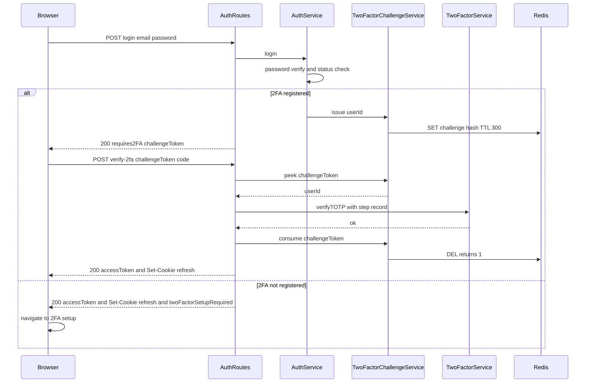

- ログインの応答は `userId` を含まない（42.7）。2FA 待ちの資格は 2FA 登録済みの利用者にだけ発行する
- 検証が失敗しても資格は消費しない（期限内の再試行を認める）。失敗は既存のアカウント単位のロックと送信元単位の制限（35.3）で抑える
- `consume` の `DEL` が 0 を返したとき（同時の二重成功）はトークンを発行しない（32.4）

#### リフレッシュとローテーション（要件33）

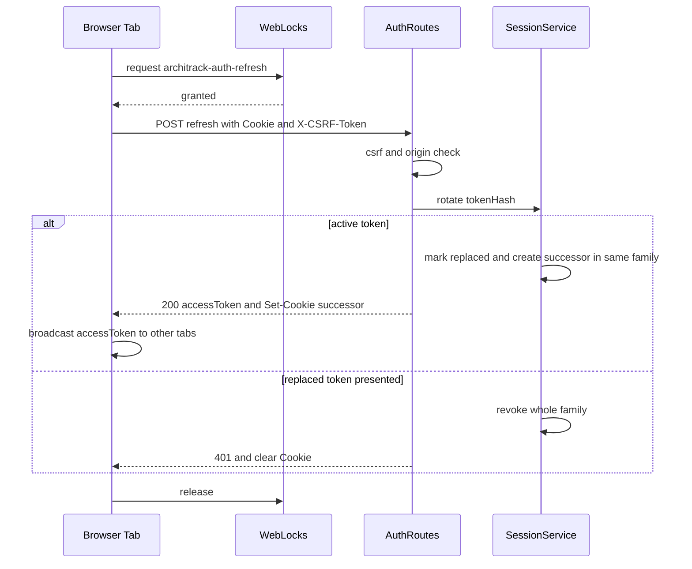

#### 利用者の状態の照合（要件33・34・36・37）

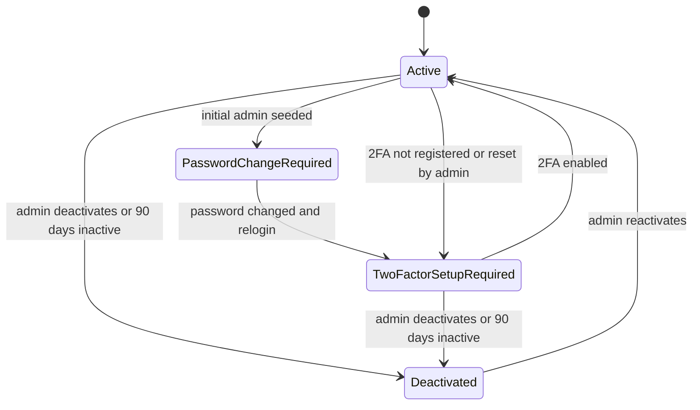

| 状態 | 許可する API | それ以外への応答 |
|---|---|---|
| Active | 全て（権限の判定に従う） | — |
| PasswordChangeRequired | `POST /api/v1/auth/password/change`、`POST /api/v1/auth/logout`、`POST /api/v1/auth/logout-all` | 403 `PASSWORD_CHANGE_REQUIRED` |
| TwoFactorSetupRequired | `POST /api/v1/auth/2fa/setup`、`POST /api/v1/auth/2fa/enable`、`POST /api/v1/auth/logout`、`POST /api/v1/auth/logout-all` | 403 `TWO_FACTOR_SETUP_REQUIRED` |
| Deactivated | なし（ログイン・リフレッシュも拒否） | 401 `ACCOUNT_DISABLED`（ログイン時は通常の認証エラーと同じ本文） |

- 状態の優先順位は Deactivated → PasswordChangeRequired → TwoFactorSetupRequired → Active とする
- 初回のパスワード変更を要する利用者は 2FA も未登録だが、要件34.2 の例外によりパスワード変更だけを許す。変更の完了で全リフレッシュトークンが失効し（要件7.5）、再ログインの後は TwoFactorSetupRequired になる（要件34.1）
- 制限中の利用者は `GET /api/v1/auth/me` も呼べない（要件34.2 の許可の範囲外）。画面が状態を知るため、ログイン・リフレッシュ・2FA の検証・2FA の有効化・パスワード変更の応答に `AuthUserView`（`twoFactorEnabled`・`mustChangePassword` を含む）を載せる
- 無効化された利用者のログインは、パスワードの正否に関わらず通常の認証エラー（`INVALID_CREDENTIALS`）と同じ本文で拒否する（36.2。存在や状態を推測させない）

#### 監査ログのアーカイブ（要件41）

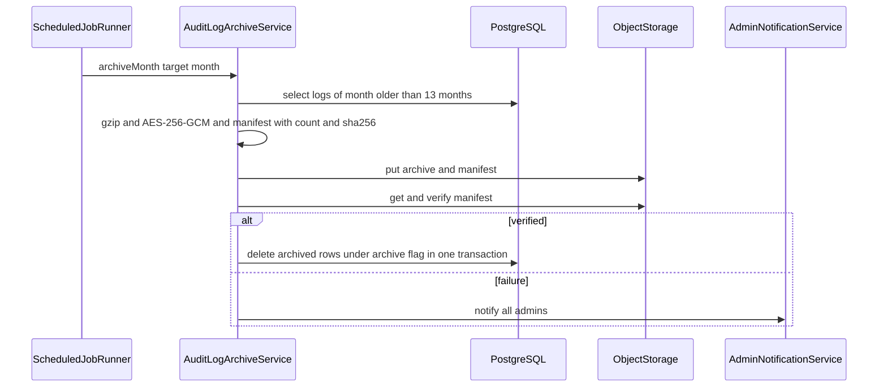

### Requirements Traceability

| Requirement | Summary | Components | Interfaces | Flows |
|---|---|---|---|---|
| 7.3 | リセットの有効期限を 1 時間 | PasswordService | `POST /api/v1/auth/password/reset-request` | — |
| 32.1-32.5 | 2FA 待ちの資格の発行・要求・期限・一回限り・取り違えの拒否 | TwoFactorChallengeService, AuthService | `POST /api/v1/auth/login`、`POST /api/v1/auth/verify-2fa` | 2FA を伴うログイン |
| 32.6 | バックアップコードも同じ資格を要求 | TwoFactorChallengeService, TwoFactorService | `POST /api/v1/auth/verify-2fa/backup` | 2FA を伴うログイン |
| 32.7 | TOTP の再利用の拒否 | TwoFactorService | `TwoFactorService.verifyTOTP` | 2FA を伴うログイン |
| 33.1 | アクセストークン以外を保護 API で拒否 | TokenService, AuthenticateMiddleware | `authenticate` | 利用者の状態の照合 |
| 33.2 | リフレッシュトークン以外での refresh を拒否 | TokenService, AuthService | `POST /api/v1/auth/refresh` | リフレッシュとローテーション |
| 33.3 | 発行者・想定利用者の検証 | TokenService | `TokenService.verifyToken` | — |
| 33.4-33.7 | ログアウト・全失効・再利用検知・ハッシュ保存 | SessionService, AuthService, PasswordService | `POST /api/v1/auth/logout`、`POST /api/v1/auth/logout-all` | リフレッシュとローテーション |
| 33.8, 33.10 | HttpOnly Cookie だけ・永続ストレージに置かない | ApiClient, TokenRefreshManager, AuthContext | `apiClient`、`TokenRefreshManager` | リフレッシュとローテーション |
| 33.9 | 応答本文にリフレッシュトークンを含めない | AuthService | 認証系の応答 | — |
| 33.11 | 再読み込み時の復元 | AuthContext | `AuthContext` の初期化 | リフレッシュとローテーション |
| 33.12 | Cookie で受ける状態変更の CSRF 検証 | CsrfProtection | `csrfProtection` | リフレッシュとローテーション |
| 34.1, 34.5 | 2FA 未登録・招待登録の直後に設定画面へ | AuthContext, ProtectedRoute | `ProtectedRoute` | 利用者の状態の照合 |
| 34.2 | 2FA 未登録の API を 403 | AuthenticateMiddleware | `authenticate` | 利用者の状態の照合 |
| 34.3, 34.8 | 2FA 未登録・再設定後は設定画面だけ | ProtectedRoute | `ProtectedRoute` | 利用者の状態の照合 |
| 34.4 | 設定完了後に通常の遷移先へ | TwoFactorSetupPage | `TwoFactorSetupPage` | 利用者の状態の照合 |
| 34.6 | 自己の無効化の拒否 | TwoFactorService, ProfilePage | `POST /api/v1/auth/2fa/disable` | — |
| 34.7, 34.9, 34.10 | 管理者による再設定・自己の再設定の拒否・監査 | TwoFactorService, UserInventoryPage | `POST /api/v1/users/:id/2fa/reset` | — |
| 34.11 | TOTP による再登録 | TwoFactorService, TwoFactorSetupPage | `POST /api/v1/auth/2fa/reenroll/start`、`POST /api/v1/auth/2fa/reenroll/confirm` | — |
| 35.1, 35.2 | 信頼する中継装置の情報だけで識別・記録 | ClientIpResolver, RateLimitPolicy | `getClientIp` | — |
| 35.3-35.5 | 2FA 検証・リセット・登録の制限 | RateLimitPolicy | 専用の制限 | — |
| 35.6 | 本番で無効化設定を無視 | RateLimitPolicy, RuntimeMode | `isRateLimitBypassAllowed` | — |
| 35.7 | 登録の有無を推測させない応答 | PasswordService | `POST /api/v1/auth/password/reset-request` | — |
| 36.1, 36.3, 36.5 | 無効化・再有効化・自己と最後の管理者の保護 | AccountStatusService, AuthenticateMiddleware | `POST /api/v1/users/:id/deactivate`、`POST /api/v1/users/:id/reactivate` | 利用者の状態の照合 |
| 36.2, 36.7 | 無効化者のログイン拒否・最終ログインの記録 | AuthService | `POST /api/v1/auth/login` | 利用者の状態の照合 |
| 36.4, 36.9 | 通知と監査 | AccountStatusService, AdminNotificationService | `notifyAllAdmins` | — |
| 36.6 | 無効化された担当者の表示名の表示 | UserSelect | `UserSelect` | — |
| 36.8 | 90 日の自動無効化 | AccountStatusService, ScheduledJobRunner | `inactive-user-deactivation` | — |
| 36.10, 36.11 | 棚卸しの表示と絞り込み | UserInventoryPage, UserInventoryService | `GET /api/v1/users/inventory` | — |
| 36.12 | 一般ユーザーへの 403 | UserInventoryService | `GET /api/v1/users/inventory` | — |
| 37.1 | トークンのハッシュ保存 | InvitationService, PasswordService | 招待・リセットの作成 | — |
| 37.2, 37.5 | 一覧にトークンを含めない・作成者以外の取り消し | InvitationService, InvitationManager | `GET /api/v1/invitations`、`DELETE /api/v1/invitations/:id` | — |
| 37.3 | 記録にトークンを残さない | HttpLogger, FrontendNginxConfig, RegisterPage, PasswordResetPage | `POST /api/v1/invitations/verify`、`POST /api/v1/auth/password/verify-reset` | — |
| 37.4, 37.8 | 使用済み・期限切れのトークンの消去 | TokenCleanupJob, ScheduledJobRunner | `expired-token-cleanup` | — |
| 37.6 | 初期管理者のパスワード検証 | InitialAdminSeeder | `seedAdminUser` | — |
| 37.7 | 初回ログインのパスワード変更の強制 | ProtectedRoute, AuthContext | `ProtectedRoute` | 利用者の状態の照合 |
| 38.1-38.3 | 割り当て・全権限・システムロール名の上限 | PrivilegeCeilingPolicy | `assertCanAssignRole`、`assertCanGrantPermission` | — |
| 38.6, 38.7, 38.10 | ロールの作成・優先度の変更の上限と範囲 | PrivilegeCeilingPolicy | `assertCanSetRolePriority`、`POST /api/v1/roles`、`PATCH /api/v1/roles/:id` | — |
| 38.11 | 上限より上のロールの変更・削除の拒否 | PrivilegeCeilingPolicy | `assertCanModifyRole`、`PATCH /api/v1/roles/:id`、`POST /api/v1/roles/:id/permissions`、`DELETE /api/v1/roles/:id/permissions/:permissionId`、`DELETE /api/v1/roles/:id` | — |
| 38.12 | システムロールの優先度の変更の拒否 | PrivilegeCeilingPolicy | `assertCanChangeRolePriority`、`PATCH /api/v1/roles/:id` | — |
| 38.8 | 保有しない権限の追加の拒否 | PrivilegeCeilingPolicy | `assertCanGrantPermission`、`POST /api/v1/roles/:id/permissions` | — |
| 38.9 | 上限を超えるロールの割り当ての解除の拒否 | PrivilegeCeilingPolicy, UserRoleService | `assertCanRevokeRole`、`DELETE /api/v1/users/:id/roles/:roleId` | — |
| 38.13 | 上限を超えるユーザーの削除・無効化・再有効化・2FAの再設定の拒否 | PrivilegeCeilingPolicy, UserRoleService, AccountStatusService, TwoFactorService | `assertCanManageUser`、`DELETE /api/v1/users/:id`、`POST /api/v1/users/:id/deactivate`、`POST /api/v1/users/:id/reactivate`、`POST /api/v1/users/:id/2fa/reset` | — |
| 38.4 | 一般ユーザーの既定権限から一覧の閲覧を外す | DefaultPermissionSeed | `seedRolePermissions` | — |
| 38.5 | 担当者候補は ID と表示名だけ | AssignableUsersEndpoint | `GET /api/users/assignable` | — |
| 39.1, 39.3, 39.4, 39.6 | 判定の規則・一覧の絞り込み・ファイル URL・担当者の変更の反映 | ProjectScopeService, ProjectScopeGuard | `canAccessProject`、`buildProjectScopeWhere` | — |
| 39.2 | 範囲外の ID 指定に 404 | ProjectScopeGuard | `requireProjectScope` | — |
| 39.5 | システム管理者の既定に全案件閲覧 | DefaultPermissionSeed | `seedRolePermissions` | — |
| 39.7 | 範囲外のアクセスの記録 | ProjectScopeGuard, SecurityAnomalyMonitor | `PROJECT_SCOPE_DENIED` | — |
| 40.1-40.5 | 認証・アカウント操作の監査 | AuthService, InvitationService, TwoFactorService, AuditLogService | `AuditLogService.createLog` | 2FA を伴うログイン |
| 40.6 | 削除前の監査と失敗時の中止 | UserRoleService, AuditLogService | `DELETE /api/v1/users/:id` | — |
| 40.7, 40.8 | 監査ログの保全と改変の拒否 | AuditLogService | `audit_logs` のトリガー | — |
| 40.9 | 出力の記録 | ExportAuditService | `POST /api/v1/audit-logs/exports`、`ExportAuditService.record` | — |
| 40.10, 40.11 | ブラウザの出力の事前記録と失敗時の中止 | ExportAuditClient | `runRecordedExport` | — |
| 40.12 | 招待の記録の対象に招待先のメールアドレス | AuditLogsPage | `getAuditLogTargetLabel` | — |
| 41.1-41.6 | アーカイブ・消去・鍵の必須・改ざん検知・復元・失敗時の保全 | AuditLogArchiveService, ScheduledJobRunner, RuntimeMode, AdminNotificationService | `audit-log-archive`、`POST /api/v1/audit-logs/archives/restore` | 監査ログのアーカイブ |
| 42.1, 42.2 | 運用設定の保護と監査 | AdminLogLevelEndpoint | `GET/POST /api/v1/admin/log-level` | — |
| 42.3, 42.5, 42.6 | クエリの伏せ字・要求識別子・利用者 ID | HttpLogger | `httpLogger` | — |
| 42.4 | エラー監視へ機密を送らない | SentryScrubber, ErrorHandler | `beforeSend` | — |
| 42.7 | ログイン失敗の応答にユーザー ID を含めない | AuthService | `POST /api/v1/auth/login` | 2FA を伴うログイン |
| 42.8 | DB 障害の詳細を返さない | AuthService, ErrorHandler | 認証系の応答 | — |
| 42.9 | 実行環境の指定が無いときの開発用機能 | RuntimeMode | `isDevelopmentFeatureEnabled` | — |
| 43.1-43.2, 43.4-43.7 | 異常の検知・通知の内容・抑止・設定 | SecurityAnomalyMonitor, AdminNotificationService, ExportAuditService | `SecurityAnomalyMonitor.observe` | — |
| 43.3 | 429・5xx の急増 | SecurityAnomalyMonitor, RateLimitPolicy, ErrorHandler | `SecurityAnomalyMonitor.observe` | — |
| 43.8, 43.9 | 利用者ごとの抑止・通知の総数の上限と溢れ分の通知 | SecurityAnomalyMonitor, ScheduledJobRunner | `SecurityAnomalyMonitor.observe`、`security-anomaly-overflow-summary` | — |
| 44.1-44.4 | 画面配信のセキュリティヘッダー | FrontendNginxConfig | `frontend/nginx.conf` | — |
| 45.1-45.4 | メールキューの接続と後始末 | EmailQueue | `EmailService` | — |

### Components and Interfaces

#### Component Summary

| Component | Domain | Intent | Req Coverage | Key Dependencies | Contracts |
|---|---|---|---|---|---|
| TwoFactorChallengeService | Backend Service | 2FA 待ちの資格の発行・照会・消費 | 32 | Redis (P0) | Service |
| TwoFactorService | Backend Service | TOTP の再利用の拒否、再設定、再登録 | 32, 34, 38, 40 | Prisma (P0), AuditLogService (P1), PrivilegeCeilingPolicy (P0) | Service, API |
| AuthService | Backend Service | ログイン・リフレッシュ・ログアウトの是正 | 32, 33, 36, 40, 42 | TokenService (P0), SessionService (P0) | Service, API |
| TokenService | Backend Service | クレームの種別・発行者・利用者 | 33 | jose (P0) | Service |
| SessionService | Backend Service | ハッシュ保存・系列・再利用検知・失効 | 33 | Prisma (P0) | Service |
| PasswordService | Backend Service | リセットのトークンの保存と期限・応答 | 7, 33, 35, 37 | Prisma (P0), EmailQueue (P1) | Service, API |
| AuthenticateMiddleware | Backend Middleware | 種別の検証と状態の照合 | 33, 34, 36 | AuthenticatedUserStateService (P0) | Service |
| CsrfProtection | Backend Middleware | Cookie を受ける要求の CSRF・Origin の検証 | 33 | — | Service |
| ClientIpResolver | Backend Middleware | 送信元 IP の識別 | 35 | Express `trust proxy` (P0) | Service |
| RateLimitPolicy | Backend Middleware | 認証系の専用の制限 | 35, 43 | Redis (P1) | Service |
| RuntimeMode | Backend Config | 開発用機能・本番の前提の判定 | 35, 41, 42 | — | Service |
| AccountStatusService | Backend Service | 無効化・再有効化・自動無効化 | 36, 38 | SessionService (P0), AdminNotificationService (P1), PrivilegeCeilingPolicy (P0) | Service, API |
| UserInventoryService | Backend Service | 棚卸しの一覧と絞り込み | 36 | Prisma (P0) | Service, API |
| AdminNotificationService | Backend Service | 全システム管理者への通知 | 36, 41, 43 | EmailQueue (P0), Sentry (P2) | Service |
| ScheduledJobRunner | Backend Job | 繰り返しジョブの登録と実行 | 36, 37, 41, 43 | Bull (P0) | Batch |
| TokenCleanupJob | Backend Job | 使用済み・期限切れのトークンの消去 | 37 | Prisma (P0) | Batch |
| InvitationService | Backend Service | 招待のトークンの保存・一覧・取り消し・監査 | 37, 40 | Prisma (P0) | Service, API |
| InitialAdminSeeder | Backend Seed | 初期管理者のパスワード検証と初回変更 | 37 | PasswordService (P0) | Batch |
| HttpLogger | Backend Middleware | 要求識別子・伏せ字・利用者 ID | 37, 42 | pino-http (P0) | Service |
| FrontendNginxConfig | Web Server | ヘッダー・中継・アクセスログ | 37, 44 | nginx (P0) | — |
| RegisterPage | Frontend Page | フラグメントのトークンと POST の検証 | 37 | ApiClient (P0) | State |
| PasswordResetPage | Frontend Page | フラグメントのトークンと POST の検証 | 37 | ApiClient (P0) | State |
| InvitationManager | Frontend Component | 作成直後だけの URL 表示と取り消し | 37 | ApiClient (P0) | State |
| PrivilegeCeilingPolicy | Backend Service | 割り当て・権限追加の上限 | 38 | RBACService (P0) | Service |
| DefaultPermissionSeed | Backend Seed | 既定の権限の改訂 | 38, 39 | Prisma (P0) | Batch |
| AssignableUsersEndpoint | Backend Route | 担当者候補の応答項目 | 38 | Prisma (P0) | API |
| ProjectScopeService | Backend Service | 案件の閲覧範囲の判定と絞り込み条件 | 39 | RBACService (P0), Prisma (P0) | Service |
| ProjectScopeGuard | Backend Middleware | ID 指定の要求の判定と 404 化・記録 | 39 | ProjectScopeService (P0), AuditLogService (P1) | Service |
| SecurityAnomalyMonitor | Backend Service | 時間窓の計数・閾値・通知の抑止・通知の総数の上限と溢れ分 | 39, 43 | Redis (P0), AdminNotificationService (P0) | Service |
| AuditLogService | Backend Service | 監査の記録・保全・改変の拒否 | 40, 41 | Prisma (P0) | Service |
| UserRoleService | Backend Service | 削除前の監査と上限の呼び出し | 38, 40 | AuditLogService (P0) | Service |
| ExportAuditService | Backend Service | データ出力の記録 | 40, 43 | AuditLogService (P0), ProjectScopeService (P0) | Service, API |
| ExportAuditClient | Frontend Service | 出力の事前記録と失敗時の中止 | 40 | ApiClient (P0) | Service |
| AuditLogArchiveService | Backend Service | アーカイブ・消去・復元 | 41 | StorageProvider (P0) | Service, Batch, API |
| AdminLogLevelEndpoint | Backend Route | 運用設定の保護と監査 | 42 | requirePermission (P0) | API |
| SentryScrubber | Backend Util | エラー監視への送信内容の伏せ字 | 42 | Sentry (P0) | Service |
| ErrorHandler | Backend Middleware | 送信内容の制限と 5xx の計数 | 42, 43 | SentryScrubber (P0) | Service |
| EmailQueue | Backend Service | 接続と後始末 | 45 | Bull (P0) | Service |
| ApiClient | Frontend Service | メモリだけのアクセストークンと CSRF | 33 | — | Service |
| TokenRefreshManager | Frontend Service | タブ間のリフレッシュの直列化 | 33 | Web Locks (P0) | Service |
| AuthContext | Frontend Context | 復元・2FA 未登録・初回変更の状態 | 33, 34, 37 | ApiClient (P0) | State |
| ProtectedRoute | Frontend Component | 状態による遷移の制限 | 34, 37 | AuthContext (P0) | State |
| TwoFactorSetupPage | Frontend Page | 必須登録と再登録 | 34 | ApiClient (P0) | State |
| ProfilePage | Frontend Page | 無効化の操作を外し再登録へ導く | 34 | — | State |
| UserInventoryPage | Frontend Page | 棚卸し・無効化・再有効化・2FA 再設定 | 34, 36 | ApiClient (P0) | State |
| UserSelect | Frontend Component | 無効化された担当者の表示名 | 36 | ApiClient (P0) | State |

#### 認証・トークン

##### TwoFactorChallengeService

| Field | Detail |
|-------|--------|
| Intent | パスワード認証の成功に結び付いた、5 分・一回限りの 2FA 検証の資格を扱う |
| Requirements | 32.1, 32.2, 32.3, 32.4, 32.5, 32.6 |

**Responsibilities & Constraints**
- 資格は 32 バイトの乱数を base64url にした不透明な文字列で、JWT ではない（アクセス・リフレッシュの JWT を資格として受理しない。32.5）
- Redis に鍵 `2fa:challenge:<SHA-256(資格)>`、値 `{ userId, issuedAt }`、TTL 300 秒で置く
- Redis が `ready` でないときは発行も照会も行わず、503 を返す（2FA の検証を素通りさせない）

**Dependencies**
- Outbound: Redis — 資格の保存と消費 (P0)

**Contracts**: Service [x]

```typescript
interface TwoFactorChallengeService {
  issue(userId: string): Promise<Result<{ challengeToken: string; expiresIn: number }, ChallengeError>>;
  peek(challengeToken: string): Promise<Result<{ userId: string }, ChallengeError>>;
  consume(challengeToken: string): Promise<Result<void, ChallengeError>>;
}

type ChallengeError =
  | { type: 'CHALLENGE_INVALID' }      // 不在・期限切れ・消費済み（区別しない）
  | { type: 'CHALLENGE_STORE_UNAVAILABLE' };
```
- 事前条件: `issue` は AuthService がパスワードの検証と状態の確認に成功した後だけ呼ぶ
- 事後条件: `consume` は `DEL` が 1 を返したときだけ成功する。成功後の `peek` は `CHALLENGE_INVALID`

##### TwoFactorService（変更）

| Field | Detail |
|-------|--------|
| Intent | TOTP の再利用の拒否、自己の無効化の拒否、管理者による再設定、利用者による再登録 |
| Requirements | 32.6, 32.7, 34.6, 34.7, 34.9, 34.10, 34.11, 38.13, 40.3 |

**Responsibilities & Constraints**
- `verifyTOTP` は otplib の `checkDelta` で一致した時間ステップを求め、`users.two_factor_last_used_step` がそれ未満（または未設定）のときだけ条件付き更新で記録して成功とする（32.7）
- `NODE_ENV` による固定値（`123456`・`ABCD1234`）の受理を全環境で取り除く
- バックアップコードの照合は正規化した値で行う
- 自己の無効化（`POST /api/v1/auth/2fa/disable`）は 403 `TWO_FACTOR_DISABLE_NOT_ALLOWED` を返す（34.6）
- 再設定・再登録・検証の成功と失敗を監査する（34.10、40.3）

**Contracts**: Service [x] / API [x]

```typescript
interface TwoFactorService {
  verifyTOTP(userId: string, code: string): Promise<Result<boolean, TwoFactorError>>;        // Ok(false) はコードの不一致
  verifyBackupCode(userId: string, backupCode: string): Promise<Result<boolean, TwoFactorError>>;
  resetByAdmin(actorId: string, targetUserId: string, ctx?: TwoFactorRequestContext): Promise<Result<void, TwoFactorResetError>>;
  startReenrollment(userId: string, currentCode: string): Promise<Result<TwoFactorReenrollmentStartData, TwoFactorError>>;
  confirmReenrollment(userId: string, newCode: string, ctx?: TwoFactorRequestContext): Promise<Result<TwoFactorEnabledData, TwoFactorError>>;
}

// 実装は既存の種別の名前を使う（本章の当初の案の INVALID_CODE・NOT_ENABLED・LOCKED は置かなかった）。
// 次は本章で扱う種別の抜粋。ロックは TwoFactorService でなく AuthService の ACCOUNT_LOCKED で返す
type TwoFactorError =
  | { type: 'INVALID_TOTP_CODE' }
  | { type: 'INVALID_BACKUP_CODE' }
  | { type: 'BACKUP_CODE_ALREADY_USED' }
  | { type: 'CODE_ALREADY_USED' }          // 32.7
  | { type: 'TWO_FACTOR_NOT_ENABLED' }
  | { type: 'USER_NOT_FOUND' }
  | { type: 'REENROLLMENT_NOT_STARTED' }
  | { type: 'DECRYPTION_FAILED'; message: string };

type TwoFactorResetError =
  | { type: 'SELF_RESET_FORBIDDEN' }   // 34.9
  | { type: 'USER_NOT_FOUND' };

interface TwoFactorRequestContext { ipAddress?: string; userAgent?: string }   // ipAddress は getClientIp で得る
```

| Method | Endpoint | Request | Response | Errors |
|---|---|---|---|---|
| POST | /api/v1/auth/verify-2fa | `{ challengeToken, code }` | `{ accessToken, expiresIn, user }` + Set-Cookie | 401, 429, 503 |
| POST | /api/v1/auth/verify-2fa/backup | `{ challengeToken, backupCode }` | 同上 | 401, 429, 503 |
| POST | /api/v1/auth/2fa/disable | — | — | 403 |
| POST | /api/v1/users/:id/2fa/reset | — | 204 | 403, 404 |
| POST | /api/v1/auth/2fa/reenroll/start | `{ currentCode }` | `{ qrCodeDataUrl, secretForManualEntry }` | 400, 401 |
| POST | /api/v1/auth/2fa/reenroll/confirm | `{ newCode }` | `{ backupCodes }` | 400 |

- 再設定は 1 トランザクションで `two_factor_secret`・`two_factor_pending_secret`・バックアップコードを消去し、`two_factor_enabled=false`、全リフレッシュトークンを失効させ、`access_token_generation` を 1 つ進め、監査 `TWO_FACTOR_RESET_BY_ADMIN`（実行者・対象）を記録する。コミット後に利用者の状態のキャッシュを無効化する（34.7、34.10）
- 再設定より前に発行されたアクセストークンは、トークンの世代（`gen`）が利用者の `access_token_generation` より小さくなり、AuthenticateMiddleware が拒否する（34.7）。世代は時刻でなく番号で比べる（`iat` は秒の精度のため、再設定と同じ秒に再ログインしたトークンを誤って拒否しうる）
- 再登録は現在の TOTP の検証の後、新しい秘密鍵を `two_factor_pending_secret` に置き、新しい秘密鍵の TOTP の確認で本採用し、バックアップコードを作り直す（34.11）。確認までは既存の秘密鍵が有効である
- 再設定の権限は `user:manage` とする
- 再設定は `two_factor_last_used_step`・失敗回数・ロックの列を書き換えない（実装の判断。タスク47.8）

##### AuthService（変更）

| Field | Detail |
|-------|--------|
| Intent | ログイン・リフレッシュ・ログアウトを資格・状態・監査に結び付ける |
| Requirements | 32.1, 33.2, 33.4, 33.9, 36.2, 36.7, 40.1, 40.2, 40.3, 40.4, 42.7, 42.8 |

**Responsibilities & Constraints**
- `login`: パスワードの検証の前に無効化を確認し、無効化されていればパスワードの正否に関わらず `INVALID_CREDENTIALS` を返す（36.2）。2FA 登録済みなら資格を発行し `{ requires2FA: true, challengeToken, expiresIn }` を返す。応答に `userId` を含めない（42.7）
- ログインの成功で `last_login_at` を記録する（36.7）。ログインの成功・失敗（パスワード誤り・存在しないメールアドレス）、ロック、2FA の成功・失敗、ログアウト・全デバイスのログアウトを監査する（40.1〜40.4）。監査の書き込みの失敗はログインの結果を変えず、エラーログと Sentry へ送る
- DB 障害は `INTERNAL_ERROR` の汎用の本文で返し、`detail` に障害の内容を含めない（42.8）
- 応答本文にリフレッシュトークンを含めない（33.9）。リフレッシュトークンは `Set-Cookie` だけで渡す

**Contracts**: Service [x] / API [x]

```typescript
type LoginResponse =
  | { type: 'SUCCESS'; accessToken: string; refreshToken: string; user: UserProfile }
  | { type: '2FA_REQUIRED'; challengeToken: string; expiresIn: number };

interface AuthResponse { accessToken: string; refreshToken: string; user: UserProfile }

// 画面の状態の判定に使う項目（UserProfile の部分）
type AuthUserView = Pick<UserProfile, 'id' | 'email' | 'displayName' | 'roles' | 'twoFactorEnabled' | 'mustChangePassword'>;

interface AuthService {
  login(email: string, password: string, ctx?: RequestContext): Promise<Result<LoginResponse, AuthError>>;
  completeTwoFactorLogin(challengeToken: string, proof: TwoFactorProof, ctx?: RequestContext): Promise<Result<AuthResponse, AuthError>>;
  refreshToken(refreshToken: string, ctx?: RequestContext): Promise<Result<AuthResponse, AuthError>>;
  logout(userId: string, refreshToken: string, ctx?: RequestContext): Promise<Result<void, AuthError>>;
  logoutAll(userId: string, ctx?: RequestContext): Promise<Result<void, AuthError>>;
}

type TwoFactorProof = { kind: 'totp'; code: string } | { kind: 'backup'; backupCode: string };

interface RequestContext { ipAddress?: string; userAgent?: string }   // ルートが getClientIp と User-Agent から作る

// 本章で扱う種別の抜粋（既存の登録・プロフィールの種別は省く）
type AuthError =
  | { type: 'INVALID_CREDENTIALS' }
  | { type: 'ACCOUNT_LOCKED'; unlockAt: Date }
  | { type: 'ACCOUNT_DISABLED' }
  | { type: 'CHALLENGE_INVALID' }
  | { type: 'INVALID_2FA_CODE' }
  | { type: 'INVALID_BACKUP_CODE' }
  | { type: 'INVALID_REFRESH_TOKEN' }
  | { type: 'REFRESH_TOKEN_EXPIRED' }
  | { type: 'TOKEN_REUSE_DETECTED' }
  | { type: 'SERVICE_UNAVAILABLE' }
  | { type: 'DATABASE_ERROR'; message: string };   // 応答は汎用の本文（42.8）
```

- `refresh`・`logout` の入力は Cookie `refreshToken` から読み、本文は読まない。両エンドポイントは `csrfProtection` を通す
- 監査は `recordAuthAudit` の一本で書く。存在しないメールアドレスのログインの失敗は targetType `Email`（targetId は入力のメールアドレス）、資格を照会できない 2FA の失敗は targetType `TwoFactorChallenge`（targetId `unknown`）とする。入力由来の値は `boundAuditText` で切り詰める（メールアドレスと targetId は 254 字、userAgent は 512 字、ipAddress は 64 字。タスク53.1）

##### TokenService（変更）

| Field | Detail |
|-------|--------|
| Intent | アクセストークンとリフレッシュトークンを種別・発行者・想定利用者で区別する |
| Requirements | 33.1, 33.2, 33.3, 34.7 |

**Contracts**: Service [x]

```typescript
type TokenKind = 'access' | 'refresh';

interface IssuedClaims {
  sub: string;              // userId
  token_use: TokenKind;
  iss: string;              // JWT_ISSUER（既定 'architrack'）
  aud: string;              // JWT_AUDIENCE（既定 'architrack-api'）
  jti: string;
  iat: number;
  exp: number;
  email?: string;           // access のみ
  roles?: string[];         // access のみ
  gen?: number;             // access のみ。発行時の利用者の access_token_generation（34.7）
  fam?: string;             // refresh のみ（系列 ID）
}

// 実装の引数と戻り値は既存の TokenPayload の形を保った（IssuedClaims は JWT のクレームの形）
interface TokenPayload { userId: string; email: string; roles: string[]; permissions?: string[]; accessTokenGeneration?: number }
type AccessTokenIssuePayload = TokenPayload & { accessTokenGeneration: number };

interface TokenService {
  generateAccessToken(payload: AccessTokenIssuePayload): Promise<string>;
  generateRefreshToken(userId: string, familyId: string): Promise<string>;
  verifyToken(token: string, type: TokenKind): Promise<Result<TokenPayload, TokenError>>;   // gen を持たないトークンは accessTokenGeneration が undefined
}

type TokenError = { type: 'TOKEN_EXPIRED' } | { type: 'TOKEN_INVALID' };
```
- `verifyToken` は jose の `jwtVerify` に `issuer`・`audience` を渡し、`token_use` が `expected` と一致しないものを `TOKEN_INVALID` とする
- アクセストークンの JOSE ヘッダーの `typ` は `at+jwt`（RFC 9068）とする
- 互換: 移行前に発行されたトークン（`token_use` を持たない）は全て `TOKEN_INVALID` になる。移行時の再ログインとして扱う

##### SessionService（変更）

| Field | Detail |
|-------|--------|
| Intent | リフレッシュトークンをハッシュで保存し、系列で再利用を検知する |
| Requirements | 33.4, 33.5, 33.6, 33.7 |

**Contracts**: Service [x]

```typescript
interface SessionService {
  createSession(userId: string, deviceInfo?: string | null): Promise<{ refreshToken: string; familyId: string }>;
  rotate(presentedToken: string): Promise<Result<{ userId: string; familyId: string; refreshToken: string }, RotationError>>;
  revokeByToken(presentedToken: string, userId?: string): Promise<number>;     // 33.4: 同じ系列を全て失効
  revokeAllForUser(userId: string, tx?: RefreshTokenClient): Promise<number>;  // 33.5、34.7、36.1
}

type RotationError =
  | { type: 'NOT_FOUND' }
  | { type: 'EXPIRED' }
  | { type: 'REUSE_DETECTED'; userId: string; familyId: string };
```
- 保存する値は `SHA-256(トークン)` の 16 進（33.7）。照合は `token_hash` の一意索引で行う
- `rotate` は 1 トランザクションで、行が `replaced_at` を持てば系列の全行を消去して `REUSE_DETECTED` を返し（33.6）、持たなければ `replaced_at` を記録して後継を同じ `family_id` で作る。置き換え済みの行は有効期限まで残し、再利用の検知に使う
- `REUSE_DETECTED` は監査 `REFRESH_TOKEN_REUSE_DETECTED`（metadata に familyId・ipAddress・userAgent）を記録する。応答は 401 と Cookie の消去で、本文の code は既存の `INVALID_REFRESH_TOKEN` とする（`TOKEN_INVALID` は置かなかった）
- 利用者のリフレッシュトークンを変える取引（ローテーション・ログアウト・全デバイスのログアウト・パスワードの変更とリセット・利用者の削除）は、リフレッシュトークンの表に触れる前に `lockUserRefreshTokens`（利用者ごとの勧告ロック）を取る。他の更新と同じ取引で全てを失効させるとき（パスワードの変更とリセット・無効化・2FA の再設定）は、ロックを取ってから消す `revokeAllRefreshTokensForUser` を使う（タスク45.2）

##### AuthenticateMiddleware と AuthenticatedUserStateService（変更・新設）

| Field | Detail |
|-------|--------|
| Intent | アクセストークンだけを受け付け、利用者の状態で要求を拒否する |
| Requirements | 33.1, 34.2, 34.7, 36.1 |

**Responsibilities & Constraints**
- `verifyToken(token, 'access')` の後、`AuthenticatedUserStateService.getState(userId)` で状態を得て、「利用者の状態の照合」の表に従って拒否する
- 表の照合より前に、トークンの `gen`（無いトークンは 0）が状態の `accessTokenGeneration` より小さいものを、署名の不正なトークンと同じ 401 で拒否する（34.7。画面はリフレッシュを試み、失効済みのためログイン画面へ戻る）
- 状態のキャッシュは Redis の鍵 `auth:user-state:<userId>`、TTL 60 秒。書き込みは既存の RBAC のキャッシュと同じく世代の照合で古い値の書き戻しを防ぐ。Redis が `ready` でないときは DB から読む
- 状態を変える処理（無効化・再有効化・2FA の登録と再設定・初回のパスワード変更の完了）はコミットの後に `invalidate(userId)` を呼ぶ

```typescript
interface AuthenticatedUserState {
  isActive: boolean;
  twoFactorEnabled: boolean;
  mustChangePassword: boolean;
  accessTokenGeneration: number;  // 34.7
}

interface AuthenticatedUserStateService {
  getState(userId: string): Promise<AuthenticatedUserState | null>;  // null は利用者の不在（401）
  invalidate(userId: string): Promise<void>;
}
```

##### CsrfProtection（変更）

| Field | Detail |
|-------|--------|
| Intent | Cookie で認証情報を受け付ける状態変更の要求に CSRF の検証を課す |
| Requirements | 33.12 |

- 対象は Cookie を読む `POST /api/v1/auth/refresh` と `POST /api/v1/auth/logout`。Bearer で認証する API はブラウザが自動で付けないため対象外とする
- 二重送信（Cookie `csrf-token` とヘッダー `X-CSRF-Token` の定数時間比較）に加え、`Origin`（無ければ `Referer`）が `FRONTEND_URL` と一致することを確かめる
- `NODE_ENV=test` での素通りを外す。CORS の許可ヘッダーに `X-CSRF-Token` を加える

#### 送信元の識別と回数制限

##### ClientIpResolver

| Field | Detail |
|-------|--------|
| Intent | 信頼する中継装置の段数に基づく `req.ip` だけを送信元とする |
| Requirements | 35.1, 35.2 |

- `app.set('trust proxy', env.TRUST_PROXY_HOPS)`。本番では `TRUST_PROXY_HOPS` を必須とし、`true` は設定の検証で拒否する。開発・試験の既定は 0
- `getClientIp(req): string` は `req.ip` を返す。`X-Forwarded-For`・`X-Real-IP` を直接読む処理は全て置き換える（回数制限、監査ログの `metadata.ipAddress`、セキュリティログ）
- 本章で加えた監査の経路は IP を `metadata.ipAddress` に書く。既存の `PERMISSION_CHECK_FAILED` の記録（`recordPermissionCheckFailure`）は値を `getClientIp` で得るが、キーは従来どおり `metadata.ip` である
- 配備の構成は「Railway のエッジ → frontend の nginx → backend（プライベートネットワーク）」とし、本番の値は 2 を想定する。配備時に `req.ip` の実測で確かめ、backend の公開ドメインは閉じる

##### RateLimitPolicy（変更）

| Field | Detail |
|-------|--------|
| Intent | 認証系の専用の制限を設け、識別を `req.ip` に揃え、無効化の設定を本番で無視する |
| Requirements | 35.3, 35.4, 35.5, 35.6, 43.3 |

| 制限 | 対象 | 識別 | 既定（時間窓 / 上限） | 超過時 |
|---|---|---|---|---|
| `twoFactorVerifyLimiter` | `/verify-2fa`、`/verify-2fa/backup` | `req.ip` | 5 分 / 10 | 429 |
| `passwordResetRequestLimiter` | `/password/reset-request` | `req.ip` と メールアドレスの SHA-256 | 1 時間 / 5（各識別） | IP の超過は 429。メールアドレスの超過は通常の受理と同じ 200 を返し送信しない |
| `passwordResetLimiter` | `/password/reset`、`/password/verify-reset` | `req.ip` | 15 分 / 10 | 429 |
| `registrationLimiter` | `/auth/register`、`/invitations/verify` | `req.ip` | 15 分 / 10 | 429 |

- `skip` は `OPTIONS` と、`RuntimeMode.isRateLimitBypassAllowed()`（`NODE_ENV` が明示的に `test`、または `development` で `DISABLE_RATE_LIMIT==='true'`）に限る。本番では `DISABLE_RATE_LIMIT` を読まない（35.6）
- Redis のストアが失敗したときは、制限を無効にせずプロセス内のメモリのストアへ退避する
- 429 の応答のたびに `SecurityAnomalyMonitor.observe('rate_limited', …)` を呼ぶ（43.3）

##### RuntimeMode

| Field | Detail |
|-------|--------|
| Intent | 開発用機能の有効化と本番の前提を一箇所で判定する |
| Requirements | 35.6, 41.3, 42.9 |

```typescript
type RuntimeKind = 'production' | 'development' | 'test' | 'unspecified';

interface RuntimeMode {
  kind(): RuntimeKind;                       // process.env.NODE_ENV をそのまま読む（スキーマの既定値を使わない）
  isDevelopmentFeatureEnabled(): boolean;    // 'development' または 'test' の明示のときだけ true
  isRateLimitBypassAllowed(): boolean;
  assertProductionPrerequisites(): void;     // 本番の前提の欠落で起動を止める
}
```
- API ドキュメント（`/docs`）とエラー応答のスタックトレースは `isDevelopmentFeatureEnabled()` のときだけ有効にする（42.9）
- `assertProductionPrerequisites` は `kind()` が `production` のとき、`ARCHIVE_ENCRYPTION_KEY`（64 桁の 16 進）、`TRUST_PROXY_HOPS`、`REDIS_URL` の欠落で例外を投げ、`index.ts` は起動を止める（41.3）

#### アカウント

##### AccountStatusService

| Field | Detail |
|-------|--------|
| Intent | 無効化・再有効化・90 日の自動無効化 |
| Requirements | 36.1, 36.3, 36.4, 36.5, 36.8, 36.9, 38.13 |

**Contracts**: Service [x] / API [x]

```typescript
interface AccountStatusService {
  deactivate(actorId: string, targetUserId: string, reason: string, ctx: RequestContext): Promise<Result<void, AccountStatusError>>;
  reactivate(actorId: string, targetUserId: string, reason: string, ctx: RequestContext): Promise<Result<void, AccountStatusError>>;
  deactivateInactiveUsers(now: Date): Promise<{ deactivatedUserIds: string[] }>;
}

type AccountStatusError =
  | { type: 'SELF_DEACTIVATION_FORBIDDEN' }
  | { type: 'LAST_ACTIVE_ADMIN_PROTECTED' }
  | { type: 'USER_NOT_FOUND' }
  | { type: 'ALREADY_IN_STATE' };
```

| Method | Endpoint | Request | Response | Errors |
|---|---|---|---|---|
| POST | /api/v1/users/:id/deactivate | `{ reason }` | 204 | 400, 403, 404, 409 |
| POST | /api/v1/users/:id/reactivate | `{ reason }` | 204 | 400, 403, 404, 409 |

- 権限は `user:manage`。無効化は 1 トランザクションで `is_active=false`・`deactivated_at`・`deactivation_reason` を書き、全リフレッシュトークンを失効させ、監査 `USER_DEACTIVATED`（実行者・対象・理由）を記録する。コミットの後に状態のキャッシュを無効化し、全システム管理者へ通知する（36.1、36.4）
- 最後の有効なシステム管理者の判定は、`admin` ロールを持ち `is_active=true` の利用者の数で行う（36.5）
- 再有効化（画面と復旧のスクリプトの両方）は `reactivated_at` に現在の日時を書く。`last_login_at` は書き換えない（36.8、36.10）
- 自動無効化は `is_active=true` かつ `GREATEST(created_at, last_login_at, reactivated_at) < now - 90日`（PostgreSQL の `GREATEST` は NULL を無視する）の利用者を対象とし、監査 `USER_AUTO_DEACTIVATED`（実行者なし、`metadata.trigger='inactivity'`）を記録し、対象の一覧を一通の通知にまとめて全システム管理者へ送る（36.8、36.9）。冪等であり、日次の実行で漏れを追う
- 自動無効化は唯一の有効なシステム管理者も対象とする（要件36.8 の文言どおり）。復旧はサーバー上の `npm run user:reactivate -- --email <address>`（`reactivate-user` スクリプト）で行い、監査 `USER_REACTIVATED`（`metadata.trigger='operator_script'`）を記録する
- ロック（要件4.6 の `is_locked`）とは別の列であり、ログインの成功や時間の経過で解除しない

##### UserInventoryService

| Field | Detail |
|-------|--------|
| Intent | 全利用者の棚卸しの一覧と絞り込み |
| Requirements | 36.10, 36.11, 36.12 |

| Method | Endpoint | Request | Response | Errors |
|---|---|---|---|---|
| GET | /api/v1/users/inventory | `?status=active|inactive&inactiveDaysAtLeast=N&page&limit` | `UserInventoryItem[]` とページ情報 | 403 |

```typescript
interface UserInventoryItem {
  id: string;
  displayName: string;
  email: string;
  roles: string[];
  status: 'active' | 'inactive';
  twoFactorEnabled: boolean;
  lastLoginAt: string | null;
  createdAt: string;
  invitedBy: { id: string; displayName: string } | null;
}
```
- 権限は `user:read`（要件38.4 の後は一般ユーザーが持たないため 403。36.12）
- 招待者は `users.invited_by_id` から引く（招待の行は使用後もトークンを消して残るが、招待の作成者の削除や招待の取り消しに左右されない利用者の属性として、登録時に写す）

##### AdminNotificationService

| Field | Detail |
|-------|--------|
| Intent | 全ての有効なシステム管理者へ通知する一般の手段 |
| Requirements | 36.4, 36.9, 41.6, 43.1, 43.5 |

```typescript
type AdminNotificationKind =
  | 'USER_DEACTIVATED' | 'USER_REACTIVATED' | 'USERS_AUTO_DEACTIVATED'
  | 'AUDIT_ARCHIVE_FAILED' | 'SECURITY_ANOMALY' | 'ADMIN_ROLE_CHANGED';

interface AdminNotification {
  kind: AdminNotificationKind;
  subject: string;
  lines: string[];            // 本文の各行。トークン・パスワードを含めない
}

interface AdminNotificationService {
  notifyAllAdmins(notification: AdminNotification): Promise<void>;  // 失敗はログと Sentry へ送り、呼び出し元を失敗にしない
}
```
- 宛先は `admin` ロールを持つ `is_active=true` の利用者。メールキューに投入し、同時に Sentry の `captureMessage` を送る
- 既存の `UserRoleService` の管理者ロール変更の通知はこの手段へ置き換える

##### ScheduledJobRunner と TokenCleanupJob

| Field | Detail |
|-------|--------|
| Intent | 定期処理を一つの実行基盤で動かす |
| Requirements | 36.8, 37.4, 37.8, 41.1, 41.2, 43.9, 45.3 |

**Contracts**: Batch [x]

| Job | 周期（cron、Asia/Tokyo） | 処理 | 冪等性 |
|---|---|---|---|
| `inactive-user-deactivation` | 毎日 03:00 | `AccountStatusService.deactivateInactiveUsers` | 対象の条件で再判定する |
| `expired-token-cleanup` | 毎時 15 分 | 使用済み・期限切れの招待・リセットのトークン、期限切れのリフレッシュトークンの消去 | 条件による一括の消去 |
| `audit-log-archive` | 毎月 1 日 04:00 | 13 か月以上前の月ごとのアーカイブと、8 年以上前のアーカイブの消去 | 月ごとの目録の有無で済みを判定する |
| `security-anomaly-overflow-summary` | 10 分ごと | 異常の通知の総数の上限で送らなかった通知（溢れ分）が残り、その上限の時間窓が明けていれば、件数・期間・種類ごとの内訳の要約を全システム管理者へ 1 通送り、溢れ分の記録を消す（43.9、2026-10-26 追加） | 溢れ分の記録の取り出しと消去を一つの操作で行い、二重に送らない |
| `failed-email-job-cleanup` | 毎時 45 分 | メールキューの失敗のジョブのうち、失敗から 1 時間を過ぎたものを中身ごと消す（`queue.clean`。45.3、タスク44.12） | 時刻の条件による一括の消去 |

- キュー `scheduled-jobs` を `REDIS_URL` で接続し、Bull の `repeat` で登録する。起動のたびに同じ `jobId` で登録し直し、定義の重複を作らない
- 消去の対象（37.4、37.8）: 招待は `status IN ('used','revoked')` または `expires_at < now` の行の `token_hash` を NULL にし、行そのものは残す（状態・期限・作成者を保ち、招待一覧の状態の返却と表示（要件1.7・13.2）と期限切れの招待の再送信（要件13.7）を維持する。37.4 が求めるのはトークンの消去である）。リセットは `used_at IS NOT NULL` または `expires_at < now` の行を、リフレッシュトークンは `expires_at < now` の行を消す。毎時の実行で 24 時間以内の消去を満たす（利用者の判断、2026-10-16。タスク作成のレビューが、招待の行を消すと要件1.7・13.2・13.7 と食い違うことを指摘した）
- 失敗は Bull の再試行（3 回）の後、エラーログと Sentry へ送る。アーカイブの失敗は管理者へ通知する（41.6）

##### InvitationService（変更）・PasswordService（変更）・InitialAdminSeeder

| Field | Detail |
|-------|--------|
| Intent | 招待・リセットのトークンの保存と提示、取り消しの権限、初期管理者の保護 |
| Requirements | 7.3, 33.5, 35.7, 37.1, 37.2, 37.5, 37.6, 40.5 |

- 招待・リセットのトークンは `token_hash`（SHA-256）だけを保存する（37.1）。原文はメールの本文と、招待の作成直後の応答の `invitationUrl` にだけ現れる（要件13.3・13.5 を維持）
- 招待一覧（`GET /api/v1/invitations`）の応答は `id, email, status, expiresAt, createdAt, inviter { id, displayName }` とし、トークンと招待 URL を含めない（37.2）
- 取り消しは `user:invite` の権限を持つ利用者なら作成者でなくても受け付ける（37.5）
- 招待の作成・取り消し・再送信、招待経由の登録を監査する（40.5）。再送信は経路 `POST /api/v1/invitations/:id/resend`（権限 `user:invite`）で受け、新しいトークンを発行して同じ行の `token_hash` と期限を置き換え、古いトークンを失効させ、`INVITATION_RESENT` を記録する（掃除で `token_hash` が NULL になった期限切れの招待も再送信できる）。作成と再送信の応答は、サーバーが組み立てた `invitationUrl`（フラグメントの形）を返し、画面はトークンから URL を組み立てない
- 招待の検証は `token_hash` の一致で引くため、`token_hash` が NULL の招待はどのトークンとも一致せず、無効なトークンとして扱う
- リセットの有効期限は `SESSION_CONFIG.PASSWORD_RESET_TOKEN_EXPIRY_MS`（1 時間）に一本化し、`RESET_TOKEN_EXPIRY` の重複を取り除く（7.3）。新しい要求は同じ利用者の未使用のトークンを失効させる
- リセット要求の応答は、登録の有無と制限の有無に関わらず同じ 200 と同じ本文を返す（35.7）
- パスワードの変更・リセットは全リフレッシュトークンを失効させる（33.5、既存の挙動を維持）。初回変更の完了で `must_change_password=false` にする
- 初期管理者の seed は `PasswordService.validatePasswordStrength`（要件2.5〜2.8）を通し、満たさなければ例外で seed を止める。作成する初期管理者は `must_change_password=true` とする（37.6、37.7）
- メールのリンクは `/register#token=…`・`/password-reset#token=…` とし、トークンを URL のフラグメントに置く（サーバーへ送られずアクセスログに残らない。37.3）。検証は `POST /api/v1/invitations/verify`・`POST /api/v1/auth/password/verify-reset` の本文で受ける。移行期間はクエリの形のリンクも画面が読み、読んだ直後に `history.replaceState` で URL から取り除く。画面を開いたまま同じタブでリンクを開いた（フラグメントだけが変わり再読み込みされない）ときは、`hashchange` で新しいトークンを読み、同じく URL から取り除く（`useUrlToken`。タスク50.3）

##### PrivilegeCeilingPolicy・DefaultPermissionSeed・AssignableUsersEndpoint

| Field | Detail |
|-------|--------|
| Intent | 自分を超える権限の付与を拒否し、既定の権限と担当者候補の応答を絞る |
| Requirements | 38.1, 38.2, 38.3, 38.4, 38.5, 38.6, 38.7, 38.8, 38.9, 38.10, 38.11, 38.12, 38.13, 39.5 |

```typescript
interface PrivilegeCeilingPolicy {
  assertCanAssignRole(actorId: string, roleId: string): Promise<Result<void, CeilingError>>;
  assertCanGrantPermission(actorId: string, permission: { resource: string; action: string }): Promise<Result<void, CeilingError>>;
  assertCanRenameRole(roleId: string): Promise<Result<void, CeilingError>>;
  // 2026-10-26 追加（38.6、38.7）。変更後（作成では作成する）ロールの優先度を判定する
  assertCanSetRolePriority(actorId: string, priority: number): Promise<Result<void, CeilingError>>;
  // 2026-10-26 追加（38.11）。対象のロールの現在の優先度を判定する（優先度の変更、権限の追加・削除、ロールの削除の前）
  assertCanModifyRole(actorId: string, roleId: string): Promise<Result<void, CeilingError>>;
  // 2026-10-26 追加（38.12）。呼び出し側は優先度が実際に変わるときだけ呼ぶ
  assertCanChangeRolePriority(roleId: string): Promise<Result<void, CeilingError>>;
  // 2026-10-26 追加（38.9）
  assertCanRevokeRole(actorId: string, targetUserId: string, roleId: string): Promise<Result<void, CeilingError>>;
  // 2026-10-26 追加（38.13）。対象のユーザーの保有するロールの優先度の最大値を判定する（削除・無効化・再有効化・2FAの再設定の前）
  assertCanManageUser(actorId: string, targetUserId: string): Promise<Result<void, CeilingError>>;
}

type CeilingError =
  | { type: 'ROLE_PRIORITY_EXCEEDS_ACTOR' }               // 38.1、38.6、38.7、38.9、38.11
  | { type: 'SYSTEM_ADMIN_REQUIRED' }                     // 38.2
  | { type: 'SYSTEM_ROLE_RENAME_FORBIDDEN' }              // 38.3
  | { type: 'PERMISSION_NOT_HELD_BY_ACTOR' }              // 38.8
  | { type: 'SYSTEM_ROLE_PRIORITY_CHANGE_FORBIDDEN' }     // 38.12
  | { type: 'TARGET_USER_EXCEEDS_ACTOR' };                // 38.13

// システム管理者ロールの優先度（seed の値。38.12 により変わらない）。38.10 の上限の値
const SYSTEM_ADMIN_ROLE_PRIORITY = 100;
```
- 実行者の上限は保有ロールの `priority` の最大値。割り当てるロールの `priority` がそれを超えると 403（38.1）
- `*:*` の追加と `admin` ロールの割り当ては、実行者が `admin` ロールを持つときだけ許す（38.2）
- `isSystem` のロールの `name` の変更を拒否する（38.3）
- 上限の比べ方（38.1、38.6、38.7、38.9、38.11、38.13 で共通）: 実行者の上限は保有ロールの `priority` の最大値で、対象の `priority` が上限より大きいときだけ拒否する。上限と等しい値は許す（38.1 の実装と 51.2 の E2E の対照「上限ちょうどの優先度」に揃える）。ロールを持たない実行者の上限は -Infinity とする。`admin` ロールを持つ実行者にも同じ規則を当てるが、38.10 により `admin` の優先度を超えるロールは作れないため、`admin` は実質的に拒否されない
- ロールの作成（38.7）と優先度の変更（38.6）: `RoleService.createRole`・`updateRole` が、書き込みと同じトランザクションのクライアントで `assertCanSetRolePriority` を呼ぶ。作成で `priority` を省いたときは既定の 0 で判定する。変更は `priority` が与えられ、かつ現在の値と異なるときだけ判定する（画面は説明だけの変更でも現在の優先度を送るため。38.3 の同じ名前を拒否しない扱いと揃える）
- 範囲の検証（38.10）: `priority` の上限を定数 `SYSTEM_ADMIN_ROLE_PRIORITY`（100。seed の `admin` の値と同じ定数を参照する）とし、ロールの作成の `createRoleSchema`（`roles.routes.ts`）と変更の `updateRoleSchema`（`auth-update.schema.ts`）の zod の `max` で検証する。超えると `validate` の既定の 400 `VALIDATION_ERROR` を返す。38.12 で `admin` の優先度は変えられないため、行から読まず定数で足りる。範囲の検証は入力の誤りであり、権限チェックの失敗として記録せず、異常の検知へも送らない
- 既存のデータの手当て（38.10・38.11、運用）: 38.10 より前の API では優先度が 100 を超えるロールを作れた。そのようなロールは admin（100）の上限より上になり、38.11 により admin でも優先度の変更・権限の追加と取り外し・消去ができず、38.10 により値の修正もできない。本番への展開の前に `SELECT id, name, priority FROM roles WHERE priority > 100` で確かめ、該当があれば DB で直接 100 以下へ改める（移行は設けない）
- 上限より上のロールの変更・削除（38.11）: 対象のロールの現在の `priority` が実行者の上限より大きいとき、優先度の変更（上げる・下げるを問わない）、権限の追加（`RolePermissionService.assignPermissionInTransaction`）・削除（`RolePermissionService.removePermissions` の取引の中）、ロールの削除（`RoleService.deleteRole`）を `ROLE_PRIORITY_EXCEEDS_ACTOR` で拒否する。38.6 は変更後の値、38.11 は現在の値を見るため両方を残す（上限以下のロールを上限より上げる変更は 38.6、上限より上のロールを下げてから割り当てる抜け道は 38.11 が塞ぐ）。名前と説明だけの変更は 38.11 の対象外とする（権限が動かないため。システムロールの名前は 38.3 が拒否する）。ロールの削除を含めた理由: 上限より上のロールを消すことは、上位の利用者が作った権限の構成を下位の利用者が壊す操作であり、変更と同じ向きの越権であるため
- システムロールの優先度の変更（38.12）: `isSystem` のロール（`admin`・`user`）の `priority` が実際に変わる変更を、38.3 と同じく実行者によらず `SYSTEM_ROLE_PRIORITY_CHANGE_FORBIDDEN` で拒否する。応答は 38.3 の `SYSTEM_ROLE_RENAME_FORBIDDEN` と同じ 403 `{ error: 'FORBIDDEN', message, code }` とし、38.3 と同じく監査 `PERMISSION_CHECK_FAILED` を記録し、異常の検知へ `permission_denied` を送る（ee6316cd が 38.3 の拒否に加えた観測と揃える）
- 判定の順（`updateRole`）: 存在の確認 → 38.3（名前）→ 38.12（システムロールの優先度）→ 38.11（現在の優先度）→ 38.6（変更後の優先度）。38.10 の範囲の検証は zod の段で先に済む。権限の追加は 38.11 → 38.2 → 38.8 の順、削除は 38.11 だけ、ロールの削除は存在の確認 → 38.11 → 既存のシステムロールの保護（`SYSTEM_ROLE_PROTECTED`）・使用中（`ROLE_IN_USE`）の順とする
- 判定と書き込みの間の割り込みの防止（タスク58.1）: 判定は書き込みと同じトランザクションのクライアントで行う。ロールの削除と権限の追加・削除は、対象のロールの行を判定の前にロックする（優先度の変更は、版を伴わない経路が `FOR NO KEY UPDATE` でロックし、版を伴う経路は `updatedAt` を条件にした更新で並行の変更を競合として検出する）。ロールの削除（`RoleService.deleteRole`）は存在の確認の後に `SELECT … FROM roles … FOR UPDATE` でロックしてから 38.11 を判定し、使用中の件数を数える（要件17.5 の使用中の判定と同じロック）。権限の追加・削除は、ロールと権限の存在の確認の後、38.11 の判定の前に同じ行を `FOR SHARE` でロックする。優先度の変更（`UPDATE` が取る行のロック）とロールの削除はこのロックを取った取引の終わりまで待つため、判定から書き込みまでの間に対象のロールの優先度が上限より上へ変わらない。並行する権限の追加・削除どうしは `FOR SHARE` のため互いを待たない
- 権限の追加（38.8）: `*:*` は従来どおり `SYSTEM_ADMIN_REQUIRED`（38.2）。それ以外は、`admin` ロールを持たない実行者について、実行者の保有ロールの権限（同じトランザクションのクライアントで `user_roles` → `role_permissions` → `permissions` を読む。Redis のキャッシュの `RBACService.hasPermission` は使わない）のいずれかが、追加する権限を要件21 のワイルドカードの照合（`*:*`、`*:action`、`resource:*`、完全一致）で包含しなければ `PERMISSION_NOT_HELD_BY_ACTOR` とする。追加する権限が `project:*` のようなワイルドカードのときは、同じ照合で包含する権限（`project:*` または `*:*`）を持つ場合だけ許す。一括の追加は 1 件でも違反があれば全体をロールバックする（51.1 と同じ）
- 割り当ての解除（38.9）: `UserRoleService.removeRoleInTransaction` が、最後の管理者の判定より前に `assertCanRevokeRole` を呼ぶ。対象の利用者が実行者自身のときは判定しない（38.9 は他のユーザーからの解除を対象とする。自分の保有するロールは上限を超えない）
- 他のユーザーの管理（38.13）: ユーザーの削除（`UserRoleService.deleteUser`）、無効化・再有効化（`AccountStatusService.deactivate`・`reactivate`）、2FAの再設定（`TwoFactorService.resetByAdmin`）が、書き込みと同じトランザクションのクライアントで `assertCanManageUser` を呼ぶ。対象のユーザーの上限は保有ロールの `priority` の最大値（ロールを持たないユーザーは -Infinity）で、実行者の上限より大きいときだけ `TARGET_USER_EXCEEDS_ACTOR` で拒否する（上限と等しいときは許す。`admin` 同士の操作は従来どおり通る）。対象が実行者自身のときは判定しない（自己の削除・無効化・2FAの再設定は既存の拒否が先に止める）。判定の順は、存在の確認 → 38.13 → 最後の管理者の保護（`LAST_ADMIN_PROTECTED`・`LAST_ACTIVE_ADMIN_PROTECTED`）→ 状態の確認（`ALREADY_IN_STATE`）とする。判定の前に対象の利用者の行を `SELECT … FROM users … FOR UPDATE` でロックしてから対象の保有ロールを読む（並行するロールの割り当ての `user_roles` の INSERT は外部キーの検査で同じ行の `FOR KEY SHARE` を取って待つため、判定から書き込みまでの間に対象へ上位のロールが割り当てられない）。最後の管理者の判定が取る `admin` ロールの行のロックがある経路では、そのロックの後に取る（既存の経路とロックの順を揃える）。拒否の応答は 403 `{ error: 'FORBIDDEN', message, code: 'TARGET_USER_EXCEEDS_ACTOR' }` とし、既存の拒否の形（`CANNOT_DELETE_SELF` の 400、`SELF_RESET_FORBIDDEN` の 403 など）は変えない
- 拒否の扱い（38.6〜38.9、38.11〜38.13）: 既存の 3 つの上限の拒否と同じく、403 `{ error: 'FORBIDDEN', message, code: <CeilingError の種別> }` を返し、`recordCeilingRejection` で監査 `PERMISSION_CHECK_FAILED` をトランザクションの外（ロールバックの後）で記録し、ルートで `observeSecurityAnomaly` に `permission_denied` を送る（43.2。SecurityAnomalyMonitor の節の 43.2 の定義）。ルートの送り出しは `roles.routes.ts` の `rejectByCeiling` と `user-roles.routes.ts` の割り当て・解除・ユーザーを消す要求の拒否、`user-inventory.routes.ts` の無効化・再有効化・2FAの再設定の拒否で行う
- 上限の拒否の監査の形（`recordCeilingRejection`。`before`・`after` は null、`metadata.reason` は `CeilingError` の種別、他の metadata の値は文字列）:
  - ロールの作成（38.7）: targetType `role`、targetId は要求されたロールの名前（ロールは作られず ID が無いため）、metadata `{ reason, requestedName, requestedPriority }`
  - ロールの優先度の変更（38.6、38.11、38.12）: targetType `role`、targetId はロールの ID、metadata `{ reason, currentPriority, requestedPriority }`
  - ロールの削除（38.11）: targetType `role`、targetId はロールの ID、metadata `{ reason, roleName }`
  - システムロールの名前の変更（38.3）: targetType `role`、targetId はロールの ID、metadata `{ reason, currentName, requestedName }`
  - 権限の追加・削除（38.2、38.8、38.11）: targetType `role-permission`、targetId はロールの ID、metadata `{ reason, permissionId, permission }`（`permission` は `resource:action`）
  - ロールの割り当て・割り当ての解除（38.1、38.9）: targetType `user-role`、targetId は対象の利用者の ID、metadata `{ reason, roleId }`
  - 他のユーザーの管理（38.13）: targetType `user`、targetId は対象の利用者の ID、metadata `{ reason, operation, targetPriority }`（`operation` は `delete`・`deactivate`・`reactivate`・`two_factor_reset`）
- 画面: ロール管理・ユーザー管理の画面は 403 の `code` を出し分けておらず、既存の汎用のエラー表示のままとする（新しい表示文言は設けない）
- 移行: 不要（列・既定の権限の変更は無い）。既に `admin` の優先度を超えるロールや、実行者の上限を超えて作られたロールがあっても書き換えない。`admin` の優先度が 100 であることは seed が定め、`user` は 0 である（38.12 の後は変わらない）
- 既定の権限: `user` ロールから `user:read` を外す（38.4）。権限 `project:read_all` を新設する。`admin` は `*:*` で全てを持つ（39.5）。本番の既存データは移行の SQL で `user` ロールの `user:read` の割り当てを外す
- `GET /api/users/assignable` は `is_active=true` の利用者の `{ id, displayName }` だけを返す（38.5）

#### 案件の閲覧範囲

##### ProjectScopeService

| Field | Detail |
|-------|--------|
| Intent | 案件の閲覧範囲の判定規則と、一覧の絞り込み条件を一箇所で持つ |
| Requirements | 39.1, 39.3, 39.4, 39.6 |

**Contracts**: Service [x]

```typescript
type ProjectAccessDecision = 'allowed' | 'not_found' | 'out_of_scope';

interface ProjectScopeService {
  /** 案件の不在・論理削除は not_found、関係者または全案件閲覧の権限は allowed、それ以外は out_of_scope */
  evaluateProjectAccess(userId: string, projectId: string): Promise<ProjectAccessDecision>;
  /** 範囲内なら true。案件の不在・論理削除も false（呼び出し側で区別しない） */
  canAccessProject(userId: string, projectId: string): Promise<boolean>;
  /** 全案件閲覧の権限を持つなら null（絞り込みなし）、持たなければ関係者の条件 */
  buildProjectScopeWhere(userId: string): Promise<Prisma.ProjectWhereInput | null>;
  hasAllProjectsAccess(userId: string): Promise<boolean>;   // project:read_all
}
```
- 関係者は `salesPersonId`・`constructionPersonId`・`createdById` のいずれかが利用者 ID と一致すること。全案件の判定は `RBACService.hasPermission(userId, 'project:read_all')` で行い、ロール名を直書きしない（39.1）
- 判定は要求のたびに案件の行を読む（担当者の変更が次の要求から反映される。39.6）。案件の判定結果はキャッシュしない
- 一覧・検索・件数は `buildProjectScopeWhere` の条件を `deletedAt: null` と AND で結ぶ（39.3）
- ファイルの取得用 URL の発行（各業務 spec と site-survey の `SignedUrlService`）は `canAccessProject` を呼ぶ（39.4）。既存の `SignedUrlService.validateProjectAccess` のロール名の判定の差し替えは site-survey の所管である
- 一覧の絞り込みのため、`projects` に `construction_person_id` と `created_by_id` の索引を加える

##### ProjectScopeGuard（`requireProjectScope`）

| Field | Detail |
|-------|--------|
| Intent | ID 指定の要求を判定し、範囲外を存在しないものと同じ 404 にして記録する |
| Requirements | 39.1, 39.2, 39.7 |

```typescript
type ProjectIdResolver = (req: Request) => Promise<string | null>;  // null は対象の不在

interface ProjectScopeGuardOptions {
  scopeService?: Pick<ProjectScopeService, 'evaluateProjectAccess'>;   // 省略時は共有のインスタンス
  auditLogService?: Pick<IAuditLogService, 'createLog'>;               // 省略時は共有の PrismaClient で組み立てる
}

function requireProjectScope(resolveProjectId: ProjectIdResolver, options?: ProjectScopeGuardOptions): RequestHandler;

/** 案件 ID を経路のパラメータから読む既定の解決関数 */
const projectIdFromParam: (paramName: string) => ProjectIdResolver;
```
- `requirePermission` の後に置く。判定は `evaluateProjectAccess` で行う。解決関数が `null` を返す、または判定が `allowed` でないとき、`NotFoundError` と同じ Problem Details（`404 NOT_FOUND`、汎用の本文）を返す（39.2）
- 範囲外のとき（案件が実在し範囲外のときだけ）、監査 `PROJECT_SCOPE_DENIED`（利用者・targetType `Project` と案件 ID・日時。metadata に要求識別子・メソッド・問い合わせ文字列を除いたパス・ipAddress・userAgent）を記録し（記録の失敗は 404 を変えない）、`SecurityAnomalyMonitor.observe('scope_denied', …)` を呼ぶ（39.7）
- 子リソースから案件 ID を引く解決関数は各業務 spec が持つ。本 spec は案件そのもの（`/api/projects` の `GET /`、`GET /status-counts`、`GET /:id`、`GET /:id/detail-summary`、`PUT /:id`、`DELETE /:id`、`PATCH /:id/status`、`GET /:id/status-history`）に適用する

#### 監査

##### AuditLogService（変更）

| Field | Detail |
|-------|--------|
| Intent | 記録対象の追加、実行者の写しの保持、改変の拒否 |
| Requirements | 40.1, 40.2, 40.3, 40.4, 40.5, 40.6, 40.7, 40.8, 41.1 |

- 追加する種別: `LOGIN_LOCKED`、`TWO_FACTOR_VERIFIED`、`TWO_FACTOR_FAILED`、`LOGOUT_ALL`、`INVITATION_RESENT`、`INVITATION_ACCEPTED`、`USER_DEACTIVATED`、`USER_REACTIVATED`、`USER_AUTO_DEACTIVATED`、`TWO_FACTOR_RESET_BY_ADMIN`、`TWO_FACTOR_REENROLLED`、`REFRESH_TOKEN_REUSE_DETECTED`、`PROJECT_SCOPE_DENIED`、`DATA_EXPORTED`、`OPERATIONAL_SETTING_CHANGED`、`AUDIT_ARCHIVE_CREATED`、`AUDIT_ARCHIVE_FAILED`、`AUDIT_ARCHIVE_RESTORED`
- `actor_id` は外部キーを持たない文字列とし、無人の処理（自動無効化・アーカイブ）では null とする。記録時に `actor_email`・`actor_display_name` を写す（40.7）
- ログインの失敗は `actor_id` を null、`metadata` に対象のメールアドレス・送信元 IP・ユーザーエージェントを記録する（40.1）
- DB のトリガー `audit_logs_immutable` が UPDATE を常に拒否し、DELETE は `current_setting('architrack.audit_archive', true) = 'on'` のときだけ許す（40.8）。アプリの API は監査ログの更新・削除の経路を持たない
- ユーザーの削除（`UserRoleService.deleteUser`）は、同じトランザクションの中で、管理者ロールのロック・対象の読み出し・不在と最後の管理者の判定の後、削除の最初の書き込みの前に `USER_DELETED`（実行者・削除対象のメールアドレスと表示名）を記録し、記録の失敗でトランザクションごと中止する（40.6。判定より前に記録すると、削除しない要求にも記録が残るため）
- 対象の種別（targetType）は既存の `User`・`Invitation`・`Permission` などに加えて、`Project`（範囲外のアクセスと案件に属する出力）、`DataExport`（案件に属さない出力。targetId は出力の種別）、`Email`（存在しないメールアドレスのログインの失敗。targetId は入力のメールアドレス）、`TwoFactorChallenge`（資格を照会できない 2FA の失敗。targetId `unknown`）を使う

##### ExportAuditService と ExportAuditClient

| Field | Detail |
|-------|--------|
| Intent | データの出力・一括ダウンロードを記録する共通の手段 |
| Requirements | 40.9, 40.10, 40.11, 43.4 |

**Contracts**: Service [x] / API [x]

```typescript
type ExportKind =
  | 'site_survey_report_pdf' | 'site_survey_images_zip' | 'quantity_table_pdf'
  | 'itemized_statement_xlsx' | 'estimate_request_xlsx' | 'estimate_pdf' | 'estimate_xlsx'
  | 'schedule_export' | 'order_export' | 'progress_export'
  | 'construction_photo_ledger_pdf' | 'construction_photos_zip' | 'annotated_image'
  | 'audit_log_json';

interface ExportRecordInput {
  kind: ExportKind;
  projectId: string | null;     // 案件に属する出力は必須
  targetIds: string[];          // 出力の対象のデータの ID
  itemCount: number;
}

interface ExportAuditService {
  record(actorId: string, input: ExportRecordInput, ctx: RequestContext): Promise<Result<{ recordId: string }, ExportAuditError>>;
}

type ExportAuditError = { type: 'PROJECT_OUT_OF_SCOPE' } | { type: 'RECORD_FAILED' };
```

| Method | Endpoint | Request | Response | Errors |
|---|---|---|---|---|
| POST | /api/v1/audit-logs/exports | `ExportRecordInput` | 201 `{ recordId }` | 400, 404（範囲外の案件）, 500 |

- 認証済みの全利用者が呼べる。`projectId` を指定したときは `evaluateProjectAccess` で判定し、範囲外・不在・論理削除は汎用の 404 とする（実在して範囲外のときだけ `PROJECT_SCOPE_DENIED` を記録する）
- 要求本文は strict な zod で検証する（`backend/src/schemas/export-audit.schema.ts`）。`audit_log_json` は `projectId` を null とし、それ以外の種別は `projectId` を必須とする。`targetIds` は 1〜256 字を最大 10000 件、`itemCount` は 0 以上の整数とする
- 監査 `DATA_EXPORTED`（実行者・種別・案件・対象・件数・日時）を記録する。targetType は案件があれば `Project`（targetId は案件 ID）、無ければ `DataExport`（targetId は種別）とし、metadata は kind・projectId・targetIds（1000 件・各 128 字で切り詰め、`targetIdCount` と切り詰めたときの `targetIdsTruncated`）・itemCount・ipAddress・userAgent（512 字）とする。記録の後に `SecurityAnomalyMonitor.observe('data_export', actorId)` を呼ぶ（40.9、43.4）
- サーバー側で生成する出力は、各業務 spec がハンドラーから `ExportAuditService.record` を直接呼ぶ。本 spec の監査ログの JSON 出力（`GET /api/v1/audit-logs/export`）は本 spec が呼ぶ
- `POST /api/v1/audit-logs/exports` は種別 `audit_log_json` も受け付けるため、利用者は自分の名義で監査ログの出力の記録を足せる（他人の名義の記録や記録の消去はできない。受け付けを続けるかは利用者の判断を待つ）

```typescript
// frontend
async function runRecordedExport<T>(input: ExportRecordInput, generate: () => Promise<T>): Promise<Result<T, RecordedExportError>>;

type RecordedExportError = { type: 'RECORD_FAILED'; message: string } | { type: 'GENERATION_FAILED'; cause: unknown };
```
- 記録の要求が成功したときだけ `generate` を呼ぶ（40.10）。失敗したときは生成を始めず、呼び出し側が「出力を記録できなかったため中止しました」のエラーメッセージを表示する（40.11）
- 各業務 spec の出力処理がこの包みを呼ぶ。本 spec は包みと API の呼び出しを提供する
- 本 spec には画面で生成する出力が無いため、40.10・40.11 は本 spec では単体テストで確かめ、本番の入口での E2E は最初の適用先（site-survey の調査報告書の PDF 出力）で行う。それまでは `e2e/requirement-exclusions.json` に区分 `pending-implementation` で登録し、対になる実装決定として、調査報告書の出力が記録を先に要求することを観測する E2E を `test.fail()` のラチェットで置く。site-survey の適用で成功へ反転させ、除外の登録を外す（利用者の判断、2026-10-16）

##### AuditLogArchiveService（変更）

| Field | Detail |
|-------|--------|
| Intent | 監査ログの月次のアーカイブ・8 年の消去・復元 |
| Requirements | 41.1, 41.2, 41.3, 41.4, 41.5, 41.6 |

**Contracts**: Service [x] / Batch [x] / API [x]

```typescript
interface ArchiveManifest {
  period: { from: string; to: string };     // 対象の月（UTC の月初から月末）
  recordCount: number;
  plaintextSha256: string;                  // 圧縮前の JSON Lines の SHA-256
  hmacSha256: string;                       // 目録の内容への HMAC（鍵は ARCHIVE_ENCRYPTION_KEY から導出）
  createdAt: string;
  keyId: string;
}

interface AuditLogArchiveService {
  archiveMonth(month: string): Promise<Result<ArchiveManifest, ArchiveError>>;
  deleteArchivesOlderThan(years: number, now: Date): Promise<{ deleted: string[] }>;
  restore(from: Date, to: Date): Promise<Result<AsyncIterable<AuditLogRecord>, ArchiveError>>;
}

type ArchiveError =
  | { type: 'KEY_MISSING' }
  | { type: 'STORAGE_FAILED'; cause: string }
  | { type: 'INTEGRITY_FAILED'; month: string };
```
- 保存先は `StorageProvider` の `audit-archives/YYYY/MM.jsonl.gz.enc` と `audit-archives/YYYY/MM.manifest.json`。本文は gzip の後に AES-256-GCM で暗号化する（41.1、41.4）
- 書き込みの後に読み戻して目録と照合し、一致したときだけ、アーカイブの許可の設定の下で同じ月の行を 1 トランザクションで消去する。失敗したときは行を残し、監査 `AUDIT_ARCHIVE_FAILED` と管理者への通知を行う（41.6）
- 8 年の判定は目録の `period.to` で行う（ファイルの作成日時を使わない。41.2）
- 鍵の欠落時に乱数の鍵を作る処理を取り除き、`KEY_MISSING` を返す。本番では起動時に停止する（41.3）
- 復元は `POST /api/v1/audit-logs/archives/restore`（`{ from, to }`、`audit:read`）で、指定期間の月のアーカイブを復号し、目録の照合の後に JSON Lines で返す。照合に失敗した月は `INTEGRITY_FAILED` とし、監査 `AUDIT_ARCHIVE_RESTORED` を記録する（41.5）

#### 運用・記録・検知

##### AdminLogLevelEndpoint

| Field | Detail |
|-------|--------|
| Intent | 運用設定の変更・参照をシステム管理者に限り、変更を監査する |
| Requirements | 42.1, 42.2 |

- 経路を `/admin/log-level` から `/api/v1/admin/log-level` へ移し、`authenticate` と `requirePermission('ops:manage')` を通す。`ops:manage` は `user` ロールへ割り当てない（`admin` は `*:*` で持つ）
- 変更は監査 `OPERATIONAL_SETTING_CHANGED`（実行者、`before`・`after` のログレベル）を記録する（42.2）

##### HttpLogger

| Field | Detail |
|-------|--------|
| Intent | アクセスログの要求識別子・伏せ字・利用者 ID |
| Requirements | 37.3, 42.3, 42.5, 42.6 |

- 要求識別子は常に `randomUUID()` で生成し、応答ヘッダー `X-Request-Id` で返す。受信した `x-request-id`・`x-railway-request-id` は別の項目（`clientRequestId`・`edgeRequestId`、128 文字に切り詰め）として記録するだけにする（42.5）
- 記録する URL はクエリの値を伏せ字にする。対象のキーは `token`、`password`、`code`、`backupCode`、`refreshToken`、`secret`、`key`、`signature`、`X-Amz-Signature`、`X-Amz-Credential`（大文字小文字を区別しない。37.3、42.3）
- 認証済みの要求は `userId` を記録する（42.6。`authenticate` が `req.user` を設定した後、応答の完了時に読む）

##### SentryScrubber と ErrorHandler

| Field | Detail |
|-------|--------|
| Intent | エラー監視へ機密を送らず、5xx を計数する |
| Requirements | 42.4, 42.8, 43.3 |

- `errorHandler` は Sentry の文脈に要求本文を付けない。付けるのは経路・メソッド・要求識別子・利用者 ID に限る
- `initSentry` の `beforeSend` で、`event.request` の `data`・`cookies` を消去し、`headers` の `authorization`・`cookie`・`x-csrf-token` を `[Filtered]` にし、`query_string` を HttpLogger と同じ規則で伏せ字にする。`sendDefaultPii` は false とする（42.4）。実装は同じ規則を `beforeSendTransaction`（トレースの事象）にも当て、`beforeBreadcrumb` で HTTP の breadcrumb の url・クエリ・フラグメントも伏せる（タスク55.3）
- 5xx の応答のたびに `SecurityAnomalyMonitor.observe('server_error', …)` を呼ぶ（43.3）
- 画面側の Sentry（`frontend/src/utils/sentry.ts` の `initSentry`）も、送る URL のトークンを伏せる（42.4）。`beforeBreadcrumb`（遷移の from・to、fetch・xhr の url）、`beforeSend`（`event.request` の url・クエリ・`Referer`）、`beforeSendTransaction`、セッションリプレイの `beforeAddRecordingEvent`（記録の事象の href・span・breadcrumb）と、クライアントの `preprocessEvent`（replay の事象の `urls`・`request`）の各経路で、`?token=`・`&token=` などのクエリの値と `#token=` のフラグメントを伏せる。`beforeSend`・`beforeSendTransaction` が共に使う `scrubSentryEvent` は、トレースの文脈（`contexts.trace.data`。`browserTracingIntegration` が pageload の span に付ける `url.full` は、初期化が画面の描画より前のため断片の `#token=` を含む）と子 span（`spans[].data` の `url.full`・`http.url`・`url` など URL を持つ属性、`url.query`・`http.query` のクエリ、`url.fragment`・`http.fragment` の断片、`spans[].description` の URL）と事象名（`transaction`）も伏せる
- 画面側の規則は `frontend/src/utils/url-query-redaction.ts` に置く。backend の `backend/src/utils/url-query-redaction.ts` を画面から読み込めないための写しで、対象のキーと伏せ字の文字列は backend と同じにし、両方を揃えて変える（テストは同じ事例を固定する）。画面側だけの規則として、クエリの有無にかかわらず空でないフラグメントは丸ごと `#[REDACTED]` にする（招待・リセットのリンクはトークンをフラグメントで運ぶため）

##### SecurityAnomalyMonitor

| Field | Detail |
|-------|--------|
| Intent | 時間窓の件数で異常を検知し、重複を抑えて管理者へ通知する |
| Requirements | 39.7, 43.1, 43.2, 43.3, 43.4, 43.5, 43.6, 43.7, 43.8, 43.9 |

**Contracts**: Service [x]

```typescript
type AnomalySignal = 'login_failed' | 'permission_denied' | 'scope_denied' | 'rate_limited' | 'server_error' | 'data_export';

interface AnomalyObservation {
  signal: AnomalySignal;
  sourceIp: string | null;
  userId: string | null;
}

interface SecurityAnomalyMonitor {
  observe(observation: AnomalyObservation): void;   // 非同期に計数し、要求の応答を待たせない
}

interface AnomalyThreshold { windowSeconds: number; threshold: number; cooldownSeconds: number }

// 2026-10-26 追加（43.9）。SecurityAlertConfig に notificationLimit として持たせる
interface NotificationLimit { maxNotifications: number; windowSeconds: number }

// 一件の観測の処理の結果に 'capped'（上限により送らず溢れ分に数えた）を加える
type AnomalyRecordOutcome = 'dropped' | 'counted' | 'notified' | 'suppressed' | 'capped';
```
- 計数は Redis の分単位の桶（`anomaly:<signal>:<分>`、`INCR` と `EXPIRE`）で行い、時間窓の合計が閾値を超えたら通知する。`data_export` は利用者ごとの桶で数える（43.4）
- 通知の抑止は `SET anomaly:notified:<signal> NX EX cooldownSeconds` で行う（43.6）。2026-10-26 の改訂（43.8）で、`data_export` の抑止の鍵を利用者ごとの `anomaly:notified:data_export:user:<userId>` に改める。計数の鍵（利用者ごと）と抑止の鍵の単位が揃い、利用者 A の通知の抑止の時間内でも利用者 B の急増は通知される。他の群の抑止の鍵（群ごと）は変えない
- 通知の総数の上限（43.9、2026-10-26 追加）: 抑止の鍵を取れた（送るべき）通知について、固定の時間窓の計数 `anomaly:notify-budget:<窓の番号>`（`INCR` と `EXPIRE`。窓の番号は `floor(now / windowSeconds)`）を進め、`maxNotifications` を超えたら送らず、溢れ分として `anomaly:overflow:count`（`INCR`）、`anomaly:overflow:groups`（ハッシュ。群ごとの件数）、`anomaly:overflow:since`（`SET NX`。最初の溢れの時刻）、`anomaly:overflow:last`（最後の溢れの時刻）に記録して `'capped'` を返す。抑止の鍵は取ったまま残す（同じ種類の再送は抑止の時間の間止まり、溢れ分の通知で知らせる）
- 溢れ分の通知（43.9）: 上限の内で通知を送るときは、送る前に溢れ分の鍵を一つの `MULTI`（読み出しと `DEL`）で取り出し、残っていれば本文の末尾に「上限により送らなかった通知: N 件（期間 since 〜 last、内訳 群: 件数）」を添える。次の通知が無いまま上限の時間窓が明けたときに備え、定期処理 `security-anomaly-overflow-summary`（10 分ごと。ScheduledJobRunner の節）が、溢れ分が残り、最初の溢れの属する時間窓が明けていれば、同じ取り出しで要約を 1 通送る。要約は上限の計数に含めない（1 回の実行で 1 通に限り、溢れ分が無ければ送らないため、要約による殺到は起きない）。要約の件名は「【重要】セキュリティ上の異常の検知: 上限により送らなかった通知の要約」とし、本文は上限の設定（「異常の通知の総数の上限（W 秒あたり N 通）により送らなかった通知の要約」）と上の添え書きと同じ 1 行とする
- 取り出した溢れ分を戻す範囲（43.9）: 取り出しの後に `getNotifier()` か `notifyAllAdmins` が例外を投げたときだけ、件数と内訳を溢れ分へ戻して例外を投げ直す（要約は定期処理の次の実行が送り直す）。`AdminNotificationService.notifyAllAdmins` は宛先の取得とメールのキューへの投入の失敗を自身の中で警告ログに留めて例外にしないため、その失敗では溢れ分は戻らず、添え書き・要約の内容は失われうる（通知そのものの失敗と同じ扱いで、ログに残る）
- 二重送信の防止と既知の制約（43.9）: 二重に送らないことは、溢れ分の読み出しと消去を一つの `MULTI` で行う取り出しが担う（重なった取り出しの片方だけが中身を得る）。要約の処理の排他の鍵 `anomaly:overflow:summary-lock`（`SET NX EX 60`）は同じ時刻の重複の実行を避ける補助であり、処理の後に所有の照合をせずに消す（期限の切れた後に他の実行が取った鍵を消しうるが、取り出しが一つであるため二重には送らない）。戻すときの `since` は無条件の上書き、`last` は `SET NX` で、取り出しと戻しの間に新しい溢れが記録された場合の最初・最後の時刻は最小・最大の比較をしないため、期間の表示が厳密でないことがある。件数と内訳は `INCRBY`・`HINCRBY` で足し戻すため失われない
- 上限と時間窓は環境変数 `SECURITY_ALERT_NOTIFICATION_LIMIT`（既定 10 通）と `SECURITY_ALERT_NOTIFICATION_WINDOW_SECONDS`（既定 3600 秒）で変える（43.7 と同じく `backend/src/config/security-alert.ts` で検証する）。既定の 10 通 / 時は、群ごとの抑止 1800 秒の下で利用者ごとでない 4 群が出しうる最大の 8 通 / 時を上回り、利用者ごとのデータ出力の通知が多数の利用者で同時に起きた場合にだけ効く値である。試験と CI の環境は E2E と統合テストの全件で超えない値にし、上限の振る舞いは単体と統合のテストの中で設定を下げて確かめる
- 通知の本文は、検知の種類、時間窓、件数、上位 5 件の送信元 IP・利用者 ID を含める（43.5）。主な送信元・利用者は桶ごとの Redis のソート済み集合で数える
- 閾値・時間窓・抑止の時間は検知の群ごとの環境変数 `SECURITY_ALERT_<GROUP>_THRESHOLD`・`_WINDOW_SECONDS`・`_COOLDOWN_SECONDS` で変える（43.7。`backend/src/config/security-alert.ts`）。群は `LOGIN_FAILED`・`PERMISSION_DENIED`（`permission_denied` と `scope_denied` の合算）・`RATE_LIMITED`・`SERVER_ERROR`・`DATA_EXPORT` の 5 つで、例えば `SECURITY_ALERT_PERMISSION_DENIED_THRESHOLD` とする。計数の鍵と通知の抑止の鍵も群ごとに持つ（`data_export` は計数の鍵・抑止の鍵とも利用者ごと。43.4、43.8）。既定は `login_failed` 20 件 / 300 秒、`permission_denied`・`scope_denied` 合算 30 件 / 300 秒、`rate_limited` 100 件 / 300 秒、`server_error` 20 件 / 300 秒、`data_export` 利用者ごと 50 件 / 3600 秒、抑止 1800 秒
- `permission_denied` は既存の `recordPermissionCheckFailure` から、`login_failed` は AuthService から呼ぶ（43.1、43.2）。権限の上限による 3 つの 403（`user-roles.routes.ts` のロールの割り当て、`roles.routes.ts` の権限の付与とシステムロールの名前の変更）も、ルートで `observeSecurityAnomaly` に `permission_denied` を送る（43.2）。2026-10-26 に加えた上限の 403（38.6 のロールの優先度の変更・38.7 のロールの作成・38.8 の保有しない権限の追加は `roles.routes.ts`、38.9 の割り当ての解除は `user-roles.routes.ts`、38.11 の上限より上のロールの変更・消去と 38.12 のシステムロールの優先度の変更は `roles.routes.ts`、38.13 の上限を超えるユーザーを消す要求は `user-roles.routes.ts`、無効化・再有効化・2FAの再設定は `user-inventory.routes.ts`）も同じく送る。38.10 の 400 は入力の誤りであり送らない
- 43.2 の権限チェックの失敗（403）の定義（2026-10-26、利用者の判断）: 数えるのは、RBAC の権限の不足による拒否（`requirePermission` の `authorize` による 403）と、権限付与の上限による拒否（要件38 の 38.1〜38.3・38.6〜38.9・38.11〜38.13）の二つである。業務上の保護による拒否（`SYSTEM_ROLE_PROTECTED`、`LAST_ADMIN_PROTECTED`、`SELF_RESET_FORBIDDEN`、`TWO_FACTOR_DISABLE_NOT_ALLOWED`、2FA 未登録・初回のパスワード変更中などの利用者の状態による制限。応答の状態コードが 403 か 400 かを問わない）は数えない。これらは通常の運用の中で起きる拒否であり、数えると本当の兆候が埋もれるためである（OWASP のログの指針を踏まえた利用者の判断）
- Redis が使えないときは計数を捨て、警告ログを残す（検知の欠落は要求の失敗にしない）

##### EmailQueue（変更）

| Field | Detail |
|-------|--------|
| Intent | メールキューの接続とジョブの後始末 |
| Requirements | 45.1, 45.2, 45.3, 45.4 |

- `new Queue('email-queue', env.REDIS_URL, …)` とし、`REDIS_HOST`・`REDIS_PORT` を使わない（45.1）
- ジョブの既定に `removeOnComplete: true` を置く（45.2）
- `failed` イベントで最終の試行（`attemptsMade >= opts.attempts`）のとき、種別・宛先のドメイン・失敗の理由（トークンを含まない）だけをエラーログと Sentry へ送り、`job.remove()` で消す（45.3）
- 本番でキューの `error` イベントを受けたら Sentry へ送る（45.4）

#### 画面配信

##### FrontendNginxConfig

| Field | Detail |
|-------|--------|
| Intent | 画面と静的ファイルの全応答にセキュリティヘッダーを付け、API を同一オリジンへ中継する |
| Requirements | 37.3, 44.1, 44.2, 44.3, 44.4 |

- `server_tokens off;`（44.3）
- ヘッダーは一つの取り込みファイル（テンプレートから生成）にまとめ、サーバーの階層と `add_header` を持つ全ての `location` で取り込む（nginx の継承の規則による欠落を防ぐ。44.1、44.2）
- CSP（44.1、44.4）:
  - `default-src 'self'; script-src 'self' 'wasm-unsafe-eval' https://cdn.jsdelivr.net; style-src 'self' 'unsafe-inline' https://fonts.googleapis.com; font-src 'self' data: https://fonts.gstatic.com; img-src 'self' data: blob: ${CSP_IMG_SRC_EXTRA}; connect-src 'self' blob: data: https://cdn.jsdelivr.net https://tessdata.projectnaptha.com ${CSP_CONNECT_SRC_EXTRA}; worker-src 'self' blob:; object-src 'none'; base-uri 'self'; form-action 'self'; frame-ancestors 'none'`
  - `CSP_IMG_SRC_EXTRA` と `CSP_CONNECT_SRC_EXTRA` は R2 の署名 URL の取得先と Sentry の取り込み先を環境ごとに渡す
  - connect-src の `blob:` と `data:` は、PDF のプレビューで react-pdf が blob の URL を fetch し、現場調査の一括エクスポートで bulkExportService が data の URL を fetch するために要る（2026-10-25 の利用者の判断。44.4）
- `Strict-Transport-Security: max-age=31536000; includeSubDomains` は本番だけ付ける（`NGINX_HSTS_VALUE` が空の環境では付かない。44.2）
- `X-Frame-Options: DENY`、`X-Content-Type-Options: nosniff`、`Referrer-Policy: no-referrer`（44.2）。`X-XSS-Protection` は外す
- `location /api/` と `location = /csrf-token` を `${BACKEND_INTERNAL_URL}` へ中継し、`X-Forwarded-For $proxy_add_x_forwarded_for`、`X-Forwarded-Proto` を付ける
- 中継は本番だけでなく試験（`docker-compose.test.yml`）と CI（`docker-compose.ci.yml`）でも用いる（本番と同じ nginx のイメージで検証する方針）。各環境の `VITE_API_URL` は画面と同じオリジンとし、`BACKEND_INTERNAL_URL` は compose の backend のサービス名で渡す。`BACKEND_INTERNAL_URL` が空のときはコンテナの起動前の検査で失敗させる（中継先の無い nginx を黙って起動しない）
- アクセスログの書式はクエリを含めない `$uri` を使う（37.3）。`$uri` は `try_files` の内部の置き換えの後の値のため、画面の経路（SPA のルート）への要求は `/index.html` として記録される
- CSP の `script-src` は `'unsafe-eval'` を含めないため、画面の入口（`main.tsx`）が最初に `frontend/src/utils/zod-csp-config.ts` を読み込み、Zod の JIT（`new Function` による eval の試行）を止める（`z.config({ jitless: true })`。検証の結果は変わらず、試行のたびに起きる CSP の違反を無くす。44.4）
- 配信物から可視化の統計（`stats.html`）を外す

#### フロント

##### ApiClient・TokenRefreshManager（変更）

| Field | Detail |
|-------|--------|
| Intent | アクセストークンをメモリだけに置き、リフレッシュを Cookie とタブ間の直列化で行う |
| Requirements | 33.8, 33.10 |

- `ApiClient` はアクセストークンをインスタンスの変数だけに持ち、localStorage・sessionStorage・IndexedDB に書かない（33.10）
- リフレッシュは `POST /api/v1/auth/refresh` を本文なし・`credentials: 'include'`・`X-CSRF-Token` 付きで送る（33.8）。CSRF トークンは `GET /csrf-token` の応答本文から得てメモリに持つ
- `TokenRefreshManager.refreshToken()` は `navigator.locks.request('architrack-auth-refresh', …)` の中で、ロックの取得時に他のタブが直前に配った新しいアクセストークンがあればそれを使い、無ければリフレッシュを送る。結果は BroadcastChannel で配る（ブラウザの同一オリジンの中に限り、永続しない）
- 工程表の出力と担当者選択の localStorage の直接の読み取りは `apiClient` 経由に置き換える

##### AuthContext・ProtectedRoute（変更）

| Field | Detail |
|-------|--------|
| Intent | 再読み込み時の復元と、利用者の状態による遷移の制限 |
| Requirements | 33.11, 34.1, 34.3, 34.5, 34.8, 37.7 |

- 初期化は CSRF トークンの取得 → Cookie によるリフレッシュの順で行い、リフレッシュの応答の `user` で利用者を復元する。localStorage を読まない（33.11）
- `user.mustChangePassword` が真ならパスワード変更の画面（`/profile` のパスワード変更の区画を単独で表示する `/setup/password`）だけを許し、それ以外の経路は同画面へ置き換える（37.7）
- `user.twoFactorEnabled` が偽なら `/profile/2fa-setup` だけを許す（34.1、34.3、34.5、34.8）。どちらの制限中もヘッダーのナビゲーションは表示せず、ログアウトだけを置く
- 初回のパスワード変更の完了でリフレッシュトークンが全て失効するため、ログイン画面へ戻し、再ログインの後に 2FA の設定へ進める

##### その他の画面（要約）

- **TwoFactorSetupPage**（34.4、34.11）: 設定の完了後、`ProtectedRoute` が保存した遷移先（無ければ `/dashboard`）へ遷移する。2FA 登録済みの利用者には「認証アプリを変更する」の手順（現在のコード → 新しい QR → 新しいコード → 新しいバックアップコード）を表示する
- **ProfilePage**（34.6）: 2FA の無効化の操作を取り除き、再登録の手順への導線に替える
- **UserInventoryPage**（34.7、36.10、36.11）: `/admin/user-inventory`。表示名、メールアドレス、ロール、状態、2FA 登録の有無、最終ログイン日時、作成日時、招待者の列と、状態・経過日数の絞り込み、無効化・再有効化（理由の入力）・2FA の再設定の操作。自分自身の行の操作は無効にする
- **UserSelect**（36.6）: 現在の値が候補（有効な利用者だけ）に無いときも、案件の詳細から渡された表示名で「（無効）」を添えて表示する
- **InvitationManager**（37.2、37.5）: 招待 URL は作成直後の応答の値だけを表示し、一覧には表示しない。取り消しは全ての未使用の招待で可能にする
- **RegisterPage・PasswordResetPage**（37.3）: トークンをフラグメントから読み、POST で検証し、読んだ直後に URL から取り除く。フラグメントだけが変わったときは `hashchange` で読み直す（`useUrlToken`）
- **AuditLogsPage**（40.12、2026-10-26 追加）: 監査ログ画面の対象の欄に、招待の記録では招待先のメールアドレスを表示する。表示は次の関数で組み立てる

  ```typescript
  // frontend/src/utils/audit-log-actions.ts
  function getAuditLogTargetLabel(log: Pick<AuditLog, 'targetType' | 'targetId' | 'targetName' | 'metadata'>): string;
  ```
  - `targetType` が `Invitation` で `metadata.email` が空でない文字列なら、その値を返す。それ以外は従来どおり `targetName || targetId || '-'` を返す
  - 監査ログ画面（`AuditLogs`、`/admin/audit-logs`）の対象の欄と、`AuditLogViewer` の対象の欄の両方がこの関数を使う
  - 表示を画面の側で組み立てる理由: 招待の記録（`INVITATION_CREATED`・`INVITATION_REVOKED`・`INVITATION_RESENT`）は `InvitationService.recordAudit` が `metadata.email` を書いており、既に書かれた行もメールアドレスを持つ。`audit_logs` には対象の名前の列が無く、トリガー `audit_logs_immutable` が UPDATE を拒否するため、既存の行へ名前を書き足すことはできない。記録の時点で名前の写しを書く案（列の追加と移行）は既存の行に効かず、40.12 を既存の行で満たせないため採らない。記録、API の応答（`metadata` を含む）、JSON の出力は変えない
  - `INVITATION_ACCEPTED`（招待経由の登録、targetType `Invitation`、`metadata.email` を持つ）も同じ表示になる。40.12 の対象外だが、同じ招待を指す記録の表示を揃える
  - 対象の種別の列（`AuditLogViewer` の 1 行目の `targetType`）は変えない

### Data Models

#### Physical Data Model（追加・変更）

```prisma
model User {
  // 既存の列は変更しない
  isActive               Boolean   @default(true)  @map("is_active")
  deactivatedAt          DateTime? @map("deactivated_at")
  deactivationReason     String?   @map("deactivation_reason")
  lastLoginAt            DateTime? @map("last_login_at")
  reactivatedAt          DateTime? @map("reactivated_at")  // 最後の再有効化（36.8 の起点）
  accessTokenGeneration  Int       @default(0) @map("access_token_generation")  // 34.7
  mustChangePassword     Boolean   @default(false) @map("must_change_password")
  twoFactorLastUsedStep  Int?      @map("two_factor_last_used_step")
  twoFactorPendingSecret String?   @map("two_factor_pending_secret")  // AES-256-GCM
  invitedById            String?   @map("invited_by_id")
  invitedBy              User?     @relation("InvitedUsers", fields: [invitedById], references: [id], onDelete: SetNull)

  @@index([isActive, lastLoginAt])
}

model RefreshToken {
  id         String    @id @default(uuid())
  userId     String
  tokenHash  String    @unique @map("token_hash")
  familyId   String    @map("family_id")
  replacedAt DateTime? @map("replaced_at")
  deviceInfo String?
  expiresAt  DateTime
  createdAt  DateTime  @default(now())

  @@index([familyId])
  @@index([userId])
  @@index([expiresAt])
}

model Invitation          { tokenHash String? @unique @map("token_hash") }  // token 列を置き換える。掃除で NULL にする（行は残す）
model PasswordResetToken  { tokenHash String @unique @map("token_hash") }  // token 列を置き換える

model AuditLog {
  actorId          String? @map("actor_id")            // 外部キーを持たない
  actorEmail       String? @map("actor_email")
  actorDisplayName String? @map("actor_display_name")
}

model Project {
  @@index([constructionPersonId])
  @@index([createdById])
}
```

- 不変条件: `is_active=false` の利用者は有効なリフレッシュトークンを持たない（無効化と同じトランザクションで失効させる）
- 不変条件: 同じ `family_id` の中で `replaced_at` が null の行は高々 1 行
- `audit_logs` のトリガー（生の SQL）: `BEFORE UPDATE` は常に例外、`BEFORE DELETE` は `current_setting('architrack.audit_archive', true) IS DISTINCT FROM 'on'` のとき例外

#### 移行

1. 列の追加（既定値あり）と索引の追加。既存の利用者は `is_active=true`・`must_change_password=false`・`last_login_at=null`（自動無効化の起点は作成日時になるため、移行日から 90 日の猶予を置く目的で、移行時に `last_login_at` を移行日時で埋める）
2. `refresh_tokens` は全行を消去し、新しい列の形で作り直す（原文のトークンからハッシュの移行はしない。全利用者が再ログインする）
3. `invitations`・`password_reset_tokens` の `token` は SHA-256 を計算して `token_hash` へ移し、`token` 列を取り除く（未使用の招待のリンクは有効のまま残る）
4. `invitations` の使用済みの行から `users.invited_by_id` を埋める
5. `audit_logs` の外部キーを外し、既存の行の `actor_email`・`actor_display_name` を利用者から埋め、トリガーを作る（トリガーは埋めた後に作る）
6. `role_permissions` から `user` ロールの `user:read` を外し、`permissions` に `project:read_all` と `ops:manage` を加える
7. `users` に `reactivated_at`（null）と `access_token_generation`（既定 0）を加える（2026-10-22 の要件34.7・36.8 の改訂による追加。既存のアクセストークンは `gen` を持たず 0 として扱うため、移行で無効にならない）

上の 1〜7 は一本の移行でなく、タスクごとの移行に分けて適用した（適用済みの移行は書き換えないため）。実在の移行と上の項目の対応は次のとおり（2026-10-25、タスク57.2）。

| 移行 | 項目 |
|---|---|
| `backend/prisma/migrations/20261017000000_security_remediation_ipa_20261009_user_status/migration.sql` | 1（利用者の状態の列・索引）、4 |
| `backend/prisma/migrations/20261017010000_security_remediation_ipa_20261009_audit_log_protection/migration.sql` | 5 |
| `backend/prisma/migrations/20261017020000_security_remediation_ipa_20261009_default_permissions/migration.sql` | 6 |
| `backend/prisma/migrations/20261018000000_security_remediation_ipa_20261009_invitation_token_nullable/migration.sql` | 3 の前段（掃除のため招待のトークンの列に空を許す） |
| `backend/prisma/migrations/20261018010000_security_remediation_ipa_20261009_refresh_token_family/migration.sql` | 2 |
| `backend/prisma/migrations/20261022000000_security_remediation_ipa_20261009_access_token_generation/migration.sql` | 7（`access_token_generation`） |
| `backend/prisma/migrations/20261022010000_security_remediation_ipa_20261009_reactivated_at/migration.sql` | 7（`reactivated_at`） |
| `backend/prisma/migrations/20261023000000_security_remediation_ipa_20261009_invitation_token_hash/migration.sql` | 3（招待） |
| `backend/prisma/migrations/20261023010000_security_remediation_ipa_20261009_password_reset_token_hash/migration.sql` | 3（パスワードリセット） |

### Error Handling

| 状況 | 応答 | 記録 |
|---|---|---|
| 2FA 待ちの資格の不在・期限切れ・消費済み | 401 `INVALID_CHALLENGE`（区別しない） | 監査 `TWO_FACTOR_FAILED` |
| TOTP の再利用 | 401 `INVALID_2FA_CODE`（通常の誤りと同じ本文） | 監査 `TWO_FACTOR_FAILED`（`metadata.reason='replay'`） |
| リフレッシュトークンの再利用 | 401 `INVALID_REFRESH_TOKEN` と Cookie の消去 | 監査 `REFRESH_TOKEN_REUSE_DETECTED` |
| 2FA 未登録・初回変更中の API | 403 `TWO_FACTOR_SETUP_REQUIRED`・`PASSWORD_CHANGE_REQUIRED` | なし |
| 無効化された利用者の API | 401 `ACCOUNT_DISABLED` | なし |
| 範囲外の案件 | 404 `NOT_FOUND`（存在しない案件と同じ本文） | 監査 `PROJECT_SCOPE_DENIED` |
| 上限を超える付与 | 403 `FORBIDDEN`（`code` に `CeilingError` の種別） | 監査 `PERMISSION_CHECK_FAILED`、異常の検知 `permission_denied` |
| システム管理者ロールの優先度を超える優先度の指定（38.10） | 400 `VALIDATION_ERROR`（`validate` の既定の本文） | なし |
| Redis の不在（2FA 待ちの資格） | 503 `SERVICE_UNAVAILABLE` | エラーログ |
| 認証中の DB 障害 | 500 `INTERNAL_ERROR`（汎用の本文） | エラーログ、Sentry（伏せ字の後） |

フロントは 403 `TWO_FACTOR_SETUP_REQUIRED`・`PASSWORD_CHANGE_REQUIRED` を受けたら `AuthContext` の利用者を取り直し、`ProtectedRoute` の制限に委ねる。

### Testing Strategy

#### 単体テスト（Vitest）

- `TwoFactorChallengeService`: 発行した資格の `peek` が利用者 ID を返す。`consume` の二度目が `CHALLENGE_INVALID`。TTL の経過後の `peek` が `CHALLENGE_INVALID`。Redis 不在で `CHALLENGE_STORE_UNAVAILABLE`（32.2〜32.5）
- `TwoFactorService.verifyTOTP`: 同じステップのコードの二度目を `CODE_ALREADY_USED`。前のステップのコードの後の現在のステップは成功（32.7）。固定値 `123456` を全環境で拒否
- `TokenService.verifyToken`: リフレッシュトークンを `access` で検証すると `TOKEN_INVALID`。発行者・利用者の違うトークンを拒否（33.1〜33.3）
- `SessionService.rotate`: 置き換え済みの再提示で系列の全行が消える（33.6）。保存値が原文と異なり SHA-256 と一致（33.7）
- `PrivilegeCeilingPolicy`: priority 50 の実行者が 100 のロールを割り当てられない。`admin` を持たない実行者の `*:*` の追加を拒否（38.1〜38.3）
- `PrivilegeCeilingPolicy`（2026-10-26 追加）: priority 50 の実行者が既存のロールの優先度を 51 へ上げられず、50 へは上げられ、上限以下（例: 50）のロールの優先度を 40 へ下げられる。上限より上（例: 80）のロールの優先度を下げる変更は 38.6 の判定（変更後の値）を通っても 38.11 が拒否する。同じ値の再送は判定しない（38.6）。51 のロールを作れず 50 は作れる（38.7）。`project:read` だけを持つ実行者が `project:update` を追加できず、`project:read` は追加でき、`project:*` を持つ実行者は `project:update` を追加でき `*:update` は追加できない（38.8）。他の利用者から 51 のロールを外せず、50 は外せ、自分からは外せる（38.9）。`admin` の優先度を超える値は `admin` の実行者でも 400、等しい値は通る（38.10。スキーマの単体）。priority 50 の実行者が 80 のロールの優先度を 40 へ下げられず、権限の追加・削除とロールの削除もできず、50 のロールではできる。80 のロールの説明の変更はできる（38.11）。`admin`・`user` の優先度の変更は `admin` の実行者でも 403、同じ値の再送は通る（38.12）
- `ProjectScopeService`: 営業・工事・作成者の各一致で true、無関係で false、`project:read_all` で true、論理削除で false（39.1、39.6）
- `SecurityAnomalyMonitor`: 閾値の超過で一度だけ通知し、抑止の時間内は送らない（43.1〜43.6）
- `SecurityAnomalyMonitor`（2026-10-26 追加）: 利用者 A のデータ出力の急増の通知の後、抑止の時間内に利用者 B の急増が通知され、A の再度の超過は送られない（43.8）。上限 2 の設定で 3 件目の通知が送られず溢れ分に数えられ、次の時間窓の最初の通知に件数・期間・内訳が添えられ、溢れ分が消える。次の通知が無いまま時間窓が明けると要約のジョブが 1 通だけ送る（43.9。時刻は注入した `now` で進める）
- `RuntimeMode`: `NODE_ENV` 未設定で開発用機能が無効、本番で `DISABLE_RATE_LIMIT` を無視（35.6、42.9）
- `HttpLogger` と `SentryScrubber`: `?token=abc` が記録で伏せ字になる。要求本文・Cookie が Sentry の事象に含まれない（42.3、42.4）
- `ApiClient`・`AuthContext`: localStorage へ書き込まない。再読み込みの初期化で Cookie のリフレッシュから復元する（33.10、33.11）
- `runRecordedExport`: 記録の失敗で生成を呼ばない（40.11）

#### 統合テスト（Vitest + 実 PostgreSQL・実 Redis）

- 監査ログのトリガー: UPDATE と、許可の設定の無い DELETE が失敗する。ユーザーの削除の後も監査ログが残る（40.7、40.8）
- アーカイブ: 13 か月より前の月を書き出し、読み戻して照合し、行を消す。保存の失敗で行が残る。目録の改ざんで復元が `INTEGRITY_FAILED`（41.1、41.4〜41.6）
- 送信元の識別: `TRUST_PROXY_HOPS=1` で `X-Forwarded-For` の先頭を偽っても回数制限の識別が変わらない（35.1）
- 無効化: トランザクションの中でリフレッシュトークンが消え、状態のキャッシュが無効化される（36.1）
- メールキュー: 完了したジョブが Redis に残らない。最終の失敗で消える（45.2、45.3）

#### E2E テスト（Playwright）

- 2FA のログイン: パスワード → コード → ダッシュボード。メールアドレスとコードだけの直接の検証の要求が 401（32.1、32.2）
- 2FA の必須化: 未登録の利用者がログインすると設定画面へ遷移し、他の画面の URL を開いても設定画面へ戻る。設定の後に元の遷移先へ（34.1〜34.4）
- 管理者による 2FA の再設定: 棚卸し画面で再設定 → 対象者の次のログインで設定画面へ（34.7、34.8）
- 再読み込み: ログイン後に再読み込みしてもログイン画面へ戻らない。localStorage にトークンが無い（33.8〜33.11）
- ログアウト: ログアウトの後に保持した Cookie で refresh が 401（33.4）
- 無効化: 棚卸し画面で無効化 → 対象者の操作が拒否され、ログインできない。再有効化で戻る（36.1〜36.3）。案件の詳細で無効化された担当者の名前が表示される（36.6）
- 棚卸し: 列と絞り込み。一般ユーザーで画面が開けない（36.10〜36.12）
- 招待: 一覧にトークン・URL が表示されない。他の管理者の招待を取り消せる（37.2、37.5）
- 初期管理者: 初回ログインでパスワード変更の画面だけが開く（37.7）
- 閲覧範囲: 担当外の利用者の案件一覧に案件が出ない。詳細の URL を直接開くと「見つかりません」になる（39.2、39.3）
- 管理用エンドポイント: 未認証・一般ユーザーのログレベルの変更が拒否される（42.1）
- 権限付与の上限の残り（2026-10-26 追加。38.11 は `role:update`・`role:delete` だけを持つ実行者が上限より上のロールの優先度を下げる・権限を足す・外す・ロールを消すことの拒否、38.12 はシステム管理者による `admin`・`user` の優先度の変更の拒否を主張する。`e2e/specs/admin/privilege-ceiling.spec.ts` と同じく API で主張する）: `role:update` だけを持つ実行者が既存のロールの優先度を上限より上げられない、`role:create` だけを持つ実行者が上限より高いロールを作れない、`role:update` だけを持つ実行者が持たない権限を追加できない、`user:update` だけを持つ実行者が上限より高いロールを他の利用者から外せない（403、`code`、DB の不変、`PERMISSION_CHECK_FAILED` の記録）。システム管理者がその優先度を超えるロールを作れない（400）。各々に上限内の操作の対照を置く（38.6〜38.12）
- 監査ログ画面の招待の対象: 招待を作成・再送信・取り消した後、監査ログ画面の該当の行の対象の欄に招待先のメールアドレスが表示され、招待の ID が表示されない（40.12）
- 画面配信: 応答に CSP・HSTS（本番の構成）・Referrer-Policy・X-Content-Type-Options があり、`Server` に版が無い。主要画面でコンソールに CSP の違反が出ない（44.1〜44.4）

#### 起動時の確認の判定（2026-10-26、利用者の判断）

- 未ログインの状態で画面を開くと、`AuthContext` の初期化が Cookie によるリフレッシュ `POST /api/v1/auth/refresh` を送り、リフレッシュの Cookie が無いため 400 が返る。ブラウザはこの応答について、ネットワークの層のコンソールのエラー（`Failed to load resource`）を出す
- これは設計どおりの応答であり（Cookie の無い refresh は `readRefreshTokenCredential` が検証エラーの 400 `Refresh token is required` を返す）、起動時のアプリケーションのエラーに数えない。スモークの確認・E2E のコンソールの監視で起動時のエラーを数えるときは、未ログインの状態の refresh の 400 による `Failed to load resource` の 1 件を除いて判定する。それ以外の 4xx・5xx、アプリケーションのコードが出すエラー、CSP の違反は従来どおりエラーに数える

#### E2E の認証基盤の移行

- 全体の準備で共有の役割ごと（管理者・一般ユーザー）にログインし、リフレッシュの Cookie を保持する。各テストのコンテキストへ Cookie を渡し、終了時に回収して次のテストへ渡す（E2E は直列実行）。状態を変える検証（2FA 未登録・初回のパスワード変更・無効化・ロック・2FA の再設定など）は共有の Cookie を使わず、専用の利用者でテストの中でログインし、各テストの開始時に初期化の補助で状態を戻す
- 試験用の利用者は既知の TOTP の秘密鍵で seed し、補助関数が otplib でコードを計算する。同じ利用者の連続ログインで再使用として拒否されないよう、補助関数はコードを計算する前に DB の最後に使った時間ステップを戻す（次の時間ステップを待たない）
- localStorage の `accessToken` を読んで Bearer にし、API で前提データを作っている補助関数・テストは、トークンの取得を一つの補助へ集める。その補助は、画面のセッションと別の Cookie の入れ物（Playwright の独立した要求のコンテキスト）でログイン API を呼び、応答のアクセストークンを返す。画面の Cookie によるリフレッシュを共有しないので、Web Locks で直列化されない二重のリフレッシュによる再利用の検知は起きない。localStorage の `accessToken` で画面の状態を観測していたテストは、画面の表示（ログイン後の画面が開けるか）と、認証済みの API の成否の観測へ置き換える
- E2E の補助は、状態のキャッシュ（`auth:user-state:<userId>`）を backend の `invalidate` と同じ「消して世代を進める」処理で無効化する。このため E2E の実行環境は backend と同じ Redis の論理 DB へ接続する。`REDIS_URL` が無いときは、試験環境の既定値 `redis://localhost:6380/1` を使う
- 認証の Cookie を伴う API の呼び出しは、画面と同じオリジン（nginx の中継）を通す。backend へ直接つなぐ `API_BASE_URL` は、認証の Cookie を要しない確認（ヘルスチェック、Cookie を持たない要求の拒否の観測）に限る。ブラウザは `localhost` の Cookie を `127.0.0.1` へ送らないため、CI の `API_BASE_URL`（`127.0.0.1`）では Cookie が渡らない

### Security Considerations

- 脅威と対策の対応: 資格の窃取によるなりすまし（2FA 待ちの資格は 5 分・一回限り・パスワードの成功に結び付く）、XSS によるトークンの窃取（リフレッシュトークンは HttpOnly、アクセストークンはメモリだけ、CSP）、CSRF（`SameSite=Strict`・二重送信・Origin の照合）、トークンの再利用（系列の失効）、送信元の偽装（段数の固定）、記録からの漏洩（伏せ字・ハッシュ保存・フラグメント）、権限の昇格（上限の検査）、横方向の閲覧（閲覧範囲）、痕跡の消去（外部キーの解除・トリガー）
- Cookie の属性: `refreshToken` は `HttpOnly; Secure`（本番）`; SameSite=Strict; Path=/api/v1/auth; Max-Age=<REFRESH_TOKEN_EXPIRY>`。`csrf-token` は `Secure; SameSite=Strict; Path=/`（スクリプトから読めるが、本文の値を正とする）
- 範囲外を 404 にするため、存在の確認に使える差（応答時間を除く）を残さない。応答時間の差は対象外とする

### 配備の前提と移行の順序

1. backend: 移行の適用、`TRUST_PROXY_HOPS`・`ARCHIVE_ENCRYPTION_KEY`・`JWT_ISSUER`・`JWT_AUDIENCE` の設定
2. frontend: nginx の中継（`BACKEND_INTERNAL_URL`）、CSP の取得先・HSTS の環境変数、`VITE_API_URL` を画面と同じオリジンに
3. staging で確認: `req.ip` が自分の公開 IP と一致すること、再読み込みでログインが保たれること、主要画面で CSP の違反が無いこと
4. backend の公開ドメインを閉じる（是正計画の運用作業 O4 に追記する）
5. 利用者への告知: 全員の再ログインと 2FA の登録
