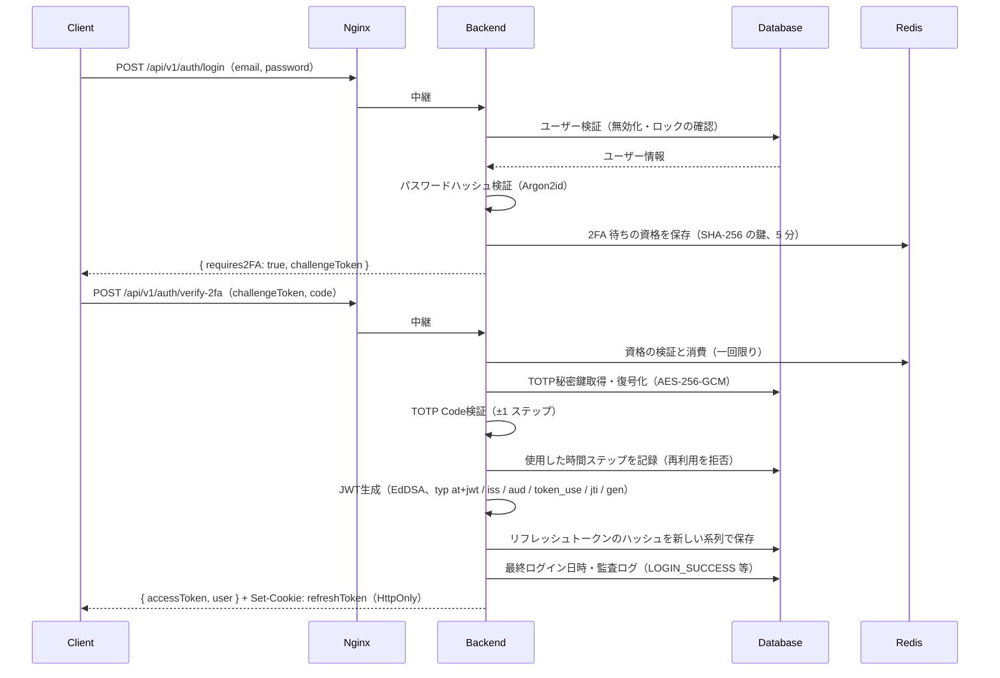
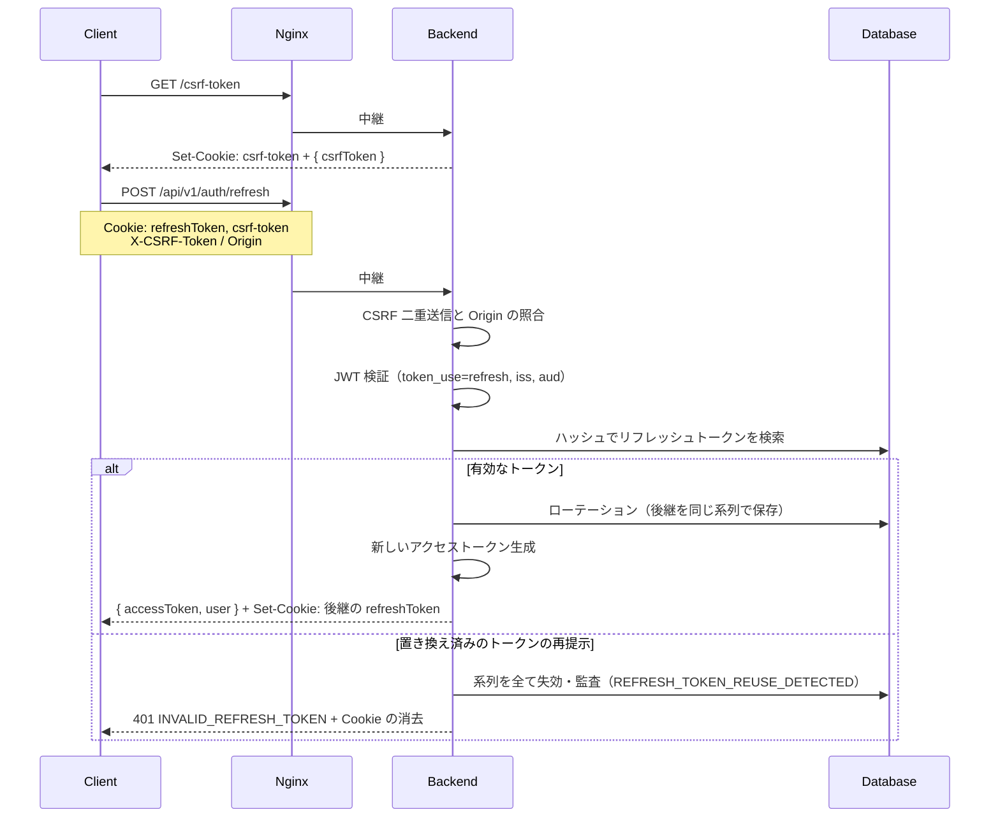
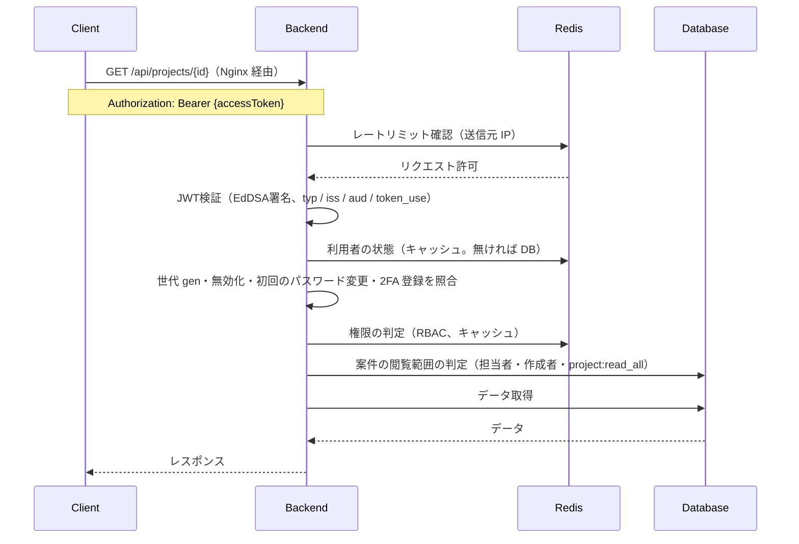
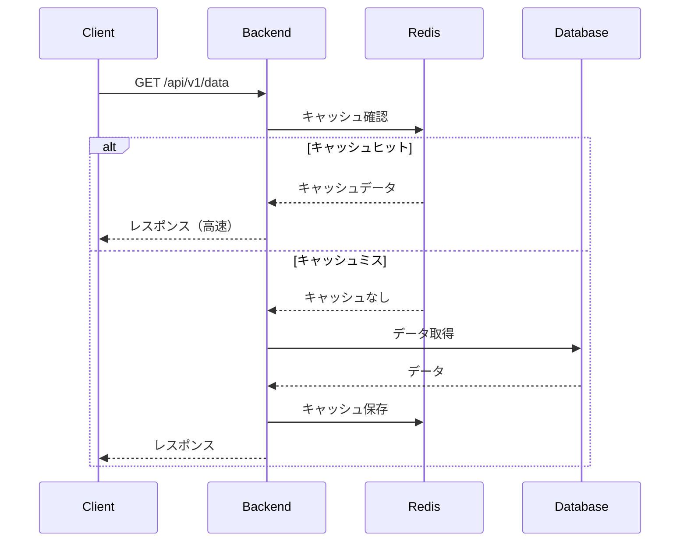
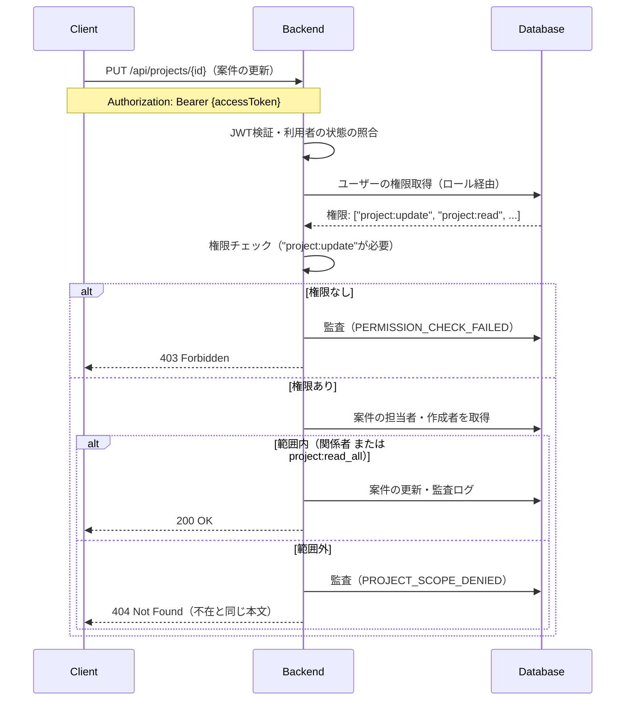
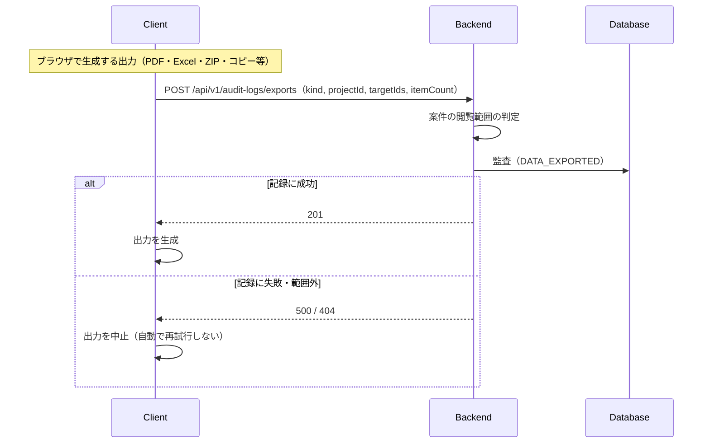
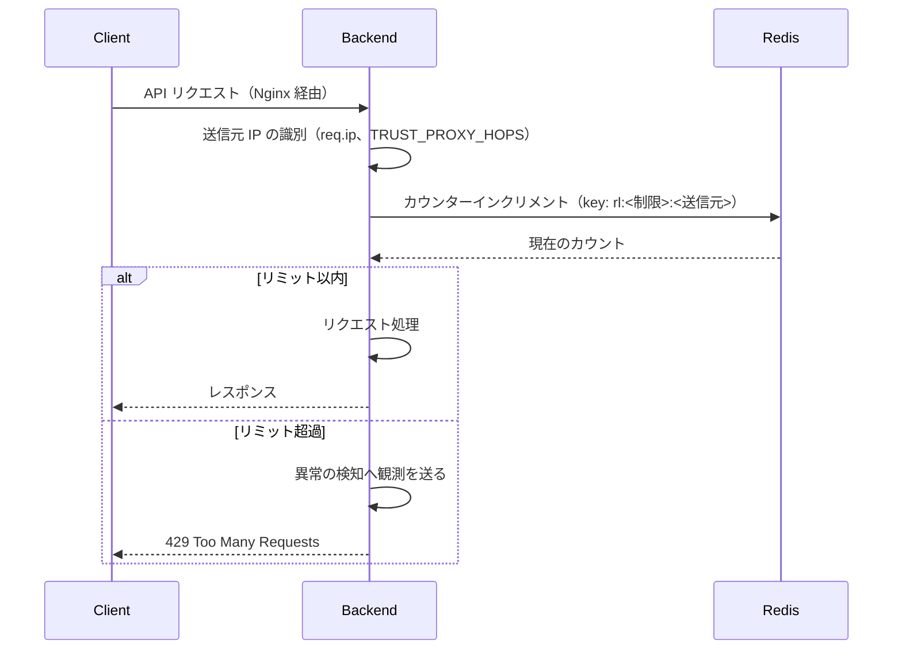
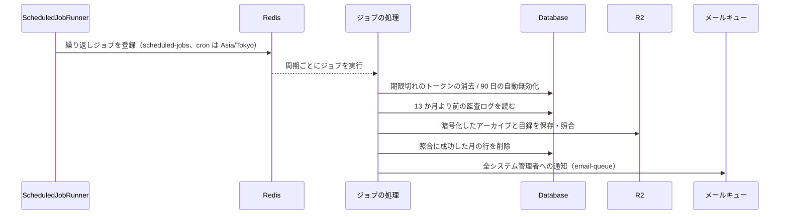

# データフロー

このドキュメントでは、ArchiTrackにおけるデータの流れを説明します。

---

## リクエストフロー

```
1. クライアントリクエスト（frontend の公開ドメイン）
   ↓
2. Railway のエッジ（TLS 終端）
   ↓
3. frontend の Nginx
   - /api/・/csrf-token → backend へ中継（BACKEND_INTERNAL_URL、プライベートネットワーク）
   - それ以外 → SPA の静的ファイルを配信
   - 全応答にセキュリティヘッダー・CSP を付与
   ↓
4. バックエンドAPI (Express)
   ↓
5. ミドルウェアチェーン
   - 送信元 IP の識別（trust proxy = TRUST_PROXY_HOPS）
   - HTTP ログ（要求識別子の生成、クエリの伏せ字）
   - Rate Limiting (Redis。認証系は専用の制限)
   - CSRF・Origin の照合（Cookie を使うリフレッシュ・ログアウト）
   - 認証 (JWT の検証 + 利用者の状態の照合)
   - 認可 (RBAC) → 案件の閲覧範囲（業務 API）
   - リクエスト検証 (Zod)
   ↓
6. ビジネスロジック
   - 監査ログの記録（データ出力は生成の前に記録）
   ↓
7. データアクセス
   - PostgreSQL (永続化、Prisma)
   - Redis (キャッシュ、計数、キュー)
   - R2 (ファイル、監査ログのアーカイブ)
   ↓
8. レスポンス生成
   ↓
9. Nginx 経由でクライアントに返却
```

ローカル開発環境では 2・3 を通らず、Vite の画面から backend へ直接つなぎます（CORS で `FRONTEND_URL` を許可）。

---

## 認証フロー

2FA は全利用者で必須です。リフレッシュトークンは HttpOnly Cookie だけで受け渡し、アクセストークンは画面のメモリだけに保持します。

### ログイン（2FA 登録済み）



- パスワード・2FA の失敗はそれぞれ連続 5 回でロックします（監査 `LOGIN_LOCKED`）
- 2FA 未登録の利用者には、パスワードの検証の後にアクセストークンを返し、画面は 2FA の設定画面へ進みます。設定とログアウト以外の API は 403（`TWO_FACTOR_SETUP_REQUIRED`）です

### トークンリフレッシュ



- 画面はタブ間のリフレッシュを Web Locks で直列化し、結果を BroadcastChannel で他のタブへ配ります
- 無効化された利用者のリフレッシュは 401（`ACCOUNT_DISABLED`）です

---

## API リクエストフロー

### 認証が必要なAPIリクエスト



| 照合の結果 | 応答 |
|-----------|------|
| トークンの不正・2FA の再設定より前の世代 | 401 |
| 無効化された利用者 | 401 `ACCOUNT_DISABLED` |
| 初回のパスワード変更を要する / 2FA 未登録 | 403 `PASSWORD_CHANGE_REQUIRED` / `TWO_FACTOR_SETUP_REQUIRED` |
| 権限なし | 403 |
| 案件の閲覧範囲外・不在・論理削除済み | 404（区別しない） |

### キャッシュフロー



利用者の状態・権限のキャッシュは、無効化・2FA の再設定・ロールの変更などの際に無効化します。案件の閲覧範囲の判定はキャッシュしません（担当者の変更が次の要求から反映される）。

---

## RBAC（ロールベースアクセス制御）と閲覧範囲のフロー



ロール・権限の付与と他のユーザーの管理には、さらに権限付与の上限（実行者の保有ロールの優先度の最大値）を掛けます（[セキュリティ設計](security-design.md#権限付与の上限)）。

---

## データベーストランザクションフロー

### 業務データの更新と監査ログ（例）

```typescript
// トランザクション開始
await prisma.$transaction(async (tx) => {
  // 1. 業務データの更新
  const estimate = await tx.estimate.update({
    where: { id: estimateId },
    data: { name: '見積書' },
  });

  // 2. 監査ログ記録（同じトランザクションの中で書く）
  await tx.auditLog.create({
    data: {
      action: 'ESTIMATE_UPDATED',
      actorId: userId,
      actorEmail,          // 記録時の実行者の写し
      actorDisplayName,
      targetType: 'Estimate',
      targetId: estimate.id,
      metadata: { ipAddress, userAgent, requestId },
    },
  });

  return estimate;
});
// コミット
```

監査ログの行は DB のトリガーで更新を拒否し、削除はアーカイブの処理の中でだけ許します。

---

## データ出力の記録フロー

出力・一括ダウンロード・クリップボードへのコピーは、生成の前に監査（`DATA_EXPORTED`）へ記録し、記録に失敗したら出力しません。



サーバーで生成する出力（工程表・発注・出来高・監査ログの JSON）は、backend が生成の前に同じ記録を行い、失敗したら出力を返しません。

---

## エラーハンドリングフロー

```
1. エラー発生
   ↓
2. エラー分類
   - ValidationError（400）
   - AuthenticationError（401）
   - AuthorizationError（403）
   - NotFoundError（404。閲覧範囲外も同じ）
   - InternalServerError（500）
   ↓
3. エラーロギング
   - 構造化ログ（要求識別子付き、機密を伏せる）
   - Sentry（本番環境。要求本文・Cookie・認証ヘッダーを除く）
   ↓
4. 監査ログ記録・異常の検知（権限の拒否、範囲外、429、5xx 等）
   ↓
5. クライアントにエラーレスポンス（Problem Details 形式）
   {
     "type": "https://.../errors/...",
     "title": "...",
     "status": 404,
     "detail": "...",
     "instance": "/api/...",
     "code": "ERROR_CODE"
   }
```

認証の DB 障害などの内部の詳細は応答に含めず、汎用の応答にします。

---

## レートリミットフロー



**レートリミット設定（主なもの）:**
- 一般API: 100 req/15min/IP
- ログインAPI: 10 req/1min/IP
- トークンリフレッシュ: 20 req/1min/IP
- 2FA検証: 10 req/5min/IP
- パスワードリセットの要求: 5 req/1h（送信元・メールアドレスのそれぞれ）

全体は[セキュリティ設計](security-design.md#レートリミット)を参照してください。

---

## 定期処理とキューのフロー



ジョブの一覧は[セキュリティ設計](security-design.md#定期処理)を参照してください。

---

## 次のステップ

- [システム構成](system-overview.md): システム全体像
- [セキュリティ設計](security-design.md): セキュリティ層
- [開発ワークフロー](../development/workflow.md): 開発の流れ
