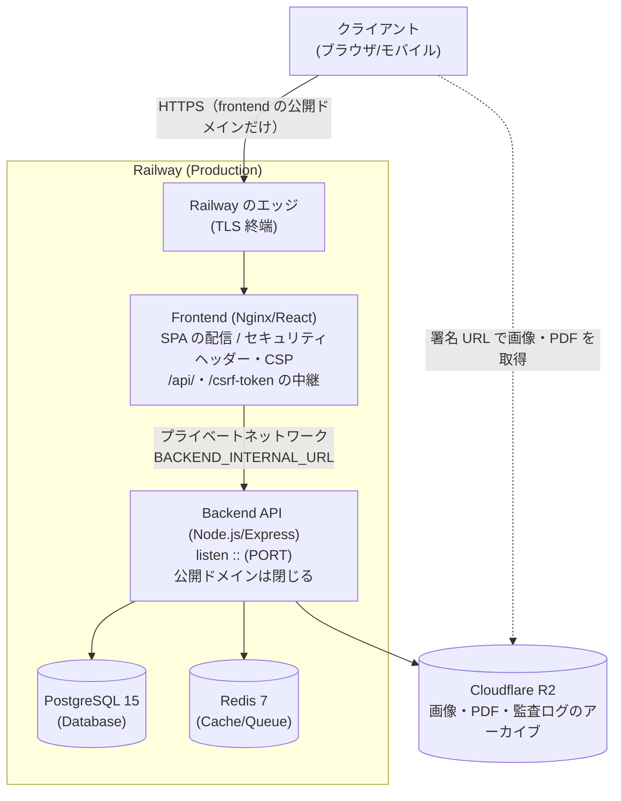

# システム構成

このドキュメントでは、ArchiTrackのシステム構成とアーキテクチャを説明します。

---

## システム構成図

### 本番環境（Railway）

ブラウザは frontend の公開ドメインだけにつなぎます。frontend の nginx が画面（SPA）を配信し、`/api/` と `/csrf-token` を Railway のプライベートネットワーク経由で backend へ中継します（画面と API が同一オリジン）。



- ブラウザは R2 の画像・PDF を backend が発行する署名 URL で直接取得します（CSP の `CSP_IMG_SRC_EXTRA`・`CSP_CONNECT_SRC_EXTRA` で配信元を許可する）
- backend は信頼する中継の段数 `TRUST_PROXY_HOPS=3`（エッジの 2 段 + nginx の 1 段）で送信元 IP を識別します（[セキュリティ設計](security-design.md#本番の要求経路と送信元-ip-の識別)）

### ローカル開発環境（Docker Compose）

開発環境では画面（Vite）から backend へ直接つなぎます（`VITE_API_URL=http://localhost:3000`。CORS で `FRONTEND_URL` を許可）。

```
┌─────────────────────────────────────────────────────────────────┐
│  ┌──────────────────┐              ┌─────────────────────┐     │
│  │   Frontend       │              │   Backend API       │     │
│  │   (Vite HMR)     │──────────────│   (tsx watch)       │     │
│  │   Port: 5173     │  API calls   │   Port: 3000        │     │
│  └──────────────────┘   (CORS)     └──────────┬──────────┘     │
│                                                │                 │
│                                    ┌───────────┴─────────┐      │
│                                    │                     │      │
│                          ┌─────────▼──────┐   ┌─────────▼─────┐│
│                          │  PostgreSQL 15 │   │   Redis 7     ││
│                          │  (Docker)      │   │   (Docker)    ││
│                          └────────────────┘   └───────────────┘│
└─────────────────────────────────────────────────────────────────┘
```

### テスト・CI環境（Docker Compose、本番相当）

テスト環境（`docker-compose.test.yml`）およびCI環境（`docker-compose.ci.yml`）では、フロントエンドに本番と同じ構成（nginx + ビルド済み静的ファイル）を使用しています。画面は本番と同じく nginx 経由の同一オリジンで API を呼びます（`VITE_API_URL=http://localhost:5174`、`BACKEND_INTERNAL_URL=http://backend:3000`、`TRUST_PROXY_HOPS=1`）。これにより、nginx固有の設定問題（MIMEタイプ、セキュリティヘッダー、CSP、中継等）を本番デプロイ前に検出できます。

```
┌─────────────────────────────────────────────────────────────────┐
│  ┌──────────────────┐              ┌─────────────────────┐     │
│  │   Frontend       │  /api/,      │   Backend API       │     │
│  │   (Nginx/React)  │─────────────▶│   (NODE_ENV=test)   │     │
│  │   Port: 5174/80  │  /csrf-token │   Port: 3100/3000   │     │
│  └──────────────────┘              └──────────┬──────────┘     │
│                                                │                 │
│                                    ┌───────────┴─────────┐      │
│                                    │                     │      │
│                          ┌─────────▼──────┐   ┌─────────▼─────┐│
│                          │  PostgreSQL 15 │   │   Redis 7     ││
│                          │  (tmpfs)       │   │   (tmpfs)     ││
│                          └────────────────┘   └───────────────┘│
└─────────────────────────────────────────────────────────────────┘
```

---

## コンポーネント

### Frontend（React + Vite）

**役割:**
- ユーザーインターフェース
- クライアントサイドルーティング
- 状態管理（認証状態、利用者の状態による画面遷移の制限）
- APIクライアント（アクセストークンはメモリだけに保持）

**技術スタック:**
- React 19
- Vite 8
- React Router 7
- fetch ベースの API クライアント（`frontend/src/api/client.ts`）

**本番環境:**
- Nginx（静的ファイルサーバー、`/api/`・`/csrf-token` の中継、セキュリティヘッダー・CSP）
- HTTPS（Railway自動設定）

**開発環境:**
- Vite Dev Server（HMR）
- ポート: 5173

### Backend（Node.js + Express）

**役割:**
- REST API提供
- ビジネスロジック
- データベースアクセス
- 認証・認可（2FA 必須、利用者の状態の照合、RBAC、権限付与の上限、案件の閲覧範囲）
- 監査ログ・異常の検知と通知
- 定期処理（期限切れのトークンの消去、90 日の自動無効化、監査ログのアーカイブ等）とメール送信のキュー

**技術スタック:**
- Node.js 22
- Express 5
- Prisma（ORM）
- JWT（EdDSA、jose）
- Bull（Redis のジョブキュー）

**本番環境:**
- Node.js プロセス
- `::`（IPv4・IPv6 のデュアルスタック）で `PORT` を待ち受け
- frontend の nginx からプライベートネットワーク経由でだけ受ける（公開ドメインは閉じる）

**開発環境:**
- tsx watch（ホットリロード）
- ポート: 3000

### Database（PostgreSQL）

**役割:**
- データ永続化
- トランザクション管理
- リレーショナルデータ管理
- リフレッシュトークン（ハッシュ）・監査ログ（改変を禁じるトリガー付き）の保存

**技術スタック:**
- PostgreSQL 15

**アクセス:**
- Backend経由のみ（Prisma ORM）
- 外部非公開（本番環境）

### Cache / Queue（Redis）

**役割:**
- 2FA 待ちの資格（5 分・一回限り）
- 利用者の状態・権限のキャッシュ
- レートリミット・異常検知の計数
- ジョブキュー（メール `email-queue`、定期処理 `scheduled-jobs`）

**技術スタック:**
- Redis 7（全て `REDIS_URL` で接続。本番の実行環境では必須）

**アクセス:**
- Backend経由のみ
- 外部非公開（本番環境）

### Object Storage（Cloudflare R2）

**役割:**
- 現場調査・工事写真の画像、PDF 等のファイル
- 監査ログのアーカイブ（`audit-archives/`、AES-256-GCM で暗号化）

**アクセス:**
- Backend が読み書きし、ブラウザには署名 URL を発行する
- 詳細は[ストレージ構成](storage-configuration.md)を参照

---

## ネットワーク構成

### 本番環境（Railway）

| サービス | ポート | プロトコル | アクセス |
|---------|-------|-----------|---------|
| Frontend | 443 | HTTPS | 公開（画面と API の唯一の入口） |
| Backend | `PORT` | HTTP（プライベートネットワーク） | Frontend の nginx から（公開ドメインは閉じる） |
| PostgreSQL | - | Internal | Backend のみ |
| Redis | - | Internal | Backend のみ |

**特徴:**
- Railwayの内部ネットワークでサービス間通信（nginx の中継先は `BACKEND_INTERNAL_URL`）
- 外部からは Frontend の HTTPS エンドポイントだけにアクセスする。API も同じオリジンの `/api/` で受ける
- データベース・Redis は外部アクセス不可（TCP Proxy を無効にする）

### ローカル開発環境（Docker Compose）

| サービス | ポート | プロトコル | アクセス |
|---------|-------|-----------|---------|
| Frontend | 5173 | HTTP | localhost |
| Backend | 3000 | HTTP | localhost |
| PostgreSQL | 5432 | TCP | localhost |
| Redis | 6379 | TCP | localhost |

**特徴:**
- Dockerネットワークでサービス間通信
- すべてのポートがlocalhostからアクセス可能
- 開発用にHTTPを使用

---

## スケーラビリティ

### 水平スケーリング

**Frontend:**
- 静的ファイルサーバー（Nginx）
- 複数インスタンスで負荷分散
- 中継先の名前は要求のたびに引き直す（backend の作り直しで宛先が変わっても古い宛先へ送らない）

**Backend:**
- ステートレス設計（アクセストークンは署名で検証）
- リフレッシュトークンは PostgreSQL、2FA 待ちの資格・状態のキャッシュ・計数は Redis で共有
- 複数インスタンスで負荷分散可能

**Database:**
- PostgreSQL レプリケーション
- 読み取りレプリカ（将来的に）

**Cache:**
- Redis Cluster（将来的に）

### 垂直スケーリング

Railway環境でリソース（CPU、メモリ）を増強可能

---

## 可用性

### ヘルスチェック

```
GET /health
```

backend のエンドポイントです（nginx は中継しない）。Railway のヘルスチェック（`healthcheckPath = "/health"`）が使います。

**レスポンス:**
```json
{
  "status": "ok",
  "timestamp": "2025-11-13T00:00:00.000Z",
  "services": {
    "database": "connected",
    "redis": "connected"
  }
}
```

### モニタリング

- **Sentry**: エラートラッキング（要求本文・Cookie・認証ヘッダー等の機密を除いて送る）
- **異常の検知と通知**: ログイン失敗・権限の拒否・回数制限・5xx・データ出力の急増を全システム管理者へメールで通知
- **Railway Dashboard**: リソース監視
- **Prisma Metrics**: データベースクエリパフォーマンス

---

## 次のステップ

- [データフロー](data-flow.md): データの流れ
- [セキュリティ設計](security-design.md): セキュリティ層
- [技術スタック](tech-stack.md): 技術選定理由
