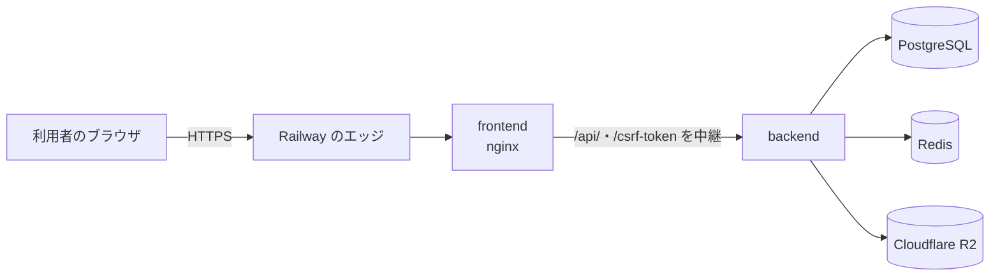
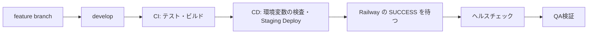
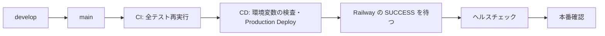

# デプロイ概要

このドキュメントでは、ArchiTrackのデプロイメント方式とワークフローの概要を説明します。

---

## デプロイ環境

ArchiTrackは **Railway** プラットフォームにデプロイされます。

### 対象環境

| 環境 | トリガー | ワークフロー（ジョブ） | 用途 |
|------|---------|------------|------|
| **Staging** | `develop`ブランチへのpush | `ci.yml`（`deploy-staging`） | 統合テスト・QA検証 |
| **Production** | `main`ブランチへのpush | `ci.yml`（`deploy-production`） | 本番環境デプロイ |

### 構成



- 画面は API を**同じオリジン**（frontend の公開ドメイン。`VITE_API_URL`）へ送り、frontend の nginx がプライベートネットワークの backend（`BACKEND_INTERNAL_URL`）へ中継する
- frontend の nginx が CSP・HSTS などのセキュリティヘッダーを付ける（`CSP_IMG_SRC_EXTRA`・`CSP_CONNECT_SRC_EXTRA`・`NGINX_HSTS_VALUE`）
- backend は本番の前提（`ARCHIVE_ENCRYPTION_KEY`・`TRUST_PROXY_HOPS`・`REDIS_URL`）が欠けると起動しない
- PostgreSQL・Redis は公開ネットワーク（TCP Proxy）を閉じ、運用のスクリプトは `railway ssh` で backend のコンテナの中から実行する

設定の一覧は[環境変数設定](environment-variables.md)、作り方は[Railway設定](railway-setup.md)を参照。

---

## デプロイ方式

### 自動デプロイ（推奨）

GitHub Actionsによる継続的デプロイ（CD）を使用します。

**利点:**
- コード変更の自動反映
- CI/CDパイプラインでの品質チェック
- デプロイ履歴の記録
- ロールバックが容易

### 手動デプロイ

`ci.yml` は手動実行（`workflow_dispatch`）を持たない。やり直すときはデプロイのジョブを再実行する（[手動デプロイ](#手動デプロイ緊急時再デプロイ)）。

---

## デプロイフロー

### Staging環境へのデプロイ



**手順:**

1. フィーチャーブランチで開発
2. `develop`ブランチへPR作成
3. CI自動実行（テスト・ビルド確認）
4. レビュー承認後、`develop`へマージ
5. `develop`へのpushでStaging環境へ自動デプロイ（`ci.yml` の `deploy-staging` ジョブ）
   - 環境変数の検査（`check:env`。GitHub の `staging` 環境シークレットを読む）
   - Railway (staging environment) へデプロイを開始し、新しいデプロイが `SUCCESS` になるまで待つ（`scripts/railway-deploy-wait.sh`）
   - 公開ドメインへのヘルスチェック実行
6. Staging環境でQA検証

### Production環境へのデプロイ



**手順:**

1. Staging環境での検証が完了
2. `main`ブランチへPR作成
3. CI自動実行（全テスト再実行）
4. レビュー承認後、`main`へマージ
5. `main`へのpushでProduction環境へ自動デプロイ（`ci.yml` の `deploy-production` ジョブ）
   - 環境変数の検査（`check:env`。GitHub の `production` 環境シークレットを読む）
   - Railway (production environment) へデプロイを開始し、新しいデプロイが `SUCCESS` になるまで待つ（`scripts/railway-deploy-wait.sh`）
   - 公開ドメインへのヘルスチェック実行

詳細は[CI/CD設定](cicd-github-actions.md#cd継続的デプロイ)を参照。
6. 本番環境の動作確認

---

## デプロイ前の準備

### 初回セットアップ

1. **[環境変数設定](environment-variables.md)**: 必須環境変数の設定
2. **[シークレット管理](secrets-management.md)**: JWT鍵・2FA鍵の生成
3. **[Railway設定](railway-setup.md)**: Railwayプロジェクトの作成
4. **[CI/CD設定](cicd-github-actions.md)**: GitHub Secretsの設定

### デプロイ前チェックリスト

- [ ] 環境変数がすべて設定されている（[環境変数設定](environment-variables.md)）
- [ ] JWT鍵ペアが生成・設定されている
- [ ] 2FA暗号化鍵が生成・設定されている
- [ ] backend に `ARCHIVE_ENCRYPTION_KEY`・`TRUST_PROXY_HOPS`（`3`）・`REDIS_URL` が設定されている
- [ ] frontend に `BACKEND_INTERNAL_URL`・`VITE_API_URL`（frontend の公開オリジン）・`CSP_IMG_SRC_EXTRA`・`CSP_CONNECT_SRC_EXTRA`（本番は `NGINX_HSTS_VALUE` も）が設定されている
- [ ] Railway の変数名に `STAGING_`・`PRODUCTION_` を付けていない（[Railwayの変数名の注意](environment-variables.md#railwayの変数名の注意)）
- [ ] GitHub の環境シークレット（`RAILWAY_*_TOKEN`、`check:env` が読む `STAGING_*`・`PRODUCTION_*`）が設定されている
- [ ] backend のドメインの向き先のポートが `PORT` と一致している
- [ ] ローカルでテストがすべてパスしている
- [ ] データベースマイグレーションが確定している

---

## 手動デプロイ（緊急時・再デプロイ）

`ci.yml` は手動実行（`workflow_dispatch`）を持たないため、対象のブランチ（Staging は `develop`、Production は `main`）の CI の実行のデプロイのジョブを再実行する。

1. GitHub リポジトリの **Actions** タブ > **CI** を開く
2. 対象のブランチの最新の実行を選択
3. **Re-run jobs** から `deploy-staging`・`deploy-production` のジョブを再実行

手順の詳細は[CI/CD設定](cicd-github-actions.md#手動デプロイ)を参照。

---

## ロールバック手順

本番環境でデプロイが失敗した場合のロールバック方法：

### 方法1: Railway Dashboardから直接ロールバック（推奨）

```
1. Railway Dashboard にログイン
2. ArchiTrack プロジェクトを選択
3. Deployments タブを開く
4. 前回の成功したデプロイメントを選択
5. "Redeploy" をクリック
```

### 方法2: Git revertでロールバック

```bash
# 問題のあるコミットをrevert
git checkout main
git revert <commit-sha>
git push origin main
# → ci.yml の deploy-production が実行され、revert後の状態がデプロイされる
```

### 方法3: 前回の成功したCIの実行のデプロイのジョブを再実行

```
1. Actions タブ > "CI" を選択し、main の前回の成功した実行を開く
2. "Re-run jobs" から deploy-production を再実行（その実行のコミットがデプロイされる）
```

---

## デプロイ後の確認

### ヘルスチェック

```bash
# Staging
curl https://<staging-backend-url>/health

# Production
curl https://<production-backend-url>/health
```

**期待されるレスポンス:**
```json
{
  "status": "ok",
  "timestamp": "2025-11-13T00:00:00.000Z",
  "services": {
    "database": "connected",
    "redis": "connected"
  }
}
```

### マイグレーション確認

Railway UIでデプロイログを確認し、以下のメッセージを探す：
```
Migration applied: <migration-name>
```

### アプリケーション動作確認

- フロントエンドにアクセス
- frontend の公開ドメイン経由の `/csrf-token` が 200（JSON）になる（API の中継）
- ログイン機能のテスト（監査ログの送信元 IP が自分の公開 IP と一致する）
- 写真・PDF が表示され、ブラウザのコンソールに CSP の違反が出ない
- 主要機能の動作確認

確認のコマンドは[Railway設定の配備の後の確認](railway-setup.md#配備の後の確認)を参照。

---

## トラブルシューティング

デプロイ時の問題が発生した場合は、[トラブルシューティング](troubleshooting.md)を参照してください。

---

## 次のステップ

- [環境変数設定](environment-variables.md): 必須環境変数の設定
- [シークレット管理](secrets-management.md): JWT鍵・2FA鍵の生成
- [Railway設定](railway-setup.md): Railwayプロジェクトの作成
- [CI/CD設定](cicd-github-actions.md): GitHub Actionsの設定
- [鍵ローテーション手順書](key-rotation-procedure.md): JWT鍵の定期・緊急のローテーション
- [トラブルシューティング](troubleshooting.md): デプロイ時の問題と解決方法
