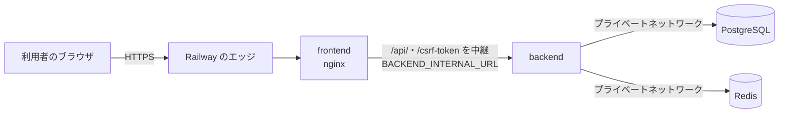

# Railway設定

このドキュメントでは、RailwayプラットフォームでのArchiTrackプロジェクトのセットアップ手順を説明します。

---

## 前提条件

- Railwayアカウント（https://railway.app）
- GitHub連携済み
- [Railway CLI](../getting-started/prerequisites.md#railway-cli)インストール済み

---

## 初回セットアップ

### ステップ1: プロジェクト作成

1. **Railway Dashboard にログイン**
   - https://railway.app にアクセス

2. **新しいプロジェクトを作成**
   - **New Project** ボタンをクリック
   - **Deploy from GitHub repo** を選択
   - ArchiTrackリポジトリを選択

### ステップ2: サービスの作成

以下の4つのサービスを作成します（staging・production は同じプロジェクトの Railway の環境として分け、各環境に同じ4つのサービスを置く）。



画面は API を同じオリジン（frontend の公開ドメイン）へ送り、frontend の nginx がプライベートネットワーク（`*.railway.internal`）で backend へ中継する。

#### 1. PostgreSQL Database

- **テンプレートから作成:**
  - Railway Dashboard > **+ New** > **Database** > **PostgreSQL**
- **自動設定:**
  - `DATABASE_URL` 環境変数が自動生成されます
- **公開ネットワーク（TCP Proxy）は無効にする:**
  - PostgreSQL Service > **Settings** > **Networking** で Public Networking（TCP Proxy）が無いことを確かめる。backend からはプライベートネットワークで届く

#### 2. Redis Cache

- **テンプレートから作成:**
  - Railway Dashboard > **+ New** > **Database** > **Redis**
- **自動設定:**
  - `REDIS_URL` 環境変数が自動生成されます
- **公開ネットワーク（TCP Proxy）は無効にする:** PostgreSQL と同じ

#### 3. Backend Service

- **Empty Serviceとして作成:**
  - Railway Dashboard > **+ New** > **Empty Service**
  - サービス名: `backend`

**設定:**

- **Root Directory**: `/backend`
- **Build Command**: Dockerfileから自動検出（`backend/railway.toml` の `builder = "DOCKERFILE"`）
- **Start Command**: 設定しない（Dockerfile の `docker-entrypoint.sh` が `MIGRATE_ON_DEPLOY=true` でマイグレーションを、`RUN_SEED=true` でシードを実行してから起動する）

**環境変数:**
```bash
# データベース（Railway自動参照）
DATABASE_URL=${{Postgres.DATABASE_URL}}
REDIS_URL=${{Redis.REDIS_URL}}

# JWT鍵（手動設定）
JWT_PUBLIC_KEY=<Base64エンコードされた公開鍵>
JWT_PRIVATE_KEY=<Base64エンコードされた秘密鍵>

# 2FA暗号化鍵（手動設定）
TWO_FACTOR_ENCRYPTION_KEY=<64文字16進数>

# CORS設定
FRONTEND_URL=https://your-frontend.railway.app

# 環境
NODE_ENV=production
PORT=3000
LOG_LEVEL=info

# 本番の前提（どれかが欠けると ProductionPrerequisiteError で起動を止める。REDIS_URL も同じ）
ARCHIVE_ENCRYPTION_KEY=<64文字16進数>  # 監査ログのアーカイブの暗号鍵。staging・本番で別々に生成
TRUST_PROXY_HOPS=3  # Railway のエッジ（2 段）→ frontend の nginx（1 段）

# 初期管理者アカウント（初回のシードの後に INITIAL_ADMIN_PASSWORD を削除する）
INITIAL_ADMIN_EMAIL=admin@example.com
INITIAL_ADMIN_PASSWORD=<強力なパスワード>
INITIAL_ADMIN_DISPLAY_NAME=System Administrator

# Sentry（任意）
SENTRY_DSN=https://xxx@xxx.ingest.sentry.io/xxx

# デプロイ時マイグレーション自動実行
MIGRATE_ON_DEPLOY=true

# 起動時のシード（ロール・権限・初期管理者。本番は明示したときだけ実行）
RUN_SEED=true

# ストレージ（Cloudflare R2）は環境変数設定の「Railway環境」を参照
```

> **変数名に `STAGING_`・`PRODUCTION_` を付けない。** GitHub Secrets（`STAGING_BACKEND_URL` など）の名前には接頭辞が付くが、Railway の変数はアプリが読む名前のまま設定する。`STAGING_ARCHIVE_ENCRYPTION_KEY` の名前で作ると backend は `ARCHIVE_ENCRYPTION_KEY` を見つけられず起動を繰り返し止める（[Railwayの変数名の注意](environment-variables.md#railwayの変数名の注意)）。

#### 4. Frontend Service

- **Empty Serviceとして作成:**
  - Railway Dashboard > **+ New** > **Empty Service**
  - サービス名: `frontend`

**設定:**

- **Root Directory**: `/frontend`
- **Build Command**: Dockerfileから自動検出

**環境変数:**
```bash
# API の接続先（ビルド時）: frontend 自身の公開オリジン（同一オリジン）
VITE_API_URL=https://<frontend のドメイン>

# API の中継先（実行時。必須）: backend のプライベートネットワークの URL。scheme://host[:port] だけ
BACKEND_INTERNAL_URL=http://<backend のサービス名>.railway.internal:3000

# CSP の追加の取得先（R2 を使う環境で必須。空白区切り）
CSP_IMG_SRC_EXTRA=https://<バケット名>.<アカウント ID>.r2.cloudflarestorage.com
CSP_CONNECT_SRC_EXTRA=https://<バケット名>.<アカウント ID>.r2.cloudflarestorage.com https://o<組織 ID>.ingest.sentry.io

# HSTS（本番だけ。staging は設定しない）
NGINX_HSTS_VALUE=max-age=31536000; includeSubDomains

# Sentry（推奨）
VITE_SENTRY_DSN=https://xxx@xxx.ingest.sentry.io/xxx
```

> `VITE_` で始まる変数はViteが**ビルド時**にバンドルへ埋め込みます（受け口は `frontend/Dockerfile` の `ARG VITE_API_URL`・`ARG VITE_SENTRY_DSN`）。値を追加・変更したら**再デプロイ（再ビルド）するまで反映されません**。`VITE_SENTRY_DSN` を設定しない場合、フロントエンドからSentryへの送出は行われません。
> `BACKEND_INTERNAL_URL` が未設定・形の違い（パス付きなど）だと、コンテナは起動前の検査（`nginx-require-backend-internal-url.sh`）で止まる。ポートは backend の `PORT` に合わせる。各変数の詳細は[環境変数設定](environment-variables.md#frontend-service)を参照。

### ステップ3: ドメイン設定

#### Backend Service

1. Backend Service > **Settings** > **Networking**
2. **Generate Domain** をクリック
3. ドメインの向き先のポート（Target Port）を backend の待ち受けのポート（`PORT`。既定 `3000`。起動のログの `Server started port=...`）に合わせる
4. 生成されたURL（例: `your-backend.railway.app`）をメモ

> 向き先のポートが待ち受けのポートと違うと、コンテナの中のヘルスチェックは通るのに外からは 502（`Application failed to respond`）になる。設定を変えた後は外から `/health` が 200 になることを確かめる。

#### Frontend Service

1. Frontend Service > **Settings** > **Networking**
2. **Generate Domain** をクリック
3. 生成されたURL（例: `your-frontend.railway.app`）をメモ

#### CORS設定・API の接続先の更新

1. Backend Service > **Variables**
2. `FRONTEND_URL` を更新: `https://your-frontend.railway.app`
3. Frontend Service > **Variables**
4. `VITE_API_URL` を frontend の公開 URL（`https://your-frontend.railway.app`）にし、frontend を再ビルドする

#### 配備の後の確認

```bash
# 中継の確認: frontend の公開ドメイン経由で 200（JSON）。502 なら中継先へ届いていない
curl -s -o /dev/null -w "%{http_code}\n" https://<frontend のドメイン>/csrf-token

# セキュリティヘッダーの確認: CSP に R2 の配信元が入っているか（本番は HSTS も）
curl -sI https://<frontend のドメイン> | grep -i -E "content-security-policy|strict-transport-security"
```

- 自分の公開 IP（`curl https://ifconfig.me`）でログインし、監査ログの送信元 IP がそれと一致することを確かめる（違えば `TRUST_PROXY_HOPS` を直す）
- 写真・PDF を表示し、ブラウザのコンソールに CSP の違反が出ないことを確かめる

### ステップ4: 自動デプロイの無効化

GitHub Actionsから制御するため、Railway UIからの自動デプロイを無効化します。

**Backend Service:**
1. Backend Service > **Settings** > **Service**
2. **Watch Paths** を空にする
3. または `railway.toml` に `watchPatterns = []` を設定

**Frontend Service:**
1. Frontend Service > **Settings** > **Service**
2. **Watch Paths** を空にする
3. または `railway.toml` に `watchPatterns = []` を設定

**railway.toml の設定例（`backend/railway.toml`）:**
```toml
[build]
builder = "DOCKERFILE"
watchPatterns = []  # GitHub Actionsから制御するため自動デプロイを無効化

[deploy]
healthcheckPath = "/health"
healthcheckTimeout = 300
restartPolicyType = "ON_FAILURE"
restartPolicyMaxRetries = 3
```

---

## Railway CLI設定

### インストール

```bash
# npm経由（推奨）
npm install -g @railway/cli

# またはcurlスクリプト経由（Linux/macOS）
sh -c "$(curl -fsSL https://railway.app/install.sh)"
```

### 認証

```bash
# Railway認証（ブラウザ経由）
railway login

# プロジェクトリンク（プロジェクトルートで実行）
cd ArchiTrack
railway link
```

### 確認

```bash
# バージョン確認
railway --version

# 認証状態確認
railway whoami

# プロジェクト情報確認
railway status
```

---

## GitHub Secrets用のID取得

GitHub Actionsで使用するRailway IDを取得します。

### プロジェクトID

```bash
railway status --json | jq -r '.project.id'
```

### サービスID（Staging）

```bash
railway status --json | jq -r '.services[] | select(.name=="backend-staging") | .id'
railway status --json | jq -r '.services[] | select(.name=="frontend-staging") | .id'
```

### サービスID（Production）

```bash
railway status --json | jq -r '.services[] | select(.name=="backend") | .id'
railway status --json | jq -r '.services[] | select(.name=="frontend") | .id'
```

これらのIDを[CI/CD設定](cicd-github-actions.md)のGitHub Secretsに設定します。

---

## データベースマイグレーション

### 自動マイグレーション適用（推奨）

Railway環境変数に`MIGRATE_ON_DEPLOY=true`を設定することで、デプロイ時に自動的に`prisma migrate deploy`が実行されます。

起動時に `backend/docker-entrypoint.sh` が `npm run prisma:migrate:deploy` を実行します（`NODE_ENV=production` かつ `MIGRATE_ON_DEPLOY=true` のとき）。

### 手動マイグレーション適用

```bash
# backend のコンテナに入って実行する（作業ディレクトリは /app）
railway ssh --service <backend のサービス名> --environment <staging|production>
npm run prisma:migrate:deploy
```

> `railway run`・`railway connect` は手元の端末から DB へ直接つなぐため、Postgres の公開ネットワーク（TCP Proxy）を無効にした環境では届かない。運用のスクリプトは `railway ssh` で backend のコンテナの中から実行する。

### マイグレーション適用の確認

Railway UIでデプロイログを確認し、以下のメッセージを探す：
```
Migration applied: <migration-name>
```

**重要な注意点:**
- 本番環境では必ず`prisma:migrate:deploy`を使用（`prisma:migrate`は開発環境専用）
- マイグレーションファイルがGitにコミットされていることを確認
- データベースの破壊的変更（カラム削除など）は慎重に実施

---

## データベースシーディング

### 自動実行

本番（`NODE_ENV=production`）では `RUN_SEED=true` のときだけ、起動時にシード（`node dist/prisma/seed.js`）が実行されます。初期管理者は `INITIAL_ADMIN_EMAIL` と `INITIAL_ADMIN_PASSWORD` が設定されているときに作られます（既存の管理者は変えない）。作った後は[初回デプロイの後の後片づけ](secrets-management.md#初回デプロイの後の後片づけ必須)を行います。

### 手動実行

```bash
# backend のコンテナに入って実行する（作業ディレクトリは /app）
railway ssh --service <backend のサービス名> --environment <staging|production>
node dist/prisma/seed.js
```

---

## トラブルシューティング

### Railway環境でのデータベース接続エラー

**症状:**
```
Error: P1001: Can't reach database server
```

**原因と解決方法:**
- **原因1:** `DATABASE_URL` が設定されていない
  - **解決:** Railway Dashboard > Database > Connect で接続文字列を確認
- **原因2:** データベースが起動していない
  - **解決:** Railway Dashboard > Database > Restart

詳細は[トラブルシューティング](troubleshooting.md)を参照してください。

---

## 次のステップ

- [環境変数設定](environment-variables.md): 環境変数の設定
- [シークレット管理](secrets-management.md): JWT鍵・2FA鍵の生成
- [CI/CD設定](cicd-github-actions.md): GitHub Actionsの設定
- [デプロイ概要](overview.md): デプロイフロー
